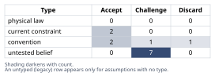
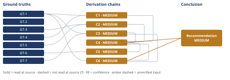

# Northbrook Analytics Churn Root-Cause Analysis

*First-principles analysis · 15 October 2026*

*Read with: [How to read this analysis](HOW-TO-READ.md) · [Working file](analysis-20261015T041905Z.md) · [All files](INDEX.md)*

## Executive Summary

**Recommendation:** Run five parallel diagnostics — an internal change-log overlay, cohort/segment/CS-book segmentation, a ticket-category and resolution-time/CSAT trend, win-loss/exit-interview coding, and a logo-count check — together with a resourced, reversible support-capacity stop-gap, and withhold any structural fix (pricing, onboarding rebuild, competitive response) until the diagnostics confirm the dominant cause (chain C6).

**Band (from §6):** MEDIUM (chain C6).

**Would change it:** Diagnostic D1 confirming or ruling out a discrete internal operational change in Q1–Q3 would move this to HIGH or overturn the top-ranked hypothesis; Diagnostic D2 showing no cohort/segment concentration anywhere would instead favor the broad multi-causal-drift rival (chain C4).

## 1. Problem Essence

**Core problem:** Identify which upstream driver (or combination) is causing Northbrook Analytics' quarterly churn to more than double in three quarters, and determine the correct diagnose-then-fix sequence — rather than reacting to the two reported symptoms (ticket volume, adoption scores) as if they were causes themselves.

**Success criteria:**
1. The analysis distinguishes symptom from cause for both reported signals (ticket-volume growth, adoption-score decline) using an explicit why-chain, rather than treating either as a terminal explanation.
2. The analysis produces a ranked set of root-cause hypotheses across all six leadership-named categories (including "combination"), each tied to a predicted, checkable data signature.
3. The analysis states a base-rate/magnitude check on whether the speed and size of the churn escalation itself favors a single discrete shock over slow multi-causal drift.
4. The analysis names, for the top-ranked hypothesis, the specific observation(s) that would falsify it.
5. The analysis recommends a concrete next step that can be started within days, names what resourcing commitment it does NOT yet make, and states what evidence would unlock that commitment.

---

## 2. Assumptions Table

**Inversion applied (Phase 2).** Before tabulating assumptions, inversion was run against the implicit claim a leadership team in this position is likely to default to: *"this churn rise is unremarkable organic drift, with no single identifiable, fixable cause."* Inverted: assume that claim is false. Failure-guaranteeing conditions enumerated (unfiltered): (1) a discrete internal operational change occurred inside the Q1–Q3 window (support staffing, CS reorg, pricing/packaging, onboarding process, or a major release); (2) a named competitor made an aggressive pricing/feature/GTM move inside the window; (3) churn is concentrated in an identifiable cohort, segment, tier, vintage, or CS-rep book rather than broad-based; (4) the churn metric's own definition or denominator changed across Q1–Q3; (5) sales shifted the mix of closed deals toward a worse-fit segment. Necessary preconditions derived from each, tagged `load-bearing` where the top-ranked hypothesis in chain C4 (§4) would not survive the precondition's failure: (1) → **A-04** (load-bearing), (2) → **A-05**, (3) → **A-02** (load-bearing), (4) → **A-03**, (5) → **A-07**. Each is carried into the table below as an `untested belief` row.

| Assumption | Type | Treatment | Verdict | Verification |
|---|---|---|---|---|
| A-01: Ticket-volume increase and adoption-score decline are themselves the root causes of churn | convention | Explicitly challenge before use | Discard — contradicted by the 5-whys/counterfactual traces in chains C1 and C2 (§4), which show both are leading indicators consistent with several unresolved upstream causes, not sufficient causes on their own | unverified — flagged; superseded by chains C1/C2 |
| A-02: Churn is broad-based across the customer base rather than concentrated in a specific cohort/segment/tier/vintage/CS-rep book | untested belief | Verify via segmentation cut | Challenge — unverified, load-bearing: central to distinguishing among all six hypotheses in chain C4 | unverified — flagged; resolved by Diagnostic D2 (§6) |
| A-03: The quarterly churn metric is computed identically across Q1, Q2, and Q3 (same definition, denominator logic, and treatment of non-renewal notice vs. actual cancellation) | untested belief | Verify metric definition consistency with Finance/RevOps | Challenge — unverified; if false, GT-1's trend is partly a measurement artifact rather than a behavioral change | unverified — flagged; resolved by confirming the metric's definition log |
| A-04: No discrete internal operational change (support-staffing cut, CS reorg, pricing/packaging change, onboarding-process change, or major release) occurred within the Q1–Q3 window | untested belief | Verify against internal change-log / HR / product-release records | Challenge — unverified, load-bearing: the #1-ranked hypothesis in chain C4 depends on this resolving to "a change did occur" | unverified — flagged; resolved by Diagnostic D1 (§6) |
| A-05: The competitive landscape (named competitors' pricing, features, go-to-market) has not meaningfully shifted during this window | untested belief | Verify via win-loss notes and exit interviews | Challenge — unverified | unverified — flagged; resolved by Diagnostic D4 (§6) |
| A-06: No macroeconomic or customer-side budget shock (procurement freezes, vendor consolidation) disproportionately affecting Northbrook's customer base occurred in this window | current constraint | Record expiry conditions | Accept — expires if/when the macro conditions affecting Northbrook's customer base ease; treated as lower-prior because it would need to coincide exactly with this window | unverified — flagged; checked via CFO commentary and exit-reason coding alongside Diagnostic D4 |
| A-07: Sales has not shifted the mix of closed deals toward a worse-fit segment in a way that inflates apparent churn without reflecting a product/service change | untested belief | Verify via new-logo ICP-fit trend | Challenge — unverified | unverified — flagged; not covered by the five diagnostics in §6, named as a residual gap |
| A-08: The observed 4.1%–9.2% quarterly churn rate is statistically stable and not an artifact of a small denominator (a handful of large accounts churning in a small customer base) | untested belief | Verify against absolute logo/customer counts | Challenge — unverified; absolute counts were not supplied in the problem statement | unverified — flagged; resolved by pulling raw counts alongside Diagnostic D2 |
| A-09: Mid-market SaaS industry benchmarks (GT-7) are a reasonable directional reference for "healthy" churn at Northbrook, despite differing ARR bands and churn definitions across sources | convention | Explicitly challenge | Accept — directionally useful (every source found agrees double-digit/high-20s annual churn is abnormal) but not precise enough to pin an exact target; used only directionally in chain C3 | read-at-source (GT-7); cross-checked against other vendor figures (3.5%–7.5% annual range) found in the same search, which disagree on the exact number but not the direction |
| A-10: Feature-adoption-score decline and ticket-volume increase are correlated with each other in time (both trending within the same Q1–Q3 window) rather than independent coincidences | untested belief | Verify via time-series overlay | Challenge — plausible given the problem statement lists them as concurrent signals, but not independently confirmed | unverified — flagged; resolved by Diagnostic D3 (§6) |
| A-11: Churn observed at quarterly measurement points reflects decisions made near those points rather than decisions made earlier and merely recorded at the next quarterly checkpoint | current constraint of the measurement architecture | Record expiry conditions | Accept — expires once Northbrook reports churn by decision date rather than by quarterly checkpoint; flagged per the explicit measurement-nuance request in the task | unverified — flagged; cannot be resolved without raw cancellation-decision-date data |
| A-12: The six categories leadership named are jointly exhaustive of plausible causes | convention | Explicitly challenge | Accept — accepted as the organizing frame for chain C4's fishbone, on the explicit condition that "combination" and cross-category interaction are treated as a live, first-class outcome rather than a residual | read-at-source (GT-6); challenged and reframed in chain C4 |
| A-13: Organic, multi-causal churn decay in SaaS businesses typically manifests as gradual single-digit-percentage-point drift over multiple quarters-to-years rather than a >2x relative jump within two quarters | convention (domain heuristic) | Explicitly challenge | Challenge — unverified; no source located that directly establishes this specific magnitude-speed regularity; used in chain C3 under an explicit `[Assumes: A-13]` annotation | unverified — flagged; would be confirmed/disconfirmed by Northbrook's own historical quarter-over-quarter churn variance or a published SaaS churn-volatility study, neither obtained here |

## 3. Ground Truths

- **GT-1** Quarterly churn rate rose from 4.1% (Q1) to 9.2% (Q3) within the same fiscal year — a 2.24× relative increase in the quarterly rate over two quarters — source: task SITUATION text (user-supplied); read-at-source: "Quarterly churn rate rose from 4.1% in Q1 to 9.2% by the end of Q3 of the same year."
- **GT-2** Annual contract values run $18,000–$40,000, on annual renewal terms — source: task SITUATION text; read-at-source: first paragraph of SITUATION.
- **GT-3** Churn is measured quarterly, but is contractually realized/actionable only at annual renewal boundaries — source: task SITUATION text; read-at-source: "renewing yearly (so churn is only observable/actionable at renewal boundaries, but is being measured quarterly here...)".
- **GT-4** Customer Success has flagged rising support-ticket volume over the same window — source: task "Known signals" list; read-at-source: first bullet of "Known signals."
- **GT-5** Feature-adoption scores have dropped over the same window — source: task "Known signals" list; read-at-source: second bullet of "Known signals."
- **GT-6** Leadership has not yet determined which of six named candidate categories (or a combination) is the driver — source: task "Known signals" list; read-at-source: third bullet of "Known signals," enumerating (a)–(f).
- **GT-7** Mid-market SaaS industry commentary treats annual logo churn under roughly 5% as "expected" for mid-market/enterprise segments, treats double-digit annual churn as indicating "something's wrong," and treats monthly churn above 2–3% as "a problem" — source: userjot.com, "SaaS Churn Rate Benchmarks: What's Actually Normal in 2025"; read-at-source: fetched directly via WebFetch, quoting "Annual churn under 5% is expected" (mid-market/enterprise, 50–500 employees) and "If you're in this segment and seeing double-digit churn, something's wrong." Caveat: this is a vendor blog aggregating benchmark claims, not a peer-reviewed study; other sources surfaced in the same search (Vena Solutions, Recurly) place "normal" B2B SaaS annual churn anywhere from roughly 3.5% to 7.5% depending on segment and definition (logo vs. revenue, voluntary vs. total). GT-7 is used only as a directional sanity check (see Dead End 3, §5), never as a precise target.

**Provenance summary:** `?`-marked: none (0 of 7) — every ground truth above is `read-at-source`.
Read-at-source locations: GT-1 through GT-6 — directly stated in the task's own SITUATION / "Known signals" text, which is this analysis's primary input and was read in full before analysis began. GT-7 — userjot.com, "SaaS Churn Rate Benchmarks: What's Actually Normal in 2025," fetched via WebFetch; the quoted passages above are the read-at-source location.

---

## 4. Derivation Chains

### Conclusion C1: Ticket-volume growth is a symptom pointing at one of three unresolved upstream causes, not a root cause

GT-4 (ticket volume up) + GT-1 (quarterly churn up 2.24× over two quarters)
→ a ticket-volume rise tracking ordinary usage growth would not also track a 2.24× churn escalation in two quarters, so ticket volume needs its own why-chain rather than standing as a terminal cause
→ the discriminating fact for that why-chain is ticket content mix — bug reports, setup/how-to questions, or billing issues — because each points to a different upstream driver
→ with that discriminating fact not yet pulled, ticket volume is consistent with three live candidate upstream shocks: a product defect, an onboarding failure, or a support-capacity reduction

**Confidence:** MEDIUM — Rivals axis short: a live rival reading holds that ticket-volume growth is not merely a symptom but itself a direct causal mechanism (overload → slower resolution → frustration-driven churn, independent of why volume rose). This analysis does not rule that rival out; it folds it forward as reinforcing rather than contradicting the service-quality hypothesis ranked #1 in chain C4, where it is carried as a named, live consideration rather than settled.

### Conclusion C2: Adoption-score decline is a symptom pointing at onboarding failure or partial competitive displacement, not a root cause

GT-5 (adoption scores down) + GT-3 (annual renewal; quarterly measurement lags the decision point)
→ an adoption-score decline spread evenly across all tenure cohorts would look different from one concentrated in recently onboarded accounts, so tenure-cohort concentration is the discriminating fact here
→ the two candidate upstream drivers that concentration would separate are onboarding failure, where new cohorts never reach core workflows, and partial competitive displacement, where some workflows migrate to a rival tool before a full cancellation
→ with cohort-level and module-level usage data not yet pulled, adoption-score decline is also a leading indicator rather than a root cause

**Confidence:** MEDIUM — Rivals axis short: a live rival reading holds that a product/UX regression (not onboarding or displacement) could independently explain the adoption-score decline. Not ruled out here; carried forward into chain C4's ranking as hypothesis #3 (offer/product gap) rather than settled in this chain.

### Conclusion C3: The speed and magnitude of the churn escalation favor testing a single dominant shock before a slow multi-causal-drift hypothesis

GT-1 (4.1%→9.2% quarterly churn) + GT-7 (mid-market SaaS churn benchmarks)
→ converting GT-1's Q1 rate to an annualized-equivalent churn via (1-q)^4 gives roughly 15% ((1-0.041)^4 ≈ 0.846)
→ converting GT-1's Q3 rate the same way gives roughly 32% ((1-0.092)^4 ≈ 0.680), a jump that tracks the quarterly rate's own 2.24× relative increase
→ the only hard mathematical bound on any annual churn rate is the [0%, 100%] interval itself, with a non-zero practical floor in real markets because some churn is driven by customer-side events no vendor controls, such as the customer's own bankruptcy or M&A
→ GT-7 places the conventional/expected tier for mid-market SaaS under roughly 5% annual churn, so Northbrook's own Q1 figure was already 2-3× that ceiling before the escalation, and its Q3 figure is roughly 6× it
→ the gap from Northbrook's current trajectory down to GT-7's conventional ceiling is headroom other mid-market SaaS companies already demonstrate is reachable, while the much smaller gap from that ceiling down to the near-zero practical floor is the harder, largely irreducible remainder
→ a 2.24× relative jump in the quarterly rate within two quarters is large and fast relative to how gradual, independent, multi-cause decay typically moves a churn metric *[Assumes: A-13]*
→ that speed and magnitude, combined with how far outside the conventional ceiling Northbrook already sits, favor prioritizing a single, time-bounded shock over slow multi-causal drift as the lead hypothesis to test first

**Confidence:** MEDIUM — Inference axis short: the next-to-last hop's claim that organic multi-cause decay "typically" moves slower than the observed 2.24× jump rests on `[Assumes: A-13]`, an unverified heuristic with no located citation. If A-13 is false — i.e., organic drift can plausibly move this fast — the preference for a discrete-shock hypothesis weakens and hypothesis #6 ("broad multi-causal drift," ranked in C4) rises in plausibility; the endpoint does not survive A-13's failure unchanged. Verification: compare Northbrook's own historical quarter-over-quarter churn variance, or a published SaaS churn-volatility study — neither obtained in this analysis. GT-7 itself carries a source-quality caveat (vendor blog; cross-source range 3.5%–7.5% annual) but is used only directionally and is not an independent cause of this rating.

### Conclusion C4: Ranked root-cause hypotheses across the six leadership-named categories

C1 (ticket volume → product/onboarding/support-capacity) + C2 (adoption → onboarding/displacement) + C3 (speed/magnitude favors a discrete shock)
→ the two symptom why-chains share exactly one upstream cause in common, onboarding failure, and both are also consistent with a single operational shock capable of touching support capacity and onboarding at once
→ combining that overlap with C3's preference for a discrete shock points to an internal operational change — most plausibly a support-capacity reduction or an onboarding-process or product change — as the best mechanistic fit for both symptoms arriving together *[Assumes: A-04]*
→ under the fishbone's six leadership-named categories, that mechanistic fit ranks service-quality/support degradation first, onboarding failure second, offer/product gap third, with competitive displacement and pricing pressure ranked lower because neither has a direct mechanistic link to a simultaneous rise in both given symptoms, and broad multi-causal drift ranked last as the catch-all that C3's speed/magnitude argument disfavors but does not rule out

**Confidence:** MEDIUM — capped by its cited chains (C1, C2, C3, each MEDIUM; see their own confidence lines). Independently, the second hop's preference for one internal shock over two coincidental causes rests on `[Assumes: A-04]` (whether a discrete internal operational change occurred in Q1–Q3), which is unverified. If A-04 resolves to "no such change occurred," the #1-ranked hypothesis loses its main mechanistic support and hypothesis #6 (broad multi-causal drift) or #4 (competitive displacement) would need to be re-ranked upward. Verification: Diagnostic D1 (internal change-log overlay against the churn/ticket-volume timeline, §6).

### Conclusion C5: A single parallel diagnostic pull can discriminate among all six ranked hypotheses

C4 (ranked hypotheses) + GT-6 (leadership has not yet run diagnostics)
→ each ranked hypothesis in C4 implies its own checkable data signature: tenure-cohort concentration for onboarding, resolution-time/CSAT decline preceding cancellation for service quality, a release-timed bug-ticket-category spike for product gaps, named-competitor mentions skewed toward larger accounts for displacement, and downgrade or price-objection mentions for pricing pressure
→ because those signatures are mutually discriminating, a single coordinated pull across cohort, ticket-category, resolution-time/CSAT, and exit-interview/win-loss fields can test all six ranked hypotheses in one pass rather than testing them one at a time

**Confidence:** MEDIUM — capped by C4. No additional downgrade cause of its own: the "distinct signatures enable parallel testing" inference is a straightforward deduction that recomputes cleanly against the signature list in C4.

### Conclusion C6: The recommended action is a composite diagnose-plus-stop-gap plan, not a blind commitment and not a wait-and-see

GT-1 (accelerating churn trend) + C4 (ranked hypotheses) + C3 (urgency argument)
→ applying the trade-off procedure's five weighted criteria (speed to insight, resource risk, stops-the-bleeding value, organizational credibility, implementation complexity) to the two options that survive the must-have knockouts — committing now without diagnosis, and waiting for more quarterly data, are both eliminated as must-have failures — the composite option (parallel fast diagnostics plus a reversible support-capacity stop-gap) scores 82 against the sequential diagnose-then-fix option's 80, the gap driven by the composite's higher stops-the-bleeding score
→ the flip test shows this two-point win needs a two-point move on either the stops-the-bleeding or the implementation-complexity weight to overturn it, which is a moderately robust result rather than an artifact of the chosen weights
→[2nd] rolling the stop-gap out to the CS and support team without a named executive sponsor who actually resources it risks the stop-gap becoming symbolic, which would erase the composite option's entire scoring advantage over the sequential option
→[2nd] a quick, visible drop in ticket backlog in the first two weeks could be misread by leadership as the problem already being solved, creating pressure to cancel the segmentation and exit-interview diagnostics before they land
→[3rd] if the diagnostics later attribute most of the churn to onboarding or product rather than support, the CS team that absorbed the stop-gap's extra workload for no attributable benefit gains a legitimate grievance that weakens the next cross-functional response
→[3rd] once this diagnose-then-fix sequencing is used successfully, it tends to become the default playbook for the next anomaly, so any shortcuts accepted this time — skipping a data source, declaring victory early — get institutionalized as acceptable shortcuts too

None of these second- or third-order effects contradicts a ground truth; they extend the plan's rollout design rather than requiring a return to Phase 2, and they are acted on directly in the Adversarial pass record's Cluster A and Cluster C dispositions (Appendix).

**Confidence:** MEDIUM — capped by C3 and C4 (see their own confidence lines for A-13 and A-04). Independently, the trade-off's weighting is a judgment call rather than a verified fact, though the flip test shows the composite option's win is robust to any single ±1 weight change (a ±2 move on the stops-the-bleeding or implementation-complexity weight is needed to overturn it), so the weighting itself is not an additional cause of this rating beyond the cap already inherited from C3/C4.

---

## 5. Abandoned Reasoning

### Dead End: Treating ticket-volume increase and adoption-score decline as the root causes themselves

**What was tried:** An initial framing (assumption A-01) that would prescribe a generic "improve support responsiveness and adoption coaching" initiative directly from the two reported signals, without further diagnosis.

**Why abandoned:** Fails the counterfactual/5-whys test run in chains C1 and C2 — both signals are leading indicators correlated with the churn rise, not shown to be independently sufficient causes. Treating them as directly actionable is circular: it prescribes a fix for a symptom without identifying the mechanism that produced it.

**What it ruled out:** Saves leadership from launching an undirected "improve CS" initiative that could spend budget on the wrong lever — for example, hiring additional support staff when the real driver is a specific broken integration introduced by a recent release.

### Dead End: Picking the single best-fitting category (service-quality degradation) and committing fully to it without running the parallel diagnostic

**What was tried:** Using chain C4's #1-ranked hypothesis as sufficient grounds to commit immediately and fully to a support-capacity rebuild (e.g., a hiring program), skipping the diagnostics in C5/C6.

**Why abandoned:** Contradicts GT-6 (leadership has not yet determined the driver) combined with the live, unsettled rival carried in C4's own confidence line (broad multi-causal drift, ranked #6, not ruled out) and the acknowledgment that hypotheses #1–#3 are interaction-prone rather than mutually exclusive. This option is also eliminated at the must-have stage of the trade-off collapsed into chain C6 (must-have: must not foreclose evidence).

**What it ruled out:** Saves leadership from over-committing resources to one workstream (e.g., a support-staffing hiring spree) before confirming it is the dominant driver — exactly the fatal risk the pre-mortem's Cluster A names in the Adversarial pass record (Appendix).

### Dead End: Using the industry churn benchmark (GT-7) as a precise target rather than a directional sanity check

**What was tried:** Treating GT-7's "under 5% annual" figure as an exact, authoritative target and stating Northbrook's churn exceeds it by a precise multiple that the analysis would then rely on as a load-bearing number.

**Why abandoned:** The same search that produced GT-7 also surfaced other vendor sources (Vena Solutions, Recurly) placing "normal" mid-market/B2B SaaS annual churn anywhere from roughly 3.5% to 7.5%, depending on definition (logo vs. revenue churn, voluntary vs. total) and segment. No single authoritative figure exists across sources — only directional agreement that double-digit-to-high-20s annual churn is abnormal.

**What it ruled out:** Saves the analysis (and leadership) from a spuriously precise claim such as "Northbrook's churn exceeds the benchmark by exactly 6.4×," which the underlying evidence cannot support.

## 6. Conclusion

**Recommended approach:** Run five parallel, low-cost diagnostics within one to two weeks — **D1** an internal change-log overlay (support staffing, CS reorg, pricing/packaging, onboarding process, product releases) against the churn and ticket-volume timeline; **D2** a segmentation cut of churned accounts by tenure/cohort, segment, ACV band, and CS-rep book of business; **D3** a ticket-category and resolution-time/CSAT trend (not just raw volume); **D4** exit-interview and win-loss coding for named-competitor mentions and price objections, run first among the five because delay is most costly if it confirms displacement; and **D5** a check of absolute logo/customer counts behind the published rates — while simultaneously executing a reversible, no-regret support-capacity stop-gap (triage the ticket backlog) under a named executive sponsor who actually resources it. Withhold any structural commitment — a pricing overhaul, an onboarding rebuild, a competitive repositioning, or a support-staffing program — until the diagnostics confirm which of the ranked hypotheses is dominant, with one named exception: if D4 surfaces a named-competitor mention on an account above the 75th percentile ACV, authorize an immediate, account-scoped retention response for that account without waiting for the other four diagnostics (chain C6).

**Key insight:** The two signals leadership is currently treating as evidence — ticket-volume growth and the adoption-score decline — are themselves leading indicators that converge on the same small set of upstream causes rather than standing as explanations in their own right, and the sheer speed of the churn escalation (a 2.24× jump in the quarterly rate within two quarters) makes a single internal operational shock a better-fitting lead hypothesis than slow, independent multi-causal drift — which is why the fix should target whichever shock the diagnostics confirm, not the two symptoms themselves (chains C1, C2, C3, C4).

**Trade-offs acknowledged:** This plan deliberately delays any structural fix by one to two weeks and accepts the resourcing cost of a stop-gap whose own benefit cannot be fully isolated from the diagnostics' effect; it also knowingly relaxes its own "don't commit before confirming" discipline for exactly one case — a named-competitor signal on a large account — because the pre-mortem (Appendix) showed that waiting there is the one place delay itself is the irrecoverable risk (chain C6).

**What NOT to do:** Do not commit to a company-wide pricing overhaul, a crash feature-parity program against a named competitor, or a blanket onboarding-process rebuild before D1–D5 land — each targets a different one of the six ranked hypotheses, and committing early risks fixing a symptom while the real driver, confirmed only after the fact, continues uninterrupted (chain C6; Dead End 2, §5).

**Confidence:** MEDIUM — the ranked-hypothesis chain (C4) and the action-plan chain (C6) are both capped at MEDIUM because C4 rests on an unverified assumption (A-04: whether a discrete internal operational change occurred in the Q1–Q3 window) this analysis could not check without Northbrook's own internal change logs, and because C3's speed/magnitude argument — which C6 inherits — rests on A-13 (an unverified heuristic about how fast organic multi-cause decay typically moves), also unchecked here. Diagnostic D1 (chain C5/C6) is the single step most likely to move this conclusion to HIGH, or to overturn the #1-ranked hypothesis entirely in favor of #2–#6. The live, unsettled rival — broad multi-causal drift with no dominant driver, ranked #6 in chain C4 — is not ruled out and would be favored if D2 shows no concentration anywhere in the customer base.

