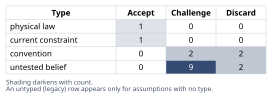
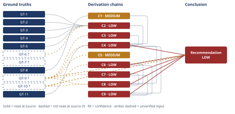

# Portland-to-Bay-Area Relocation Decision

*First-principles analysis · 15 October 2026*

*Read with: [How to read this analysis](HOW-TO-READ.md) · [Working file](analysis-20261015T044911Z.md) · [All files](INDEX.md)*

## Executive Summary

**Recommendation:** Decide from a real delta of ~$35K-$58K/yr, not the $70K headline
(chain C4) — weighed against an unpriced partner-career cost (chain C6) and the fact that
neither staying nor leaving is risk-free (chain C7). The cash-vs-partner weighting is a
judgment this analysis cannot supply (chain C8); use the five next steps in the Conclusion
instead of a verdict.

**Band (from §6):** LOW — chains C4, C6, C7, C8, C9 are below HIGH; the conclusion rests on
unverified inputs GT-9? (offer terms) and GT-10? (partner's job portability).

**Would change it:** The offer letter (chain C5), real rent quotes (chain C1), the partner's
job-market research (chain C6), the employer's counter-offer (chain C7), and the couple's own
weighting (chain C8).

## 1. Problem Essence

**Core problem:** Given a $70K/yr headline raise that requires relocating from Portland to the
SF Bay Area (hybrid, 3 days/week in-office) and would force the user's partner — whose
Portland-based career has no remote option — to either quit, job-hunt in the Bay Area, or
accept a commuting/living-apart arrangement, what is the real economic and household-level
trade-off, and what does the user (together with their partner) need to determine before
deciding?

**Success criteria:**
1. States the realistic, cost-of-living-and-tax-adjusted economic delta of the offer (not the
   raw $70K figure), bracketed as an estimate with named inputs.
2. Treats the partner's career cost as a priced decision variable alongside the user's
   comp, not as an unpriced externality.
3. Surfaces and tests the hidden assumptions named in the task (stability of the remote
   baseline, true size of the CA tax drag, non-transferability of the partner's career,
   whether in-office cadence or relocation itself is the binding constraint) rather than
   accepting them at face value.
4. Produces either a single defensible recommendation or — if the personal/relational inputs
   are genuinely unknown — a concrete decision framework plus the specific questions the user
   and partner must answer to complete it. Both outcomes satisfy this criterion; the analysis
   is not required to name exactly one of "accept" or "decline" if a composite or
   conditional path (e.g., negotiated terms, a trial period) scores better.
5. Names the conditions under which the decision would look obviously wrong in two years
   (pre-mortem), for both the accept and decline paths.

---

## 2. Assumptions Table



| Assumption | Type | Treatment | Verdict | Verification |
|------------|------|-----------|---------|--------------|
| The $70K/yr headline figure is the real economic gain from taking the offer | convention | Challenge before use — a quoted comp delta is pre-tax, pre-COL, pre-commute by convention, not by economic necessity | Challenge — survives only as an upper bound; net figure is materially lower once housing/commute are netted (see C1, C3, C4) | GT-8, Fermi estimate in C1/C3/C4 |
| Equity in the offer is worth its quoted/face value | untested belief | Verify, or flag unverified | Challenge — unvested/illiquid equity conventionally carries a 20-40% discount; exact vesting/liquidity unknown | unverified — flagged (GT-9?); flagged in C5 |
| The current fully-remote role is a stable, indefinite baseline with no risk of its own | untested belief | Verify, or flag unverified | Discard as stated — remote arrangements are revocable (RTO mandates, reorgs); "safe to stay" is not established | unverified — flagged; challenged via inversion in C7 |
| The 3-days/week in-office cadence is the binding cost of the new job, more than relocation itself | convention | Challenge before use | Discard as stated — relocation is the forcing function for the partner's career regardless of in-office day count | challenged via C6/C7 |
| The partner's career is genuinely non-transferable to the Bay Area | untested belief | Verify, or flag unverified | Challenge — plausible as stated by the user but not independently verifiable by this analysis; portability (licensure, network, remote options at a Bay Area employer) is unknown | unverified — flagged (GT-10?); central input named in C6 and the Conclusion's next steps |
| California income tax is higher than Oregon's for this income band | untested belief | Verify, or flag unverified | Discard — reversed by sourced data: Oregon's 9.9% top bracket starts at $125K and Multnomah/Metro add local tax on top, while CA's 9.3% bracket runs to $371,479 with no local personal income tax anywhere in the state | GT-1, GT-2, GT-3, GT-4, GT-5 (read-at-source); GT-6? (reported-by-delegate) — see C2 |
| Comparable Bay Area 2BR housing costs materially more than Portland | current constraint | Record expiry conditions — this is a real, current market condition, not a law; it would lift only if Bay Area housing supply/demand shifted sharply or the user chose an unusually cheap commute-accessible suburb | Accept — supported by sourced rent ranges; treated as a current market constraint, not permanent | GT-8 (read-at-source, affordwhere.com) |
| Time spent commuting has a nonzero personal opportunity cost | physical law | Accept as ground-truth candidate — time allocated to a commute cannot simultaneously be used for anything else; this is a conservation-of-time identity, not negotiable | Accept — definitional | GT-11 (identity); dollar value of that time is a separate, unverified estimate (see next row) |
| A commuter's time is worth $25-$50/hr for the purpose of pricing commute cost | untested belief | Verify, or flag unverified — this is an assumed input to the Fermi estimate, not a measured figure | Challenge — plausible range, not sourced for this specific user; widens C3's bracket | unverified — flagged; used only inside C3's bracket, not presented as measured |
| No middle/composite option exists between "stay fully remote in Portland" and "relocate to the Bay Area" | convention | Challenge before use — the trade-off procedure requires testing composite/negotiated options before scoring named options alone | Challenge — a negotiated reduced cadence, delayed relocation, or trial period are live composite options not foreclosed by anything in the stated facts | named explicitly in C8's option set |
| This decision reduces to a single correct answer this analysis can supply | convention | Challenge before use | Discard as a universal claim — the weight the user places on partner-career-cost vs. cash upside is a personal value judgment this analysis cannot assert on the user's behalf | challenged in C8; drives the Conclusion's framework-not-verdict shape |
| The current employer would not counter-offer if the user raised the SF offer | untested belief | Verify, or flag unverified | Challenge — untested; a live, cheap-to-test option | unverified — flagged; surfaced in C7 |
| The couple's willingness to live apart or have one partner job-hunt cold in a new market is already settled | untested belief | Verify, or flag unverified | Challenge — not stated by the user; this is exactly the kind of relational fact Phase 2 requires flagging rather than assuming | unverified — flagged (GT-10?); named as a required next step in the Conclusion |
| [A-14] The incremental round-trip commute-time delta between the remote baseline and the hybrid role is roughly 60-90 minutes per in-office day | untested belief | Verify, or flag unverified | Challenge — plausible range, not confirmed against the actual office location | unverified — flagged; surfaced in Phase 4 (C3), used only inside C3's bracket |
| [A-15] The user's total post-raise income falls in the ~$150,000-$370,000 single-filer band used in the OR/CA tax comparison | untested belief | Verify, or flag unverified | Challenge — plausible for a 5-year senior engineer receiving a $70K raise, but not confirmed; if actual income sits below $125K or above $1M the comparison in C2 should be rerun | unverified — flagged; surfaced in Phase 4 (C2); confirming this would tighten C2/C4 |
| [A-16] The current fully-remote arrangement is not already protected by a signed, durable agreement (e.g., a contractual remote-work guarantee) | untested belief | Verify, or flag unverified | Challenge — plausible default for most at-will US employment, not confirmed | unverified — flagged; surfaced in Phase 4 (C7) |
| [A-17] The user has a career-capital goal (title, network, or skill trajectory) that matters independently of near-term comp | untested belief | Verify, or flag unverified | Challenge — plausible for most engineers 5 years into a career, but not stated by the user; the weight this carries is exactly the kind of personal value judgment C8 flags | unverified — flagged; surfaced in Phase 4 (C7) |

---

## 3. Ground Truths

- **GT-1** Oregon 2025 single-filer state income tax brackets: 4.75% ($0-$4,400), 6.75%
  ($4,400-$11,100), 8.75% ($11,100-$125,000), 9.9% (above $125,000) — source:
  brackets.tax, "Oregon vs California 2025" comparison page; read-at-source: full bracket
  table fetched and quoted directly (WebFetch).
- **GT-2** California 2025 single-filer state income tax brackets run from 1% to 13.3%,
  with the 9.3% bracket covering $72,724-$371,479 and the 13.3% top rate applying only
  above $1,000,000 — source: brackets.tax, same comparison page; read-at-source: full
  bracket table fetched and quoted directly.
- **GT-3** California State Disability Insurance (SDI) employee withholding is 1.2% of all
  covered wages in 2025, with no taxable wage cap (removed by SB 951 effective Jan 1,
  2024) — source: edd.ca.gov, "Payroll Taxes: Rates and Withholding"; read-at-source:
  fetched directly, rate and no-cap status confirmed in the page text.
- **GT-4** Multnomah County, OR levies a "Preschool for All" personal income tax of 1.5%
  on county taxable income above $125,000 (single)/$200,000 (joint), rising to a combined
  3% above $250,000 (single)/$400,000 (joint); rates rise by 0.8 points starting 2027 —
  source: multco.us/node/85310; read-at-source: fetched directly, thresholds and rates
  quoted from the page.
- **GT-5** Metro (Portland regional government) levies a Supportive Housing Services (SHS)
  personal income tax of 1% on income above $125,000 for single filers (2021-2025
  threshold) — source: portland.gov/revenue/personal-tax; read-at-source: fetched
  directly, rate and threshold quoted from the page.
- **GT-6?** California has never permitted, and does not currently have, any city or
  county personal income tax anywhere in the state (a 1963 state law forbids it; a 2025
  San Francisco Board of Supervisors resolution reaffirms this) — cited to: a 2025 SF
  Board of Supervisors resolution and multiple secondary tax-guide sources; reported-by-
  delegate: surfaced via WebSearch summary, the underlying sfbos.org resolution PDF was
  not opened directly by this analysis.
- **GT-7?** Portland, OR average rent (all unit types) was reported at $1,860/month as of
  September 2025, with 1-bedroom units averaging about $1,550/month — cited to:
  steadily.com/blog/average-rent-portland; reported-by-delegate: surfaced via WebSearch
  summary, the source page was not opened directly. (Supporting color only; not load-bearing
  — GT-8 carries the housing-delta chain.)
- **GT-8** Rent ranges (per month): Portland 1BR $1,340-$2,360, Portland 2BR
  $1,830-$3,210; San Francisco 1BR $2,400-$4,600, San Francisco 2BR $3,100-$5,900;
  the site's overall cost-of-living estimate puts Portland about 32% cheaper than San
  Francisco (47% cheaper for a typical 1BR) — source: affordwhere.com/compare/portland-vs-
  san-francisco; read-at-source: fetched directly, ranges and percentages quoted from the
  page. Caveat carried forward into C1: this is a single real-estate-aggregator's estimate,
  not an authoritative government index (e.g., BLS or HUD Fair Market Rents), and "San
  Francisco" proper rents sit above what a hybrid employee could likely find in a cheaper,
  commute-accessible Bay Area suburb — so these figures are treated as the upper end of a
  bracket, not a point estimate.
- **GT-9?** The offer as described: approximately +$70,000/year in total compensation
  (base + equity combined) versus the user's current compensation, contingent on relocating
  to the SF Bay Area and working 3 days/week in a hybrid arrangement — source: the user's
  own description of the offer; unverified: no offer letter, vesting schedule, or company
  name was supplied, so the exact split between cash and equity, the equity's liquidity
  (public vs. private), and the precise income level cannot be confirmed by this analysis.
- **GT-10?** The user has 5 years' tenure in a fully remote role at their current employer;
  the user's partner has an established, Portland-based career with no remote option for
  that role — source: the user's own description; unverified: the partner's actual
  job-market portability (licensure requirements, Bay Area demand for their skillset,
  whether any Bay-Area employer in their field offers remote/hybrid work) was not supplied
  and cannot be independently verified by this analysis.
- **GT-11** Definitional identity used in the Fermi estimate below: Net Real Economic Delta
  = Raw Comp Delta − (Incremental Housing Cost + Incremental Commute-Time Cost + Incremental
  Tax Burden) ± Equity Valuation Adjustment — source: accounting identity, not an external
  citation; passes the irreducibility test as a definition rather than an empirical claim.

**Provenance summary:**
```text
?-marked: GT-6, GT-7, GT-9, GT-10 (4 of 11)
Read-at-source: GT-1 — brackets.tax Oregon-vs-California 2025 page, full bracket table
Read-at-source: GT-2 — brackets.tax Oregon-vs-California 2025 page, full bracket table
Read-at-source: GT-3 — edd.ca.gov Rates_and_withholding page, 2025 SDI rate and no-cap text
Read-at-source: GT-4 — multco.us/node/85310, PFA thresholds and rates
Read-at-source: GT-5 — portland.gov/revenue/personal-tax, SHS rate and threshold
Read-at-source: GT-8 — affordwhere.com/compare/portland-vs-san-francisco, rent ranges and overall %
```

GT-6? and GT-9?/GT-10? were not read further this session: GT-6 because the specific
sfbos.org resolution PDF was not fetched directly (convergent secondary sources made the
underlying structural fact — no CA locality taxes personal income — high-confidence
without that extra fetch); GT-9/GT-10 because they describe the user's own private
situation and no external source exists for this analysis to open — they remain `?`
permanently until the user/partner confirm specifics, which the Conclusion names as a
required next step.

---

## 4. Derivation Chains



### Conclusion C1: Incremental Bay Area housing cost is roughly $12K-$24K/yr, not zero

GT-8 (Portland vs SF 1BR/2BR rent ranges, affordwhere.com)
→ a 2BR rents for roughly $1,830-$3,210/mo in Portland (midpoint ~$2,520) versus roughly $3,100-$5,900/mo in San Francisco proper (midpoint ~$4,500)
→ treating SF-proper rents as the upper end and a cheaper commute-accessible Bay Area suburb as the lower end brackets the monthly housing delta at roughly $1,000-$2,000, central ~$1,500
→ annualized across 12 months, this is an incremental housing cost of roughly $12,000-$24,000/yr, central ~$18,000/yr, that the raw $70K offer figure does not account for

**Confidence:** MEDIUM — GT-8 is read at source but is a single real-estate aggregator's estimate rather than an authoritative government index, and the actual neighborhood/commute trade-off the user would choose is unknown; verification path: get an actual rent quote for 2-3 candidate Bay Area neighborhoods within an acceptable commute of the new office.

### Conclusion C2: The common "California taxes more" assumption is backwards at this income band

GT-1 (OR brackets) + GT-2 (CA brackets) + GT-3 (CA SDI 1.2%, uncapped) + GT-4 (Multnomah PFA) + GT-5 (Metro SHS) + GT-6? (CA bars local personal income tax statewide)
→ Oregon's state schedule reaches its 9.9% top bracket at just $125,000 of taxable income, a much lower threshold than California's 9.3% bracket, which runs from $72,724 to $371,479
→ Multnomah County and Metro each layer additional personal income tax (1.5%/3% and 1%) on income above that same $125,000 threshold, stacking directly onto the Oregon state rate for Portland-area residents
→ at representative upper-middle incomes the combined Oregon-plus-Portland-local marginal rate (about 12.4%-13.9%) exceeds California's combined state-plus-SDI marginal rate (about 10.5%) [Assumes: A-15 — total income falls in the ~$150K-$370K band, unconfirmed against GT-9?], because California has no local personal income tax anywhere in the state
→ a worked example at $270,000 total income shows Oregon+Portland owing about $28,600 in combined state+local tax versus California+SDI owing about $24,800 — roughly a $3,800/yr tax saving from relocating, the opposite of the common assumption that moving to California raises the tax bill

**Confidence:** LOW — two axes are short at once, not one: GT-6? is `?`-marked (Inputs axis) — corroborated by convergent secondary sources but not read at its primary source; verification path: fetch the 2025 SF Board of Supervisors resolution directly or a California Franchise Tax Board confirmation that no locality may levy personal income tax. And the worked example's income band rests on A-15, a premise whose failure would shift this chain's conclusion rather than leave it intact (Inference axis) — verification path: confirm the user's actual total post-raise income. Two short axes at once caps this chain at LOW, not MEDIUM, per the confidence-band definition.

### Conclusion C3: Hybrid in-office commuting adds a real but soft annual cost of roughly $4K-$11K/yr

GT-9? (offer terms: 3 days/week hybrid, user-stated)
→ assuming a round-trip commute delta of roughly 60-90 minutes/day versus the current zero-commute remote baseline, 3 days/week across about 48 working weeks/year totals roughly 144-216 hours/year of new commute time [Assumes: A-14 — commute-time delta of 60-90 min/day round trip, not confirmed against a specific office location]
→ valuing that time at $25-$50/hr, a personal-time opportunity-cost range rather than a measured wage rate, yields an incremental annual commute cost of roughly $3,600-$10,800/yr, central ~$7,000/yr
→ hybrid in-office work therefore adds a real, if soft, annual cost of roughly $4K-$11K/yr that a cash-comp comparison omits entirely

**Confidence:** LOW — rests directly on GT-9? (the offer's exact in-office cadence and location are user-stated, unconfirmed against an offer letter) and on two further unverified estimate inputs (commute-time delta, value-of-time range) with no cited source for either; verification path: confirm the actual office location/commute distance and, separately, decide what hourly value the user and partner actually place on personal time.

### Conclusion C4: The realistic net economic delta, before equity-discounting, is roughly $35K-$58K/yr — not $70K

C1 (housing delta, MEDIUM) + C2 (tax finding, LOW) + C3 (commute cost, LOW) + GT-9? (offer: +$70K raw) + GT-11 (net-delta identity)
→ applying GT-11's identity and combining C1's housing drag ($12K-$24K/yr), C3's commute drag ($3.6K-$10.8K/yr), and C2's tax effect (a $0-$3.8K/yr saving, credited rather than debited) against the $70K raw figure at their respective worst-case and best-case ends nets to a real economic delta bracket of roughly $35K-$58K/yr, central ~$47K/yr
→ this is substantially below the $70K headline, but also higher than the "taxes alone cut it by a third" intuition would predict, because the single largest assumed drag — California income tax — is not actually a drag at this income band

**Confidence:** LOW — capped by C2 and C3 (both LOW) on its head and by GT-9? directly; C1's verification path (actual neighborhood rent quotes), C2's (confirm GT-6? and the user's real income level, A-15), and C3's (confirm commute distance and time-value) together would tighten this bracket; until then, treat $35K-$58K/yr as a bracket, not a point estimate.

### Conclusion C5: The equity component may be worth materially less than its quoted face value

GT-9? (offer includes equity as part of the +$70K, user-stated)
→ equity in a compensation offer is conventionally quoted at a face/grant value that assumes full vesting and no share-price decline, both of which are uncertain for an offer whose company, share type (public RSU vs. private/illiquid), and vesting schedule were not supplied
→ applying a conventional 20-40% illiquidity/vesting/volatility discount to just the equity share of the figure, an unknown fraction of the $70K, further reduces the realistic annual value of the raise by an amount this analysis cannot size without that split
→ C4's $35K-$58K/yr bracket should be read as an upper estimate until the equity's vesting schedule and share type are confirmed; the cash-only portion of the delta is the more reliable number to act on in the meantime

**Confidence:** MEDIUM — the discount convention itself is well-established in comp analysis (Inference axis is sound); the only shortfall is GT-9? (the cash/equity split and vesting terms are unconfirmed); verification path: request the equity grant's vesting schedule, share type, and current valuation basis from the offer letter.

### Conclusion C6: The partner's career cost is a real, currently-unpriced household cost

GT-10? (partner's established, non-remote Portland career, user-stated)
→ an offer's compensation figure prices only the offer-holder's individual labor-market value; it carries no accounting for a second household member's income, seniority, or professional network
→ when relocation forces a partner to quit, restart in a new market, or sustain a long-distance arrangement, the household absorbs a cost — lost income during a job search, lost seniority/network value, or the relational strain of living apart — that does not appear anywhere in C4's bracket
→ C4's $35K-$58K/yr figure is therefore a one-person economic view; the true household-level expected value nets out a partner-career cost whose size depends on facts this analysis was explicitly not given

**Confidence:** LOW — rests directly on GT-10?, which names an input (the partner's actual job-market portability) with no verification path available to this analysis at all; only the user and partner can supply it, which is why the Conclusion routes this to a named next step rather than to a number.

### Conclusion C7: Neither "stay remote" nor "relocate" is the risk-free option it is assumed to be

GT-9? (current role: fully remote, 5 years' tenure, user-stated)
→ inverting the implicit claim that staying is the safe default: a remote-work policy reversal (RTO mandate), a reorg that deprioritizes remote roles for promotion, or stagnant comp at the current employer would each make the status quo riskier than it looks today, and none of these has been ruled out [Assumes: A-16 — the current remote arrangement is not already protected by a signed, durable agreement]
→ second-order, actor lens: accepting the SF offer changes the current employer's incentives too — a competing offer is a live trigger for a counteroffer or retention adjustment, an option the user has not yet tested [Assumes: already tabled — the current employer would not counter-offer, see Assumptions Table]
→ second-order, time lens: immediately the move reads as a one-time cash/equity gain; after a few cycles the dominant effect shifts to whichever path builds more durable career capital (title, network, skill trajectory), a horizon this analysis cannot price without the user's own career goals [Assumes: A-17 — the user has a career-capital goal that matters independently of near-term comp]
→ "staying" is not a risk-free baseline and "leaving" is not simply a risk weighed against a safe default; both paths carry real, differently-shaped risk that the headline comp numbers do not capture

**Confidence:** LOW — rests on GT-9? and on three untested beliefs (A-16, A-17, and the already-tabled employer-counteroffer belief) about remote-work durability, career-capital goals, and counteroffer likelihood, neither with a verification path available except asking the current employer directly and the user naming their own career goals, which the Conclusion names as a next step.

### Conclusion C8: The decision resolves to a framework, not a single scored verdict

C4 (net economic delta, LOW) + C6 (partner-career cost, LOW) + C7 (reversibility/optionality, LOW) + GT-9? (offer terms) + GT-10? (partner's career)
→ a trade-off across the real option set — (a) stay remote in Portland, (b) relocate and have the partner quit/job-hunt in the Bay Area, (c) relocate and commute/live apart from the partner, (d) a composite option such as negotiating a reduced in-office cadence or a delayed-relocation trial period while the partner first explores Bay Area portability — is scoreable on economics (C4) but not yet on partner-cost (C6) or reversibility (C7), because those two criteria depend on facts only the user and partner hold
→ locking criterion weights before scoring, the trade-off procedure's core discipline, is not honestly possible here: the weight the user would place on partner career cost versus cash upside is itself the personal value judgment the decision turns on, not a fact this analysis can assert on the user's behalf
→ the decision therefore resolves to naming the priced known (C4's bracket), the named unknowns (C6, C7, GT-9?, GT-10?), and the specific questions that would let the couple supply the missing weights themselves — a framework rather than a single recommended option

**Confidence:** LOW — every input this chain cites is itself LOW or `?`-marked; this is not a weakness to be fixed by more analysis, it is the honest shape of a decision whose two highest-weighted criteria are facts only the user and partner can supply (see Conclusion for the specific questions).

### Conclusion C9: Pre-mortem — both paths have a specific, plausible failure story

C4 (net economic delta, LOW) + C6 (partner-career cost, LOW) + C7 (reversibility/optionality, LOW)
→ running a pre-mortem on "we accepted the offer and it was a mistake" surfaces a recurring cluster: the equity/comp upside underdelivers (C5), the partner's career cost turns out larger than assumed because the Bay Area market doesn't want their skillset or they take a lower-leverage job (C6), and the relationship absorbs a living-apart or resentment cost the move's cash gain doesn't offset
→ running the mirror pre-mortem on "we stayed and it was a mistake" surfaces: remote work gets rescinded anyway at the current employer, promotion/comp stagnate, and the user regrets never testing the counteroffer or market rate the SF offer revealed (C7)
→ both paths have a plausible, specific failure story, which is itself evidence this is a genuine trade-off rather than a decision with a dominant answer; the pre-mortem's practical value is in naming the tripwires worth checking before committing either way — did the current employer counter, is there an actual Bay-Area opening in the partner's field, does the equity vest on the schedule quoted

**Confidence:** LOW — built entirely from LOW-rated chains; its value is diagnostic (naming tripwires) rather than predictive, and it is not cited by any other chain's head.

---

## 5. Abandoned Reasoning

### Dead End: Using the raw $70K headline as the decision number

**What was tried:** Early framing treated the $70K/yr figure itself as the quantity to weigh
against the partner's career cost.

**Why abandoned:** Contradicted by GT-1/GT-2/GT-4/GT-5/GT-8 once the Fermi estimate was run:
housing (C1) and commute (C3) costs alone remove $16K-$35K/yr from the figure before equity
is even discounted (C5). A raw headline comparison would have anchored the whole downstream
analysis on an inflated number.

**What it ruled out:** Treating the offer's top-line number as directly comparable to current
compensation without a cost-of-living pass — this is the single most common error in
relocation comp decisions and this dead end documents exactly why it fails here.

### Dead End: Assuming California taxes automatically cost more than Oregon's

**What was tried:** An initial pass (before the Oregon/Portland local-tax research) assumed
California's higher top marginal rate (13.3%) meant the move would increase the user's tax
burden, and priced that as a drag alongside housing.

**Why abandoned:** Contradicted by GT-1, GT-4, and GT-5: Oregon's 9.9% top bracket starts at
only $125,000, and Multnomah/Metro stack another 1-3% on top of that for Portland-area
residents, while California's comparable 9.3% bracket runs all the way to $371,479 with no
local personal-income-tax layer anywhere in the state (GT-6?). At the income band this
offer plausibly falls in, the "CA taxes more" framing reverses rather than merely weakens.

**What it ruled out:** Treating a state's headline top marginal rate as a proxy for an
individual taxpayer's actual burden without checking (a) the bracket thresholds at the
taxpayer's actual income and (b) local/county taxes layered on the "cheaper" state. This
also saves a future analyst from re-deriving the Oregon/Portland local-tax structure, which
is unusual and easy to miss.

### Dead End: Treating the 3-days/week in-office requirement as the central obstacle

**What was tried:** Framing the decision as primarily about whether 3 days/week in-office is
tolerable, implicitly treating the partner's situation as a secondary, office-cadence-driven
concern.

**Why abandoned:** The inversion/second-order pass (C7) and the partner-cost chain (C6) show
the forcing function is relocation itself, not the office-day count — a fully-remote offer
requiring the same relocation would create the identical partner-career problem. Anchoring on
"3 days/week" understates the real decision variable.

**What it ruled out:** Negotiating only the in-office cadence (e.g., asking for 1-2 days
instead of 3) as if that alone resolves the household-level cost; it would not, unless paired
with a no-relocation or delayed-relocation arrangement.

### Dead End: Attempting to output a single prescriptive "accept" or "decline" verdict

**What was tried:** Drafting a direct recommendation ("take the offer" or "stay") based on
the C4 economic bracket alone.

**Why abandoned:** The trade-off procedure's weight-locking step (C8) could not be completed
honestly — the relative weight between cash upside and partner-career cost is a personal
value judgment resting on GT-9?/GT-10?, inputs this analysis was explicitly told to treat as
unknown rather than invent. Forcing a single verdict here would be reasoning by assumption at
exactly the point Phase 2 exists to stop that.

**What it ruled out:** A confident single-word recommendation that would look authoritative
but would actually be smuggling in an assumed answer to "how much do you value X over Y" that
only the user and partner can supply.

---

## 6. Conclusion

**Recommended approach:** Decide from a bracketed real economic delta of roughly
$35K-$58K/yr before equity-discounting (chain C4) — not from the $70K headline and not from
the instinct that California taxes eat the raise (chain C2) — weighed against a currently
unpriced partner-career cost (chain C6) and against the fact that neither staying nor leaving
is actually risk-free (chain C7). Because the weight between cash upside and partner-career
cost is a personal value judgment this analysis cannot supply (chain C8), resolve it with
these concrete next steps rather than a verdict:

- Get the actual offer letter: confirm the cash/equity split, vesting schedule, and share
  type before trusting the $70K figure at all (chain C5).
- Get real rent quotes for 2-3 Bay Area neighborhoods within an acceptable commute of the new
  office, to replace C1's bracket with a real number (chain C1).
- Have your partner research, concretely, whether their field has any Bay Area opening,
  remote option, or licensing path — this single fact does more to resolve the decision than
  any further comp analysis (chain C6).
- Ask your current employer, directly, whether they would counter — it is a free option that
  changes the comparison on both sides (chain C7).
- As a couple, name your actual weight in your own words: would you rather have the cash/
  career upside or the relationship and location stability, and what would make you regret
  either choice in two years (chain C8, chain C9).

**Key insight:** The input most people assume is the big drag on a Portland-to-Bay-Area move
— California income tax — is, within the sourced data, roughly a wash or even a modest saving
at this income band, because Portland's local Metro and Multnomah County taxes stack on top
of Oregon's unusually low top-bracket threshold while California has no local personal income
tax anywhere in the state; the real drag is housing cost and commute time, not taxes
(chain C2).

**Trade-offs acknowledged:** This analysis deliberately does not hand you a single "take it /
don't take it" answer — chain C8's weight-locking step cannot be completed without your and
your partner's own values and your partner's actual Bay Area job-market facts (chain C8).
Equity may also be worth meaningfully less than its quoted face value, so lead with the
cash-only portion of the delta until vesting terms are confirmed (chain C5).

**Confidence:** LOW — every chain contributing to this conclusion (C4, C6, C7, C8, C9) is
rated below HIGH, each with its own verification path stated on its own confidence line in
section 4. The Conclusion also rests directly on two unverified inputs: GT-9? (the offer's
exact comp split, equity terms, and in-office/location details — verification: obtain the
actual offer letter and vesting schedule) and GT-10? (the partner's real job-market
portability and the couple's willingness to live apart — verification: the conversation named
above, which only the user and partner can have). This LOW rating is not a defect to be
fixed by more analysis — chain C8 explains why the two highest-weighted inputs here are
facts only the user and partner can supply.
