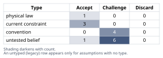
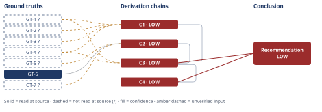

# Slack Integration vs. Reporting Rewrite: Capacity Allocation

*First-principles analysis · 11 October 2026*

*Read with: [How to read this analysis](HOW-TO-READ.md) · [Working file](analysis-20261011T201804Z.md) · [All files](INDEX.md)*

## Executive Summary

**Recommendation:** Give the reporting rewrite primary claim on this quarter's 3.2 engineer-quarters to protect the $180k LOI and the other two top-10 accounts' renewal risk, and carve out a small, ring-fenced slice (0.15–0.31 EQ) for a minimal webhook-based Slack notification path, conditional on written acceptance criteria from the LOI account and a pre-agreed rule that the webhook is cut first if capacity tightens (chain C3, chain C4).

**Band (from §6):** LOW — both chains the conclusion rests on, C3 and C4, are LOW (chain C3, chain C4).

**Would change it:** Deduplicating the 41 Slack requests against pipeline value, reading the LOI's exact acceptance language, and obtaining a real engineering estimate for the rewrite alone (chain C1, chain C2); confirming the two governance conditions actually hold would most directly raise the band (chain C4).

## 1. Problem Essence

**Core problem:** Given one quarter of engineering capacity sufficient to fund only one of two competing initiatives, how should that capacity be allocated between (a) a Slack integration repeatedly requested by sales prospects and (b) a reporting rewrite an enterprise account has tied to a time-boxed, contractually-contingent expansion commitment — in a way that correctly weighs demonstrated, concentrated revenue-at-risk against an unvalidated, diffuse demand signal, and that does not foreclose a cheaper partial remedy for whichever need is deprioritized?

**Success criteria:**
- The recommendation names a single allocation of the 3.2 engineer-quarters (or an explicit split) and states what each initiative receives.
- The recommendation distinguishes revenue that is contractually time-boxed and at concrete risk this quarter from revenue or pipeline effects that are directional but unmeasured, and shows its weighting reflects that distinction rather than treating both as equally certain.
- The recommendation explicitly tests whether a low-cost partial remedy (e.g., a webhook-based notification path) can address a meaningful share of the deprioritized initiative's demand without consuming capacity needed by the prioritized one — i.e., it does not silently assume the choice is binary.
- The recommendation names the specific second-order risks (to sales pipeline, to retention of other accounts, to engineering credibility with enterprise customers) created by each allocation and states what would have to be true for the recommendation to reverse.

---

## 2. Assumptions Table

| Assumption | Type | Treatment | Verdict | Verification |
|------------|------|-----------|---------|--------------|
| A-1: 41 logged Slack requests indicate unmet demand large enough to justify a full quarter of build capacity | untested belief | Verify, or flag as unverified; surfaced via inversion ("what would make this conclusion too clean?") | Challenge — the raw count conflates request volume with validated demand magnitude; no deal-value or conversion linkage is given | unverified — flagged (feeds C1, GT-1?) |
| A-2: The 41 requests correspond roughly 1:1 with distinct accounts/deals | untested belief | Verify, or flag as unverified | Challenge — the fact set itself states this is a request count, not de-duplicated; true distinct-account count could be materially lower | unverified — flagged (feeds C1, GT-1?) |
| A-3: "No churn-survey reason code attributes departure to missing Slack" is strong evidence that Slack is not revenue-relevant | convention (treating a retention metric as if it measured acquisition/conversion) | Explicitly challenge before use | Challenge — churn surveys measure departures among existing customers; they cannot observe prospects who never signed because of a missing feature, so this evidence answers a different question than "does Slack block new revenue" | unverified — flagged (feeds C1, GT-2?); this mismatch is itself a load-bearing finding, not merely a caveat |
| A-4: The $180k/yr LOI commitment converts to collected revenue once the rewrite ships on schedule | current constraint (contractual, contingent) | Record expiry/trigger conditions | Accept — expires/triggers at this quarter's close per the LOI's own exit clause; contingent on the account's acceptance of what ships, not merely on a ship date being met | unverified — flagged (feeds C1/C2/C3/C4, GT-4?); no underlying contract document was opened by this analysis |
| A-5: Engineering's planned reporting-rewrite scope will match the LOI account's own definition of "shipped" closely enough to satisfy the exit clause | untested belief, surfaced by inversion (failure-guaranteeing condition: "ships on time but doesn't satisfy the account") | Verify via written, specific acceptance criteria before build starts | Challenge — this is the single most common way a "we shipped it" claim fails to prevent a contractual exit; no evidence here that acceptance criteria have been agreed | unverified — flagged (feeds C1, C4); closing action named in Phase 5 pre-mortem cluster 1 |
| A-6: A minimal, webhook-based Slack notification capability can be built in a small fraction of a quarter | untested belief, resolved via the Estimate technique | Decompose into unit-factors and bracket, rather than cite an analogous project | Accept — resolved via unit-factor decomposition rather than an analogous-project citation; bracketed at 0.15–0.31 engineer-quarters (bare-bones tier), carried into GT-7? with that bracket as its own caveat since no company-specific velocity data exists | unverified — flagged (feeds C2); verification path = time-box the first two days of actual work and compare to the estimate |
| A-7: Total engineering capacity this quarter is fixed at 3.2 EQ with no additional hiring/contracting available | current constraint | Record expiry conditions | Accept — expires at next capacity-planning cycle (e.g., next quarter's hiring/contracting decisions); not physically immutable, just fixed for this decision window | unverified — flagged (feeds C2; sourced from GT-5?, no document opened) |
| A-8: The reporting rewrite's own cost is comfortably below 3.2 EQ, leaving real headroom for any Slack-adjacent work | untested belief / data gap | Verify with an actual engineering estimate before committing to a composite plan | Challenge — the given facts state only that funding *both* initiatives as originally scoped is impossible; no individual cost breakdown for the rewrite alone is given, so headroom is unknown and could be near zero | unverified — flagged (feeds C2); this is the single fact most likely to flip the composite recommendation if false (see Phase 5 sensitivity) |
| A-9: Sales, support, and engineering can reliably ring-fence a small capacity carve-out without it being absorbed by the larger initiative's scope creep | convention (organizational-discipline assumption, not a technical fact) | Explicitly challenge before use | Challenge — scope leakage is a common, well-documented failure mode of organizational effort-allocation; discipline is not guaranteed by stating an intent | unverified — flagged (feeds C2, C4); mitigated, not resolved, by the named governance conditions in the Phase 5 pre-mortem |
| A-10: Shipping the reporting rewrite (scoped to the LOI account's needs) also resolves the other two top-10 accounts' reporting complaints | untested belief | Verify by comparing the other two accounts' specific complaints to planned scope | Challenge — the three accounts filed tickets citing "reporting limitations" generically; nothing confirms their specific pain points are identical to the LOI account's | unverified — flagged (feeds C1); named as an accepted risk with mitigation in Phase 5 pre-mortem cluster 4 |
| A-11: The capacity figure of 3.2 EQ, already stated as "net of on-call/maintenance," has no further realistic erosion this quarter (e.g., from an unplanned incident or staffing change) | current constraint | Record expiry/variance conditions | Accept — treated as fixed for planning purposes; residual risk (incident-driven erosion) flagged separately in the Phase 5 pre-mortem rather than assumed away | unverified — flagged (feeds C2; sourced from GT-5?) |
| A-12: Engineering capacity is a conserved, non-duplicable resource within a single quarter — allocating it to one initiative makes it unavailable to the other in the same window | physical/logical constraint (resource conservation; essentially definitional) | Accept as a ground-truth candidate | Accept — this is true by definition of "capacity" and "one quarter," not an empirical claim requiring a source | n/a — promoted directly to GT-6, no citation needed |
| A-13: The weights and anchors chosen for the trade-off criteria (revenue protection and contract safety weighted highest, scope certainty lower) reflect this business's actual risk tolerance and priorities | convention (an analytical choice made by this analysis, not a fact about the business) | Explicitly challenge before use; surfaced by the end-of-phase Assumption Audit on chain C3 | Challenge — these weights were set by this analysis before scoring (per the trade-off procedure's discipline) but were not independently confirmed with the business's own stated risk tolerance; the flip test shows the ranking is robust to single-weight changes, which bounds this risk without eliminating it | unverified — flagged (feeds C3); verification path = confirm criterion weights with whoever owns revenue-risk tolerance for the business before treating the ranking as final |
| A-14: The ring-fenced webhook will be built to the reliability bar scoped in GT-7? (retry logic, payload signing) rather than cut further under time pressure | untested belief, surfaced by the end-of-phase Assumption Audit on chain C4's time-lens hop | Verify, or flag as unverified | Challenge — time pressure on a capped carve-out is exactly the condition under which reliability work gets cut first; this is also pre-mortem cluster 2's concern from the other direction (the carve-out being cut, versus being under-built rather than cut) | unverified — flagged (feeds C4) |
| A-15: Sales and customer success will represent the webhook's actual scope accurately to prospects rather than overselling it as a full native Slack integration | convention (organizational-communication discipline assumption), surfaced by the end-of-phase Assumption Audit on chain C4's third-order hop | Explicitly challenge before use | Challenge — this is the same discipline risk pre-mortem cluster 3 names from the disposition side; the audit surfaces it independently as a chain-level assumption | unverified — flagged (feeds C4); closing action named in Phase 5 pre-mortem cluster 3 (a pre-agreed script distinguishing webhook from native app) |

**Note on provenance of the user-supplied facts (A-1 through A-11's underlying figures):** none of GT-1 through GT-5 below is backed by a document this analysis opened — they are stated directly by the requester as internal business metrics, with no file, URL, ticketing system, or CRM export named. Per the Input Contract, a fact entering this analysis without a named source is classified `unverified`, not `reported-by-delegate`. This governs the `?` suffixes applied throughout and is not a request to re-derive or doubt the figures' correctness — it is a statement about what this analysis did (and did not) verify against a source.

---

## 3. Ground Truths

- **GT-1?** Over the last two quarters, 41 inbound Slack-integration requests were logged across 240 active accounts; this is a count of requests, not de-duplicated distinct accounts. — unverified: stated directly by the requester as an internal metric; no CRM export, ticket log, or other source document was named or opened by this analysis.
- **GT-2?** No churn-survey reason code attributes any past departure to the missing Slack integration. — unverified: same reason as GT-1?. Scope note carried forward into the chains: a churn survey measures departures among existing customers and does not observe prospects who declined to purchase or deals that stalled over a missing feature — so this fact, even if taken at face value, bears on retention risk, not on acquisition/pipeline risk.
- **GT-3?** 3 of the top-10 accounts by ARR filed support tickets in the last two quarters citing reporting limitations as a renewal risk. — unverified: same reason as GT-1?.
- **GT-4?** One of those top-10 accounts signed a Letter of Intent committing $180,000/year in expansion ARR, contingent on the reporting rewrite shipping this quarter, with an exit clause permitting non-renewal if it does not ship this quarter. — unverified: same reason as GT-1?; no LOI document was opened by this analysis, so the exact scope/acceptance language of "shipping" is not confirmed beyond the stated summary.
- **GT-5?** Total build capacity this quarter is 3.2 engineer-quarters (net of on-call/maintenance), sufficient to fund one of the two initiatives as each is currently scoped, not both. — unverified: same reason as GT-1?. Does not by itself state either initiative's individual cost — only that their sum exceeds 3.2 EQ.
- **GT-6** Engineering capacity within a single quarter is a conserved, non-duplicable resource: time allocated to one initiative is time unavailable to any other initiative in that same window. — source: definitional (conservation of a scarce, non-stockpiled resource across a fixed time window); not an empirical figure requiring an external citation; read-at-source: n/a (logical/definitional ground truth, promoted from A-12).
- **GT-7?** A minimal, webhook-based outbound-notification capability (fire an HTTP POST on a configurable set of existing domain events to a destination URL, with basic retry and payload signing, no bespoke UI) decomposes into roughly five build tasks — event-hook wiring, delivery/retry subsystem, minimal configuration path, payload signing, and testing/docs — each estimated at 2–4 engineer-days absent company-specific measurement, yielding a bracket of 10–20 engineer-days, or **0.15–0.31 engineer-quarters** against a ~65-working-day quarter (13 weeks × 5 days). — unverified: this is this analysis's own Estimate-technique derivation (unit-factor decomposition, not an analogy to another company's project), not a measured figure from this company's codebase or engineering history; flagged accordingly. Read-at-source: n/a — no source exists to read; the bracket is a dimensional-analysis estimate, named as such.

**Provenance summary.** `?`-marked: GT-1, GT-2, GT-3, GT-4, GT-5, GT-7 (6 of 7). Read-at-source (unsuffixed): GT-6 — definitional/logical ground truth (resource conservation within a fixed time window), requiring no external citation; there is no source location to name because none is needed for a definitional claim.

**Act-attempted disclosure (Phase 3 verification step).** For GT-1? through GT-5?, no source document, file path, URL, or named system was ever cited by the requester to this analysis — these are first-person business assertions, not citations to a document this analysis failed to open. The Phase 3 verification step's trigger (attempt to open a cited source) therefore does not apply to them: there is nothing named to target with Read, Grep, or WebFetch. This is recorded here rather than as a Phase 3 failure record, because a failure record presupposes a named source that could not be opened, and none was named. `Act attempted?` for every chain resting on these ground truths is **no — no source named**, and this is disclosed rather than hidden. GT-7? required no external source either, for the different reason that it is this analysis's own bracketed estimate, built by decomposition rather than citation; `Act attempted?` is likewise **no — not a sourced claim**.

---

## 4. Derivation Chains

### Conclusion C1: The reporting rewrite is the higher-priority claim on this quarter's capacity

GT-1? (41 undeduplicated requests, no deal-value linkage) + GT-2? (no churn code cites Slack) + GT-3? (3 of top-10 cite reporting as renewal risk) + GT-4? (LOI: $180k contingent, exit clause this quarter)
→ the Slack signal is a request count of unknown distinct-account size with no measured link to any deal outcome
→ the reporting signal, by contrast, is concentrated in three named top-10 accounts and reduced to one specific dollar figure with one specific contractual trigger date
→ the churn-survey evidence in GT-2? answers whether missing Slack causes existing customers to leave, not whether it blocks prospects from buying
→ that mismatch makes GT-2? weak evidence of low stakes for a revenue-acquisition decision, not strong evidence
→ an unlinked volume signal of unknown true size carries materially less decision weight this quarter than a named account's contractual, time-boxed commitment
→ the reporting rewrite is the higher-priority claim on this quarter's capacity

**Confidence:** LOW — two axes are short. Inputs: every head input is unverified (GT-1? — verify by deduplicating the 41 requests to distinct accounts/deals and tagging each to pipeline stage/value; GT-2? — verify by obtaining win-loss data that tags "missing Slack" as a lost-deal reason, since churn surveys structurally cannot see this; GT-3? — verify by opening the underlying support tickets; GT-4? — verify by reading the LOI document's exact acceptance language). Rivals: a live rival — "the Slack signal, once deduplicated and linked to pipeline value, could represent revenue exceeding $180k" — is not settled by any observation available this quarter; it is outweighed in C3's weighted comparison but not independently disproven, and the closing observation is the same deduplication-and-tagging exercise named above.

### Conclusion C2: A capped, ring-fenced Slack webhook carve-out is technically feasible alongside the reporting rewrite, conditional on two unverified premises

**Theoretical floor-cost framing (direction: lower is better — an ideal floor).** The governing hard constraint here is logical rather than physical: delivering any Slack-facing capability requires at least one outbound call the product must trigger, so the floor is set by whether a triggerable event/webhook pathway already exists in the product, not by a law of nature. If such a pathway already exists, the ideal floor is near-$0 engineering cost (support/docs only, pointing prospects at a generic Zapier recipe); if it does not, the floor is the minimal event-emission-plus-delivery build bracketed in GT-7? (0.15–0.31 EQ). Best demonstrated: not available — no comparable internal or external benchmark is cited by this analysis, so no reference point narrower than the bracket itself is claimed. Conventional figure: a full native Slack app (OAuth install flow, slash commands, interactive components, Slack app-directory review, multi-tenant admin controls), implied by GT-5? to cost on the order of most of the 3.2 EQ quarter. Gap: most of the distance between the floor and the conventional figure is feature-richness and platform convention, not physical necessity — the only irreducible slice is the single outbound call itself.

**Fishbone (supporting breadth check on the Slack ask, referenced in §6's trade-off caveat).** Effect: "prospects/customers keep requesting Slack integration." Categories and candidate causes — People: champions/admins want ambient visibility without logging into the product; procurement/IT treats it as an RFP checklist item regardless of demonstrated use. Process: sales and renewal conversations surface it as a competitive comparison point. Technology/Tools: the only confirmed notification channel is unspecified by the given facts, and no existing webhook/event API is confirmed to exist. Information: the 41-request log does not record which specific capability is wanted (ambient notification vs. interactive slash commands), so the composite count masks causes that may differ widely in build cost. Environment: native Slack support is a category-norm checklist item in B2B SaaS, independent of demonstrated functional need. Discriminating observation: whether requests specify a particular workflow versus a generic "do you integrate with Slack" ask would separate a deep functional need from a checkbox/convention effect — this breakdown is not available in the given facts and is named as a data gap, carried forward as the `no chain — flagged assumption only` caveat in §6 rather than as a chain input, because no measured breakdown exists to cite.

GT-5? (3.2 EQ total, insufficient for both initiatives at stated scope) + GT-6 (capacity conserved within one quarter) + GT-7? (webhook bracketed at 0.15–0.31 EQ)
→ the capacity fact in GT-5? states only that the two initiatives together exceed 3.2 EQ at their stated scope, not that the rewrite alone consumes all of it
→ if the rewrite's own cost leaves real headroom, the webhook's 0.15–0.31 EQ bracket is small enough to fit that headroom without displacing the rewrite *[Assumes: A-8]*
→ because capacity is conserved within the quarter, any headroom the webhook consumes is headroom the rewrite cannot also use
→ the composite's feasibility therefore depends entirely on how much of the 3.2 EQ the rewrite alone actually requires, a figure the given facts do not state
→ a floor-cost webhook carve-out is feasible only if it is both small and genuinely ring-fenced against the larger initiative's scope pressure *[Assumes: A-9]*
→ a composite allocation — reporting rewrite as primary claim, webhook as a capped secondary claim — is technically feasible within 3.2 EQ, conditional on real rewrite headroom and held scope discipline

**Confidence:** LOW — two axes are short. Inputs: GT-5? (verify by obtaining a real engineering estimate for the rewrite alone, before committing to any carve-out) and GT-7? (verify by time-boxing the first two days of actual webhook work and comparing against the bracket) are both unverified. Inference: two hops rest on unpriced `[Assumes: *]` premises rather than one — A-8 (if false, the composite is infeasible and the decision reverts to a straight reporting-only vs. Slack-only choice) and A-9 (if false, the carve-out is absorbed by the rewrite's own scope, which is why Phase 5 converts it into a named governance condition rather than leaving it as a hope).

### Trade-off analysis (weighted-criteria matrix, supporting C3)

Options scored, status quo and composite included per the trade-off procedure's requirement to always include both: **A** — Slack-only (full quarter, native app); **B** — Reporting-only (full quarter, no Slack action); **C** — Composite (reporting rewrite primary + capped webhook carve-out); **D** — Do nothing with the capacity / reallocate elsewhere. No must-have knocks out any option outright; all four are scored.

Criteria, weights, and 1–5 anchors: (1) Revenue protected/secured this quarter [w5; 1=$0 secured, 5=LOI secured + other top-10 risk mitigated]; (2) Pipeline upside unlocked [w3; 1=no measurable effect, 5=clear quantified unblock]; (3) Capacity efficiency — spend matched to payoff, slack preserved for the other need [w4; 1=consumes full capacity for uncertain payoff, 5=minimal capacity for full payoff]; (4) Contract/relationship safety [w5; 1=high risk of triggering the exit clause, 5=negligible risk]; (5) Scope/delivery certainty [w3; 1=large novel scope, high execution risk, 5=small well-understood scope]; (6) Addressable breadth of stated demand [w2; 1=addresses neither logged demand signal, 5=addresses both substantially].

| Option | Rev. protected (w5) | Pipeline upside (w3) | Capacity efficiency (w4) | Contract safety (w5) | Delivery certainty (w3) | Breadth (w2) | Weighted total |
|---|---|---|---|---|---|---|---|
| A — Slack-only | 1 | 3 | 2 | 1 | 3 | 3 | **42** |
| B — Reporting-only | 5 | 1 | 1 | 4 | 2 | 3 | **64** |
| C — Composite | 5 | 3 | 4 | 4 | 2 | 4 | **84** |
| D — Do nothing | 1 | 1 | 1 | 1 | 5 | 1 | **34** |

Each score traces to GT-1?–GT-5?, GT-7?, C1, and C2 as derived above; D's criterion-5 score of 5 is a vacuous "certainty" (nothing attempted, so nothing can fail to ship), not a virtue, which is why its weighted total still ranks last.

**Flip test:** C beats B by +20 (criteria 2, 3, and 6; criteria 1, 4, 5 tie). B does not out-score C on any single criterion, so no increase to any one criterion's weight can make B win — this is weak dominance, not a near-tie. The strongest result the procedure can return: **no single weight change flips this.**

### Conclusion C3: The composite allocation (reporting rewrite primary, capped webhook secondary) weakly dominates reporting-only, Slack-only, and doing nothing

GT-1? (diffuse, unlinked request signal) + GT-4? (LOI's binding dollar figure and trigger) + C1 (reporting is the higher-priority claim) + C2 (composite technically feasible, conditional on A-8/A-9)
→ weighting six criteria before scoring, the composite scores 84 against reporting-only's 64, Slack-only's 42, and do-nothing's 34
→ the composite ties or beats reporting-only on every single criterion and never loses to it on any *[Assumes: A-13 — the criterion weights reflect this business's actual risk tolerance; if they do not, the ranking should be re-run with corrected weights]*
→ because the composite does not lose to reporting-only on any criterion, no single-weight change among the six criteria can reverse that ranking — the flip test returns "no single weight change flips this"
→ the composite allocation is the recommended option over all three alternatives, subject to the same conditional premises that bound C2's own confidence

**Confidence:** LOW — capped by the Inputs ceiling: this chain cites C1 and C2, both LOW, so it cannot rate higher regardless of how robust the weighting arithmetic itself is (recomputed in the Phase 5 adversarial pass below and confirmed arithmetically clean). The weighted-dominance result and the flip test are themselves high-confidence findings given the inputs as stated; what is LOW is the inputs those findings are computed from (GT-1?, GT-4?, and the unpriced premises carried up from C1 and C2, plus A-13 named above). Verification path: the same ones named on C1 and C2 — deduplicate/tag the 41 requests, obtain win-loss data, read the LOI's acceptance language, get a real engineering estimate for the rewrite alone — plus confirming A-13's weights with the business's own risk owner.

### Conclusion C4: Realizing the composite's advantage requires converting two of its input assumptions into enforced governance conditions, not optional hopes

C3 (recommend the composite allocation)
→[2nd] once the composite ships, the LOI account's champion gains or loses internal credibility depending on whether delivered scope matches their specific acceptance bar (actor lens) *[Assumes: A-5]*
→[2nd] sales reps gain a real but limited answer to the Slack objection rather than silence (actor lens)
→[2nd] engineering absorbs the burden of defending a ring-fenced carve-out against its own larger initiative's scope pressure (actor lens) *[Assumes: A-9]*
→[2nd] immediately this quarter, the $180k expansion is secured or not depending on scope-match (time lens) *[Assumes: A-5]*
→[2nd] the other two top-10 accounts' renewal risk is secured or not depending on whether the rewrite's scope also covers their specific complaints (time lens) *[Assumes: A-10]*
→[2nd] after a few quarters, the webhook either becomes an accepted stopgap or a support liability if shipped without adequate reliability testing (time lens) *[Assumes: A-14]*
→[3rd] over a longer horizon, an oversold webhook compounds into a credibility cost harder to walk back than stating the quarter's limits plainly from the start (time lens) *[Assumes: A-15]*
→ these downstream effects do not contradict GT-4? or GT-6, so they convert A-5 and A-9 from optional hopes into necessary governance conditions: written acceptance criteria agreed before build starts, and a pre-agreed rule that cuts the webhook, never the rewrite, first if capacity tightens

**Confidence:** LOW — capped by C3's LOW rating. Both the actor and time lenses were walked and no extension step contradicts a ground truth (checked against GT-4? and GT-6 explicitly), so this chain's own reasoning is sound; the LOW band is inherited entirely from the uncertainty already named on C1/C2/C3, not from a new defect introduced here. What would most directly raise this chain's standing: executing and confirming the two named governance conditions (written acceptance criteria; pre-agreed cut-webhook-first priority) before build starts, which would convert A-5 and A-9 from unpriced premises into verified commitments.

---

## 5. Abandoned Reasoning

### Dead End: Treating the 41 logged requests as a direct, proportional demand signal ("41 > 3 tickets, so Slack is the bigger problem")

**What was tried:** An initial reading of the facts compares request counts at face value — 41 Slack requests versus 3 reporting-risk tickets — and concludes Slack demand is larger and should win the capacity allocation.

**Why abandoned:** This conflates a request count with validated demand. GT-1? is explicitly not deduplicated, so the true distinct-account count could be a fraction of 41; none of the 41 carries a deal-value or conversion linkage, while the 3 reporting tickets are concentrated in named top-10 accounts and one is reduced to a specific, binding dollar figure with a specific trigger date (GT-4?). Comparing an un-deduplicated count against a concentrated, contractually-quantified risk is comparing different units.

**What it ruled out:** Saves a future analyst from re-deriving "bigger number wins" reasoning; the correct comparison (done in C1 and the trade-off matrix) weighs concentration and measured value, not raw counts.

### Dead End: Treating the $180,000 LOI as fully guaranteed, risk-free revenue once the rewrite ships on schedule

**What was tried:** An initial framing treats "ship the rewrite this quarter" as sufficient to guarantee the $180k, making the reporting choice a pure, risk-free win.

**Why abandoned:** An LOI with an exit clause is a conditional commitment, not a signed renewal; GT-4? only states that shipping is a condition, not that shipping on any engineering-defined scope automatically satisfies the account's own acceptance bar (A-5). Treating it as risk-free would have produced an uncalibrated HIGH-confidence conclusion that the Self-Audit Gate would correctly flag — D-07 requires any chain resting on a `GT-N?` input to carry MEDIUM/LOW confidence, and this specific risk (scope mismatch) is exactly what the Phase 5 pre-mortem's top cluster surfaces.

**What it ruled out:** Saves a future analyst from recommending the reporting rewrite as a "sure thing"; the correct framing (C1, C4, and Phase 5 cluster 1) treats the $180k as the best available estimate of concrete revenue-at-risk, contingent on a named, closable condition (written acceptance criteria), not as cash already banked.

### Dead End: Building the full native Slack integration and treating the $180k LOI exit clause as an acceptable, bounded loss

**What was tried:** A framing that prioritizes Slack on the theory that pipeline-wide prospect friction is a bigger, compounding problem than a single account's renewal risk, and accepts the LOI's loss as the cost of fixing the larger problem.

**Why abandoned:** The trade-off matrix shows Slack-only (A) weighted-total 42 against the composite's 84 and reporting-only's 64 — A loses to both on revenue protection and contract safety, the two highest-weighted criteria, and gains only a moderate, unvalidated score on pipeline upside that the inversion-derived failure modes (A-1, A-2) already flag as unproven. The inversion pass in Phase 2 also showed this choice guarantees an immediate, concrete, contractually-triggered loss in exchange for a hypothetical, unmeasured gain.

**What it ruled out:** Saves a future analyst from re-running the Slack-only case; it is weakly dominated by the composite on every criterion that matters and is not revisited unless GT-1?/GT-2? are verified and show the Slack-driven pipeline risk to be larger than the $180k plus the other two top-10 accounts' combined risk.

### Dead End: Doing nothing with the quarter's capacity (banking it or diverting it to unrelated work)

**What was tried:** Considered as the required status-quo/do-nothing option per the trade-off procedure.

**Why abandoned:** Trivially dominated — weighted total 34, lowest of all four options, failing on revenue protection, pipeline upside, capacity efficiency, contract safety, and breadth simultaneously; its only strength (criterion 5, delivery certainty) is vacuous, since nothing attempted cannot fail to ship.

**What it ruled out:** Confirms the decision is genuinely between the three active options, not a case where inaction is secretly competitive.

---

## 6. Conclusion

**Recommended approach:** Allocate the quarter's 3.2 engineer-quarters primarily to the reporting rewrite — protecting the $180,000 LOI and the renewal risk flagged by the other two top-10 accounts — and carve out a small, explicitly ring-fenced slice (bracketed at 0.15–0.31 EQ) for a minimal, webhook-based Slack notification path rather than a native app, positioned to sales honestly as a stopgap. Treat this as conditional on two governance steps completed before build starts: written, specific acceptance criteria from the LOI account, and a pre-agreed rule that the webhook carve-out — never the rewrite — is the first thing cut if capacity tightens (chain C3, chain C4).

**Key insight:** The two facts that look most decisive each partially answer a different question than the one the decision turns on. "No churn-survey code cites the missing Slack integration" measures retention among existing customers, not whether prospects decline to buy or deals stall without it — so it is weak evidence of low stakes for a revenue-acquisition decision, not strong evidence (chain C1). Symmetrically, "ships this quarter" in the LOI's exit clause is a scheduling condition, not a guarantee that whatever engineering delivers will satisfy the account's own acceptance bar — so the dominant risk to the $180k is a scope-definition gap, not a calendar slip (chain C4).

**Trade-offs acknowledged:** This recommendation accepts, rather than eliminates, two open risks: that the reporting rewrite's true cost may leave little or no real headroom for even a capped webhook carve-out, and that a ring-fence stated as an intent may not survive contact with the larger initiative's own scope pressure (chain C2). It also accepts that a webhook, even if delivered reliably, likely satisfies only the generic/"checkbox" portion of the Slack ask surfaced by the fishbone pass — the ambient-notification and RFP-comparison need — and not a deeper native-app workflow some prospects may specifically require; this last claim rests on the fishbone categorization rather than a measured breakdown of the 41 requests — no chain — flagged assumption only.

**Confidence:** LOW — both chains this conclusion rests on (C3, C4) are LOW, and the Conclusion's rating matches its weakest contributing chain as required. The downgrade is not a defect in the reasoning itself (the weighted-dominance arithmetic recomputes cleanly, and the flip test returns the strongest possible result — no single weight change flips the ranking) but a faithful reflection of its inputs: every business-metric ground truth (GT-1?, GT-2?, GT-3?, GT-4?, GT-5?) is unverified by this analysis because no source document was named to open, and two load-bearing premises (A-8: real rewrite headroom; A-9: held scope discipline) are not yet priced by any evidence. The single verification that would most raise this band: get an actual engineering estimate for the reporting rewrite's cost alone (closes A-8, GT-5?) and agree written acceptance criteria with the LOI account before build starts (closes A-5, directly de-risking chain C4 and indirectly C3).
