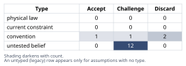
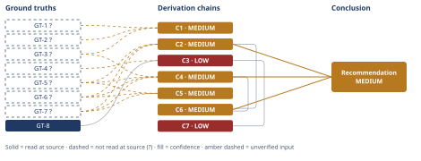

# Slack Integration vs. Reporting Rewrite: Which to Build

*First-principles analysis · 15 October 2026*

*Read with: [How to read this analysis](HOW-TO-READ.md) · [Working file](analysis-20261015T043421Z.md) · [All files](INDEX.md)*

## Executive Summary

**Recommendation:** Fund the reporting rewrite (Option B) with the full 3.2 engineer-quarters this quarter, and do not fund the Slack integration (Option A) this quarter; in parallel, spend a few days confirming whether a scoped reporting fix plus a minimal Slack webhook stopgap could do better than either pure option (chain C6, C7).

**Band (from §6):** MEDIUM (chain C6).

**Would change it:** A real engineering estimate showing the rewrite overruns 3.2 engineer-quarters (chain C3), deduplicated Slack demand concentrated in a high-value, pipeline-critical segment, or confirmation that the LOI account's base-contract exposure and the other top-10 accounts' risk are smaller than assumed (chain C4).

## 1. Problem Essence

**Essence Statement:** Given a fixed 3.2-engineer-quarter budget that funds exactly one of two named options in full, which single initiative — the Slack integration or the reporting rewrite — should the team build next quarter, and is there a partial or composite allocation of that same budget that neither pure option captures?

**Success criteria (a correct answer must achieve):**
- Maximizes expected retained-plus-expansion revenue net of execution risk over the next two quarters (not just the quarter the LOI deadline falls in).
- Is checked against a genuine composite/hybrid allocation before being forced into "pick exactly A or exactly B."
- Explicitly names the unknowns that, if resolved differently, would change the recommendation, rather than presenting false precision.
- Separates the raw stipulated facts of the scenario from the interpretive leaps layered on top of them (e.g., "41 requests" as a fact is not the same claim as "41 requests prove broad demand").

Given the strong stakes asymmetry visible even at a first read — one side has a dated dollar figure attached, the other does not — the stakes-escalation rule applies: assumptions on the higher-stakes side (reporting) are held to a higher verification bar than their counterparts on the lower-stakes side, not a lower one, precisely because more rides on them.

## 2. Assumptions Table



*Provenance note (applies to every row below): all seven stipulated facts of this scenario (GT-1 through GT-7) are given directly by the user with no external source named — no CRM export, ticket system, or legal document is identifiable to open. Per the Input Contract, a fact naming no source enters as `unverified`; this is a structural feature of analyzing a hypothetical business scenario, not a suspicion that the numbers are wrong. It is addressed once here rather than repeated on every row.*

| # | Assumption | Type | Treatment | Verdict | Verification |
|---|---|---|---|---|---|
| A-1 | The 41 Slack requests represent broad, de-duplicated demand across many distinct accounts | untested belief | Verify by deduplicating request records to distinct account IDs | Challenge — GT-2? already shows the true distinct-account count is unknown and ≤41, so breadth cannot be assumed | unverified; would need deduplication of request records by account ID |
| A-2 | Zero churn-code attribution for Slack means zero revenue risk from its absence | convention | Challenge explicitly: churn-survey codes capture only completed departures' stated reasons, not active win-rate friction, silent dissatisfaction, or future competitive risk | Discard — conflates completed-departure attribution with active win-rate friction or future risk; the literal claim is rejected | no source; sales win/loss notes citing Slack as a lost-deal reason are not supplied |
| A-3 | Slack demand is generically distributed, not concentrated in a strategic high-value segment | untested belief | Verify by segmenting the (deduplicated) requesting accounts by ARR tier / plan tier | Challenge — no segmentation data provided to confirm or deny concentration in a high-value segment | unverified; named as flip condition 2 in §6 |
| A-4 | The reporting rewrite can be fully scoped and shipped within 3.2 engineer-quarters this quarter | untested belief — highest-stakes assumption in the analysis | Must be verified by an actual engineering sizing/spike before committing | Challenge — no engineering sizing estimate exists for the rewrite against 3.2 EQ | unverified; the single highest-stakes gap in this analysis — see pre-mortem cluster 1 and flip condition 1 |
| A-5 | A full reporting rewrite (vs. a scoped fix targeting the cited gaps) is required to satisfy the LOI's shipping contingency | untested belief | Verify directly with the account's buyer — what capability, specifically, must "ship" | Challenge — not confirmed with the account's buyer; load-bearing for whether a scoped fix suffices | unverified — flagged; used in chain C3 `[Assumes: A-5]` |
| A-6 | The LOI's exit clause threatens only the $180K expansion ARR, not the account's base contract | untested belief | GT-7?'s literal wording is "non-renewal," a base-contract term | Challenge — GT-7?'s literal wording does not resolve whether the clause reaches the base contract | unverified — flagged; used in chain C2 `[Assumes: A-6]` |
| A-7 | The decision is strictly binary: fund A in full, or fund B in full, with no other allocation possible | convention | Challenge directly via a composite-option test (chain C3) | Discard — the binary framing is not supported by any technical or contractual constraint in the ground truths | rejected via chain C3's composite test |
| A-8 | The LOI deadline ("this quarter") is a hard, non-negotiable constraint | convention | Challenge: LOIs are typically negotiable commercial instruments, unlike signed order forms | Challenge — LOIs are typically negotiable, but no data on this account's flexibility | unverified; not used in a load-bearing chain |
| A-9 | Honoring this LOI's deadline pressure invites other accounts to use the same contractual-threat leverage | untested belief | Assess via second-order actor-lens reasoning (chain C5) | Challenge — plausible precedent effect, no historical base rate available | unverified — flagged; used in chain C5 `[Assumes: A-9]` |
| A-10 | Building for one customer's contractual threat (over a broadly-requested feature) damages engineering/roadmap credibility | untested belief, culture-dependent | Cannot be verified from the facts given; flagged and carried as a caveat | Challenge — culture-dependent, cannot be verified from the facts given | unverified — flagged; used in chain C5 `[Assumes: A-10]` |
| A-11 | The 240-account base and the two-quarter window are representative, not a cherry-picked period | convention | Accepted as given (no contrary evidence) | Accept — no contrary evidence given; treated as a boundary condition | accepted as stated by the user |
| A-12 | The two non-LOI top-10 accounts' reporting complaints are a leading indicator of further top-10 renewal risk, and plausibly describe the same gap as the LOI account | untested belief | Elevated toward a systemic (not account-specific) read given independent corroboration | Challenge — corroboration is real but "same gap" is not confirmed | unverified; ticket text for all three accounts not supplied |
| A-13 | A minimal Slack notification webhook can be built at a small fraction of a full native integration's cost using existing webhook infrastructure | untested belief | Verify with an engineering t-shirt-size estimate | Challenge — no t-shirt-size estimate exists for the webhook stopgap | unverified — flagged; used in chain C3 `[Assumes: A-13]` |
| A-14 | Negotiating the LOI deadline risks triggering the same relationship damage the exit clause threatens | untested belief | Assess qualitatively; no data available | Challenge — plausible relationship cost to a deadline conversation, no data either way | unverified; not used in a load-bearing chain |
| A-15 | The LOI account's base-contract ARR is a 1x–5x multiple of the $180,000 expansion figure | untested belief (surfaced during the Phase 4 Assumption Audit, from chain C4) | Verify against the account's actual base-contract value | Challenge — base-ARR multiplier is an assumed order-of-magnitude range, not sourced | unverified — flagged; used in chain C4 `[Assumes: A-15]`, affects only the upper bracket, not the floor |
| A-16 | The exit-clause-reach probability (30–70%) and sibling-account churn probability (10–30% each) are unanchored, assumption-only ranges | untested belief (surfaced during the Phase 4 Assumption Audit, from chain C4) | Replace with legal review (clause) and CS risk-scoring (sibling accounts) if a tighter estimate is ever needed | Challenge — exit-clause-reach and sibling-churn probabilities are unanchored ranges | unverified — flagged; used in chain C4 `[Assumes: A-16]`, affects only the upper bracket, not the floor |

**Stakes-escalation note:** A-4, A-5, and A-6 are the three assumptions carrying the most weight in this decision (they directly size Option B's true cost and true benefit), and none of the three is verified. This is flagged prominently rather than smoothed over — see Derivation Chains (C2–C4) and the Conclusion's flip conditions.

## 3. Ground Truths

*Provenance: every stipulated figure below (GT-1 through GT-7) is given directly by the user as a premise of this hypothetical decision scenario. No external document, ticket system, or CRM export is named or reachable to open — see the Phase 3 failure record below. Per the Input Contract, an input naming no source enters as `unverified`, so each carries the `?` suffix. This reflects a structural fact about the scenario's framing, not doubt about the user's good faith.*

- **GT-1?**: Over the last two quarters, 41 inbound requests for a Slack integration were logged across 240 active accounts.
- **GT-2?**: The 41 figure is a count of requests, not deduplicated distinct accounts; the true number of distinct accounts asking is unknown and ≤ 41.
- **GT-3?**: No churn-survey reason code in that period attributes any customer departure to the missing Slack integration.
- **GT-4?**: Team capacity next quarter is 3.2 engineer-quarters — enough to fund exactly one of the two options in full, not both.
- **GT-5?**: Three of the company's top-ten accounts by ARR filed support tickets in the last two quarters citing reporting limitations as a renewal risk.
- **GT-6?**: One of those three accounts has signed a Letter of Intent (LOI) committing $180,000/year in expansion ARR, contingent on the reporting rewrite shipping this quarter.
- **GT-7?**: The LOI includes an exit clause permitting non-renewal if the rewrite does not ship this quarter.
- **GT-8**: Because GT-4? fixes total next-quarter capacity at exactly one option's worth, any composite/hybrid allocation is only feasible if reduced-scope versions of *both* named options fit inside 3.2 engineer-quarters combined. (Derived by arithmetic entailment from GT-4?; this is a logical consequence, not an independently sourced fact, so it carries no `?` and has no read-location — it is derived, not read.)

**`?`-marked:** GT-1, GT-2, GT-3, GT-4, GT-5, GT-6, GT-7 (7 of 8).

**Phase 3 failure record (shared, applies to GT-1 through GT-7):** Source: none named — the user describes internal CRM/support-ticket/legal records of a hypothetical company without naming a system, document, or URL. Reason unreachable: no source identifier was provided and none exists to open within this session; this is a stipulated premise of a hypothetical scenario, not a claim about a reachable external document. No Read/Grep/WebFetch attempt was made because there is no path or URL to target — attempting one would not constitute verification, only the appearance of it. The genuine uncertainty in this scenario is interpretive (addressed in Phase 2's assumptions, e.g., A-1, A-5, A-6), not about whether these numbers are being reported in good faith.

**Act attempted?** No, for all of GT-1–GT-7, for the reason above — recorded once here rather than per-row, and reflected in the self-audit scan's "Act attempted?" column.

## 4. Derivation Chains



### C1 — Demand-signal strength for Option A (Slack)

```text
GT-1? (41 logged requests, 2Q) + GT-2? (dedup count unknown, ≤41) + GT-3? (no churn attribution)
→ At most 41 of 240 active accounts (≤17%) have ever logged a Slack request, and the true distinct-account count could be far smaller than 41
→ A few vocal accounts asking repeatedly would produce the same count of 41 as many accounts each asking once, and GT-2? does not let us tell the two cases apart
→ Zero churn-code attribution over two quarters means the integration's absence has not yet been shown to cause a single completed departure
→ The proven revenue-at-risk from not building Option A, over the measured period, is therefore effectively zero
→ Combined, Option A's case is a real but unquantified demand signal, not an evidenced retention or expansion thesis
```

**Confidence:** MEDIUM. Inputs: three `?`-marked GTs — the cap is structural (hypothetical-scenario provenance), not a specific doubt; would move to HIGH if the 41 requests were deduplicated to distinct accounts and cross-checked against sales win/loss notes. Inference: hops are deliberately conservative and do not overreach the stated facts. Rivals: "41 undercounts true demand because most prospects never file a formal request" is live and addressed in Abandoned Reasoning (§5, entry 1).

### C2 — Commitment-and-risk strength for Option B (Reporting)

```text
GT-5? (3 of top-10 cite reporting as renewal risk) + GT-6? (signed LOI, $180K contingent) + GT-7? (exit clause)
→ A signed LOI naming a specific dollar figure and a shipping contingency is a materially stronger commitment signal than an inbound support ticket
→ The exit clause in GT-7? is written around "non-renewal," which is contractually a base-contract term, not an expansion-only term
→ Nothing in GT-7? restricts the clause to forfeiting only the $180K increment, so the base-contract-at-risk reading cannot be ruled out from the facts given [Assumes: A-6]
→ Two further top-10 accounts, independent of the LOI account, cite the same category of limitation as a renewal risk
→ This is a second, independent data point that reporting gaps are a systemic top-tier risk rather than one account's idiosyncratic ask
```

**Confidence:** MEDIUM. Inputs: three `?`-marked GTs, same structural caveat as C1. Inference: the base-contract-exposure hop rests on A-6, which is unresolved in either direction — this is the single largest swing factor in the whole analysis and is carried into C4, C6, and the Conclusion's flip conditions. Rivals: "the LOI is a soft, non-binding sales artifact with no real walk-away risk" is live and addressed in Abandoned Reasoning (§5, entry 2).

### C3 — Framing challenge: is this really binary? (composite/hybrid test)

```text
GT-4? (3.2 EQ funds exactly one option) + GT-8 (fixed-budget arithmetic entailment)
→ A strict either/or framing assumes each option must be built at full native scope or not at all
→ "Full scope" is a scoping choice embedded in how the question was posed, not a technical constraint named in any ground truth
→ A minimal Slack notification webhook plausibly costs a small fraction of a full native integration's effort, using patterns already common in SaaS products [Assumes: A-13]
→ A reporting fix scoped to the specific gaps the three complaining accounts actually cited plausibly costs less than a ground-up rewrite [Assumes: A-5]
→ If both scoped pieces together fit inside 3.2 engineer-quarters, a composite captures most of each option's value at a fraction of either option's assumed full cost
→ This composite is only safe to select once A-5 and A-13 are confirmed, which this analysis has not done
```

**Confidence:** LOW. Inputs: one `?`-marked GT (ceiling MEDIUM). Inference: short as well — the conclusion rests on two unpriced, unresolved assumptions (A-5, A-13) whose failure would reverse it, and neither has been estimated; two short axes caps the band at LOW. Rivals: "LOI shipping contingencies are typically drafted to require the full promised capability, so a scoped fix would not legally discharge it" is live and unresolved — tracked in Abandoned Reasoning (§5, entry 3) as an open rival, not a refuted one.

### C4 — Quantified expected-value comparison (estimate procedure)

Target quantity: expected ARR impact, in dollars, attributable to each option over the next two quarters — chosen so both options are compared on the same basis.

```text
GT-6? ($180,000 expansion, firm figure) + GT-3? (zero churn floor for Option A) + GT-5? (corroborating top-10 complaints) + GT-7? (exit clause scope)
→ Option B's quantifiable floor is $180,000/yr in contingent expansion ARR, stated directly rather than estimated
→ Option A's quantifiable floor is $0 in proven-at-risk revenue, per the zero churn-code attribution
→ On the floor comparison alone, $180,000 exceeds $0 by the full amount — no estimation is required for this step
→ Bracketing the upper end: base-contract exposure is unknown but plausibly $180,000–$900,000 (an assumed 1x–5x multiplier on the expansion figure, not a sourced number) [Assumes: A-15]
→ Adding a 30%–70% chance the exit clause reaches the full base contract, plus the two other top-10 accounts' own ARR-scale exposure at an assumed 10%–30% churn probability each, brackets Option B's total exposure at roughly $400,000 to $1,600,000 [Assumes: A-16]
→ Option A has no comparable upper bracket — no deal size, win-rate lift, or segment concentration is given, so its upside cannot be responsibly bracketed beyond "non-zero and currently unmeasured"
→ Both the lower-bound comparison ($180,000 vs. $0) and the upper-bound comparison (hundreds of thousands to ~$1.6M vs. an unbracketed non-zero figure) favor prioritizing Option B, so the estimate is decision-resolved without further tightening
```

**Confidence:** MEDIUM. Inputs: four `?`-marked GTs, structural cap as before — GT-6? is the single most load-bearing figure in the analysis; confirming the LOI's actual signed terms would lift this chain toward HIGH. Inference: the upper-bound brackets rest on A-15/A-16, both explicit order-of-magnitude placeholders, not measured figures — but the headline conclusion does not depend on them; it holds at the conservative floor comparison alone. Rivals: "Option A could be a top-of-funnel gatekeeper feature whose unquantified upside secretly exceeds B's floor" is live and not ruled out by any given fact — carried forward as flip condition 2 in §6.

### C5 — Second-order effects (actor lens + time lens)

```text
GT-5? (corroborating top-10 complaints) + GT-6? (LOI) + GT-7? (exit clause)
→ (time, immediate) Shipping B directly satisfies the one deadline that currently exists
→ (time, immediate) Shipping A does nothing to the LOI's clock, which keeps running regardless of Slack's own progress
→ (actor, customers) If B ships and resolves the same gap for the two other top-10 accounts, their escalation risk likely falls alongside the LOI account's
→ (actor, sales) A successful threat-driven ship gives sales a reference story for future reporting-sensitive deals
→ (actor, other accounts) If other accounts learn a signed exit clause reliably reprioritizes the roadmap, some will attach similar clauses to future renewals [Assumes: A-9]
→ (actor, internal) If A ships instead and the LOI account's base contract is put at risk, Customer Success inherits a damaged enterprise relationship [Assumes: A-10]
→ (actor, internal) That damaged relationship also carries reduced trust in the roadmap process going forward [Assumes: A-10]
→ (time, medium-term) Within 2–4 quarters, shipping B lets the company verify whether the other two accounts' complaints were actually resolved by the same fix
→ (time, long-term) If prioritizing contractually-threatened accounts over broadly-requested features repeats as a pattern, roadmap control risks drifting toward whichever account negotiates the sharpest clause
```

**Contradiction check:** none of these effects contradicts GT-1 through GT-8; the precedent-risk effect (A-9) is a genuine cost of choosing B, carried into the Conclusion as an explicit caveat rather than a reason to reverse the pick, since the LOI is a commitment already made, not one the company is choosing to invite.

**Success-criteria check:** the decision's purpose is to maximize retained-plus-expansion revenue while preserving future roadmap integrity; the precedent effect works against the second half of that purpose even in the branch where B succeeds. This is named explicitly rather than smoothed over; its mitigation (clause discipline in *future* contracts, not declining this already-signed LOI) is carried into the pre-mortem's disposition.

**Confidence:** MEDIUM. Inputs: structural cap as before. Inference: the time-lens hops follow directly from GT-5?/GT-6?/GT-7?; the actor-lens precedent hops rest on A-9/A-10, both unresolved in either direction. Rivals: none beyond those already tracked on C2.

### C6 — Core recommendation

```text
C2 (MEDIUM) + C4 (MEDIUM)
→ Per chain C2, Option B's stakes include a contractually-dated $180,000 floor plus plausible larger exposure
→ Per chain C4, this floor exceeds Option A's entire quantifiable case under the most conservative reading available
→ Because capacity (GT-4?) funds exactly one option in full, and B's floor dominates A's floor on both bracket ends, the single-option choice that maximizes expected retained-plus-expansion revenue this quarter is Option B
```

**Confidence:** MEDIUM. Inputs: both cited chains are MEDIUM, driven by the structural `?` on the underlying stipulated GTs, not an identified factual doubt. Inference: this chain only compares two already-established floors and introduces no new unpriced assumption. Rivals: "the composite dominates both" is live and tracked as a parallel no-regret investigation (C7), not folded into this headline pick; "Option A should win on breadth across 240 accounts" is addressed and rejected in C1/Abandoned Reasoning.

### C7 — Composite investigation (parallel track, not a scope commitment)

```text
C3 (LOW)
→ Answering whether A-5 and A-13 resolve favorably costs a conversation with engineering and the account team, not engineering time
→ The expected value of spending a few hours confirming or ruling out the composite is positive regardless of which option is funded
→ If both answers come back favorable, scope can be adjusted without displacing the reporting work; if not, nothing is lost
```

**Confidence:** LOW. Inputs: inherits C3's LOW rating in full. Inference: this is a recommendation to gather information, not a scope commitment, which is why it stays out of C6 rather than merged into it. Rivals: none — this is a no-regret action.

## 5. Abandoned Reasoning

### Dead End: 41 requests understate true Slack demand

**What was tried:** Treat "41 requests understates true demand, because most prospects never bother filing a formal request" as a reason to weight Option A more heavily.

**Why abandoned:** No fact in the record points this direction more than the opposite (a handful of accounts asking repeatedly). More importantly, even granting larger informal demand, GT-3? (zero churn attribution) remains the hard floor for proven revenue-at-risk — informal demand does not change the floor comparison in C4.

**What it ruled out:** Weighting Option A's demand breadth above Option B's quantified commitment in the headline comparison. Ruled out by: GT-3? combined with C4's conservative-floor framing.

### Dead End: LOI is a non-binding sales artifact

**What was tried:** Treat the LOI as a soft, non-binding sales artifact (letters of intent are often non-binding in general commercial practice) whose stakes are therefore overstated.

**Why abandoned:** Even if legally non-binding, an account's willingness to put a dollar figure and a shipping deadline in writing is a stronger demand signal than 41 undifferentiated requests. The downside of treating it as a bluff and being wrong (losing a top-10 account) is asymmetrically worse than the downside of treating it as real and being wrong (building reporting work that two other top-10 accounts already said they need anyway).

**What it ruled out:** Discounting C2/C4's stakes to near-zero. Ruled out by: GT-5? (independent corroboration makes the reporting need real regardless of the LOI's enforceability) combined with asymmetric-downside reasoning in the pre-mortem.

### Dead End: Scoped reporting fix safely discharges the LOI

**What was tried:** Assume a scoped/partial reporting fix would legally discharge the LOI's shipping contingency, making the composite (C3) a safe default rather than a thing to investigate.

**Why abandoned:** Not refuted — this rival remains live. LOI shipping contingencies are often drafted to require a specific, fully-described capability, and nothing in the given facts confirms a scoped fix would satisfy it.

**What it ruled out:** Nothing — this is recorded as an open, unresolved rival (not an abandoned one), which is exactly why C3 and C7 are rated LOW and framed as "investigate," not "assume and build."

### Dead End: Single weighted trade-off score across both options

**What was tried:** Build a single weighted trade-off score (criteria scored 1–5 and weighted, per the standard trade-off procedure) across both options on dimensions like "revenue impact," "strategic risk," and "demand breadth."

**Why abandoned:** The two options' value is of fundamentally different kinds — one carries a dated, dollar-denominated contractual floor; the other carries a speculative upside with no dollar anchor at all. Forcing both into 1–5 scored criteria would require inventing precision (e.g., scoring "demand breadth: 3/5") that the direct floor-vs-floor comparison in C4 makes unnecessary, and risks hiding the real asymmetry behind a tidy-looking weighted number.

**What it ruled out:** A scored trade-off matrix as the primary decision instrument for this particular comparison. Replaced by the direct estimate-based floor comparison in C4, which states its uncertainty explicitly rather than compressing it into a single weighted score.

## 6. Conclusion

**Recommended approach:** Fund Option B (the reporting rewrite) with the full 3.2 engineer-quarters this quarter; do not fund Option A (the Slack integration) this quarter. In parallel, within the first one to two weeks, spend non-engineering time confirming (a) what "ships" must concretely mean to satisfy the LOI's contingency, and (b) a rough t-shirt-size for a minimal Slack webhook stopgap — only shift scope if both answers come back favorable and doing so does not displace the reporting work (chain C6, C7).

**Key insight:** The two options are not actually comparable as originally framed, because one carries a dated, dollar-denominated contractual floor corroborated by two independent signals, while the other carries an unweighted count of requests with an explicitly proven-zero churn impact — the decision is dominated at the floor level before any of the deeper strategic debate (precedent risk, roadmap capture) needs to be resolved (chain C4, C6).

**Trade-offs acknowledged:** Choosing B accepts two real costs, named explicitly rather than hidden: a precedent risk (rewarding a contractually-threatened account ahead of a broadly-requested feature, which may invite similar clauses from other accounts), and an execution risk (no engineering estimate has confirmed the rewrite actually fits in 3.2 engineer-quarters — this is the single biggest threat to this recommendation, see the pre-mortem) (chain C5).

**Confidence:** MEDIUM. Inputs: every ground truth in this analysis is structurally `?`-marked because this is a hypothetical scenario with no external source to check against — the cap reflects that structural fact, not a specific doubt about the figures as given. Inference: the recommendation holds at the conservative floor comparison alone (C4) and does not require resolving the larger, more speculative upside/downside brackets. Rivals: the main live rival — that a composite dominates both pure options — is tracked as a parallel, no-regret investigation (C7/C3) rather than ruled out, because this analysis lacks the two facts (A-5, A-13) that would settle it; it does not outrank the core recommendation because it has not been confirmed viable.

**Conditions that would flip this recommendation:**

1. **Engineering estimate overrun.** If a real sizing/spike shows the reporting rewrite credibly cannot fit in 3.2 engineer-quarters (A-4 resolves unfavorably), the recommendation flips toward either the scoped composite (chain C3) or negotiating the LOI deadline — committing the full budget to a project that overruns risks missing the deadline *and* shipping nothing.
2. **Concentrated, pipeline-critical Slack demand.** If deduplicating the 41 requests and segmenting by ARR tier shows demand is concentrated in a small number of high-value, pipeline-critical accounts — especially if sales can attribute specific stalled or lost deals to the missing integration — this closes chain C4's gap on Option A's side and could flip the recommendation toward Option A or the composite.
3. **Smaller-than-assumed exposure.** If the LOI account's base-contract ARR is confirmed small relative to $180K *and* the two other top-10 accounts' complaints are confirmed minor or unrelated (A-6 resolves favorably, A-12 resolves unfavorably), chains C2 and C4's floor shrinks materially, making the decision much closer and potentially flipping it in combination with condition 2.

