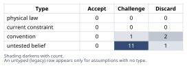
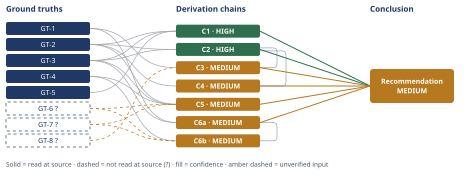

# Should We Add a Free Tier to Our B2B SaaS Product

*First-principles analysis · 11 October 2026*

*Read with: [How to read this analysis](HOW-TO-READ.md) · [Working file](analysis-20261011T205916Z.md) · [All files](INDEX.md)*

## Executive Summary

**Recommendation:** Do not add a true open, permanent self-serve free tier right now. Instead,
add a narrower composite — a self-serve sandbox/demo environment plus a formalized,
sales-assisted, time-limited trial for qualified leads from existing outbound/referral channels —
run as an explicitly gated pilot with pre-committed metrics, not a permanent packaging decision
(chain C1, chain C5).

**Band (from §6):** MEDIUM — the structural case is HIGH (chain C1, chain C2) but the specific
design and its risk controls are each MEDIUM (chain C3, chain C4, chain C5, chain C6a).

**Would change it:** (1) resolving whether $10k ACV correlates with seats (chain C3), (2) a real
Finance cost-to-serve estimate replacing the industry bracket (chain C6a), and (3) the gated
pilot itself producing a measured conversion rate and cost-to-serve for this product (chain C5).

## 1. Problem Essence

**Essence Statement.** Given a $2.4M‑ARR, 240‑team B2B SaaS business running 100% outbound
go‑to‑market with no inbound/self‑serve infrastructure, and a cost structure in which any
free‑usage tier's cost scales with *active* (not *paying*) users, determine the lowest‑risk
packaging‑and‑channel change — if any — that addresses the real underlying needs behind "add a
free tier" (buyer self‑serve‑evaluation expectations, competitive table‑stakes risk, and
acquisition‑channel diversification) without materially exposing the business to uncapped
support/infra cost or cannibalizing the existing $10,000‑ACV outbound sales pipeline.

"Should we add a free tier" is the triggering question, not the question to answer: it bundles at
least five separable sub‑questions (acquisition‑channel strategy, cost‑model exposure,
product‑led‑vs‑sales‑led motion fit, competitive positioning/table‑stakes risk, and cannibalization
risk to the existing $10k‑ACV motion) that can — and, as this analysis will show, do — have
different answers from each other. Forcing them into one yes/no collapses that structure and is
itself a reasoning error to avoid.

**Success criteria** (what a correct answer must achieve):

1. Treats "add a free tier" as a bundle of separable sub‑questions (channel, cost model,
   motion‑fit, competitive positioning, cannibalization) and answers each, rather than forcing a
   single yes/no.
2. Does not require the final answer to be literally "add a full open free tier" or "don't" —
   genuinely evaluates alternatives and composites (trial, sandbox, guarantee, hybrid designs).
3. Quantifies what would need to be true (conversion rate, cost‑to‑serve, volume) for a
   free‑tier‑like offering to be NPV‑positive, with every numeric input explicitly labeled as
   given‑fact vs. external‑benchmark vs. assumption.
4. Names the single highest‑leverage unresolved unknown and a cheap, concrete way to resolve it,
   given that no freemium pilot has ever been run.
5. Addresses the risk of *not* acting (competitive/table‑stakes loss, growth‑ceiling risk) with
   the same rigor as the risk of acting (cost exposure, cannibalization) — inaction is itself an
   option with consequences, not a neutral default.

**Methodological note on technique selection.** This run uses the full composer (Phases 1–5),
since the request asks for a holistic decision, not one isolated technique. Two companion
techniques named in the methodology as requiring explicit disclosure when not fired —
theoretical‑limit and inversion — are each invoked at two points; see `Techniques not applied`
in the process‑output appendix for the two points where they did not fire and why (in short:
theoretical‑limit's domain — a law‑permitted ceiling/floor once convention is stripped — does not
fit either the essence‑reframe question here or the quantitative question in §4, which is a
magnitude rebuild from cost/revenue unit‑factors, i.e. Estimate's domain; and the Phase 5
adversarial technique is pre‑mortem rather than inversion because the conclusion is a plan, not a
bare claim, per the methodology's own claim‑vs‑plan decision rule).

## 2. Assumptions Table



| # | Assumption | Type | Treatment | Verdict | Verification |
|---|---|---|---|---|---|
| A1 | This product's free‑to‑paid conversion rate will fall somewhere in the general B2B SaaS benchmark range | untested belief | Use external benchmark only as a planning bracket, never as a point forecast | Challenge — accepted only as an external bracket (→ GT‑6?), not as this product's measured number | unverified — flagged (→ GT‑6?); verification path: run a scoped, gated pilot (see §6) to get a product-specific number |
| A2 | Cost per active free/trial user (k) will be low (tens–hundreds of $/yr) | untested belief | Must be modeled by Finance from actual infra pricing + a defined support‑tier policy before any build decision | Challenge — accepted only as an industry bracket (→ GT‑7?), not as this company's measured number | unverified — flagged (→ GT‑7?); verification path: Finance cost‑to‑serve model for the specific free/trial design, done before launch |
| A3 | "All competitors have a free tier" means this company needs one too (competitor‑mimicry read) | convention | Explicitly challenged: is the signal "need a free tier" specifically, or "buyers expect a self‑serve try‑before‑buy option," which narrower alternatives can also satisfy? | Discard — the mimicry framing itself is rejected as the controlling frame; the underlying buyer expectation is accepted separately (see A6) | Resolved by reframing (chain C1) and by the trade‑off result (chain C5) |
| A4 | A free tier, once added, is low/no incremental cost because "free users don't cost anything" | convention (common SaaS folk belief) | Explicitly challenged | Discard — contradicted directly by GT‑3 (Finance‑confirmed cost model) | Already settled by GT‑3; no further verification needed |
| A5 | Building a free tier is just a pricing‑page/paywall change | untested belief / hidden assumption | Challenge against GT‑2 | Discard — contradicted by GT‑2; it requires self‑serve signup, onboarding, and (for any volume) an inbound acquisition motion that does not exist today — a GTM‑infrastructure project, not a packaging change | Follows directly from GT‑2 |
| A6 | Buyers in competitive evaluations expect to self‑serve‑trial before talking to sales, and will disqualify vendors who can't offer that | untested belief (load‑bearing — surfaced by inversion) | Verify | Challenge — plausible given GT‑5, but unverified as to frequency/magnitude for this company's actual deals | Have sales tag lost/stalled competitive deals for "no self‑serve option cited as a factor" over the next N opportunities — cheap, uses data already being generated |
| A7 | A free tier would cannibalize existing $10k‑ACV outbound pipeline (prospects self‑select into free instead of a paid contract) | untested belief (load‑bearing — surfaced by inversion) | Verify / mitigate by design (seat caps, feature gating) | Challenge — real risk, magnitude unknown, partially controllable via product design | Pilot with explicit tracking of free/trial‑signup overlap with active outbound opportunities (an "overlap/leak rate") |
| A8 | This company's $10,000/team ACV correlates with seat count (i.e., pricing is effectively per‑seat in practice, not flat‑per‑team) | untested belief, explicitly flagged as open by the business owner ("not per‑seat necessarily, confirm if it matters") | Verify directly | Challenge — load‑bearing and unresolved; business owner itself flagged this as open (→ GT‑8?) | unverified — flagged (→ GT‑8?); verification path: pull a sample of ~10–20 contracts; check whether ACV correlates with seat count |
| A9 | This company's outbound‑reached ICP is the same market segment where competitors' free tiers actually function as a deal‑qualification gate (e.g., SMB/mid‑market self‑serve buyers), rather than a segment (e.g., large enterprise RFP) where free tiers are rarely the entry point | untested belief | Verify | Challenge — unresolved, genuinely unknown from the given facts (no ICP/segment data given) | Segment the lost‑deal analysis from A6 by deal size/segment |
| A10 | Support/CS has capacity to absorb free/trial ticket volume without degrading paying‑customer SLA (fishbone: People) | untested belief | Verify | Challenge — unresolved | Define a capped/self‑serve‑only support tier for free/trial users *before* launch; track paying‑customer support SLA during the pilot |
| A11 | Sales comp plan and lead‑routing can accommodate free/trial‑originated leads without conflicting with outbound rep incentives (fishbone: Process) | untested belief | Verify | Challenge — unresolved; see pre‑mortem Cluster A | Define routing/comp rules explicitly before the pilot; monitor rep behavior for diversion/neglect patterns |
| A12 | Infra cost per active free/trial account is bounded and predictable, not subject to runaway/abuse (bot signups, compute abuse) (fishbone: Technology) | untested belief | Verify | Challenge — unresolved | Rate‑limiting/abuse controls designed into the pilot; monitor the *distribution* of cost per account, not just the average |
| A13 | A minimal, cheap inbound motion (e.g., a landing page plus existing referral traffic) could be stood up fast enough to avoid the "no signal because no funnel" confound (surfaced at chain C4; rival to C4) | untested belief | Verify / design around | Challenge — partially addressed by routing the pilot through existing referral + outbound traffic rather than waiting on a built inbound funnel, not fully verified | Pilot design explicitly uses existing referral + outbound channels (see §6), not a new paid‑acquisition motion |
| A14 | The 1–5 criterion weights and option scores in the trade‑off matrix (chain C5) reflect this company's actual risk priorities and ICP, not just generic SaaS reasoning | untested belief | Flag unverified | Challenge — weights were locked from the business owner's own stated top‑three concerns before scoring, which is the correct discipline, but fit to this company's actual ICP (A9) is unresolved | Re‑run the flip test (see §4/§5) once A9 is resolved |
| A15 | Cost‑to‑serve an active free/trial account scales *linearly* with active‑user count, not sub‑linearly (e.g., via caching/CDN economies of scale) (surfaced at chain C6a; convention — the simplest reading of GT‑3's wording) | convention | Explicitly challenged | Challenge — live, unresolved rival, not ruled out; see chain C6a confidence line | Measure actual k at two different volume levels during the pilot to check for scale economies |

## 3. Ground Truths

`?`-marked: GT-6, GT-7, GT-8 (3 of 8).

- **GT-1** — $2.4M ARR, 240 paying teams, ~$10,000/team/year average contract value. *Measured*
  (the company's own books). Source: stated by the business owner as a fixed given fact for this
  analysis. Read-at-source: N/A — first-party operational data the business owner has direct
  authority over (their own revenue and contract records), not an external document with a
  page/section to cite; categorically different from an externally‑checkable claim, so it is
  accepted as given per the Input Contract rather than suffixed `?`. Feeds chain C3, chain C6a.
- **GT-2** — Go‑to‑market today is 100% outbound sales + referrals; no self‑serve inbound
  channel, no PLG motion, no existing signup funnel. *Stated fact* (business owner, internal).
  Read-at-source: N/A — first-party operational fact about the company's own GTM, same basis as
  GT-1. Feeds chain C1, chain C2, chain C4, chain C5.
- **GT-3** — Finance has confirmed: free‑tier costs (infra + support) scale with *active* users,
  not *paying* users. *Confirmed policy/cost‑model fact* (business owner, Finance, internal).
  Read-at-source: N/A — first-party policy fact confirmed directly by the company's own Finance
  function, same basis as GT-1. This is the single most load‑bearing fact in the whole analysis —
  see the Sensitivity step in the adversarial pass record. Feeds chain C1, chain C2, chain C5,
  chain C6a.
- **GT-4** — No freemium pilot has ever been run; the free‑to‑paid conversion rate for this
  product is genuinely unknown internally (not merely unestimated from internal data — unknown).
  *Stated fact* (business owner, internal). Read-at-source: N/A — first-party fact about the
  company's own operating history, same basis as GT-1. Feeds chain C5, chain C6b.
- **GT-5** — All competitors have a free tier. *Stated market‑observation fact* (business
  owner). Read-at-source: N/A — first-party market observation the business owner directly
  asserts; examined, not assumed decisive — see assumption A3 and chain C1/C5. Feeds chain C1.
- **GT-6?** — External B2B freemium conversion‑rate benchmarks: self‑serve B2B freemium
  commonly converts at roughly 6–8% (Lenny Rachitsky, survey of 1,000+ products, as reported by
  Userpilot); sales‑assisted freemium 10–15% (same source); a broader cross‑industry median of
  8% across 200 software products, right‑skewed with a ~10x gap between top and bottom quartile
  (ChartMogul/Growth Unhinged/ProductLed, as reported by Userpilot); a lower cross‑client average
  of 3.7% (First Page Sage, 80+ SaaS clients, 2021–2025, as reported by Userpilot), ranging 2.6%
  (EdTech) to 5.8% (RegTech). *External benchmark, read‑at‑source only for the aggregator page*:
  read at [userpilot.com/blog/freemium-saas](https://userpilot.com/blog/freemium-saas/) via
  WebFetch on 2026‑10‑11. **Phase 3 failure record:** a direct fetch of First Page Sage's own
  page (`firstpagesage.com/seo-blog/saas-conversion-rate-benchmarks/`) was attempted to verify
  the primary figure and returned HTTP 404 (page not found/moved) — the primary ChartMogul,
  ProductLed, and Lenny Rachitsky reports were not independently opened. Remains `?` because the
  figures are read through a secondary aggregator, not the primary studies. Per the unreachable-
  source exception, this ground truth feeds only MEDIUM chains (C5, C6b), consistent with that
  record. Feeds chain C5, chain C6b.
- **GT-7?** — Cost‑to‑serve a lightweight, self‑serve‑support‑only free B2B SaaS account
  (infra + support) commonly runs roughly tens‑to‑low‑hundreds of dollars per active account per
  year, and can exceed $1,000/yr if live support or heavy compute/storage is involved. *Estimate
  — general industry order‑of‑magnitude reasoning, not a cited study and not this company's own
  number.* No specific source was located or attempted for this figure because it is not a
  citable empirical claim from one study; it is a planning bracket only, and Finance has not yet
  produced a number for this specific product (see A2). Unverified; the single highest‑leverage
  number to measure before any build decision (see chain C6a/C6b and §6). Feeds chain C5, chain
  C6b.
- **GT-8?** — Whether this company's $10,000/team ACV correlates with seat count is unconfirmed
  by the given facts; pricing is stated as team‑based, "not per‑seat necessarily." *Explicitly
  flagged as open by the business owner itself* ("confirm if it matters"). Unverified — see A8.
  Feeds chain C3.

## 4. Derivation Chains



**Note on technique choice for the quantitative step below.** The requested "theoretical‑limit /
back‑of‑envelope estimate" is implemented here with the **Estimate** procedure (a magnitude
rebuild from cost/revenue unit‑factors), not the **Theoretical‑limit** procedure. Theoretical‑limit
derives a ceiling/floor from a governing hard constraint (a physical law, a conservation identity,
a protocol minimum) — there is no such constraint on a SaaS cost‑to‑serve figure; it is a modeled
business ratio, not a law‑permitted bound. Using Estimate instead of Theoretical‑limit is itself
the result of applying the two techniques' own decision rule, not an omission.

---

**C1 — the bundle decomposes into five separable questions, and the sub‑answers differ from each
other**

```text
GT-2 (100% outbound, no inbound/self-serve infra) + GT-3 (free-tier cost scales with active users) + GT-5 (all competitors have a free tier)
→ a "free tier" changes five separable things at once: acquisition channel, cost-model exposure, GTM-motion fit, competitive positioning, and cannibalization exposure
→ each of those five sub-questions can have a different correct answer from the others
→ GT-5 only tells us the competitive-positioning sub-question is live, not what the other four sub-questions' answers should be
→ chain C5's own result confirms this: self-serve parity is best solved by sandbox+trial, while cost and cannibalization exposure argue against an open free tier
→ the literal yes/no framing of "add a free tier" collapses five independent decisions into one binary and should be decomposed before deciding
```

none · Inputs ceiling: HIGH.

**Confidence:** HIGH. Inputs: all three head facts are given, unflagged. Inference: the five
sub‑questions are a straightforward partition of what literally changes when self‑serve free
usage is introduced; no inserted assumption beyond the table. Rivals: a "this is really one
unified decision" reading is foreclosed on inspection, independent of any other chain's result —
the five sub‑questions concern definitionally different objects (an acquisition mechanism, a cost
schedule, an org‑process fit, a market‑perception fact, and a pipeline‑economics fact), so nothing
requires them to share one answer, and no rival reading was found that unifies them.

---

**C2 — without an inbound channel, a self‑serve free tier is a pure cost center until fed**

```text
GT-2 (no inbound/self-serve signup funnel exists) + GT-3 (cost scales with active users)
→ active free users can only originate from a newly-built inbound motion or from redirected existing outbound-touched prospects
→ the new-channel path produces cost with zero volume and zero benefit until a separate acquisition investment is funded
→ the redirected-prospect path converts any acquisition benefit directly into cannibalization exposure
→ the only available volume in that redirected path is prospects sales would otherwise have converted at full ACV
→ a self-serve free tier cannot be evaluated as a standalone pricing decision: it is conditional on which acquisition path feeds it, and each path carries a different, named cost
```

ceiling: HIGH.

**Confidence:** HIGH. Inputs clear. Inference: an exhaustive two‑way partition (new channel vs.
existing channel) with no unstated assumption inserted. Rivals: "organic/word‑of‑mouth visitors
could self‑discover a free‑tier link without any built funnel" is foreclosed directly by GT‑2's
own wording, an unsuffixed given fact — there is no signup funnel to discover at all.

---

**C3 — cannibalization is real and design‑dependent, not hypothetical**

```text
GT-1 ($10k ACV, team-based pricing) + GT-8? (seat-correlation unconfirmed) + C2 (redirected-prospect path converts acquisition benefit into cannibalization)
→ a free/trial tier that exposes the same team-collaboration value as the paid product gives a price-sensitive outbound prospect a rational incentive to self-serve instead of signing
→ this incentive is strongest exactly when the tier is not capped below real team usage
→ the magnitude of this risk is controllable by product design (seat caps, feature gating) but not eliminable, and is unverified for this product because GT-8? is open
```

cited: C2 (HIGH) · Inputs ceiling: MEDIUM (GT‑8? is `?`-marked).

**Confidence:** MEDIUM. Inputs: GT‑8? is the sole short axis — whether $10k ACV scales with
seats is unconfirmed, and that is exactly what determines how tightly a free/trial tier must be
capped; verification removing this cap is a 10–20‑contract sample check (A8), cheap and
immediate. Inference: clean — the mechanism (shared value → rational self‑selection) follows by
deduction once GT‑8? is granted either way. Rivals: clean — no competing conclusion to "this risk
is real and design‑dependent" was found; the only open question is the risk's magnitude, which is
exactly what the Inputs‑axis shortfall above already carries, not a second, independent axis.

---

**C4 — second‑order: mixing a self‑serve/trial motion into a 100%-outbound sales org creates its
own confound, through both the actor and time lenses**

```text
C2 (acquisition path dependency) + GT-2 (outbound reps have no process/incentive for self-serve leads)
→ introducing free/trial-originated leads requires new comp-plan rules or lead-routing changes, because reps are neither incentivized nor equipped to treat them as real pipeline
→ infra/support cost appears before any conversion revenue, so the motion looks like a pure cost sink before there has been time for a signal to accrue
→ low free/trial signups during that window could mean either "no product-market pull" or simply "no funnel was built to feed it"
→ those two causes are observationally identical from a conversion-rate dashboard alone
→ launching this as an isolated experiment, without resourcing lead volume or redefining the sales interface, risks an uninterpretable or falsely-negative result
→ this risk holds regardless of whether true freemium product-market fit is actually good
```

ceiling: HIGH.

**Confidence:** MEDIUM. Inputs clean (C2 is HIGH, GT‑2 is given). Inference: clean — each hop
follows by deduction from the one before it; no hop rests on an undeclared or unpriced premise.
Rivals: short, and this is the chain's sole shortfall — A13 (a minimal, cheap inbound motion
built from existing referral traffic could be stood up fast enough to avoid this confound) is a
live, unsettled rival to the *severity* of this chain's endpoint; nothing in this analysis rules
it out. This is exactly why the recommended pilot design (§6) deliberately routes through
existing referral + outbound channels rather than waiting on new paid acquisition — the design
response to an acknowledged, open rival, not a claim that the rival has been settled.

---

**C5 — trade‑off: across realistic alternatives, a narrower composite dominates an open free tier**

Options evaluated (status quo always included; a composite always tested per the trade‑off
procedure): (0) status quo — outbound only; (1) full open self‑serve free tier; (2) time‑limited,
sales‑assisted trial; (3) freemium‑lite, single‑user‑capped tier; (4) self‑serve sandbox/demo
environment (synthetic data, no living account); (5) money‑back guarantee on paid contracts, no
new product surface; (6) composite — sandbox/demo **plus** a sales‑assisted time‑limited trial for
qualified leads, with no permanent open free account.

No hard must‑have knockouts were identified — competitive risk, cost exposure, and cannibalization
risk are all matters of degree for this company, not binary pass/fail gates, so they are scored as
weighted criteria rather than applied as knockouts.

Criteria, weights (1–5, locked before scoring), and anchors:

| Criterion | Weight | 1 anchor | 5 anchor |
|---|---|---|---|
| C1 Self‑serve/competitive parity | 5 | No change to buyer evaluation experience | Buyer can fully try the product before any sales contact |
| C2 Cost containment | 5 | Open-ended, uncapped active-user cost exposure | Cost fixed/capped or near-zero regardless of volume |
| C3 Pipeline protection | 5 | High risk existing outbound prospects divert from $10k contracts | Mechanism explicitly prevents diversion from paid team contracts |
| C4 Build feasibility (low burden) | 4 | Requires a full inbound/self-serve funnel from scratch first | Deployable within the existing outbound motion, minimal new infra |
| C5 Speed to signal | 3 | 12+ months to get a meaningful, uncounfounded read | Meaningful read within one quarter |
| C6 Motion integrity | 3 | Significant comp-plan/lead-routing conflict with outbound reps | Fully compatible, no new conflicts |
| C7 Upside ceiling | 2 | Negligible long-run growth optionality | Large compounding self-serve growth-channel potential |

Scores (1–5) and weighted totals (weight × score, summed; weights sum to 27):

| Option | C1(5) | C2(5) | C3(5) | C4(4) | C5(3) | C6(3) | C7(2) | Weighted total |
|---|---|---|---|---|---|---|---|---|
| Status quo | 1 | 5 | 5 | 5 | 1 | 5 | 1 | **95** |
| Full open free tier | 5 | 1 | 1 | 1 | 2 | 2 | 5 | **61** |
| Time-limited sales-assisted trial | 3 | 4 | 4 | 4 | 4 | 4 | 2 | **99** |
| Freemium-lite, single-user cap | 3 | 3 | 3 | 2 | 2 | 3 | 3 | **74** |
| Sandbox/demo (synthetic data) | 4 | 5 | 5 | 4 | 4 | 5 | 2 | **117** |
| Money-back guarantee | 2 | 4 | 5 | 5 | 3 | 5 | 1 | **101** |
| **Composite: sandbox + gated trial** | 5 | 5 | 5 | 3 | 4 | 5 | 3 | **120** |

**Flip test.** Composite (120) beats Sandbox‑alone (117) by 3 points; the two differ only on C1
(5 vs 4), C4 (3 vs 4), C7 (3 vs 2), so the gap equals `w(C1) − w(C4) + w(C7)` = 5 − 4 + 2 = 3.
Raising `w(C4)` to its maximum (5) only narrows the gap to 2 — not a flip. The only single‑criterion
move that flips the ranking is cutting `w(C1)` — the highest‑weighted criterion in the matrix — from
5 down to 2 (a tie) or to 1 (an outright flip): an ~60–80% cut to the one criterion this analysis
weighted most heavily. Against the full open free tier, the gap is 120 − 61 = 59 points; no
single‑criterion weight move within the 1–5 scale closes that gap. The ranking is robust unless the
competitive/self‑serve‑parity criterion itself was badly over‑weighted (see A9, A14).

```text
GT-2 (no inbound funnel) + GT-3 (cost scales with active users) + GT-4 (no pilot ever run, conversion genuinely unknown) + GT-6? (external conversion benchmark) + GT-7? (cost-to-serve benchmark)
→ GT-4 means every score in this matrix that depends on conversion or cost-to-serve must lean on external benchmarks rather than internal data
→ scoring 7 options against the 7 weighted criteria above ranks the composite (sandbox + gated trial) highest, at 120
→ the composite's margin over every other option (see table above) spans from 3 points against sandbox-alone to 59 points against the full open free tier
→ the flip test shows this ranking is robust: only a drastic cut to the single highest-weighted criterion changes the leader
→ among realistic options, a composite "sandbox + gated trial" design dominates a true open freemium tier under this company's specific constraints
```

(unverified) · ?-marked: GT-6?, GT-7? · lowest cited: none (no chain cited directly) · Inputs
ceiling: MEDIUM (two `?`-marked inputs, no LOW chain cited).

**Confidence:** MEDIUM. Inputs: short, and this is the chain's sole shortfall — GT‑6? and GT‑7?
feed the anchor reasoning behind several scores (C1, C2, C7 in particular), so the *scores
themselves*, not just the final ranking, inherit the benchmark uncertainty; verification path is
the same gated pilot named in §6. Inference: clean — weights were locked from the business
owner's own stated top‑three concerns before scoring, which is the correct discipline, and the
ranking is arithmetic once those weights and scores are granted; A14 (whether the weights
reflect this company's real priorities) is a live open question noted in §2, but it bears on how
much to *act* on this ranking, not on whether the ranking itself follows from the stated inputs.
Rivals: the live rival named on this chain in §6 — fund a full open freemium build in parallel
with a real inbound‑marketing investment, as a multi‑quarter growth bet — is addressed, not left
open: §5 ("Sequencing dominates parallel commitment") shows that path is dominated by running the
gated pilot first and deciding afterward, on cost‑of‑information grounds (citing chain C4 and
chain C6b), for any risk‑neutral or risk‑averse decision‑maker; a decision‑maker with a strategic
urgency reason to move regardless of information value is explicitly outside what that argument
settles, which is why it is recorded as a dominance argument, not a proof, and why the Conclusion
section still names it as a live alternative for a different risk appetite rather than claiming
it is impossible.

---

**C6a — the break‑even condition is independent of volume: it hinges on cost‑to‑serve ÷ ACV, not
on how many free users you acquire**

Target quantity: break‑even free‑to‑paid conversion rate, `c*` (dimensionless, fraction/year).
Model: for `N` active free/trial accounts in a steady‑state annual cohort, converting at rate `c`
to a $10k‑ACV contract, with cost‑to‑serve `k` ($/active account/year):

`Net value = N·c·ACV − N·k = N·(c·ACV − k)`

```text
GT-1 ($10,000 ACV) + GT-3 (cost and conversion revenue both scale with active users)
→ modeling cost and revenue as linear in active-user count N lets N factor out of the break-even condition entirely [Assumes: A15]
→ solving the resulting break-even condition gives c* = k / ACV: break-even depends only on the ratio of cost-to-serve to ACV
→ volume determines how much total profit or loss accrues once above or below break-even, not whether the tier is above or below break-even in the first place
```

ceiling: HIGH.

**Confidence:** MEDIUM. Inputs clean — both head facts are given, unflagged. Inference: short,
and this is the chain's sole shortfall — A15 (cost‑to‑serve scales linearly, not sub‑linearly) is
an unpriced premise on the first hop; if cost‑to‑serve instead falls with scale (a plausible
caching/CDN‑type economy), the break‑even conversion rate needed would actually *decrease* as N
grows, which changes this chain's own endpoint (volume would start to matter for more than just
magnitude), so the premise cannot be said to leave the endpoint unaffected if it fails. Rivals:
clean, and not a second shortfall — the sub‑linear‑scaling possibility just described is the same
A15 premise already counted under Inference, not an independent competing conclusion; no other
rival to this chain's endpoint was found.

---

**C6b — substituting the cost and conversion brackets leaves the sign of the decision genuinely
undetermined from benchmarks alone**

```text
GT-4 (no pilot ever run, conversion genuinely unknown internally) + GT-6? (external conversion-rate benchmark, roughly 2-15%) + GT-7? (cost-to-serve bracket, roughly $50-$2,000/yr) + C6a (c* = k/ACV)
→ GT-4 is why this chain must rely on external brackets rather than a measured number for either k or c
→ substituting GT-7?'s bracket against the $10,000 ACV anchor gives a break-even conversion-rate bracket of roughly 0.5% to 20%
→ that break-even bracket overlaps almost the entire plausible external benchmark range from GT-6?
→ whether achievable conversion clears break-even therefore depends entirely on where cost-to-serve actually falls for this product
→ the estimate cannot resolve the NPV sign in either direction from benchmarks alone
→ both cost-to-serve and conversion rate must be measured for this specific product before the question is answerable
```

?-marked: GT-6?, GT-7? · lowest cited: C6a (MEDIUM) · Inputs ceiling: MEDIUM (two `?`-marked
inputs, and a cited chain rated MEDIUM — both are Inputs-axis facts, not two separate axes).

**Confidence:** MEDIUM. Inputs: short, and this is the chain's sole shortfall — GT‑6? and GT‑7?
are both unverified brackets, and the cited chain C6a is itself MEDIUM; the verification path for
all of it is the same gated pilot and Finance cost model named in §6, and GT‑6?/GT‑7? both have a
stated verification path, so the stronger LOW trigger ("a `?` input with no verification path
available") does not apply. Inference: clean — each hop is a direct algebraic substitution or a
restatement of what the resulting bracket implies; no hop rests on an unpriced premise beyond
A15, already priced on C6a's own line. Rivals: clean — this chain's endpoint is itself a
ruling‑out ("the sign cannot be determined from benchmarks alone"), not a positive claim with a
live competitor; the Rivals axis does not apply to a chain whose job is establishing
indeterminacy.

---

**End‑of‑phase Assumption Audit** is recorded as process output (see appendix) — it adds A11
(originating step: C4, surfaced by the pre‑mortem/second‑order reasoning rather than tagged on a
specific hop) and A15 (originating step: C6a, tagged inline) to the table above; A13 and A14 are
likewise already present in the table, surfaced through the Rivals‑axis and trade‑off reasoning
respectively rather than through an inline hop tag; all other chain steps were scanned and
introduce no assumption beyond what the table already carries.

**Second‑order check against the decision's own success criteria.** The purpose of this decision
is to grow ARR efficiently *while protecting* the $2.4M outbound engine (GT‑1) that produces it
today. Cannibalization (C3) and the mixed‑motion confound (C4) are exactly the kind of effect that
could defeat that purpose even if every ground truth holds — which is why both are carried into
the trade‑off weights (C5: pipeline protection and motion integrity both weighted 5/3) rather than
treated as a footnote. No enumerated second‑order effect contradicts a ground truth outright, so
no return to Phase 2 was triggered by this step.

## 5. Abandoned Reasoning

### Dead End: Single-point conversion-rate forecast

**What was tried:** Picking a single point conversion rate (e.g., "use the median 8%
benchmark") as the planning number for the NPV estimate.

**Why abandoned:** GT‑4 explicitly states the conversion rate is genuinely unknown for this
product, and GT‑6?'s own distribution is ~10x‑spread and right‑skewed — a single point from a
bimodal external distribution manufactures false precision.

**What it ruled out:** Ruled out by GT‑4 and GT‑6?; forces the bracketed Estimate approach used
in chain C6a/C6b instead of a point forecast.

### Dead End: Competitor-mimicry as decisive evidence

**What was tried:** Treating "all competitors have a free tier" as decisive evidence that this
company must have one too (competitor‑mimicry).

**Why abandoned:** The prompt explicitly flags this as a trap to examine rather than assume; the
trade‑off result shows narrower alternatives satisfy the same underlying buyer expectation at
much lower cost/cannibalization risk.

**What it ruled out:** Ruled out by chain C5 (and A3); saves re‑litigating "but competitors all
have one" as a standalone argument.

### Dead End: Open freemium as the default implementation

**What was tried:** Assuming that *if* the answer to "add something" is yes, the default
implementation is a true open freemium tier (the literal reading of the question).

**Why abandoned:** The trade‑off matrix (chain C5) shows the composite sandbox+gated‑trial
design dominates a true open free tier on every criterion except raw upside‑ceiling, and ties or
beats it even on self‑serve parity.

**What it ruled out:** Ruled out by chain C5; saves re‑evaluating a full open tier as the
default shape of "yes."

### Dead End: Dismissing the competitive signal entirely

**What was tried:** Dismissing the competitive signal entirely ("since conversion rate is
unknown, ignore the free‑tier question and do nothing").

**Why abandoned:** The inversion analysis (Phase 2, → A6) surfaced a real, named cost of
inaction (losing competitive evaluations), reflected in the trade‑off matrix's lowest‑of‑all C1
score for the status‑quo option (weight 5, the joint‑highest weight in the matrix).

**What it ruled out:** Ruled out by chain C5 (status‑quo's C1 score of 1, weighted 5); saves
re‑treating inaction as a free, risk-less option.

### Dead End: Full multi-year NPV/DCF model

**What was tried (not ruled out, a deliberate scope choice):** Building a full multi‑year
NPV/DCF model with discounting instead of the single‑period break‑even ratio in chain C6a/C6b.

**Why not pursued further:** The two most consequential inputs (k and c) are both
order‑of‑magnitude unknowns; added modeling sophistication on top of two unmeasured inputs adds
apparent precision without adding real information. This is flagged honestly as a limitation of
§4's estimate, not something a ground truth ruled out.

**What it ruled out:** Nothing — this is a disclosed scope limitation, not a ruled-out path;
revisit once GT‑7?/GT‑6? are replaced by measured figures.

### Dead End: Parallel full-build-plus-inbound-investment as a co-equal alternative

**What was tried:** Treating "fund a full open freemium build in parallel with a real
inbound‑marketing investment, as a deliberate multi‑quarter growth bet" as a viable alternative
on equal footing with the recommended composite, rather than as a rival requiring resolution.

**Why abandoned:** Chain C6b shows the NPV sign cannot be determined from external benchmarks
alone, and chain C4 shows an unresourced, isolated self‑serve motion risks an uninterpretable
signal; together these mean committing capital to a full build *before* the gated pilot's result
arrives spends money on a question the pilot would answer more cheaply, while the full build
remains available afterward at only the bounded delay cost of one to two quarters (chain C4's
time‑lens discussion). Running the pilot first and deciding afterward strictly dominates
committing to both at once, for any risk‑neutral or risk‑averse decision‑maker.

**What it ruled out:** This is a dominance argument on cost‑of‑information grounds, not a proof
the parallel‑build path is wrong for every leadership team — a team with a strategic urgency
reason to move now regardless of information value could still rationally choose it. The entry
rules out the parallel‑build path on cost‑of‑information grounds only; that qualification is
itself what chain C5's Rivals axis and the §6 Confidence line rely on, rather than overclaiming
the rival is impossible.

## 6. Conclusion

**Recommended approach:** Do not add a true open, permanent self‑serve free tier at this time.
Instead, add a narrower composite: a self‑serve sandbox/demo environment (synthetic data, no
living account, near‑zero marginal cost) so any prospect can look at the product before talking
to anyone, plus a formalized, sales‑assisted, time‑limited trial for qualified leads sourced from
the existing outbound and referral channels — not a new, unbudgeted inbound‑marketing motion
(chain C1, chain C2, chain C5). Run this as an explicitly gated pilot with pre‑committed
continue/kill/scale thresholds, not as a permanent packaging decision made in advance of any
product‑specific evidence (chain C4, chain C5).

**Key insight:** Because this company's own cost model makes free/trial‑tier cost scale with
active users while conversion revenue also scales with active users, the break‑even condition
collapses to a ratio — cost‑to‑serve ÷ ACV — that is independent of volume (chain C6a). The
question "how many free users can we get" (an inbound/marketing problem this company currently
has no infrastructure to answer) is not the right first question; "what does it cost to serve
one, and what fraction will convert" is, and neither number has ever been measured for this
product (GT‑4, GT‑7?).

**Trade‑offs acknowledged:** This recommendation trades away the large compounding upside‑ceiling
of a true open PLG motion — the lowest‑weighted criterion in the trade‑off matrix — for
materially lower cost exposure, cannibalization risk, and build burden (chain C5). It may also
only partially satisfy the most demanding form of "self‑serve" expectation — a buyer who wants to
try with their own data, indefinitely, with no salesperson involved at all — since a time‑boxed,
sales‑gated trial does not fully match that bar even though it scored well on the self‑serve
parity criterion (chain C5; see the pre‑mortem's Cluster D finding in the adversarial pass
record). This is a deliberate, named trade, not a free lunch.

?-marked: none cited directly (GT‑6?/GT‑7?/GT‑8? only enter via C3/C5/C6a, already reflected in
their bands) · lowest cited: C3/C4/C5/C6a (MEDIUM) · Inputs ceiling: MEDIUM.

**Confidence:** MEDIUM. The *structural* case for decomposing the bundle and avoiding an open
free tier given this cost model (C1, C2) is HIGH; the *specific design and its risk controls*
(C3 cannibalization, C4 mixed‑motion confound, C5 trade‑off ranking, C6a break‑even structure)
are each MEDIUM, capped by open questions this analysis could not resolve from the given facts
alone: whether $10k ACV correlates with seats (GT‑8?), this company's actual cost‑to‑serve
(GT‑7?), and whether the trade‑off weights reflect this company's real ICP risk profile (A9,
A14). A rival reading — fund a full open‑freemium build in parallel with a real
inbound‑marketing investment as a deliberate multi‑quarter growth bet, rather than hedging with
the narrower composite — is substantially addressed rather than left open: chain C5 and the §5
entry "Sequencing dominates parallel commitment" show that path is dominated, on
cost‑of‑information grounds, by running the gated pilot first and deciding afterward. That is a
dominance argument, not a proof, so it remains on the table for a leadership team with a
strategic‑urgency reason to move regardless of information value (chain C5). What would move
this band: (1) the seat/ACV sample check (A8) resolving GT‑8?, (2) a real Finance cost‑to‑serve
model replacing GT‑7?, and (3) the gated pilot itself (named below) producing a measured `c` and
`k` for this product. The condition under which this conclusion is false: if the gated pilot
shows a measured cost‑to‑serve low relative to ACV *and* a measured conversion rate clearing that
break‑even with a cannibalization leak‑rate below an agreed ceiling, the recommendation should
flip toward building a fuller, more open freemium motion rather than staying with the narrower
composite (see the adversarial pass record's Falsification line).

**The single highest‑leverage unknown, and how to resolve it cheaply:** cost‑to‑serve one active
free/trial account (`k`), not the conversion rate (chain C6a). Resolve it via a small, time‑boxed,
instrumented pilot *before* any further product build: (1) have Finance produce a real `k`
estimate for the specific sandbox+trial design, replacing GT‑7?'s industry bracket, including an
explicit, enforced support‑tier policy (not just a policy on paper); (2) pull a 10–20 contract
sample to resolve GT‑8? (seat/ACV correlation) and set trial/seat caps accordingly (chain C3);
(3) run the sandbox+gated‑trial pilot for one to two quarters using existing referral and
outbound‑sourced leads (no new paid‑acquisition spend), with pre‑committed thresholds for `c`,
`k`, and an overlap/cannibalization leak‑rate ceiling written down *before* launch, not decided
at the review (chain C5); (4) have sales tag lost/stalled competitive deals for "no self‑serve
option" to resolve A6/A9 in parallel. This is the cheapest path to a product‑specific number
given that no freemium pilot of any kind has ever been run (GT‑4).
