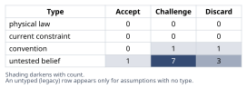
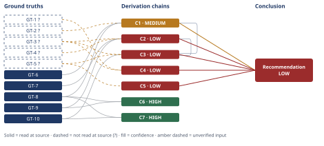

# Should We Add a Free Tier?

*First-principles analysis · 15 October 2026*

*Read with: [How to read this analysis](HOW-TO-READ.md) · [Working file](analysis-20261015T045902Z.md) · [All files](INDEX.md)*

## Executive Summary

**Recommendation:** Don't launch a full, uncapped free tier now. Sequence it instead: confirm or build a minimal self-serve discovery/signup funnel first, then run a small, capped, time-boxed pilot to measure real cost and conversion, before committing to any permanent free tier (chain C1, chain C3).

**Band (from §6):** LOW (chain C3).

**Would change it:** A real per-free-user cost figure from Finance, a measured conversion rate from a capped pilot, or win-loss evidence that competitors' free tiers are concretely costing specific deals (chain C2, chain C5).

## 1. Problem Essence

**Essence Statement.** The literal question — "should we add a free tier?" — is a proxy for a sharper one: *is a free tier, launched now, structurally capable of doing the job a free tier is supposed to do (expand top-of-funnel acquisition and convert a share of it to paid revenue), given that the acquisition mechanism a free tier depends on — a self-serve discovery-and-signup channel — does not currently exist in this business?* A free tier is a pricing/segmentation layer applied *on top of* an acquisition funnel; it is not itself an acquisition funnel. The real decision is therefore about sequencing and mechanism, not about a checkbox feature.

**Success criteria — a correct answer must:**
- Answer whether to add a free tier now, not merely assert that free tiers "can work" for SaaS in general.
- Name the GTM mechanism a free tier structurally depends on (discovery → self-serve signup → activation → conversion) and test whether this company currently has it.
- Surface the key quantitative uncertainty (free-to-paid conversion rate, and the resulting cost per acquired paying customer) and give a concrete, cheap way to resolve it before committing real budget.
- Consider the full option space — status quo, a full/uncapped free tier, a time-limited free trial, and a sequenced/composite validation path — not just a binary yes/no, and test whether a blend of options beats either extreme.
- State plainly what would have to be true for "add a full free tier now" to in fact be the correct call.

## 2. Assumptions Table



| # | Assumption | Type | Treatment | Verdict | Verification |
|---|---|---|---|---|---|
| A-1 | "Competitors all have a free tier, so we need one to compete." | Convention | Challenge: does this ICP's procurement actually route through free-tier comparison? | Challenge — unverified as stated: no evidence it is costing specific deals, only that peers have one. | Cheap: win-loss interviews on recent lost deals, asking specifically whether the prospect adopted/evaluated a competitor's free tier. Not yet run. |
| A-2 | "A free tier drives growth." | Untested belief | Decompose the mechanism (chain C1). | Discard — false as a general claim here: growth requires signup volume, which requires a discovery channel that does not exist (GT-2). | Resolved analytically via C1; stays contingent on a channel being built. |
| A-3 | "Free-tier infrastructure is basically free, so the downside is small." | Untested belief | N/A — directly contradicted by a given ground truth. | Discard — directly contradicted by GT-3 (finance-confirmed scaling cost). | Discharged by GT-3 (finance-confirmed scaling cost). |
| A-4 | "The lack of a self-serve channel is a problem a free tier itself fixes." | Untested belief (causal inversion) | Decompose what a free tier structurally is (GT-8). | Discard — false: a free tier is a segmentation/pricing layer on an existing funnel, not a funnel-creation mechanism. | Resolved analytically via GT-8 / C1 / C6 / C7. |
| A-5 | "Free-to-paid conversion rate will land near typical industry benchmarks." | Untested belief | Verify against external benchmarks (GT-9, GT-10) and internal data (GT-4). | Challenge — unresolved: no internal data exists (GT-4); external benchmarks span roughly 3–12% (standard freemium) to 8–45%+ (trials), too wide to price the decision, and per C6/C7 describe a population that already has the missing precondition. | Cheap, bounded pilot (C2/C3); see pre-mortem disposition B. |
| A-6 | "Support/infra cost per free user is a known, modest figure." | Untested belief | My own Fermi bracket ($50–$400/free user/year) is explicitly illustrative, not company data. | Challenge — unverified: flagged as illustrative, not company data. | Ask Finance for an actual figure, ideally from a small closed cohort, before trusting any CAC_free number. |
| A-7 | "A free tier and the existing outbound/referral motion can coexist without cannibalization or support strain." | Untested belief / current constraint | Trace second-order effect on the paying base (chain C4). | Challenge — unverified: flagged as a real second-order risk (chain C4). | Ring-fence support capacity and monitor during any pilot (pre-mortem disposition E). |
| A-8 | "This $10k-ACV, outbound-sold, team-based product is comparable to classic PLG freemium successes (Slack, Notion, Figma)." | Convention / reasoning-by-analogy | Challenged directly — ban on using analogy as standalone evidence. | Discard — as direct evidence: those companies paired freemium with strong virality and a self-serve funnel from day one; the mechanism, not the price point, made it work, and this company has the price/product profile but not yet the mechanism. | Do not use as evidence until GT-2 is overturned. |
| A-9 *(surfaced in Phase 4 audit)* | "A free-tier launch announcement alone does not generate a durable top-of-funnel discovery channel." | Untested belief | Named while walking chain C1. | Challenge — plausible but unverified: launch spikes are typically transient, not a durable channel. | unverified — flagged; track actual signup-source attribution during any pilot. |
| A-10 *(surfaced in Phase 4 audit)* | "Infra+support cost per free user falls in the $50–$400/year order-of-magnitude range used in the C2 bracket." | Untested belief | Named while walking chain C2; already flagged inline as ASSUMED. | Challenge — unverified: explicitly illustrative, not company data. | unverified — flagged; same as A-6 — resolve via Finance before using any CAC_free figure for real decisions. |
| A-11 *(surfaced in Phase 4 audit)* | "The trade-off weights used in C3 (ARR potential=4, cost exposure=4, time-to-signal=3, risk to paying base=5, reversibility=2, competitive narrative=2) reflect this company's actual risk tolerance." | Untested belief | Named while walking chain C3; not confirmed by leadership. | Challenge — unverified: proposed by this analysis, not confirmed by leadership; mitigated by the flip test's robustness finding. | unverified — flagged; leadership should re-run the weighting exercise themselves before treating C3's ranking as final. |
| A-12 *(surfaced in Phase 4 audit)* | "No slack capacity currently exists in the support org to absorb incremental free-tier load without degrading paid-customer service." | Untested belief | Named while walking chain C4. | Challenge — unverified: GT-3 establishes cost scaling, not that zero slack exists. | unverified — flagged; ask support/CS leadership for current utilization before sizing any pilot's support footprint. |
| A-13 *(surfaced in Phase 4 audit)* | "Win-loss interviews can reliably elicit the true reason for a loss, including competitor free-tier use." | Untested belief | Named while walking chain C5. | Accept — reasonably reliable with disciplined methodology, subject to interviewer and recall bias as a known limitation. | unverified — flagged; standard win-loss practice caveat; triangulate with sales notes, not interviews alone. |

## 3. Ground Truths

Provenance convention used throughout: the five business facts supplied directly by the requester name no external document and so are marked `?` under the provenance test ("did this analysis read the asserted figure in a cited source?") even though they are stipulated as given for this exercise — this analysis has no external document against which to check an internal company metric, and the Input Contract is explicit that supplying a fact does not by itself discharge Phase 3 verification. This is a disclosure about what this analysis could check, not a doubt about the requester's figures.

- **GT-1?**: $2.4M ARR from 240 paying teams, averaging ~$10,000/team/year. *Unverified — stipulated internal metric, no external source to read.*
- **GT-2?**: Acquisition today runs through outbound sales and referral only; no self-serve inbound/PLG channel or funnel exists. *Unverified — stipulated internal fact.*
- **GT-3?**: Finance has confirmed free-tier infrastructure and support costs scale with active free users — a real, scaling cost center, not near-zero marginal cost. *Unverified by this analysis — attributed to Finance, not independently read from a finance document.*
- **GT-4?**: No internal freemium pilot has ever been run; no internal free-to-paid conversion data exists. *Unverified — stipulated statement of absence.*
- **GT-5?**: All named competitors currently offer a free tier. *Unverified — no competitors were named and none were independently researched.*
- **GT-6**: Definitional identity. Free-tier-attributable revenue growth = (top-of-funnel free signups) × (free-to-paid conversion rate) × (ACV of converted customers). *Definitional — a mechanistic identity about how a freemium funnel turns into revenue, not an empirical claim requiring a citation.*
- **GT-7**: Definitional identity, derived from GT-3 and GT-6. Cost per paying customer acquired via the free tier, CAC_free = (annual infra+support cost per free active user, *c*) ÷ (free-to-paid conversion rate, *r*). *Definitional.*
- **GT-8**: Definitional fact. A free-tier signup requires a prospect to first discover a self-serve signup flow; signup volume is therefore bounded by the reach of whatever discovery channel feeds that flow. *Definitional.*
- **GT-9**: Standard (account-gated) freemium B2B SaaS free-to-paid conversion ≈ 3–5% at the 50th percentile, ≈ 8–12% at the 75th percentile. *Read-at-source: Userpilot's benchmark page, quoting the ChartMogul/Growth Unhinged "2026 SaaS Conversion Report" table — https://userpilot.com/blog/saas-average-conversion-rate (fetched and the specific percentile table located and quoted).* Note: this benchmark population is drawn from products that, by definition of being measured this way, already have a self-serve signup funnel — a scope gap addressed in chain C1/C2, not a provenance flag.
- **GT-10**: B2B SaaS free-trial-to-paid conversion, cited with a wide spread across studies on the same page: median reported as either 18.5% or 8% depending on the underlying study cited, top quartile 35–45% (elite >60%), enterprise sales-assisted 25–40%, bottom performers <8%. *Read-at-source: Flint's blog page — https://www.flint.com/blog/b2b-saas-free-trial-conversion-rate-statistics (fetched and the specific figures located and quoted).* The page's own internal inconsistency (two different "median" figures from two different cited studies) is disclosed rather than resolved — treat as a wide range, not a point estimate.

**`?`-marked: GT-1, GT-2, GT-3, GT-4, GT-5 (5 of 10).**

**Not read — turn budget:** none; both externally-checkable figures that this analysis could attempt to verify (GT-9, GT-10) were read at source as shown above. GT-1 through GT-5 have no external document to open — they are internal company facts stipulated by the requester — so no read was attempted or skipped for budget reasons; the `?` reflects provenance category ("no source was located," per the provenance test), not an unattempted read.

## 4. Derivation Chains



### C1 — The volume bottleneck: why a free tier cannot drive growth *today*

```text
GT-2? (no self-serve/PLG channel exists) + GT-8 (signup requires discovery) + GT-6 (growth = signups × conversion × ACV)
→ because GT-2 states no discovery/self-serve channel exists today, the signup-volume term that GT-8 says signup generation depends on is at or near zero if a free tier is simply switched on with no other change [Assumes: A-9]
→ in GT-6's identity, a near-zero signups term forces a near-zero converted-customer output regardless of how favorable the conversion-rate term turns out to be
→ a free tier therefore cannot function as a growth driver today; it only becomes one once a discovery/self-serve channel is built, or is shown to already exist independently of the free tier itself
```

**Confidence:** MEDIUM (chain C1). Inputs short — GT-2 cannot be read at an external source (internal stipulated fact). Inference clean — each hop follows directly from the GT-6/GT-8 identity. Rivals clean — the obvious rival, that in-product virality could bootstrap discovery without a built funnel, is ruled out in §5 because virality-driven signup is itself a self-serve/PLG mechanism, which GT-2 already states does not exist today. What would remove the cap: nothing available to this analysis — GT-2 is an internal fact the requester has stipulated as given and that cannot be externally audited from outside the company; the cap is structural to working from stipulated internal data, not a defect in the reasoning.

### C2 — The free-tier CAC bracket (the key quantitative uncertainty)

```text
GT-3? (cost scales with free users) + GT-7 (CAC_free = c / r identity) + GT-9 (conversion benchmark 3–12%) + GT-4? (no internal data exists)
→ applying GT-7, CAC_free depends on two factors — c (annual cost per free user) and r (conversion rate) — and GT-4 confirms neither has ever been measured inside this company
→ bracketing r using GT-9 (3% at the low/standard end, 12% at the high/"great" end) and c using an illustrative, uncited order-of-magnitude range of $50–$400 per free user per year [Assumes: A-10] produces CAC_free from roughly $420 (low c ÷ high r) at the favorable end to roughly $13,300 (high c ÷ low r) at the unfavorable end
→ this bracket spans more than one order of magnitude and straddles GT-1's $10,000 average ACV, so the question of whether a free tier is a cheap or a ruinously expensive acquisition channel cannot be resolved from benchmarks alone
→ per the estimate procedure's stop criterion, a bracket this wide relative to the decision threshold must be tightened with real company data before capital is committed, not treated as resolved
```

**Confidence:** LOW (chain C2) on the *specific numbers* in this bracket. Inputs short — two `?`-marked inputs (GT-3, GT-4) plus an explicitly assumed, uncited `c` range (A-10) that is illustrative, not company data. Inference also short on that account — the arithmetic is sound but one hop rests on an unverified assumed value, not a ground truth. Two axes short → LOW. Rivals clean — no alternative economic model was proposed. What would remove the cap: a real `c` from Finance (even from a 20–50 person closed cohort) and a real `r` from a small bounded pilot — see pre-mortem dispositions A and B. Note: the chain's *structural* conclusion — "this uncertainty is wide enough to require cheap validation before committing" — does not depend on exactly where in the bracket reality falls; that distinction is carried forward explicitly into C3 rather than silently upgrading this chain's band.

### C3 — The trade-off across options, and the resulting recommendation

Four options were scored on six weighted criteria (ARR potential=4, cost exposure risk=4, time-to-signal=3, risk to the existing paying base=5, reversibility=2, competitive narrative=2; 1–5 anchored scale, 5=best): **(1)** add a full, uncapped free tier now; **(2)** status quo; **(3)** a time-boxed free trial instead of perpetual freemium; **(4)** a composite — build a minimal self-serve signup funnel first, then run a small, capped, time-boxed freemium/trial pilot before any permanent commitment. Weighted totals: Option 1 = 40, Option 2 = 70, Option 3 = 71, Option 4 = 83.

```text
C1 (MEDIUM) + C2 (LOW) + GT-10 (trial benchmark) + GT-5? (competitor-parity claim) + GT-3? (cost scaling)
→ because C1 shows negligible signup volume without a discovery channel and C2 shows the resulting CAC is unknown within more than one order of magnitude, an uncapped full free tier (Option 1) scores worst on cost-exposure and paying-base-risk criteria against every rival option
→ a weighted comparison across six criteria scores the sequenced composite (Option 4: build the funnel, then run a small capped pilot) highest, and the flip test shows no single-criterion reweighting within a normal 1–5 range reverses that ranking against either the trial-only option (Option 3) or the status quo (Option 2) [Assumes: A-11]
→ GT-5's competitor-parity claim is addressed more cheaply and more diagnostically by a win-loss review of recent lost deals than by matching competitors' free tier blindly, since GT-5 alone does not establish that competitor free tiers are costing this company any specific deal
→ the correct near-term action is therefore not "add a free tier" as literally framed, but to sequence funnel-validation and a capped pilot before committing to any permanent free tier, using a time-boxed trial as the lower-risk interim self-serve mechanism
```

**Confidence:** LOW (chain C3), by the capping rule — C3 cites C2, which is LOW, so C3 is capped at LOW regardless of its other axes. This is disclosed rather than argued around: the *precise* weighted scores in the trade-off inherit C2's unresolved cost/conversion uncertainty. What keeps the chain's ordinal recommendation (Option 4 over its rivals) actionable despite the LOW numeric band is the flip-test finding above — the ranking is robust to reasonable reweighting and does not require the exact bracket numbers in C2 to be right, only their rough order of magnitude relative to one another. That robustness is a property of this chain's *ranking*, not a license to re-rate its *band* past the mechanical cap.

### C4 — Second-order risk: support dilution threatens the existing paying base

```text
GT-1? (240 paying teams = 100% of current ARR) + GT-3? (cost scales with active free users, shared cost center)
→ GT-3 establishes that free-tier support demand draws on the same scaling cost center as paid-customer support, rather than a cost-free or separately-resourced pool [Assumes: A-12]
→ without ring-fenced support budget/headcount for free users, an increase in free-tier volume competes for the attention currently dedicated to the 240 paying teams who generate 100% of the $2.4M ARR named in GT-1
→ this is a second-order risk that a free-tier launch degrades service to the existing revenue base before it produces any offsetting paid conversions — a risk the literal "should we add a free tier" framing does not surface on its own
```

**Confidence:** LOW (chain C4). Inputs short — both head inputs are `?`-marked internal facts. Rivals also live and not fully settled: "properly ring-fenced resourcing from day one eliminates this risk" is a real competing reading, addressed only as a *mitigation* (pre-mortem disposition E, §Adversarial pass) rather than ruled out as a chain-level rival — a mitigation plan is not the same as settling which reading of the current, unresourced state is correct. Two axes short → LOW. What would remove the cap: confirmation from support/CS leadership on current utilization/slack (A-12), and an explicit ring-fencing decision before any pilot launches.

### C5 — The competitive-parity assumption, stress-tested

```text
GT-5? (all competitors have a free tier)
→ GT-5 alone states a fact about competitor offerings, not a fact about why buyers in this company's own deals choose a vendor, so it does not by itself establish that the absence of a free tier is costing this company any specific deal
→ because procurement for a ~$10,000/year team contract sourced via outbound sales and referral (GT-2) typically routes through a relationship-driven evaluation rather than self-serve trial-shopping, the mechanism by which a competitor's free tier would influence this company's deals is unclear without direct evidence
→ the cheapest way to resolve whether GT-5 is decision-relevant is a win-loss review of recently lost deals asking specifically whether the prospect adopted or evaluated a competitor's free tier — a near-zero-cost diagnostic that converts GT-5 from an assumed competitive pressure into either a confirmed, specific loss pattern or a non-issue [Assumes: A-13]
```

**Confidence:** LOW (chain C5). Inputs short — GT-5 is `?`-marked and no competitors were named. Rivals live and not fully settled: competitor free-tier parity could matter for reasons beyond direct deal loss (analyst commentary, investor narrative, candidate recruiting) — this is not ruled out, only set aside as outside the scope of a GTM/economics decision. Two axes short → LOW. What would remove the cap: the win-loss review itself, plus naming the actual competitors and checking their offerings directly.

### C6 — Why the freemium benchmark cannot be applied to this company as-is

```text
GT-9 (standard freemium benchmark, 3–12%) + GT-8 (signup requires discovery)
→ the products that make up GT-9's benchmark population are, by definition, measured on their *existing* self-serve signup funnels — a product cannot register a free-to-paid conversion rate without first having generated free signups
→ therefore GT-9's percentages describe outcomes conditional on a discovery/self-serve funnel already being in place, which is precisely the precondition GT-2 says this company does not yet have
→ GT-9 is informative as a ceiling on what conversion might look like once a funnel exists, but is not evidence that comparable signup volume or conversion will occur without one
```

**Confidence:** HIGH (chain C6). Inputs clean — both GT-9 (read-at-source) and GT-8 (definitional) are unsuffixed. Inference clean — each hop is a direct entailment of what a conversion-rate benchmark measures. Rivals: none identified — no competing reading of what GT-9's benchmark population structurally requires was found.

### C7 — The trial benchmark carries the same precondition

```text
GT-10 (trial benchmark) + GT-8 (signup requires discovery)
→ GT-10's trial-conversion figures are likewise measured on products whose self-serve trial-signup flow already exists and already receives traffic
→ GT-10 therefore carries the same structural precondition as GT-9 (chain C6): it bounds what conversion could look like once a funnel exists, and is not evidence that this company would see comparable signup volume today
```

**Confidence:** HIGH (chain C7). Inputs clean — both inputs unsuffixed. Inference clean. Rivals: none identified.

### Second-order extension — actor lens and time lens

Walked explicitly against the first-order conclusion in C1/C3 (sequence funnel-building and a capped pilot rather than launching a free tier now):

- **Actor lens.** *Support/CS team* absorbs incremental, unbudgeted load the moment free users exist (feeds C4). *Prospects/buyers* mid-deal may use a "good enough" free tier to stall or avoid the $10,000 decision, a cannibalization channel distinct from net-new acquisition (feeds C3's Option 1 cost-exposure score). *Sales team* may reflexively work free/trial signups as outbound targets, contaminating any pilot's data on whether the self-serve mechanism itself works (named explicitly in the adversarial pass, cluster E). *Competitors* with mature PLG motions face no new threat from a hastily-built, bolt-on free tier and may instead gain a talking point ("even they have one, and it shows") if this company's version is visibly thin — a reputational second-order effect distinct from the economics in C2.
- **Time lens.** *Immediate* (first 1–2 quarters): added infra/support cost against near-zero volume, per C1 — a pure cash drag with little learning value unless a funnel is built in parallel. *Medium term* (6–18 months): if a discovery channel is deliberately built alongside a capped pilot, C2's bracket becomes testable with real data rather than external benchmarks. *Long term* (18+ months): a mature self-serve/PLG motion could become a genuine second acquisition channel alongside outbound/referral — but this requires sustained investment in growth/PLG function, self-serve billing, and in-product usage limits, not a pricing-page toggle; reaching it is a strategic commitment, which is exactly the condition named in the Conclusion's point (4) for when Option 1 becomes correct on its own terms.

No extension step contradicts a Ground Truth; the support-dilution and sales-contamination effects are priced into C4 and the pre-mortem record rather than requiring a return to Phase 2.

## 5. Abandoned Reasoning

Record every reasoning path that was explored and discarded.

### Dead End: In-product virality as a funnel substitute

**What was tried:** Treat "in-product virality — existing free users inviting teammates — could bootstrap top-of-funnel discovery without any built acquisition channel" as a live rival to chain C1's conclusion.

**Why abandoned:** Virality-driven signup is itself a self-serve/PLG discovery mechanism, and GT-2 explicitly states that no such mechanism exists today. The rival collapses into the same gap C1 already names rather than escaping it — a contradicted premise, not a surviving alternative.

**What it ruled out:** Chain C1 is safe to read as "near-zero signups" without carving out a virality exception; the chain's Rivals axis is settled by this entry.

### Dead End: Competitor parity via non-deal-loss channels

**What was tried:** Treat "competitor free-tier parity matters for reasons beyond direct deal loss" (analyst commentary, investor narrative, recruiting) as something this analysis should resolve as part of chain C5.

**Why abandoned:** Those effects are real but sit outside a GTM/unit-economics decision about customer acquisition; pricing a free tier against vague reputational benefit would smuggle an unweighted, unverifiable criterion into C5's trade-off — the intermediate claim could not be established on the evidence available.

**What it ruled out:** C5 stays confined to the win-loss-testable claim (does this cost us deals), with the broader reputational question named as a live rival on C5's own confidence line rather than folded into the economics.

### Dead End: Eliminating Option 1 as a knockout instead of scoring it

**What was tried:** Eliminate Option 1 (full, uncapped free tier now) outright as a knocked-out option on a must-have ("must not jeopardize the paying base") rather than scoring it in the weighted trade-off (chain C3).

**Why abandoned:** A knockout hides the *magnitude* of the disadvantage rather than being factually wrong; scoring Option 1 alongside its rivals shows it losing on cost-exposure and paying-base-risk by a wide margin (40 vs. 70–83), which is more informative than a binary "not allowed."

**What it ruled out:** Nothing about the economics — this is a methodological choice, not a resolved claim — recorded so the scored-vs-knocked-out decision is visible rather than silent.

### Dead End: Deriving current CAC from GT-1 alone

**What was tried:** Derive the company's *current* CAC via outbound/referral directly from GT-1 (ARR, team count, ACV), to compare numerically against the CAC_free bracket in chain C2.

**Why abandoned:** GT-1 contains ARR, team count, and ACV — nothing about sales/marketing spend, cycle length, or headcount — so CAC_current cannot be derived from the ground truths supplied; the intermediate step could not be established from the available inputs.

**What it ruled out:** Nothing resolved; named explicitly so it is not mistaken for an omission. The company has this data internally and should run the comparison itself once CAC_free is pinned down by a real pilot (chains C2, C3).

## 6. Conclusion

**Recommended approach:** Do not add a full, perpetual free tier now. Instead, sequence the investment: (1) build or confirm a minimal self-serve discovery-and-signup funnel exists at all — content/SEO, marketplace listing, or an in-product invite loop — because a free tier bolted onto zero top-of-funnel volume cannot generate growth regardless of conversion rate (chain C1); (2) once that funnel produces even modest signup flow, run a small, capped, time-boxed pilot (freemium or trial) to measure the two real unknowns — cost per free user and conversion rate — directly, rather than relying on external benchmarks spanning nearly two orders of magnitude (chain C2); (3) only commit to a permanent, uncapped free tier once that pilot clears a CAC_free threshold set against this company's own (currently unknown) outbound/referral CAC. A weighted trade-off across four options — full free tier now, status quo, trial-only, and this sequenced composite — scores the composite highest and the ranking is robust to reasonable reweighting (chain C3).

**Key insight:** The question "should we add a free tier" silently assumes a free tier is an acquisition channel. It is not — it is a pricing/segmentation layer applied *on top of* an acquisition channel. This company's acquisition channel today is outbound sales and referral only; no self-serve discovery mechanism exists to feed a free tier's signup flow. Flipping on a free tier without first building that mechanism adds a real, scaling cost center (finance-confirmed) against near-zero volume, which is the opposite of a growth lever (chain C1).

**Trade-offs acknowledged:** The sequenced approach is slower and concedes some competitive speed to better-funded, PLG-native competitors who already have the self-serve mechanism this company lacks — an accepted, explicitly named risk, not a free pass (chain C3; see pre-mortem cluster D). It also does not, by itself, resolve whether competitor free-tier parity is actually costing deals — that requires a separate, near-zero-cost win-loss review (chain C5) run in parallel, not instead of, the funnel/pilot sequencing. And any pilot, however capped, still draws on the same support resources as the 240 paying teams generating 100% of current ARR, so it must be explicitly resourced and monitored rather than run on spare capacity that may not exist (chain C4).

**Confidence:** LOW, by the mechanical capping rule — this conclusion cites chains C2 through C5, all of which are themselves capped at LOW because the two real empirical unknowns (free-tier infrastructure/support cost per user, and free-to-paid conversion rate) have never been measured inside this company (GT-4) and the external benchmarks bracket them across close to two orders of magnitude (GT-9, GT-10). This LOW band describes the *specific numbers* underneath the recommendation, not the *direction* of it: the ordinal case for sequencing over an immediate uncapped launch (chain C3's flip test) holds across the width of that bracket, because every option that would change ranking requires reweighting criteria far outside a normal 1–5 range. **What would change the recommendation (chain C2, chain C3):** (a) Finance supplying a real per-free-user cost figure from even a small closed cohort (resolves A-6/A-10 at near-zero cost, tightening chain C2); (b) a small, capped pilot run after a minimal funnel exists, producing a real conversion rate to replace the GT-9/GT-10 external bracket used in chain C2; (c) a win-loss review showing competitor free tiers are concretely costing specific deals today (resolves A-1, tightening chain C5) — any of these would narrow the bracket enough to re-rate this conclusion above LOW, and (b) in particular is the one piece of evidence that would most directly move chain C3's recommendation itself, not just its confidence.

**What would have to be true for "add a full free tier now" to be the correct call instead:** (1) a self-serve discovery/signup channel already exists or is being built in parallel with real, near-term traffic — overturning GT-2 and chain C1's volume-bottleneck finding; (2) Finance's actual per-free-user cost is low enough that even a pessimistic conversion rate clears a reasonable CAC payback against the $10,000 average ACV (GT-1) — a materially more favorable finding than chain C2's bracket implies; (3) win-loss evidence shows the company is concretely losing deals today because it lacks a free tier (overturning chain C5's finding that GT-5 alone doesn't establish this), making this a sales-enablement/win-rate problem rather than a growth-channel problem, which carries different ROI logic than the CAC/conversion framing in chain C2; or (4) leadership deliberately chooses to fund a multi-quarter pivot into a PLG motion and treats chain C3's Option 1 near-term negative unit economics as a priced-in strategic investment rather than expecting it to pencil out standalone. Absent one of these, the sequenced path (chain C3, Option 4) is the better bet.
