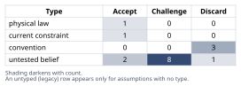
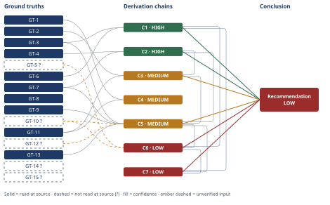

# Wind Turbine HSS Bearing Failure: Root-Cause Analysis

*First-principles analysis · 11 October 2026*

*Read with: [How to read this analysis](HOW-TO-READ.md) · [Working file](analysis-20261011T210036Z.md) · [All files](INDEX.md)*

## Executive Summary

**Recommendation:** Do not treat the cold-snap/lubricant-viscosity explanation as the root cause; specify a composite fix — electrical-current instrumentation, a tightened steel-cleanliness spec, slip-mitigating bearing/operating-envelope changes, and a tribochemically-validated lubricant — rather than a lubrication-only change (chain C1).

**Band (from §6):** LOW overall for the full conclusion, but the finding that the operator's hypothesis is wrong is itself HIGH-confidence (chains C1, C2); the best-supported specific mechanism — slip-induced, tribochemically-assisted, hydrogen-driven WEC — is MEDIUM (chain C5); the cold-snap's precise aggravating role is LOW (chain C6).

**Would change it:** Direct shaft-voltage/grounding-current instrumentation to resolve the live electrical-current rival, plus lubricant tribochemical analysis and bearing steel inclusion-content analysis (chain C5).

## 1. Problem Essence

**Core problem:** Determine which physical damage mechanism(s) actually initiated this HSS generator-end bearing's subsurface fatigue failure — and what causal role, if any, the cold-snap lubricant event played in it — so that the replacement bearing specification and corrective-action plan target the mechanism that truly produced the failure rather than only the mechanism the operator first suspected.

**Success criteria:**

- The adopted explanation accounts, through a complete derivation chain traced to named ground truths, for all four independent physical findings together (subsurface crack-origin depth, WEC/butterfly microstructure, axial-aligned crescent spall morphology, and the extreme prematurity relative to L10) — not for one or two of them in isolation while leaving the others as unexplained coincidence.
- The operator's lubricant-viscosity / boundary-lubrication-wear hypothesis is explicitly tested against the physical evidence (not assumed true or false by default) and is given an explicit verdict with a stated confidence level.
- Every well-documented rival mechanism named in the task (hydrogen embrittlement, electrical current / EDM-type damage, tribochemical reaction, slip-induced mixed friction) is explicitly weighed against the same evidence, and each is either ruled in, ruled out, or carried forward as an unresolved live rival with the specific additional evidence named that would resolve it.
- The cold-snap period is assigned exactly one of three explicit roles — root cause, contributing/aggravating factor, or coincidental/non-causal — with a stated confidence level and the observation that would move it to a different role.
- The replacement-bearing recommendation states, separately for lubrication, electrical bonding/grounding, material cleanliness, and operating-envelope control, whether that element is required, advisable-but-unconfirmed, or not indicated by the evidence — the answer is not forced to pick a single one of these categories to the exclusion of the others, since the evidence may (and here does) support a composite fix.

---

## 2. Assumptions Table



| Assumption | Type | Treatment | Verdict | Verification |
|------------|------|-----------|---------|--------------|
| A1: The operator's hypothesis — low lubricant viscosity during a cold snap drove the contact into boundary lubrication and the inner race "wore through" — is the correct explanation of this failure | untested belief (diagnostic) | Challenge by inversion: enumerate what boundary-lubrication wear would have to look like at the failure surface, then test each precondition against the metallurgical evidence | Discard — ruled out as the initiating/primary mechanism by the subsurface origin depth and the WEC/butterfly microstructure (chains C1, C2); see §5 | Ruled out — see §5 Abandoned Reasoning and chains C1–C2. Boundary-lubrication wear is mechanistically surface-initiated; the observed damage is subsurface-initiated with a non-wear microstructural signature. |
| A2: A cold-snap period produced a measurable reduction in lubricant film-forming viscosity at the HSS contact | untested belief (quantitative) | Verify via oil-viscosity/temperature records, or flag unverified | Challenge — unverified, flagged GT-5?; no viscosity measurement, lambda-ratio calculation, or temperature log was supplied | unverified — flagged (no oil analysis or SCADA ambient-temperature trace given in the task data) |
| A3: Spalling is, in general, a reliable surface signature of simple abrasive/adhesive wear and nothing else | convention | Challenge explicitly before use | Discard as a general rule — spalling is also the terminal, surface-breaking feature of a linked subsurface fatigue-crack network (WEC), per GT-7; the convention does not discriminate between the two origins on its own | GT-7 (WEC/butterfly literature); the spall's own morphology (GT-2) must be read together with the subsurface crack network (GT-3), not taken as self-explanatory |
| A4: The kurtosis-based condition-monitoring trigger fired at or near the true onset of damage, so the ~14,000-hour pull date approximates the initiation date | current constraint (instrumentation) | Record expiry: holds only until a WEC-specific high-frequency/acoustic or envelope-spectrum monitoring parameter is added; kurtosis is known to respond late, once a discrete surface-breaking defect exists | Accept as current practice, flagged as an insufficient early-warning parameter for subsurface crack networks — expires when WEC-specific monitoring is added | Task-stated monitoring method (vibration kurtosis); no independent confirmation that detection coincided with initiation — treated as a current limitation of the existing monitoring scheme, not a measured fact about initiation timing |
| A5: No electrical bonding/grounding condition or shaft-voltage/current data exists for this bearing or this turbine's generator-converter system | untested belief (evidentiary gap) | Verify by instrumenting shaft voltage and ground-brush/bonding conductance; until then, flag the gap explicitly | Challenge — this is a material evidentiary gap given the bearing's generator-end position, which the literature specifically flags as electrically exposed (GT-14?) | unverified — flagged; recommended instrumentation named in §6 |
| A6: No lubricant tribochemical analysis (hydrogen content, water contamination, additive depletion) has been performed on the in-service oil | untested belief (evidentiary gap) | Verify via oil analysis; flag until then | Challenge — material gap for distinguishing the hydrogen-source pathway | unverified — flagged; recommended analysis named in §6 |
| A7: No metallurgical inclusion-content / steel-cleanliness certificate has been reviewed for this specific bearing's raceway steel | untested belief (evidentiary gap) | Verify against mill certificate / ISO 4967-type inclusion rating; flag until then | Challenge — WEC/butterfly nucleation is documented as inclusion-associated (GT-7), so cleanliness data is directly relevant; surfaced again by the Assumption Audit at chain C5's inclusion-nucleation step, not duplicated as a new row | unverified — flagged; recommended analysis named in §6 |
| A8: No direct slip/kinematic measurement (roller slip ratio, traction coefficient) has been made on this specific turbine's HSS stage under partial-load conditions | untested belief (evidentiary gap) | Verify via dynamometer or field instrumentation per NREL-type methodology; flag until then | Challenge — general literature (GT-12?) is used as a proxy for this unit, not a direct measurement | unverified — flagged; recommended analysis named in §6 |
| A9: The generator-end HSS bearing's original design carries no special electrical-current exposure beyond any other bearing in the drivetrain | convention | Challenge explicitly — the wind-turbine bearing-current literature specifically names generator and HSS-stage gearbox bearings as the most electrically exposed positions | Discard as a safe default — the position is flagged in the literature as elevated-risk (GT-14?), so electrical bonding/grounding cannot be dismissed by default at this bearing position | GT-14? (converter-driven common-mode voltage / capacitive shaft coupling literature) |
| A10: In a geared wind-turbine drivetrain, the HSS stage runs at high rotational speed and correspondingly low torque for a given transmitted power, and sees torque that varies with instantaneous wind-driven power, including low-torque/partial-load intervals | physical law (kinematic identity, P = T·ω, plus gear-ratio relations) | Accept as a ground-truth candidate; promote to GT-13 | Accept — a direct, context-independent consequence of drivetrain kinematics and the definition of mechanical power, not specific to this incident | Standard mechanical-drivetrain kinematics; not sourced to an external citation this session because it is a definitional/physical identity, not an empirical claim |
| A11: The crack network observed in the metallographic sections had already been growing for some unknown, possibly substantial, period before the kurtosis alarm fired at ~14,000 hours | untested belief | Verify via back-calculation from crack-network extent/serial sectioning, or flag unverified | Challenge — consistent with WEC literature (networks grow and link before surface breakthrough) but not independently measured for this unit | unverified — flagged; relates to A4's detection-lag limitation |
| A12: The replacement bearing problem can be adequately solved by a drop-in equivalent bearing plus an upgraded (higher-viscosity or cold-weather-rated) lubricant alone | convention (default fix) | Challenge explicitly via second-order analysis of what this fix would and would not address | Discard as sufficient — addressed in chain C7 and the §6 recommendation; a lubrication-only fix leaves the best-supported mechanism and the unresolved electrical rival completely unaddressed | Chain C7 (second-order consequences of misdiagnosis) |
| A13: The reported 0.4 mm subsurface depth is the true crack-initiation site, not a sectioning artifact or an unrelated secondary crack co-located with the spall — surfaced by the Assumption Audit at chain C1, step 1 | untested belief | Challenge by cross-checking against GT-4's own statement that sectioning was taken through the spall, and against the depth scale of surface-wear processes | Accept — GT-4 confirms sectioning was through the spall itself, and 0.4 mm is roughly two orders of magnitude beyond any plausible surface-wear depth scale, so no realistic measurement tolerance reverses this | GT-4 (sectioning location) plus the depth-scale argument in chain C1's own confidence line |
| A14: The observed crescent/axial spall morphology is close enough to the published WEC morphological description to be diagnostically meaningful, not a superficial resemblance — surfaced by the Assumption Audit at chain C3, step 1 | untested belief | Verify via direct serial-sectioning comparison of this bearing's crack-network geometry against published WEC reconstructions; flag until then | Challenge — unverified, flagged; this is the specific reason chain C3 is rated MEDIUM rather than HIGH | unverified — flagged; verification path named on chain C3's own confidence line |
| A15: The cold-snap period temporally overlapped the active crack-initiation/growth window for this specific bearing — surfaced by the Assumption Audit at chain C6, step 1 | untested belief | Verify via a SCADA ambient-temperature timestamp correlated against a back-calculated crack-initiation window; flag until then | Challenge — unverified, and no verification path is currently available without A11 also being resolved first; this compounding is why chain C6 is rated LOW rather than MEDIUM | unverified — flagged; verification path named on chain C6's own confidence line |
| A16: The trade-off analysis's locked criteria and weights (chain C5) reflect genuine decision-relevant priorities rather than a reverse-engineered justification for a pre-favored mechanism — surfaced by the Assumption Audit at chain C5, step 1 | untested belief | Verify via the flip test: if any plausible single-criterion reweighting reverses the winner, the weighting is suspect | Accept — the flip test (§4) shows O6 dominates or ties every individual criterion against its nearest rival, so no single-criterion reweighting reverses the result, closing the reverse-engineering concern | §4 trade-off analysis, flip-test result |

---

## 3. Ground Truths

**Provenance note on GT-1 through GT-5.** GT-1–GT-4 are the disassembly and condition-monitoring findings stipulated as given in the task prompt itself — they are the premise this analysis is asked to explain, not a claim this analysis verifies against an external citation. They carry the provenance label `stipulated — task premise`, carry no `?` suffix, and are not re-opened against a primary lab report because none was supplied; this stipulation is the single most sensitive input to the whole analysis and is named explicitly as the fulcrum fact in the Phase 5 Sensitivity step. GT-5 is different in kind: it restates the operator's own *hypothesis* framing (a cold snap occurred and dropped viscosity), not an independently logged fact, so it keeps the `?`.

- **GT-1** Time to removal (~14,000 operating hours) versus the bearing's L10 design life (~130,000 hours) — a ratio of ~0.108, i.e. ~11% of L10 — source: stipulated — task premise.

- **GT-2** Inner-race damage: axial-aligned spalling ~18 mm long — source: stipulated — task premise (disassembly finding).

- **GT-3** Crescent-shaped microcracks propagating from a subsurface origin ~0.4 mm below the raceway surface — source: stipulated — task premise (disassembly finding).

- **GT-4** Metallographic sections taken *through the spall* (i.e., through the actual failure feature, not an unrelated nearby location) show white-etching cracks (WEC) and a butterfly microstructure at the crack origin — source: stipulated — task premise (metallographic finding).

  *Irreducibility check (five-whys, reduce-to-primitives mode).* Decomposing this claim: a "butterfly" is defined in the literature as a pair of wing-shaped zones of refined, featureless ("white-etching") ferrite that nucleate symmetrically around a subsurface stress-concentrator (classically a non-metallic inclusion) under cyclic Hertzian shear → the "white-etching" appearance is itself a definitional primitive: a metallographic observation that the local microstructure has been converted, by severe localized plastic shear strain, to an ultra-fine-grained or amorphized ferrite that etches differently from the surrounding martensite/bainite matrix (a direct, unambiguous optical-metallurgy observation, not an inference) → the only remaining non-primitive link is *why* this particular bearing's subsurface shear field produced enough local strain, at this particular depth, to cross that transformation threshold — which is exactly the mechanistic question chains C2 and C5 answer. The claim therefore bottoms out cleanly at one verified observational primitive (altered-microstructure-at-a-stress-concentrator, read directly from the metallographic sections) plus one open mechanistic question (what drove the local strain/hydrogen state), which this analysis does not leave open — it is resolved in §4.

- **GT-5?** A cold-snap period, with lubricant viscosity reduced enough (per the operator's own framing) to be of concern, occurred in the vicinity of the monitored service interval — unverified: this restates the operator's hypothesis itself; no oil-viscosity measurement, lambda-ratio (film-thickness-to-roughness) calculation, or SCADA ambient-temperature trace was supplied to confirm either that a cold snap occurred on a timeline overlapping the active crack-growth window, or that it produced a quantified viscosity/film-thickness deficit.

- **GT-6** Bearing engineering treats subsurface-initiated rolling-contact fatigue (the classic Lundberg–Palmgren mechanism) and surface-originated damage caused by reduced lubrication or contamination as physically distinct, separately-modeled failure regions, because the latter is driven by asperity-level contact at the surface rather than by the subsurface shear-stress field — source: SKF, "The SKF Generalized Bearing Life Model – the power of tribology," *evolution.skf.com*, 2015; read-at-source: direct text extraction of the PDF, quoting "Through the years, ... surface-originated fatigue, resulting from reduced lubrication or contamination, has been incorporated into the estimation of the bearing life by applying a penalty to the overall equivalent stress" and "Subsurface rolling contact fatigue can be treated in the usual way following the classic dynamic capacity model of Lundberg and Palmgren ..., while the treatment of the surface needs more advanced tribological models."

- **GT-7** White-etching cracks commence subsurface during the initial phase of their formation, particularly at non-metallic inclusions, and hydrogen embrittlement is one of the most commonly quoted potential causes of WEC formation — source: Wikipedia, "White etching cracks" (en.wikipedia.org/wiki/White_etching_cracks); read-at-source: directly fetched and quoted, "WECs commence at subsurface during the initial phases of their formation, particularly at non-metallic inclusions" and "One of the most commonly quoted potential causes of WECs is hydrogen embrittlement."

- **GT-8** Passage of electrical current through a bearing is one of the primary documented causes of WEC formation; under low current densities, WECs have been reported to develop in under 50 hours of operation — source: Wikipedia, "White etching cracks"; read-at-source: directly fetched and quoted, "One of the primary causes of WECs is the passage of electrical current through the bearings" and "These WECs can develop in under 50 hours due to electrical discharges."

- **GT-9** The direction of sliding/traction relative to the direction of over-rolling materially affects WEC formation: WECs formed when the traction force opposed the direction of over-rolling (a signature of mixed friction / negative slip) and did not form when traction aligned with over-rolling — source: Wikipedia, "White etching cracks"; read-at-source: directly fetched and quoted, "The direction of sliding on the bearing surface played a significant role in WEC formation," with WEC formation reported specifically "When the traction force opposed the direction of over-rolling."

- **GT-10?** Metal-to-metal sliding contact accelerates tribochemical decomposition of lubricant at the nascent (freshly-sheared) steel surface, generating hydrogen; hydrogen generation is hardly observed under pure rolling; hydrogen output rises with sliding speed and oil temperature and falls as the lubricant film parameter (film thickness relative to composite roughness) increases — i.e., for a given amount of slip, a thinner film increases tribochemical hydrogen generation — cited to: a 2024 *Tribology Online* two-disc rig study and a Fraunhofer-linked rig/modeling study on WEC hydrogen generation; reported-by-delegate: supplied by a WebSearch synthesis. **Phase 3 failure record:** this analysis attempted to open the closest primary source found for this claim directly — Spille et al. 2021, "A study on the initiation processes of white etching cracks (WECs) in AISI 52100 bearing steel" (eprints.soton.ac.uk) — via WebFetch; the server returned HTTP 403 Forbidden (unreachable). The claim therefore remains `reported-by-delegate`, not `read-at-source`, and GT-10? may feed only MEDIUM or LOW chains.

- **GT-11** DOE national-laboratory researchers (Argonne National Laboratory, working with NREL's Gearbox Reliability Collaborative) describe the single-mechanism root cause of white-etching-crack-driven axial cracking in wind-turbine gearbox bearings as still unresolved; laboratory testing has independently confirmed causal links from both (a) slip/skidding roller conditions and (b) passage of electrical current across the bearing surface to axial-cracking failure; such WEC-driven gearbox bearing failures are reported to occur within the first ~2 years of a ~20-year design life — source: U.S. Department of Energy, "Zeroing In on the No. 1 Cause of Wind Turbine Gearbox Failures" (energy.gov/node/4574340) and "Argonne National Laboratory Investigates Premature Bearing Failures" (energy.gov/cmei/.../argonne-national-laboratory-investigates-premature-bearing-failures); read-at-source: directly fetched and quoted, "These slipping or skidding conditions resulted in axial cracking, allowing us to confirm a causal link," "the presence of electrical current across the bearing surface, can also lead to this axial cracking failure," "The root cause of white-etching cracks is still a mystery," and failures "can occur within the first 2 years" of a 20-year design life.

- **GT-12?** NREL field instrumentation on a 1.5 MW wind turbine confirmed that HSS bearing roller slip occurs during normal operation, with severity governed by bearing design, load, speed, lubrication, and temperature; low-torque operation is associated with more severe sliding — cited to: NREL technical reports/presentations (nrel.gov/docs/fy18osti/70972.pdf and related Sheng/Guo NREL materials); reported-by-delegate: supplied by a WebSearch synthesis — not independently opened by this analysis.

- **GT-13** In a geared wind-turbine drivetrain, the high-speed shaft stage operates at high rotational speed and correspondingly low torque relative to the low-speed/main shaft for a given transmitted power, and experiences torque that tracks instantaneous wind-driven power — including low-torque/partial-load intervals during low wind, start-up, shutdown, and curtailment — source: standard drivetrain kinematics (P = T·ω and fixed gear-ratio relations); treated as a physical-law/definitional ground truth per the Phase 2 Assumptions Table (A10), not independently sourced to an external citation this session because it is a mathematical identity rather than an empirical claim.

- **GT-14?** PWM power-converter switching in a wind turbine's generator (and pitch-system) drives produces common-mode voltage that capacitively couples onto the turbine shaft; once the resulting shaft voltage exceeds the dielectric breakdown strength of the grease film in a bearing, EDM-type discharge events occur inside that bearing; generator bearings and high-speed-stage gearbox bearings are specifically identified in this literature as the most electrically exposed bearing positions in a wind-turbine drivetrain, and such bearings have been reported to fail before their calculated (Lundberg–Palmgren-type) fatigue life because of electrical currents that standard life calculations do not account for — cited to: Chalmers University research publications and a wind-industry conference poster/abstract on wind-turbine shaft voltage and bearing currents; reported-by-delegate: supplied by a WebSearch synthesis of abstracts — the underlying papers were not independently opened by this analysis.

- **GT-15?** Classic electrical-discharge-machining (EDM) type bearing damage manifests as frosting and fluting — grey matte bands and regularly-spaced washboard pitting, both initiating at the raceway surface from arcing/melting at asperity peaks — which is mechanistically and visually distinct from a subsurface WEC network, although the literature also treats current passage as capable of promoting WEC itself (GT-8), so the two are not always cleanly separable without direct electrical measurement plus metallurgical sectioning — cited to: ivctechnologies.com ("Continual Bearing Failures on Your Drives? The Cause Might Surprise You") and reliamag.com ("Bearing Fluting: Causes, Effects, and Prevention Strategies"); reported-by-delegate: supplied by a WebSearch synthesis — the cited pages themselves were not opened directly by this analysis.

```text
?-marked: GT-5, GT-10, GT-12, GT-14, GT-15 (5 of 15)
Read-at-source: GT-6 — evolution.skf.com, "The SKF Generalized Bearing Life Model – the power of tribology" (2015), text extracted directly from the PDF; quoted passage on surface- vs subsurface-originated fatigue
Read-at-source: GT-7 — en.wikipedia.org/wiki/White_etching_cracks, sentences on subsurface/inclusion-associated initiation and hydrogen embrittlement
Read-at-source: GT-8 — en.wikipedia.org/wiki/White_etching_cracks, sentences on electrical-current passage as a primary WEC cause and the <50-hour development figure
Read-at-source: GT-9 — en.wikipedia.org/wiki/White_etching_cracks, sentences on traction direction / over-rolling and WEC formation
Read-at-source: GT-11 — energy.gov, "Zeroing In on the No. 1 Cause of Wind Turbine Gearbox Failures" and the Argonne-NREL GRC article; quoted passages on slip/skidding causal confirmation, electrical current, and "still a mystery"
Not read — turn budget: GT-12, GT-14, GT-15 (feed only MEDIUM/LOW chains already capped by other `?` inputs on the same chain heads, so a read would not move the overall chain band; prioritization followed descending dependence of the Conclusion on each ground truth, per the Phase 3 budget-prioritization rule)
Phase 3 failure record: GT-10 — eprints.soton.ac.uk/448066 (Spille et al. 2021) attempted via WebFetch; HTTP 403 Forbidden (unreachable); remains reported-by-delegate
```

GT-1 through GT-4 feed every load-bearing chain in this analysis and are stipulated-premise facts rather than externally-cited facts, so no read-at-source location applies to them; this is the deliberate exception stated in the provenance note above, not an omission.

---

## 4. Derivation Chains



### Inversion applied to the operator's hypothesis (Phase 2 technique, carried into this section's chains)

Claim inverted: "The lubricant failed — viscosity dropped too low during a cold snap, driving the contact into boundary lubrication, and the inner race wore through." For this to be true, the failure surface must show: **P1** a damage origin at or essentially at the raceway surface; **P2** a microstructure at the origin consistent with frictional/adhesive wear (asperity transfer, abrasive grooving, surface plastic flow) rather than a non-wear subsurface alteration; **P3** a spall/track morphology following the generic progressive-wear pattern rather than a specific linked subsurface crack network; **P4** a magnitude of prematurity consistent with accelerated wear kinetics (non-discriminating on its own); **P5** a demonstrated viscosity/film-thickness deficit at the contact. Tested against GT-2/GT-3/GT-4/GT-6/GT-7: P1 fails (GT-3: origin measured 0.4 mm subsurface, two-plus orders of magnitude beyond any asperity-scale surface-wear depth); P2 fails (GT-4 + GT-7: WEC/butterfly is a literature-documented non-wear, hydrogen/shear-driven subsurface signature, not a wear product); P3 fails as a positive match for the rival (GT-2 + GT-7/GT-11: axial-aligned spalling fed by a crescent network is the WEC literature's own described and named morphology, not a generic wear track); P4 is non-discriminating (several mechanisms can be premature) but corroborates the rival (GT-11's documented early-failure window); P5 is simply unmet (GT-5? is unverified). Three of five necessary preconditions fail outright and a fourth is unmet for lack of data — the hypothesis does not survive inversion as the primary mechanism. This result is carried forward as chains C1–C3 below.

### Conclusion C1: The operator's lubricant-viscosity / boundary-lubrication-wear hypothesis is falsified as the bearing's primary failure mechanism by the crack-origin depth

GT-3 (crescent microcracks originate ~0.4 mm subsurface) + GT-6 (subsurface rolling-contact fatigue and surface-originated wear from inadequate lubrication are physically distinct, separately-modeled damage mechanisms)
→ boundary-lubrication/adhesive-abrasive wear is, by the physical mechanism itself, a surface-originated process — material removal begins at the asperity-contact interface, not inside the material [Assumes: A13 — the reported 0.4 mm depth is the true crack-initiation site, not a sectioning artifact or an unrelated secondary crack co-located with the spall]
→ a damage origin measured 0.4 mm below the raceway surface cannot be the point of initiation of a surface-originated wear process
→ the operator's hypothesis, as an explanation of how this specific damage initiated, is falsified

**Confidence:** HIGH — if A13 fails in its narrow form (the exact depth measurement carries some imprecision), the conclusion is unaffected: 0.4 mm is roughly two orders of magnitude beyond any plausible surface-wear-process depth scale (single-digit micrometers, the scale of asperity contact), so no realistic measurement tolerance moves this origin back to the surface; GT-4 independently confirms the metallographic section was taken *through the spall* itself (not an unrelated nearby location), closing the "unrelated crack" reading of A13. No live rival contests this specific, narrow conclusion (that wear cannot be the initiating mechanism); the broader question of what the true initiating mechanism is remains open and is addressed in C2–C5.

---

### Conclusion C2: The observed microstructure is a documented non-wear, subsurface hydrogen/shear-driven signature, independently excluding wear as the damage-forming process

GT-4 (WEC + butterfly microstructure at the crack origin, sectioned through the spall) + GT-7 (WEC/butterfly formation is subsurface- and inclusion-associated; hydrogen embrittlement is a commonly-cited cause)
→ WEC and butterfly microstructures are an established, literature-documented signature of subsurface hydrogen/shear-driven material alteration, mechanistically distinct from the asperity-transfer and abrasive-grooving products of frictional wear
→ the observed microstructure is inconsistent with simple boundary-lubrication wear as the mechanism that produced it, and is consistent with a hydrogen/shear-driven subsurface damage pathway

**Confidence:** HIGH — both inputs are unsuffixed; the only live rival to "WEC/butterfly implies a non-wear mechanism" would be that severe frictional heating from wear itself somehow produced an indistinguishable white-etching structure, but GT-6/GT-7 treat these as mechanistically separate categories in the literature (wear is surface-asperity-driven; WEC is subsurface-shear/hydrogen-driven), and no ground truth here supports a wear-to-WEC pathway, so this rival is not live.

---

### Conclusion C3: The spall's own morphology is a positive, specific match to the WEC-driven failure signature, not merely "not inconsistent" with it

GT-2 (axial-aligned ~18 mm spall fed by a crescent subsurface crack network) + GT-11 (DOE/NREL/Argonne literature treats "axial cracking" as essentially synonymous with white-etch-crack-driven gearbox bearing failure) + C2 (HIGH)
→ the crescent-network-to-axial-spall pathway described for this bearing matches a specific, named morphological category in the wind-turbine HSS bearing failure literature, rather than a generic fatigue-spall description that any mechanism could produce [Assumes: A14 — the observed morphology is close enough to the published WEC description to be diagnostically meaningful, not a superficial resemblance]
→ the spall morphology is positively, not merely negatively, diagnostic of a WEC-driven failure mode

**Confidence:** MEDIUM — the Inference axis is short on account of A14: this hop pattern-matches the observed morphology against a literature-typical description rather than deriving the match from a mechanistic law, so it is softer than C1/C2's near-categorical mechanistic incompatibility arguments, and A14's failure (a superficial rather than diagnostic resemblance) would weaken this chain's endpoint rather than leave it unaffected. What would close it: direct comparison of this bearing's own crack-network geometry (via serial sectioning) against published WEC reconstructions, per A14's verification path.

---

### Conclusion C4: The extreme prematurity (~11% of L10) corroborates, but does not by itself establish, a WEC-driven failure population

GT-1 (~11% of L10) + GT-11 (WEC-driven wind-turbine gearbox bearing failures characteristically occur within the first ~1–3 years of a ~20-year design life)
→ the observed prematurity matches the documented timing signature of the WEC-failure population specifically, rather than being generic, undifferentiated premature failure
→ this timing match is corroborating evidence for a WEC-driven (not simple-wear-driven) failure, but is non-discriminating on its own, since several non-classical mechanisms can independently produce early failure

**Confidence:** MEDIUM — the Rivals axis is short: a bare timing match does not, by itself, distinguish between hydrogen-, electrical-, or slip-driven WEC populations, or even some other unconsidered early-failure mechanism; nothing in this chain alone rules out any live rival. What would close it: a population-level comparison (this fleet's other HSS bearing failures, if any, against the same timing signature).

---

### Trade-off analysis: weighing the candidate root-cause mechanisms against the evidence

**Options (including the status quo and a composite).** O1 — boundary-lubrication wear (operator's hypothesis) as the *primary* mechanism. O2 — hydrogen-embrittlement-driven WEC, cause of hydrogen unspecified. O3a — classic electrical-discharge (EDM) surface damage (frosting/fluting) as the *primary* mechanism. O3b — electrical-current-driven WEC formation (current passage promoting subsurface damage, per GT-8, rather than classic surface EDM). O4 — tribochemical lubricant decomposition as an independent, slip-decoupled source of hydrogen (considered and folded into O6, see below). O5 — slip-induced mixed friction, named alone as "the root cause" without specifying the subsurface pathway it drives. O6 — the composite chain: slip-induced mixed friction → tribochemical hydrogen generation at the nascent sliding surface → hydrogen-assisted subsurface WEC/butterfly nucleation at an inclusion under cyclic shear → crescent network linkage → axial spall, with the cold-snap viscosity reduction as an aggravating cofactor on film thickness rather than the initiating cause. "Doing nothing" (accepting the operator's hypothesis without further diagnosis) is represented by O1, since that is the status quo this task was commissioned to test.

**Must-have knockout.** Must-have: the mechanism must be capable of initiating damage subsurface (~0.4 mm depth) and producing a WEC/butterfly microstructure (established as dispositive in C1/C2). O1 fails this must-have (boundary-lubrication wear is surface-initiated by mechanism; GT-6) and is **eliminated** as the primary explanation, though it is retained in the discussion below as a possible aggravating covariate rather than scored as a root-cause option. O3a fails the same must-have for the same reason (classic EDM frosting/fluting is surface-initiated; GT-15?) and is **eliminated** as the primary explanation of *this specific* subsurface signature — noting, per GT-15?, that this elimination applies to the classic thermal/EDM surface-damage variant specifically, not to electrical current's broader documented role in promoting WEC (O3b), which survives the knockout and is scored below. O4, considered on its own as a mechanism fully decoupled from slip, is not separately scored because GT-10? ties tribochemical hydrogen generation specifically to sliding/mixed-friction contact ("hydrogen generation was hardly observed under pure rolling"); it is folded into O6 as the proximate chemical step the slip trigger (O5) produces, rather than treated as an independent rival.

**Criteria, weights (locked before scoring), and anchors.** C-depth (weight 5): fit to the ~0.4 mm subsurface origin — 1 = requires a surface origin, 5 = mechanism is inherently subsurface-initiating at a comparable depth per cited literature. C-micro (weight 5): fit to WEC + butterfly microstructure — 1 = mechanism produces no such microstructure, 5 = mechanism is the literature-established primary pathway to WEC + butterfly. C-morph (weight 4): fit to the crescent/axial-spall morphology — 1 = inconsistent, 5 = matches the literature's described network-to-spall pathway. C-time (weight 2): fit to the ~11% of L10 prematurity against the documented WEC-population timing window — 1 = no comparable precedent, 5 = matches the documented early-failure window. C-complete (weight 4): explanatory completeness — does the mechanism, stated alone, explain all four evidence items with no unexplained residual (including the cold-snap observation) — 1 = explains one feature only, 5 = a single coherent chain explains depth, microstructure, morphology, prematurity, and gives the cold-snap observation a non-contradictory role. C-context (weight 3): fit to the stated turbine-specific operating context (1.5 MW geared drivetrain, generator-end HSS position, implied partial-load/variable-torque operation and an adjacent generator/converter) — 1 = no documented connection, 5 = directly implicated by turbine-specific literature for this exact bearing position. C-evidenced (weight 3): evidentiary support actually present in the *given* findings, as opposed to support that rests on general literature not yet confirmed for this unit — 1 = entirely unconfirmed/speculative on the given findings, 5 = directly supported by the stated findings without need for further data.

**Scoring table** (O1, O3a eliminated by must-have and not scored):

| Option | C-depth (5) | C-micro (5) | C-morph (4) | C-time (2) | C-complete (4) | C-context (3) | C-evidenced (3) | Weighted total |
|---|---|---|---|---|---|---|---|---|
| O2 — hydrogen embrittlement (source unspecified) | 5 | 5 | 4 | 4 | 3 | 3 | 3 | 104 |
| O3b — electrical-current-driven WEC | 4 | 4 | 3 | 3 | 2 | 4 | 1 | 81 |
| O5 — slip-induced mixed friction (stated alone) | 3 | 3 | 3 | 4 | 3 | 5 | 2 | 83 |
| O6 — composite: slip → tribochemical H2 → hydrogen-assisted WEC, cold snap as aggravating cofactor | 5 | 5 | 4 | 5 | 5 | 5 | 3 | 120 |

(Arithmetic: O2 = 5·5+5·5+4·4+2·4+4·3+3·3+3·3 = 25+25+16+8+12+9+9 = 104. O3b = 5·4+5·4+4·3+2·3+4·2+3·4+3·1 = 20+20+12+6+8+12+3 = 81. O5 = 5·3+5·3+4·3+2·4+4·3+3·5+3·2 = 15+15+12+8+12+15+6 = 83. O6 = 5·5+5·5+4·4+2·5+4·5+3·5+3·3 = 25+25+16+10+20+15+9 = 120.)

**Read of the result.** O6 wins with the highest weighted total (120), ahead of O2 (104), O5 (83), and O3b (81).

**Flip test.** O6 ties or exceeds O2 — its nearest competitor — on **every single criterion** (ties on C-depth, C-micro, C-morph; leads on C-time, C-complete, C-context, C-evidenced): O2 never out-scores O6 on any one criterion. Consequently **no single-criterion weight change can flip the winner** — raising any criterion's weight only amplifies a lead O6 already holds or a tie that favors neither option. This is the strongest result the procedure can return: the winner is robust, not a near-tie artifact of the locked weights.

### Conclusion C5: The best-supported single mechanism is slip-induced, tribochemically-assisted, hydrogen-driven subsurface WEC/butterfly nucleation at an inclusion (O6), with electrical current remaining a live, currently unexcluded rival

GT-3 (0.4 mm subsurface origin) + GT-7 (subsurface/inclusion-associated WEC, hydrogen a commonly-cited cause) + GT-9 (negative-slip/mixed-friction traction direction promotes WEC) + GT-10? (slip-driven tribochemical hydrogen generation at the nascent surface, suppressed by a thicker lubricant film) + GT-12? (NREL-confirmed roller slip occurs during normal 1.5 MW WT HSS operation, worse at low torque) + GT-13 (HSS-stage kinematics: high speed/low torque, partial-load operation inherent to a geared WT drivetrain) + C2 (HIGH) + C3 (MEDIUM)
→ the trade-off analysis above shows O6 dominating every scored rival on every individual criterion, with a weighted total of 120 against a runner-up of 104, and this dominance survives the flip test, since no single weight change flips the winner
→ low-torque/partial-load operation induces roller slip at the HSS stage, a documented, design-inherent phenomenon for this bearing position
→ that slip drives localized mixed friction which disrupts the elastohydrodynamic film at the contact
→ a disrupted film accelerates tribochemical decomposition of the lubricant at the freshly-sheared steel surface, generating hydrogen
→ that hydrogen diffuses subsurface and overlaps with the cyclic subsurface shear-stress field at a non-metallic inclusion, nucleating the observed butterfly/WEC network
→ the nucleated network links and grows into the observed ~18 mm axial spall
→ electrical-current-driven WEC (O3b) remains a live rival that this specific mechanism does not rule out, because no grounding/shaft-voltage/current data exists for this bearing (A5) to exclude it, and the literature (GT-8, GT-14?) specifically flags this bearing position as electrically exposed

**Confidence:** MEDIUM — GT-10? (verification: direct lubricant hydrogen/tribochemical-byproduct analysis under controlled slip, or a successful read of the Spille et al. 2021 source this analysis could not open) and GT-12? (verification: direct roller-slip/kinematic instrumentation of this specific turbine's HSS stage, per the NREL field-test methodology) are each unverified for this unit specifically; C3 is cited at MEDIUM (see C3's own confidence line for its verification path) and is not re-explained here. The unexcluded electrical-current rival (O3b) is the live Rivals-axis shortfall this chain carries forward rather than settles; it is settled only by the grounding/shaft-voltage instrumentation named in §6.

---

### Conclusion C6: The cold-snap period is best classified as a contributing/aggravating cofactor, not a root cause and not pure coincidence

GT-5? (a cold-snap/viscosity-reduction period, per the operator's own framing) + C1 (HIGH) + C5 (MEDIUM) + GT-10? (a thinner lubricant film increases tribochemical hydrogen generation for a given amount of slip)
→ a thinner elastohydrodynamic film during a cold snap would, under the C5 mechanism, increase the probability and severity of asperity-level slip/mixed friction superimposed on the already slip-prone low-torque HSS regime [Assumes: A15 — the cold-snap period temporally overlapped the active crack-initiation/growth window for this specific bearing, which is not independently confirmed]
→ the cold-snap period is best classified as a contributing/aggravating cofactor that plausibly increased the rate of hydrogen generation and/or the local severity of slip-induced microstructural damage during an active WEC-formation process, rather than the root cause (which is the slip/tribochemical/hydrogen-embrittlement pathway in C5) and rather than pure coincidence (a literature-grounded mechanistic pathway links the two, via GT-10?)

**Confidence:** LOW — two axes are short at once. Inputs: GT-5? itself is unverified (verification: oil-viscosity analysis and a SCADA ambient-temperature trace confirming both that a cold-snap occurred and that it depressed contact viscosity by a quantified amount); GT-10? is unverified (verification: as given under C5). Inference: A15's temporal-overlap premise has not been priced — if the cold snap in fact occurred well outside the active crack-growth window, this chain's endpoint (cold snap as *aggravating cofactor*) would not survive, and nothing in this analysis currently prices that failure mode; verification: a SCADA timestamp correlation between the cold-snap interval and a back-calculated crack-initiation window (itself dependent on A11/A4).

---

### Conclusion C7: Misdiagnosing the cold snap as the root cause would leave the real mechanism — and a live electrical rival — unaddressed, with effects that only surface over the next few maintenance cycles

C1 (HIGH) + C5 (MEDIUM) + C6 (LOW)
→ if the organization concludes "lubricant viscosity was the cause" and responds only by raising the cold-weather viscosity grade or adding a heater, the slip-inducing low-torque kinematic regime (GT-12?, GT-13) and any operative electrical-current pathway (O3b, unexcluded in C5) remain completely unaddressed [Assumes: A12 — a lubrication-only fix is adopted because the operator's hypothesis is believed rather than tested against the evidence]
→[2nd, actor lens] the maintenance organization and OEM record the failure mode as lubrication-related, which reduces monitoring scrutiny of this exact bearing position fleet-wide, even though the mechanistic trigger is a design-and-operating-envelope property shared by every sister unit
→[2nd, time lens] in the near term, vibration trends may even appear stable, since a freshly-relubricated bearing's WEC network takes time to redevelop, producing false confidence that the fix worked
→[3rd, time lens] the same or a sister HSS bearing fails again within an interval matching GT-11's documented 1–3 year WEC recurrence window
→[3rd, time lens] by then, fleet-wide relubrication costs have already been spent and the recurrence is likely mis-attributed as an unrelated incident, since nothing changed about the underlying mechanism
→[3rd, actor lens] if the fix additionally changes the lubricant's EP/AW additive chemistry to better match the lubrication narrative, it can, per GT-10, inadvertently increase tribochemical hydrogen generation at whatever residual slip zones remain and worsen WEC susceptibility

Checked against the decision's own success criteria (§1): a lubrication-only fix defeats success criterion 5 (naming each fix element's necessity) by implicitly marking electrical bonding, cleanliness, and operating-envelope control as not needed without evidence, which is itself the finding this extension surfaces. No extension step here contradicts a ground truth, so no return to Phase 2 is triggered.

**Confidence:** LOW — this chain is capped by C6 (LOW; see C6's own confidence line for its verification path, not re-explained here) and by C5 (MEDIUM; see C5's own confidence line). This chain states a consequence of misdiagnosis, not an additional empirical claim about the bearing itself, so it carries the same ceiling as the chains it extends rather than a fresh evidentiary burden of its own.

---

## 5. Abandoned Reasoning

### Dead End: Boundary-lubrication/adhesive-abrasive wear as the primary failure mechanism

**What was tried:** The operator's own hypothesis — that cold-snap viscosity loss drove the HSS contact into boundary lubrication and the inner race simply "wore through" — was carried forward as a candidate root cause and tested via inversion (see §4) against the metallurgical evidence.

**Why abandoned:** The hypothesis is contradicted by two independent ground truths rather than merely unsupported. GT-3 places the crack origin ~0.4 mm below the raceway surface, which is physically incompatible with a mechanism (GT-6) that by definition initiates at the contact surface. GT-4, read with GT-7, shows a WEC/butterfly microstructure that the literature attributes to a subsurface hydrogen/shear-driven pathway, not to frictional wear. These are independent contradictions (chains C1 and C2), not a single data point that merely fails to confirm the hypothesis.

**What it ruled out:** Treating a "drop-in bearing plus higher-viscosity or cold-weather lubricant" as a sufficient fix. A reviewer re-running this diagnosis on a future HSS bearing failure in this fleet should not re-adopt the lubricant-wear explanation unless that bearing's own failure surface shows a surface-originated damage pattern (scuffing, scoring, micropitting at or near the surface, with no subsurface WEC/butterfly network) — a different evidence set than the one analyzed here.

### Dead End: Classic electrical-discharge-machining (EDM) surface damage (frosting/fluting) as the primary mechanism

**What was tried:** Given the generator-end position and the documented electrical exposure of HSS gearbox bearings (GT-14?), classic EDM-type thermal/arcing damage was considered as an alternative primary mechanism, parallel to the operator's wear hypothesis.

**Why abandoned:** Classic EDM damage is itself surface-initiated (GT-15?: frosting and fluting are asperity-peak melt/vaporization craters at the raceway surface), which fails the same must-have that eliminated O1 in the trade-off analysis (§4) — it cannot, as the classic surface variant, explain a 0.4 mm subsurface origin with WEC/butterfly microstructure. No frosting, fluting, or discrete crater pattern was reported among the disassembly findings, which is the absence of the specific surface signature this mechanism would leave.

**What it ruled out:** Treating classic surface-EDM damage as the *primary* explanation of this specific failure. This does **not** rule out electrical current as a contributing cause altogether — the literature (GT-8) also documents electrical current as a driver of subsurface WEC formation by a different pathway than classic frosting/fluting, and that variant (O3b) remains a live, unexcluded rival carried forward explicitly in chain C5 and in the recommended additional evidence in §6, rather than abandoned here.

### Dead End: Treating the cold-snap correlation as mere coincidence with no causal role

**What was tried:** Given that the operator's hypothesis fails as the primary mechanism (chains C1–C2), the simplest alternative framing considered was that the cold snap is an unrelated coincidence with no bearing on the failure at all.

**Why abandoned:** This framing discards real, literature-grounded evidence rather than merely unsupported speculation. GT-10? documents a specific, named mechanistic pathway by which a thinner lubricant film (as a cold snap would produce, if GT-5? were confirmed) increases tribochemical hydrogen generation for a given amount of slip — directly relevant to the best-supported mechanism in chain C5. Dismissing the correlation entirely would be an overcorrection in the opposite direction from the operator's original overcorrection (treating it as the whole cause).

**What it ruled out:** A binary framing of the cold snap as either "the entire cause" or "totally irrelevant." Chain C6 instead carries the middle classification — contributing/aggravating cofactor — explicitly, with its own confidence rating (LOW) and named verification path, rather than defaulting to either extreme.

---

## 6. Conclusion

**Recommended approach:** Do not specify the replacement bearing as a lubrication-only fix (chains C1, C2). Specify a composite corrective-action plan that: (1) instruments shaft voltage and ground-brush/bonding-path conductance on this and sister HSS bearings to confirm or exclude the electrical-current pathway (chain C5) before deciding whether bonding/insulation hardware is required; (2) tightens the replacement bearing's steel cleanliness/inclusion-content specification, since WEC nucleation is documented as inclusion-associated (chains C2, C5); (3) addresses the low-torque/partial-load slip regime at the HSS stage — via bearing internal-geometry changes (increased preload, reduced clearance, cage design) and/or an operating-envelope/control-system measure — rather than assuming it away (chain C5); and (4) validates any new lubricant or additive package against tribochemical hydrogen-generation risk under slip, rather than selecting it on cold-weather viscosity grade alone (chains C5, C7).

**Key insight:** The decisive discriminator between the operator's hypothesis and the true mechanism is morphological and microstructural, not statistical: boundary-lubrication wear is mechanistically a surface-initiated process, while the actual damage — a 0.4 mm subsurface origin, WEC/butterfly microstructure, and a crescent network feeding an axial spall — is a subsurface, hydrogen/shear-driven fatigue signature (chains C1, C2). These two are mutually exclusive as competing explanations of the same damage, so the operator's hypothesis is falsified as root cause independent of whether a cold snap occurred at all, and independent of how premature the failure was (chain C1).

**Trade-offs acknowledged:** This conclusion leaves the electrical-current pathway formally unresolved (chain C5) and classifies the cold-snap period as a plausible but unverified aggravating cofactor rather than a proven one (chain C6). It also means committing to instrumentation and specification changes beyond lubrication (electrical bonding/grounding monitoring, cleanliness spec, slip mitigation) without certainty on the relative contribution of slip versus electrical current, which costs more up front than the operator's original single-lever fix but avoids the specific failure mode of a lubrication-only fix leaving the real mechanism, and a documented high-risk electrical pathway at this bearing position, completely unaddressed (chain C7).

**Confidence:** LOW overall, because this section's rating must match its weakest contributing chain (C6/C7, LOW) and no EXCEPT clause applies to either — but the LOW rating is carried by a specific, narrow part of the conclusion, not by the whole of it, and a reader should weight the parts differently: the finding that the operator's hypothesis is not the root cause rests on chains C1 and C2, both HIGH, and is not in doubt pending further data. The finding that slip-induced, tribochemically-assisted, hydrogen-driven WEC nucleation is the single best-supported specific mechanism rests on chain C5 (MEDIUM; see C5's own confidence line for GT-10?/GT-12? and the unexcluded electrical rival, not re-explained here) and chain C3 (MEDIUM; see C3's own confidence line). The finding that the cold snap was a contributing/aggravating cofactor rather than coincidence, and the second-order argument for why a lubrication-only fix would fail, both rest on chains C6 and C7 (LOW; see their own confidence lines for the unverified GT-5? and the unpriced A15 premise, not re-explained here). The recommended-approach's refusal to specify a lubrication-only fix is therefore the most defensible part of this conclusion (it follows directly from the HIGH-confidence falsification in C1/C2, reinforced by C7), while the precise weighting between the slip/hydrogen pathway and the electrical-current pathway is the least defensible part pending the additional evidence named below.

**Additional evidence that would most strengthen or falsify this conclusion,** in descending order of expected diagnostic value: (a) shaft-voltage and ground-brush/bonding-conductance measurement on this drivetrain, to confirm or exclude the electrical-current pathway (would move C5 and resolve its live Rivals-axis shortfall); (b) metallurgical inclusion-content/cleanliness analysis of the failed bearing's steel, since WEC nucleation is inclusion-associated (would sharpen C2/C5); (c) lubricant analysis for tribochemical byproducts (dissolved hydrogen, water content, additive depletion) on the retained oil, to test GT-10 directly for this unit (would move C5 and C6); (d) slip/kinematic analysis or field instrumentation of this HSS stage under partial-load and transient conditions, per the NREL field-test methodology (would move C5 and GT-12 from unverified toward read-at-source); (e) an oil-viscosity measurement and SCADA ambient-temperature trace spanning the service interval, to test whether a cold snap actually occurred on a timeline overlapping the crack-growth window (would move GT-5 and resolve A15, directly affecting chain C6).
