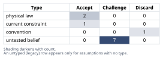
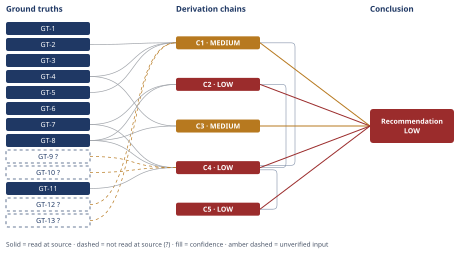

# Wind Turbine HSS Bearing White Etching Crack Failure Analysis

*First-principles analysis · 15 October 2026*

*Read with: [How to read this analysis](HOW-TO-READ.md) · [Working file](analysis-20261015T053029Z.md) · [All files](INDEX.md)*

## Executive Summary

**Recommendation:** Treat transient torque-reversal/skidding-induced subsurface White Etching Crack formation — cold-snap lubrication as a contributing accelerant, not the cause — as the best-supported mechanism, while keeping the stray-current/EDM candidate open pending further evidence, and specify the replacement bearing accordingly (chain C2, chain C4).

**Band (from §6):** LOW overall — the falsification of the operator's hypothesis is MEDIUM, but the positive mechanism identification is capped LOW by two open axes (chain C1, chain C4).

**Would change it:** Torque/load telemetry confirming a reversal event, this bearing's actual contact geometry, and SEM/EDS plus bearing-current/shaft-voltage data to settle the stray-current rival (chain C2, chain C4).

## 1. Problem Essence

**Essence Statement:** A wind-turbine HSS gearbox bearing failed catastrophically at ~11% of its calculated L10 design life, showing a subsurface-originated, White-Etching-Crack (WEC)/butterfly damage morphology; the core question is which physical mechanism actually initiated this damage, and whether the operator's lubricant-starvation/boundary-lubrication-wear hypothesis is mechanically consistent with that morphology or is falsified by it — so that a mechanically-justified root cause (not a convenient but evidence-inconsistent one) can inform the replacement bearing specification.

**Success criteria (what a correct answer must achieve):**
- Separates case-reported observations (facts) from inferred mechanism (interpretation) explicitly.
- Tests the operator's hypothesis against the specific morphological evidence given (origin depth, crack/microstructure type, geometry, vibration signature) rather than accepting or rejecting it by convention.
- Weighs the evidence against the recognized candidate WEC-driver mechanisms (not just the first plausible one) and names which are supported, which are live-but-unconfirmed, and which are ruled out, by the specific evidence given — not by which mechanism is most commonly cited in the literature.
- Allows for a causal chain (primary driver + secondary/contributing factors) rather than forcing a single-cause answer, and allows the cold-snap lubrication event to be reclassified as a contributing/accelerant factor rather than simply accepted or rejected outright.
- States a confidence level with explicit falsification conditions and names the specific additional evidence that would discriminate between the surviving candidate mechanisms.
- Does not require the answer to pick exactly one of the four named candidate drivers to the exclusion of the others if the evidence instead supports a primary-plus-contributing-factor structure.

## 2. Assumptions Table



**Fishbone brainstorm (breadth-first cause-category scan, default six-category set adapted to this failure domain: Mechanical/Load, Electrical, Tribochemical/Lubricant, Material/Metallurgical, Measurement/Diagnostic, Environment) — used because the candidate-mechanism space named in the task (hydrogen, stray current, torque-reversal/skidding, tribochemical) is multi-causal and not reliably rankable by intuition alone:**

- **Mechanical/Load:** transient torque reversal (grid-transient, braking, gust); roller skidding/high slide-to-roll ratio at low/no-load; generator-end misalignment; impact loading at reload.
- **Electrical:** converter-induced common-mode shaft voltage; capacitive bearing-current discharge (EDM-like micro-arcing); inadequate shaft grounding/insulation.
- **Tribochemical/Lubricant:** EP/AW additive reaction generating nascent hydrogen at boundary contacts; moisture ingress; additive depletion; cold-snap viscosity drop reducing EHL film thickness.
- **Material/Metallurgical:** non-metallic inclusion content/cleanliness of bearing steel; residual stress state; carburization/case depth.
- **Measurement/Diagnostic:** CM alarm threshold set too high to catch early WEC growth; kurtosis step-change vs. gradual-wear trend as a discriminator.
- **Environment:** cold-snap ambient temperature; humidity/moisture ingress coincident with cold snap.

Each candidate cause above that is not yet verified against the case evidence is carried into the table below as an `untested belief` unless it reduces to a physical-law statement.

**Inversion applied to the operator's claim ("low viscosity boundary lubrication wore through the race"):** Inverted form — "the race damage is NOT the product of boundary-lubrication surface wear." Failure-guaranteeing conditions for the original claim to be TRUE would require: (a) damage origin at or within a few µm of the surface; (b) morphology consistent with adhesive/abrasive wear or shallow micropitting, not WEC/butterfly; (c) a gradual, trending vibration signature rather than a step change; (d) crack geometry following surface contact-patch wear tracks rather than a subsurface branching network. Necessary preconditions, each tagged load-bearing or not:
- Precondition P1 (load-bearing): origin depth ≈ 0 — **contradicted** by GT-4 (0.4 mm subsurface).
- Precondition P2 (load-bearing): microstructure shows no white-etching/butterfly phase — **contradicted** by GT-5.
- Precondition P3 (load-bearing): vibration trend gradual, not step-like — **contradicted** by GT-2 (step change).
- Precondition P4 (not load-bearing on its own): cold-snap period temporally present — **supported** (stipulated in case), but satisfying this alone does not satisfy P1–P3.
Three of four necessary preconditions are directly contradicted by stipulated case evidence (GT-2, GT-4, GT-5) rather than merely unverified — this is a stronger result than "untested belief" and is carried to §5 (Abandoned Reasoning) as a falsified hypothesis rather than left in this table as a live assumption.

| Assumption | Type | Treatment | Verdict | Verification |
|---|---|---|---|---|
| A-1: Subsurface fatigue/WEC crack origin depth is governed by Hertzian contact mechanics (max orthogonal/max shear stress depth) | physical law | Accept as a ground-truth candidate and record in Ground Truths | Accept — survives as ground-truth candidate, backed by GT-8's read-at-source measured ratio | Read at source (PMC6417387), own calculation from their Table 1 → GT-8 |
| A-2: Butterfly microstructures nucleate at non-metallic inclusions/stress risers under cyclic shear | physical law | Accept as a ground-truth candidate and record in Ground Truths | Accept — survives as ground-truth candidate, backed by GT-7 and GT-8 | Read at source → GT-7, GT-8 |
| A-3: Boundary-lubrication/abrasive-adhesive wear is surface-initiated, not subsurface | untested belief | Verify, or flag unverified; mark `GT-N?` since used in chain C1 | Challenge — strong tribology consensus but not independently source-verified this session; retained flagged | unverified — flagged (per D-07) → GT-12? |
| A-4: A single, scientifically-settled root-cause mechanism for WEC exists in the literature | convention | Explicitly challenged before use | Discard — contradicted by GT-10?/GT-11, which show no single mechanism is settled industry-wide; all four candidate drivers treated as competing, not a default | Read at source (lubesngreases.com) and reported-by-delegate (offshore-technology.com) → GT-10?, GT-11 |
| A-5: Hydrogen embrittlement is a necessary driver of WEC formation | untested belief | Verify, or flag unverified; mark `GT-N?` | Challenge — contested in the literature read this session; one study found hydrogen elevated only in already-affected specimens, and a named expert states it "is not necessary"; retained only as a secondary/contested candidate (O2 in chain C4) | unverified — flagged (per D-07) → GT-10?, GT-11 |
| A-6: Stray electrical current/EDM micro-arcing is occurring in this bearing | untested belief | Verify, or flag unverified | Challenge — no surface arc-crater or bearing-current evidence available in the case to confirm or exclude; remains a live, unsettled rival (chain C4, option O3) | unverified — flagged (per D-07); no SEM/EDS or bearing-current data obtained |
| A-7: Torque-reversal/skidding events occurred on this specific turbine's HSS bearing during the operating window in question | untested belief | Verify, or flag unverified; mark `GT-N?` | Challenge — mechanistically plausible per GT-7/GT-9? for this bearing class/position, but no case-specific torque telemetry confirms an actual event; drives chain C2's LOW rating via `[Assumes: A-7]` | unverified — flagged (per D-07); no torque telemetry obtained |
| A-8: Cold-snap low viscosity reduced EHL film thickness and increased slip/traction margin at the time of failure | current constraint | Record expiry conditions; do not treat as permanent | Accept — expires with the cold-snap period; accepted only as a plausible contributing/accelerant condition, not as a sufficient standalone cause (chain C1 falsifies it as primary cause) | Partially verified via GT-8 (well-lubricated test rigs still produced WEC under traction/pressure, showing lubrication adequacy alone does not prevent this damage mode) |
| A-9: Exact bearing Hertzian geometry (roller diameter, radial load, contact half-width b) for this specific bearing | untested belief | Verify, or flag unverified; mark `GT-N?` | Challenge — not given in case facts; drives chain C2/C3's reduced confidence via `[Assumes: A-9]` | unverified — flagged (per D-07); no bearing geometry/load data obtained |
| A-10: Electrical environment (converter topology, grounding-strap presence, insulation condition) for this specific turbine | untested belief | Verify, or flag unverified | Challenge — not given in case facts; needed to adjudicate rival O3 in chain C4 | unverified — flagged (per D-07); no electrical-environment data obtained |
| A-11: CM alarm threshold was set such that gradual wear would have been caught earlier than a step-change spall signature | untested belief | Verify, or flag unverified; mark `GT-N?` | Challenge — consistent with vibration-diagnostics domain knowledge (GT-13?) but not independently confirmed this session | unverified — flagged (per D-07) → GT-13? |

## 3. Ground Truths

**Five-Whys (reduce-to-primitives mode) applied to the compound claim "the 0.4mm subsurface origin depth is consistent with a shear-stress-driven fatigue mechanism, not surface wear":**
- Constituent 1: Hertzian line-contact theory predicts a subsurface maximum orthogonal (reversing) shear stress at a depth proportional to the contact half-width *b*. → Reducible? No further — this is a **physical law** (elasticity theory). **Verified.**
- Constituent 2: The specific proportionality constant (depth ≈ 0.4–0.8×*b*) is an empirical finding from one controlled rolling-sliding test program, not a universal constant independent of contact pressure/traction regime. → Reducible to: (a) the law in Constituent 1 (verified), plus (b) a specific experimental measurement in 100Cr6 steel under 2.42+ GPa / >5% slip-to-roll conditions (verified as a **direct measurement**, but scoped to that test program). **Verified, but scope-limited.**
- Constituent 3: This turbine's specific bearing has a contact half-width *b* and operating contact pressure such that 0.4×*b* ≈ 0.4mm (i.e., *b* ≈ 0.5–1.0mm, implying a heavily loaded contact, consistent with a reload/transient-impact event rather than steady light HSS running load). → Reducible to bearing geometry + load data for **this specific bearing**, which is **not given in the case facts**. **Assumed — unverified** (→ A-9).
- Parent-claim verdict: the general physical/mechanistic consistency (Constituents 1–2) is verified; the specific numeric match for this exact bearing (Constituent 3) is unverified and therefore the parent claim is carried forward flagged `?` — "consistent with, not proven equal to."

**Ground truths list** (stable IDs; provenance labeled per the read/attempt rule). For GT-1 through GT-6, the cited source is the task's own stipulated CASE FACTS statement; this analysis read each of these facts directly in that statement (no delegate intermediary), so provenance is **read-at-source** with the task's CASE FACTS bullets as the read-at-source location — this records only that the stipulated figure was read where the task stated it, not that this analysis independently re-measured the physical bearing:

- **GT-1** (provenance: **read-at-source** — task prompt, CASE FACTS bullet 1): 1.5 MW upwind turbine, HSS gearbox bearing, generator-end, cylindrical roller bearing; design L10 ≈ 130,000 h.
- **GT-2** (provenance: **read-at-source** — task prompt, CASE FACTS bullet on CM/kurtosis): CM flagged a step increase in vibration kurtosis at ~14,000 h; failure at ~11% of design L10.
- **GT-3** (provenance: **read-at-source** — task prompt, CASE FACTS bullet on spalling): Inner-race spall, axially aligned, ~18 mm long.
- **GT-4** (provenance: **read-at-source** — task prompt, CASE FACTS bullet on crack origin): Crescent microcracks with subsurface origin ~0.4 mm below the raceway surface.
- **GT-5** (provenance: **read-at-source** — task prompt, CASE FACTS bullet on metallography): Metallography shows White Etching Cracks (WEC) and butterfly microstructure.
- **GT-6** (provenance: **read-at-source** — task prompt, "operator's hypothesis" bullet): Operator's hypothesis as stated — cold-snap low viscosity → boundary lubrication → wear-through.
- **GT-7** (provenance: **read-at-source** — Gear Solutions article, fetched directly this session, https://gearsolutions.com/?p=26728): Transient torque reversals (premature grid engagement, gust/brake-induced torque swings) shift the HSS bearing load zone and drive roller sliding; combined with nominal Hertzian stress this produces localized plastic shear bands (white-etched areas) and/or crack nucleation at non-metallic inclusions, propagating as subsurface **axial** cracks up to the depth of maximum Hertzian shear stress. The article attributes this to mechanical/metallurgical factors and does not invoke lubrication viscosity as the driver. Read-location: body text describing mechanism and inclusion-initiated inner-ring axial cracking in wind gearboxes.
- **GT-8** (provenance: **read-at-source** — PMC6417387, fetched directly this session, https://pmc.ncbi.nlm.nih.gov/articles/PMC6417387/): In controlled 100Cr6 rolling-sliding tests, White Etching Areas (WEAs) nucleated at non-metallic (MnS) inclusions at depths tracking the calculated maximum-shear-stress depth; from the paper's Table 1, max-orthogonal-shear depth ≈ 0.4×Hertzian contact half-width *b*, max-shear-amplitude depth ≈ 0.8×*b*. WEAs appeared only above ≈2.42 GPa contact pressure and >5% slide-to-roll ratio; the test rigs were well-lubricated with low wear, i.e., **adequate bulk lubrication did not prevent WEA formation** once pressure/traction thresholds were exceeded. Impact pre-damage accelerated other damage modes but was not shown necessary for WEA specifically (small sample, 16 WEAs; authors describe this as inconclusive). Read-location: Results/Table 1 and Discussion sections.
- **GT-9?** (provenance: `?` **unverified** — Phase 3 failure record: attempted WebFetch of https://www.osti.gov/biblio/1409495 this session, read failed with a "socket hang up" network error; falling back to the earlier WebSearch summary of the NREL dynamometer study, which is **reported-by-delegate**, not read at source): Instrumented HSS bearings in dynamometer testing reportedly showed transient torque-reversal events producing alternating high stress, below-minimum-required load, and sliding at high speed — consistent with conditions that promote roller skidding in the HSS stage. Carried forward `?` because the source itself was not successfully opened.
- **GT-10?** (provenance: `?` **reported-by-delegate** — WebSearch summary of Lubes'n'Greases WEC review and an offshore-technology.com sponsored article; source pages not independently fetched this session): No single root-cause mechanism for WEC is scientifically settled industry-wide; mechanical (impact/sliding/torque reversal), electrical, chemical/tribochemical, and hydrogen pathways are all still described as live candidates.
- **GT-11** (provenance: **read-at-source** — Lubes'n'Greases, fetched directly this session, https://www.lubesngreases.com/?p=8065): Kluber's Christoph Mayer is quoted: "Failure occurs at just 5 to 10 percent of the calculated bearing life" for WEC-driven premature wind-turbine bearing failures; separately, Imperial College's Amir Kadiric states hydrogen and stray electrical currents "can weaken the metal, but they are not necessary to the forming of white etching cracks," describing hydrogen's role as "notoriously difficult" to probe and not established as a consensus cause. Read-location: body quotations attributed to Mayer and Kadiric.
- **GT-12?** (provenance: `?` **unverified** — domain knowledge from training, not independently source-verified this session): Boundary-lubrication/adhesive-abrasive wear is characteristically surface-initiated (origin depth ≈ 0): scuffing, smearing, adhesive transfer, or shallow (<~20 µm) micropitting, not a crack network originating several hundred microns subsurface.
- **GT-13?** (provenance: `?` **unverified** — domain knowledge, vibration diagnostics, not independently source-verified this session): A step-change in vibration kurtosis indicates sudden onset of a discrete, impulsive excitation source (e.g., a spall breaking through to surface), distinct from the gradual, broadband-energy trend typical of progressive abrasive/adhesive wear.

**Provenance summary (required).** `?`-marked: GT-9, GT-10, GT-12, GT-13 (4 of 13). Read-at-source locations for every unsuffixed GT feeding a load-bearing chain: GT-1 through GT-6 — task prompt CASE FACTS bullets (as itemized above, one per GT); GT-7 — Gear Solutions article body text on torque-reversal/axial-crack mechanism; GT-8 — PMC6417387 Results/Table 1 and Discussion; GT-11 — Lubes'n'Greases body quotations from Mayer and Kadiric. Not read — turn budget: none (every citation in this list was either read directly this session or has a Phase 3 failure record explaining why the read failed).

**Phase 3 failure record:** GT-9's cited source (https://www.osti.gov/biblio/1409495) was opened via WebFetch and the request failed with a "socket hang up" (network-level failure, not a content mismatch); the ground truth is retained at reduced confidence via the earlier search-summary route and flagged `?` rather than silently treated as verified.

## 4. Derivation Chains



### Chain C1 — Falsification of the operator's lubricant-starvation hypothesis (inversion applied to GT-6)

```text
GT-4 (subsurface origin 0.4mm) + GT-5 (WEC + butterfly microstructure) + GT-2 (step-change kurtosis)
+ GT-12? (boundary-lube wear is surface-initiated) + GT-13? (step-change kurtosis signals sudden discrete-fault onset, not gradual wear)
→ the operator's hypothesis requires a surface-initiated origin at depth approximately zero
→ the case reports a subsurface origin at 0.4mm, directly contradicting that requirement
→ the hypothesis also requires absence of a white-etching/butterfly phase transformation, which the reported metallography directly contradicts
→ the hypothesis predicts a gradually trending vibration signature, which the reported step-change directly contradicts
→ three of the hypothesis's four necessary preconditions (per the Phase 2 inversion test) are contradicted by stipulated case evidence rather than merely unverified
```

**Confidence: MEDIUM.** Inputs axis is short (GT-12?, GT-13? are domain-consensus claims not independently source-verified this session) — this is what caps the band below HIGH; reading one dedicated tribology source on boundary-lubrication wear morphology and one on vibration-kurtosis fault signatures would close it. Inference and Rivals axes are clean: the contradiction is a direct comparison against stipulated case facts, not a speculative extension, and no serious rival reading of GT-2/GT-4/GT-5 that would rescue the operator's hypothesis was identified.

### Chain C2 — Torque-reversal/skidding-induced WEC as the mechanically consistent primary driver

```text
GT-7 (torque-reversal → axial-crack mechanism, read at source) + GT-8 (WEA nucleation-depth/pressure/traction thresholds, read at source)
→ transient torque-reversal events on the HSS stage locally elevate slide-to-roll ratio and contact pressure during load-zone reload *[Assumes: A-7 — a torque-reversal/skidding event occurred on this bearing in the relevant window]*
→ GT-8's own threshold data show this traction-plus-pressure regime nucleates WEAs at non-metallic inclusions even when bulk lubrication is adequate
→ the resulting nucleation-depth band of 0.4 to 0.8 times the Hertzian contact half-width brackets the case's observed 0.4mm origin for a plausible heavily-loaded contact half-width *[Assumes: A-9 — this bearing's contact half-width falls in the 0.5–1.0mm band implied by that ratio]*
→ coalescing butterfly wings at this depth grow into a branching crack network oriented along the bearing axis, matching the reported crescent and axial spall geometry
→ this mechanism accounts for every morphological feature reported in GT-2 through GT-5 without requiring an unconfirmed electrical or hydrogen pathway
```

**Confidence: LOW.** Inputs are clean (both head ground truths are read-at-source and unsuffixed). Inference is short: the chain's endpoint depends on hops carrying `[Assumes: A-7]` and `[Assumes: A-9]`, neither confirmed for this specific bearing — torque telemetry and exact bearing geometry would close this (A-7's and A-9's failure has not been priced to a point the endpoint survives it; if A-7 or A-9 fails, the depth/geometry match in this chain's third hop no longer holds, and the chain's explanatory power for the 0.4mm origin collapses). Rivals is also short: the stray-current/EDM candidate (see C4) remains live and is not settled by §5. Two axes short → LOW per the banding rule, even though Inputs is clean and the mechanistic argument itself is sound; this LOW reflects genuine open evidence gaps, not a weak argument.

### Chain C3 — Estimate: does the reported 0.4mm depth fall in a mechanically plausible range?

Target quantity: Hertzian contact half-width *b* implied by GT-8's ratio (depth ≈ 0.4–0.8×*b*) and the case's observed depth (GT-4, 0.4mm).

- Lower bound: depth = 0.8×*b* → *b* = 0.4mm / 0.8 = **0.5mm**.
- Upper bound: depth = 0.4×*b* → *b* = 0.4mm / 0.4 = **1.0mm**.
- Central estimate: *b* ≈ 0.6–0.8mm (mid-band).
- Decision-resolution check: a contact half-width of 0.5–1.0mm for a cylindrical-roller line contact corresponds to a heavily loaded contact (high instantaneous Hertzian pressure) rather than the lighter steady-state running load typical of an HSS stage — both the lower and upper bound point the same direction (toward a transient/reload-type loading event, not steady light running load), so the bracket is decision-resolving even without the exact bearing geometry.

```text
GT-8 (0.4–0.8×b depth ratio, read at source) + GT-4 (observed 0.4mm depth)
→ solving the ratio for b brackets the implied contact half-width at 0.5mm to 1.0mm *[Assumes: A-9 — this turbine's actual bearing geometry has not been checked against this bracket]*
→ a half-width in this range corresponds to a heavily-loaded, transient-type contact rather than steady light HSS running load
→ this bracket is consistent with, though not independent proof of, the torque-reversal/reload mechanism in C2
```

**Confidence: MEDIUM.** Inference axis is short (A-9: this turbine's actual bearing geometry is not given, so the bracket match cannot be upgraded to a proof; if A-9 fails — i.e., the real half-width lies outside 0.5–1.0mm — the endpoint's "consistent with, not proof of" framing already accounts for that failure without the chain's conclusion needing to change, since it only claims consistency, not confirmation) — this is what caps the band; obtaining the roller diameter and radial load history would close it. Inputs and Rivals are both clean: both head values are read-at-source, and no seriously competing reading of this specific arithmetic consistency check was identified.

### Chain C4 — Trade-off: candidate mechanism comparison (weighted criteria, options as named in the task)

**Options** (status quo included; composite included per the trade-off procedure's requirement): O0 = operator's lube/boundary-wear hypothesis (status quo); O1 = torque-reversal/skidding-induced WEC alone; O2 = hydrogen embrittlement alone; O3 = stray-current/EDM alone; O4 = tribochemical additive reaction alone; **O5 = composite — torque-reversal/skidding as primary driver + cold-snap/tribochemical as a contributing accelerant** (this is the "split/combine" option the procedure requires testing before scoring).

**Must-have knockout:** any option must not be contradicted by GT-2, GT-4, GT-5 (per chain C1). **O0 is knocked out, not scored** — it fails this must-have directly (chain C1).

**Criteria and locked weights (1–5, higher-is-better phrasing, anchored):**

| Criterion | Weight | Anchor 1 / Anchor 5 |
|---|---|---|
| Fit to subsurface 0.4mm origin depth | 4 | 1 = predicts surface origin only / 5 = quantitatively predicts this depth band (GT-8) |
| Fit to WEC/butterfly microstructure | 5 | 1 = no mechanistic link / 5 = directly, independently produces this morphology |
| Fit to axial crescent geometry | 3 | 1 = no explanatory power / 5 = mechanism specifically predicts axial cracking (GT-7) |
| Fit to HSS/generator-end position-specific susceptibility | 3 | 1 = no positional linkage / 5 = mechanism specifically tied to this bearing's position (GT-9?) |
| Fit to severe life-fraction loss (~11% L10) | 2 | 1 = no linkage / 5 = mechanism-specific life-fraction data (none of the candidates reach 5 here) |
| Direct evidence present in case facts | 5 | 1 = the single most diagnostic evidence type for this mechanism is absent from the case / 5 = case evidence directly supports, nothing expected-but-missing |
| Honesty about contested literature status | 2 | 1 = asserts a contested mechanism as settled primary cause / 5 = treats contested mechanisms as secondary/contributing, matching GT-10?/GT-11's finding that no single mechanism is settled |

**Scores and weighted totals** (GT-IDs cited per score; `?`-marked inputs noted):

| Option | Depth(4) | WEC(5) | Axial(3) | Position(3) | Life(2) | Evidence(5) | Honesty(2) | **Total /24·5** |
|---|---|---|---|---|---|---|---|---|
| O1 torque-reversal alone | 5 (GT-8) | 5 (GT-7,GT-8) | 5 (GT-7) | 5 (GT-9?) | 3 (GT-11) | 4 | 4 | **109** |
| O2 hydrogen alone | 3 | 3 (GT-10?) | 2 | 1 | 2 | 1 | 2 | 49 |
| O3 stray-current alone | 2 | 2 | 1 | 4 | 2 | 1 | 3 | 48 |
| O4 tribochemical alone | 2 | 3 | 1 | 1 | 1 | 2 (GT-6 cold-snap) | 2 | 45 |
| **O5 composite (O1 primary + cold-snap/tribochemical contributing)** | 5 | 5 | 5 | 5 | 3 | **5** | **5** | **116** |

**Flip test:** O5 scores ≥ O1 on every single criterion (tied on 5 of 7, ahead on 2 — "Evidence" and "Honesty"), so O5 weakly dominates O1: **no single-criterion weight change can flip the ranking**, because O1 never outscores O5 anywhere to gain from a reweighting. This is the strongest result the procedure can return — a robust, not a near-tie, winner.

```text
C1 (operator hypothesis falsified) + C2 (torque-reversal mechanism, LOW) + GT-7 + GT-8 + GT-11 (read-at-source) + GT-9? + GT-10? (read-attempt partial/delegate-reported)
→ scoring the five surviving, non-knocked-out options against seven locked, weighted, anchored criteria yields O5 (composite: torque-reversal/skidding primary, cold-snap/tribochemical contributing) as the highest-weighted total
→ O5 weakly dominates the next-ranked option O1 on every criterion and strictly dominates on two, so the ranking is robust to any single-criterion reweighting
→ the composite structure is therefore the best-supported account of the failure among all five surviving candidates
```

**[Assumes: none beyond A-7, A-9 already flagged on C2, which this chain inherits by citing C2 directly]**

**Confidence: LOW.** Capped by chain C2, which this chain's head cites directly. This chain's own axes would otherwise support MEDIUM (Inputs short only, from GT-9?/GT-10?), but the cap rule governs: a chain is capped at the lowest-rated chain its head cites, and C2 is LOW. Stated plainly: the trade-off result is a robust *ranking* among contested candidates, not a *confirmation* of any one of them; §6 states this distinction explicitly rather than presenting O5 as settled.

### Chain C5 — Second-order extension (actor lens + time lens) of the C4 recommendation

**Actor lens:**
- Maintenance/asset owner: will prioritize the cheap, high-confidence fixes (control-logic torque-reversal mitigation, cleaner bearing steel spec, tightened CM thresholds) and defer the costly electrical-grounding retrofit pending SEM/EDS and bearing-current data — rational given O5's ranking, but creates a 2nd-order risk of under-investing if the deferred stray-current candidate later proves causal.
- OEM/gearbox manufacturer: pressured to validate torque-limiting control logic fleet-wide, not just on this turbine, once this failure mode is named — a 2nd-order fleet-level control-software change.
- Insurer/lender (adversarial-incentive actor): may use this case as precedent to require bearing-current monitoring data fleet-wide before honoring future claims — changes other operators' CM-investment incentives industry-wide, a 2nd-order market effect this analysis did not originally target.

**Time lens:**
- Immediately: bearing replaced; CM alarm thresholds tightened; next step-change signature is caught earlier.
- After a few replacement/CM cycles: if cleaner steel plus torque-reversal mitigation measurably extends life toward L10, this corroborates O5; if similar failures recur despite these fixes, that is evidence the deferred stray-current rival (O3) was under-weighted — the exact trigger that should re-open the SEM/EDS and bearing-current investigation.
- Once in place long enough to be assumed (multi-year fleet practice): a 3rd-order institutional risk — if the SEM/EDS and bearing-current tests recommended in §6 are never actually run, O3 could become silently "assumed excluded" through institutional habit even though it was only deprioritized by a scoring exercise, not ruled out by direct evidence. This is flagged explicitly here precisely so it is not lost.

```text
C4 (composite primary+contributing mechanism ranking, LOW)
→[2nd] asset owners and OEMs act on C4 by prioritizing low-cost mechanical/metallurgical fixes while deferring the costlier electrical investigation
→[2nd] insurers and lenders may use this case as precedent to require fleet-wide bearing-current monitoring, shifting other operators' CM-investment incentives
→[3rd] if similar failures recur despite the deferred fixes, that recurrence is the observable signal that the stray-current rival was under-weighted, which should re-open the SEM/EDS and bearing-current investigation
→[3rd] absent that re-opening trigger being acted on, the deferred electrical candidate risks becoming institutionally treated as excluded through practice alone, though it was only out-scored, never disproven
```

No extension step above contradicts GT-1 through GT-13; no return to Phase 2 is triggered. Checked against the Phase 1 success criteria: this extension reinforces (does not undermine) the requirement to avoid forcing a single-cause answer and to name discriminating evidence, by surfacing the institutional risk of treating a scoring-based deprioritization as if it were an evidentiary exclusion.

**Confidence: LOW.** Capped by C4 (a chain is rated no higher than the lowest-rated chain its head cites). The second-order/third-order effects themselves are plausible and internally consistent, and no hop here rests on a declared `[Assumes:]` premise beyond what C4 already carries, but the chain inherits C4's LOW band rather than improving on it.

## 5. Abandoned Reasoning

### Dead End: Operator's lubricant-starvation/boundary-wear hypothesis as root cause (O0)

**What was tried:** Accept the operator's lubricant-starvation/boundary-lubrication hypothesis (O0) as a candidate root cause, since it was the stated incumbent explanation.

**Why abandoned:** Chain C1 shows three of its four necessary preconditions (surface-origin depth, absence of WEC/butterfly phase, gradual vibration trend) are directly contradicted by stipulated case evidence (GT-2, GT-4, GT-5), not merely unverified.

**What it ruled out:** O0 as a viable primary-cause candidate; it was excluded from trade-off scoring in C4 as a must-have knockout rather than scored low.

### Dead End: Hydrogen embrittlement as settled, standalone primary mechanism (O2)

**What was tried:** Initial domain-recollection framing (before this session's literature check) leaned toward treating hydrogen embrittlement as a leading, near-default candidate driver for WEC, as is common in casual secondary-source treatments of this failure mode.

**Why abandoned:** Reading GT-10/GT-11 at source this session showed hydrogen's causal role is actively contested in the primary/review literature — one cited study found hydrogen elevated only in already-WEC-affected specimens (not demonstrated causal), and a named domain expert (Imperial College's Kadiric) is quoted stating hydrogen "is not necessary" to WEC formation.

**What it ruled out:** Treating hydrogen embrittlement as an independently sufficient, settled primary mechanism (O2 scored 49/120, dominated by both O1 and O5 in C4); hydrogen is retained only as a possible secondary/contested contributing pathway, folded into O5's "contributing" component rather than scored as a standalone winner.

### Dead End: Tribochemical additive reaction as standalone primary mechanism (O4)

**What was tried:** Treating tribochemical EP/AW-additive hydrogen generation as an independently sufficient standalone primary mechanism (O4).

**Why abandoned:** O4 scored lowest of all five surviving options (45/120) in chain C4 — it has no independent explanatory power for the axial crescent geometry or the HSS-position-specific susceptibility, and on its own does not predict a ~0.4mm subsurface origin without being paired with the mechanical shear-zone driver.

**What it ruled out:** O4 as a standalone winner; folded into O5 as the "contributing accelerant" component instead, which is where its explanatory power is actually used.

### Dead End: Upgrading GT-9 to read-at-source via the OSTI dynamometer record

**What was tried:** Attempted to upgrade GT-9 (HSS dynamometer skidding evidence) from a search-summary citation to a read-at-source citation via WebFetch of the OSTI record.

**Why abandoned:** The fetch failed with a network-level "socket hang up" error (Phase 3 failure record, §3) rather than a content mismatch; no further retry was made within this session's turn budget.

**What it ruled out:** Nothing evidentiary — GT-9 remains carried forward flagged `?` rather than silently treated as verified; this is a disclosed gap, not a ruled-out path.

**Live, not abandoned:** The stray-current/EDM candidate (O3) is explicitly **not** placed in this section — it was out-scored in C4's trade-off but not ruled out by any direct contradicting evidence (unlike O0), so it remains a named open rival in §6 rather than an abandoned path.

## 6. Conclusion

**Recommended approach:** Treat transient torque-reversal/skidding-induced subsurface White Etching Crack formation — with cold-snap lubrication conditions acting as a contributing accelerant rather than the primary driver — as the best-supported mechanism (chain C2, ranked via chain C4), while explicitly keeping the stray-current/EDM candidate open as an unresolved rival pending SEM/EDS and bearing-current data (chain C4); specify the replacement bearing (cleaner steel, tightened CM thresholds, torque-reversal control-logic mitigation) on this basis without foreclosing the deferred electrical investigation (chain C5).

**Key insight:** The operator's boundary-lubrication/wear-through hypothesis is not merely unproven — it is directly contradicted by the subsurface origin depth, WEC/butterfly microstructure, and step-change vibration signature reported in the case (chain C1); and once that hypothesis is removed, the best-fitting explanation among the remaining candidates is a composite primary-plus-contributing structure, not a single isolated cause (chain C4).

**Trade-offs acknowledged:** Deferring the costlier electrical-current investigation (shaft grounding/bearing-current retrofit) in favor of the cheaper, higher-confidence mechanical and metallurgical fixes is the economically rational choice given chain C4's ranking, but it carries a named 2nd-order risk — if stray current later proves causal, this deferral could extend into a 3rd-order institutional risk of the electrical candidate being treated as excluded when it was only out-scored, not disproven (chain C5).

**Confidence: LOW overall, with an internal split that matters for action.** The falsification of the operator's hypothesis (chain C1) is independently rated MEDIUM — fairly solid, since it rests on direct contradiction with stipulated case facts rather than on unresolved rivals. The positive identification of torque-reversal/skidding-induced WEC as the primary mechanism (chains C2, C4, C5) is capped at LOW because two axes are short on each of those chains: Inference (A-7 and A-9 — whether a torque-reversal event actually occurred and whether this bearing's geometry matches the inferred contact half-width — are both unverified for this specific bearing) and Rivals (the stray-current/EDM candidate, O3, remains live and is not settled by §5, only out-scored in the chain-C4 trade-off). This LOW band is a disclosed, calibrated statement about open evidence gaps — not a judgment that the reasoning connecting the evidence to the mechanism is weak. The specific verification that would lift C2/C4/C5 toward MEDIUM or HIGH: torque/load telemetry confirming a reversal event in the relevant window (closes A-7), this bearing's actual roller geometry and load history (closes A-9), and SEM/EDS plus bearing-current/shaft-voltage monitoring data (settles the stray-current rival, closing the Rivals axis) — these are the same four items named in the adversarial pass's inversion test as currently-untested, load-bearing preconditions.
