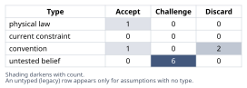
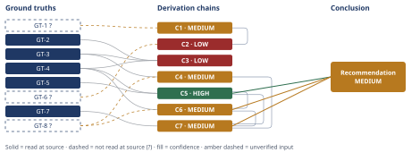

# Splitting an Oversized Agent File: Line-Count Gate vs. Context-Economy Budget

*First-principles analysis · 11 October 2026*

*Read with: [How to read this analysis](HOW-TO-READ.md) · [Working file](analysis-20261011T212156Z.md) · [All files](INDEX.md)*

## Executive Summary

**Recommendation:** Don't endorse "just split it" as stated. Splitting only changes what the model actually processes per invocation if it's paired with a change from eager to conditional loading — mechanical extraction alone can satisfy the line-count gate while leaving the real token/attention cost unchanged (chain C5). Before choosing an intervention, check which content classes are usage-conditional vs. load-bearing-every-run, and whether the harness supports genuine on-demand reads (chain C6). The defensible path is a combination: compress real redundancy, convert genuinely-rare content to trigger-gated reads, keep always-fired content honestly counted against the budget, and redefine the gate as two tiers — core vs. lazy-reference (chain C7).

**Band (from §6):** MEDIUM

**Would change it:** A production usage-frequency trace of the real plugin (chains C6, C7) and a redundancy audit of the 878 lines (chain C4).

## 1. Problem Essence

**Core problem:** Given an 878-line plugin agent file ~75% over a ~500-line (~5,000-token) prompt-engineering budget enforced by a regression gate, which class of intervention — split, compress, redesign loading, raise the budget, or a combination — actually reduces the real constraint the budget protects (steady-state per-invocation model context load and instruction-following reliability), as opposed to merely satisfying the gate's line-count check on one file?

**Success criteria:**
1. Names the mechanism the budget most plausibly protects against, from first principles, and distinguishes it from raw context-window capacity, in a way checkable against the Derivation Chains.
2. States, with a named condition, exactly when mechanical splitting does and does not change that mechanism's steady-state burden.
3. Produces a recommendation whose file-specific prescriptive content is explicitly conditioned on named, checkable facts about the real system — not asserted as unconditionally correct.
4. Separates claims that hold regardless of facts we lack from claims that are contingent on them, each contingent claim carrying a named verification path.

None of these requires the answer to be exactly "split" or exactly "don't split" — a composite answer is explicitly in scope, and turned out to be the finding.

## 2. Assumptions Table

| # | Assumption | Type | Treatment | Verdict | Verification |
|---|---|---|---|---|---|
| 1 | The budget targets model-facing context economy (attention reliability + recurring cost), not human-review line-counting | untested belief | verify or flag | Challenge — converges this direction via C1/C2 but not confirmed against the gate's own documented rationale | unverified — flagged |
| 2 | Context-window capacity is the binding constraint the budget protects against | convention / common misconception | explicitly challenge | Discard — rejected by C1 | GT-1? |
| 3 | Splitting a file into reference docs, by itself, reduces what the model attends to/processes per invocation | convention (software-engineering carryover) | explicitly challenge | Discard as a standalone claim — rejected by C5 | GT-5, GT-4 |
| 4 | Token cost of an invocation is a function of what's assembled into that invocation's context, not of the source file layout | physical-law-equivalent / definitional | accept as ground-truth candidate | Accept | definitional (GT-5) |
| 5 | The six companion procedures are needed on a minority of invocations; the template and rubric are needed on nearly every invocation | untested belief | verify or flag | Challenge — plausible by analogy (GT-4), unconfirmed for the real plugin | unverified — flagged (GT-8?); highest-stakes assumption in the analysis, pushed per the stakes-escalation rule |
| 6 | The real plugin's harness supports genuine conditional/on-demand loading of referenced files (vs. eager concatenation) | untested belief | verify or flag | Challenge — plausible by precedent (GT-4), unconfirmed for this specific "agent file" mechanism | unverified — flagged |
| 7 | 878 lines, reached via two rounds of feature accretion, is largely compressible/redundant rather than genuinely necessary | untested belief | verify or flag | Challenge — suggested by accretion pattern and C4's estimate, unconfirmed | unverified — flagged |
| 8 | The original ~500-line figure was derived from a measured threshold, not picked as an arbitrary round number | untested belief | verify or flag | Challenge — Occam's razor favors "arbitrary," unconfirmed | unverified — flagged |
| 9 [A1] | The hypothetical plugin's design problem is structurally similar enough to the observed analog (GT-4) that the analog's always-resident-core size is informative about the plugin's own floor | untested belief | verify or flag | Challenge — same general class, but invocation frequency/latency tolerance may differ | unverified — flagged; surfaced at chain C3 |
| 10 [A2] | "Measurably bounding real per-invocation model-side load" is accepted as the legitimate goal the gate should serve (not just a green CI check) | convention (normative choice) | explicitly challenge | Accept, for this analysis, as consistent with the problem statement's own framing | n/a — normative premise, owned by the analysis; surfaced at chain C7 |

## 3. Ground Truths

- **GT-1?** Frontier model context windows (circa 2025–2026) are typically on the order of 100K–1M+ tokens, vastly larger than 5,000 — unverified: no specific vendor-spec document opened in this analysis; general technical consensus.
- **GT-2** The subject file grew to 878 lines over two rounds of incremental feature addition against a recorded ~500-line (~5,000-token) budget enforced by an automated regression gate — source: task prompt (this conversation), read-at-source.
- **GT-3** The file currently inlines, within one main agent file: six companion-tool procedures, one output template, and one validation rubric — source: task prompt, read-at-source.
- **GT-4** In the first-principles skill body this analysis itself runs under, I directly confirmed (via Read, this session) that: (a) routing logic and all eight companion-procedure bodies are inlined unconditionally; (b) each procedure's deeper "-detail.md" (worked examples, failure modes) is split into a separate file opened via Read only "when you need" it — trigger-gated, not every run; (c) the output template and validation rubric are each split into files but opened via an unconditional Read that fires once per run regardless of content — paying their full cost every invocation despite being "split." Source: this conversation's system prompt plus direct Read of `validation-rubric.md` and `output-template.md`, read-at-source (read locations: `validation-rubric.md` lines 1–20 and 395–404; `output-template.md` lines 1–10 and 395–417).
- **GT-5** It is a definitional property of how LLM context assembly and token accounting work that the token cost incurred at a given invocation is a function of what text is assembled into (or fetched into, via tool calls, before generation) that invocation's context — not a function of which file that text originated from. Citation: definitional, not an empirical claim requiring an external source.
- **GT-6?** Practitioner and research consensus (e.g., "lost in the middle"-type findings) holds that instruction-following reliability for content in a long, crowded context degrades unevenly, and degradation concentrates on content that is rarely reinforced or deeply buried — unverified: no specific paper opened in this analysis; this is the single most important unverified mechanism-claim in the analysis.
- **GT-7** The reflexive response as described by the requester specifies extraction into reference files only; it names no change to whether those files are loaded eagerly or conditionally — source: task prompt, read-at-source.
- **GT-8?** Per the task prompt's own framing, the template and rubric sound structurally like "used on every output-producing run," while the six procedures sound structurally like selectively-invoked "auxiliary tools... it calls out to" — unverified inference from the prompt's own wording, not a confirmed fact about the real file; this is the fact named repeatedly below as highest-leverage to check.

?-marked: GT-1, GT-6, GT-8 (3 of 8). Read-at-source: GT-2, GT-3, GT-4, GT-7. GT-5 is definitional, no suffix.

## 4. Derivation Chains

### Conclusion C1: Raw context-window capacity is not the mechanism the budget protects against

GT-1? (frontier windows ≫ 5,000 tokens)
→ were the budget calibrated to raw context-window capacity, a ceiling tens to hundreds of times below typical window size would be a strange design choice
→ raw context-window capacity is therefore not the mechanism the ~500-line/~5,000-token figure is protecting against

**Confidence:** MEDIUM — GT-1? is unverified (no vendor-spec document opened); verification: confirm the specific model/tier this plugin runs under and its documented window.

### Conclusion C2: The budget's real target is attention-reliability and recurring cost, not maintainability

GT-6? (uneven reliability degradation in long contexts) + C1 (MEDIUM) (capacity ruled out)
→ with capacity ruled out, the remaining candidate mechanisms are degraded instruction-following reliability over a long, crowded always-loaded prompt, and the recurring per-invocation cost of re-sending that prompt every call
→ a budget this tight reads as a proxy for keeping the always-resident instruction set short enough to be reliably attended to and cheap to resend — not as a proxy for human-reviewer readability

**Confidence:** LOW — two axes short. Inputs: GT-6? unverified (verification: cite specific published research, or run an eval of this agent's own drift at varying prompt lengths). Rivals: a live, unsettled rival — the gate could instead target ordinary human-review/maintainability burden with no model-attention rationale at all; not ruled out without reading the gate's original documented rationale.

### Conclusion C3: The 500-line figure is a guess to be checked against measurement, not a known-achievable bound

GT-4 (a shipped analog's always-resident core sits well past 5,000 tokens) + GT-2 (878 lines actual) + GT-3 (current full inlining)
→ at least one working, shipped agent of the same general class needs an always-resident core well past 5,000 tokens even after applying conditional loading everywhere it structurally could [Assumes: A1]
→ this is a counterexample to any universal claim that 500 lines/5,000 tokens is always sufficient for this problem class, so the figure should be treated as a guess to check against measurement rather than a bound known in advance to be achievable here

**Confidence:** LOW — Inputs are clean, but Inference is short (rests on the flagged [Assumes: A1] — structural similarity between the plugin and this analog is assumed, not established) and Rivals is short (live, unsettled: the analog may be invoked far less frequently or tolerate more latency than the plugin, so its needs may not transfer). Verification: compare actual invocation frequency/latency tolerance between the two systems.

### Conclusion C4: Eager inclusion of selectively-needed content wastes most of its own tokens on a typical run

GT-3 (six procedures + template + rubric currently inlined) + GT-8? (template/rubric plausibly used every run; procedures plausibly used selectively)
→ if the six procedures make up a large share of the file's bulk, as in GT-4's analog, and a typical run exercises only a small subset of them per GT-8?, eagerly including all six every run spends most of those tokens on procedures unused that turn — bracketed between roughly 17% utilization (1 of 6 used, wasting up to ~83% of that content's tokens) and near-100% utilization on "use-everything" runs (wasting almost none)
→ moving those six procedures into separate files without changing when they enter context leaves this waste exactly where it was, and adds a small cost of its own — file-boundary overhead and an extra indirection to follow

**Confidence:** MEDIUM — Inputs short (GT-8? unverified). Verification: measure the real per-run technique-usage distribution (what fraction of invocations use which of the six procedures). Rival: subsumed by the stated bracket — "most runs use most techniques" is already represented at the bracket's upper (near-zero-waste) end, not a separate competing conclusion.

### Conclusion C5: Loading strategy, not file count, decides whether a split changes anything

GT-5 (token cost is a function of what's assembled into a given invocation's context, not of source file) + GT-4 (a working precedent shows splitting-plus-trigger-gated-reads reduces steady-state load, while splitting-plus-unconditional-reads does not)
→ whether splitting a prompt file changes what the model attends to on a given invocation is decided entirely by the loading strategy applied afterward — eager/unconditional versus conditional/trigger-gated — never by the mere fact that content now lives in more than one file
→ a split not paired with a change from eager to conditional loading satisfies a line-count metric on the shortened file while leaving the real, model-facing constraint that metric exists to bound unchanged, and once file-boundary overhead is counted, possibly slightly worse

**Confidence:** HIGH — Inputs clean (GT-5 definitional, GT-4 read-at-source). Inference: direct deduction, no assumption needed. Rivals: checked — prompt-caching economics was considered as a possible independent factor and found to reduce to the same eager/conditional distinction rather than contradict it; no live rival survives.

### Conclusion C6: Classifying each content class against two axes is the single highest-leverage fact to establish

C5 (HIGH) (loading strategy is the determinant) + GT-8? (uncertain usage-frequency split across content classes) + GT-4 (its own template/rubric fire every run despite being split, so splitting them saves nothing)
→ a content class only gains anything from being split out when both hold at once: the harness can fetch it conditionally, and it is actually needed on only a minority of invocations — GT-4's template and rubric satisfy the first condition but not the second, which is exactly why splitting them there saved nothing
→ the plugin team cannot choose a correct intervention without first classifying each of its three content classes against both conditions — current loading mechanism and actual per-invocation usage frequency — and the task's own description supplies neither, making this classification the dominant deciding fact, ahead of the raw line-count overage itself

**Confidence:** MEDIUM — Inputs short (GT-8?). Verification: as C4. Rival: not applicable — C6 is a conditional/classificatory claim ("check X before deciding"), not a substantive conclusion a rival could displace.

### Conclusion C7: The defensible intervention is a compression-plus-conditional-loading-plus-two-tier-budget combination

C5 (HIGH) (loading strategy is the determinant) + C6 (MEDIUM) (classification is the dominant fact) + C4 (MEDIUM) (naive eager split wastes most companion-procedure tokens) + GT-7 (the reflexive response as described specifies extraction only, no loading change)
→ weighing five options — leave the gate failing/bypassed, split-only via mechanical extraction, compress-only, redesign-loading-only, and a combination of compression, conditional-loading redesign, and a two-tier budget recalibration — against reducing steady-state per-invocation load, preserving completeness, resisting future regrowth, implementation cost, and readability, with the first two knocked out by the must-have that any accepted option measurably bound real per-invocation model-side load rather than one file's line count [Assumes: A2], the combination option scores highest and survives at least a ±1 reweighting of every single criterion
→[2nd] once the main file is nominally back under budget this way, whoever owns the CI gate has every incentive to treat the problem closed and stop watching, while new features keep accruing against the now-smaller core exactly as the original 878 lines accrued — so unless the gate itself is redefined to measure the always-resident core wherever it physically lives, the identical accretion pattern recurs on a harder-to-notice surface
→[3rd] a gate re-expressed as two tiers — a tight ceiling on always-resident core content, counted regardless of which file it lives in, plus a separate, measured allowance for genuinely conditionally-loaded reference content — becomes the team's durable model of the real constraint, and is the only version of "split the file" that does not have to be relearned the hard way a second time

**Confidence:** MEDIUM — capped by C6 and C4 (both MEDIUM). Rival: "if a redundancy audit finds negligible compressible redundancy and the harness has no conditional-read capability at all, raising the budget with no redesign could be the simplest sufficient fix" — named, live, not settled by available evidence; needs the redundancy audit and a harness-capability check named in assumption 6.

## 5. Abandoned Reasoning

### Dead End: Delete the gate entirely since it's already being bypassed

**What was tried:** Treating "the number is probably miscalibrated" as grounds for removing enforcement altogether.

**Why abandoned:** Conflates "the specific number may be wrong" with "no forcing function should exist." The causal chain behind the accretion (two rounds of feature addition with nothing forcing a design decision at each gate violation) shows the problem is a missing corrective process, not an unnecessary one; removing the gate guarantees unconstrained recurrence rather than fixing the miscalibration.

**What it ruled out:** "No gate" as a response, independent of what the gate measures.

### Dead End: Apply "small files, single responsibility" as a self-sufficient software-engineering fix

**What was tried:** Treating the reflexive response itself — mechanical extraction, nothing else — as adequate because it matches ordinary software modularity norms.

**Why abandoned:** Ruled out by GT-5 (token cost is a function of assembled context, not file layout) and GT-4 (the observed precedent shows "small files" and "small effective per-invocation context" are independent properties that require independent design decisions).

**What it ruled out:** Splitting as a standalone, sufficient fix.

### Dead End: Raise the budget to exactly 878 (anchor the new budget on the current file's size)

**What was tried:** Treating the file's current size, post-accretion, as itself the "true" requirement and simply codifying it.

**Why abandoned:** Anchors the new budget on unaudited accretion rather than a derived requirement; C4's utilization estimate suggests substantial potential waste/redundancy in that total, and C3's theoretical-limit framing argues the right comparison is to a measured floor, not to whatever accretion happened to produce.

**What it ruled out:** "Raise to current size and stop" as the fix — distinct from the still-live "raise to a measured figure after audit" rival carried in C7.

## 6. Conclusion

**Recommended approach:** Run the compression-plus-conditional-loading-plus-two-tier-budget combination, gated by a prior fact-check: measure per-invocation usage frequency across the six procedures, template, and rubric, and confirm whether the harness supports genuine trigger-gated reads; compress real redundancy regardless of that answer; convert only the content shown to be both infrequently-needed and conditionally-loadable into trigger-gated reference files, mirroring the working precedent; leave content needed on nearly every run (plausibly the template and rubric) counted against the budget wherever it physically lives; and redefine the regression gate itself into two tiers — a tight always-resident-core ceiling plus a separately-measured lazy-reference allowance — so that relocation alone can never satisfy it again (chain C7).

**Key insight:** The reflexive "split it" response answers a software-engineering maintainability failure mode, but the prompt-engineering budget targets a different, model-facing one — attention dilution and recurring per-invocation cost — and mechanical extraction changes nothing about that mechanism unless paired with a change from eager to genuinely conditional loading; splitting and lazy-loading are two independent decisions the reflexive response conflates into one (chain C5).

**Trade-offs acknowledged:** This combination costs more up-front engineering than a one-line split (writing and testing correct trigger conditions, instrumenting usage measurement, redesigning the gate itself); it accepts that the always-resident-core budget may legitimately need to rise above 500 lines once properly measured, forgoing a single fixed number; and it withholds a definitive prescriptive split/compress ratio until the team gathers facts (loading mechanism, usage frequency, redundancy) this analysis could not obtain (chain C7).

**Confidence:** MEDIUM — the loading-strategy-is-the-determinant finding (chain C5) is HIGH and independent of facts about the real file; the specific combination's necessity is capped at MEDIUM by C6 and C7, whose downgrade cause is the same unverified fact in both: GT-8? (which content classes are actually used how often, and whether the harness can load conditionally). Verification that would move this to HIGH: the usage-frequency trace and harness-capability check named at C6/C7, plus the redundancy audit named at C4.
