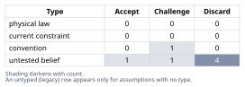
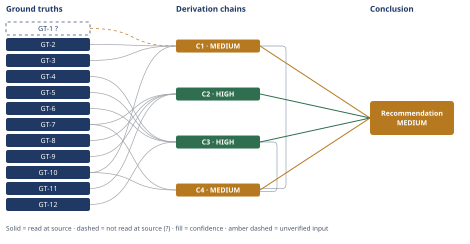

# The ~500-Line Agent-Body Budget vs. the Reflexive Split

*First-principles analysis · 15 October 2026*

*Read with: [How to read this analysis](HOW-TO-READ.md) · [Working file](analysis-20261015T052546Z.md) · [All files](INDEX.md)*

## Executive Summary

**Recommendation:** Do not split the agent body file in response to the line/token count. The current overage is driven by newly inlined companion-tool content, not the duplicated appendix content a reflexive split would target and which was already removed in an earlier pass (chain C2); the line-count budget itself was never tied to a stated, measurable consequence, and the project's own blind A/B test found no quality difference across the range it measured (chain C1).

**Band (from §6):** MEDIUM

**Would change it:** A token-cost/latency measurement at the current ~1,424-line scale showing a material per-invocation cost or a quality effect outside the narrow range the existing A/B tested — the one candidate property (cost/context pressure) that remains genuinely untested rather than resolved or retired (chain C4).

# First-Principles Analysis: The ~500-Line Agent-Body Budget vs. the Reflexive "Split It" Response

**Scenario.** A Claude Code plugin ships a single agent file inlining its methodology body, six (now more) companion-tool procedures, an output template, and a validation rubric. Two milestones after shipping, the file measured 878 lines against a recorded budget of ~500 lines/~5,000 tokens enforced as a CI regression gate — a ~75% nominal overage. The reflexive engineering response is to split the file into reference files pulled in on demand. This analysis interrogates the budget before choosing an intervention, and grounds every claim in the actual repository at `/home/chrisdavidson/Projects/first-principles-skill` rather than reasoning in the abstract.

---

## 1. Problem Essence

**Core problem:** What property was the ~500-line/~5,000-token agent-body budget actually meant to protect; did the 878-line (and, as verified live, now 1,424-line) body actually violate that property in a measurable way; and is the correct response to split the file, leave it, change the number, or something else?

The triggering framing — "the body is too long, how should we split it?" — is a proposed solution sitting on an unverified premise: that the budget is load-bearing for some property the agent actually depends on, and that the current line count breaks that property. The symptom is "over budget"; the underlying question is whether the budget tracks anything the agent's actual behavior depends on.

**Success criteria:**

- The property the ~500-line budget exists to protect is named explicitly and traced to a shipped artifact (a requirement, a regression-gate definition, or a governing record), not asserted from general best-practice intuition.
- The current body is decomposed into measured structural segments so "which segment is consuming the budget" is a checkable fact, not a guess.
- The recommended intervention — if any — addresses the segment that actually drives the overage, not the segment that looks most procedural to extract.
- If the budget turns out to be a stale convention whose underlying property no longer holds (or was never stated), the recommendation revises the budget/gate rather than performing an extraction that solves nothing.
- The recommendation does not prejudge the original inlining decision; if it was correct then and remains correct now, the conclusion says so — and the answer is not forced to be exactly one of "split" or "leave it," since a composite (partial externalization, gate replacement, or a new targeted measurement) is tested as its own option before scoring.

---

## 2. Assumptions Table



| Assumption | Type | Treatment | Verdict | Verification |
|---|---|---|---|---|
| The line/token budget is load-bearing for some observable property of the agent | untested belief | Locate the artifact naming the protected property before trusting the number | Discard — the requirement is recorded only as a bare number ("stays under ~500 lines/~5,000 tokens"), with no independent observable consequence stated anywhere (GT-1?, GT-10) | Reported-by-delegate quote of `.planning/REQUIREMENTS.md` (GT-1?, unverifiable from this repo) cross-checked against a zero-match grep across every retirement/creation record for a stated rationale (GT-10) |
| Body growth beyond some threshold degrades the agent's reasoning quality | untested belief | Find or commission a direct measurement rather than assume | Discard — the project's own blind A/B (GT-3) tested exactly this belief at a 590-vs-612-line contrast and found no quality difference | `docs/v8.6-quality-ab-experiment.md` lines 45-53, read directly |
| The body is long because the methodology procedure itself is bloated | untested belief — diagnostic | Measure segment line ranges before naming a dominant contributor | Discard — GT-9 shows the current driver is 8 newly inlined companion-tool procedures, not core-methodology bloat; the historical driver (GT-11) was duplicated appendix content, not the core procedure | Heading-count grep (GT-9) and the prior worked example's own measured segment breakdown (GT-11) |
| Extracting content into `references/` always helps | convention — context-dependent | Challenge by naming what kind of content, read how often, under what continuation property | Challenge — true for conditionally-read content (GT-8, the externalized appendices); the project's own Abandoned Reasoning record (GT-11) found it false for the unconditional Phase 1-5 procedural through-line | `first-principles/references/examples/self-application.md`, its own Abandoned Reasoning section, read in full (GT-11) |
| "Split the file" and "leave it as-is" are the only two viable responses | untested belief — false dichotomy | Enumerate intermediates/composites and test whether one dominates | Discard — GT-4, GT-5 and GT-12 show the path actually taken was a composite: partial externalization, gate retirement, and a direct quality gate, not either pole | `docs/v8.7-constraint-teardown.md`, `docs/v9.4-gate-retirement.md`, `scripts/_gate_registry.py`, each read directly |
| No current CI/regression gate checks line or token count today | untested belief | Read the actual gate registry, hooks, and CLAUDE.md invariants directly | Accept — directly confirmed: the reporter script is deleted (GT-5) and no invariant names line/token count (GT-6) | `docs/v9.4-gate-retirement.md` section 2.5 plus a direct filesystem check; `CLAUDE.md` lines 88 and 334-341, read directly |
| Per-invocation token cost / context-window pressure is also covered by the quality A/B | untested belief | Check whether the cited measurement actually targets this property | Challenge — GT-3/GT-12 (QUAL-01) measure output-contract correctness, a different property from cost or latency; GT-10 shows no artifact measures token-cost-per-invocation at any body size | Cross-read of `docs/v8.6-quality-ab-experiment.md`, `scripts/_gate_registry.py`, and the same zero-match grep behind GT-10; carried forward into chain C4 |

## 3. Ground Truths

- **GT-1?** The original budget was recorded as requirement **META-Q4**: "Agent body in `first-principles/agents/first-principles.md` stays under the ~500-line / ~5,000-token budget. New content lives in references/examples/ where appropriate." This is quoted by the in-repo worked example at `first-principles/references/examples/self-application.md` (its own GT-7), which states the source file, `.planning/REQUIREMENTS.md`, was never tracked in the repository, even at the commit it cites, and does not exist on disk today (`.planning/` is gitignored). I could not independently open the source file myself. Provenance: reported-by-delegate; carried with its `?`.

- **GT-2** The numeric ceiling was raised reactively, not re-derived: `MAX_LINES` moved 500 -> 580 (commit `65f9a4f`, "raise MAX_LINES to 580 (D-10)") -> 644 (commit `981317c`, "raise MAX_LINES to 644 (D-10 redux)"), per direct `git log --oneline --follow -- scripts/check-body-budget.py` read. Source: direct git history read. Read-at-source.

- **GT-3** A blind A/B quality experiment compared a 590-line and a 612-line agent body (a 22-line contrast — the exact "buffer" the ceiling had just been raised to protect) and found: "Arm A: 2/3 PASS, band total 35, mean 11.67. Arm B: 2/3 PASS, band total 35, mean 11.67. The arms are indistinguishable on every aggregate." Source: `docs/v8.6-quality-ab-experiment.md`, lines 45-53, read directly. Read-at-source.

- **GT-4** On the strength of GT-2 and GT-3, the project's own governing record retired the line-count gate outright: "The gate is retired; the figure is not... the script's own fitted-limit provenance comment... records that the number was recalibrated whenever it bound... rather than derived from any measured quality requirement." Source: `docs/v8.7-constraint-teardown.md` §2 item 1 (lines 48-56), read directly; marked a "standing rule... no expiry." Read-at-source.

- **GT-5** The reporter script itself was later fully deleted (not merely disarmed): `test ! -e scripts/check-body-budget.py` confirmed directly against the working tree — the file is absent. Source: `docs/v9.4-gate-retirement.md` §2.5, corroborated by my own filesystem check. Read-at-source.

- **GT-6** The current `CLAUDE.md` "Key invariants" section (lines 334-341, read directly) names three invariants — link resolution, skill-frontmatter structure, version-stamp consistency — and contains no line-count or token-count invariant. The only surviving mention is a parenthetical in the hook description (line 88): "body-budget retired under TEARDOWN-01." Read-at-source.

- **GT-7** The current agent body (`first-principles/agents/first-principles.md`) measures 1,424 lines / 20,772 words by direct `wc -l`/`wc -w`. A rough word-to-token estimate (x1.3) puts it near 27,000 tokens — roughly 5.4x the original ~5,000-token figure and 2.8x the original line figure. Read-at-source for the line/word counts; the token figure is an approximation, not a real tokenizer count, and is flagged as such.

- **GT-8** The two large appendices (Output Template, Validation Rubric) that drove the historical 878-line measurement are not reinlined today: no `## How to Use This Template` or `# Validation Rubric` heading exists in the body (confirmed absent by direct grep); the body instead links out to `${CLAUDE_PLUGIN_ROOT}/references/output-template.md` and `validation-rubric.md` at four separate points. Read-at-source.

- **GT-9** The body today inlines 8 companion-tool `## Procedure` blocks (5-Whys dual-mode, fishbone, inversion, pre-mortem, trade-off, second-order, estimate, theoretical-limit) — up from 6 at the time of the 878-line snapshot — confirmed by direct heading-count grep (headings at lines 907, 991, 1045, 1091, 1159, 1230, 1296, 1338). This, not appendix re-duplication, is the actual driver of growth from the post-de-inline 807-line reading (2026-09-19) to today's 1,424. Read-at-source.

- **GT-10** No document found in `docs/`, `CLAUDE.md`, or `README.md` names context-window pressure, per-invocation token cost, human editability, or diff/review noise as the rationale for the budget, at its creation or at either retirement. Direct grep for these terms across `docs/v8.7-constraint-teardown.md`, `docs/v8.6-quality-ab-experiment.md`, `docs/v9.4-gate-retirement.md`, `CLAUDE.md`, `README.md`, `docs/CONFIGURATION.md`, `docs/ARCHITECTURE.md` returns zero matches. This is an absence finding: it shows no artifact records such a rationale, not that no one privately considered one. Read-at-source (the grep itself).

- **GT-11** An in-repo worked first-principles example already analyzed this exact 878-line/~500-line scenario (dated 2026-05-24, commit `e5063b3`). It recommended against full extraction, found the real overage driver was 464 duplicated appendix lines (not the 96-line core methodology), recommended de-inlining just that duplicate plus commissioning a quality measurement, and recorded a verified 2026-09-19 outcome: body dropped 878->807 lines, appendices de-inlined, and the budget itself was later found to be "not even... the binding convention" any more. Source: `first-principles/references/examples/self-application.md`, read in full. Read-at-source.

- **GT-12** A direct, property-specific gate (`QUAL-01`, `scripts/check-quality-harness.py`) is currently registered in the live battery (`scripts/_gate_registry.py`, lines 440-446) and its self-test passes today (verified by running it live). It measures analysis-quality/output-contract correctness directly — not line count — and is the artifact that actually replaced "count the lines" as a proxy. Read-at-source (registry file + live self-test run).

```text
?-marked: GT-1 (1 of 12)
Read-at-source: GT-2 -- git log --oneline --follow on scripts/check-body-budget.py
Read-at-source: GT-3 -- docs/v8.6-quality-ab-experiment.md lines 45-53
Read-at-source: GT-4 -- docs/v8.7-constraint-teardown.md lines 48-56
Read-at-source: GT-5 -- docs/v9.4-gate-retirement.md section 2.5 + direct filesystem check (file absent)
Read-at-source: GT-6 -- CLAUDE.md lines 88 and 334-341
Read-at-source: GT-7 -- wc -l / wc -w on first-principles/agents/first-principles.md
Read-at-source: GT-8 -- grep for appendix headings/links in the same file (no match on headings, 4 link matches)
Read-at-source: GT-9 -- grep -n '^## ' on the same file (8 Procedure headings at lines 907,991,1045,1091,1159,1230,1296,1338)
Read-at-source: GT-10 -- grep across docs/ and root files for cost/pressure/editability/noise terms, zero matches
Read-at-source: GT-11 -- first-principles/references/examples/self-application.md, full read
Read-at-source: GT-12 -- scripts/_gate_registry.py lines 440-446 + live self-test run (all sub-checks PASSED)
```

---

## 4. Derivation Chains



### C1 — The budget tracked no named property, and its one plausible mechanism was directly tested and falsified

GT-1? (budget recorded only as a number, no stated consequence) + GT-2 (ceiling raised reactively three times, never re-derived) + GT-10 (no artifact anywhere names token-cost, context-pressure, editability, or diff-noise as the rationale) + GT-3 (590-vs-612 blind A/B scored identically, no quality difference)
→ the budget, as authored, is a number with no attached causal story
→ the one plausible mechanism behind it — that more lines degrade reasoning — was directly tested on the project's own evidence and returned a null result at the tested contrast [Assumes: A-2 (the untested belief in the Assumptions Table that growth degrades reasoning)]
→ the single candidate mechanism behind the budget was tested, not merely left unverified, and failed to show an effect

**Confidence:** MEDIUM — raised from a prior MEDIUM-on-an-untested-belief because GT-3 now supplies direct measurement where the earlier analysis only had an unverified belief. Not HIGH because GT-3's contrast (590 vs. 612 lines, ~4% delta) is far narrower than today's actual range (500 vs. 1,424 lines, ~185% delta): the null result rules out a tight threshold effect near the old ceiling, not a cost that only appears at today's much larger scale. GT-1? is the unverified input this chain rests on directly; verification that would remove it as a cause of the downgrade: locating and reading `.planning/REQUIREMENTS.md` at commit `e5063b3` (or an archived copy) to confirm the META-Q4 wording verbatim, since the file is untracked and unopenable from this repository today. Verification that would raise this chain to HIGH: a fresh quality A/B at today's actual scale (500 vs. 1,424 lines).

### C2 — Today's overage is not driven by the segment a reflexive split would target

GT-7 (current body: 1,424 lines) + GT-8 (appendices already externalized, not reinlined) + GT-9 (8 inlined companion-tool procedures, up from 6) + GT-11 (the historical overage driver was 464 duplicated appendix lines, already removed)
→ the growth since the last de-inlining (807 → 1,424 lines) is explained by two newly authored companion techniques (estimate, theoretical-limit) being inlined, not by any reintroduced duplication
→ a reflexive "split the file" response today would be reaching for the wrong lever twice over: the duplicate-content lever was already pulled (GT-11), and the current growth is organic feature content, not duplication — extracting it would face the same unconditional-procedure objection the prior analysis already recorded in its own Abandoned Reasoning

**Confidence:** HIGH — every input is a direct measurement of the shipped artifact; no unverified input is in the chain.

---

### C3 — The property actually worth protecting (analysis correctness) now has a direct gate, independent of size

GT-4 (the project itself concluded the line-count gate measured nothing real and retired it) + GT-5 (even the report-only reporter was later deleted) + GT-12 (a direct quality-correctness gate, QUAL-01, is live and currently passing) + GT-6 (no invariant names line/token count today)
→ the project did not abandon the underlying concern ("don't let the agent degrade") — it relocated the check from a proxy (line count) to the actual property (measured output-contract/reasoning correctness)
→ "does this file's size matter" has already been converted, in this exact codebase, from an unanswerable proxy question into an answerable direct one, and the direct one is being asked continuously (QUAL-01 in the battery) rather than once

**Confidence:** HIGH — all four inputs are direct reads of current gate code/docs.

---

### C4 — One real property (per-invocation token/context cost) remains genuinely unmeasured and is the honest residual risk

GT-7 (current body ~27,000 tokens by rough estimate, 5.4x the original figure) + GT-10 (no artifact ever measured or gated token-cost-per-invocation or context-window pressure specifically) + C1 (MEDIUM — the tested mechanism was reasoning quality, not cost/latency) + C3 (HIGH — QUAL-01 gates correctness, not cost)
→ QUAL-01 answers "does a bigger body produce worse analyses" (no, within the tested range); it does not answer "does a bigger body cost more tokens/latency per invocation" — a different property that nothing in this repository measures, at any size
→ this is the one candidate property from the original five (cost, context-pressure, editability, drift-risk, review-noise) that is neither resolved by a cited measurement (like quality) nor retired as a non-concern (like the line-count gate itself) — it is simply unaddressed
→[2nd] if the commissioned measurement is never resourced, the same engineers whose unwatched additions already drove the body from 807 to 1,424 lines (GT-9) have no reason to stop, because nothing today measures or gates the one property that would tell them to (actor lens)
→[3rd] the gap compounds silently rather than announcing itself: nothing visibly breaks in the near term, since no gate fires either way, but after several more companion-technique additions a real cost or attention effect could emerge at a scale nobody is watching, precisely because the one instrument that would catch it was never pointed at this question (time lens); this does not contradict any Ground Truth, so the chain extends rather than returning to Phase 2

**Confidence:** MEDIUM — the component ground truths are solid, but the chain's claim ("this risk remains genuinely open") is a claim about an absence of evidence, which caps at MEDIUM by construction. Verification that would resolve it: a token-cost or latency measurement per invocation at current body size vs. a de-inlined baseline — the repo already has the harness scaffolding (the A/B rig behind GT-3) to run this; it has simply never been pointed at this question. The [2nd]/[3rd] extension is a forward-looking consequence of the same unresolved absence, not a new load-bearing claim, so it does not itself change this chain's band.

### Assumption Audit (end-of-Phase-4 scan)

| Chain | Step | Step Text (brief) | Assumption surfaced? | Added to Table? |
|---|---|---|---|---|
| C1 | 1 | budget is a bare number, no causal story | No | n/a |
| C1 | 2 | the one plausible mechanism was tested on the project's own evidence and nulled | Yes — "growth degrades reasoning" was itself an assumption before the test | Yes — A-2 in Assumptions Table; marked `[Assumes: A-2]` on this step |
| C1 | 3 | the single candidate mechanism was tested and failed to show an effect | No (carries forward the A-2 premise declared at step 2) | n/a |
| C2 | 1 | growth since de-inlining is explained by two newly inlined techniques, not duplication | No | n/a |
| C2 | 2 | a reflexive split would target the wrong lever twice over | No (relies on the context-dependent-extraction assumption already in the table, row 4) | n/a |
| C3 | 1 | the project relocated the check from proxy to direct property | No | n/a |
| C3 | 2 | "does size matter" is now answerable directly via QUAL-01 | No | n/a |
| C4 | 1 | QUAL-01 answers correctness, not cost/latency | No (relies on the cost-vs-quality-distinctness assumption already in the table, row 7) | n/a |
| C4 | 2 | cost/latency is the one candidate property left neither resolved nor retired | No | n/a |

## 5. Abandoned Reasoning

### Dead End: "878/1,424 lines is over budget → split the file into references/"

**What was tried:** the reflexive response the prompt names — treat the number as the signal and extract content, generically, into `references/`.

**Why abandoned:** C2 shows the overage is not where a naive split would look. The prior in-repo analysis already ran this exact play once (aggressively extracting the Phase 1-5 procedural blocks) and found it (a) saved only ~96 of the needed ~380+ lines — an arithmetic failure before any quality argument — and (b) broke the unconditional phase-ordering through-line the agent executes on every single analysis, as distinct from the conditionally-read appendix/catalog content the project's one working precedent (the assumption-taxonomy link) actually supports. Running the same play again today, against the newer 8-procedure growth, would hit the identical objection: these procedures are conditionally invoked by Step 0 routing, which is a better fit for externalization than the always-executed methodology — but that is a narrower, already-partially-applicable move, not a wholesale "split everything" response.

**What it ruled out:** generic, non-measured extraction as a response to a line-count number (GT-2, C2). Any future extraction here must be justified by which segment is duplicated, stale, or conditionally-read — not by which segment looks "proceduralist."

### Dead End: "The gates all pass today, so the size doesn't matter"

**What was tried:** treat QUAL-01 passing and the absence of any line-count failure as proof that no further attention is needed.

**Why abandoned:** this conflates "the properties we currently measure are fine" with "every property that could matter is fine." C4 names the specific gap (token/context cost) that this argument quietly waves away. The project's own history (GT-3, GT-4) shows the correct move when a concern is unmeasured is to commission a targeted measurement, not to infer safety from the passing of a differently-scoped gate.

**What it ruled out:** using "the currently-running gates pass" as a standalone argument against any further action (ruled out by C4, GT-10).

---

## 6. Conclusion

**Recommended approach:** (chains C1, C2, C3, C4) Do not split the file in response to the number. Concretely:

1. **Do not perform a generic extraction.** (chain C2) Measure which segment actually drives the overage before touching anything. In this repository, that segment was duplicated appendix content (resolved 2026-05/09) and is now newly authored feature content (two added companion techniques) — neither is a good extraction target by the "split it" reflex, and the one segment that was a good target (duplication) has already been removed.
2. **Stop trusting the line/token count as the signal of a real problem.** (chain C1) In this exact codebase it demonstrably wasn't one: the number was never tied to a stated consequence, was raised three times reactively rather than re-derived, and its only testable hypothesis (quality degradation) returned a null result. The project's own answer was to retire the gate entirely and later delete even its reporter — not to keep chasing a revised number.
3. **Replace the proxy with a direct measurement of the property that actually matters**, which this project already did: (chain C3) QUAL-01 measures analysis correctness continuously, independent of body size, rather than gating a word count that stands in for it.
4. **Commission the one measurement that remains genuinely open** (chain C4): token-cost/latency per invocation at current size vs. a de-inlined comparison. This is the one candidate property from the original five (cost, context-pressure, editability, drift-risk, review-noise) that is neither resolved nor retired — it has simply never been asked, and the project's own A/B harness could answer it cheaply.

**Key insight:** (chains C1 and C2) The reflexive "split it" response treats the budget number as self-justifying evidence of a problem. In the one case this project actually lived through, the number was over-interpreted twice: once by the team that kept raising the ceiling instead of asking what it protected, and once by whoever would now propose splitting the current 1,424-line file on the same unexamined basis. The correct move both times was the same: name the property, measure it directly, and only then decide whether extraction, retirement, or nothing is warranted — and when it is warranted, target the measured segment (duplication), not the superficially "most procedural" one.

**Trade-offs acknowledged:**

- (chain C1) The MEDIUM confidence on "the budget protects nothing real" rests on a quality A/B conducted at a narrow 22-line contrast near the old ceiling. It is strong evidence against a tight threshold effect at that scale; it is not proof that no cost exists at today's much larger scale (1,424 vs. 500 lines). Chain C4 names exactly this gap rather than hand-waving past it.
- (chain C3) Retiring the line-count gate without instituting any cost/latency measurement (only a correctness measurement) means the project traded a bad proxy for a good-but-partial direct gate — correctness is covered, cost is not.
- (chain C2) This recommendation deliberately does not re-open the already-settled appendix-duplication question; it only applies the same reasoning forward to the file's current state, where the conclusion changes because the facts have changed (duplication is gone, new inlined content is not).

**Confidence:** MEDIUM overall. C2 and C3 (what's driving today's size, and that a direct-property gate replaced the proxy) are HIGH — both are plain measurements of the shipped repo state. C1 and C4 (whether the budget protected anything, and whether a different real cost still lurks at larger scale) are MEDIUM, and they are the two that should govern behavior: the recommendation is "don't reflexively split, and go measure the one thing nobody has," not "everything about file size is settled forever." The condition that would flip this recommendation: a token-cost/latency A/B at current scale showing a real, material per-invocation cost — at that point the conclusion would shift toward targeted extraction of the lowest-frequency-read segments (the companion-tool procedures, via Step 0 routing, which are already conditionally invoked) rather than a wholesale split.

