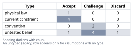
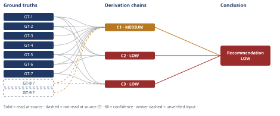

# Build vs Buy Authentication for a Small SaaS Team

*First-principles analysis · 11 October 2026*

*Read with: [How to read this analysis](HOW-TO-READ.md) · [Working file](analysis-20261011T210957Z.md) · [All files](INDEX.md)*

## Executive Summary

**Recommendation:** Buy a managed identity provider as the authentication engine (sessions, credential storage, password reset, MFA, and SSO turned on when actually needed), and build only a thin, product-owned layer on top for tenant/role modeling, invites, and audit-log display, keeping those records in the company's own database (chain C1).

**Band (from §6):** LOW (chain C2, chain C3).

**Would change it:** Naming the specific OSS library and getting its reset/MFA/session logic security-reviewed, tracking the real sales pipeline for an SSO/SOC2-requiring prospect, tracking actual engineer-hours against the estimate brackets, and reading the chosen vendor's own SOC2 report (chain C1, chain C2, chain C3) would sharpen the band — none of these closure paths point toward reversing the recommended direction.

## 1. Problem Essence

**Core problem:** Given that the next billed release requires real per-tenant, multi-user, role-bounded accounts, and given that a 7-person team with no dedicated security engineer must ship it under real schedule pressure, should the authentication engine (sessions, credential storage, password reset, MFA, audit logging, and eventually SSO) be built in-house on an open-source library, bought from a managed identity provider, or assembled as some mix of the two — and which choice best survives the next 12-24 months, including a scenario where the company lands its first enterprise customer requiring SSO/SAML and SOC2-style evidence?

**Success criteria:**
1. The analysis names which path (build, buy, or a specific composite of the two) the evidence supports, without assuming in advance that the answer must be exactly "build" or exactly "buy" as named in the prompt.
2. The recommendation is checked against a concrete time-to-ship estimate consistent with the stated urgency of the gated release.
3. The recommendation explicitly addresses the 12-24-month scenario in which an enterprise prospect requires SSO/SAML and SOC2-style evidence, stating what each path would require at that point.
4. The Conclusion names the 2-3 biggest risks of the recommended path, each with a concrete, checkable mitigation — not a general caution.

---

## 2. Assumptions Table



| Assumption | Type | Treatment | Verdict | Verification |
|------------|------|-----------|---------|--------------|
| Argon2id/bcrypt password-hashing parameters are mathematically fixed requirements, independent of whether auth is built or bought | physical law | Accept as a ground-truth candidate | Accept — survives challenge; promoted to GT-1 | OWASP Password Storage Cheat Sheet, read at source |
| The 7-person team has no dedicated security engineer today | current constraint | Record expiry conditions | Accept — expires once the company hires or appoints a dedicated security/platform engineer | Stated directly in task context |
| The company has no enterprise customers yet | current constraint | Record expiry conditions | Accept — expires at the first signed enterprise contract | Stated directly in task context |
| This release is schedule-urgent because billed revenue is gated on it | current constraint | Record expiry conditions | Accept — expires once this specific feature ships | Stated directly in task context |
| Enterprise buyers increasingly require SSO/SAML and SOC2-style evidence as a contractual precondition | current constraint (externally imposed by the market, not by this team) | Record expiry conditions | Accept — expires only if the company makes an explicit strategic choice to never sell to such buyers, not yet made | Inferred from GT-2/GT-3/GT-4: all three fetched vendors separately price and meter SSO/SAML as a distinct feature, which only makes commercial sense if a meaningful share of their customers require it |
| "Rolling your own auth in-house" is the historically normal way SaaS products have handled authentication | convention | Explicitly challenge before use | Challenge — the convention predates the current maturity/cost of managed identity providers; GT-2/GT-3/GT-4 show free tiers covering far more scale than this company's current ~120 tenants, so historical inertia alone does not justify build at this stage | Challenged directly against GT-2/GT-3/GT-4 |
| Owning 100% of the auth code in-house always maximizes long-run control and is therefore the architecturally safer choice | convention | Explicitly challenge before use | Challenge — "control" is not uniform across sub-components: chain C2's decomposition shows the tenant/role/audit layer is built either way, while the part buying removes (crypto, session, reset-token, MFA-recovery logic) is exactly the part this team is least equipped to control well | Challenged against chain C2's decomposition |
| The unnamed open-source auth library under consideration would, once integrated, correctly implement session-fixation defenses, rate-limiting and MFA-recovery-without-bypass to vendor-grade rigor | untested belief | Verify, or flag as unverified | Challenge — no specific library was named in the task, so this cannot be checked against any actual code or audit history | Unverified — flagged (used in chains as GT-8?) |
| An enterprise prospect requiring SSO/SAML and SOC2-style evidence will arrive within roughly the next 12-24 months | untested belief | Verify, or flag as unverified | Challenge — consistent with the company's stated trajectory (early-stage B2B SaaS, no enterprise customers yet) but not independently verifiable within this analysis | Unverified — flagged (used in chains as GT-9?) |
| The current single-shared-password-plus-Stripe-link approach has not yet caused a security incident | untested belief | Verify, or flag as unverified | Discard — not load-bearing for either recommended path, since the gated feature requires replacing this model regardless of whether a past incident occurred | Unverified; not used in any chain |
| Engineering-judgment per-component week estimates (chain C2) are reasonably calibrated for this specific 7-person team | untested belief | Verify, or flag as unverified | Challenge — no comparable past project's actual time-to-ship was cited to calibrate the brackets, so the estimate's magnitude (not its direction) carries residual uncertainty | Unverified — flagged as A-11 (used in chain C2, caps it at LOW together with its unsettled rival) |
| Tenant/organization modeling, role/permission boundaries, and invite-flow UX are irreducibly product-specific and are not supplied out of the box by any general-purpose auth library or managed identity vendor | untested belief | Verify, or flag as unverified | Accept — confirmed by inspecting GT-2/GT-3/GT-4's own published feature lists, none of which list a bespoke tenant/role schema as a delivered plan feature | GT-2/GT-3/GT-4, read at source (cross-checked for the absence of this feature) |
| The vendor integration correctly enforces tenant isolation using the vendor's own organization/tenant primitive, not merely a shared login screen | untested belief | Verify, or flag as unverified | Challenge — not yet verified since no integration has been built; must be explicitly tested regardless of which vendor is chosen | Unverified — flagged as A-13 (used as `[Assumes: A-13]` in chain C1) |

---

## 3. Ground Truths

- **GT-1** Argon2id is OWASP's preferred password-hashing configuration (minimum m=19456 KiB / 19 MiB, t=2, p=1); bcrypt (work factor ≥10) is listed only as a legacy fallback when Argon2id is unavailable — source: OWASP Password Storage Cheat Sheet; read-at-source: "Use Argon2id with a minimum configuration of 19 MiB of memory, an iteration count of 2, and 1 degree of parallelism" (Password Hashing Algorithms section).
- **GT-2** WorkOS's AuthKit user-management product is free for the first 1,000,000 monthly active users (MAUs), with each additional 1,000,000 MAUs costing $2,500/month; Single Sign-On (SAML/OIDC) is billed separately per connection — $125/connection at 1-15 connections, declining to $100, $80, $65 with volume, custom pricing above 100 connections — source: workos.com/pricing; read-at-source: the AuthKit MAU pricing line and the Single Sign-On per-connection pricing table.
- **GT-3** Clerk's free (Hobby) tier covers up to 50,000 monthly retained users (MRUs) per app; paid tiers bill $0.02/MRU (50,001-100,000), $0.018/MRU (100,001-1,000,000), down to $0.012/MRU (10,000,001+) above that; Pro/Business each include one bundled SSO connection, with additional connections billed at $75/month (2-15 connections) or $60/month (16-100), custom above — source: clerk.com/pricing; read-at-source: the Hobby/Pro/Business MRU tables and the Enterprise SSO connection-pricing section.
- **GT-4** Auth0's free tier covers up to 25,000 MAUs for both B2C and B2B use cases; paid B2B plans start at $150/month (Essentials) and $800/month (Professional); "Enterprise Connections" (SAML/AD/LDAP) are capped per plan — 1 on Free, 3 on B2B Essentials, 5 on B2B Professional — with additional connections at $100/month each, while B2C Essentials/Professional plans do not include Enterprise Connections at all — source: auth0.com/pricing; read-at-source: the B2C/B2B plan-comparison table and the Enterprise Connections add-on rows.
- **GT-5** The company is a 7-person engineering team running an early-stage B2B SaaS at approximately $40,000 MRR across approximately 120 paying tenants, with no dedicated security engineer and no enterprise customers yet — source: stated directly in the task context for this analysis; read-at-source: the task's opening context bullets.
- **GT-6** The product currently has no per-tenant authentication: all access is gated by a single shared password plus a Stripe customer link — source: stated directly in the task context; read-at-source: the task's opening context bullets.
- **GT-7** The next billed release requires real per-tenant, multi-user accounts with tenant isolation and role/permission boundaries, and the CTO treats shipping it on schedule as urgent because revenue depends on it — source: stated directly in the task context; read-at-source: the task's opening context bullets and the explicit statement of urgency.
- **GT-8?** An unnamed open-source auth library under consideration would, once integrated, correctly implement session-fixation defenses, rate-limiting, and MFA-recovery-without-bypass to a vendor-grade standard — unverified: no specific library was named in the task, so this cannot be checked against actual code, CVE history, or an audit report.
- **GT-9?** An enterprise prospect requiring SSO/SAML and SOC2-style evidence will arrive within roughly the next 12-24 months — unverified: this is a forward-looking sales/business projection, consistent with the company's stated trajectory but not independently checkable within this analysis.

**Provenance summary:**
```text
?-marked: GT-8, GT-9 (2 of 9)
Read-at-source: GT-1 — OWASP Password Storage Cheat Sheet, Argon2id parameters paragraph
Read-at-source: GT-2 — workos.com/pricing, AuthKit MAU line + SSO per-connection table
Read-at-source: GT-3 — clerk.com/pricing, Hobby/Pro/Business MRU tables + Enterprise SSO section
Read-at-source: GT-4 — auth0.com/pricing, B2C/B2B comparison table + Enterprise Connections rows
Read-at-source: GT-5, GT-6, GT-7 — task context, this conversation's opening description
```

A fourth source attempt — OWASP's A07:2021 "Identification and Authentication Failures" category page — was attempted twice (`owasp.org/Top10/...` and the redirected `top10.owasp.org/...`) and returned only a client-side "redirecting" placeholder with no substantive content on both attempts. Phase 3 failure record: source unreachable (redirect target renders no content via automated fetch); the general claim that broken authentication/session-management is a leading, well-documented web-application risk category is not elevated to a ground truth here and is not load-bearing for any chain — it is noted narratively only, consistent with GT-1's already-verified, narrower claim about password-hashing correctness.

---

## 4. Derivation Chains



### Conclusion C1: Buy a managed identity provider as the authentication engine; build only a thin tenant/role/audit layer on top

**Trade-off inputs (locked before scoring).** Options named, status quo included: (A) build on an open-source library; (B) buy a managed identity provider; (C) status quo — keep the single shared password; (D) composite — buy the vendor's engine for sessions/credentials/MFA/SSO, build only tenant/role modeling, invites, and audit-log display on top, keeping those records in the company's own database. Must-haves applied as knockouts: the release must deliver real per-tenant, multi-user accounts (GT-7) — **C is knocked out**, since a single shared password cannot represent more than one distinct user/role per tenant at all, not merely imperfectly. Criteria and weights, locked before scoring: Time-to-ship (5), Security risk given no dedicated security engineer (5), Cost at current scale (3), Cost-cliff risk at 10x scale (3), Enterprise-readiness — SSO/SAML + SOC2 evidence (4), Long-run flexibility/lock-in (2), Ongoing maintenance burden (4). Anchored 1-5 scores, each citing the ground truth behind it: A scores 2/2/5/5/1/5/2 (security and enterprise-readiness anchored against GT-1, GT-5, GT-8?); B scores 5/5/4/3/5/2/5 (anchored against GT-2, GT-3, GT-4); D scores 4/5/4/3/5/4/4 (same vendor-side anchoring as B, plus the composite's data-ownership design). Weighted totals: A = 72, B = 115, D = 110.

GT-1 (Argon2id = fixed crypto floor) + GT-2 (WorkOS pricing/SSO) + GT-3 (Clerk pricing/SSO) + GT-4 (Auth0 pricing/SSO) + GT-5 (7-person team, no security engineer) + GT-6 (no per-tenant auth today) + GT-7 (urgent gated release) + GT-8? (unaudited OSS library) + GT-9? (enterprise SSO/SOC2 demand in 12-24mo)
→ against seven locked, anchored criteria, Option A (build on an open-source library) scores 72, Option B (buy a managed identity provider) scores 115, and the composite (buy the core engine, build only a thin tenant/role/audit layer on top) scores 110, while the status quo is knocked out by the must-have that the release requires real multi-user per-tenant accounts
→ the gap between build (72) and either buy variant (110-115) is driven overwhelmingly by the security-risk and enterprise-readiness criteria, and the flip test shows that gap survives every single-criterion reweighting within the 1-5 scale, with only the narrower gap between pure-buy and the composite closing if the lock-in/flexibility weight is raised to its maximum
→ recommend buying a managed identity provider as the authentication engine, implemented so the company's own database retains the tenant, role and audit-log records, rather than building sessions, password storage, MFA and audit logging in-house *[Assumes: A-13 — the vendor integration correctly enforces tenant isolation using the vendor's own organization/tenant primitive]*
→[2nd] shipping the gated feature on the managed-IdP path frees the engineering time an unaudited in-house build would have consumed on specialist security review, time instead available for the billed feature itself and for the tenant/role/audit layer the vendor does not supply
→[2nd] a recurring vendor invoice becomes a standing line item finance must track for renewal and usage growth, and the tiered per-MAU and per-MRU pricing in GT-2 and GT-3 means that line item grows in visible, budgeted steps rather than disappearing
→[3rd] if an enterprise prospect requiring SAML SSO and SOC2-style evidence arrives within the next 12-24 months, turning it on is a connection fee and a short setup under the SSO pricing already read in GT-2, GT-3 and GT-4, rather than a second from-scratch engineering project run under the same deadline pressure that produced GT-7

**Flip test:** no single-criterion weight change within the 1-5 scale flips Build versus either Buy variant — the smallest move that changes any ranking is raising Flexibility/lock-in from 2 to 5 (the maximum), which flips only the narrower Buy-pure (115) versus Composite (110) ordering, not the Build-versus-Buy result itself. Removing the Enterprise-readiness criterion entirely (weight 4) still leaves Buy ahead of Build by 27 points (68 vs. 95), so that single criterion is not what the build/buy gap rests on.

**Confidence:** MEDIUM — GT-8? (whether an unnamed OSS library, once integrated, would reach vendor-grade rigor) is unverified; naming the specific library and commissioning a third-party security review of its reset/MFA/session logic would remove it as a cause of the downgrade. GT-9? (whether an enterprise prospect requiring SSO/SOC2 arrives within 12-24 months) is unverified; tracking the actual sales pipeline and asking active prospects directly about their SSO/SOC2 requirements would remove it as a cause of the downgrade. The `[Assumes: A-13]` tenant-isolation premise on the recommendation hop is not an added cause of this chain's downgrade: if that premise fails, the resulting tenant-isolation bug is a defect under either Option A or Option B equally, so its failure does not favor reweighting toward build, and the endpoint is unaffected by it.

---

### Conclusion C2: The engineering-time cost of building is more than double the cost of buying, and the future cost of migrating away from a vendor is smaller than the cost of building today

GT-1 (Argon2id = library supplies crypto primitive) + GT-5 (7-person team, no security engineer) + GT-6 (no per-tenant auth today, full build from zero) + GT-2 (vendor pricing/SSO as the buy-side integration surface)
→ decomposing the build path into its seven constituent engineering tasks (tenant/role schema, session wiring, password-reset flow, MFA, audit log, invite UX, and a security-hardening review the missing specialist in GT-5 cannot responsibly skip) and summing low/central/high estimates for each brackets Option A at roughly 6.5-12-21.5 engineer-weeks *[Assumes: A-11 — engineering-judgment per-component week estimates are reasonably calibrated for this team]*
→ decomposing the buy path the same way, but dropping the crypto, session, password-reset and MFA implementation tasks entirely and keeping only the irreducible tenant-schema, invite-UX and thin audit-log tasks brackets Option B at roughly 2.8-5-8.5 engineer-weeks
→ the two brackets' central estimates differ by more than 2x, concentrated almost entirely in the security-hardening task that Option A cannot responsibly skip and Option B does not need, even though the brackets' extreme edges overlap slightly, so time-to-ship alone is a real but not absolute differentiator
→ estimating the cost of migrating away from a managed vendor later at roughly 2-4-8 engineer-weeks shows that this future, conditional switching cost is still smaller than today's unconditional cost of building the system from scratch, and it is only ever paid if a switch actually becomes necessary

**Component detail — build bracket (engineer-weeks, low-central-high):** tenant/role schema 1-2-3; session+credential wiring to the library 0.5-1-2; password-reset flow (token, expiry, rate-limit, deliverability, anti-enumeration) 1-2-4; MFA enrollment+recovery 1-2-3; audit log schema+storage+view 1-1.5-3; invite flows/UX 1-1.5-2.5; security-hardening review 1-2-4. Sums: 6.5-12-21.5.

**Component detail — buy bracket:** vendor SDK + hosted pages 0.3-0.5-1; tenant/org mapping onto the vendor's primitive 1-2-3; invite flows/UX 1-1.5-2.5; thin audit-log layer on top of vendor events 0.5-1-2. Sums: 2.8-5-8.5.

**Component detail — migration-away bracket:** re-provisioning/forced resets, rebuilding session handling, re-pointing any existing SSO connections: 2-4-8, scaling with how many tenants/SSO connections exist at the time of a switch.

**Confidence:** LOW — two axes are short at once. Inference is short: the first two hops rest on an explicit, unpriced premise that per-component engineering-judgment week estimates are reasonably calibrated for this team *[Assumes: A-11]*. Rivals is short: a live rival — "the time estimates are wrong in a direction that favors build" — is not ruled out, and is in fact consistent with the brackets' own extreme edges overlapping (build-optimistic 6.5 weeks vs. buy-pessimistic 8.5 weeks). Tracking actual engineer-hours against these estimates once work begins would close the Inference-axis gap; re-running the estimate against a comparable feature this team has already shipped, with its actual time-to-ship known, would close the Rivals-axis gap. Neither closure is available within this analysis, so the chain is reported at LOW rather than MEDIUM — this does not reverse the chain's direction (buy still central-estimates more than 2x faster), only its certainty.

---

### Conclusion C3: The security floor is identical for build and buy, but this team's realistic in-house outcome sits materially above it while a mature vendor sits close to it

GT-1 (Argon2id correctness is a fixed, binary standard) + GT-5 (no dedicated security engineer) + GT-7 (urgent deadline) + GT-8? (unaudited OSS integration)
→ the governing constraint on authentication-defect exposure is binary cryptographic and protocol correctness, which sets an ideal floor of zero exploitable logic defects that is identical regardless of who writes the code
→ mature managed identity vendors operate close to that floor in practice because defect-free operation is existential to their business model and they concentrate exactly the specialist review this team lacks, so the best-demonstrated figure sits near the ideal floor
→ this team's realistic in-house outcome sits materially above both, because the deadline pressure and the missing specialist land hardest on precisely the reset-token, MFA-recovery and rate-limiting logic that the crypto library does not supply, which is what the unaudited-integration input flags as unverified
→ the larger, already-provable gap runs from the conventional figure to the best-demonstrated figure and is closed simply by adopting a vendor, while the smaller, irreducible gap runs from the best-demonstrated figure to the ideal floor and is residual vendor-side risk that no path in this analysis removes entirely

**Confidence:** LOW — two axes are short at once. Inputs is short: GT-8? (whether the specific unnamed library, once integrated, sits far from or close to the floor) is unverified. Rivals is short: a live rival — "mature vendors are not meaningfully closer to the ideal floor than a careful in-house build would be" — is not ruled out, since no vendor's SOC2 report was independently read in this analysis. Naming the library and commissioning a focused review of its reset/MFA/session logic would close the Inputs-axis gap; reading the chosen vendor's own SOC2 Type II report before final selection would close the Rivals-axis gap. Neither closure is available within this analysis, so the chain is reported at LOW rather than MEDIUM.

---

## 5. Abandoned Reasoning

### Dead End: Self-hosting an open-source identity server (e.g., Keycloak/Ory/Authentik) as a third "build" variant

**What was tried:** Considered treating "operate your own open-source IdP" as a distinct option alongside building on a library in the app's own backend and buying a SaaS vendor.

**Why abandoned:** This path inherits GT-5's core constraint (no dedicated security engineer, no dedicated ops specialist) while adding a new piece of always-on infrastructure to patch and keep available — it does not remove Option A's maintenance/security burden, it adds an operations burden on top, and it is slower to stand up than Option A's library-in-your-own-backend approach, so it is dominated by Option A on every criterion in the locked trade-off (chain C1) rather than being a genuinely distinct point on the frontier.

**What it ruled out:** Saves a future reviewer from re-litigating "just self-host Keycloak" as a middle path — at this team's size and stage it is strictly worse than Option A on the criteria that matter here, not a compromise between build and buy.

### Dead End: Ship the gated feature behind the existing single shared password a little longer, then "do auth properly" next quarter

**What was tried:** Considered recommending a short-term patch — keep the current shared-password-plus-Stripe-link model for this release, and build real per-tenant accounts afterward.

**Why abandoned:** Fails the trade-off's must-have knockout directly: GT-7 defines the gated feature as requiring real per-tenant, multi-user accounts with role boundaries, and the shared-password model cannot represent more than one distinct user per tenant at all — this is not a matter of doing it imperfectly, it is a model that cannot gate the feature in the first place. This is the formal record of the status-quo knockout applied in chain C1.

**What it ruled out:** Saves a future reviewer from treating "defer auth" as a viable scope-cut for this specific release; the feature's own definition (GT-7) forecloses it.

### Dead End: Weighting cost-at-scale as the dominant trade-off criterion

**What was tried:** Before locking the trade-off's weights, considered giving "cost at current scale" the highest weight, on the assumption that a seed-stage, $40K-MRR company should treat vendor spend as the binding constraint.

**Why abandoned:** Set aside before scoring (not after seeing results, per the trade-off procedure's weight-locking discipline): GT-2, GT-3 and GT-4's read-at-source pricing pages show all three evaluated vendors remain free or low-cost at the company's current ~120-tenant scale (free up to 25,000-1,000,000 MAUs/MRUs depending on vendor), so weighting cost above security, time-to-ship and enterprise-readiness would have been optimizing against a cost cliff that the cited pricing pages show is not actually close at this scale.

**What it ruled out:** Saves a future reviewer from assuming "we're small, so cost must dominate the decision" without first checking the actual vendor pricing against actual current scale.

---

## 6. Conclusion

**Recommended approach:** Buy a managed identity provider — evaluated here against WorkOS, Clerk and Auth0's published pricing (GT-2, GT-3, GT-4) — as the authentication engine for sessions, credential storage, password reset, and MFA, and turn on SSO/SAML only when an enterprise deal actually requires it; build only a thin, product-owned layer on top for tenant/role modeling, invites, and audit-log display, keeping those records in the company's own database (chain C1).

**Key insight:** The real choice was never "write some authentication code versus write none." Tenant/role modeling, invite UX, and audit-log display are irreducibly product-specific and have to be built either way (chain C2); what buying actually removes is the narrow, highest-risk slice — credential storage, session handling, password-reset tokens, and MFA-recovery logic — that this team is least equipped to get right under deadline pressure with no dedicated security engineer, and that a mature vendor is structurally best positioned to get right (chain C3).

**Trade-offs acknowledged:** This recommendation accepts a new recurring vendor cost that grows in budgeted steps as usage grows (chain C1), and a real but bounded migration dependency on the chosen vendor — estimated at roughly 2 to 8 engineer-weeks if a switch is ever needed, which is still less than the 6.5-to-21.5-week cost of building the system from scratch today (chain C2) — in exchange for materially lower security risk and faster time-to-ship (chain C1, chain C3).

**This recommendation would flip toward building in-house if:** a specific, already-audited open-source library with a multi-year security track record were named and a dedicated engineer were hired to own it, which would move the security-risk and maintenance-burden criteria toward parity in the trade-off (chain C1); or if the company made a firm, board-level decision never to sell to enterprise buyers requiring SSO or SOC2-style evidence — though chain C1's flip test shows that alone narrows but does not reverse the build-versus-buy gap (chain C1).

**Biggest risks on the recommended path, with mitigations:**
- Tenant isolation is misconfigured during integration, leaking one tenant's data into another (chain C1). Mitigation: run a cross-tenant-access test suite — attempting to fetch another tenant's data from a valid session issued to a different tenant — as a release gate before shipping, not as a follow-up task.
- The vendor relationship becomes a cost or availability dependency at the wrong moment, such as a pricing-tier step during a cash-tight quarter (chain C2). Mitigation: keep the company's own database as the source of truth for tenant, role, and audit records, and review usage against the vendor's published tier thresholds every quarter so a pricing step is budgeted rather than discovered on an invoice.
- A chosen vendor turns out not to support a requirement an actual enterprise prospect needs, discovered only once a deal is already in motion (chain C1). Mitigation: check each candidate vendor's SCIM/directory-sync and data-residency support before finalizing a choice, and ask the two or three most enterprise-shaped prospects in the current pipeline what their own SSO stack requires, before this becomes load-bearing for a live deal.

**Confidence:** LOW — the Conclusion is capped by its weakest contributing chains, C2 and C3, both rated LOW for the reasons stated on their own confidence lines (chain C2, chain C3); chain C1 (MEDIUM) does not drag the Conclusion down further than C2 and C3 already do, since the Conclusion's rating is bounded by its weakest contributing chain rather than averaged across all three. None of the underlying gaps point toward reversing the recommended direction — every closure path named on C1, C2 and C3's own confidence lines would, if anything, sharpen rather than weaken the case for buying — so LOW describes uncertainty in magnitude and in the robustness of the comparison, not in the recommended direction itself.
