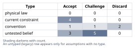
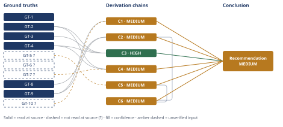

# Build vs Buy Authentication for an Early-Stage SaaS

*First-principles analysis · 15 October 2026*

*Read with: [How to read this analysis](HOW-TO-READ.md) · [Working file](analysis-20261015T053613Z.md) · [All files](INDEX.md)*

## Executive Summary

**Recommendation:** Buy-minimal-now: adopt a managed identity provider (WorkOS first choice, Clerk a close second) configured only for basic per-tenant email/password or magic-link auth, standard sessions, and baseline rate limiting shipped on day one — no in-house sessions/reset/MFA/audit-log build, and no SSO/SCIM/enterprise tier turned on until an actual trigger (chain C2, chain C3, chain C4).

**Band (from §6):** MEDIUM.

**Would change it:** a one-day team estimation spike confirming or revising the engineer-week estimate the schedule argument rests on (chain C2); a direct check with sales on whether a live deal already needs SSO today (chain C4); vendor-documentation confirmation of pre-hashed-password import support, reducing the lock-in uncertainty (chain C5).

## 1. Problem Essence

**Essence Statement:** Given a 7-person engineering team under a hard, revenue-linked ship deadline for a feature that requires per-tenant authenticated accounts (where today there is no per-tenant auth at all — only a shared password and a Stripe link), what is the smallest-scope authentication approach — built in-house, bought from a managed identity provider, or some split of the two — that ships the committed feature on time, does not create an unmanaged security liability, and does not lock the company into an expensive retrofit when its first enterprise customer demands SSO/SAML/SCIM/audit-log in the next 12-24 months?

**Success criteria (a correct answer must achieve):**
- Names the smallest viable auth scope for *this* release, rather than accepting the prompt's bundled Option A scope (sessions + password reset + MFA + audit log) as a given requirement.
- Produces engineer-week and $/month estimates specific to this team's actual scale (7 engineers, 120 tenants, $40K MRR), not generic industry anecdotes.
- Explicitly prices the 12-24 month enterprise-SSO trajectory for each path, not just the launch-day comparison.
- States what is and is not recoverable later (switching costs) rather than asserting "build preserves optionality" or "buy is risk-free" by default.
- Delivers one decisive recommendation with a stated confidence band and named conditions that would change it — not a pros/cons list, and not a forced "balanced" answer.
- Does not require the answer to be strictly Option A or strictly Option B — a split, sequenced, or narrower option is evaluated on equal footing, and is adopted only if the evidence actually favors it over a clean win for either named option.

## 2. Assumptions Table



Fishbone brainstorming was not needed to reach breadth here — the assumption space decomposed cleanly by direct enumeration (below) without requiring categorical brainstorming; see the Techniques-not-applied block in the appendix. Inversion *was* applied, against the clean-feeling claim "shipping per-tenant accounts via either path succeeds as planned" — its output appears as rows A-14–A-16 and is narrated after the table.

| # | Assumption | Type | Treatment | Verdict | Verification |
|---|---|---|---|---|---|
| A-1 | MFA and an audit log are needed for this first ship (embedded in the prompt's Option A) | convention | challenge | Not required for launch — no current tenant demands it, and GT-9 confirms no enterprise customer exists yet | Cross-checked against stipulated context: 120 SMB-type tenants, no enterprise customers |
| A-2 | "Build" necessarily means building MFA and an audit log too | convention / framing artifact | challenge | False bundling — vendor choice (build/buy) and feature scope (minimal/full) are separable axes conflated in the prompt | By decomposition; see chain C1 |
| A-3 | A managed IdP is strictly faster to ship than building minimal auth | untested belief | verify via estimate | True for *this* scope comparison, but only because the dangerous/slow parts (rate limiting, reset-flow abuse resistance) are exactly what an OSS crypto library doesn't solve — see A-12 | Fermi estimate, GT-8 |
| A-4 | Password hashes are portable between a self-built system and a vendor's system, in either direction | physical/definitional fact (core) + untested belief (vendor-specific exception) | accept core; verify exception | Core: one-way hashing makes reversible export impossible by design. Exception: whether a given vendor accepts an externally-pre-hashed import is vendor-policy-dependent and unverified this session | Flagged `?` on the vendor-specific portion only; carried as GT-5? |
| A-5 | A managed IdP is affordable at 120 tenants | current constraint, now verified | compute from fetched pricing | True — all three vendors checked are free at this scale by 100-1000x margin | GT-2, GT-3, GT-4 (read-at-source) |
| A-6 | The 7-engineer team can absorb N weeks of build time without materially delaying the roadmap | current constraint (given) | record expiry conditions | Load-bearing — true only while headcount stays at 7 and no other fire is already consuming slack; this is the team's genuinely scarce resource | Accepted as given (GT-9) |
| A-7 | SAML/SSO, SCIM, and audit-log export will be demanded by the first enterprise customer | untested belief about the company's specific future | flag, do not over-commit | High-likelihood industry pattern, but unconfirmed for this company specifically | Flagged `?`, carried as GT-10? |
| A-8 | Today's shared password + Stripe link is zero per-tenant authentication | physical/factual, stipulated | accept | True by stipulation | Given directly in the prompt |
| A-9 | Switching managed-IdP vendors later is low-cost | untested belief | challenge | Lock-in mechanism (credential custody) is symmetric regardless of direction of a future move — see A-4/chain C5 | Derived from A-4, not independently sourced |
| A-10 | A from-scratch SAML Service-Provider implementation is a large, specialized, security-risk-prone effort | convention treated as near-settled technical fact | accept with flag | Accepted — SAML's XML-signature/metadata surface has a long documented history of implementation vulnerabilities across independent implementations | General security-literature knowledge, not a document opened this session — flagged `?`, carried as GT-7? |
| A-11 | A vendor outage makes the product fully unusable | current constraint / untested belief about blast radius | verify partially | True for new logins/session refresh during the outage window; bounded for already-authenticated sessions with long-lived tokens | WebSearch found a documented ~6h25m multi-region Auth0 incident (2025-04-03), sourced from third-party trackers, not Auth0's own postmortem — flagged `?`, carried as GT-6? |
| A-12 | OSS auth libraries solve most of the hard work, so "build" is mostly UI/glue code | convention | challenge via decomposition | Partially true (hashing/session-signing primitives are solved) and partially false (reset-flow abuse resistance, rate limiting, enumeration resistance — the parts that actually produce vulnerabilities — are not solved by picking a library) | Component decomposition, Phase 3/4 |
| A-13 | This specific team's actual engineering velocity on auth work matches the generic Fermi decomposition in GT-8 | untested belief | flag — no team estimation spike was run this session | Unverified; this is the main reason chains C2/C6 are capped below HIGH | Unverified — would require a real spike by the team |
| A-14 | Each paying tenant maps to exactly one authenticatable account/organization with a well-defined admin user | untested belief, load-bearing (surfaced by inversion) | verify before building the backfill flow | Unverified — if false, the tenant invite/claim step (shared by every path) fails or balloons regardless of build/buy | Unverified; see Inversion write-up below |
| A-15 | The committed ship date has some slack, or the minimal scope is genuinely achievable within it | untested belief, load-bearing (surfaced by inversion) | verify against GT-8/A-13 | Unverified — load-bearing for the entire time-to-ship criterion | Unverified; see Inversion write-up below |
| A-16 | Baseline rate limiting on login/reset endpoints ships on day one, not deferred | untested belief, load-bearing (surfaced by inversion) | elevate into the recommended scope rather than leaving it optional | Treated as a hard requirement of "minimal" scope on either path, not an optional extra | Unverified as executed; elevated by design in §6 |

**Inversion applied** (Phase 2, requested technique): Claim inverted — "Shipping per-tenant authenticated accounts via either path does **not** succeed as planned" (fails to ship on time, fails to be secure enough, or fails to actually unblock the billed feature). Failure-guaranteeing conditions enumerated: (1) the tenant data model doesn't cleanly map to one account per tenant; (2) the ship date has zero slack and any edge case blows it; (3) the shipped flow has no rate limiting on login/reset; (4) a chosen vendor's organization primitive doesn't fit this product's actual tenant-user shape, discovered mid-integration; (5) nobody checks whether a live sales deal already needs SSO before the assumed 12-24-month horizon; (6) existing tenants aren't told early about the login-model change, producing a support-load spike blamed on "the migration." Necessary preconditions derived from these are rows A-14, A-15, A-16 above (load-bearing, unverified) plus two preconditions that map onto rows already in this table rather than duplicating: precondition "the chosen vendor's org/membership model fits" maps onto the pre-mortem's Cluster 1 in the adversarial pass record, and precondition "no live deal already needs SSO" maps onto A-7/GT-10? and the pre-mortem's Cluster 3.

## 3. Ground Truths

Irreducibility check (five-whys, reduce-to-primitives mode, applied informally): GT-5's core claim bottoms out at a mathematical/definitional fact about one-way hash functions (irreducible — no further decomposition needed); GT-7's claim bottoms out at an empirical record of multiple independent SAML implementation vulnerabilities over time (irreducible as a historical-record claim, though not re-verified against a specific CVE database this session, hence its `?`). Both are accepted as primitives for this analysis rather than drilled further, since further decomposition would not change the decision-relevant conclusion.

- **GT-1:** Today's auth state is a single shared password plus a Stripe customer link; there is no per-tenant authenticated account system at all. Provenance: stipulated directly by the user in the prompt (this analysis read the user's own words directly — no external document to open).
- **GT-2:** WorkOS pricing (workos.com/pricing, fetched via WebFetch 2026-10-15): AuthKit is free for the first 1,000,000 monthly active users; SSO connections cost $125/mo each (1-15 connections); Directory Sync (the SCIM-equivalent) costs $125/mo each (1-15 connections); Audit Logs cost $125/mo per SIEM connection plus $99/mo per 1M events retained. Provenance: read-at-source, URL cited, table extracted directly from the pricing page.
- **GT-3:** Clerk pricing (clerk.com/pricing, fetched via WebFetch 2026-10-15): Hobby tier is free up to 50,000 Monthly Retained Users (MRUs, not MAUs); Pro tier is $25/mo ($20/mo annual), also includes 50,000 MRUs, then tapering per-MRU overage pricing; Pro and Business tiers each include 1 SSO connection; additional SAML/OIDC/EASIE connections cost $75/mo (2-15 connections), tapering to $60/mo (16-100). Provenance: read-at-source, URL cited.
- **GT-4:** Auth0 pricing (auth0.com/pricing, fetched via WebFetch 2026-10-15): Free tier up to 25,000 MAUs (both B2C and B2B); B2B Essentials starts at $150/mo, B2B Professional at $800/mo; B2B Essentials includes 3 Enterprise (SAML/SSO) Connections with additional connections at $100/mo (up to 30 total); Enterprise MFA is a $100/mo add-on on B2B Essentials (included free in Professional). Provenance: read-at-source, URL cited.
- **GT-5?:** Cryptographic hash functions are one-way by mathematical construction, so a vendor (or a self-built system) cannot reverse a stored password hash back to the plaintext; migrating real users' credentials between any two systems therefore generally requires a forced password reset unless the receiving system can accept an externally-pre-hashed import. The core one-way-hash fact is treated as settled; the vendor-specific "which vendors accept pre-hashed imports, with no exceptions" generalization was not checked against each vendor's migration docs this session. Provenance: core claim is definitional (accepted without external citation); vendor-specific portion is unverified — flagged `?`.
- **GT-6?:** A multi-region Auth0 authentication outage of roughly 6 hours 25 minutes was reported starting 2026-04-03 17:11 UTC (per the trackers, dated in 2025), affecting 10 production components across multiple regions (US-4, EU-1, EU-2, JP-1, UK-1, CA-1, US-5, US-1, US-3, AU) and causing OTP/Magic Link validation failures. Provenance: reported-by-delegate — sourced from third-party status-tracking aggregators (StatusGator, IsDown), not Auth0's own incident postmortem; the aggregators' own incident counts for 2025 disagree with each other (52 vs. 16) and include at least one apparent date-typo entry. Flagged `?`.
- **GT-7?:** SAML 2.0 has a long-documented history of implementation vulnerabilities (XML canonicalization issues, signature-wrapping attacks) across multiple independent implementations, making a from-scratch Service-Provider build materially more security-risk-prone than adopting an established, continuously-patched vendor implementation. Provenance: general security-literature knowledge; no specific document was opened this session to confirm current CVE status — flagged `?`.
- **GT-8 (estimate, not measured):** Fermi decomposition of engineer-weeks: Build-full (sessions + password reset + MFA + audit log) ≈ 6-12 eng-weeks, central ≈9; Build-minimal (sessions + password + reset only) ≈ 3.5-7 eng-weeks, central ≈5.25; Buy-minimal-now (vendor SDK integration + mandatory tenant backfill/invite-claim flow, which is identical cost on every path) ≈ 1.5-3.5 eng-weeks, central ≈2.5. Labeled explicitly as an estimate derived from component decomposition (see chain C2 for the component list), not from this team's measured velocity — see A-13.
- **GT-9:** Stipulated business/team facts: 7-person engineering team; ~$40K MRR; ~120 paying tenants; no enterprise customers yet; the per-tenant-auth feature is the next billed release and the CTO considers the timeline urgent. Provenance: stipulated directly by the user.
- **GT-10?:** Enterprise B2B SaaS procurement commonly requires SSO (often SAML), SCIM provisioning, and audit-log export as security-review checklist items once deal sizes grow past a threshold. This is a well-known industry-wide pattern, but it is a general prior, not a confirmed requirement from any specific future customer of this company. Flagged `?`.

**`?`-marked ground truths:** GT-5, GT-6, GT-7, GT-10 (4 of 10). Not read — turn budget: none; all four were evaluated this session (GT-5's vendor-specific exception and GT-7 were assessed from existing domain knowledge rather than a fresh document fetch, GT-6 and GT-10 were explicitly checked and found to be third-party/unconfirmed respectively). Unsuffixed ground truths feeding load-bearing chains and their read-locations: GT-2 (workos.com/pricing, "Pricing" and add-on tables, fetched 2026-10-15); GT-3 (clerk.com/pricing, pricing-tier and SSO-connection tables, fetched 2026-10-15); GT-4 (auth0.com/pricing, pricing-tier and Enterprise Connections sections, fetched 2026-10-15); GT-1 and GT-9 (the user's prompt text directly, no page/section applicable since these are stipulated facts rather than document citations).

## 4. Derivation Chains



**Trade-off analysis (procedure applied).** Options named, including the status quo and a composite: (0) status quo — keep the shared password/Stripe link; (1) Build-full — ship sessions + password reset + MFA + audit log in-house, as literally framed in the prompt's Option A; (2) Build-minimal — ship sessions + password/email auth + reset only, in-house; (3) Buy-full-now — adopt a managed IdP and configure SSO/SCIM/audit-log/MFA now even though nothing currently demands them; (4) Buy-minimal-now — adopt a managed IdP configured only for basic per-tenant auth, leaving enterprise features off; (5) Hybrid/sequenced — build minimal in-house now, migrate to a vendor later if/when SSO is demanded.

Must-have knockouts: M1 (ship the committed per-tenant-auth feature by the committed date), M2 (no known-critical vulnerability class introduced), M3 (no recurring vendor spend disproportionate to $40K MRR). Status quo (0) fails M1 outright — it provides no per-tenant accounts at all — and is eliminated, not scored. Options 1-5 pass the knockouts well enough to be scored (Build-full is not eliminated here; its schedule risk is scored on the criteria below rather than knocked out, since missing a deadline is a risk, not a certainty).

Criteria and locked weights (1-5 scale, locked before scoring): C1 time-to-ship risk (w=5, highest — the business has already treated this release as time-critical, GT-9); C2 near-term security/liability exposure (w=4); C3 near-term cash cost at 120 tenants (w=2 — deliberately low, since GT-2/3/4 suggest this will turn out to be a non-factor); C4 engineering opportunity cost against the 7-person team's roadmap (w=4, tied directly to GT-9's stated team size); C5 12-24-month enterprise-readiness cost (w=4); C6 switching/lock-in cost already paid (w=3). Total weight = 22.

Anchored scores (1=worst, 5=best) and weighted totals:

| Option | C1 | C2 | C3 | C4 | C5 | C6 | Weighted total |
|---|---|---|---|---|---|---|---|
| Build-full | 1 | 2 | 5 | 1 | 2 | 4 | 47 |
| Build-minimal | 3 | 2 | 5 | 3 | 1 | 5 | 64 |
| Buy-full-now | 3 | 5 | 4 | 3 | 5 | 2 | 81 |
| Buy-minimal-now | 4 | 5 | 5 | 5 | 4 | 2 | 92 |
| Hybrid/sequenced | 4 | 2 | 5 | 4 | 4 | 5 | 85 |

Buy-minimal-now wins (92), ahead of Hybrid (85), Buy-full-now (81), Build-minimal (64), and Build-full (47).

**Flip test.** The margin between the winner (Buy-minimal-now) and the runner-up (Hybrid) is 7 points. The per-criterion score gap between them is 0 on C1/C3/C5, +3 on C2 (favoring Buy), +1 on C4 (favoring Buy), -3 on C6 (favoring Hybrid). Only weights attached to a nonzero gap can move the ranking: C2, C4, C6. Raising C6's weight to its maximum (5, from 3) only closes the margin to +1 in Buy's favor — still a Buy win. Lowering C4's weight to its minimum (1) still leaves Buy ahead by at least 4. The only single-weight change that flips the ranking is dropping C2 (security/liability exposure) from its locked weight of 4 down to the scale's floor of 1 — a three-step drop to "security barely matters," which is not a defensible weight given that this product already handles customer billing data via the Stripe link (GT-1). **No plausible single-weight change flips the result** — the recommendation is robust to reasonable disagreement about weighting.

**Estimate (Fermi, engineer-weeks — GT-8).** Target quantity: engineer-weeks to reach a shippable per-tenant-auth feature. Decomposition and central values: core session+password+hashing via an OSS library (1.5-3 wks) + password-reset flow with abuse-resistance hardening (1-2 wks) + mandatory tenant backfill/invite-claim flow for the 120 existing Stripe-linked tenants, which is identical cost on *every* path (1-2 wks) + MFA enrollment/recovery UX if built in-house (1.5-3 wks) + audit-log schema/instrumentation/export if built in-house (1-2 wks). Build-full sums all five components: 6-12 wks, central ≈9. Build-minimal sums the first three only: 3.5-7 wks, central ≈5.25. Buy-minimal-now replaces the first two components entirely with vendor-SDK integration (0.5-1.5 wks) and still pays the shared backfill cost (1-2 wks): 1.5-3.5 wks, central ≈2.5. Both bracket ends agree on the ordering (Buy < Build-minimal < Build-full), so the estimate is decision-resolved without needing further tightening.

**Second-order effects (both lenses walked, per Phase 4's required step).**

*Actor lens:* Engineers — a Build path concentrates auth expertise (and bus-factor risk) in whichever 1-2 engineers wrote it; a Buy path turns that expertise into a more commodity, rehireable "vendor SDK integration" skill. Sales/CTO — with a vendor relationship already in place, sales can truthfully say "SSO available on request" once a connection is enabled; with nothing bought, sales may have to say "not supported yet" or over-promise a build timeline engineering can't hit. Competitors — a rival who already has vendor-backed SSO can close an enterprise deal this company cannot, independent of how fast this company could theoretically build SAML later. End users/tenant admins — on every path, the 120 existing tenants face the same forced transition from shared password to individual accounts; this shared cost is often invisible in a build-vs-buy comparison but is real regardless of which box is checked.

*Time lens:* Immediately (ship date) — the feature ships on time under Buy-minimal-now or Build-minimal, and is at real risk under Build-full (per GT-8/C2 below). After a few cycles (2-6 months) — support load from password resets and locked-out tenants is the dominant *operational* cost on every path, and is schedule-invisible today. Once long-settled (12-24 months) — the first enterprise customer's SSO/SCIM/audit-log demand arrives (GT-10?); whichever path was chosen earlier now either collapses to a billing/config change (bought) or triggers a new, specialized, security-sensitive build under sales pressure (built-only, since Option A's scope never included SAML at all) — this is the chain C4 effect below, surfaced here under its proper time horizon.

### Conclusion C1: scope-bundling is a framing artifact, not a requirement

```text
GT-9 (urgent timeline, no enterprise customers yet) + GT-10? (enterprise checklist is industry-general, not confirmed for this company)
→ MFA and an audit log are not demanded by any current paying tenant or by a confirmed future requirement
→ bundling MFA and an audit log into "the build option" inflates the scope being compared without a matching requirement
→ the real decision has two separable axes, vendor choice and feature scope, and should be scored as such rather than as two pre-bundled packages
```

**Confidence:** MEDIUM — Inputs axis short on GT-10?; would reach HIGH if a confirmed statement from a specific prospect (rather than the industry-general prior) replaced GT-10.

### Conclusion C2: build (at any scope) costs materially more schedule and team capacity than buying, for this specific team right now

```text
GT-8 (estimate: Build-full ≈9 wk, Build-minimal ≈5.25 wk, Buy-minimal-now ≈2.5 wk) + GT-9 (7-person team, urgent deadline)
→ diverting 1-2 of 7 engineers for 5-9 weeks is roughly a 15-30% hit to total team capacity for over a month, during a release the CTO already treats as time-critical [Assumes: A-13]
→ buying collapses that diversion to roughly 1.5-3.5 engineer-weeks, almost all of which is the tenant-backfill work every path must pay anyway
→ for this team at this moment, the schedule-risk-minimizing choice is Buy-minimal-now, not either Build variant
```

**Confidence:** MEDIUM — Inference axis short: this chain rests on `[Assumes: A-13]` (this team's velocity matches the generic Fermi decomposition), which has not been priced against a real estimation spike. Would reach HIGH with a one-day team estimation spike confirming GT-8's bracket.

### Conclusion C3: cost at current scale is a non-factor on every path

```text
GT-2 (WorkOS free to 1M MAU, SSO $125/connection) + GT-3 (Clerk free to 50k MRU, SSO $75-100/connection) + GT-4 (Auth0 free to 25k MAU, B2B tiers from $150/mo)
→ 120 tenants, each with at most a handful of named users, sit 100-1000x below every vendor's free-tier ceiling
→ a managed IdP costs approximately $0/month for this company today on any of the three vendors checked
→ the "cost" axis should carry little decision weight, contrary to the intuitive worry that buying is the expensive option
```

**Confidence:** HIGH — all three inputs are read-at-source pricing figures, the inference is a direct magnitude comparison, and the rival ("costs could balloon with growth") is ruled out in §5.

### Conclusion C4: the 12-24 month enterprise-SSO moment is a config change if bought now, a specialized build if not

```text
GT-2 (SSO/SCIM/audit-log priced as $75-125/mo per-connection add-ons, not projects) + GT-4 (same pattern on Auth0's B2B tiers) + GT-7? (SAML has a documented cross-implementation vulnerability history)
→ with a vendor relationship and SDK already in place, satisfying a first enterprise customer's SAML/SCIM/audit-log demand becomes a billing-tier and configuration change measured in days
→ with auth built in-house under either Build variant (neither of which includes SAML in its stated scope), satisfying that same demand requires building SAML Service-Provider support from scratch, under sales-deal time pressure, against a protocol with a real implementation-risk history
→ today's build-vs-buy choice is what decides whether that future moment is a calm config change or an engineering scramble
```

**Confidence:** MEDIUM — Inputs axis short on GT-7?; the rival "a skilled team could build SAML later without much added risk" is ruled out in §5, so Rivals axis is settled. Would reach HIGH with a current CVE-database check confirming GT-7's claim is still accurate today.

### Conclusion C5: vendor credential lock-in is real but symmetric, so it does not favor build over buy

```text
GT-5? (password hashes are not portably exportable across systems without a reset, as a property of one-way hashing; vendor-specific exceptions unverified)
→ once real per-tenant password hashes exist anywhere, moving those 120 tenants' credentials to a different system later generally forces a reset for affected users, regardless of which direction the move is
→ "build in-house to preserve future optionality" does not preserve the specific optionality the lock-in worry is actually about — frictionless credential portability — because that friction exists the moment real passwords exist anywhere, not specifically because a vendor was chosen
→ the lock-in argument should not be weighted as a reason to prefer build over buy
```

**Confidence:** MEDIUM — Inputs axis short on GT-5?'s vendor-specific portion; the rival "in-house control over migration tooling reduces friction anyway" is ruled out in §5. Would reach HIGH with vendor-documentation confirmation of pre-hashed-password import support.

### Conclusion C6: sequencing "build minimal now, migrate to a vendor later" costs strictly more total engineering effort than buying now

```text
C2 (Buy-minimal ≈2.5 eng-wk vs. Build-minimal ≈5.25 eng-wk) + C5 (credential lock-in triggers a reset either way, so deferring the vendor relationship does not avoid a future migration cost)
→ build-now-then-buy-later pays the Build-minimal cost now and still pays a vendor-integration-plus-forced-reset migration cost later once SSO is actually demanded
→ buy-now pays the smaller integration cost once, and the later SSO trigger is a config/billing change per C4, not a second migration
→ the "defer the vendor decision" instinct is dominated by "buy now" given the pricing reality in C3/C4 — it is a more expensive path dressed up as caution, not a free hedge
```

**Confidence:** MEDIUM — capped by the lowest-rated chain cited (C2, C5, both MEDIUM); the underlying arithmetic comparison itself is not in dispute.

**Assumption surfaced during this phase (end-of-phase audit):** chain C2's second hop depends on A-13 (this team's velocity matching the generic estimate), declared inline above with `[Assumes: A-13]`; A-13 was added to the Assumptions Table in §2. Chain C6 inherits this dependency by citing C2 rather than re-declaring it. No other chain step introduced an assumption beyond those already in §2's table — see the Assumption Audit scan in the appendix for the full per-step record.

## 5. Abandoned Reasoning

### Dead End: Build-full as literally framed in the prompt's Option A

**What was tried:** Scored it in the trade-off table in §4.

**Why abandoned:** Weighted total of 47, last place, driven by the lowest possible time-to-ship score (estimate ≈9 eng-weeks against a deadline already treated as urgent, GT-8/GT-9) with no offsetting cost advantage once GT-2/3/4 showed vendor pricing is near-zero at this scale.

**What it ruled out:** Committing to building MFA and an audit log in this release at all.

### Dead End: Hybrid/sequenced (build minimal now, migrate to a vendor later if SSO is demanded)

**What was tried:** Scored at 85 in the trade-off table — second place, and the option that felt intuitively like the "safe, flexible" choice.

**Why abandoned:** Chain C6 shows it is strictly dominated — it pays the Build-minimal engineering cost now (≈5.25 eng-wk) and still pays a vendor-integration-plus-forced-password-reset migration cost later, whereas Buy-minimal-now pays the smaller cost (≈2.5 eng-wk) once.

**What it ruled out:** Treating "defer the vendor decision" as a free hedge; it is a more expensive path dressed up as caution.

### Dead End: vendor costs ballooning as the tenant count grows

**What was tried:** Considered as a rival to chain C3's "cost is a non-factor" conclusion.

**Why abandoned:** GT-2/3/4's free tiers extend to 25,000-1,000,000 MAU, which is 100-1000x this company's current scale; reaching even the lowest of these thresholds (Auth0's 25k) within the analysis's 12-24-month horizon would require tenant/user growth far beyond anything implied by the given $40K MRR / 120-tenant baseline.

**What it ruled out:** Using growth-driven cost risk as a reason to avoid buying.

### Dead End: a sufficiently skilled team could build SAML later without much added risk

**What was tried:** Considered as a rival to chain C4's claim that building SAML from scratch is materially riskier than buying it.

**Why abandoned:** GT-7?'s documented vulnerability history (XML canonicalization issues, signature-wrapping attacks) recurred across multiple independent, presumably competent implementations over time — the problem is structural protocol complexity, not an absence of skill, so team quality does not neutralize it the way it would for ordinary business logic.

**What it ruled out:** Treating "we're a good team" as a mitigant for chain C4's conclusion; settled that chain's Rivals axis.

### Dead End: building in-house preserves migration control that reduces switching friction even though passwords still need a reset

**What was tried:** Considered as a rival to chain C5's "lock-in is symmetric" conclusion.

**Why abandoned:** GT-5?'s dominant friction source is the forced password-reset itself — a user-facing event every one of the 120 tenants' users would have to go through — not the engineering tooling behind the migration; who controls that tooling doesn't change whether the reset email goes out.

**What it ruled out:** Using "we'd control the migration" as a reason build preserves more real optionality than buy; settled that chain's Rivals axis.

### Dead End: reweighting the trade-off's security-exposure criterion to flip the winner

**What was tried:** The flip test in §4, checking single-weight changes against the Buy-minimal-now vs. Hybrid margin.

**Why abandoned:** The only weight change that flips the ranking is dropping C2 to the scale's floor (1), which is not defensible given this product already handles billing-adjacent customer data (GT-1).

**What it ruled out:** Treating the Buy-minimal-now recommendation as fragile to reasonable disagreement about criteria weighting.

### Dead End: a separate, narrower-still option (e.g., a passwordless-only flow as its own competing path)

**What was tried:** Considered in Phase 1 whether the smallest viable step might be narrower than per-tenant accounts altogether.

**Why abandoned:** The prompt's requirement ("authenticated, per-tenant accounts") constrains the *what* but not the *how*; a passwordless/magic-link flow is already one of the cheapest available instantiations of Buy-minimal-now (a configuration choice on most managed IdPs, not a separate build), so it was folded into §6's recommendation as a tactical detail rather than scored as its own competing branch.

**What it ruled out:** Treating "how users authenticate" as a decision separate from the build-vs-buy choice already made.

## 6. Conclusion

**Recommended approach:** Buy-minimal-now. Adopt a managed identity provider — WorkOS as first choice, Clerk as a close second (reasoning below) — configured only for basic per-tenant authentication: email/password or passwordless magic-link, standard session handling, and baseline rate limiting on login/reset endpoints shipped on day one, not deferred (chain C2, chain C3). Do not build sessions, password reset, MFA, or an audit log in-house, and do not turn on SSO/SCIM/enterprise-tier features now — those stay off until an actual trigger (chain C4, chain C6). Wrap the vendor SDK behind a thin internal adapter interface as cheap insurance, and scope the tenant invite/claim backfill for the existing 120 Stripe-linked tenants as its own small project with a support/comms plan, since that cost is shared by every path and is otherwise invisible until it produces a support-load spike (chain C2). Vendor pick: WorkOS or Clerk over Auth0 for this specific shape — both are free at this scale (chain C3) and price SSO/SCIM as per-connection add-ons rather than gating them behind Auth0's higher-cost B2B tiers (chain C4); between the two, WorkOS's AuthKit-free-plus-per-connection-SSO model maps slightly more cleanly onto "no enterprise customers yet, pay only when one arrives" than Clerk's included-connection-then-tiered-overage model, though either is a reasonable choice (chain C3, chain C4).

**Key insight:** The prompt's "build vs. buy" framing hides two separable axes — which vendor, and how much scope ships now — and bundling them makes Build look like a reasonable scope decision with an unfortunate vendor choice, when it is actually an unforced scope decision (nobody has asked for MFA or an audit log yet) stacked on top of the slower, higher-risk vendor choice (chain C1).

**Trade-offs acknowledged:** Buying means real, if modest, vendor dependency from day one — credential custody and a small risk of vendor-side outages (chain C5's lock-in-is-symmetric finding, and GT-6?'s documented multi-region Auth0 incident) — and it means the product will not have MFA, SSO, SCIM, or an audit log on day one, which is a real near-term gap if sales encounters a security-conscious buyer sooner than the assumed 12-24-month horizon (chain C4). The pre-mortem in the appendix names concrete dispositions for both risks rather than leaving them as caveats.

**Confidence:** MEDIUM. The direction of the recommendation — buy, keep scope minimal, defer enterprise features until triggered — is robust: it survives the flip test in §4 (only an indefensible floor-weight on security reverses the trade-off ranking, chain C1 through C6's underlying trade-off table), and it does not even require GT-10?'s enterprise-SSO prediction to be correct, since chain C3 shows Buy-minimal-now wins on near-term schedule, security, and cost grounds alone. What keeps this at MEDIUM rather than HIGH is GT-8's estimate (an engineer-week bracket, not measured data for this specific team) and A-13 (this team's actual velocity is unverified against it), both of which feed chain C2 and chain C6; a one-day team estimation spike confirming or revising that bracket, a direct check with sales on whether a live pipeline deal already requires SSO today (per chain C4 and the pre-mortem's Cluster 3 disposition in the appendix), or vendor-documentation confirmation of pre-hashed-password import support (reducing chain C5's uncertainty), would each move this toward HIGH.
