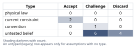
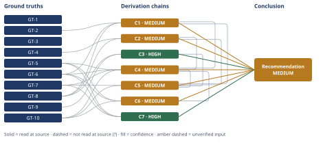

# Should a 12-Engineer Rails Monolith Move to Microservices

*First-principles analysis · 11 October 2026*

*Read with: [How to read this analysis](HOW-TO-READ.md) · [Working file](analysis-20261011T212717Z.md) · [All files](INDEX.md)*

## Executive Summary

**Recommendation:** Leadership's conclusion is not supported: the 45-minute pipeline and the coordinated restart are both caused by this project's specific CI-execution and deploy-topology configuration, not by it being a monolith, and a full microservices split would leave both causes in place while adding new distributed-systems and organizational cost on top of them (chain C5). Fix the pipeline mechanics and restart topology now, add internal modularization next, and defer any service extraction behind named, currently-unmet conditions (chain C5).

**Band (from §6):** MEDIUM

**Would change it:** Profiling this specific pipeline by stage and confirming its deploy/worker topology (chains C1, C2) — if those checks contradict the pattern seen on comparable Rails codebases, the MEDIUM band would need to be revisited; absent that, completing them as planned is expected to raise it to HIGH.

## 1. Problem Essence

**Essence Statement:** Leadership has diagnosed a symptom (deploys feel slow: a 45-minute pipeline plus a coordinated restart, against 2 deploys/day for 12 engineers) and proposed a specific, expensive architectural remedy (microservices) without first establishing that the remedy's causal mechanism — service boundary separation — actually targets the mechanism producing the symptom. The real question is not "should deploys be faster" (everyone agrees they should) but: **what is the verified causal chain from "monolith architecture" to "45-minute pipeline + coordinated restart," and does splitting the codebase into services break that chain, or does it leave the chain's actual links intact while adding new costs on top?**

**Success criteria — a correct answer must:**
1. Identify the actual mechanical cause(s) of the 45-minute pipeline duration and the coordinated-restart requirement, distinguishing causes inherent to "being a monolith" from causes that are properties of this specific CI/test/release implementation.
2. State, for the microservices option specifically, what concretely would and would not change about the 45-minute number and the restart requirement if it were adopted — not by analogy to other companies, but by mechanism.
3. Determine whether deploy frequency (2/day) is actually bottlenecked by pipeline duration or by a separate batching/process/review constraint, including what 2/day would look like holding architecture constant and only pipeline duration changed.
4. Not require the answer to be "microservices: yes" or "microservices: no" as the only two shapes — a partial/staged answer (modular monolith now, targeted extraction later, or never) must be considered on equal footing, since the real option space includes splitting the remedy (fix the pipeline mechanics now; revisit extraction only if a genuine scaling/ownership need later confirms it).
5. Produce a concrete, cost-ordered action plan and name the specific future conditions that would make microservices the right call, so the answer is falsifiable and actionable rather than a pure critique.

## 2. Assumptions Table

**Inversion pass applied to the core claim.** Leadership's conclusion ("deploys are too slow, we need microservices") is exactly the shape of claim the inversion technique exists for: clean, confident, and thin on stated evidence. Inverted form: *"splitting into microservices will NOT fix the deploy-speed problem (and may make the underlying symptom worse)."* Enumerated failure-guaranteeing conditions and the necessary preconditions they derive, each tagged load-bearing or not:

- Failure condition: the 45-minute figure is actually caused by serial/unparallelized test execution policy, which is a configuration choice that persists regardless of how many repos the code lives in → necessary precondition **P1 (load-bearing):** the pipeline duration is caused by something that cannot be fixed without separating deployment units.
- Failure condition: the "coordinated restart" is caused by single-instance/no-load-balancer deploy infrastructure, not by the code being one repo → necessary precondition **P2 (load-bearing):** the restart requirement is caused by codebase packaging rather than by deploy/infra topology.
- Failure condition: cross-domain transactions (checkout touching cart+catalog+fulfillment) that are currently in-process would, once split, require new distributed-consistency handling that does not exist today → necessary precondition **P3 (load-bearing):** the post-split integration/contract-test burden across services is smaller than today's whole-suite run.
- Failure condition: the 12-person team has no dedicated platform capacity to build and run N parallel CI/CD, tracing, and contract-versioning stacks, so that cost is paid out of the same hours that could otherwise fix the existing pipeline → necessary precondition **P4 (not load-bearing for the technical question, but load-bearing for feasibility):** the team can absorb N new operational surfaces without diverting capacity from the fix it is actually trying to achieve.
- Failure condition: no service-ownership boundary maps cleanly onto a 12-person team, so average team-per-service size falls below a viable on-call/review minimum → reinforces **P4**.

P1 and P2 are the two preconditions on which leadership's entire recommendation stands or falls. Both are tested directly against ground truths in Phase 3/4 below (GT-1 through GT-4, GT-6) and both are found almost certainly false in general for Rails-monolith-shaped CI/restart problems — though this analysis also flags that scenario-specific confirmation (profiling *this* pipeline) has not been done and is the first recommended action, not an assumed given.

| Assumption | Type | Treatment | Verdict | Verification |
|---|---|---|---|---|
| A1: Being a monolith inherently causes the 45-minute pipeline duration (= inversion's P1) | untested belief | Verify, or flag as unverified | Discard — contradicted by GT-1, GT-2, GT-3, GT-6: comparably-sized Rails monoliths cut CI time by ~4x through execution-policy changes alone, with no change to deployment-unit count | GT-2 (kellysutton.com, read-at-source), GT-3 (shopify.engineering, read-at-source) |
| A2: The full test suite must run, serially, on every deploy | current constraint (property of this project's current CI config) | Record expiry conditions | Accept — expires once parallelization/sharding/selective-test-running is implemented; demonstrated changeable on a comparably-sized Rails codebase (GT-2) | GT-2 (read-at-source) |
| A3: Deploys require a coordinated, synchronous application restart (= inversion's P2, restart half) | convention | Challenge before use | Challenge — GT-4 shows the standard Rails app server supports zero-downtime rolling ("phased") restarts in cluster mode, independent of whether the code lives in one repo or many; whether *this* deployment is currently configured that way is separately unverified (→ A12) | GT-4 (puma.io, read-at-source) |
| A4: Splitting into microservices will reduce the system-level 45-minute number (= inversion's P1/P2 combined, forward direction) | untested belief | Verify, or flag as unverified | Discard — contradicted by GT-5 and GT-6: splitting a codebase does not reduce total business logic or test surface, it redistributes it and adds a new category of inter-service contract/integration testing that does not exist today | GT-5, GT-6 (definitional — distributed-systems structural facts, no external citation applicable) |
| A5: Each individual microservice's own CI pipeline would run faster in isolation than today's whole-suite run | untested belief | Verify, or flag as unverified | Challenge — true only for a single service's own narrow pipeline considered alone; irrelevant to the system-level 45-minute question once GT-6's inter-service integration/contract-test surface is counted, and this is precisely the intuition that makes leadership's conclusion feel more obviously correct than it is | GT-6 (definitional) |
| A6: Deploy frequency (2/day) is bottlenecked by pipeline duration (= inversion's P1, frequency framing) | untested belief | Verify, or flag as unverified | Discard — contradicted by the GT-8/GT-9 arithmetic: a 45-minute pipeline permits on the order of 16–32x today's observed frequency even with zero additional parallel CI capacity, so pipeline duration alone cannot be the binding constraint | GT-8 (stipulated scenario fact), GT-9 (arithmetic, recomputable from GT-8) |
| A7: A 12-engineer team can effectively own and operate N independently-deployed microservices without per-service engineering capacity falling below a viable on-call/review minimum (= inversion's P4) | current constraint (organizational/headcount reality, Conway's Law) | Record expiry conditions | Accept — expires only if headcount grows substantially or the eventual service count N is kept very small (2–3); until then this is an arithmetic/organizational constraint, not a permanent law | GT-7 (definitional/arithmetic — organizational fact, no external citation applicable) |
| A8: The system has parts with genuinely independent scaling or reliability/release-cadence requirements (e.g., fulfillment vs. catalog) that would justify separate deployability | untested belief | Verify, or flag as unverified | Challenge — not evidenced anywhere in the stated situation; this is exactly the condition that *would* justify microservices later (see chain C7), but nothing currently confirms it holds today | unverified — flagged; needs direct evidence (traffic/incident/release-cadence data per domain) before it can support any conclusion |
| A9: The 45 minutes is dominated by test execution specifically, rather than by build, asset-compilation, Docker-image-build, or deploy-orchestration steps | untested belief | Verify, or flag as unverified | Challenge — not stated in the scenario; the pipeline has never been profiled/instrumented by component | unverified — flagged; first recommended action (Phase 6) is to instrument the pipeline and confirm this before committing to any fix |
| A10: The catalog/cart/checkout/fulfillment modules inside the monolith are tightly coupled, such that a change to one requires re-testing/re-deploying all of them together | untested belief | Verify, or flag as unverified | Challenge — plausible given the "coordinated restart" language in the prompt, but not confirmed; if true, GT-3's Shopify precedent shows this is fixable via internal modularization without changing the number of deployment units | unverified — flagged; needs a dependency/coupling audit of the existing codebase (e.g., a Packwerk-style boundary scan) |
| A11: The cost of a full microservices migration (distributed overhead, N CI/CD pipelines, versioning/contracts, service mesh, observability tooling) is lower than, or comparable to, the cost of fixing the existing CI/deploy mechanics directly | untested belief | Verify, or flag as unverified | Discard — contradicted by GT-5, GT-6, GT-7, and GT-10: a comparably small team (Segment) that decomposed a single domain into many per-unit services reported "exploding complexity" and a rising defect rate, and later consolidated back into one deployable service | GT-10 (InfoQ, July 2018, read-at-source) |
| A12: The application's current deploy/infrastructure topology (app-server process model, load-balancer presence) structurally prevents a rolling/zero-downtime restart | untested belief | Verify, or flag as unverified | Challenge — not confirmed either way by the scenario; GT-4 shows the *capability* exists generically for the standard Rails/Puma stack, but whether *this* deployment is currently configured to use multiple workers behind a load balancer is unverified | unverified — flagged; second recommended action (Phase 6) is to check/enable this directly before assuming any architectural rewrite is required |
| A13: Teams generally scale deploy frequency toward the pipeline-permitted ceiling when pipeline duration is the binding constraint on frequency (surfaced during the Phase 4 Assumption Audit, from chain C3's step 2) | untested belief | Verify, or flag as unverified | Challenge — a reasonable behavioral/economic prior, not independently verified for this team; used only to support a ruling-out inference (that pipeline duration is not the dominant constraint), and the ~16–32x headroom gap computed in GT-9 is large enough that chain C3's conclusion is robust even to a moderate violation of this assumption | unverified — flagged; no external source cited, used only as a bounded, acknowledged premise |

**Stakes-escalation note:** The conclusion under evaluation ("microservices is the correct fix") is a multi-quarter, largely irreversible, organization-wide commitment — the highest-stakes class of conclusion this methodology handles. Per the stakes-escalation rule, A1 and A4 (the two assumptions the entire recommendation rests on) have accordingly been pushed as far toward verified ground truth as external evidence allows (GT-1 through GT-6, GT-10) rather than left as accepted conventions, and both are discarded as stated.

## 3. Ground Truths

**Reduce-to-primitives check applied to the two load-bearing claims.** Before listing ground truths, the compound claims "the 45-minute pipeline is caused by being a monolith" and "the coordinated restart is caused by being a monolith" were each decomposed into constituents and tested for irreducibility:

- *45-minute pipeline* decomposes into: (a) total test/business-logic volume, (b) test-parallelism degree, (c) full-suite-vs-selective/sharded execution policy, (d) build/asset/image steps, (e) the deploy/restart step itself. (a) bottoms out at GT-8/GT-6 (a property of total logic volume, which splitting redistributes but does not shrink — not a property of "monolith-ness"). (b) and (c) bottom out at CI configuration choices, verified changeable on a comparable codebase (GT-2). (d) and (e) bottom out at pipeline/deploy design choices. None of the five constituents bottoms out at a fact that is actually about single-repo-vs-many-repo code organization — so the compound claim fails the irreducibility test and is discarded (A1).
- *Coordinated restart* decomposes into: (f) number of running app-server worker processes, (g) whether the app server supports rolling worker replacement, (h) load-balancer/traffic-draining presence, (i) backward-compatibility of in-flight DB migrations during rollout. All four bottom out at deploy-infrastructure configuration (GT-4), not at codebase topology — a single-instance microservice with no load balancer would need exactly the same coordinated restart that a single-instance monolith needs. Claim discarded (A3/A12).

**Provenance summary:** `?`-marked: none (0 of 10). Read-at-source: GT-1 — github.blog, "Building GitHub with Ruby and Rails," deploy-frequency statement quoted directly; GT-2 — kellysutton.com, "Speeding up a Rails CI pipeline," the five listed techniques and the 6m29s record quoted directly; GT-3 — shopify.engineering, "Deconstructing the Monolith," the quoted root-cause and anti-microservices statements read directly; GT-4 — puma.io official restart documentation, phased-restart mechanism and worker-count requirement read directly; GT-10 — InfoQ (July 2018) coverage of Segment's "Goodbye Microservices" post, quoted figures and statements read directly. GT-5, GT-6, GT-7 and GT-9 are definitional/arithmetic facts (distributed-systems structure, redistribution-not-reduction of logic, headcount arithmetic, and pure division) rather than externally-sourced empirical claims, so no source-provenance suffix applies to them; GT-8 is a fact stipulated by the problem statement itself.

- **GT-1** GitHub's Rails monolith deploys "as often as 20 times a day," with a Rails-version upgrade shipped nearly every week, attributed to a thorough test suite plus progressive rollout — source: github.blog, "Building GitHub with Ruby and Rails"; read-at-source: the deploy-frequency sentence and the test-suite/progressive-rollout attribution, fetched and quoted directly.
- **GT-2** A comparably-sized production Rails monolith's full CI suite was cut from roughly 25 minutes to a record of 6 minutes 29 seconds via five purely CI-engineering changes — flake elimination (green-build rate 75%→98%), restoring per-test isolation/randomized order, a 2-minute per-file time cap, timing-based parallel-bucket (knapsack) balancing, and raising parallel jobs from 40 to 130 — with no change to the number of deployable units — source: kellysutton.com, "Speeding up a Rails Continuous Integration Pipeline"; read-at-source: the five numbered techniques and the 6m29s figure, fetched and quoted directly.
- **GT-3** Shopify explicitly diagnosed "a lack of boundaries between distinct functionality in our code" — not the fact of being a monolith — as the direct cause of tests that were "difficult to write, and very slow to run on CI," and fixed it by enforcing internal modularity (components/Packwerk) while deliberately keeping a single deployable unit, specifically to avoid taking on "multiple different test & deployment pipelines," per-service "infrastructural overhead," and the network latency of inter-service calls — source: shopify.engineering, "Deconstructing the Monolith: Designing Software That Maximizes Developer Productivity"; read-at-source: the quoted root-cause and anti-microservices statements, fetched directly.
- **GT-4** Puma, the standard Rails application server, supports a "phased restart" (`pumactl phased-restart` / SIGUSR1) that replaces worker processes one at a time in cluster mode (2+ workers), producing a restart with no downtime and no hanging requests, subject to backward-compatible database migrations — source: puma.io official restart documentation; read-at-source: the phased-restart mechanism, worker-count requirement, and migration-compatibility caveat, fetched and read directly.
- **GT-5** A network call between two processes has non-zero latency, can fail independently of the caller, and requires an explicit serialization/versioning contract — none of which is true of an in-process method call within one codebase; this is a structural property of distributed computing, not an empirical claim requiring external citation — source: definitional (distributed-systems fundamentals); provenance: definitional, no suffix applicable.
- **GT-6** Splitting a fixed amount of business logic across N services does not reduce the total volume of that logic or the tests it requires; it redistributes the logic and adds a new category of test (cross-service integration/contract tests) that does not exist when the same calls are in-process — source: definitional (follows from GT-5 plus conservation of logic volume); provenance: definitional, no suffix applicable.
- **GT-7** Dividing a fixed headcount of 12 engineers across N independently-deployed services means either each service gets fewer dedicated engineers as N grows (eroding the minimum needed for safe on-call and code review), or engineers must context-switch across multiple services' codebases, CI pipelines, and on-call rotations — source: arithmetic/organizational fact (headcount ÷ service count), amplified by Conway's Law; provenance: definitional, no suffix applicable.
- **GT-8** Stipulated scenario facts: a 6-year-old, single Rails monolith (catalog, cart, checkout, fulfillment) of ~350 KLOC; CI/CD pipeline ~45 minutes end-to-end; every deploy requires a full test-suite run plus a coordinated application restart; 12 engineers; ~2 deploys/day — source: the problem statement itself; provenance: stipulated, no suffix applicable (these are given facts of the scenario under analysis, not claims this analysis verified against an external record).
- **GT-9** 1,440 minutes/day ÷ 45 minutes/pipeline-run ≈ 32 possible sequential pipeline runs per day on a single CI runner, holding architecture and parallel-runner count constant at today's baseline — source: pure arithmetic from GT-8; provenance: definitional/computed, no suffix applicable; recomputable independently: 1440/45 = 32.0.
- **GT-10** Segment decomposed a single integration domain into one microservice per third-party "destination," reaching a point where it was adding roughly three new services a month; by early 2017 the company described the result as "exploding complexity," reporting "as our velocity plummeted, our defect rate exploded," for what the source describes only as "a small team" — they subsequently consolidated the per-destination services back into one monolithic service ("Centrifuge") with a single shared dependency version — source: InfoQ (July 2018), reporting on Segment engineer Alexandra Noonan's "Goodbye Microservices" post; read-at-source: the quoted "exploding complexity" / "velocity plummeted ... defect rate exploded" statements and the Centrifuge consolidation, fetched and read directly from the InfoQ article.

## 4. Derivation Chains

### Conclusion C1: The 45-minute pipeline is caused by this project's CI/test-execution configuration, not by monolith architecture

GT-2 (comparable Rails monolith cut CI 25min→6m29s via execution-policy changes alone) + GT-6 (splitting logic across services redistributes it, does not shrink it) + GT-8 (this system's 45-min full-suite-every-deploy baseline)
→ a comparably-sized Rails monolith's full CI time dropped roughly 4x through test-execution-policy changes alone, with the codebase remaining one deployable unit throughout
→ the lever that moved CI time in that case was parallelism, flake rate, and test-selection policy, not the number of deployment units the code was split into *[Assumes: A9 — the 45 minutes is dominated by test execution rather than build/asset/image steps; if build steps dominated instead the same class of fix, pipeline-stage parallelization and caching, still applies, so the conclusion weakens in degree, not in kind]*
→ the 45-minute figure stated in GT-8 is therefore most parsimoniously explained by this monolith's CI being unparallelized and full-suite-serial by configuration choice, not by it being a monolith

**Confidence:** MEDIUM — the Inputs axis is clean (GT-2, GT-6, GT-8 are all unsuffixed), but the Inference axis is short: the chain generalizes from one external comparable (GT-2) to this specific, never-profiled codebase, and rests on the undeclared-until-now premise A9. What removes this as a cause of the downgrade: directly instrument/profile this pipeline by stage (test execution vs. build vs. deploy) and by parallelism headroom, converting the claim from an analogy to a direct measurement — this is the first recommended action in §6.

### Conclusion C2: The coordinated-restart requirement is caused by deploy/infrastructure configuration, not by monolith architecture

GT-4 (Puma phased-restart: zero-downtime rolling worker replacement, cluster mode) + GT-8 (this system's coordinated-restart baseline)
→ the standard Rails application server supports zero-downtime rolling worker replacement decoupled from whether the codebase is packaged as one deployable unit or many
→ the coordinated-restart requirement stated in GT-8 is therefore most parsimoniously explained by this deployment's current process/instance topology, not by the codebase being a monolith *[Assumes: A12 — this deployment's current app-server/worker/load-balancer configuration has not been confirmed either way]*
→ concrete candidate topology causes include a single worker process, no load balancer in front of multiple instances, or simply never having configured the phased-restart mechanism

**Confidence:** MEDIUM — Inputs are clean; Inference is short on A12, an unverified premise about this specific deployment's topology. What removes this as a cause of the downgrade: confirm the current app-server worker count and load-balancer/traffic-draining setup, then either enable rolling restarts directly or identify the specific blocker (e.g., a migration that is not backward-compatible with the previous app version) — the second recommended action in §6.

### Conclusion C3: Deploy frequency (2/day) is not bottlenecked primarily by the 45-minute pipeline duration

GT-8 (45-min pipeline, ~2 deploys/day observed) + GT-9 (1,440 min/day ÷ 45 min ≈ 32 possible sequential runs/day)
→ a 45-minute pipeline permits roughly 32 sequential runs per day on a single CI runner, a bracket of [16, 32, 32+] once contention and multi-runner capacity are considered — a central estimate of ~16x today's observed frequency even at the pessimistic (contended, single-runner) end of the bracket
→ if pipeline duration alone capped deploy frequency, frequency would track much closer to that ceiling as the team invested effort in shipping more often, so a gap this large indicates a separate, non-pipeline-duration constraint — batching into releases, review/approval cadence, risk aversion, or merge-queue policy — is the binding one *[Assumes: A13 — teams generally scale deploy frequency toward the pipeline-permitted ceiling when pipeline duration is the binding constraint; even if this holds only loosely, the ~16–32x headroom margin makes the ruling-out conclusion robust to a moderate violation of it]*

**Confidence:** HIGH — Inputs are clean (pure stipulated facts and recomputable arithmetic: 1440/45 = 32.0); Inference rests on A13, an unverified but bounded behavioral premise whose failure the chain has already priced (the margin is wide enough that the ruling-out conclusion survives a moderate violation, per the inline note), which keeps this axis within the HIGH band's own stated allowance for a priced assumption; the chain's conclusion is itself a ruling-out of one specific candidate cause (pipeline duration) among several live candidates (batching, review cadence, risk aversion, merge-queue policy), so for this chain's own narrow claim the Rivals axis is self-satisfied — the live alternative causes remain genuinely unresolved and are named as the subject of a separate recommended measurement step in §6, not silently assumed away.

### Conclusion C4: Microservices does not causally fix either identified cause, and adds new costs on top of both

C1 (MEDIUM — pipeline cause is CI configuration) + C2 (MEDIUM — restart cause is deploy topology) + GT-5 (network calls carry latency, partial failure, and explicit contracts that in-process calls do not) + GT-6 (splitting logic redistributes it, does not shrink it) + GT-7 (12 engineers ÷ N services erodes per-service capacity) + GT-10 (comparable small team: decomposition → rising defect rate, falling velocity, later reversal)
→ since C1 and C2 show the actual causes of the 45-minute pipeline and the coordinated restart are CI-execution-policy and deploy-topology choices rather than codebase-splitting, decomposing the codebase into services does not remove either cause
→ decomposition instead adds the network-call overhead and new inter-service contract/integration-test surface described in GT-5 and GT-6, on top of the two unchanged original causes
→ making that decomposition operationally safe additionally requires the 12 engineers described in GT-7 to build and operate N new CI/CD, observability, and contract-versioning surfaces
→ this combination of unchanged original causes, new technical overhead, and new capacity cost matches the pattern GT-10 reports for a comparably small team that decomposed one domain into many per-unit services
→ that team saw velocity fall and defect rate rise, and later reverted the decomposition

**Confidence:** MEDIUM — capped by C1 and C2 (both MEDIUM; their own confidence lines carry the explanation and are not repeated here). No additional chain-specific downgrade cause: this chain's own hops recompute cleanly from GT-5/GT-6/GT-7/GT-10 and no further assumption is introduced.

### Trade-off matrix supporting Conclusion C5 (technique output)

Five options were scored (status quo and a composite included, per the trade-off procedure's requirement) against eight weighted criteria, weights locked before scoring:

| Criterion (weight) | O1 Do nothing | O2 Fix mechanics alone | O3 Modularize (+O2) | O4 Full microservices now | O5 Staged composite (O2→O3, deferred extraction) |
|---|---|---|---|---|---|
| Latency reduction, 1–2Q (5) | 1 → 5 | 5 → 25 | 4 → 20 | 2 → 10 | 5 → 25 |
| Capacity fit vs. 12-eng team (4) | 5 → 20 | 4 → 16 | 3 → 12 | 1 → 4 | 4 → 16 |
| Operational simplicity (4) | 5 → 20 | 5 → 20 | 5 → 20 | 1 → 4 | 5 → 20 |
| Migration safety (3) | 5 → 15 | 4 → 12 | 3 → 9 | 1 → 3 | 4 → 12 |
| Reversibility (3) | 5 → 15 | 5 → 15 | 4 → 12 | 1 → 3 | 4 → 12 |
| Conway's-Law fit (3) | 5 → 15 | 5 → 15 | 5 → 15 | 2 → 6 | 5 → 15 |
| Root-cause alignment, GT-1–4/6 (5) | 1 → 5 | 5 → 25 | 5 → 25 | 1 → 5 | 5 → 25 |
| Future optionality (2) | 3 → 6 | 2 → 4 | 5 → 10 | 3 → 6 | 5 → 10 |
| **Weighted total** | **101** | **132** | **123** | **41** | **135** |

Anchors: Latency reduction 1 = no change in 6 months, 5 = cut to <10 min within one quarter (as GT-2 demonstrates is achievable); Capacity fit 1 = requires >6 months of dedicated platform effort, 5 = achievable by 1–2 engineers in a few weeks; Root-cause alignment 1 = does not touch the mechanisms GT-1–GT-4/GT-6 identify, 5 = directly targets them.

### Conclusion C5: The staged composite wins, narrowly ahead of fixing mechanics alone, with full microservices far behind

C1 (MEDIUM) + C2 (MEDIUM) + C3 (HIGH) + C4 (MEDIUM) + GT-7 (headcount arithmetic) + GT-10 (Segment precedent)
→ the weighted totals above rank the staged composite (135) ahead of fix-mechanics-alone (132), modularize-alone (123), do-nothing (101), and full-microservices-now (41), with the top two separated mainly by the future-optionality criterion (weight 2) and both separated from full-microservices-now by root-cause alignment and operational simplicity (weights 5 and 4)
→ the smallest single-criterion weight change that flips the top-two ranking is lowering future-optionality's weight from 2 to 1, which ties the staged composite with fix-mechanics-alone; every other single-criterion weight change leaves the ranking unchanged, and full-microservices-now trails far enough behind that no single-criterion change within a 1–5 scale closes that gap

**Confidence:** MEDIUM — capped by C1, C2, and C4 (all MEDIUM; their own confidence lines carry the explanation). The ranking between the top two options (staged composite vs. fix-mechanics-alone) is a genuine near-tie that depends on how much weight is placed on preserving future optionality cheaply; this is disclosed honestly rather than resolved by refining scores, per the trade-off procedure's own instruction not to manufacture false precision on a near-tie.

### Conclusion C6: The second- and third-order effects of a full migration compound the original symptom rather than resolving it

C4 (MEDIUM — microservices does not fix either cause and adds new cost) + GT-5 (network/consistency structural cost) + GT-6 (logic redistribution) + GT-10 (comparable small-team precedent)
→ [2nd, actor lens] engineers must now build cross-service consistency handling for checkout flows (cart, catalog, fulfillment, payment) that in-process calls never required
→ [2nd, actor lens] the same 12 engineers also take on-call across more independently-moving services than before, each with unfamiliar failure modes
→ [2nd, time lens] immediately after a full split, a feature touching catalog, cart, and checkout together requires coordinating several separate service releases instead of one restart
→ [3rd] both effects match GT-10's reported pattern of rising defects and falling velocity, working against the Phase-1 success criterion of making deploys faster and safer

**Confidence:** MEDIUM — capped by C4 (MEDIUM; its own confidence line carries the explanation). No additional chain-specific downgrade cause: the second/third-order hops recompute cleanly from GT-5/GT-6/GT-10 and introduce no further unverified assumption.

### Conclusion C7: Microservices becomes the right call under two specific, currently-unmet conditions

GT-5 (network calls carry latency, partial failure, and explicit contracts that in-process calls do not) + GT-6 (splitting logic redistributes it, does not shrink it) + GT-7 (12 engineers ÷ N services erodes per-service capacity)
→ the structural properties in GT-5 and GT-6 show decomposition's costs are worth paying only when a benefit exists that one deployable unit cannot provide, even after internal modularization
→ two concrete examples are a genuinely independent scaling curve for one part of the system, or separate teams needing different release cadences without touching each other's code
→ the headcount arithmetic in GT-7 shows realizing such a benefit safely also requires enough dedicated headcount for each resulting service to keep a viable, independently-staffed on-call and review team

**Confidence:** HIGH — Inputs are clean (GT-5, GT-6, GT-7 are unsuffixed, definitional facts); Inference is a direct deduction from those three; this chain states a conditional ("extraction is justified when (a) and (b) hold"), not an assertion that (a) or (b) currently hold for this system — whether they hold is tracked separately as assumption A8 (Challenge — unverified), so no contradiction exists between this chain's HIGH rating and A8's unresolved status. No live rival contests this specific conditional structure.

## 5. Abandoned Reasoning

### Dead End: Accepting "each microservice's own pipeline would be faster" as sufficient evidence for leadership's conclusion

**What was tried:** Early in Phase 2, A5 (each individual microservice's own CI pipeline would run faster in isolation, because it tests less code) was considered as validating evidence for the recommendation.

**Why abandoned:** GT-6 establishes that total business logic and test surface is not reduced by splitting, only redistributed, with a new category of inter-service integration/contract tests added on top. A locally-true observation about one service's narrower pipeline does not establish the system-level claim leadership actually needs — that the *aggregate* 45-minute figure improves.

**What it ruled out:** The single most intuitive-sounding argument for microservices in this scenario — "each piece would deploy faster on its own" — is ruled out as system-level evidence, saving a future reviewer from re-litigating it without re-deriving GT-6.

### Dead End: Taking the prompt's "coordinated restart" framing at face value as an architectural constraint

**What was tried:** Initially classified A3 (deploys require a coordinated, synchronous restart) as a current constraint or physical-law-adjacent fact, since the scenario's own wording frames it that way.

**Why abandoned:** GT-4 (Puma's official phased-restart documentation) directly contradicts treating synchronous/coordinated restart as inherent to any Rails deployment; the behavior described is better explained as a deploy-topology configuration choice (worker count, load-balancer presence) than as a property of the architecture.

**What it ruled out:** Anchoring the entire analysis on leadership's own framing of the symptom, rather than testing that framing against a verified capability of the actual technology stack in use.

### Dead End: Resolving the trade-off near-tie by refining scores until one option wins decisively

**What was tried:** Considered re-scoring the "capacity fit," "reversibility," or "future optionality" criteria in chain C5's trade-off until the staged composite option won by a comfortable margin over "fix mechanics alone."

**Why abandoned:** The trade-off procedure explicitly instructs against refining scores to break a near-tie — doing so manufactures false precision rather than resolving a genuine, honest disagreement about how much weight to place on cheaply preserving future optionality.

**What it ruled out:** Presenting the staged composite as an unambiguous winner when the honest result is a narrow, named near-tie with "fix mechanics alone" — a materially different and more useful statement for leadership to act on.

### Dead End: Using GitHub's and Shopify's deploy cadence as a direct target for this team

**What was tried:** Considered citing GT-1 (GitHub: up to 20 deploys/day) and GT-3's implied Shopify cadence (30–40/day) as a benchmark this 12-engineer team should aim to match.

**Why abandoned:** Using another company's achieved number as a direct target — without grounding it in a verified fact about *this* team's size, review process, or business risk tolerance — is reasoning by analogy used as direct evidence, which the methodology prohibits. GT-1 and GT-3 are used only for the narrower, grounded claim that CI speed and restart mechanics are solvable without microservices, never as a cadence target.

**What it ruled out:** Smuggling an unexamined "deploy N times a day" target into the recommendation that nothing in this analysis actually establishes as necessary or even desirable for this team.

## 6. Conclusion

**Recommended approach:** Leadership's conclusion is not supported — fix the two verified causes directly (CI-execution-policy and deploy-topology configuration) through a staged, cost-ordered plan, rather than committing to a full microservices rewrite now (chain C5):

1. Instrument and profile the existing pipeline by stage (test execution, build, asset compilation, deploy) and measure actual test-parallelism headroom before changing anything (chain C1).
2. Confirm the current app-server worker count and load-balancer/traffic-draining setup, then enable zero-downtime rolling restarts or fix the specific blocker found, such as a migration that is not backward-compatible (chain C2).
3. Apply the same class of CI-engineering fixes demonstrated on a comparable production Rails codebase: eliminate flaky tests, restore per-test isolation, cap any single slow test file, and shard tests into timing-balanced parallel buckets (chain C1).
4. Separately measure what actually gates deploy frequency at 2/day — release batching, review/approval cadence, or risk aversion — since pipeline duration alone cannot explain the current frequency (chain C3).
5. Begin enforcing internal module boundaries between catalog, cart, checkout, and fulfillment (a bounded-contexts or Packwerk-style approach) without changing the number of deployment units (chain C5).
6. Defer any service-extraction decision until the two conditions named in chain C7 are measured and confirmed true for a specific, named part of the system (chain C7).

**Key insight:** The two facts leadership's reasoning treats as inherent to being a monolith — the 45-minute pipeline and the coordinated restart — are both, on inspection, properties of this project's specific CI-execution and deploy-topology configuration rather than of monolith architecture itself, and splitting the codebase would leave both unchanged causes in place while adding new distributed-systems overhead on top of them (chains C1, C2, C4).

**Trade-offs acknowledged:** The staged plan defers, rather than answers, whether any part of this system genuinely needs independent scaling or release cadence — accepting slower resolution of that open question in exchange for avoiding a Segment-like cost of deciding it by premature commitment (chain C6). It also only narrowly outscores "fix mechanics alone without internal modularization," and that narrowness is disclosed rather than resolved (chain C5). Cutting the pipeline to roughly 5 minutes will not, by itself, raise deploy frequency much above 2/day if a separate batching or review-cadence constraint turns out to be the binding one — that constraint has not been identified in this analysis and needs its own direct measurement (chain C3).

**Confidence:** MEDIUM — the Conclusion rests on multiple MEDIUM chains (C1, C2, C4, C5, C6), each capped not by any unverified ground truth but by a single named, closeable gap: C1 and C2 each rest on an unverified premise about this specific codebase/deployment (A9, A12) that direct instrumentation would resolve in days, and C4, C5, and C6 inherit that cap by citing C1/C2. C3 and C7 are independently HIGH. Nothing here is capped by a `GT-N?` input — every ground truth used is unsuffixed — so the MEDIUM rating reflects "this hasn't been measured on your specific system yet," not "the evidence is weak." What would move this to HIGH: completing recommended actions 1 and 2 above (profiling the pipeline and confirming deploy topology) and finding the results consistent with GT-2 and GT-4's pattern, as the Segment (GT-10), GitHub (GT-1), and Shopify (GT-3) precedents all suggest is likely.
