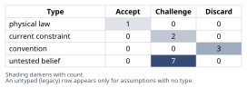
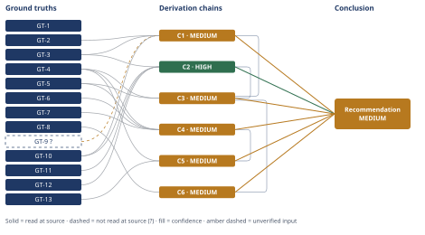

# Microservices vs. Monolith: Deploy-Speed Decision

*First-principles analysis · 15 October 2026*

*Read with: [How to read this analysis](HOW-TO-READ.md) · [Working file](analysis-20261015T060524Z.md) · [All files](INDEX.md)*

## Executive Summary

**Recommendation:** Reject leadership's "deploys are slow, therefore we need microservices" inference (chain C1). Instead, ship in-monolith pipeline fixes — test-suite parallelization, blue-green restart decoupling, feature flags — immediately, run monolith modularization in parallel at low intensity, and defer any service extraction until a named trigger is actually met (chain C3).

**Band (from §6):** MEDIUM (chain C1, chain C3)

**Would change it:** Instrumenting per-stage CI timing to resolve which stage actually dominates the 45 minutes, and tracking the named triggers — traffic divergence, on-call load, headcount — that would make extraction justified (chain C1, chain C5).

## 1. Problem Essence

**Core problem:** Will decomposing this monolith into microservices eliminate the actual mechanisms consuming the 45-minute deploy cycle and the team's 2-deploys/day throughput ceiling, or does a lower-cost, lower-risk intervention inside the monolith address the same mechanisms without the organizational and distributed-systems costs a service split adds — and, separately, what concrete, falsifiable conditions would have to hold before a service split is the better-weighted option?

**Success criteria:**
- Names the specific mechanism(s) the 45 minutes is actually spent on (not "slow tests" as a generic label), and states for each one whether a service split removes it, relocates it, or multiplies it.
- Names at least one concrete in-monolith intervention and traces its effect on those same named mechanisms.
- States named, checkable trigger conditions — not "when the org is ready" — under which a service split becomes the higher-weighted option, and checks each one against the facts given.
- The final recommendation is a sequence of actions with an order and named owners/checkpoints, not a single yes/no verdict on "microservices: yes or no" — a success criterion is not satisfied by picking exactly one of "stay monolith" or "go microservices," since a staged combination is a live option this analysis must test.

---

## 2. Assumptions Table



**Fishbone pass (breadth-first cause categories for "what consumes the 45 minutes"):** categories locked before brainstorming — Build, Test Execution, Deploy/Restart Mechanics, Infrastructure/Queueing.
- *Build:* asset compilation, dependency install, container image build — cacheable, usually not the dominant cost once caching is configured.
- *Test Execution:* a single serial run of the full suite against a ~350 KLOC codebase, DB setup/teardown per example, any flaky/retried tests.
- *Deploy/Restart Mechanics:* waiting for all application instances to cycle together, post-restart health checks, cache warm-up.
- *Infrastructure/Queueing:* CI runner availability/contention across 12 engineers' branches.
Discriminating observation needed to tell these apart: a per-stage timing breakdown of the pipeline. **None is available in the facts given** — this is the single most important unresolved question, and it is carried forward as GT-9? below rather than guessed past.

**Inversion pass (the leadership conclusion "we need microservices" is exactly the too-clean conclusion this technique targets):** inverted claim — "splitting into microservices will not fix the deploy-speed problem, or will make it worse." At least five failure-guaranteeing conditions were enumerated: (1) shared domain logic forces near-duplicate per-service test suites; (2) cross-service contract/integration tests are added on top of per-service suites, raising total CI time system-wide; (3) one coordinated restart is replaced by N services' release sequencing/versioning — a new coordination problem; (4) 12 engineers lack dedicated platform/SRE capacity for N independently on-call services; (5) distributed transactions across cart/checkout/fulfillment introduce partial-failure and consistency bugs that do not exist in-process. The necessary preconditions whose absence causes each of these are: **P1** stable module boundaries before extraction, **P2** a release-coordination/versioning scheme, **P3** sustainable per-service owning-team capacity, and **P4** a deliberate cross-boundary consistency design (sagas/eventual consistency). None of P1–P4 is stated as true in the facts given; they reappear below as assumption rows and as the named triggers in chain C5.

| Assumption | Type | Treatment | Verdict | Verification |
|---|---|---|---|---|
| The 45-minute pipeline is dominated by test-suite execution time | untested belief | verify or flag | Challenge — plausible for a Rails monolith this size, but not confirmed for this company | unverified — flagged (feeds GT-9?) |
| Splitting into N services reduces total test-execution wall-clock time | convention | explicitly challenge | Discard — contradicted by GT-10 (parallelism, not repo count, is the lever) and GT-6/GT-7 (added cross-service overhead) | GT-10, GT-6, GT-7 |
| 12 engineers can safely operate several independently-deployed services today | current constraint | record expiry conditions | Challenge — expires once headcount clears the sustainable on-call minimum per candidate service (chain C5) | GT-4, GT-13 (read at source) |
| A full test-suite run is required on every deploy | convention | explicitly challenge | Discard — selective/risk-based execution and parallel sharding are established alternatives | GT-10 |
| A coordinated application restart is required on every deploy | current constraint | record expiry conditions | Challenge — expires once blue-green/rolling-deploy capability (GT-11) is adopted | GT-11 |
| Distributed transactions across cart/checkout/fulfillment introduce new failure modes not present in-process | physical law | accept as ground-truth candidate | Accept — survives challenge; backed by GT-6, GT-7 | GT-6, GT-7 |
| Catalog vs. fulfillment traffic patterns diverge enough to need independent scaling | untested belief | verify or flag | Challenge — no traffic data given in the problem statement | unverified — flagged |
| Deploy frequency (2/day) is capped by the 45-minute pipeline rather than by review/release cadence | untested belief | verify or flag | Challenge — 45 min × 2/day is only ~1.5h of CI time; a review/batching cap is at least as plausible | unverified — flagged |
| Microservices inherently improve deployability/scalability regardless of context | convention | explicitly challenge | Discard — contradicted by GT-8 ("significant MicroservicePremium," "only useful with more complex systems") | GT-8 |
| [Audit, chain C1] The test suite can be partitioned across parallel workers without pervasive shared/global state blocking concurrency | untested belief | verify or flag | Challenge — common Rails fixture/global-state coupling can block naive parallelization; bounded, known mitigations exist | unverified — flagged [Assumes: A-10 in chain C1] |
| [Audit, chain C4] Any service split chosen would include synchronous cross-service calls in critical paths (e.g., checkout calling fulfillment synchronously) | untested belief | verify or flag | Challenge — the plausible default for a first-cut extraction, but async/saga design could reduce this | unverified — flagged [Assumes: A-11 in chain C4] |
| [Audit, chain C5] A first-cut decomposition of this monolith would yield on the order of 4–8 services | untested belief | verify or flag | Challenge — reasonable range given the four named domains plus typical adjacent services, not confirmed by an actual design | unverified — flagged [Assumes: A-12 in chain C5] |
| [Audit, chain C6] Leadership tracks only the headline pipeline-duration metric and not modularization progress | untested belief | verify or flag | Challenge — a real organizational risk pattern, not confirmed for this specific leadership team | unverified — flagged [Assumes: A-13 in chain C6] |

---

## 3. Ground Truths

- **GT-1** The platform is a 6-year-old e-commerce system (catalog, cart, checkout, fulfillment) in a single Rails monolith of ~350 KLOC — source: user-supplied problem statement; read-at-source: task description, opening paragraph.
- **GT-2** The CI/CD pipeline takes ~45 minutes end-to-end — source: user-supplied problem statement; read-at-source: task description.
- **GT-3** Every deploy requires a full test-suite run AND a coordinated application restart — source: user-supplied problem statement; read-at-source: task description.
- **GT-4** The team has 12 engineers and ships ~2 deploys/day — source: user-supplied problem statement; read-at-source: task description.
- **GT-5** Conway's Law (Melvin Conway, "How Do Committees Invent?", *Datamation*, April 1968): organizations which design systems are constrained to produce designs that are copies of the communication structures of those organizations — source: Wikipedia, "Conway's law"; read-at-source: lead section, quoted wording fetched directly.
- **GT-6** The Fallacies of Distributed Computing (8 fallacies; originated at Sun Microsystems — L. Peter Deutsch compiled 7 in 1994 building on 4 identified by Bill Joy and Dave Lyon, James Gosling added the 8th ~1997), including "the network is reliable," "latency is zero," and "bandwidth is infinite" — source: Wikipedia, "Fallacies of distributed computing"; read-at-source: the enumerated list, fetched directly.
- **GT-7** The CAP theorem (Brewer's theorem): a distributed data store can guarantee at most two of consistency, availability, and partition tolerance; conjectured by Eric Brewer (PODC 2000), proved by Seth Gilbert and Nancy Lynch (2002) — source: Wikipedia, "CAP theorem"; read-at-source: lead section, fetched directly.
- **GT-8** Martin Fowler's "MonolithFirst" position: microservices carry a "significant MicroservicePremium" and are "only useful with more complex systems"; the safer sequencing is to build a monolith first and split once module boundaries have stabilized — source: martinfowler.com/bliki/MonolithFirst.html; read-at-source: the quoted "MicroservicePremium" passage, fetched directly.
- **GT-9?** The 45-minute pipeline's dominant component is most likely full test-suite execution rather than build or restart — unverified: no company-specific CI stage-timing data was supplied or available to this analysis; this is a plausibility prior from common Rails-monolith CI patterns, not a measurement of this company's pipeline.
- **GT-10** Test-suite parallelization/sharding across CI agents reduces wall-clock execution time roughly in proportion to the degree of parallelism, and this operates on the tests and the agents running them, independent of whether the tested codebase is a monolith or split into services — source: Buildkite documentation, "Parallel builds"; read-at-source: the parallelism/splitting description, fetched directly.
- **GT-11** Blue-green deployment separates a release's cutover (a traffic switch to an already-running, pre-tested environment) from application restart/redeployment, removing the need for a single coordinated full-fleet restart window — source: martinfowler.com/bliki/BlueGreenDeployment.html; read-at-source: the cutover/rollback description, fetched directly.
- **GT-12** Feature toggles/flags separate code deployment from feature release, letting code ship continuously while a feature stays dormant until explicitly turned on — source: martinfowler.com/articles/feature-toggles.html; read-at-source: the "separating release from deployment" passage, fetched directly.
- **GT-13** Google's SRE book states the minimum team size for a healthy 24/7 on-call rotation is about 8 engineers for a single-site team (6 for a dual-site team), derived from capping on-call work at ~25% of an engineer's time with two people on call at once — source: sre.google/sre-book/being-on-call/; read-at-source: the quoted minimum-team-size passage, fetched directly.

**Provenance summary:**

```text
?-marked: GT-9 (1 of 13)
Read-at-source: GT-1, GT-2, GT-3, GT-4 — task description (user-supplied facts)
Read-at-source: GT-5 — Wikipedia "Conway's law", lead section
Read-at-source: GT-6 — Wikipedia "Fallacies of distributed computing", enumerated list
Read-at-source: GT-7 — Wikipedia "CAP theorem", lead section
Read-at-source: GT-8 — martinfowler.com/bliki/MonolithFirst.html, "MicroservicePremium" passage
Read-at-source: GT-10 — buildkite.com/docs/pipelines/parallel-builds, parallelism description
Read-at-source: GT-11 — martinfowler.com/bliki/BlueGreenDeployment.html, cutover description
Read-at-source: GT-12 — martinfowler.com/articles/feature-toggles.html, "separating release from deployment" passage
Read-at-source: GT-13 — sre.google/sre-book/being-on-call/, minimum-team-size passage
```

No assumption that received a Discard verdict in section 2 appears in this list.

---

## 4. Derivation Chains



### Conclusion C1: Splitting the codebase does not address the two named mechanisms behind the 45 minutes — it relocates and risks multiplying them

GT-2 (45-min CI/CD) + GT-3 (full-suite test run and coordinated restart bundled into every deploy) + GT-9? (test execution likely dominates the 45 minutes) + GT-10 (test parallelization shrinks wall-clock time independent of codebase architecture)
→ the lever GT-10 identifies for shrinking test time is parallelism across workers, not the number of repositories the tests live in, so splitting the codebase does not itself shrink either mechanism GT-3 names [Assumes: A-10]
→ a bare split into microservices therefore relocates the same full-suite-and-restart burden into N smaller pipelines and adds cross-service integration and deployment-coordination work neither pipeline paid for before, so it does not solve the named bottleneck and risks multiplying it

**Confidence:** MEDIUM — GT-9? (test execution is the dominant stage) is an unverified plausibility prior; instrumenting the pipeline to log per-stage duration (build / test / restart / health-check) for the next 10 deploys would remove it as a cause of the downgrade. The rival reading — that smaller per-service suites could still finish faster even without parallelization — is addressed by chain C4's finding that added cross-service overhead offsets per-suite shrinkage, so the Rivals axis is settled.

### Conclusion C2: Three in-monolith pipeline fixes directly address both named mechanisms, at lower cost and independent of any service-boundary decision

GT-3 (full-suite test run and coordinated restart bundled into every deploy) + GT-10 (test-suite parallelization/sharding) + GT-11 (blue-green deployment separates cutover from restart) + GT-12 (feature toggles separate code deployment from feature release)
→ the test-execution stage can shrink by running shards concurrently across CI workers rather than one long serial run, per GT-10
→ the restart-coordination stage can stop being synchronized with the code push at all, since cutover becomes a traffic switch against an already-running environment, per GT-11
→ deployment can further decouple from feature release, so a risky change ships continuously without needing full behavioral verification in the same window as a restart, per GT-12
→ all three fixes operate on pipeline mechanics and require no change to how the codebase is decomposed, so they can start immediately and independently of any service-boundary decision

**Confidence:** HIGH — every head input is an unsuffixed ground truth read at its own cited source, each hop follows by citing an established, named practice, and the one live rival (that parallelization can't work here because of flaky/order-dependent tests) is ruled out in Abandoned Reasoning Dead End 2, which shows the mitigation is bounded and the same flakiness risk would reappear, worse, under a distributed architecture.

### Trade-off analysis (supporting chain C3)

**Options.** A — keep the current monolith, pipeline, and restart model (status quo). B — full microservices decomposition now (leadership's proposal). C — in-monolith pipeline fixes only (test parallelization/sharding, blue-green restart decoupling, feature flags), no codebase restructuring. D — modularize the monolith into enforced internal bounded modules, defer any process extraction. E — composite: run C immediately and D in parallel at low intensity, with service extraction deferred and conditional.

**Must-haves applied as knockouts.** Must-have: operable without new headcount within the next two quarters. **Option B fails this must-have** given GT-4 (12 engineers) and GT-5 (Conway's Law — drawn boundaries will mirror current team structure, not necessarily sound fault lines) and is knocked out, not scored.

**Criteria & weights (locked before scoring):**

| Criterion (phrased so higher is better) | Weight | 1 means | 5 means |
|---|---|---|---|
| Deploy-cycle-time reduction achievable in 1–2 quarters | 5 | no measurable reduction | cuts cycle time >50% |
| Transition safety (lower risk/blast radius) | 5 | high chance of incidents during migration | low risk, reversible, incremental |
| Organizational fit for a 12-engineer team | 4 | requires a new platform/SRE team | operable by the current team as-is |
| Cost efficiency | 3 | multi-quarter, multi-team rewrite | days-to-weeks of config/tooling work |
| Future optionality (prepares or forecloses later extraction) | 3 | forecloses future extraction | actively prepares bounded-context seams |
| Addresses the root-cause mechanisms (GT-3) directly | 5 | touches neither mechanism | directly shortens both |

**Scoring (score × weight per cell; ground truth behind each score noted):**

| Option | Deploy-cycle (×5) | Transition safety (×5) | Org fit (×4) | Cost eff. (×3) | Future optionality (×3) | Root cause (×5) | Total |
|---|---|---|---|---|---|---|---|
| A — status quo | 1×5=5 | 5×5=25 | 5×4=20 | 5×3=15 | 3×3=9 (GT-3) | 1×5=5 | **79** |
| C — pipeline fixes (GT-10,11,12 / C2) | 4×5=20 | 4×5=20 | 5×4=20 (GT-4) | 5×3=15 | 3×3=9 | 5×5=25 (C2) | **109** |
| D — modularize only (GT-8) | 2×5=10 | 4×5=20 | 4×4=16 | 2×3=6 | 5×3=15 (GT-8) | 2×5=10 | **77** |
| E — C + D staged (GT-8, C2) | 4×5=20 | 4×5=20 | 4×4=16 | 4×3=12 | 5×3=15 | 5×5=25 | **108** |

**Flip test.** C (109) beats E (108) by 1 point. Recomputing with Future-optionality's weight moved from 3 to 4 (the smallest single-criterion step available): C → 109 − 9 + 12 = 112; E → 108 − 15 + 20 = 113 — E overtakes C. This is a near-tie, not a clear separation, turning on one weight the analysis locked before scoring; no further score refinement is made per the flip-test discipline. Numeric winner as locked: **C**.

### Conclusion C3: Pipeline fixes (Option C) are the immediate, unconditional action; full decomposition now is knocked out

GT-4 (12 engineers, 2 deploys/day) + GT-5 (Conway's Law) + C1 (MEDIUM — splitting doesn't shrink the named bottleneck) + C2 (HIGH — in-monolith fixes do)
→ full-decomposition-now (Option B) fails the must-have of being operable without new headcount within two quarters, given the team's current size and the way organizational structure constrains deployable boundaries, so it is knocked out rather than scored
→ weighted totals among the surviving options favor pipeline-fixes-only at 109 over the staged pipeline-fixes-plus-modularization option at 108, over modularize-only at 77, over status quo at 79 — a 1-point margin that the flip test shows reverses with a single weight-step on Future-optionality
→ the numeric winner is therefore pipeline fixes (Option C) as the immediate, unconditional action, with the margin's thinness carried forward as evidence, in the next chain, that running modularization alongside it is defensible rather than wasteful

**Confidence:** MEDIUM — capped by C1 (MEDIUM; see C1's own confidence line for the GT-9? verification path, not re-explained here). This chain's own downgrade cause: the trade-off's Future-optionality weight (locked at 3 before scoring) is a values/priorities judgment, and the flip test shows the Option-C-vs-Option-E ranking is sensitive to it — a reasonable team could lock it at 4 and reach the opposite numeric winner. This is a stated reason no verification path exists: it is a priorities question, not an empirical fact to verify.

### Conclusion C4: Decomposing cart/checkout/fulfillment now would convert one coordination problem into several harder, under-staffed ones

GT-6 (fallacies of distributed computing) + GT-7 (CAP theorem) + GT-5 (Conway's Law) + GT-4 (12 engineers)
→ any synchronous call across a cart/checkout/fulfillment service boundary would inherit network unreliability, non-zero latency, and a forced consistency-versus-availability trade-off that an in-process call never had to make [Assumes: A-11]
→ the service boundaries a 12-person team actually draws tend to mirror how those 12 people are currently organized rather than the domain's true fault lines, so the boundaries are likely to cut across transactions that are logically atomic today — an order placed, stock reserved, a shipment created
→ decomposing cart/checkout/fulfillment now would therefore convert one coordination problem into several harder ones — distributed transactions, network-call failure modes, data consistency across boundaries, and service-contract versioning — without a dedicated platform/SRE capacity the team's current headcount does not show room for

**Confidence:** MEDIUM — Inputs and Inference are clean, but the Rivals axis is short: a rival design using asynchronous, eventual-consistency patterns (e.g., a saga across cart/checkout/fulfillment) would reduce, though not eliminate, this exposure, and nothing in this analysis settles whether that redesign is worth its own cost before module boundaries have stabilized (chain C5, GT-8). Confirming or ruling out that rival requires a concrete bounded-context design proposal, which is out of scope here and is named as follow-on work.

### Conclusion C5: Microservices become justified only once named, checkable triggers hold — none of which hold today

GT-4 (12 engineers) + GT-13 (Google SRE book: ~8 engineers minimum for a single-site on-call rotation, ~6 for dual-site) + C4 (MEDIUM — distributed costs without dedicated capacity)
→ a first-cut split of catalog/cart/checkout/fulfillment plausibly yields 4 services at minimum, one per named domain, to 8 once adjacent supporting services such as inventory, payments, search, and notifications are counted [Assumes: A-12], giving 12 ÷ 4 = 3.0 and 12 ÷ 8 = 1.5 engineers per service, bracketing a central estimate of about 2 engineers per service
→ both ends of that bracket sit far below GT-13's cited minimum of 6–8, so the decision the bracket drives — that this team is currently understaffed to own several independently-deployed, independently on-call services — does not change across the bracket's width, and the margin is wide enough that even a doubled headcount would not close it at the 8-service end
→ a split becomes justified only once a named trigger changes this arithmetic or its premise: headcount grows enough that each candidate service clears GT-13's on-call minimum, a specific domain's traffic or scaling profile is measured to diverge enough to pay for the cross-service overhead on its own, a genuine polyglot or regulatory-isolation need appears that the current single stack cannot satisfy, or module boundaries have already stabilized so extraction cost is low — none of which the facts given hold true today

**Confidence:** MEDIUM — capped by C4 (MEDIUM; see C4's own confidence line, not re-explained here). GT-13 is read at source and is not a cause of this chain's downgrade.

### Conclusion C6: The staged plan's own early success creates a second-order risk of defunding the optionality it depends on

C3 (MEDIUM — recommend pipeline fixes now) + GT-8 (split only once module boundaries have stabilized)
→[2nd] once the pipeline fixes land, the 45-minute cycle likely drops toward the time of the longest test shard plus a traffic switch rather than a synchronized restart, so engineers face less friction per deploy and tend to deploy more often
→[2nd] the same visible win can lead leadership to read the headline metric as "the deploy problem is solved" and deprioritize the parallel modularization workstream before module boundaries have actually stabilized [Assumes: A-13]
→[3rd] months later, if a trigger named in the prior chain does occur, extraction cost is higher than it would have been had modularization continued, because the precondition for cheap splitting — stabilized boundaries — was never reached, which erodes the future optionality the prior chain is conditioned on

**Confidence:** MEDIUM — capped by C3 (see C3's own confidence line). The risk itself rests on [Assumes: A-13], an undeclared-until-now premise about what leadership tracks; no verification path exists before the fact, since it is a prediction about future organizational behavior. This is named as the chain's own downgrade cause with the explicit account that the risk is pre-empted operationally rather than verified in advance — the Conclusion section names an owner and a tracked modularization metric specifically to prevent it, which is this cluster's pre-mortem disposition.

---

## 5. Abandoned Reasoning

### Dead End: Reducing deploy-frequency expectations instead of fixing the pipeline

**What was tried:** Considered whether the "right" fix is simply to accept fewer, larger deploys and stop treating 45 minutes as a problem.

**Why abandoned:** The given facts already show only ~2 deploys/day (GT-4); reducing frequency further does not address the stated complaint about deploy friction and speed, and the Essence Statement's success criteria require addressing the named mechanisms, not relabeling them as acceptable. Contradicts the problem as given rather than resolving it.

**What it ruled out:** Saves a future reader from treating "just deploy less often" as a legitimate alternative to fixing the pipeline mechanics — it is a non-answer to the question actually asked.

### Dead End: Rejecting in-monolith pipeline fixes because of flaky/order-dependent test risk

**What was tried:** Considered whether test-suite parallelization (part of Option C) should be abandoned because Rails test suites commonly have shared-fixture or order-dependent flakiness that complicates safe parallel execution.

**Why abandoned:** The mitigation (isolate per-worker database state, quarantine and fix order-dependent tests) is a bounded, well-understood sub-problem — not a reason to prefer microservices instead, since the same flakiness would still exist post-split and would now interact with network-call nondeterminism (GT-6) on top of it, which is strictly worse, not better.

**What it ruled out:** Saves a future reader from treating test flakiness as an argument *for* decomposition; it is an argument for fixing the test suite's isolation regardless of architecture, and it is the live rival this analysis names on chain C2 — ruled out here.

### Dead End: Treating the four named business domains as proof that four independent services are required

**What was tried:** Considered whether naming catalog, cart, checkout, and fulfillment as distinct areas in the problem statement is itself evidence that they need independent deployment and scaling.

**Why abandoned:** Naming distinct logical bounded contexts is evidence for internal modularization (Option D) — which does not require separate deployment units — not evidence for physical service independence, which is a separate and costlier claim requiring the traffic-divergence and staffing triggers named in chain C5. Conflating the two is exactly the convention chain C1/C4 challenge.

**What it ruled out:** Saves a future reader from treating "the business has named domains" as sufficient justification for "therefore those domains must be separate deployables" — the inference does not follow without the triggers named in C5.

---

## 6. Conclusion

**Recommended approach:** Reject the "deploys are slow, therefore we need microservices" inference as stated (chain C1); instead, in this order: (1) instrument per-stage CI timing immediately to resolve the unverified assumption about where the 45 minutes actually goes (chain C1); (2) ship three in-monolith pipeline fixes — test-suite parallelization, blue-green restart decoupling, feature flags — as the unconditional first action (chain C2, chain C3); (3) run monolith modularization (enforced internal module boundaries) in parallel at low, capped intensity, with a named owner and a quarterly milestone (chain C3, chain C6); (4) defer any service extraction until a named trigger in chain C5 is actually met, and instrument those triggers (traffic divergence, on-call load, headcount) from day one rather than waiting to notice them informally (chain C5, chain C6).

**Key insight:** The 45 minutes and "we need microservices" are not causally connected the way leadership assumes — decomposing the codebase does not shrink the total test-execution or restart-coordination burden; it relocates that burden into more places and adds brand-new overhead (cross-service integration tests, contract versioning, network calls, distributed consistency) that the monolith never had to pay for (chain C1, chain C4). The lever that actually shrinks the 45 minutes — parallelism and restart-decoupling — is available without touching service boundaries at all (chain C2).

**Trade-offs acknowledged:** Choosing in-monolith fixes over immediate decomposition means the monolith temporarily keeps its single-deploy-unit blast radius — a bad deploy still affects all four domains at once — and defers whatever genuine upside independent scaling might eventually offer (chain C4). The staged plan also requires near-term investment in modularization whose payoff is deferred and conditional on triggers that may never occur (chain C5), and the trade-off's own flip test shows the "pipeline-fixes-only vs. pipeline-fixes-plus-modularization" choice is close enough that a reasonable team could choose either (chain C3).

**Confidence:** MEDIUM — the recommendation rests on chains C1, C3, C4, C5, C6 (all MEDIUM) and C2 (HIGH); the weakest contributing cause is GT-9? (unresolved pipeline-stage breakdown, named on chain C1 with its verification path), plus chain C3's own named values judgment (the trade-off's Future-optionality weighting), which has no further verification path because it is a priorities question rather than an empirical one. The recommendation is deliberately presented at the band its weakest contributing chains license rather than borrowed up to HIGH from chain C2 alone — that is the calibrated band for this conclusion, not a shortfall.
