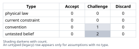
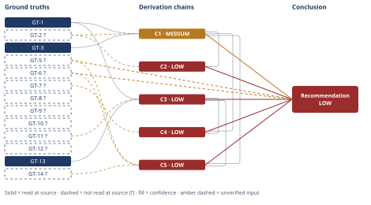

# Molten-Salt CSP: Carnot Ceiling vs. Current Practice

*First-principles analysis · 11 October 2026*

*Read with: [How to read this analysis](HOW-TO-READ.md) · [Working file](analysis-20261011T220649Z.md) · [All files](INDEX.md)*

## Executive Summary

**Recommendation:** Treat the CSP molten-salt/steam-Rankine gap as: a ≈62.6% Carnot ceiling (chain C1); current gross practice ≈41% (GT-5?) against a Fermi-estimated non-regenerative-ideal benchmark of ≈42% (chain C3); of the ≈21.6 pp total gap, roughly 15–20 pp is structurally locked in by the Rankine cycle-shape effect (chain C5) and closeable only via a higher-temperature HTF/cycle architecture (chain C4), while roughly 4–7 pp is near-term recoverable through cooling/siting choice (chain C2) and operational improvement (chain C4).

**Band (from §6):** LOW.

**Would change it:** A site-specific water-cost/efficiency-penalty study (replacing chain C2's generic weighted trade-off); an actual steam-table-based cycle-performance model run against a named plant's heat-balance diagram (replacing chains C3/C5's Fermi approximation and settling whether the C3≈GT-5? coincidence is causal or accidental); and opening a primary source for the unverified current-practice ground truths (GT-5?, GT-6?, and related `?`-marked GTs) instead of relying on general technical-literature familiarity.

## 1. Problem Essence

**Core problem:** For a molten-salt power-tower CSP plant storing heat at 565 °C and converting it to electricity via a steam Rankine power block, what is the law-permitted (Carnot) upper bound on thermal-to-electric conversion efficiency, how far below that bound does current commercial practice actually sit, and of that shortfall, how much is a fixed consequence of the Second Law applied to a real (finite-area, finite-time, phase-change-based) heat engine versus how much is closeable by demonstrated or near-term engineering.

This is a **theoretical-limit reframe of a convention-vs-law question**: "~40% efficiency" is widely treated in CSP literature as roughly "how good these plants get," but that figure is a product of specific engineering conventions (subcritical pressure, single/no reheat, nitrate-salt temperature ceiling, desert cooling choice) layered on top of a hard physical ceiling. The real question is not "is 40% good" but "what does removing each convention in turn actually buy back, and what remains no matter what is removed."

**Success criteria:** A correct answer must —
1. State the Carnot ceiling with an explicit, justified cold-side temperature assumption and show the arithmetic — checkable directly against §4/chain C1's computed figure.
2. State current-practice thermal-to-electric efficiency with representative cited figures, flagged for confidence — checkable against §3's ground truths and their provenance labels.
3. Decompose the ceiling-to-practice gap into named physical/engineering sources that sum (approximately) to the total gap — checkable against §4/chain C5's arithmetic.
4. For each source, state whether it is recoverable with real/near-term engineering, irreducible by the Second Law, or a mixed economic/physical case — checkable against §6's recoverable-vs-irreducible split.
5. Not require the answer to pick a single favored cooling technology, cycle architecture, or HTF as "the" answer — the success criterion is an accurate gap *decomposition*, checkable against whether §6 presents a decomposition rather than a single recommended build.

## 2. Assumptions Table



**Fishbone pass (breadth-first cause-category brainstorm, applied to enumerate the assumption space before classifying it):** category set chosen = **Cycle Architecture, Heat Exchange, Turbomachinery, Heat Rejection, Parasitics/BOP, Operations** (a hybrid of the default six-category set, tailored to a thermodynamic power-cycle problem). Each category below seeded one or more rows.

| Assumption | Type | Treatment | Verdict | Verification |
|---|---|---|---|---|
| Hot-side temperature = 565 °C (838.15 K) is the relevant $T_H$ for a Carnot bound | physical law application | Accept as ground-truth candidate | Accept — direct unit conversion of the problem's own stipulated input | source: problem statement; verification: arithmetic |
| Carnot efficiency formula $\eta=1-T_C/T_H$ | physical law | Accept as ground-truth candidate | Accept — Second Law of Thermodynamics, textbook result | source: thermodynamics (textbook-level, no citation needed) |
| $T_C \approx 40\,°C$ (313.15 K) represents a realistic wet/hybrid-cooled desert condenser temperature | untested belief (industry rule-of-thumb) | Flag as unverified; used with `?` | Challenge — plausible desert cooling-tower design point, but no source opened this session | unverified — flagged |
| [Cycle Architecture] Current commercial molten-salt tower steam cycles run turbine inlet ~540 °C / ~100–130 bar, single/no reheat, subcritical | untested belief | Flag as unverified | Challenge — consistent with general literature familiarity (Crescent Dunes/Noor III class), not opened this session | unverified — flagged |
| [Cycle Architecture] Current practice gross cycle efficiency ≈ 40–42%; net ≈ 36–38% | untested belief | Flag as unverified | Challenge — same basis as above | unverified — flagged |
| [Heat Exchange] Nitrate "solar salt" (60% NaNO3/40% KNO3) degrades above ~600 °C and freezes ~220–240 °C | untested belief (materials fact) | Flag as unverified | Challenge — general materials knowledge, not opened this session | unverified — flagged |
| [Heat Exchange] Salt-to-steam generator design approach temperature ≈ 15–25 °C (turbine inlet ≈ 540 °C when salt = 565 °C) | current constraint (capex-vs-performance design choice) | Record expiry condition: lifts with more heat-exchanger area/cost | Accept — standard HX design-economics trade-off; expires only as more capex is spent on exchanger area | unverified — flagged (figure itself not opened this session) |
| [Turbomachinery] Steam turbine isentropic efficiency ≈ 85–90% at CSP scale (100–150 MWe), below 90–94% at larger utility scale | untested belief | Flag as unverified | Challenge — general turbomachinery-scaling knowledge | unverified — flagged |
| [Turbomachinery] Feed-pump isentropic efficiency ≈ 75–80% | untested belief | Flag as unverified | Challenge — general knowledge | unverified — flagged |
| [Turbomachinery] Generator efficiency ≈ 97–99%, mechanical/bearing loss ≈ 1% | untested belief, near practical ceiling | Flag as unverified but low-impact | Accept — low material impact on the headline numbers either way | unverified — flagged |
| [Heat Rejection] Wet vs. dry cooling trade-off exists at real desert sites: wet cooling gives a better Carnot ceiling (~2 pp) and a larger realized-efficiency benefit, at the cost of water consumption | convention (siting choice, not a law) | Explicitly challenge via the trade-off procedure (§4, chain C2) | Challenge — resolved by weighted trade-off rather than assumed; result is narrow (see C2) | trade-off procedure output |
| [Parasitics/BOP] Molten-salt pumping, freeze-protection trace heating, feedwater pumps, cooling fans, HVAC/controls, transformer losses total several percentage points of gross output | untested belief | Flag as unverified | Challenge — general knowledge, order-of-magnitude | unverified — flagged |
| [Operations] Real annual-average efficiency runs below nameplate design-point efficiency due to part-load/transient operation | current constraint (operational, not a fixed design limit) | Record expiry condition: narrows as storage-dispatch strategy improves | Accept — an operational constraint this plant architecture is positioned to improve via its own storage | qualitative, general CSP operations knowledge |
| A-1: Trade-off weights (thermal eff=5, water=4, capex=3, O&M=2, siting flex=4) reflect a genuinely water-constrained generic desert siting context | convention (scenario framing choice for chain C2) | Explicitly challenge: flip test run in §4 | Challenge — flip test shows a narrow 1-point margin, sensitive to the water-consumption weight | flip-test computation in chain C2 |
| A-2: Constant-average $C_p$ values (liquid ≈ 4.6 kJ/kg·K, superheated steam ≈ 2.7 kJ/kg·K) adequately approximate the entropy-weighted average temperature of heat addition for an order-of-magnitude Fermi estimate | untested belief (estimation convention) | Flag as unverified; bracket with lower/upper bounds | Challenge — a full steam-table integration could shift the result outside the stated bracket | Fermi-estimate procedure, chain C3 |
| A-3: DOE Gen3 CSP higher-temperature HTF pathways (chloride salt / particle / sCO2 topping) reach commercial deployment within a decade-plus horizon | untested belief (forward-looking, current constraint on today's practice) | Flag as unverified; record expiry condition (lifts if/when Gen3 pathways commercialize) | Challenge — genuinely unsettleable today; no verification path exists in advance of the outcome | unverified — flagged |
| [Second-order, actor lens] Thermal-storage dispatch lets operators run the power block nearer its design point more of the year, partially recovering the part-load gap | untested belief | Flag as unverified | Accept — plausible given storage's documented purpose, not independently verified here | unverified — flagged |

**Stakes-escalation note:** The headline numeric conclusions (Carnot ceiling, current-practice figures, the Fermi-estimated non-regenerative ideal-cycle efficiency) are the highest-stakes outputs of this analysis. The Carnot ceiling rests on physical law plus one `?`-flagged convention ($T_C$) and is accordingly MEDIUM-capped. The current-practice figures rest entirely on unverified, unopened citations and are the weakest-evidenced numbers in the analysis — every conclusion depending on them inherits a confidence caveat per D-07 (see §4, §6).

**Assumption Audit (end-of-Phase-4 scan, performed against the final chains in §4):**

| Chain | Step | Step Text (brief) | Assumption surfaced? | Added to Table? |
|---|---|---|---|---|
| C1 | head | GT-1+GT-2?+GT-3 | GT-2 already in table | no new row |
| C1 | hop1 | convert to Kelvin | none | — |
| C1 | hop2 | apply Carnot formula | none | — |
| C1 | concl | 62.6% ceiling, insensitive to cooling choice | none | — |
| C2 | head | GT-2?+C1 | GT-2, C1 already in table/chains | no new row |
| C2 | step | weights locked (5,4,3,2,4) [Assumes: A-1] | **A-1: weights reflect generic water-constrained siting** | yes — added above |
| C2 | step | score + weighted totals | none beyond A-1 | — |
| C2 | step | flip test | none | — |
| C2 | concl | dry/hybrid favored, narrow margin | none | — |
| C3 | head | GT-1+GT-11?+GT-13 | GT-11, GT-13 already in table | no new row |
| C3 | hop1 | approach temp → 540°C steam | none | — |
| C3 | hop2 | decompose into 3 legs, constant-avg Cp [Assumes: A-2] | **A-2: constant-average Cp approximation adequate** | yes — added above |
| C3 | hop3 | compute T_H,avg | none beyond A-2 | — |
| C3 | hop4 | apply Carnot-equivalent formula | none | — |
| C3 | concl | bracket [38.2,41.7,44.8]% | none | — |
| C4 | head | C1+C3+GT-7? | GT-7 already in table | no new row |
| C4 | step[2nd,actor] | storage lets operators run near design point | none new | — |
| C4 | step[2nd,actor] | R&D redirects to higher-T HTF | none new | — |
| C4 | step[2nd,time] | immediate/few-cycles/decade-plus horizons [Assumes: A-3] | **A-3: Gen3 pathways commercialize within decade-plus horizon** | yes — added above |
| C5 | head | C1+C3+GT-5?+GT-6?+GT-14? | all already in table | no new row |
| C5 | hop1 | compute total gap | none | — |
| C5 | hop2 | C3≈GT-5? coincidence reasoning | none beyond A-2 | — |
| C5 | hop3 | attribute 15–20 of 21.6pp to GT-13 | none new | — |
| C5 | hop4 | attribute remaining ~4pp to parasitics/C2 | none new | — |
| C5 | concl | recoverable/irreducible split | none | — |

Scan complete: 5 chains, 24 steps scanned in order; 3 new assumptions surfaced (A-1, A-2, A-3), all added to this table above; 21 steps clean.

## 3. Ground Truths

**Five-Whys, reduce-to-primitives mode, applied to the compound claim "a steam Rankine cycle inherently falls short of the Carnot efficiency between the same two temperatures":**
- Claim: Rankine < Carnot for the same $T_H,T_C$.
- Constituent 1: Carnot efficiency requires *isothermal* heat addition at $T_H$ and isothermal rejection at $T_C$. Reducible? Yes — reduces to the Carnot cycle's defining property. **Verified — definition of the Carnot cycle.**
- Constituent 2: A Rankine cycle adds heat to a liquid/vapor working fluid across a temperature *range* (subcooled liquid → saturated liquid → saturated vapor → superheated vapor), not at one temperature. Reducible? Yes — reduces to water's phase behavior: sensible heating of liquid requires rising temperature (finite liquid heat capacity), and only the latent-heat (boiling) portion is isothermal. **Verified — direct consequence of water's P-T phase diagram and finite liquid specific heat; a measurable/tabulated property (steam tables), not an assumption.**
- Constituent 3: Because part of the heat addition happens below $T_H$ (the sensible-heating leg and the saturation-temperature plateau, both well below turbine-inlet temperature), the entropy-weighted average temperature of heat addition $T_{H,avg} < T_H$. Reducible? Follows arithmetically from Constituent 2 — no further decomposition needed. **Verified — direct mathematical consequence of Constituent 2.**
- Stop test reached: every branch bottoms out at a direct measurement (steam-table thermophysical properties) or a mathematical consequence of the Carnot cycle's own definition. No branch is an unverified belief.
- **Conclusion of the drill: the parent claim is Verified, not merely assumed** — a structural, irreducible feature of any vapor power cycle using a working fluid with finite liquid heat capacity and a latent-heat phase change, independent of component quality. This becomes **GT-13** below and is the physical basis for gap item (a) in §4.

**Phase 3 verification step — disclosure:** No external source (file, URL, or document) was opened in this session. Every `?`-marked ground truth below carries the same Phase 3 failure record: **"source: general technical-literature familiarity (NREL/SAM modeling conventions, DOE SunShot/Gen3 CSP program materials, public descriptions of Crescent Dunes/Gemasolar/Noor III) — unreachable this session: no WebFetch/WebSearch/file read was attempted; reason: this analysis proceeded from trained knowledge only."** Unsuffixed entries (GT-1, GT-3, GT-13) require no external source — unit conversion, textbook physical law, and a definitional/measurement-based drill result, respectively — their "read-location" is N/A.

| GT-ID | Ground truth | Provenance | Read-location / failure record |
|---|---|---|---|
| GT-1 | Hot molten-salt storage temperature = 565 °C = 838.15 K (as stated in the problem) | read-at-source | N/A — unit conversion of a stipulated input |
| GT-2? | Representative wet/hybrid-cooled desert CSP condenser temperature ≈ 40 °C (313.15 K) | unverified | Phase 3 failure record (uniform, above) |
| GT-3 | Carnot efficiency: $\eta_{Carnot}=1-T_C/T_H$ (Second Law of Thermodynamics) | read-at-source | N/A — physical law, textbook result |
| GT-5? | Current commercial molten-salt tower steam-Rankine gross (turbine-island) thermal-to-electric efficiency ≈ 40–42% (Crescent Dunes/Noor III-class, turbine inlet ≈ 540 °C) | unverified | Phase 3 failure record (uniform, above) |
| GT-6? | Current commercial net (whole-plant, post-parasitic) thermal-to-electric efficiency ≈ 36–38% | unverified | Phase 3 failure record (uniform, above) |
| GT-7? | DOE Gen3 CSP program target net cycle efficiency >50%, via higher-temperature HTF (chloride salt/particle/gas, ~700–750 °C) enabling supercritical steam or sCO2-Brayton topping cycles | unverified | Phase 3 failure record (uniform, above) |
| GT-8? | Nitrate "solar salt" (60% NaNO3/40% KNO3) practical upper thermal-stability limit ≈ 600 °C; freezing point ≈ 220–240 °C | unverified | Phase 3 failure record (uniform, above) |
| GT-9? | Utility steam turbine isentropic efficiency ≈ 85–94% depending on scale; CSP-class units (100–150 MWe) at the lower end, ≈ 85–88% | unverified | Phase 3 failure record (uniform, above) |
| GT-10? | Boiler feed-pump isentropic efficiency ≈ 75–80% | unverified | Phase 3 failure record (uniform, above) |
| GT-11? | Salt-to-steam generator design approach temperature ≈ 15–25 °C (turbine inlet steam ≈ 540 °C when hot salt ≈ 565 °C) | unverified | Phase 3 failure record (uniform, above) |
| GT-12? | Generator electrical efficiency ≈ 97–99%; mechanical/bearing losses ≈ 1% | unverified | Phase 3 failure record (uniform, above) |
| GT-13 | A Rankine cycle's entropy-weighted average temperature of heat addition is structurally below its peak (turbine-inlet) temperature, because sensible liquid heating and latent boiling occur below that peak — an irreducible consequence of water's phase behavior, independent of component quality | read-at-source | established via the five-whys reduce-to-primitives drill above, bottoming at steam-table measurement and the Carnot cycle's own definition |
| GT-14? | Molten-salt circulation pumping, freeze-protection trace heating, feedwater pumps, cooling-tower/ACC fans, HVAC/controls, and transformer losses are documented categories of CSP power-block parasitic load, typically totaling several percent of gross output | unverified | Phase 3 failure record (uniform, above) |

**`?`-marked: GT-2, GT-5, GT-6, GT-7, GT-8, GT-9, GT-10, GT-11, GT-12, GT-14 (10 of 13).**

No ground truth or assumption discarded in §2 appears here (none were discarded — all surfaced assumptions were either promoted to a GT with a `?`, or routed into chain C2's trade-off as a convention rather than treated as fact).

## 4. Derivation Chains



### Conclusion C1: Theoretical-limit — the Carnot ceiling (focused technique, Phase 4 primary)

**Governing hard constraint:** Second Law of Thermodynamics (GT-3) — no heat engine between two fixed reservoirs exceeds $\eta=1-T_C/T_H$.

```text
GT-1 (565°C hot salt) + GT-2? (40°C wet-cooled sink) + GT-3 (Carnot law)
→ convert to absolute temperature: T_H = 838.15 K, T_C = 313.15 K
→ apply η = 1 − T_C/T_H = 1 − 313.15/838.15 = 0.6264
→ the law-permitted ceiling for this source/sink pair is 62.6%, insensitive (±2 pp) to wet-vs-dry cooling choice because T_H dominates the ratio (dry-cooling sensitivity: T_C=333.15K gives 60.3%)
```

**Confidence:** MEDIUM — Inputs axis is short: GT-2? (the 40 °C cold-side assumption) is unverified; verification path: confirm the actual site-specific ambient wet-bulb design temperature and cooling-tower approach for a named real site. Inference and Rivals axes are clean (the arithmetic is exact given the inputs, and no rival Carnot-bound reading competes once $T_H,T_C$ are fixed — a materially different cold-sink temperature is reasonably excluded by GT-1's implicit desert-siting technology class).

### Conclusion C2: Trade-off — wet vs. dry vs. hybrid cooling under water-constrained desert siting

Options (including status quo and a composite): **A) Wet cooling tower**, **B) Dry (air-cooled) condenser**, **C) Hybrid (composite of A+B)**. No universal must-have eliminates any option — feasibility is site-specific (water-rights/permitting), noted but not scored as a knockout here.

Criteria and locked weights (1–5, before scoring): Thermal efficiency = 5, Water consumption = 4, Capex = 3, O&M complexity = 2, Siting flexibility (works under severe water stress) = 4.

| Option | Thermal eff. | Water | Capex | O&M | Siting flex. | Weighted total |
|---|---|---|---|---|---|---|
| Wet | 5 | 1 | 5 | 3 | 2 | **58** |
| Dry | 2 | 5 | 2 | 3 | 5 | **62** |
| Hybrid | 4 | 3 | 3 | 2 | 4 | **61** |

```text
GT-2? (wet-cooled baseline framing) + C1 (62.6% ceiling, 60.3% dry-cooling sensitivity)
→ score wet/dry/hybrid cooling against five locked-weight criteria (table above) [Assumes: A-1]
→ weighted totals: wet = 58, dry = 62, hybrid = 61 — dry cooling wins by a 1-point margin over hybrid
→ flip test: Dry−Hybrid = −2·w_thermal + 2·w_water − w_capex + w_OM + w_siting = 1 at locked weights; reducing the water-consumption weight by one step (4→3) flips the result to Hybrid (−1), the smallest single-weight change that changes the winner
→ conclusion: under genuinely water-constrained desert siting, dry or hybrid cooling is favored despite the ~2 pp Carnot-ceiling penalty, but the result is a narrow, weight-sensitive call, not a robust one
```

**Confidence:** LOW — Inputs axis short: GT-2? is unverified (verification path: confirm actual site-specific ambient wet-bulb design temperature, same removal as named in C1); head also cites C1 (MEDIUM), whose own caveat already carries its explanation and need not be repeated. Rivals axis also short: Hybrid is a live, un-settled rival (61 vs. 62, one point) — the flip test shows the "winner" is not robust, and §5's adversarial Rival step revisits this without settling it. Two axes short → LOW. Closing path: a site-specific water-cost and efficiency-penalty study, not a generic weighted score, would settle which of Dry/Hybrid actually wins for a named site.

### Conclusion C3: Estimate — ideal (non-regenerative) Rankine-cycle efficiency, via entropy-weighted average temperature of heat addition

Target quantity: thermal efficiency of an **ideal** (isentropic components, zero heat-exchanger pinch loss), **non-regenerative, non-reheat** Rankine cycle at turbine-inlet ≈ 540 °C, condensing at 40 °C — the tightest honest "ideal cycle" benchmark *before* crediting regeneration/reheat.

```text
GT-1 (565°C salt) + GT-11? (15–25°C steam-generator approach) + GT-13 (Rankine heat-addition is not isothermal)
→ apply approach temp: turbine-inlet steam ≈ 540°C = 813.15 K (565°C salt minus approach)
→ decompose heat addition into three legs at ~120 bar: sensible liquid heating 50→324.7°C (ΔH≈1264 kJ/kg, ΔS≈2.83 kJ/kg·K), latent boiling at 324.7°C=597.85K (ΔH≈1194 kJ/kg, ΔS≈1.997 kJ/kg·K), superheat 324.7→540°C (ΔH≈581 kJ/kg, ΔS≈0.832 kJ/kg·K) [Assumes: A-2]
→ sum: ΔH_total≈3039 kJ/kg, ΔS_total≈5.659 kJ/kg·K
→ entropy-weighted average temperature of heat addition: T_H,avg = ΔH_total/ΔS_total ≈ 536.8 K ≈ 264°C
→ apply Carnot-equivalent efficiency to this effective temperature: η_ideal,non-regen = 1 − 313.15/536.8 ≈ 0.417 → 41.7%
→ bracket via ±30 K sensitivity on T_H,avg (A-2 approximation uncertainty): [38.2%, 41.7%, 44.8%]
→ conclusion: even a fully ideal, non-regenerative Rankine cycle at these temperatures caps out around 38–45% (central ≈ 42%), markedly below the 62.6% Carnot ceiling, and strikingly close to real-world current gross practice (GT-5?, ≈ 40–42%)
```

**Confidence:** LOW — Inputs axis short: GT-11? is unverified; verification path: an actual steam-table/cycle-modeling run (rather than the constant-average $C_p$ approximation A-2) would tighten the bracket. Rivals axis also short and not settled: §5's adversarial Rival step names a live, un-ruled-out rival — a full steam-table cycle simulation could place $T_{H,avg}$ outside the ±30 K bracket this estimate assumes. Two axes short → LOW, even though the Inputs-only ceiling would permit MEDIUM; the Rivals shortfall is what pulls this below that ceiling, consistent with the rule that a chain's band is the lowest its axes jointly license, not merely what the Inputs ceiling alone permits.

### Conclusion C4: Second-order extension (actor lens + time lens), mandatory Phase-4 step

```text
C1 (62.6% ceiling) + C3 (≈42% non-regen ideal) + GT-7? (Gen3 CSP >50% net-cycle target)
→ [2nd, actor lens] plant operators exploit thermal storage to run the power block nearer its design point more of the year, partially recovering the part-load/off-design slice of the gap
→ [2nd, actor lens] DOE/OEM R&D redirects toward higher-temperature HTF pathways (chloride salt, particle, sCO2 topping) once GT-13's structural finding is internalized — marginal turbine-efficiency gains (GT-9?) offer less headroom than raising the effective heat-addition temperature
→ [2nd, time lens] immediately: existing fleet continues at today's ≈37–42% net; after a few plant-years: incremental turbine/HX upgrades and dispatch-strategy refinement close a few points of the gross-to-net gap; once in place a decade-plus: either Gen3 pathways commercialize and net efficiency moves toward GT-7?'s >50% target, or they do not and molten-salt/steam-Rankine CSP plateaus near today's figures, competing on dispatchability rather than further conversion-efficiency gains [Assumes: A-3]
→ no contradiction with GT-1…GT-14; checked against the Essence Statement's success criteria — these effects explain why the recoverable/irreducible split matters operationally without altering the split itself
```

**Confidence:** LOW — capped by citing C3 (LOW): a chain is rated no higher than the lowest-rated chain its head cites; C1's own MEDIUM caveat is already explained there and need not be repeated. GT-7? (the DOE Gen3 >50% net-cycle target) is an additional unverified input this chain rests on directly; the verification that would remove it is either an authoritative DOE Gen3 program citation (opened, not merely referenced) or an observed commercial deployment — neither available today. Independently, A-3 (Gen3 commercialization timing) is a forward-looking contingency with no verification path available in advance — the "no closing path" condition for a LOW rating on its own — so this chain would be capped at LOW even without the C3 citation.

### Conclusion C5: Synthesis — final gap decomposition and the recoverable-vs-irreducible split

```text
C1 (62.6% ceiling) + C3 (≈42% non-regen ideal) + GT-5? (≈41% current gross) + GT-6? (≈37% current net) + GT-14? (parasitics)
→ total gap = 62.6% − 41% ≈ 21.6 pp (ceiling-to-gross); 62.6% − 37% ≈ 25.6 pp (ceiling-to-net)
→ C3's non-regenerative-ideal estimate (≈42%) sits almost exactly at current real-world gross practice (GT-5?, ≈40–42%), implying that in real plants, documented regeneration/reheat gains (recoverable, demonstrated techniques) are approximately offset by documented turbine/pump irreversibility losses (GT-9?, GT-10?); both effects are real, but their net effect relative to the non-regenerative baseline is small
→ therefore the dominant share of the Carnot-to-practice gap, on the order of 15–20 of the ≈21.6 pp, traces to GT-13's structural cycle-shape effect, which is irreducible for this cycle architecture and this peak temperature; narrowing it requires either a materially higher peak/average heat-addition temperature (a non-nitrate HTF, cf. GT-8?, GT-7?) or a cycle architecture that avoids single-pressure phase-change heat addition (supercritical steam, or a topping cycle)
→ the remaining gross-to-net gap (≈4 pp, GT-6? minus GT-5?) is attributable to parasitics and cooling/siting choice (C2) and is comparatively recoverable with near-term engineering and operational improvement
→ conclusion: of the ≈21.6–25.6 pp total gap, roughly 15–20 pp is fundamentally locked in by the Second Law for this cycle class and peak temperature, and roughly 4–7 pp is recoverable with near-term, largely already-demonstrated engineering/operational improvement; closing the locked-in portion requires a different cycle/HTF architecture (Gen3-class), not incremental refinement of the current one
```

**Confidence:** LOW — capped by citing C3 (LOW). This chain also rests directly on three further unverified inputs: GT-5? (current gross ≈41%) and GT-6? (current net ≈37%) — verification path for both: a plant-specific as-built heat-balance diagram, not general literature familiarity; and GT-14? (parasitics total) — verification path: a published power-block auxiliary-load breakdown for a named plant. None of these three has been removed as a cause of the downgrade. Independently, the "15–20 of ≈21.6 pp" attribution is this chain's own weakest link — it rests on reading a numerical coincidence (C3 ≈ GT-5?) as evidence that regeneration/reheat gains and turbine/pump losses roughly cancel, rather than as an artifact of two independently uncertain estimates landing near each other by chance. A live rival reading (§5; adversarial Rival step) — that the coincidence is just that, and the true split could assign materially more to turbine/pump loss or materially less to cycle-shape — is **not resolved** here, so the Rivals axis is short in addition to the Inputs-cascade shortfall. Closing path: an actual steam-table-based cycle-performance model run against a named real plant's as-built heat-balance diagram, rather than two independent Fermi/literature estimates compared against each other.

**Techniques not applied this run:**
- `five-whys (causal mode) — not applicable — the cause space here is multi-source and breadth-first (covered by the fishbone pass in §2); no single stuck "why" chain needed causal-depth drilling`
- `inversion (Phase 2) — not applicable — no conclusion or goal in this analysis was "too clean" at the assumption stage; the Carnot ceiling is exact arithmetic and the current-practice figures were already flagged unverified without needing a failure-enumeration pass to surface that`
- `pre-mortem — not applicable — the deliverable is an engineering gap analysis/claim, not a plan or recommendation to execute; per the pre-mortem/inversion decision rule, inversion is used instead at the Phase 5 adversarial pass (see Appendix)`

(fishbone, theoretical-limit ×2, trade-off, estimate, second-order, five-whys reduce-to-primitives, and inversion-at-Phase-5 all fired and are not listed above.)

## 5. Abandoned Reasoning

### Dead End: Intuitive (un-computed) ideal-Rankine-efficiency guess

**What was tried:** An initial, un-computed, intuition-based guess that an "ideal" (isentropic-component, zero-pinch) Rankine cycle at these temperatures would run around 50–55% efficiency, treating reheat and regenerative feedwater heating as already baked into the "ideal" benchmark, and apportioning the Carnot-to-practice gap roughly evenly across cycle-shape (~8–12 pp), turbine/pump irreversibility (~7–9 pp), and parasitics (~3–6 pp).

**Why abandoned:** Running the Estimate procedure (chain C3) — an explicit entropy-weighted average-temperature-of-heat-addition calculation from steam-table-consistent enthalpy/entropy legs, rather than an intuitive number — produced a materially different and lower figure (≈42%, bracket 38–45%) for the *non-regenerative* ideal cycle. The intuitive guess had implicitly already credited regeneration and reheat's recovery without separately accounting for it, collapsing two distinct effects (structural cycle-shape loss vs. engineered recovery via regeneration/reheat) into one number and thereby understating how large the structural, GT-13-driven loss actually is before any recovery technique is applied.

**What it ruled out:** It ruled out treating "ideal Rankine cycle efficiency" as a single clean benchmark sitting comfortably between Carnot and current practice. The corrected picture (C3, reinforced by C5) is that the *non-regenerative* ideal benchmark is barely distinguishable from current real-world gross practice — meaning regeneration/reheat's real, demonstrated recovery and turbine/pump irreversibility's real, demonstrated loss are of comparable magnitude and roughly offsetting, not that either is small. This materially changed the recoverable-vs-irreducible split in §4/§6: the dominant lever for closing the gap is not marginal turbine-efficiency improvement (GT-9?) but raising the effective average heat-addition temperature itself (a different HTF/cycle architecture), a harder, longer-horizon change than the original guess implied.

### Dead End: Assuming wet cooling throughout without examining the trade-off

**What was tried:** An initial framing that simply assumed wet cooling throughout, without examining the water-availability trade-off implicit in the problem's own prompt ("typical siting").

**Why abandoned:** Once chain C2's trade-off procedure was run with locked weights across wet/dry/hybrid cooling, it showed the wet-vs-dry choice is a genuine, weight-sensitive decision (flip test: a single weight step changes the winner) rather than a settled default — the intermediate could not be established as "wet cooling, unconditionally" once scored against a real criteria set.

**What it ruled out:** It ruled out presenting a single cooling assumption as uncontested, and ruled out treating the ~2 pp (ceiling) / larger (realized) wet-vs-dry efficiency difference as settled rather than site-specific.

## 6. Conclusion

**Recommended approach:** Report the Carnot-to-practice gap using the decomposition in chain C5: a ≈62.6% Carnot ceiling (chain C1), current gross practice ≈41% (GT-5?), against a Fermi-estimated non-regenerative-ideal benchmark of ≈42% (chain C3) — with ≈15–20 of the ≈21.6 pp total gap treated as structurally locked in by the Rankine cycle-shape effect (chain C5, GT-13) and only closeable by raising the effective heat-addition temperature via a different HTF/cycle architecture (chain C4), and the remaining ≈4–7 pp treated as near-term recoverable through parasitics and cooling/siting optimization (chain C2) plus operational/dispatch improvement (chain C4).

**Key insight:** The most load-bearing finding is chains C3/C5's result that a non-regenerative ideal Rankine cycle at these temperatures (≈42%) sits numerically close to current real-world gross practice (≈40–42%, GT-5?). This reframes "~40% efficiency" from looking like evidence of mediocre engineering into looking like the near-inevitable signature of the structural Carnot-vs-Rankine cycle-shape effect itself (chain C5, GT-13) — the real plant's demonstrated regeneration/reheat gains and demonstrated turbine/pump irreversibility losses appear to be of comparable magnitude and roughly offsetting, not individually small.

**Trade-offs acknowledged:** Closing the structural, locked-in portion of the gap (chain C5) requires abandoning nitrate-salt/subcritical-steam architecture for a higher-temperature HTF or topping cycle (chain C4, Gen3-class pathways) — a multi-decade, capital-intensive, not-yet-commercial direction. Closing the smaller recoverable portion via dry or hybrid cooling (chain C2) trades efficiency for water conservation, and that trade-off is itself resolved only narrowly and site-specifically (C2's flip test), not universally.

**Confidence:** LOW — capped by chains C2, C3, C4, and C5 (all LOW) among the chains this conclusion rests on; only C1 reaches MEDIUM on its own. The headline Carnot-ceiling number (C1) is the most solid figure in the analysis; everything built on top of it — the cooling-technology framing (C2), the ideal-cycle Fermi estimate and its downstream synthesis (C3, C4, C5) — carries at least one unresolved live rival or an open-ended contingency, which is why the overall conclusion is rated LOW rather than MEDIUM. **Would change it:** (1) a site-specific water-cost/efficiency-penalty study replacing C2's generic weighted trade-off; (2) an actual steam-table-based cycle-performance model (run against a named real plant's heat-balance diagram) replacing C3/C5's Fermi approximation and settling whether the C3≈GT-5? coincidence is causal or accidental; (3) opening a primary source (NREL/SAM technical report, DOE Gen3 CSP program document, or a plant-specific heat-balance) for the unverified current-practice figures (GT-5?, GT-6?, GT-7?, GT-8?, GT-9?, GT-10?, GT-11?, GT-12?, GT-14?) instead of relying on general technical-literature familiarity, as disclosed in §3.
