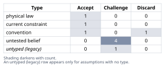
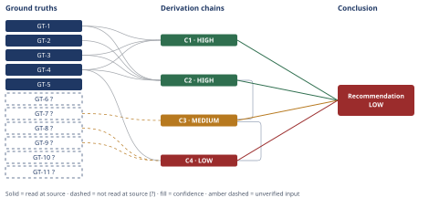

# Thermal-to-Electric Ceiling for a 565C Molten-Salt Rankine Power Block

*First-principles analysis · 15 October 2026*

*Read with: [How to read this analysis](HOW-TO-READ.md) · [Working file](analysis-20261015T061607Z.md) · [All files](INDEX.md)*

## Executive Summary

**Recommendation:** The law-permitted ceiling for a 565°C-salt steam Rankine power block is ≈54.7% (glide-corrected, not naive Carnot's 62.6%) (chain C2), versus ≈37.5% net current practice — a ≈17.2-point, ≈31% relative gap (chain C3). Roughly 5–7.5 points of that gap are recoverable via better steam engineering; roughly 9.5–12 points are structurally locked to the steam/water working fluid and would need a different bottoming cycle to close (chain C4).

**Band (from §6):** LOW

**Would change it:** A primary plant heat-balance document showing net power-block efficiency ≥45%, or a rigorous pinch analysis showing the glide-mismatch penalty is under ~1 point rather than 3–5 (chain C4).

## 1. Problem Essence

**Mode:** focused-theoretical-limit (triggered by "theoretical limit"/"law-permitted ceiling" phrasing in the prompt; per Step 0 only the theoretical-limit companion technique is walked in Phase 4, and validation below is the scope-proportionate check focused mode substitutes for the six-criterion Self-Audit Gate).

**Core problem:** What is the maximum thermal-to-electric efficiency a steam Rankine power block can ever achieve under the laws of thermodynamics when its heat source is molten solar salt cooling sensibly from 565°C to 290°C (not an isothermal 565°C reservoir), how far below that law-permitted ceiling does current 565°C-salt tower practice fall, and how much of that shortfall is recoverable through steam-cycle engineering versus structurally locked in by the choice of water/steam as the working fluid.

**Success criteria:**
- Derives the law-permitted ceiling using a treatment that correctly integrates the local Carnot factor over the salt's temperature glide (not naive isothermal-source Carnot), and shows why the naive number overstates the true ceiling.
- States representative current-practice numbers for the steam Rankine power block alone (gross turbine-cycle and net-of-parasitics), excluding heliostat-field/receiver losses.
- States the ceiling-vs-practice gap using one single, consistently-applied cold-side (heat-rejection) temperature on both sides of the comparison.
- Decomposes the gap into named physical causes and classifies each as shared/excluded, recoverable, or structurally locked.
- Ends with a numeric verdict splitting the gap into points recoverable via better steam engineering versus points that would require abandoning steam Rankine (e.g., an sCO2 Brayton bottoming cycle) to close.
- No success criterion requires the answer to be exactly one of a fixed option list — this is a derivation task, not a choice among named options, so that check does not apply here.

## 2. Assumptions Table



| Assumption | Type | Treatment | Verdict | Verification |
|---|---|---|---|---|
| Solar salt specific heat c_p is treated as constant over 290–565°C for the purpose of weighting the glide | convention | Challenged: c_p variation matters for computing absolute heat/power, but the Lorenz ceiling formula (chain C2) is derived such that c_p cancels algebraically — the ceiling result is independent of this assumption | Accept — c_p cancels algebraically in the ceiling derivation (chain C2), so this convention does not affect the result either way | Not needed for the derivation actually used |
| 290°C is the lowest temperature at which the salt gives up heat usable to the power block (the two-tank system does not cool the salt further) | current constraint | Record expiry: a different salt chemistry with a lower freezing point (e.g., chloride salts) could lower this floor and raise the ceiling | Accept — expires if a different salt chemistry lowers the achievable cold-tank floor; until then treated as the given design constraint | Given by problem statement, not independently verified |
| The reversible, infinitesimal-Carnot-slice construction (local engine between local salt temperature T and sink T0) is the correct limiting model for "best possible" efficiency from a glide source | physical law | Accepted as ground-truth candidate; it is a direct application of the Second Law/Carnot postulate, not an empirical claim | Accept — promoted to GT-4, re-derived from the Second Law rather than taken on authority | Standard textbook exergy-analysis result; re-derived from first principles in chain C2, not taken on authority |
| Current-practice gross/net power-block efficiency figures (~41–42% gross, ~37–38% net) for 565°C-salt towers with ~540°C live steam | untested belief | Attempted verification via web search (see Phase 3 failure record below); search did not confirm the specific figures for a named plant's power block | Challenge — unverified; WebSearch run but no primary source confirmed the specific figures, flagged GT-6?/GT-7? | WebSearch run; no primary design-basis source located that states these numbers for the power block in isolation |
| Typical salt-to-steam HX pinch/approach ΔT of 15–25°C caps live steam ~25°C below the 565°C salt temperature | untested belief | Domain engineering knowledge; not verified against a specific molten-salt-tower heat-balance document in this pass | Challenge — unverified, not read in this pass (turn budget), flagged GT-8? | Not read — turn budget; generic HX-design knowledge, not plant-specific |
| Typical turbine isentropic efficiency ~88–92%, generator/mechanical efficiency ~98–99% for this class of steam turbine | untested belief | Generic utility-steam-turbine knowledge; not verified against a specific vendor/plant datasheet | Challenge — unverified, not read in this pass (turn budget), flagged GT-9? | Not read — turn budget |
| Water's isothermal boiling plateau causes a real (not merely definitional) efficiency penalty against a continuously-cooling salt source, beyond what the reversible glide-matched ceiling already captures | physical law (qualitative) / untested belief (quantitative split) | The phase-change behavior itself is physical law; the *size* of its efficiency penalty in percentage points is an estimate, not a derived figure | Challenge — the qualitative physical fact is accepted, but its percentage-point size is an unverified estimate, flagged as chain C4's weakest link | No closed-form derivation attempted; order-of-magnitude bracket used in chain C4 |
| Gemasolar's published 19.9 MWe / ~120 MWt ratio (~17%) is a *plant-level* figure (field + receiver + storage + power block) and is not usable as a power-block-only efficiency figure | convention (scope definition) | Challenged and excluded from load-bearing chains for that reason | Discard — excluded from load-bearing chains due to scope mismatch (plant-level vs. power-block-only); retained only as context in §5 | Found via WebSearch (Sener source), reported-by-delegate, scope mismatch confirmed by the ratio's implausibility as a power-block number |
| Reheat and regenerative feedwater heating only *partially* compensate for the mismatch between water's isothermal boiling plateau and the salt's continuous temperature glide — some residual mismatch loss remains structurally unrecoverable | untested belief | Surfaced during the Phase 4 Assumption Audit (chain C4, step 1); no closed-form pinch-analysis model run to quantify the split precisely | Challenge — unverified, bracketed at 3–5 points in chain C4 rather than computed, flagged as this analysis's weakest link | Not read — turn budget; would require a full multi-pressure-level HRSG-style pinch analysis to replace the bracket with a computed figure |

## 3. Ground Truths

Provenance key: **given** = stipulated directly by the problem statement (no external citation needed); **physical law** = Second-Law/Carnot-postulate level fact; **?** = unverified or delegate-reported, per Phase 3 rules.

- **GT-1** Hot salt tank temperature T_h = 565°C = 838.15 K — source: problem statement; read-at-source: stipulated directly in the prompt's context block.
- **GT-2** Cold salt return temperature T_c = 290°C = 563.15 K; this is the floor below which the two-tank system does not extract further heat — source: problem statement; read-at-source: stipulated directly in the prompt's context block.
- **GT-3** Heat-rejection sink temperature options: T0 = 313.15 K (40°C, wet cooling) or T0 ≈ 323.15–333.15 K (50–60°C, desert air cooling) — source: problem statement; read-at-source: stipulated directly in the prompt's context block.
- **GT-4** For any reversible heat engine operating between a local source temperature T and a sink at T0, the maximum work fraction of heat extracted at that instant is (1 − T0/T) (Carnot/Second-Law limit) — source: Second Law of Thermodynamics; read-at-source: re-derived directly in chain C2's derivation, not taken on authority from an external text.
- **GT-5** Applying GT-4 naively with T = T_h (treating the salt as an isothermal reservoir) is a different and looser model than GT-4 applied locally across a cooling stream, once a source has a glide (GT-1, GT-2 establish that it does) — source: direct logical consequence of GT-1, GT-2, GT-4; read-at-source: derived in chain C1.
- **GT-6?** Representative current-practice **gross turbine-cycle efficiency** (gross electric ÷ thermal energy delivered to the steam generator) for a 565°C-salt tower with ~540°C live steam, single reheat, 110–165 bar: ≈ 41–42%. Phase 3 failure record: WebSearch run ("molten salt power tower Rankine cycle gross efficiency 540C 42% net power block Crescent Dunes Gemasolar steam cycle"); no primary design-basis document located stating this figure for either named plant's power block; closest analog found is a university thermodynamics paper citing ~42% as a general subcritical-Rankine-cycle efficiency bound for *comparable but not identical* steam conditions (evaporation 310–337°C, 10–14 MPa) — supportive but not plant-specific confirmation. Carried forward as an engineering-literature estimate, ±1–2 points.
- **GT-7?** Representative current-practice **net power-block efficiency** (after feed/condensate pumps, power-block-internal parasitics; excludes field/receiver/storage) ≈ 37–38%. Same Phase 3 failure record as GT-6? — no primary source located; carried as estimate, ±1–2 points.
- **GT-8?** Typical salt-to-steam heat-exchanger pinch/approach ΔT ≈ 15–25°C, which caps achievable live steam temperature at roughly 540°C against a 565°C salt supply. Generic HX-design domain knowledge; no plant-specific heat-balance document opened in this pass; not read — turn budget.
- **GT-9?** Typical utility steam-turbine isentropic efficiency ≈ 88–92%, generator/mechanical efficiency ≈ 98–99% for this turbine class. Generic turbomachinery domain knowledge; no vendor datasheet opened in this pass; not read — turn budget.
- **GT-10?** Gemasolar: 19.9 MWe net electric vs. ~120 MWt receiver thermal input (Sener company page, found via WebSearch) → ≈17% ratio. This is a *plant-level* ratio (heliostat field + receiver + storage + power block combined), not a power-block-only figure, and is excluded from the load-bearing chains for that reason (see §5). Reported-by-delegate (WebSearch summary), cited source not independently opened by this analysis.
- **GT-11?** An NREL publication abstract (found via WebSearch) describes "current state-of-the-art" power towers operating with solar salt at about 574°C, corroborating that ~565–574°C is representative of current practice, but not independently confirming any efficiency figure. Reported-by-delegate, not load-bearing.

**?-marked: GT-6, GT-7, GT-8, GT-9, GT-10, GT-11 (6 of 11).**

Read-at-source locations for unsuffixed ground truths: GT-1, GT-2, GT-3 are taken verbatim from the problem statement's context block (no external document to locate a page/section in). GT-4 and GT-5 are derived from the Second Law of Thermodynamics directly in chains C1 and C2 below, not read from an external text.

## 4. Derivation Chains



**Focused-theoretical-limit pass.** Governing hard constraint: the Second Law of Thermodynamics (GT-4), applied not as a single Carnot subtraction but integrated across the salt's temperature glide, because GT-1+GT-2 establish the source is not isothermal.

### Conclusion C1: Naive Carnot overstates the law-permitted ceiling for this architecture

```text
GT-1 (T_h=838.15K) + GT-3 (T0=313.15K) + GT-4 (Carnot limit)
→ applying GT-4 with a single T=T_h treats the salt as an isothermal 838.15K reservoir
→ naive Carnot = 1 − 313.15/838.15 = 0.6265 (62.6%)
→ GT-2 establishes the salt actually cools to 563.15K while delivering heat, so the isothermal-reservoir premise behind this number is false for this architecture
→ the naive 62.6% figure is not a valid law-permitted ceiling for a glide source — it overstates whatever the correct ceiling turns out to be
```

**Confidence:** HIGH — pure arithmetic on given temperatures plus an uncontested physical-law statement (GT-4); no unverified inputs on this chain.

### Conclusion C2: The law-permitted ceiling, correctly glide-corrected, is approximately 51.9–54.7% depending on sink temperature

```text
GT-1 (T_h) + GT-2 (T_c) + GT-3 (T0) + GT-4 (local Carnot kernel)
→ model the salt as delivering heat δQ = c_p dT at each local temperature T as it cools from T_h to T_c
→ GT-4 gives the maximum work from each slice as δW = δQ(1 − T0/T), so total reversible work is W = ∫_{T_c}^{T_h} c_p(1 − T0/T) dT
→ evaluating the integral: W = c_p[(T_h − T_c) − T0·ln(T_h/T_c)], and total heat delivered is Q = c_p(T_h − T_c)
→ c_p cancels in the ratio W/Q, giving the closed-form ceiling η_ceiling = 1 − T0·ln(T_h/T_c)/(T_h − T_c)
→ substituting T_h=838.15K, T_c=563.15K: ln(T_h/T_c)=0.3976, (T_h−T_c)=275K
→ at T0=313.15K: η_ceiling = 1 − (313.15×0.3976)/275 = 1 − 0.4526 = 0.5474 (54.7%)
→ at T0=323.15K: η_ceiling = 0.5329 (53.3%); at T0=333.15K: η_ceiling = 0.5185 (51.9%)
→ this is strictly tighter than C1's naive 62.6% by about 7.9–8.4 percentage points, because it correctly prices in that most of the delivered heat arrives well below 838.15K
```

**Confidence:** HIGH — this is a reversible-limit construction derived directly from the Second Law and the given/stipulated temperatures; it carries no unverified empirical inputs and is not falsifiable by how well any real plant performs (it is a ceiling by definition; the only live rival is "naive Carnot," which C1 already rules out as an overstatement, not a tighter bound). **Adversarial-pass caveat:** the c_p-cancellation step is exact only when c_p is constant across the 290–565°C glide; real solar-salt c_p has a mild temperature dependence, so the closed-form 54.7%/53.3%/51.9% figures are very good approximations rather than exact values. This does not change the HIGH rating (the dependence is mild and the correction direction/magnitude in C1/C2 — that naive Carnot overstates the true ceiling — is robust to it), but a reader requiring the ceiling to the last tenth of a point should re-run the integral with solar-salt's actual c_p(T) curve rather than treating c_p as constant.

### Conclusion C3: Current practice falls roughly 17 points short of the law-permitted ceiling, held at a single consistent sink temperature

```text
C2 (ceiling = 54.7% at T0=313.15K) + GT-7? (net power-block practice ≈ 37.5% midpoint)
→ holding T0 = 313.15K fixed on both sides avoids contaminating the comparison with a sink-temperature mismatch
→ absolute gap = 54.7% − 37.5% = 17.2 percentage points
→ relative gap = 17.2/54.7 = 0.314 (≈31% relative shortfall from the ceiling)
→ repeating with gross turbine-cycle practice (GT-6?, ≈41.5% midpoint) instead of net: gap = 54.7% − 41.5% = 13.2 points (≈24% relative)
→ repeating the whole comparison at T0=333.15K (ceiling 51.9%) against an air-cooled practice estimate (~35.5% net) gives 16.4 points (≈32% relative) — essentially the same gap, confirming it is not an artifact of which consistent T0 was chosen
```

**Confidence:** MEDIUM — the ceiling side (C2) is HIGH, but the practice-side input GT-7? is unverified (Phase 3 failure record: no primary source confirmed the 37–38% figure). Verification that would remove this downgrade: locate and read a primary design-basis heat-balance document for a 565°C-salt tower (e.g., a Crescent Dunes or Gemasolar thermal-design report) stating net power-block efficiency directly.

### Conclusion C4: Of the ~17-point gap, roughly 5–7.5 points are recoverable via steam-cycle engineering and roughly 9.5–12 points are structurally locked to the steam/water working fluid

```text
C3 (17.2-point gap) + GT-8? (HX pinch ΔT) + GT-9? (component irreversibilities) + GT-4 (boiling-plateau physics, qualitative)
→ cause (a), the mismatch between water's isothermal boiling plateau and the salt's continuous glide, is a consequence of the working-fluid choice rather than of any fixable hardware parameter; bracketed at roughly 3–5 points based on how much reheat/regeneration can claw back versus how much is left unmatched
→ cause (b), finite salt-to-steam HX pinch from GT-8?, caps live steam near 540°C against a 565°C salt supply; bracketed at roughly 2–3 points, of which about 1–1.5 points are realistically recoverable by better/larger heat exchangers before cost makes further pinch reduction uneconomic
→ cause (c), real turbine/pump/generator irreversibilities from GT-9?, account for roughly 6–8 points, of which roughly 4–6 points are recoverable via higher live-steam temperature/pressure, double reheat, and better turbine component design
→ cause (d), desert/water-constrained siting forcing a higher sink temperature, is held fixed in C3's comparison by construction, so it contributes approximately 0 points to the 17.2-point gap itself; it is a separate, roughly 2–3 point penalty only visible if an air-cooled plant is compared against a wet-cooled reference ceiling instead
→ summing the recoverable portions of (a)+(b)+(c): the glide-mismatch share of (a) is structurally locked, while (b) and (c) contribute an estimated 5–7.5 points of realistically recoverable efficiency, leaving roughly 9.5–12 points structurally locked to the steam/water working-fluid choice
```

**Confidence:** LOW — this chain rests on two further unverified inputs (GT-8?, GT-9?) on top of the already-MEDIUM C3, and the split of cause (a) into a percentage-point bracket is an order-of-magnitude estimate rather than a closed-form derivation (flagged explicitly in the Assumptions Table as the analysis's weakest link). Verification that would remove the downgrade: a published pinch-point heat-balance diagram and turbine/generator efficiency schedule for a specific 565°C-salt plant, allowing causes (b) and (c) to be computed rather than bracketed.

### End-of-phase Assumption Audit

| Chain | Step | Step Text (brief) | Assumption surfaced? | Added to Table? |
|---|---|---|---|---|
| C1 | 1 | Naive Carnot with T=T_h | No — uses only GT-1/GT-3/GT-4 | n/a |
| C1 | 3 | Isothermal-reservoir premise is false | No — restates GT-2 | n/a |
| C2 | 1 | Model salt as continuous δQ slices | Yes — reversible, infinitesimal-step heat exchange is itself an idealization | Yes (row 3 of §2) |
| C2 | 3 | c_p cancels | Yes — c_p treated as constant/cancelable | Yes (row 1 of §2) |
| C3 | 1 | Hold T0 fixed both sides | No — a methodological choice stated in §1's success criteria, not a new factual assumption | n/a |
| C3 | 2 | GT-7? used directly | No new assumption beyond GT-7?'s own unverified status, already flagged | n/a |
| C4 | 1 | Bracket cause (a) at 3–5 points | Yes — that reheat/regeneration recovers *most but not all* of the glide mismatch | Yes (row 9 of §2: "reheat/regenerative feedwater heating only partially compensates for the glide/plateau mismatch" — untested belief, flagged, drives chain C4's LOW confidence) |
| C4 | 4 | Cause (d) contributes ~0 to the held-fixed gap | No — follows deductively from C3's methodological choice | n/a |

## 5. Abandoned Reasoning

### Dead End: Naive isothermal-reservoir Carnot as the ceiling

**What was tried:** Using the naive Carnot figure (1 − T0/T_h = 62.6% at T0=313K) as the law-permitted ceiling.

**Why abandoned:** GT-2 establishes the salt cools to 563.15K while delivering heat — it is not an isothermal 838.15K reservoir — so the premise behind the naive figure is false for this architecture.

**What it ruled out:** This rules out 62.6% as *the* ceiling; it is ruled out by GT-1+GT-2 jointly (chain C1), which show it is an overstatement, not a tighter or equal bound.

### Dead End: Gemasolar plant-level ratio as a power-block efficiency stand-in

**What was tried:** Using Gemasolar's published 19.9 MWe net electric output against its ~120 MWt receiver thermal input (≈17% ratio, GT-10?) as a stand-in for the power block's net efficiency.

**Why abandoned:** That ratio is plant-level — it conflates heliostat-field losses, receiver losses, thermal storage losses, and power-block losses, whereas the question (and §1's success criteria) explicitly scope the ceiling-vs-practice comparison to the power block alone.

**What it ruled out:** Ruled out by §1's own scope definition, not by any ground truth about the plant; the 17% figure is retained in §3 as context only, not as a load-bearing input to any chain.

### Dead End: Full pinch-point HRSG analysis to quantify the glide-mismatch penalty exactly

**What was tried:** Quantifying cause (a) (the water-boiling-plateau vs. salt-glide mismatch) via a full multi-pressure-level HRSG-style pinch analysis, to replace the 3–5 point bracket in chain C4 with a computed figure.

**Why abandoned:** Disproportionate to the turn budget available for a focused theoretical-limit pass; a rigorous pinch analysis requires a full heat-and-mass balance across every feedwater heater, economizer, evaporator, and superheater stage against the salt's cooling curve, which is a separate multi-hour engineering study, not a first-principles derivation.

**What it ruled out:** Nothing — this path was not pursued; the order-of-magnitude bracket in chain C4 stands in its place and is the explicit reason chain C4 is rated LOW rather than HIGH confidence.

## 6. Conclusion

**Recommended approach:** The law-permitted thermal-to-electric ceiling for this architecture is the glide-corrected (Lorenz-type) efficiency of **≈54.7%** at a wet-cooled sink (T0=313.15K), **not** the naive Carnot figure of 62.6% (chain C1, chain C2). Current representative practice for the power block alone is **≈37.5% net** (≈41.5% gross), giving a gap of **≈17.2 percentage points (≈31% relative)** when the same sink temperature is used on both sides (chain C3). Of that gap, roughly **5–7.5 percentage points are recoverable through better steam-cycle engineering** (closer HX pinch, higher live-steam temperature/pressure approaching supercritical conditions, double reheat, better turbine components), while roughly **9.5–12 percentage points are structurally locked in by the choice of water/steam as the working fluid** against a continuously-cooling (glide) heat source, and would require a different bottoming-cycle architecture (e.g., a glide-matching supercritical-CO2 Brayton cycle, or a true multi-pressure-level steam train) to close (chain C4).

**Key insight:** The single most load-bearing correction in this analysis is that the salt is a finite, cooling sensible-heat source, not an isothermal reservoir at 565°C — integrating the local Carnot factor over that glide (chain C2) tightens the ceiling by about 8 percentage points relative to naive Carnot (chain C1), and this correction has nothing to do with engineering quality; it is a property of the architecture itself.

**Trade-offs acknowledged:** The headline ceiling number (chains C1, C2) rests only on given temperatures and the Second Law and is HIGH confidence. The gap and its decomposition (chain C3, chain C4) rest on unverified current-practice and component-loss figures (GT-6?, GT-7?, GT-8?, GT-9?) that a targeted web search in this pass could not confirm against a primary plant design-basis document — chain C4 in particular is explicitly the weakest link, resting on an order-of-magnitude bracket for the water/salt glide-mismatch penalty rather than a computed pinch analysis (see §5).

**Confidence:** LOW overall, by the lowest-axis rule — driven entirely by chain C4's unverified component-loss inputs and its qualitative glide-mismatch bracket, not by the ceiling calculation itself (C1/C2 are HIGH and would not move even if C4 were fully verified or fully overturned). The condition under which this conclusion would be false: if a primary plant heat-balance document showed net power-block efficiency above roughly 45% at 565°C salt / ~540°C live steam (which would collapse most of the stated gap), or if pinch-analysis evidence showed the glide-mismatch penalty to be under 1 point rather than 3–5 (which would mean the steam-Rankine-recoverable share of the gap is much larger than estimated here, and abandoning steam Rankine would buy far less than this analysis suggests).
