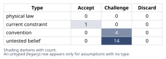
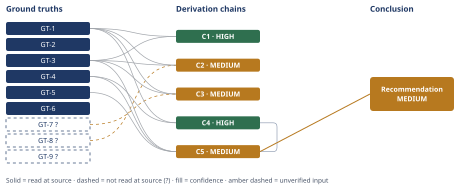

# Redis Cache vs. Postgres Upgrade Deferral

*First-principles analysis · 9 October 2026*

*Read with: [How to read this analysis](HOW-TO-READ.md) · [Working file](analysis-20261009T165243Z.md) · [All files](INDEX.md)*

## Executive Summary

**Recommendation:** Execute the scheduled Postgres upgrade on schedule and ship the Redis cache in parallel (option c) rather than the proposed cancel/defer-the-upgrade plan, provided the two efforts don't share critical-path engineers (chain C5).

**Band (from §6):** MEDIUM (chain C5).

**Would change it:** Pulling existing Postgres monitoring data to confirm the upgrade's actual binding resource would resolve the technical hinge (chain C2); confirming whether the cache and upgrade teams overlap would close the Rivals gap this Conclusion names and could move it to HIGH (chain C5).

## 1. Problem Essence

**Core problem:** Does the evidence the platform-team-lead's architecture-review document actually cites (peak read-QPS on the listings endpoint, and the next-tier Postgres instance's cost) establish that a Redis read-through cache will cut p95 latency and reduce Postgres load *enough* to safely defer the already-scheduled, lead-time-gated vertical-scale upgrade for at least two quarters — given that the two branches of this decision are not equally reversible?

**Success criteria:**
1. States explicitly whether peak-QPS and instance-cost, alone, can support (a) a latency-reduction claim and (b) a load-reduction-sufficient-to-defer claim, with the reasoning named.
2. Names the read-pattern preconditions (hit rate, write-invalidation frequency, key cardinality, staleness tolerance) a read-through cache needs to materially cut DB load, and states whether the document supplies any of them.
3. States whether the scheduled upgrade's actual binding resource (reads/CPU, writes, connections, vacuum/bloat, storage growth) is known, and if it is not read-QPS, states plainly that caching may not defer the upgrade at all.
4. Enumerates the stampede/new-failure-mode/opex second-order risks and prices the asymmetry of being wrong in each direction given the upgrade's procurement lead time.
5. Names the structural incentive conflict in who is proposing the plan, independent of the technical merits, without treating that conflict as proof the claim is false.
6. Applies inversion to the claim and second-order thinking to the recommendation, both explicitly.
7. Delivers a verdict — holds / holds conditionally (conditions named precisely) / does not hold — plus the single cheapest piece of missing evidence that would most resolve the uncertainty before the capacity-planning meeting.

No success criterion requires picking exactly option (a) or exactly option (b) as named in the prompt; a composite that captures part of each is tested as its own option in Phase 4.

## 2. Assumptions Table

### Fishbone — candidate drivers of the scheduled Postgres vertical-scale upgrade

Effect: "A Postgres vertical-scale upgrade was scheduled, with its own budget and procurement lead time, for this/next quarter." Category set locked for this pass (domain-specific, not the generic 6-category default, because the question is which *resource dimension* is binding): Compute/query-plan, Memory, I/O throughput, Storage capacity/growth, Connections/concurrency, Maintenance overhead (vacuum/bloat).

| Category | Candidate causes (unfiltered) | Discriminating observation |
|---|---|---|
| Compute / query plan | CPU-bound listings queries from missing/suboptimal indexes; planner regression after a version bump or stats drift | `pg_stat_statements` + `EXPLAIN ANALYZE` on the top listings queries — high CPU cost per row returned points here, not at raw read volume |
| Memory | Working set exceeds `shared_buffers`, forcing disk spill on reads | Buffer-cache hit ratio from `pg_stat_database`; falling hit ratio as data grows points here |
| I/O throughput | Disk IOPS saturated by read volume, or by WAL write volume from writes | IO wait time in OS-level metrics split by read vs. write; a read cache only helps the read-driven share |
| Storage capacity/growth | Listings/catalog/audit data volume approaching disk ceiling; index bloat inflating footprint | Disk-usage growth trend vs. capacity headroom — a cache does nothing for this axis at all |
| Connections/concurrency | Connection-pool exhaustion from per-request connections without pooling | `max_connections` utilization and pool wait time — a cache helps only if the app short-circuits the DB connection on a cache hit |
| Maintenance overhead | Autovacuum falling behind on a high-churn table (e.g., price/inventory updates), dead-tuple bloat | `pg_stat_user_tables` `n_dead_tup` and `last_autovacuum` — a read cache does **not** touch this axis; it is purely write-driven |

No prioritization is attempted here because the document supplies none of these observations — that absence is itself the finding (recorded as GT-3 below) and is the reason assumption A2 below is the most load-bearing unverified item in the whole analysis. Two of the six candidate branches (Storage capacity/growth, Maintenance overhead) are ones a read-through cache would do **nothing** for even if fully effective, which is the concrete mechanism behind the prompt's "if it's not primarily read-QPS-driven, a cache may not defer it at all" concern.

### Assumptions

| Assumption | Type | Treatment | Verdict | Verification |
|---|---|---|---|---|
| Peak read-QPS represents the load condition relevant to current p95 latency, not merely traffic volume | untested belief | verify or flag | Challenge — "peak traffic" and "where p95 time is spent" are different measurements; the doc conflates them | unverified — flagged (used in C1) |
| The scheduled upgrade is driven primarily by read load/CPU on the listings endpoint, not by writes, connections, vacuum/bloat, or storage growth | untested belief | verify or flag | Challenge — the single most load-bearing claim in the proposal; no root-cause data for the upgrade is cited at all | unverified — flagged (elevated to GT-8?, used in C2) |
| Listings read traffic is highly cacheable (high read:write ratio, bounded key cardinality, staleness-tolerant) | untested belief | verify or flag | Challenge — no hit-rate estimate, pilot data, or cacheability argument appears anywhere in the cited evidence | unverified — flagged (elevated to GT-7?, used in C3) |
| Write-invalidation frequency on listings data is low enough that the cache will not thrash | untested belief | verify or flag | Challenge — price/inventory/availability fields are plausibly write-heavy in exactly the way that erodes hit rate; no invalidation data cited | unverified — flagged (feeds GT-7?) |
| Key cardinality of the listings endpoint is bounded (not effectively unbounded via personalization/filters/sort permutations) | untested belief | verify or flag | Challenge — unbounded cardinality is the most common reason a "should-be-cacheable" endpoint isn't | unverified — flagged (feeds GT-7?) |
| Product staleness tolerance for listings data is compatible with the TTL a workable cache needs | untested belief | verify or flag | Challenge — staleness tolerance is a product decision never addressed in a purely technical doc | unverified — flagged |
| The two-engineer-week estimate is the complete cost of the cache effort | convention | explicitly challenge | Challenge — omits Redis infrastructure spend, on-call/operational burden, observability, and stampede-mitigation engineering | unverified — flagged (feeds GT-5 / opex) |
| Peak read-QPS + next-tier instance cost are sufficient evidence for a capacity decision of this consequence | convention | explicitly challenge | Challenge — conventional capacity planning also wants current utilization/headroom, a growth trend, and the upgrade's original rationale; all three are omitted | n/a — the challenge itself is recorded directly as GT-3 |
| Postgres procurement lead time is fixed and cannot be shortened or hedged (reserved capacity, elastic resize, expedited order) | current constraint | record expiry conditions | Accept — expires if/when the team confirms the specific managed-Postgres vendor offers a low-lead-time resize or reservable buffer; until checked, the asymmetry in GT-4 holds as stated by the scenario | unverified whether an expiry path exists — flagged |
| The architecture-review document is a neutral, complete accounting independent of who benefits from its recommendation | convention | explicitly challenge | Challenge — the author also owns the proposed deliverable, and approval both credits them with a new system and defers a competing, already-budgeted line; a structural conflict, not evidence the claim is false, but reason to require independent verification before spending the irreversible branch | structural fact, read-at-source from the prompt's own context — recorded as GT-5 |
| Current p95 latency is dominated by DB-side wait time rather than network/app-tier/serialization time | untested belief | verify or flag | Challenge — no latency breakdown is cited; if app-tier time dominates, a DB-fronting cache caps out well below the implied win | unverified — flagged (surfaced from chain C1, `[Assumes: A11]`) |
| Cache stampede / thundering herd on cold start or mass invalidation is adequately mitigated by the scoped engineering work | untested belief | verify or flag | Challenge — the 2-engineer-week estimate does not call out jittered TTL / request-coalescing / early-refresh as scoped; unmitigated, the first invalidation event could spike DB load instead of reducing it | unverified — flagged (surfaced from inversion, below) |
| Cache hit-rate will not materially decay as traffic-mix/personalization grows over the deferral horizon | untested belief | verify or flag | Challenge — if cardinality grows and nobody re-measures, today's unverified-sufficiency pattern recurs next cycle at a possibly worse lead-time point | unverified — flagged (surfaced from chain C5 third-order extension, `[Assumes: A13]`) |
| Redis's own availability/latency characteristics will not introduce a new failure mode or tail-latency risk material enough to offset the claimed gains | untested belief | verify or flag | Challenge — a read-through cache is a new dependency on the hot path; its own p99+ behavior and failure modes are addressed nowhere in the cited evidence | unverified — flagged (surfaced from inversion, below; feeds §5 pre-mortem) |
| Running the cache work in parallel with the upgrade does not create enough team-bandwidth contention to make strict sequencing preferable | untested belief | verify or flag | Challenge — depends on a fact not in the document: whether the same engineers execute both pieces of work | unverified — flagged (surfaced from trade-off scoring; this is the condition attached to the §6 recommendation) |
| The multiplicative decomposition (cacheable-read fraction × hit rate × per-query DB cost) adequately approximates actual load reduction | untested belief | verify or flag | Challenge — ignores second-order effects such as connection-pool reuse or query-batching changes that a cache can also trigger | unverified — flagged (surfaced from chain C3, step 1) |
| No faster stopgap remediation (temporary read replica, aggressive rate-limiting, query-level mitigation) exists to bridge a gap if deferral turns out wrong | untested belief | verify or flag | Challenge — the asymmetry in GT-4/C4 is stronger if no stopgap exists; weaker if one does, and the document is silent either way | unverified — flagged (surfaced from chain C4, step 1) |
| The trade-off criteria weights (e.g., breach-risk = 5, effort = 2) reflect the organization's actual priorities rather than the analyst's own | convention | explicitly challenge | Challenge — weights were locked before scoring per the trade-off procedure, but their *source* is this analysis's judgment, not a cited organizational priority-ranking | unverified — flagged (surfaced from chain C5, trade-off scoring step) |
| A full representative production traffic cycle (including seasonality) completes within the observation window so gathered hit-rate data is reliable | untested belief | verify or flag | Challenge — if the window is shorter than one full seasonal cycle, the hit-rate measurement C5's second-order step relies on could be unrepresentative | unverified — flagged (surfaced from chain C5, second-order step) |

### Inversion — what would have to be true for the claim to be false

Claim inverted: *"The Redis cache does NOT cut p95 enough and does NOT reduce DB load enough to safely defer the upgrade for two quarters."* Failure-guaranteeing conditions, with the necessary precondition each implies, and whether that precondition is load-bearing:

1. The upgrade's binding resource is not reads at all (connections, vacuum/bloat, storage, writes) → precondition: *"reads are the (or a materially sufficient) binding resource behind the scheduled upgrade"* — **load-bearing** (this is A2/GT-8?, the hinge).
2. Hit rate on listings reads is low (e.g., <50%) because of high cardinality or short staleness tolerance → precondition: *"listings reads are highly cacheable at a hit rate sufficient to matter"* — **load-bearing** (A3/GT-7?).
3. Write-invalidation is frequent enough that the cache thrashes rather than serves → precondition: *"invalidation frequency stays low relative to read volume"* — **load-bearing** (feeds GT-7?).
4. A stampede event (cold start, mass invalidation, or deploy) spikes DB load above the pre-cache baseline right when capacity is tightest → precondition: *"stampede is engineered against (coalescing/jitter/early refresh), not assumed away"* — **load-bearing** for the risk side of the decision, not for whether reads are cacheable.
5. Redis itself becomes a new availability/latency bottleneck, so the "win" is partly or wholly offset by a new tail-latency source → precondition: *"Redis's own failure/latency profile doesn't erase the gain"* — load-bearing for the latency claim specifically, not for the load-reduction claim.
6. The growth trend continues and hit rate decays before two quarters are up, so the deferral window is shorter than claimed → precondition: *"two quarters of headroom survive realistic growth, not just today's snapshot"* — load-bearing for the *duration* claim specifically.

All six preconditions are currently **untested** per the Assumptions Table above; none is verified by the cited evidence (peak QPS, instance cost). This is the inversion procedure's finding: the claim is falsifiable on at least six independent fronts, and the cheapest of the six to check *before* committing engineering time is #1 (the upgrade's binding resource), because it is checkable today from existing monitoring data without writing any new code — see §6 for the concrete cheapest-evidence recommendation.

## 3. Ground Truths

No external document is attached to this analysis — the "architecture-review document" is described in the prompt's CONTEXT, not supplied as a file or URL. There is therefore nothing further to Read/Grep/WebFetch beyond the prompt itself: GT-1 through GT-6 below are either (a) read directly from the prompt's own CONTEXT section, which is the primary source for this analysis, or (b) stated engineering definitions that do not rest on an external citation. No Phase 3 failure record is needed for either case — there is no cited external source that was attempted and failed to open. GT-7 through GT-9 are untested beliefs from the Assumptions Table above, explicitly elevated (per D-07) for use in Derivation Chains in §4, and carry the `?` suffix accordingly.

- **GT-1** A read-through cache reduces origin (Postgres) load only in proportion to (a) the fraction of traffic that is cacheable reads and (b) the hit rate achieved on that traffic; it does nothing for write traffic or for origin-side resource consumption unrelated to serving reads (e.g., storage capacity, vacuum/autovacuum overhead, WAL volume from writes) — source: definition/mechanics of read-through caching; read-at-source: this is a structural property of the pattern itself, not an empirical figure, so no document location applies.
- **GT-2** A Postgres vertical-scale upgrade (moving to a larger instance tier) increases the resources tied to that tier — typically CPU, RAM, and/or attached IO throughput — and does not by itself change storage-capacity ceilings (a separate/accompanying parameter) or connection-handling architecture unless `max_connections`/pooling is reconfigured as part of the same change — source: definition/mechanics of vertical database scaling; read-at-source: structural property, no document location applies.
- **GT-3** The only evidence cited in the architecture-review document for the cache proposal is (i) peak read-QPS on the listings endpoint and (ii) the cost of the next-tier Postgres instance; the document does not cite a current p95/p99 latency baseline, a cache-hit-rate projection or pilot data, write/invalidation frequency, key cardinality, staleness tolerance, or the original capacity-planning rationale/root-cause for the scheduled upgrade — source: the prompt's CONTEXT section ("Evidence cited in the document: peak read-QPS... and the cost of the next-tier Postgres instance"); read-at-source: read directly in the user's CONTEXT paragraph, this analysis's primary source.
- **GT-4** The decision is asymmetric in reversibility: the cache rollout can be adjusted or rolled back once live, but the Postgres upgrade has procurement lead time, so a deferral that turns out wrong reverses late, at the same lead time, "at a worse moment" — source: the prompt's CONTEXT section ("Reversibility" paragraph); read-at-source: read directly in the user's CONTEXT paragraph.
- **GT-5** The proposer (platform team lead) is both the author of the claim and the owner of the 2-engineer-week effort being proposed as the alternative to a separately budgeted, already-scheduled upgrade; approving the recommendation both credits the proposer with a new deliverable and defers/cancels a competing, pre-approved budget line — source: the prompt's CONTEXT section ("Asserted by" and "Decision this feeds" paragraphs); read-at-source: read directly in the user's CONTEXT paragraph.
- **GT-6** Read-through caches are subject to well-documented engineering failure modes, including cache stampede/thundering herd on mass invalidation or cold start, and they introduce a new dependency whose own latency and availability characteristics add to the serving path's tail latency and failure surface — source: standard distributed-systems/caching engineering knowledge (definitional, not a specific empirical citation); read-at-source: structural/definitional property, no document location applies.
- **GT-7?** Listings read traffic is cacheable at a hit rate high enough to matter (elevated from the Assumptions Table; untested belief) — unverified: no hit-rate pilot, query-log cardinality analysis, or invalidation-frequency data is cited anywhere in the evidence described; verification path: a shadow/canary cache measuring real hit rate against production traffic for even a few days, or a query-log analysis of read repeat-rate and key cardinality.
- **GT-8?** The scheduled Postgres vertical-scale upgrade is driven primarily by read-query load/CPU on the listings endpoint, rather than by writes, connections, vacuum/bloat, or storage growth (elevated from the Assumptions Table; untested belief — this is the single most load-bearing input in the analysis) — unverified: no root-cause data for the upgrade is cited; verification path: pull `pg_stat_statements`/`EXPLAIN ANALYZE` on the top listings queries, `pg_stat_user_tables` bloat/vacuum stats, and connection-pool utilization, and read the *original* capacity-planning ticket that scheduled the upgrade.
- **GT-9?** Two quarters of deferral is enough runway relative to the underlying read-traffic growth trend (elevated from the Assumptions Table; untested belief) — unverified: no growth-trend data is cited; verification path: compare the QPS growth rate implied by the upgrade's own original scheduling model against the cache's hit-rate decay sensitivity to that growth.

**Provenance summary:** `?`-marked: GT-7, GT-8, GT-9 (3 of 9). Read-at-source: GT-3 and GT-4 and GT-5 — each read directly in the prompt's CONTEXT paragraphs quoted above; GT-1, GT-2, and GT-6 are definitional/structural properties of the technologies involved and carry no document location to name.

## 4. Derivation Chains

### Conclusion C1: The cited evidence (peak read-QPS, instance cost) does not establish the claimed p95 latency reduction

GT-1 (cache load-relief mechanics) + GT-3 (evidence cited omits latency baseline and hit-rate data)
→ a p95 latency reduction from caching requires both a non-trivial hit rate and DB-side wait time being a material share of current p95, neither of which the cited evidence quantifies
→ peak read-QPS and next-tier instance cost describe traffic volume and upgrade price, not where current latency time is spent or how much of it a cache would remove *[Assumes: A11 — current p95 is DB-wait-dominated, not network/app-tier/serialization-dominated]*
→ the cited evidence supports only "this endpoint sees heavy read traffic" and "the upgrade has a known price," neither of which bounds a latency-reduction magnitude, so the latency-reduction claim is unverified as stated

**Confidence:** HIGH — the strongest rival reading, that peak QPS is itself a reasonable proxy for p95 risk under load, is named and ruled out: no correlation between past load spikes and p95 upticks is cited either, so the rival rests on the same silence GT-3 already records, not on a separate fact that would need its own verification.

### Conclusion C2: The central load-reduction claim rests entirely on an unverified assumption about the upgrade's actual driver

GT-1 (cache load-relief mechanics) + GT-8? (upgrade driver assumed read-driven) + GT-3 (no root-cause cited)
→ caching relieves only the resource dimension that reads consume — chiefly query CPU and IO for fetches — per GT-1's mechanics
→ if the scheduled upgrade's binding resource is instead connections, vacuum/bloat, write throughput, or storage growth, a read-offload leaves that binding resource on its original growth trajectory, per the fishbone branches in §2
→ the document names no root-cause analysis for the upgrade, so it cannot establish that cache-driven read-offload is responsive to whatever actually triggered the scheduling decision
→ "reduce load enough to defer the upgrade" rests entirely on GT-8?, which is wholly unverified in the evidence presented, so the central load-reduction claim does not hold as stated

**Confidence:** MEDIUM — GT-8? is unverified; the verification that would remove it as a cause of the downgrade is named on GT-8? itself in §3 (query-stats/bloat/connection-pool check plus reading the original capacity-planning ticket). A live rival — that offloading reads could still relieve shared resources (e.g., IO contention with autovacuum) even if reads are not the primary driver — is addressed and ruled out in §5 Dead End B: it bounds a direction (some relief is plausible) but not the magnitude the claim actually asserts ("enough" for two quarters), so it does not lift this chain off MEDIUM.

### Conclusion C3: The load-reduction magnitude is unquantifiable from the evidence given, so "enough" is asserted rather than shown

GT-1 (cache load-relief mechanics) + GT-7? (cacheability assumed) + GT-3 (no hit-rate data cited)
→ load-reduction magnitude is approximately the cacheable-read fraction times the achieved hit rate times the per-query DB cost, following a unit decomposition of what a cache actually removes
→ none of those three factors carries a cited value or even a bracketed estimate anywhere in the document
→ an unquantified reduction cannot be checked against the unquantified capacity gap the upgrade exists to close, so "enough" is currently a judgment call presented as a finding rather than a computed result

**Confidence:** MEDIUM — GT-7? is unverified; the verification that would remove it as a cause of the downgrade is named on GT-7? itself in §3 (shadow/canary hit-rate measurement or query-log cardinality analysis).

### Estimate — asymmetry of being wrong in each direction

Target quantity: the relative magnitude of the two wrong-decision costs, decomposed into unit-factors. No real dollar or probability figures are available in the evidence described, so each factor is bounded by what is structurally knowable rather than assigned an invented number — this is a sign-and-order-of-magnitude bracket, not a fabricated point estimate.

- Cost(wrongly deferred) ≈ P(upgrade needed sooner than 2 quarters) × [outage/degradation cost during the gap before expedited capacity lands] × [rush-procurement premium over normal lead-time pricing]. The first two factors carry no stated ceiling in the evidence (an outage's cost and the gap's length are both open on the high end); the third factor is ≥1× by definition (expedited is never cheaper than planned). Right-unbounded.
- Cost(wrongly executed now) ≈ [instance-tier cost delta] × [at most ~2 quarters of running a bigger instance somewhat earlier than strictly necessary]. Both factors are already known and already budgeted — the upgrade was scheduled and priced regardless of this decision. Bounded, closed-form.

Bracket: Cost(wrongly deferred) ∈ [bounded-but-nonzero, unbounded]; Cost(wrongly executed now) ∈ [small, bounded]. The brackets do not overlap at their upper ends. Decision-resolution stop criterion: both ends of each bracket already point to the same qualitative conclusion (an unbounded downside dominates a bounded one), so no further precision on this factor alone would change which option it favors.

### Conclusion C4: The reversibility asymmetry itself argues against cancelling the lead-time-gated upgrade on today's evidence, independent of whether GT-8? later turns out true

GT-4 (reversibility asymmetry) + GT-1 (cache load-relief mechanics)
→ wrongly deferring forces the same lead-time-gated procurement later, now compressed against an active capacity problem, carrying an open-ended outage-probability cost plus a rush-procurement premium
→ wrongly executing now only spends money already budgeted and scheduled somewhat earlier than strictly necessary — a bounded, known timing cost
→ a right-unbounded downside dominating a bounded one is the standard case for preserving the reversible option rather than spending the irreversible one on an unverified technical bet, regardless of how the GT-7?/GT-8? hinge eventually resolves

**Confidence:** HIGH — no rival to this asymmetry argument survives: the only candidate rival (that Redis opex is itself open-ended too) applies equally under every option considered in C5, so it does not favor one branch of *this* decision over the other and is not a competing conclusion to this chain's endpoint.

### Trade-off — option (a) as literally proposed vs. the viable alternatives

**Options.** (a) Ship the cache; cancel/defer the scheduled upgrade for ≥2 quarters, as literally proposed. (b) Execute the scheduled upgrade now (status quo); treat caching as an independent, separately-timed optimization. (c) Composite — execute the upgrade now AND build the cache in parallel (2 engineer-weeks, independently valuable for latency regardless of the upgrade decision); revisit deferring any *future* upgrade cycle only once the cache is live and real hit-rate/root-cause data exist.

**Must-haves applied as knock-outs.** Must-have: do not spend the lead-time-gated, hard-to-reverse-late resource against grounds that are not yet verified (GT-7?, GT-8? both unverified). Option (a) fails this must-have — it cancels/defers the upgrade now on the strength of exactly the two evidence items (GT-3) that verify neither GT-7? nor GT-8?. **(a) is eliminated, not scored** — scoring it would let a plausible-sounding weighted total out-vote the irreversibility asymmetry established in C4.

**Criteria & weights** (locked before scoring; anchors stated; every criterion phrased so higher is better):

| Criterion | Weight | 1 means | 5 means |
|---|---|---|---|
| Latency/UX improvement speed | 3 | no improvement for 2+ quarters | improvement within weeks |
| Cost efficiency (avoided unnecessary spend) | 3 | spends on both without need | spends only what's needed |
| Risk of capacity breach / outage | 5 | upgrade proceeds late or at risk | upgrade proceeds safely on schedule |
| Reversibility / optionality preserved | 4 | commits the irreversible branch on unverified grounds | preserves optionality on both branches |
| Engineering effort / opportunity cost | 2 | large unplanned effort | minimal unplanned effort |
| Time-to-insight on the real DB bottleneck | 3 | never finds out | fast, real production data |

**Scoring** (each score cites the ground truth it rests on; (a) excluded as knocked out):

| Option | Latency (×3) | Cost (×3) | Breach-risk (×5) | Reversibility (×4) | Effort (×2) | Time-to-insight (×3) | Total |
|---|---|---|---|---|---|---|---|
| (b) upgrade only | 2×3=6 (GT-1) | 3×3=9 (GT-3) | 5×5=25 (GT-4) | 4×4=16 (GT-4) | 5×2=10 (GT-3) | 2×3=6 (GT-1,GT-3) | **72** |
| (c) upgrade + parallel cache | 4×3=12 (GT-1) | 3×3=9 (GT-3) | 5×5=25 (GT-4) | 5×4=20 (GT-4) | 3×2=6 (GT-3) | 5×3=15 (GT-1,GT-7?) | **87** |

**Recommendation.** (c) wins, 87 to 72, driven by faster latency improvement, equal preservation of upgrade safety, and a large edge in generating the real hit-rate/root-cause data the next capacity cycle needs. Flip test, recomputed directly rather than by shortcut algebra: holding every other weight and score fixed, raising the Engineering-effort weight from 2 makes the two totals equal at weight = 9.5 (b: 62 + 5(9.5) = 109.5; c: 81 + 3(9.5) = 109.5) — that single criterion would have to become the single highest-weighted criterion in the matrix, above even breach-risk at 5, to flip the result. That is not asserted as plausible here. No other single-criterion change flips the result.

### Conclusion C5: Recommend option (c) — execute the upgrade on schedule and build the cache in parallel — conditional on the two efforts not sharing critical-path engineers

GT-4 (reversibility asymmetry) + GT-5 (proposer/owner structural conflict) + GT-3 (evidence gaps) + C4 (asymmetry favors preserving the irreversible branch)
→ option (a) as literally proposed fails the must-have of not spending the lead-time-gated resource on unverified grounds and is knocked out rather than merely scored down
→ weighted scoring across the two must-have-passing options favors executing the upgrade on schedule while building the cache in parallel (option c) over upgrading alone (option b), 87 to 72, robust to every single-criterion weight change short of an implausible rise in the engineering-effort weight to 9.5
→ the strongest live rival — that sequencing the cache strictly after the upgrade avoids any team-bandwidth contention and is therefore safer than parallelizing — is not fully settled by the evidence available and is recorded in §5 (Dead End C) as a condition rather than a dismissal
→ recommend option (c), conditional on confirming the 2-engineer-week cache effort does not share critical-path engineers with the upgrade execution; if it does, sequence the cache immediately after the upgrade completes rather than deferring it indefinitely
→[2nd] building the cache now, with upgrade safety already secured, produces real hit-rate and load-offload measurements across a full production traffic cycle — exactly the evidence needed to resolve GT-7? and GT-8? before the next capacity-planning cycle, rather than repeating today's evidence-light pattern
→[3rd] if nobody re-measures and hit-rate instead decays as traffic-mix/personalization grows *[Assumes: A13 — cache hit-rate will not materially decay as traffic-mix/personalization grows]*, the same unverified-sufficiency pattern recurs next cycle at a point where the upgrade's lead time may bite harder — institutionalizing hit-rate/root-cause re-measurement as a standing capacity-planning input is what prevents that recurrence, and this action item stands regardless of whether A13 holds

**Confidence:** MEDIUM — the Inputs ceiling is HIGH and the `[Assumes: A13]` premise on the third-order hop is priced in that same hop (it states what the endpoint — institutionalize re-measurement — does under A13's failure, and the action item stands either way), so Inference is not the short axis here. Rivals is the short axis: the sequencing-vs-parallel rival named above is live and unsettled by the evidence available; what would close it is the single fact named in the conclusion's own condition (whether the cache work and the upgrade execution share critical-path engineers) — once confirmed either way, this chain's Rivals axis closes.

No extension step above contradicts a ground truth, so no return to Phase 2 is triggered by this pass; the one assumption it surfaced (A13) is already carried in the Assumptions Table in §2.

## 5. Abandoned Reasoning

### Dead End A: "Verify GT-7?/GT-8? quickly before the meeting, then approve option (a) as originally proposed"

**What was tried:** Considered whether a same-day check (pulling `pg_stat_statements` and the original capacity-planning ticket) could verify GT-8? cheaply enough to rescue option (a) exactly as proposed, without needing the fuller option-(c) structure.

**Why abandoned:** GT-8? (the upgrade's root cause) can plausibly be checked quickly from existing monitoring data, but GT-7? (the cache's *actual achieved* hit rate) cannot be verified without the cache already running in production — it is a measurement of the cache's own behavior, not a property that pre-exists its deployment. Approving (a) "once GT-7? is confirmed" is circular: the only way to confirm GT-7? is to run the cache, and running the cache safely, before betting the lead-time-gated upgrade on it, is exactly what option (c) already does. This is ruled out by GT-1 (what a cache's hit rate even is) and GT-4 (the asymmetry a quick-verify does not remove).

**What it ruled out:** Any version of option (a) that tries to fully de-risk itself before the meeting via a quick check. Confirms that the parallel/sequencing structure (option c, chain C5), not a "verify-then-approve-(a)" patch, is the only path that resolves the asymmetry GT-4 describes.

### Dead End B: "Resource-sharing (IO/CPU contention with vacuum) is enough to call the load-reduction claim verified"

**What was tried:** Considered whether the plausible argument that reduced read load frees some headroom shared with other contending processes (e.g., autovacuum) could substitute for direct verification of GT-8?, since Postgres resources are rarely perfectly siloed.

**Why abandoned:** The claim under evaluation is "enough to defer for at least two quarters," not "nonzero." The resource-sharing argument bounds a direction (some relief is plausible even if reads are not the primary driver) but supplies no magnitude, and a direction with no magnitude cannot establish sufficiency against a specific multi-quarter threshold. This is ruled out by chain C2 and C3's own structure: both already require a quantified hit rate and a quantified binding-resource contribution, neither of which this argument supplies.

**What it ruled out:** Accepting qualitative plausibility as a substitute for the quantitative "enough" threshold the claim specifically asserts. Keeps C2 and C3 capped at MEDIUM rather than resolved to HIGH on the strength of this argument.

### Dead End C: "Strict sequencing (upgrade now, cache strictly next quarter) unconditionally dominates parallelizing (option c)"

**What was tried:** Evaluated whether deferring the cache work by one full quarter, to guarantee zero team-bandwidth contention during upgrade execution, dominates building it in parallel.

**Why abandoned:** Sequencing pushes the start of the hit-rate/root-cause data-gathering clock back by a full quarter, which — per C5's third-order extension — costs the team a full additional capacity-planning cycle of continued evidence-light decisions. That cost is not clearly smaller than the bandwidth-contention risk sequencing avoids, so neither option dominates outright; the correct choice turns on a fact not present anywhere in the evidence described — whether the 2-engineer-week cache effort and the upgrade execution draw on the same engineers.

**What it ruled out:** Stating either sequencing or parallelizing as the unconditionally correct call. Keeps the C5 recommendation explicitly conditional (on that one fact) rather than resolving this rival outright — this is the live Rivals-axis shortfall named in C5's confidence line.

## 6. Conclusion

**Recommended approach:** Approve option (c) — execute the already-scheduled Postgres vertical-scale upgrade on schedule, and fund the 2-engineer-week Redis read-through cache to ship in parallel, provided the two efforts do not share critical-path engineers (chain C5). Do not approve option (a) as literally proposed (ship the cache and cancel/defer the upgrade now); it is knocked out by the irreversibility asymmetry regardless of how plausible the caching story sounds (chains C4, C5). The single cheapest action before the capacity-planning meeting is to pull existing Postgres monitoring data (`pg_stat_statements`, `pg_stat_user_tables`, connection-pool utilization) and the original capacity-planning ticket to determine whether the upgrade is actually read-driven — the one unresolved input every other finding in this analysis is downstream of (chain C2).

**Key insight:** Verdict: the claim as stated does not hold on the cited evidence (chains C1, C2, C3); it would hold only *conditionally*, pending verification that GT-7? (listings reads are highly cacheable) and GT-8? (the upgrade is read-driven) are both true, and the cited evidence (peak QPS, instance cost) verifies neither. The non-obvious finding is that the *decision* does not have to wait on that verification: independent of whether the technical claim ever checks out, the stated reversibility asymmetry alone already determines the safe course of action (chain C4) — a bounded downside from upgrading "too early" is dominated by an unbounded downside from deferring "too late." Reasoning from the proposal's own framing ("the evidence looks plausible, so defer the upgrade") would miss this; reasoning from the asymmetry does not need the plausibility question answered at all.

**Trade-offs acknowledged:** This recommendation accepts roughly two extra engineer-weeks of effort now, plus an ongoing Redis operational cost (infrastructure spend, on-call burden, and stampede-mitigation engineering) that the original proposal's two-engineer-week estimate did not separately account for (chain C5). It also declines to let the platform-team lead's own proposed deliverable substitute for independent verification of the claim's two central inputs — a structural conflict of interest worth naming independent of the technical merits, even though it does not itself make the claim false (chain C5).

**Confidence:** MEDIUM — this Conclusion rests on chain C5, itself MEDIUM because its Rivals axis is short: the sequencing-vs-parallel question is unsettled pending one fact absent from the evidence described — whether the cache work and the upgrade execution share critical-path engineers, as C5's own confidence line explains. Once that fact is confirmed, this Conclusion's rating moves with C5's.
