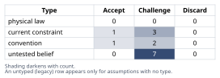
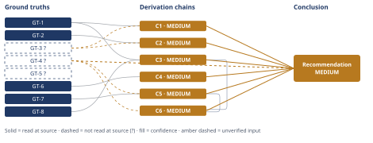

# Redis Cache vs Postgres Upgrade Decision

*First-principles analysis · 9 October 2026*

*Read with: [How to read this analysis](HOW-TO-READ.md) · [Working file](analysis-20261009T225926Z.md) · [All files](INDEX.md)*

## Executive Summary

**Recommendation:** Do not cancel the Postgres upgrade on today's evidence; run a short, time-boxed measurement spike (read/write split, cacheable fraction, a p95 root-cause trace, and a staleness-tolerance spec for price/stock) while holding or pausing procurement rather than cancelling it outright, build the cache in parallel, and only formally defer the upgrade once a measured load offload clears the upgrade's own trigger threshold with margin for expected growth (chain C6).

**Band (from §6):** MEDIUM (chains C1, C2, C3, C4, C5, C6).

**Would change it:** The required-vs-achievable load offload figure — current DB utilization margin against the upgrade's trigger threshold, and the cacheable-read fraction/achievable hit rate on the listings endpoint — would move this band to HIGH in either direction (chains C3, C6).

## 1. Problem Essence

**Essence Statement:** Does adding a Redis read-through cache in front of the Postgres-backed listings API reduce the *specific* load and latency that drove the scheduled vertical-scale upgrade by enough, and reliably enough, to safely cancel/defer that upgrade for two quarters — given that rolling back the cache is cheap but reversing a deferred upgrade mid-quarter is expensive (lost procurement lead time)?

**Success criteria** — a correct answer must:
1. State a verdict: holds / holds with caveats / does not hold as stated.
2. Identify which load-bearing sub-claims are actually supported by the cited evidence (peak read-QPS, next-tier instance cost) versus which are unverified assumptions.
3. Name where the claim is weakest.
4. State concrete, observable conditions that would falsify the claim.
5. Evaluate the *decision*, not just the claim — pricing the asymmetry between a cheap cache-rollback and an expensive late procurement reversal.
6. Not be forced into picking exactly option (a) or option (b) as named — a sequenced/composite option (e.g., keep procurement moving while measuring the cache) is in scope if the ground truths support it.
7. Name the single most important missing piece of evidence that should gate the capacity-planning decision.

## 2. Assumptions Table



| ID | Assumption | Type | Treatment | Verdict | Verification |
|----|------------|------|-----------|---------|---------------|
| A-01 | Reads on the listings endpoint are the dominant contributor to total Postgres load (vs. writes, other endpoints, background jobs) | untested belief | verify or flag | Challenge — unverified, not cited in the document, cannot be accepted without data | Pull per-endpoint/per-query-type load breakdown (pg_stat_statements or APM) for the window used to justify the upgrade |
| A-02 | The listings read pattern is cacheable: high read:write ratio, bounded key cardinality, nonzero staleness tolerance | untested belief | verify or flag | Challenge — unverified | Measure key cardinality, read:write ratio, and get explicit staleness tolerance sign-off from product owner |
| A-03 | Peak read-QPS is the right metric to size the cache's benefit against | convention | explicitly challenge | Challenge — likely false for the p95 half of the claim, see GT-2/C2 | See GT-2/C2: p95 is a tail statistic; peak-QPS sizes throughput capacity, not tail latency composition |
| A-04 | p95 latency on the listings endpoint is dominated by DB query time (vs. network, app-layer serialization, N+1 queries, connection-pool contention) | untested belief | verify or flag | Challenge — unverified, single largest blind spot | Request-level latency breakdown / distributed trace sample of p95-bucket requests |
| A-05 | A realistically achievable cache hit rate removes enough DB load to keep utilization under the trigger threshold for ≥2 quarters | untested belief | verify or flag | Challenge — unverified, unquantified in the document | Compute required ΔL from current utilization margin vs. trigger threshold; estimate achievable hit rate from A-01/A-02 data |
| A-06 | QPS growth during the deferred window stays within the margin the cache buys | current constraint | record expiry conditions | Challenge — expires once trailing growth-rate data is checked against the one-time offload the cache provides | Compare trailing QPS growth rate to the one-time offload the cache provides |
| A-07 | Cache invalidation can meet the consistency requirements for price/stock-sensitive listing fields | untested belief | verify or flag | Challenge — unverified | Get staleness-tolerance spec from product/commerce stakeholders for price and stock fields specifically |
| A-08 | Redis's own operational failure modes (cold start, stampede, saturation, outage) will not create load spikes that offset or exceed the benefit | untested belief | verify or flag | Challenge — unverified | Game-day / load test of cache-cold and cache-failure scenarios at peak synthetic traffic |
| A-09 | The 2-engineer-week effort estimate holds even if correct invalidation (not a naive TTL) is required | convention | explicitly challenge | Challenge — likely understated, see C4 | Scope the invalidation design before locking the estimate |
| A-10 | Procurement lead time makes a late-discovered reversal materially more expensive than committing now | current constraint | record expiry conditions (stated directly in context) | Accept — taken as given for this analysis; stipulated by the decision context, not independently sourced | Confirm actual lead-time figure and whether a partial/held order is possible |
| A-11 | The vertical-scale upgrade was scheduled because of a genuine, independently-identified capacity trigger (not just routine cadence) | current constraint | record expiry conditions | Challenge — unverified | Pull the original capacity-planning trigger/threshold that scheduled the upgrade |
| A-12 | Doing nothing structurally different (upgrading now, deferring the cache) is a live, comparable option | convention | explicitly challenge | Accept — confirmed as a valid comparison option; status quo-plus is always in scope per the trade-off procedure | n/a — included in Phase 4 options by construction |
| A-13 *(surfaced in Phase 4 — chain C5)* | Redis outage/stampede risk during the deferred quarter is independent of, and does not correlate with, the same peak-traffic events that would have triggered the Postgres upgrade | untested belief | verify or flag | Challenge — unverified, likely false (both are plausibly peak-traffic-correlated) | Correlate historical incident/peak-traffic timestamps |
| A-14 *(surfaced in Phase 4 — chain C6)* | A sequenced/composite option (hold procurement, measure cache, decide later) is operationally available — i.e., procurement can be paused/held rather than only "go" or "cancel" | current constraint | record expiry conditions | Challenge — unverified | Ask procurement/finance whether a hold or partial commitment is possible, and its cost |

## 3. Ground Truths

Note on provenance: this analysis has no access to the actual architecture-review document, the actual QPS/cost figures, or any telemetry — only the user's paraphrase of what the document contains. No cited source could be opened (Read/Grep/WebFetch all require a reachable document or dataset; none was supplied). Every ground truth drawn from that paraphrase is therefore marked `?` with a Phase 3 failure record below. Ground truths stated as structural/mathematical necessities of how read-through caches and tail-latency statistics work do not require an external citation (they are definitional, the software-engineering analogue of a physical law) and carry no `?`.

- **GT-1**: A read-through cache reduces load on the backing store only for the subset of traffic that is (a) a read, (b) a cache hit, and (c) on a cacheable key; it has zero direct effect on write load, cache-miss load, or any non-cacheable query load. — *definitional, no external citation required (follows from the definition of a read-through cache)*
- **GT-2**: p95 latency is a tail statistic; it is disproportionately shaped by the slowest few percent of requests, which are frequently dominated by atypical/expensive query shapes (long-tail filters, N+1 patterns, cold misses, lock/connection-pool contention) rather than by the modal "common case" request a hot-key cache serves well. — *definitional/statistical, no external citation required*
- **GT-3?**: The only evidence the architecture-review document cites is peak read-QPS on the listings endpoint and the next-tier Postgres instance's cost; no read/write split, no cacheable-fraction estimate, no p95 root-cause breakdown, no staleness-tolerance spec, and no target/required hit rate are cited. — **unverified**; Phase 3 failure record: source = "the architecture-review document"; reason unreachable = not provided to this analysis, only paraphrased in the user's message.
- **GT-4?**: The decision is reversible at the cache-rollout boundary (cheap rollback to Postgres-only) but expensive to reverse once the deferred quarter is underway, because the Postgres upgrade has procurement lead time that would need to be re-initiated. — **unverified** (stipulated by the user as the decision's reversibility context; not independently sourced); Phase 3 failure record: source = procurement process documentation; reason unreachable = not provided.
- **GT-5?**: The cited costs being weighed are a 2-engineer-week build effort (cache) against the cost of the next-tier Postgres instance (upgrade); this is the only cost comparison given. — **unverified**; same Phase 3 failure record as GT-3.
- **GT-6**: Serving correct, up-to-date price/stock values from a read-through cache requires either a TTL short enough to bound staleness (which bounds and reduces the hit rate achievable) or active write-path invalidation (which adds write-path complexity and failure surface beyond a naive cache). There is no cache design that gets both "high hit rate" and "always-fresh price/stock" for free. — *definitional, no external citation required*
- **GT-7**: Introducing Redis into the hot read path adds a new stateful dependency with its own failure modes not present in the Postgres-only architecture — cold-cache thundering herd after deploy/restart, stampede on synchronized key expiry, and Redis saturation/outage — any of which can transiently *increase* load on Postgres (fallback traffic) at the moment the cache fails. — *definitional/structural, no external citation required*
- **GT-8**: The hit rate required to defer the upgrade is mathematically determined by (i) how much headroom currently exists before the capacity trigger that scheduled the upgrade, and (ii) what fraction of total DB load is cacheable listings reads: required_offload = current_utilization − safety_margin_under_trigger, achievable_offload = hit_rate × cacheable_read_fraction × read_QPS. Neither (i) nor (ii) is cited in the document (per GT-3?), so the required-offload magnitude in the claim is currently unsolved, not merely uncertain. — *definitional/mathematical identity; its "not cited" clause inherits GT-3?'s `?`.*

`?`-marked: GT-3, GT-4, GT-5 (3 of 8).

Unsuffixed ground truths feeding load-bearing chains (GT-1, GT-2, GT-6, GT-7, GT-8) are definitional/mathematical claims about how caching, tail latency, and capacity math work in general — their "read-location" is the definition/identity stated inline above, not a page in an external document; no external source exists to point to for them, so no further read was attempted or needed. GT-3, GT-4, GT-5 were not read because no document was supplied to this analysis to read — this is disclosed above as the reason for each, not left silent.

## 4. Derivation Chains



### C1 — Load-reduction magnitude is unmeasured

```text
GT-1 (cache offloads only cacheable reads) + GT-3 (no read/write/cacheable-fraction breakdown cited)
→ the fraction of total Postgres load the cache could possibly remove cannot be bounded without knowing what share of DB load is listings reads versus writes or other endpoints [Assumes: A-01]
→ the claim's phrase "reduce database load enough" asserts a magnitude that is not yet computable from the evidence the document cites
→ as stated, the claim is neither verifiable nor falsifiable in its current form — it is a claim about an unmeasured quantity
```

**Confidence:** MEDIUM — the gap itself is a logical/structural finding (HIGH on its own terms), capped to MEDIUM because it is stated against GT-3?, which rests on a paraphrase of the document rather than the document itself. Verification that would remove the cap: obtain the document's actual per-endpoint, per-query-type load breakdown (A-01).

### C2 — The claimed metric (p95) is the one least likely to respond to a hot-key cache

```text
GT-2 (p95 is a tail statistic, usually driven by atypical query shapes) + GT-3 (no p95 root-cause breakdown cited)
→ if the p95 tail is driven by connection-pool contention, N+1 query patterns, or app-layer serialization rather than common-case DB query time, a cache serving hot keys does not touch the actual bottleneck [Assumes: A-04]
→ a well-executed cache can therefore leave p95 materially unchanged even while it successfully improves average or median latency
→ the specific metric the claim promises to cut (p95) is the one least likely to move unless the dominant tail cause is confirmed to be common-case DB query time
```

**Confidence:** MEDIUM — the mechanism is definitional, but whether it applies to *this* endpoint depends on A-04, which is untested. Verification that would remove the cap: a request-level latency trace/breakdown of actual p95-bucket requests on the listings endpoint.

### C3 — The hit-rate needed to defer the upgrade has not been computed by either side

```text
GT-1 (cache offloads only cacheable reads) + GT-8 (required offload is a function of headroom and cacheable fraction, neither cited)
→ applying the estimate procedure: required offload = current DB utilization minus the safety margin under the upgrade's trigger threshold, and achievable offload = hit rate × cacheable-read fraction × read QPS [Assumes: A-05]
→ because current utilization margin and cacheable-read fraction are both absent from the cited evidence (via GT-3), two of this equation's three inputs are unknown, so it cannot be solved in either direction
→ the capacity-planning meeting is being asked to approve a magnitude claim — "enough to defer the upgrade for two quarters" — that has not actually been computed by the document or by this analysis
```

**Confidence:** MEDIUM — the existence of the gap is structurally certain; its exact size is unverified. Verification that would remove the cap: current DB utilization margin vs. the upgrade's original trigger threshold, plus a measured or estimated cacheable-read fraction (A-01, A-05).

### C4 — Correctness (staleness) and cost both move against the claim once consistency is specified

```text
GT-6 (fresh-vs-high-hit-rate is a real trade-off for cached data)
→ if price and stock fields must be strongly consistent (e.g., near checkout), a read-through cache forces a choice between a TTL short enough to bound staleness, which erodes the hit rate the claim depends on, or active write-path invalidation, which adds scope beyond a simple lookaside cache [Assumes: A-07]
→ the cited two-engineer-week estimate describes building a cache, not necessarily building correct invalidation for commerce-sensitive fields, so it likely understates the effort if strong consistency is required [Assumes: A-09]
→ the plan's cost side and its benefit side both move in the same unfavorable direction once staleness tolerance is actually specified by product/commerce stakeholders
```

**Confidence:** MEDIUM — the trade-off GT-6 names is unconditionally true; whether it bites *this* system depends on A-07/A-09. Verification that would remove the cap: a staleness-tolerance spec for price and stock specifically.

### C5 — The cache adds new failure modes whose shelf life is shorter than the claimed deferral

```text
GT-7 (a cache adds new, Postgres-absent failure modes) + GT-4 (rollback is cheap; late upgrade-reversal is expensive)
→[2nd] (actor lens) on-call engineers now own a second stateful system whose outage or stampede can push fallback traffic back onto Postgres at the worst possible moment — precisely when deferring the upgrade left the least spare headroom [Assumes: A-13]
→[2nd] (time lens) the cache is cold and offers no protection immediately after rollout, reaches a steady-state hit rate after some weeks, and has its fixed offload gradually consumed by continued QPS growth over one to two quarters, so the deferral this claim buys has a shelf life that must be compared against the two quarters claimed [Assumes: A-06]
→[3rd] if a cache failure or stampede coincides with a genuine traffic peak during the deferred quarter, Postgres meets that peak without the extra headroom the vertical upgrade would have provided, turning a latency optimization into an availability incident
```

**Confidence:** MEDIUM — the mechanism is structurally sound; its likelihood and magnitude are untested. Verification that would remove the cap: correlate historical incident/peak-traffic timestamps (A-13), and run a cache-cold / cache-failure load test under synthetic peak traffic.

### C6 — Headline: the decision's own asymmetry rules out committing to cancellation on today's evidence

```text
GT-4 (rollback is cheap; late upgrade-reversal is expensive) + C3 (offload magnitude currently unquantified) + C5 (protective margin decays with growth and carries new failure modes)
→ option (a) — build the cache and cancel the upgrade — has a small downside if the cache works, but a large, time-compounding downside if it does not: discovered in month two of the deferred quarter, with procurement lead time already lost and new cache-related failure modes now live on top of organic growth
→ option (b) — upgrade now, treat caching as a later optimization — has a bounded, already-budgeted downside (the next-tier instance cost) and preserves optionality, since adding a cache afterward is a pure latency win with no procurement clock running against it
→ because C3 shows the offload magnitude is currently unquantified and C5 shows the deferral's protective margin both decays with growth and carries new failure modes, the binary framing the document poses is premature on the evidence it cites
→ a third, composite option dominates: do not cancel the upgrade on today's evidence; hold or pause procurement rather than cancel it outright [Assumes: A-14]; build and measure the cache in parallel against the specific utilization threshold that triggered the upgrade; and only formally defer once a measured hit rate and load reduction clear that threshold with margin for the stated growth period
```

**Confidence:** MEDIUM — the decision-theoretic argument (bounded downside vs. compounding downside under asymmetric reversibility) is close to definitional and would be HIGH standing alone; the chain is capped to MEDIUM because it is built on GT-4? (stipulated, not independently sourced) and on C3/C5, both themselves MEDIUM. Verification that would remove the cap: confirm the actual procurement lead-time cost and whether a hold/partial-commitment option exists (A-14), and close out C3 and C5's open verifications.

## 5. Abandoned Reasoning

- **What was tried:** Treating "holds as stated" (accept the claim at face value, approve option (a)) as a candidate verdict.
  **Why abandoned:** C1 and C3 show the claim's central magnitude — "enough to defer for two quarters" — is not computable from the evidence the document cites; a verdict of "holds" would be endorsing a number nobody has produced.
  **What it ruled out:** A clean "holds" verdict (ruled out by C1, C3).

- **What was tried:** Treating peak read-QPS, the document's headline cited metric, as the correct sizing basis for the p95 claim.
  **Why abandoned:** GT-2 establishes that p95 is a tail statistic typically dominated by atypical query shapes, not by aggregate throughput; peak-QPS sizes server/connection capacity, not which requests sit in the tail.
  **What it ruled out:** Using peak-QPS alone to validate the p95 half of the claim (ruled out by GT-2, C2).

- **What was tried:** A flat "does not hold — reject the cache, just do the upgrade" verdict.
  **Why abandoned:** Nothing in GT-1 through GT-8 shows the cache is a *bad* idea — only that its benefit is currently unquantified and its downside risk is underweighted. Rejecting the cache outright would forfeit a plausibly-real latency win and would not use the information the asymmetry in GT-4 actually argues for.
  **What it ruled out:** A flat rejection of the cache effort (ruled out by C6, which shows a sequenced/composite option dominates both pure alternatives).

- **What was tried:** Running the full weighted-criteria trade-off procedure (locking numeric weights 1–5 across criteria, scoring options (a)/(b) and the composite) to produce a scored recommendation.
  **Why abandoned:** The weighted-scoring procedure assumes the criteria can be scored against known anchors; here the decisive inputs (hit rate, cacheable fraction, p95 root cause, utilization margin) are exactly what's missing (GT-3?, GT-8). Scoring options now would assign numbers to unknowns and present invented precision as a finding — the procedure's own anchoring step cannot be honestly completed yet.
  **What it ruled out:** A numerically-scored trade-off matrix as this run's output (ruled out by GT-3?/GT-8 — the data the anchors require does not exist yet); the qualitative asymmetry argument in C6 is used instead, and a numeric trade-off is appropriate only after the spike named in §6 produces real anchors.

## 6. Conclusion

**Verdict:** The claim does **not hold as stated**, and should not yet be treated as "holds with caveats" either — it is currently **unestablished**: it asserts a specific, load-bearing magnitude ("cut p95... reduce DB load enough to defer... for at least two quarters") that the cited evidence (peak read-QPS, next-tier instance cost) cannot support or refute, on the one latency percentile least likely to respond to a hot-key cache without further diagnosis (chains C1, C2, C3).

**Recommended approach:** Do not approve option (a) as a cancellation of the upgrade on today's evidence, and do not default to option (b) either if it can be avoided for free. Instead, run a composite option: keep the Postgres upgrade's procurement moving or on hold rather than cancelling it outright, spend a short, time-boxed spike to measure the listings endpoint's read/write split and cacheable fraction, trace actual p95-bucket requests to find the real bottleneck, and get a staleness-tolerance spec for price/stock — then build the cache in parallel, and only formally defer the upgrade once a measured hit rate and load reduction clear the upgrade's own original trigger threshold with margin for the growth expected over the deferred period (chain C6).

**Key insight:** The claim quietly conflates "a cache will plausibly help" (likely true) with "a cache will remove a computed, sufficient amount of load from the specific metric that matters" (currently unverified) — and the decision's asymmetric reversibility (cheap to roll the cache back, expensive to re-initiate procurement late) means betting the upgrade on the unverified half of that conflation is the one mistake on the table that is expensive to undo (chains C1, C3, C6).

**Trade-offs acknowledged:** The composite option costs a short delay versus the document's binary framing, and possibly a procurement hold/pause cost if that isn't free; it also delays whatever genuine p95 relief the cache might eventually provide, if the real bottleneck does turn out to be cache-addressable (chains C2, C5).

**Confidence:** MEDIUM — every chain behind this conclusion is itself capped at MEDIUM by the same root cause: the actual architecture-review document, telemetry, and procurement terms were never available to this analysis, only a paraphrase (GT-3?, GT-4?). The structural argument — an unquantified, hard-to-reverse-if-wrong bet should not be taken on the evidence cited — is close to HIGH on its own logic (Inference axis is solid); what keeps the band at MEDIUM is that the Inputs axis rests on stipulated, unverified figures. Obtaining the single missing figure named below (required vs. achievable load offload, GT-8/C3) would move this band to HIGH in either direction — toward "approve as stated" if achievable offload comfortably clears the required threshold, or toward a firmer "does not hold" if it clearly does not.

**Single most important missing piece of evidence that should gate the decision:** the **required-vs-achievable load offload figure** — i.e., (1) how much headroom currently exists before the utilization threshold that triggered the scheduled upgrade, and (2) what fraction of total Postgres load is cacheable listings reads at a realistically achievable hit rate. Peak read-QPS and instance cost (the two figures actually cited) price the upgrade; they do not price the cache's benefit. Without the offload figure, the capacity-planning meeting is choosing between "cancel now" and "upgrade now" based on a claim that has not yet been reduced to a number on either side (chains C3, C6).
