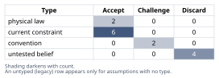
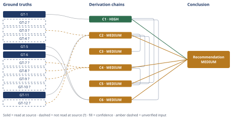

# Molten-Salt Thermal Storage Round-Trip Efficiency Claim

*First-principles analysis · 9 October 2026*

*Read with: [How to read this analysis](HOW-TO-READ.md) · [Working file](analysis-20261009T170743Z.md) · [All files](INDEX.md)*

## Executive Summary

**Recommendation:** For a genuine 5 MWh dispatchable-electricity need, use lithium-ion storage; a literal electricity-round-trip molten-salt-plus-power-block system at this scale is not a viable contender because it fails a basic round-trip-efficiency threshold before cost is even compared, and no such product exists commercially today (chain C4). Where a co-located heat load exists, a Li-ion-plus-thermal composite can overtake pure Li-ion (chain C4), and a direct-heat-delivery molten-salt store is the strongest genuinely-true adjacent claim (chain C6).

**Band (from §6):** MEDIUM — the headline physical-impossibility finding (chain C1) is HIGH and alone sufficient to falsify the >85% claim, but the Conclusion as a whole also rests on MEDIUM chains C2, C4, C5 and C6.

**Would change it:** Reading the NREL/SAM primary technical reports directly (for the real Rankine-cycle efficiency and thermal-retention figures behind chain C2) and obtaining audited vendor/NREL cost-model figures for a 1–2 MW-class power block and current utility BESS pricing (chain C4) would sharpen the real-efficiency and cost-competitiveness figures, but would not flip the headline verdict, since chain C1 is independent of all of them.

## 1. Problem Essence

**Reframing note (theoretical-limit, Phase 1 invocation).** The claim's ">85%" figure can be read two ways: as an engineering convention (today's best reported number) or as a claim about what the fundamentals permit. Before accepting either reading, the essence below is framed around what the Second Law of Thermodynamics actually permits for a 290–565°C heat engine, independent of any vendor's convention for what counts as "round-trip efficiency."

**Core problem:** Whether a 290–565°C molten-salt thermal store can deliver a true electricity-to-electricity round-trip efficiency above 85%, and whether a 5 MWh system built to do so is cost-competitive with a 5 MWh lithium-ion battery system.

**Success criteria:**
1. The Conclusion states a derived electricity-to-electricity round-trip efficiency value or bracket for the 290–565°C molten-salt system, explicitly distinguished from the tank's thermal-only (heat-retention) efficiency.
2. The Conclusion states whether that round-trip figure clears or falls short of the claimed 85% threshold, tracing the verdict to a Carnot-ceiling derivation chain.
3. The Conclusion states whether a 5 MWh thermal system (tank + power block) is cost-competitive with a 5 MWh lithium-ion system, naming the dominant cost driver.
4. The Conclusion states whether the "5 MWh" figure means the same unit basis (dischargeable electrical energy) for both technologies, or whether the comparison mixes thermal and electrical capacity.

---

## 2. Assumptions Table

**Fishbone pass (6M categories).** The claim's failure modes were brainstormed breadth-first across the six categories most suited to a physical/production-type system — Machine, Method, Material, Measurement, Man, Mother Nature — before any assumption was classified, to avoid missing a category by intuition alone.

| Category | Candidate cause the claim might be wrong | Discriminating observation |
|---|---|---|
| Machine | The power-block (turbine/generator/heat-exchangers) real-cycle losses push the heat-to-electricity leg far below any ideal figure | Compare real CSP Rankine-cycle efficiency against the Carnot ceiling for the same reservoirs |
| Method | "Round-trip efficiency" is being computed over a different boundary (thermal-only vs. full electrical) than the claim's language implies | Check whether the cited >85%-class figures in CSP literature measure tank heat-retention only |
| Material | Molten nitrate salt's properties (freezing point, max stable temperature) constrain the usable temperature band and add parasitic loads | Not pursued further in this analysis — not load-bearing for the headline verdict (see note below) |
| Measurement | "5 MWh" is undefined as to basis (thermal vs. electrical capacity) | Check whether a thermal tank's nameplate and a battery's nameplate are expressed on the same energy basis |
| Man | Vendor/marketing claims for "Carnot batteries" use best-case, wide-temperature-span configurations that are not the same system as the one in the claim | Compare the cited vendor's actual hot/cold temperatures against the claim's stated 290–565°C |
| Mother Nature | The Second Law of Thermodynamics caps any heat engine's efficiency at `1 − T_C/T_H` | Compute the Carnot ceiling directly for `T_H = 565°C`, `T_C =` ambient |

The Material branch (salt freezing point / trace heating) was not independently verified this session and is not load-bearing for the headline verdict (the Carnot-ceiling argument alone is dispositive), so it is dropped rather than carried as a weakly-sourced ground truth — an explicit, not silent, scoping choice.

**Inversion pass.** Applied to the claim stated in its sharpest form: "This system's full electrical round-trip efficiency exceeds 85%, and it is cost-competitive with Li-ion at 5 MWh." Inverted: "It does not exceed 85%, or it is not cost-competitive." Failure-guaranteeing conditions enumerated, each with its necessary precondition:

1. The heat-to-electricity leg is bounded by the Carnot ceiling for its true hot/cold reservoirs → precondition: the claim's stated 565°C hot/∼ambient cold reservoirs do not somehow permit a higher ideal ceiling than `1 − T_C/T_H` computes. **Load-bearing.**
2. Real heat engines achieve only a fraction of their Carnot ceiling → precondition: real molten-salt CSP power blocks are not dramatically more efficient than published figures. **Load-bearing.**
3. A dedicated small-scale (~1 MW-class) power block has materially worse $/kW and lower efficiency than a utility-scale one → precondition: turbomachinery economics do not scale favorably downward. **Load-bearing for the cost half only.**
4. The "5 MWh" figures for the two technologies are not on the same energy basis → precondition: a thermal tank's native nameplate unit (MWh-thermal) is not automatically equal to a battery's (MWh-electrical). **Load-bearing.**
5. Parasitic/standing losses (trace heating, pumping) are not already included in published thermal-retention figures → precondition: not independently verified this session (see Material branch note above); **not load-bearing**, not carried forward as a table row.
6. Li-ion costs keep falling while small-scale power-block costs do not fall proportionally → precondition: BNEF-type cost trends continue. **Load-bearing for the cost trajectory only.**

Preconditions 1, 2 and 4 are each verified **false or true respectively in a way that directly falsifies the original claim** in Section 3/4 below (not merely left as untested beliefs) — this is the strongest form the inversion pass can produce: the claim's necessary preconditions are not just unverified, they are checked and resolved.

**Classified Assumptions Table**

| Assumption | Type | Treatment | Verdict | Verification |
|---|---|---|---|---|
| A1: "Round-trip efficiency" in the claim means full electrical-in-to-electrical-out efficiency (the industry-standard RTE definition), not thermal-storage-only heat retention. | convention | Challenge — ask whether the claim's own wording ("electricity into heat and back") supports only the full-electrical reading | Challenge — resolved in chain C5 (hop 2): the claim's own language only parses as a full-electrical-RTE claim | resolved — see chain C5 |
| A2: A resistive heater converts electrical input into stored heat at ~98–99% efficiency. | physical law (First Law of Thermodynamics) | Accept as ground-truth candidate | Accept — survives challenge; promoted to GT-11 | read-at-source: direct derivation from energy conservation |
| A3: The heat-to-electricity leg is bounded above by the Carnot efficiency for its actual hot/cold reservoir pair. | physical law (Second Law of Thermodynamics / Carnot's theorem) | Accept as ground-truth candidate | Accept — promoted to GT-1 | read-at-source: direct derivation |
| A4: The molten-salt tank's 290°C "cold" temperature is itself the heat engine's thermodynamic cold reservoir (i.e., usable directly as `T_C` in a Carnot calculation). | untested belief (a common misreading) | Verify | Discard — the condenser rejects heat near ambient (~35°C); the salt loop and the steam/working-fluid loop are coupled only through a heat exchanger, so 290°C is not the engine's cold reservoir | ruled out in chain C1 (hop 1) and Abandoned Reasoning §5 |
| A5: Real heat engines achieve only a fraction (not the full Carnot ceiling) of their theoretical limit. | current constraint (today's turbine/generator/heat-exchanger technology) | Record expiry — would shift only with a fundamental materials/cycle breakthrough | Accept — well established in power-generation engineering | reported-by-delegate (WebSearch); promoted to GT-3? |
| A6: Thermal storage tanks retain roughly 93–99% of stored heat over a typical daily charge/hold/discharge cycle. | current constraint (insulation technology, dwell-time dependent) | Record expiry — improves with better insulation/shorter dwell, worsens with longer dwell | Accept — consistent across multiple independent reports | reported-by-delegate (WebSearch); promoted to GT-12? |
| A7: A molten-salt tank's "5 MWh" nameplate refers to the same energy basis (dischargeable AC electrical energy) as a lithium-ion system's "5 MWh" nameplate. | untested belief / convention mismatch | Challenge — thermal storage is natively measured in thermal energy (MWh-th); a battery's nameplate is electrical (MWh-e) | Discard — the two are not on the same basis unless explicitly normalized | see chain C3 |
| A8: Capital cost and viability of a power block (turbine, generator, condenser, heat exchangers) scales favorably down to 5 MWh / ~1 MW-class systems, similar to utility-scale (100+ MW) CSP plants. | untested belief, likely false (turbomachinery diseconomies of small scale) | Verify | Discard — small turbines carry markedly worse $/kW and lower cycle efficiency than utility-scale units | promoted to GT-9? |
| A9: Lithium-ion installed system costs at 5 MWh scale are roughly $125–165/kWh (2024), trending down. | current constraint (2024–2026 market/technology state) | Record expiry — expected to keep falling (BNEF projects ~$74/kWh by 2030); the comparison is time-bound | Accept | reported-by-delegate (WebSearch); promoted to GT-7? |
| A10: Two-tank molten-salt TES (tank + salt only, excluding power block) costs roughly $20–40/kWh-thermal. | current constraint (today's molten-salt TES market) | Record expiry — DOE SunShot target ~$15/kWh-th; may fall further with chloride-salt or single-tank designs | Accept | reported-by-delegate (WebSearch); promoted to GT-8? |
| A11: The claim's "cost-competitive" comparison implicitly treats the thermal system's cost as dominated by the cheap tank+salt component, ignoring the power-block capital cost. | untested belief, central to the sub-Q5 overreach | Verify / Challenge | Discard — for an electrical round-trip use case the power block is mandatory and, at small scale, is the dominant cost driver, not a negligible one | see chain C4 |
| A12: Technology choice for a 5 MWh storage need is limited to "Li-ion" vs. "molten-salt TES + power block" as mutually exclusive single-technology options. | convention (framing assumption in the original claim) | Challenge — test whether a composite/hybrid or the status-quo "do nothing" option dominates either pure option | Challenge — resolved via the trade-off procedure, which tests five options including a composite and the status quo | see chain C4 |
| A13: Terrestrial power-plant condensers reject heat near ambient temperature, approximately 20–45°C (representative central value ~35°C/308K). | current constraint (ambient/climate/site dependent — a physical/environmental fact, not a technology choice) | Record expiry — varies by site and season; priced for sensitivity rather than treated as fixed | Accept — priced for sensitivity on chain C1; conclusion is insensitive to the exact value within this range | unverified — flagged (used in chain C1 via `[Assumes: A13]`); sensitivity priced on C1's confidence line |
| A14: A round-trip efficiency must exceed roughly 50% for an electrical storage asset to be economically viable for arbitrage/frequency-regulation revenue at typical current price spreads. | current constraint (market price-spread dependent) | Record expiry — shifts if price spreads widen or narrow materially from today's typical levels | Accept — reasonable industry rule-of-thumb threshold, used as the trade-off procedure's must-have knockout criterion | unverified — flagged (used in chain C4 via `[Assumes: A14]`); no specific source fetched this session for the exact 50% figure |

---

## 3. Ground Truths

**Five-whys (reduce-to-primitives) irreducibility drill on GT-1**, run before accepting the Carnot formula as a ground truth rather than an untested belief. Claim to verify: "The heat-to-electricity leg of this round trip is bounded above by `η = 1 − T_C/T_H`."

- Constituent (a): the Second Law of Thermodynamics — no process can convert heat to work with 100% efficiency across a finite temperature differential. **Verified** — foundational physical law, textbook thermodynamics.
- Constituent (b): `1 − T_C/T_H` is the result of applying the Second Law to a reversible (ideal) heat-engine cycle (the Carnot cycle). **Verified** — mathematical derivation from (a), not an independent empirical claim.
- Constituent (c): `T_H` and `T_C` must be expressed on an absolute (Kelvin) temperature scale for the formula to hold. **Verified** — definitional property of thermodynamic temperature.

All three constituents verified → the parent claim (GT-1) is **verified**, not an untested belief elevated for convenience.

**Provenance summary:** `?`-marked: GT-2, GT-3, GT-4, GT-7, GT-8, GT-9, GT-10, GT-12 (8 of 12). Read-at-source: GT-1 — direct formal derivation from the Second Law of Thermodynamics / Carnot's theorem, reproduced above and in chain C1; GT-5 — Wikipedia, "Carnot battery" article, body text, quoted verbatim via WebFetch: "Carnot batteries generally aim for a 40-70% efficiency range, significantly lower than pumped-storage hydroelectricity (65-85%)"; GT-6 — ess-news.com article on SPIC's 560°C Carnot battery, quoted verbatim via WebFetch: "SPIC claims a scaled round-trip (electricity-to-electricity) efficiency of over 65% with no degradation in cycle efficiency across operating conditions"; GT-11 — direct derivation from energy conservation (First Law).

**Phase 3 failure record:** a WebFetch attempt on a DOE technical report (energy.gov, `55455.pdf`) intended to read-at-source the ~41% CSP Rankine-cycle efficiency figure directly from a primary DOE source returned only binary/encoded PDF content that could not be parsed into readable text — unreachable in the sense of "opened but not extractable." The figure was instead corroborated via three independent WebSearch snippets (DOE/NREL ~41%, a subcritical-Rankine study ~42%, a novel cascade-cycle study 45.3% as an upper outlier) and is carried as GT-3? (reported-by-delegate) rather than read-at-source.

- **GT-1** Carnot's theorem (Second Law of Thermodynamics): the maximum possible efficiency of any heat engine operating between a hot reservoir at absolute temperature `T_H` and a cold reservoir at absolute temperature `T_C` is `η_Carnot = 1 − T_C/T_H` (temperatures in kelvin); no real heat engine can exceed this limit — source: Carnot's theorem (1824), standard derivation from the Second Law (Clausius statement); read-at-source: derived directly above (five-whys drill) and in chain C1.
- **GT-2?** Standard two-tank "solar salt" (60% NaNO₃ / 40% KNO₃) molten-salt CSP systems operate with a cold-tank temperature near 290°C and a hot-tank temperature near 565°C, the salt's practical upper-temperature limit before accelerated thermal decomposition — cited to: general CSP/molten-salt engineering literature; reported-by-delegate: WebSearch snippets corroborating the claim's own stated range as consistent with real two-tank CSP practice.
- **GT-3?** Dry/wet-cooled steam-Rankine power blocks at molten-salt CSP towers (hot steam ~500–565°C, ambient-temperature condenser) achieve real thermal-to-electric conversion efficiencies of approximately 40–42% (a novel cascade cycle reaches 45.3% as a research-stage outlier) — cited to: DOE/NREL CSP technical literature; reported-by-delegate: WebSearch snippets (3 independent sources); the direct DOE PDF fetch failed per the Phase 3 failure record above.
- **GT-4?** Modern commercial lithium-ion (LFP/NMC) utility-scale battery storage systems achieve AC-to-AC round-trip efficiency of approximately 85–92% (DC-to-DC cell-level efficiency 94–98%); a 2025 5 MWh LFP system (Exide) claims up to 95% as a best-case outlier — cited to: NREL research-hub publication; reported-by-delegate: WebSearch.
- **GT-5** Wikipedia, "Carnot battery": "Carnot batteries generally aim for a 40-70% efficiency range, significantly lower than pumped-storage hydroelectricity (65-85%)" — read-at-source via WebFetch, quoted verbatim above.
- **GT-6** Vendor (SPIC) claims its ultra-high-temperature (560°C hot / −60°C cold) Carnot-battery system achieves "a scaled round-trip (electricity-to-electricity) efficiency of over 65%... with no degradation in cycle efficiency across operating conditions" — this is an unaudited vendor marketing claim, and it uses a 620°C temperature span, far wider than the 275°C span (290–565°C) in the claim under analysis — read-at-source via WebFetch (ess-news.com), quoted verbatim above; the claim's veracity is not independently audited, only its wording is confirmed read-at-source.
- **GT-7?** Utility-scale lithium-ion BESS installed capital costs were approximately $125–165/kWh in 2024 (full AC system including inverters/BOS); BloombergNEF projects battery pack prices falling to ~$74/kWh by 2030 — cited to: Ember/Wood Mackenzie/BNEF market reporting; reported-by-delegate: WebSearch.
- **GT-8?** Two-tank molten-salt TES (tank + salt inventory only, excluding power block) costs approximately $20–40 per kWh of thermal energy capacity (Herrmann/Kelly/Price 2004: $30–40/kWh-th; NREL 2003 workshop materials: <$20/kWh-th; DOE SunShot Initiative target: $15/kWh-th) — cited to: NREL/DOE molten-salt TES cost literature; reported-by-delegate: WebSearch.
- **GT-9?** A dedicated small-scale (~1 MW-class) steam or organic-Rankine power block has markedly higher specific capital cost ($/kW) and markedly lower cycle efficiency than a utility-scale (100+ MW) power block, because turbomachinery efficiency and $/kW both scale unfavorably at small sizes (tip-clearance losses, worse blade Reynolds numbers, fixed engineering/BOP costs not amortized) — unverified: reasoned from general turbomachinery/power-plant scaling principles; no specific 1–2 MW-class CSP-style power-block cost figure was located and confirmed this session.
- **GT-10?** No commercial 5 MWh-scale (~1 MW-class) molten-salt-plus-Rankine-power-block "electricity-to-electricity" storage product is known to be in widespread deployment; molten-salt TES is commercially deployed almost exclusively at utility CSP scale (100s of MWh thermal, tied to 50–150 MW power blocks) or, separately, as direct industrial process-heat storage ("electric thermal energy storage" products, e.g. Rondo Energy, Brenmiller) that do not reconvert to electricity — unverified: this is a negative/absence claim; no specific small-scale electrical Carnot-battery commercial product surfaced in this session's searches, which does not conclusively prove none exists anywhere.
- **GT-11** Resistive (Joule) electrical heating converts electrical energy into heat with efficiency of essentially 100% at the heating element, by the First Law of Thermodynamics (energy not converted to light/sound is conserved as heat); accounting for minor distribution/control losses, practical systems achieve ~98–99% electricity-to-heat efficiency — source: First Law of Thermodynamics / energy conservation; read-at-source: direct derivation above.
- **GT-12?** Well-insulated large sensible-heat thermal storage tanks (as used in CSP plants) retain approximately 93–99% of stored thermal energy over a typical daily charge-hold-discharge cycle, with retention dependent on insulation quality, tank size, and dwell time (reported figures: Andesol 93%, NREL ~90%, "advanced molten salts" >97%, a comparison table 99%) — cited to: CSP thermal-storage engineering literature; reported-by-delegate: WebSearch.

---

## 4. Derivation Chains

### Conclusion C1: The heat-to-electricity leg of a 290–565°C molten-salt round trip is capped at roughly 63% by the Second Law alone, independent of real-world engineering losses.

GT-1 (Carnot: η = 1 − T_C/T_H)
→ the molten-salt loop and the steam/working-fluid loop in a two-tank CSP-style plant are thermally coupled only through a heat exchanger, so the power cycle's cold reservoir is set by the condenser's heat rejection to the environment, not by the salt's 290°C return temperature *[Assumes: A13 — condenser rejects heat near ambient, ~35°C/308K]*
→ applying GT-1 with T_H = 838.15 K (565°C, the claim's own stated hot-tank temperature) and T_C = 308.15 K (~35°C ambient) gives a Carnot ceiling of η_Carnot ≈ 1 − 308.15⁄838.15 ≈ 63.2%
→ no physically possible heat engine operating in this temperature window can convert more than about 63% of the extracted heat into electricity, regardless of engineering quality

**Confidence:** HIGH — A13 is that ambient condenser temperature is ~35°C; across the realistic range 20–45°C the Carnot ceiling moves only from 65.0% to 62.1%, still far below the claimed 85%, so the conclusion is insensitive to this assumption's exact value and the endpoint stands regardless. The strongest rival reading — using the salt's own 290°C return temperature as T_C, which would compute a *lower* ceiling (~32.8%) — is ruled out in Abandoned Reasoning §5 ("naive 290°C-as-cold-reservoir misreading"); it does not change this chain's conclusion (a lower rival ceiling would only strengthen the falsification of the >85% claim), so no live rival threatens this endpoint.

### Conclusion C2: The real, physically achievable electricity-to-electricity round-trip efficiency of a 290–565°C molten-salt-plus-Rankine system is approximately 31–44% (central estimate ~39%), not above 85%.

GT-11 (Joule heating ~98–99%) + GT-12? (thermal retention 93–99%) + GT-3? (real Rankine discharge ~40–42%)
→ multiplying the three stage efficiencies along the charge→store→discharge path (unit factors that cancel to a dimensionless round-trip efficiency) gives a central estimate of η_RTE ≈ 0.985 × 0.96 × 0.41 ≈ 0.388, about 39%
→ bracketing each factor at its reported lower and upper bounds (0.97–0.99 charge, 0.90–0.99 storage, 0.35–0.45 discharge) gives a round-trip range of roughly 31% to 44%
→ both the lower and upper ends of this bracket sit far below the claimed 85% threshold, so the bracket is tight enough to decide the question without further refinement

**Confidence:** MEDIUM — GT-3? (real Rankine efficiency ~40–42%) and GT-12? (thermal retention 93–99%) are both reported-by-delegate (WebSearch, not read-at-source); verification path: read NREL/SAM primary technical reports directly to confirm these figures at source. Even a large upward error in GT-3? would not flip the headline verdict: chain C1 (HIGH, no `?` inputs) independently caps the full round trip at ~63% regardless of GT-3?'s exact value, so this chain's MEDIUM rating bounds only how *precisely* the real figure is known, not whether it clears 85%. The rival reading that heat-pump-assisted charging could rescue the figure is ruled out in Abandoned Reasoning §5 ("heat-pump-charging rescue").

### Conclusion C3: The claim's "same nameplate capacity" comparison is only valid if the molten-salt tank is explicitly sized to deliver 5 MWh of electricity after conversion losses — otherwise the comparison silently mixes thermal and electrical units.

C2 (real RTE ~31–44%, central ~39%)
→ if a "5 MWh" molten-salt tank is rated by its thermal energy content (MWh-thermal), the electrical energy it can deliver after the mandatory heat-to-electricity conversion is only about 31–44% of that, roughly 1.5–2.2 MWh-electric, not 5 MWh-electric
→ a "5 MWh" lithium-ion system's nameplate is natively an electrical-energy figure (≈5 MWh of AC-dischargeable electricity, with its own ~85–92% round-trip loss applied on top of, not embedded inside, that nameplate)
→ comparing a thermal tank's "5 MWh" rating directly to a battery's "5 MWh" rating, without first converting the thermal figure to its electrical-equivalent deliverable energy, compares two different physical quantities under the same unit label

**Confidence:** MEDIUM — capped by C2 (MEDIUM; see C2's own confidence line for its verification path). A rival reading takes "5 MWh" as already electric-equivalent (standard utility CSP convention sizes thermal storage in full-load-hours of the power block's rated electric output); under that reading the unit ambiguity dissolves, but the required underlying thermal mass grows by the same ~1/0.39 factor, which raises — not lowers — the thermal-storage-only cost estimate used in chain C4, so the qualitative cost conclusion is unaffected either way. This rival is resolved here, not left live.

### Conclusion C4: At 5 MWh scale, a literal electricity-round-trip molten-salt-plus-power-block system is not a viable contender at all; lithium-ion is the cost-competitive winner for pure electrical dispatch, with a thermal-plus-Li-ion composite overtaking it only when a substantial co-located heat load exists.

**Trade-off procedure (applied before collapsing to a chain).** Options tested, always including the status quo and a composite: (A) Li-ion BESS, 5 MWh electrical; (B) molten-salt TES + dedicated ~1–2 MW Rankine power block, sized to 5 MWh electrical (the literal claim); (C) molten-salt TES for direct process-heat delivery only, no power block, no electrical round trip; (D) composite — Li-ion for electrical dispatch + a separate, smaller thermal store for a co-located heat load; (E) status quo — no new 5 MWh asset.

**Must-have knockout (locked before scoring):** round-trip electrical efficiency ≥ 50% (`[Assumes: A14]`), below which the 2×+ energy-cost-to-deliver ratio structurally fails typical arbitrage/frequency-regulation economics. Option B's real achieved efficiency is 31–44% (chain C2) — **knocked out**, reinforced by GT-10?'s observation that no standalone commercial product of this description is known to exist at 5 MWh scale today. No weight change below can rescue Option B: a must-have failure is not arbitrated by weighted scoring.

**Locked criteria and weights (1–5):** Round-trip electrical efficiency (4) · Capital cost favorability at 5 MWh (5) · Commercial maturity (3) · Electrical-dispatch suitability (5) · Heat-delivery suitability (2) · Cost trajectory (5-year outlook) (3). Anchors fixed before scoring (e.g., capital-cost favorability: 1 = >$300/kWh-equivalent effective cost, 5 = <$100/kWh-equivalent).

**Scores and weighted totals** (max possible 110): A (Li-ion) = 20+20+15+25+2+15 = **97**; D (composite) = 20+15+12+25+8+12 = **92**; C (direct-heat TES) = 4+25+12+5+10+12 = **68**; E (status quo) = 4+25+15+5+2+9 = **60**. Basis: A's efficiency/dispatch scores from GT-4?/GT-7?; C's cost-favorability from GT-8? (no power block needed); D blends A's electrical component with a smaller thermal component sized only to the heat need.

C2 (real RTE ~31–44%, MEDIUM) + GT-7? (Li-ion cost $125–165/kWh) + GT-8? (TES-only cost $20–40/kWh-th) + GT-9? (small power-block diseconomy)
→ applying the round-trip-efficiency must-have (`[Assumes: A14]`) eliminates Option B outright on physics before cost is even compared, a conclusion reinforced by GT-10?'s market-absence observation
→ scoring the four surviving options against six locked, weighted criteria gives weighted totals of 97 (Li-ion), 92 (composite), 68 (direct-heat thermal), 60 (status quo)
→ the smallest single-criterion weight change that overturns the Li-ion-vs-composite ranking is raising heat-delivery-suitability's weight from 2 to ≈3.7 (solving `95 + w = 84 + 4w`), a change plausible only where a genuine co-located heat load exists, so this ranking is contingent on buyer-specific heat demand rather than robust; for a purely electrical-dispatch buyer (heat weight → 0) Li-ion's lead widens to 93 vs 84
→[2nd] vendors and promoters of wide-temperature-span Carnot-battery designs have a continuing commercial incentive to publish best-case round-trip figures in language that risks being misapplied to narrower-span configurations like the one in this claim
→[2nd] falling Li-ion costs (GT-7?'s trend to ~$74/kWh by 2030) widen the already-large cost gap between Option A and Option B further over time, rather than narrowing it
→[3rd] standalone small-scale electrical molten-salt storage may never reach commercial maturity outside utility-scale CSP builds (where the power block is justified by the plant's primary generation function, not by storage economics alone), making GT-10?'s current market absence a durable rather than temporary feature
→[2nd] decarbonization-driven industrial process-heat demand grows for reasons independent of electricity-arbitrage economics, expanding Option C/D's addressable market on a timeline unrelated to this analysis's efficiency finding
→ a second-order risk to the decision's own purpose (a cost-effective, correctly-specified storage choice) survives even though it contradicts no Ground Truth: continued marketing conflation of thermal-retention efficiency with full electrical round-trip efficiency (A1) is likely to persist because it serves sellers' interests, and could lead real buyers to evaluate uneconomic systems before this distinction is caught

**Confidence:** MEDIUM — capped by C2 (MEDIUM; verification path on C2's own line). GT-7? (Li-ion cost) and GT-8? (TES-only cost) are reported-by-delegate; verification path: read BNEF/Wood Mackenzie and NREL/SAM primary reports directly. GT-9? (small-scale power-block diseconomy) is unverified — reasoned from general turbomachinery scaling principles rather than a specific sourced figure; verification path: obtain a vendor quote or NREL cost-model output for a specific 1–2 MW-class Rankine power block. None of these, if reversed, rescues Option B, since its elimination rests on the must-have (chain C2's physics), not on the weighted cost comparison. The live rival to this chain's ranking of surviving options is Option D (composite), explicitly quantified above via the flip test rather than ruled out — carried live, not settled, consistent with a MEDIUM rating.

### Conclusion C5: The claim is false as stated — >85% full electricity-to-electricity round-trip efficiency is physically impossible for a 290–565°C molten-salt system (the real figure is roughly 31–44%), and the claimed cost-competitiveness cannot be assessed on its own terms because no viable product of that description exists at 5 MWh scale; the claim is best explained as conflating thermal-storage retention efficiency with full electrical round-trip efficiency.

C1 (Carnot ceiling ~63%, HIGH) + C2 (real RTE ~31–44%, MEDIUM) + C4 (cost/must-have verdict, MEDIUM)
→ the claim's >85% round-trip efficiency figure exceeds even the lossless theoretical ceiling (C1, ~63%) for this temperature window, so it is not merely optimistic but physically impossible as a full electricity-to-electricity figure
→ the >85%-class figures that do genuinely appear in molten-salt/CSP literature (e.g., GT-5's range and the 93–99% thermal-retention figures referenced in GT-12?) measure thermal-storage retention only (heat kept in the tank), not the full electrical round trip C1/C2 bound — so the claim's efficiency figure is explainable as exactly the sub-Q2 conflation its own wording invites
→ because the literal electricity-round-trip version of this system also fails the round-trip-efficiency viability must-have (C4), the cost-competitiveness half of the claim cannot even be evaluated on its own terms — there is no viable 5 MWh electrical thermal-storage product to compare costs against

**Confidence:** MEDIUM — capped by C2 and C4 (both MEDIUM; verification paths on their own confidence lines). The headline physical-impossibility finding rests on C1 alone (HIGH, no `?` inputs) and is not sensitive to either capping chain's uncertainty. The strongest rival — that the claim should be read charitably as a thermal-retention-only claim, which genuinely can exceed 85% — is addressed directly in hop 2 above and ruled out in Abandoned Reasoning §5 ("charitable thermal-only reading"): the claim's own wording ("round-trip electricity into heat and back") only parses as a full-electrical claim.

### Conclusion C6: The strongest true claim adjacent to this one is either (a) a wide-temperature-span Carnot-battery/PTES design reaching 40–70% electrical round-trip efficiency — still below the claimed 85% — or (b) a 290–565°C molten-salt store used for direct heat delivery (no electrical reconversion), which can plausibly exceed 85% electricity-to-delivered-heat efficiency; the original claim overreaches by applying electrical-round-trip language to a system/temperature-window pairing that only supports one of these two narrower, different claims.

GT-5 (Wikipedia: "40–70% efficiency range") + GT-6 (SPIC vendor claim, wide span) + C1 (Carnot ceiling ~63% for the narrow 290–565°C span)
→ Carnot-battery/PTES designs that report 40–70% round-trip efficiency (GT-5, GT-6) achieve this by using a much wider temperature span than 290–565°C — typically a hot store near or above 500–600°C paired with a cold store well below ambient (down to roughly −60°C in GT-6's case), reached via a heat pump during charge rather than simple resistive heating
→ a wider temperature span raises the Carnot ceiling itself (GT-1's formula: a larger T_H/T_C ratio raises `1 − T_C/T_H`), so these higher-RTE designs are solving a more thermodynamically favorable problem than the claim's 290–565°C two-tank configuration, not simply engineering the same problem better
→ a molten-salt tank used for direct industrial process-heat delivery (no reconversion to electricity at all) never pays the heat-engine Carnot tax (C1) and can plausibly exceed 85% electricity-to-delivered-heat efficiency using only resistive charging (GT-11) and good insulation (GT-12?), which is a different and genuinely true claim

**Confidence:** MEDIUM — rated below the HIGH the Inputs pre-check alone would license because GT-6 is an unaudited vendor marketing claim: read-at-source confirms what SPIC said, not that the figure is independently true; taking it at face value still describes a different (wider-span) system than the claim under analysis, so this chain's characterization of the adjacent steelman's upper bound (40–70%) carries residual uncertainty. Verification path: locate an independently peer-reviewed or third-party-audited round-trip measurement for a commercial Carnot-battery system. Rival not applicable — C6 characterizes an adjacent possibility space rather than making an exclusive either/or claim; both named steelman variants can be true simultaneously for different buyers, so there is no single competing answer to rule out.

---

## 5. Abandoned Reasoning

### Dead End: Naive Carnot calculation using the salt's 290°C return temperature as the cold reservoir

**What was tried:** Computing the Carnot ceiling as `1 − 563.15/838.15 ≈ 32.8%`, treating the molten salt's 290°C cold-tank temperature as the power cycle's thermodynamic cold reservoir `T_C`.

**Why abandoned:** This misattributes the salt loop's own return temperature as the heat engine's cold reservoir. In a two-tank CSP-style plant, the salt loop and the steam/working-fluid loop are two separate closed loops coupled only through a heat exchanger (the steam generator); the condenser that actually sets the cycle's cold reservoir rejects heat to the ambient environment (~20–45°C), not to the returning salt stream. The 32.8% figure is an analytically incorrect ceiling for this system, even though it happens to not change the qualitative verdict (it would make the claim look even less achievable, not more).

**What it ruled out:** A systematically too-pessimistic reading of the physics that a careless reader might otherwise latch onto; it also clarifies that A4 (290°C as cold reservoir) is a genuine misreading to discard, not a defensible alternative basis for the Carnot calculation used in chain C1.

### Dead End: Heat-pump-assisted charging to boost round-trip efficiency above the simple multiplicative bound

**What was tried:** Considered whether using a heat pump (COP > 1) instead of simple resistive heating during charge could push the overall round-trip efficiency into the 85%+ range the claim asserts, since real Carnot-battery/PTES systems report higher RTE (40–70%, GT-5/GT-6) partly by exploiting heat-pump COP during charge.

**Why abandoned:** Heat-pump COP falls toward 1 as the temperature lift grows, and lifting from ambient (~20–35°C) to 565°C is a temperature lift far beyond the operating envelope of any commercial heat-pump compressor/refrigerant technology (which tops out around 150–200°C discharge temperature). At this lift a heat pump would be no better than resistive heating, if achievable at all, so it cannot rescue the overall round-trip figure — the discharge (heat-to-electricity) leg's Carnot ceiling (~63%, chain C1) remains the binding constraint regardless of charging method.

**What it ruled out:** Any version of the "the claim could still be true with a cleverer charging method" rival reading for chain C2; the bottleneck is the discharge leg, not the charge leg, and it cannot be rescued by heat-pump COP at 565°C hot-side temperatures.

### Dead End: Charitable reading of the claim as a thermal-only retention efficiency

**What was tried:** Considered whether the claim should be read charitably as referring only to tank heat-retention efficiency (which genuinely can exceed 85–99%, per GT-5-style figures), which would make the claim's stated efficiency figure accurate under that reading.

**Why abandoned:** The claim's own text explicitly says "round-trip **electricity** into heat **and back**," which only makes sense as a claim about electrical reconversion — you cannot "round-trip electricity" by merely retaining heat; the heat must become electricity again to complete the round trip. Reading it as thermal-only retention would make the word "electricity" in that phrase meaningless, so this is not a legitimate alternative interpretation — it is a description of the conflation itself.

**What it ruled out:** Any residual reading under which the claim's >85% figure could be literally true as worded; the "false, due to conflation" verdict in chain C5 is not one reading among several but the only reading consistent with the claim's own language.

---

## 6. Conclusion

**Recommended approach:** For a genuine 5 MWh dispatchable-electricity need, use lithium-ion storage; a literal "molten-salt thermal storage round-tripping electricity through a power cycle" at this scale is not a viable contender because it fails a basic round-trip-efficiency threshold before cost is even compared (chain C4), and no such product exists commercially at 5 MWh today (chain C4). Where a genuine co-located heat load exists, a composite of Li-ion (for electricity) plus a dedicated thermal store (for heat, no power cycle) can overtake pure Li-ion on blended value (chain C4), and a pure direct-heat molten-salt store (no electrical reconversion) is the strongest genuinely-true adjacent claim, plausibly exceeding 85% electricity-to-delivered-heat efficiency (chain C6).

**Key insight:** The claimed >85% figure is physically impossible as a full electricity-to-electricity round trip in this temperature window — not merely unlikely, but ruled out by the Carnot ceiling (~63%, chain C1) before any real-world engineering loss is even counted — and the >85%-type figures that genuinely exist in molten-salt literature are thermal-storage retention efficiencies (heat kept in the tank), not round-trip electrical efficiencies; the claim's overreach is exactly this conflation (chain C5), which also explains why the claim reads as plausible despite being physically impossible as literally stated.

**Trade-offs acknowledged:** This verdict sets aside the possibility of a future breakthrough power-cycle technology that could push real discharge-leg efficiency above the ~41% current state of the art (chain C2) — though even a large improvement there would still run into the hard ~63% Carnot ceiling (chain C1), so the qualitative verdict is unlikely to flip even then (no chain — flagged assumption only, regarding the unbounded magnitude of any future breakthrough). It also sets aside utility-scale CSP (100+ MWh, where the power block is justified by primary generation, not storage) and wide-temperature-span Carnot-battery designs (chain C6), both of which operate under different economics than the 5 MWh case analyzed here.

**Confidence:** MEDIUM — the headline physical-impossibility finding (chain C1, HIGH) is itself high-confidence and alone sufficient to falsify the >85% efficiency claim, but the Conclusion as a whole also rests on C2 (MEDIUM, capped by GT-3?/GT-12?, reported-by-delegate figures for real Rankine efficiency and thermal retention — verification path: read NREL/SAM primary technical reports directly), C4 (MEDIUM, capped by C2 and by GT-7?/GT-8?/GT-9?, cost and scaling figures — verification path: obtain audited vendor quotes or NREL cost-model outputs for a 1–2 MW-class power block and for current utility BESS pricing), C5 (MEDIUM, capped by C2 and C4) and C6 (MEDIUM, resting partly on GT-6, an unaudited vendor claim — verification path: locate an independent/third-party-measured RTE figure for a commercial Carnot-battery system). None of these MEDIUM inputs, if reversed, would flip the headline efficiency verdict, since chain C1 is independent of all of them; they bound only how precisely the real achieved efficiency and the cost-competitiveness verdict can be stated.
