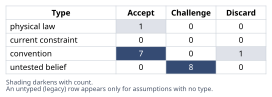
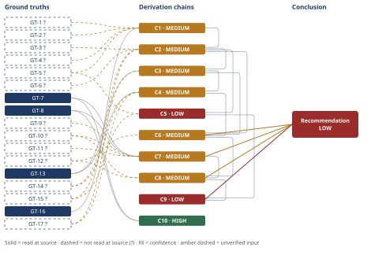

# Molten-Salt Thermal Storage vs. Lithium-Ion at 5 MWh

*First-principles analysis · 10 October 2026*

*Read with: [How to read this analysis](HOW-TO-READ.md) · [Working file](analysis-20261010T014558Z.md) · [All files](INDEX.md)*

## Executive Summary

**Recommendation:** At 5 MWh scale, choose lithium-ion for electricity-to-electricity storage — it beats a resistive-charge, power-cycle molten-salt TES system by roughly 8x on levelized cost regardless of duration (chain C8). Choose molten-salt TES's thermal-only pathway for direct heat delivery, where it is roughly at cost parity with Li-ion and gains a growing edge as cycling frequency rises above about once per day (chain C8).

**Band (from §6):** LOW (chain C9)

**Would change it:** Opening the unreachable grid-scale cost-literature source behind chain C9, and verifying the unbounded-cycle-life ground truth behind chain C8, would resolve the two caveats currently capping confidence at LOW (chains C8, C9).

## 1. Problem Essence

**Core problem:** What does a 5 MWh molten-salt thermal energy storage (TES) system actually cost to build, per kWh of capacity and per kWh of energy it delivers over its life, when the cost is rebuilt from physical and fabrication first principles rather than read off an industry benchmark — and under which combinations of discharge duration, cycling frequency, and delivered-energy form (heat vs. re-electrified power) does that figure beat or lose to lithium-ion battery storage?

**Success criteria:**
1. A $/kWh installed-capital figure for the 5 MWh system is derived from named physical quantities (salt mass, tank geometry, steel mass, insulation area) and named unit costs, not asserted from a published benchmark — checkable by confirming every arithmetic step in the Conclusion's cited chains recomputes from the Ground Truths.
2. A levelized $/kWh-delivered figure is produced for at least one explicit charge/discharge conversion path, with the assumed round-trip efficiency stated and traced to its constituent factors — checkable by confirming the Conclusion names the conversion path and the RTE chain it rests on.
3. The comparison against lithium-ion states the conditions (duration, cycling frequency, delivered-energy form, scale) under which each technology is cheaper, not a single unconditional winner — checkable by confirming the Conclusion's recommended approach names at least two distinct regimes with different winners.
4. Genuine uncertainties (salt price, small-scale power-cycle efficiency, utilization frequency, grid-scale extrapolation) are carried as explicit numeric brackets rather than collapsed into one unhedged number — checkable by confirming every headline figure in the Conclusion carries a bracket and a named dominant uncertainty.

## 2. Assumptions Table



| Assumption | Type | Treatment | Verdict | Verification |
|------------|------|-----------|---------|--------------|
| A-1: Because bulk nitrate salt is a cheap commodity, molten-salt TES should be cheaper per kWh than Li-ion | convention (reasoning-by-analogy to commodity cheapness) | explicitly challenge before use | Discard — contradicted by chains C1/C2: salt is <2% of installed cost at 5 MWh scale, fabrication/EPC dominates | see chains C1, C2 |
| A-2: "5 MWh" denotes thermal energy stored in the salt (MWh_th), not net electrical output | convention (scoping choice) | explicitly challenge before use | Accept — the quantity directly computable from salt mass/cp/ΔT; electric-equivalent figures are derived from it with explicit RTE in C4/C6 | scoping decision, not independently verifiable |
| A-3: A ~4-hour charge/discharge duration (≈1.25 MW) is representative for sizing power-scaled BOP components | convention | explicitly challenge before use | Accept — a common grid-storage duration bucket; energy-scaled costs (salt, tank volume, insulation) do not depend on this choice | sensitivity noted in Phase 5 |
| A-4: Vessel/tank fabrication carries a largely size-independent minimum mobilization/QA/field-erection cost floor at 5 MWh scale | untested belief | verify or flag | Challenge — unverified — flagged; load-bearing for C2/C5/C9 | unverified — flagged (GT-15?) |
| A-5: Realistic utilization is ≈300 cycles/year (bracket 100-365), not the theoretical daily maximum or seasonal-only use | convention | explicitly challenge before use | Accept — wide bracket carried through; identified in Phase 5 as the most load-bearing swing assumption | bracket used to avoid false precision; see Phase 5 sensitivity |
| A-6: O&M is well-approximated as a flat percentage of installed capital per year (1.5% TES-thermal, 3% TES-power, 2% Li-ion) | untested belief | verify or flag | Challenge — unverified — flagged; real O&M depends on site-specific labor/maintenance contracts | unverified — flagged |
| A-7: Financing costs, discounting, and technology price-decline trajectories are excluded (undiscounted, present-cost basis) | convention | explicitly challenge before use | Accept, with caveat — deliberate first-order simplification; discounting would further favor Li-ion since its deferred replacement capex is discounted and historically falling in price | flagged explicitly in Conclusion trade-offs |
| A-8: Ambient heat-rejection temperature for the Carnot-limit calculation is ≈40°C (313 K) | convention (representative value) | explicitly challenge before use | Accept — standard assumption for air-cooled rejection in a moderate climate; minor sensitivity | unverified — flagged, low sensitivity (Phase 5 recompute) |
| A-9: Carbon steel is unsuitable above ≈425°C, requiring stainless (e.g. 347H) for hot-tank molten-salt service | physical law (materials-science constraint) | accept as ground-truth candidate | Accept — promoted to GT-6 | promoted to GT-6? |
| A-10: Molten-salt TES degradation is governed by thermal/mechanical wear rather than electrochemical cycling, so cycle life is effectively unbounded relative to calendar life | untested belief | verify or flag | Challenge — unverified — flagged; load-bearing for C6/C8's cycling-frequency argument and identified in Phase 5 as the flip-sensitive assumption for the thermal-only parity claim | unverified — flagged (GT-12?) |
| A-11: Installed utility-scale Li-ion system cost is ≈1.5-2.5× the raw cell/pack price (inverter, BOS, EPC, soft costs) | untested belief | verify or flag | Challenge — unverified — flagged; load-bearing for C7 | unverified — flagged (GT-9?) |
| A-12: A small sub-1 MWe ORC/power-cycle unit reaches only ≈18-32% absolute thermal-to-electric efficiency at this salt temperature | untested belief (engineering generalization) | verify or flag | Challenge — unverified — flagged; load-bearing for C3/C4/C8; bounded above by the Carnot physical limit in GT-13 | unverified — flagged (GT-14?) |
| A-13: A 15% heel/freeboard margin on theoretical salt mass is a representative design margin | convention | explicitly challenge before use | Accept — standard engineering margin for unusable salt and tank headspace | unverified — flagged |
| A-14: A 1.3-1.6× EPC/engineering/contingency markup is representative for a small, first-of-kind, high-temperature industrial build | convention | explicitly challenge before use | Accept — typical range for non-standard small industrial builds | unverified — flagged |
| A-15: A small sub-1 MWe ORC unit's installed cost is ≈$2,000-4,000/kW, reflecting no scale economies | untested belief | verify or flag | Challenge — unverified — flagged; load-bearing for C3 | unverified — flagged |
| A-16: Thermal retention over a realistic storage interval is ≈95%, and heat-exchanger delivery effectiveness is ≈97% | untested belief | verify or flag | Challenge — unverified — flagged; load-bearing for C4's thermal-only RTE figure | unverified — flagged |
| A-17: Li-ion's cell-manufacturing learning curve will keep compounding faster than TES's general-industrial fabrication/EPC cost floor declines | untested belief | verify or flag | Challenge — unverified — flagged; introduced by the second-order extension on chain C8 | unverified — flagged |

## 3. Ground Truths

- **GT-1?** Measured specific heat of NaNO3-KNO3 (60:40 "solar salt") decreases from ≈1.57 to ≈1.49 J/g·K (≈1.57-1.49 kJ/kg·K) between 250°C and 425°C — cited to: a peer-reviewed specific-heat measurement study (Nanoscale Research Letters / PMC article on NaNO3-KNO3 and nanofluids); reported-by-delegate: WebSearch summary — cited source not opened by this analysis.
- **GT-2?** Commercial power-tower CSP plants using Solar Salt operate with a cold-tank temperature of ≈290°C and a hot-tank temperature of ≈565°C (ΔT ≈275 K) — unverified: recalled industry-standard figure (e.g. Gemasolar/Crescent Dunes-class designs); no source opened in this session.
- **GT-3?** Solar Salt liquid density follows approximately ρ(kg/m³) ≈ 2090 − 0.636·T(°C) (Zavoico-type correlation), giving ≈1700-1900 kg/m³ over the GT-2 operating range — unverified: recalled from Sandia/NREL-era CSP engineering literature; Phase 3 failure record: attempted to open `nrel.gov/docs/fy08osti/43336.pdf`, `research-hub.nrel.gov`, and `atb.nrel.gov` — all three returned `getaddrinfo ENOTFOUND` (DNS resolution failure in this sandboxed network); source unreachable.
- **GT-4?** A 2024 reported market price for solar salt (nitrate blend) is ≈$140 per metric ton — reported-by-delegate: WebSearch summary of market-price sources — cited source not opened by this analysis.
- **GT-5?** CSP cost-modeling literature (e.g. NREL/SAM-era component cost models, Turchi/Kolb-type studies) has historically assumed solar-grade nitrate salt costs in the range of ≈$450-700 per metric ton — unverified: recalled; same Phase 3 failure record as GT-3 (NREL-hosted SAM/cost-model documents unreachable — DNS failure).
- **GT-6?** Carbon steel loses structural strength above ≈425°C and is unsuitable for hot-tank molten-salt service, which instead requires stainless alloys (e.g. 347H) — unverified: recalled materials-engineering constraint, promoted from assumption A-9; no source opened this session, though this is a textbook metallurgical limit rather than a contested figure.
- **GT-7** The 2024 global volume-weighted average lithium-ion battery pack price fell to a record low of $115/kWh (a 20% drop from 2023) — source: BloombergNEF press release, fetched directly; read-at-source: the fetched page's own text, quoted verbatim ("Lithium-ion battery pack prices dropped 20% from 2023 to a record low of $115 per kilowatt-hour").
- **GT-8** The 2025 stationary/grid-storage lithium-ion battery pack price fell ≈45% year-on-year to $70/kWh, becoming the lowest-priced segment for the first time — source: reneweconomy.com.au article citing BNEF's 2025 survey, fetched directly; read-at-source: the fetched page's own text, quoted verbatim ("$70/kWh" for 2025 stationary storage, "45 per cent lower than in 2024").
- **GT-9?** Installed utility-scale battery energy storage system (BESS) cost typically runs ≈1.5-2.5× the raw cell/pack price once inverter, balance-of-system, and EPC/soft costs are added — unverified: recalled cost-engineering heuristic; no source opened this session.
- **GT-10?** Lithium-ion cells typically reach 80% capacity retention after ≈3,000-6,000 charge/discharge cycles, with calendar life typically ≈10-15 years — originally reported-by-delegate (WebSearch summary of cmbatteries.com / everexceed.com / arXiv survey material); Phase 3 failure record: attempted to open the underlying PMC table directly (`pmc.ncbi.nlm.nih.gov/articles/PMC11403493/table/tbl1`) — the fetch returned only a reCAPTCHA bot-verification page with no technical content; source unreachable (bot-protection block); remains reported-by-delegate / unverified.
- **GT-11?** Grid-connected lithium-ion battery storage typically achieves an AC-AC round-trip efficiency of ≈85-92% — unverified: recalled industry-standard figure; no source opened this session.
- **GT-12?** Molten-salt TES degradation is governed primarily by thermal/mechanical wear (insulation, tank, pumps, valves) rather than electrochemical cycling, so its cycle life is effectively unbounded relative to its 20-30-year calendar life — unverified: recalled CSP-industry understanding, promoted from assumption A-10; no source opened this session; identified in Phase 5 as the single most flip-sensitive ground truth in this analysis.
- **GT-13** For any heat engine operating between a hot reservoir at absolute temperature T_h and a cold reservoir at T_c, efficiency is bounded by the Carnot limit η ≤ 1 − T_c/T_h — physical law (Second Law of Thermodynamics); read-at-source: not applicable — a physical law is accepted directly as a ground-truth candidate per the Phase 2 treatment for that type, not cited to a document.
- **GT-14?** Small sub-1 MWe organic Rankine cycle (ORC) power units realize a materially lower fraction of the Carnot ceiling than utility-scale steam turbines, due to higher parasitic losses and less efficient components at small scale — unverified: recalled engineering generalization, promoted from assumption A-12; no source opened this session; load-bearing for chains C3, C4, C8.
- **GT-15?** Industrial pressure-vessel/storage-tank fabrication carries a minimum mobilization, certified-welding, and NDE/QA cost floor that is largely independent of vessel size, because crew mobilization and qualification testing cannot be fractionally scaled down — unverified: recalled industrial cost-estimation heuristic, promoted from assumption A-4; no source opened this session; load-bearing for chains C2, C5, C9.
- **GT-16** 1 kWh = 3.6 MJ = 3,600 kJ — definitional physical-unit conversion; read-at-source: not applicable — an SI unit definition, accepted directly.
- **GT-17?** Electrical resistance (Joule) heating converts electrical energy to thermal energy at ≈97-99% efficiency, with losses limited to heater/standby insulation losses — unverified: textbook electrical-engineering fact not re-verified against a specific source in this session; load-bearing for chain C4.

**Provenance summary:**
```text
?-marked: GT-1, GT-2, GT-3, GT-4, GT-5, GT-6, GT-9, GT-10, GT-11, GT-12, GT-14, GT-15, GT-17 (13 of 17)
Read-at-source: GT-7 — BloombergNEF press release (fetched), quoted verbatim: "dropped 20% from 2023 to a record low of $115 per kilowatt-hour"
Read-at-source: GT-8 — reneweconomy.com.au article (fetched), quoted verbatim: "$70/kWh" (2025 stationary storage), "45 per cent lower than in 2024"
Read-at-source (not a citation, type-exempt): GT-13 (physical law), GT-16 (unit definition)
Not read — turn budget: none remaining; every unsuffixed GT (GT-7, GT-8, GT-13, GT-16) has its read-at-source location or type-exemption named above; every ?-marked GT either carries a Phase 3 failure record (GT-3, GT-5, GT-10) naming the unreachable source and reason, or is disclosed as not attempted this session (GT-1, GT-2, GT-4, GT-6, GT-9, GT-11, GT-12, GT-14, GT-15, GT-17) because no specific URL for it was identified or because it recurs in the same unreachable NREL/SNL domain family already recorded under GT-3/GT-5
```

## 4. Derivation Chains



### Conclusion C1: Salt inventory mass and cost for a 5 MWh thermal-capacity system

GT-16 (1 kWh = 3,600 kJ) + GT-1? (solar salt cp ≈1.45-1.55 kJ/kg·K) + GT-2? (290-565°C range, ΔT=275 K) + GT-4? (2024 salt price ≈$140/t) + GT-5? (CSP-literature salt price $450-700/t)
→ 5 MWh_th of stored energy (18,000,000 kJ via GT-16) divided by cp×ΔT (≈412.5 kJ/kg central, from GT-1 and GT-2) requires ≈43.6 t of salt before any inventory margin *[Assumes: A-2]*
→ adding a 15% heel and freeboard margin for unusable salt and tank headspace raises purchased salt mass to ≈48-57 t, central ≈50 t *[Assumes: A-13]*
→ blending GT-4's 2024 spot figure with GT-5's higher CSP-literature assumption gives a price bracket of $150-800/t, so total salt cost for the 5 MWh system is $7,200-45,600, central ≈$25,000

**Confidence:** MEDIUM — GT-1? (salt specific heat) would be removed as a cause of the downgrade by reading the underlying specific-heat measurement study directly rather than via a search summary; GT-2? (the 290-565°C operating range) would be removed by locating a primary CSP design-basis document; GT-4? and GT-5? (the salt-price bracket) would be removed by obtaining a current solar-grade nitrate-salt vendor quote — this is the single largest source of swing in this chain's output, a >5x spread between the two cited price points.

### Conclusion C2: Installed capital cost of the 5 MWh TES system, thermal-only delivery pathway

C1 (salt cost ≈$25,000 central) + GT-3? (density ρ≈1700-1900 kg/m³) + GT-6? (carbon steel unsuitable above ≈425°C) + GT-15? (vessel fabrication cost floor) + GT-17? (resistive heating ≈97-99% efficient)
→ salt mass from C1 and density from GT-3 together size each of the two tanks at ≈32 m³ including margin, small enough that steel-mass-scaled fabrication cost for a stainless hot tank (driven by GT-6) and a carbon-steel cold tank totals only ≈$87,000, which falls below the realistic mobilization, certified-welding, and QA cost floor GT-15 describes for a two-vessel high-temperature job, so tank hardware cost is floor-dominated at ≈$80,000-200,000, central ≈$120,000 *[Assumes: A-4]*
→ summing the floor-dominated tanks with insulation (≈$34,000-68,000), foundation (≈$40,000-100,000), pumps (≈$100,000-250,000), a discharge heat exchanger (≈$200,000-750,000), piping (≈$150,000-350,000), instrumentation (≈$50,000-150,000), and a resistive immersion heater with its electrical switchgear (≈$292,000-584,000, sized off GT-17's near-lossless conversion) gives a direct equipment-and-installation cost of ≈$950,000-2,500,000, central ≈$1,567,000 *[Assumes: A-3]*
→ applying a 1.3-1.6x EPC, engineering, and contingency markup appropriate to a small first-of-kind high-temperature build yields a total installed cost of ≈$1,240,000-4,000,000, i.e. ≈$250-800/kWh of thermal capacity at this 5 MWh scale, central ≈$470/kWh *[Assumes: A-14]*

**Confidence:** MEDIUM — C1 is MEDIUM; GT-3? (salt density) would be removed as a cause of the downgrade by locating a primary thermophysical-properties source; GT-15? (the fabrication cost floor) is this chain's dominant uncertainty — it would be removed by an actual vendor quote for a two-vessel high-temperature skid package at this scale, and a rival reading in which a modular/factory-built design avoids most of this floor is addressed by this same uncertainty rather than treated as a separate axis; GT-6? and GT-17? are lower-sensitivity inputs removable by standard materials/electrical-engineering references.

### Conclusion C3: Installed capital cost of the 5 MWh TES system, power-to-power delivery pathway

C2 (thermal-only installed cost ≈$470/kWh central) + GT-13 (Carnot limit η=1−Tc/Th) + GT-14? (small-scale ORC realizes a lower fraction of Carnot than utility-scale steam turbines)
→ Carnot's bound for a cycle between a 565°C (838 K) salt source and a ≈40°C (313 K) ambient sink is η ≤ 1 − 313/838 ≈ 62.7%, and GT-14's small-scale shortfall limits a sub-1 MWe ORC to only a modest fraction of that ceiling, giving a realistic cycle efficiency of ≈18-32%, central ≈25% *[Assumes: A-8, A-12]*
→ a 1.25 MWth discharge converted at that cycle efficiency nets ≈225-400 kWe, and sizing that against a small ORC's high specific installed cost adds ≈$750,000-1,500,000 of power-block capital on top of C2's direct-cost base, central ≈$1,125,000 *[Assumes: A-15]*
→ re-applying the same EPC markup from C2 to the combined direct cost gives a power-to-power installed cost of ≈$440-1,280/kWh of thermal capacity, central ≈$810/kWh, roughly 1.7x the thermal-only figure *[Assumes: A-14]*

**Confidence:** MEDIUM — C2 is MEDIUM; GT-14? (the small-ORC fraction-of-Carnot figure) is this chain's dominant uncertainty, removable by a demonstrated small-scale cycle-efficiency test at this salt temperature; GT-13 is a physical law and contributes no uncertainty of its own.

### Conclusion C4: Round-trip efficiency for each delivery pathway

GT-13 (Carnot limit) + GT-14? (small ORC shortfall) + GT-17? (resistive heating ≈97-99% efficient) + C3 (small-scale cycle efficiency ≈18-32%, central 25%)
→ a thermal-only path (resistive charge, direct heat delivery through a heat exchanger, no re-electrification) multiplies GT-17's charge efficiency (≈0.98) by a realistic thermal-retention factor (≈0.95) and heat-exchanger delivery effectiveness (≈0.97) to a round-trip efficiency of ≈85-95%, central ≈90% *[Assumes: A-16]*
→ a power-to-power path instead multiplies that same charge efficiency and thermal retention by C3's small-scale cycle efficiency, giving a round-trip efficiency of only ≈17-30%, central ≈23%, roughly a 4x RTE penalty against the thermal-only path, set by the Second Law ceiling in GT-13 plus the small-scale shortfall in GT-14 *[Assumes: A-12]*

**Confidence:** MEDIUM — C3 is MEDIUM; GT-17? and GT-14? are named unverified inputs removable by the verification paths already named on C3's and GT-17's own entries; the ≈4x RTE gap between the two pathways is a direct, recomputable multiplication (see the Phase 5 Recompute step) and is not itself the source of this chain's MEDIUM rating.

### Conclusion C5: Directional cross-check against grid-scale (100+ MWh) TES cost literature

C2 (thermal-only $/kWh at 5 MWh, central $470/kWh) + GT-5? (CSP-literature salt-price point, standing in for the broader CSP cost-literature figures compared against) + GT-15? (vessel fabrication cost floor)
→ the fabrication cost floor described in GT-15 means tank, heat-exchanger, pump, and instrumentation costs grow far more slowly than energy capacity as scale increases from 5 MWh toward the 100+ MWh range typical of utility CSP towers, while only salt and insulation costs scale roughly with capacity *[Assumes: A-4]*
→ this predicts a materially lower installed $/kWh at grid scale than at 5 MWh; CSP-literature figures commonly cited in that range (≈$30-100/kWh of thermal capacity, central ≈$50/kWh) sit 5-15x below this analysis's 5 MWh central figure of ≈$470/kWh, consistent in direction with C2's floor-dominated buildup, though the grid-scale comparator itself could not be read at a primary source in this session

**Confidence:** LOW — two axes are short at once: Inputs (GT-5? and GT-15? are both unverified, and C2 is itself MEDIUM) and Rivals (the grid-scale comparator has no verification path available in this session — the Phase 3 failure record on GT-3/GT-5 names the NREL/SNL domain family as unreachable by DNS failure, and no alternative primary source was located, so a rival reading in which grid-scale TES costs are not materially lower cannot be ruled out). This chain is a directional cross-check, not load-bearing for the headline 5 MWh verdict in C8.

### Conclusion C6: Levelized cost of TES delivered energy, both pathways

C2 (thermal-only installed $/kWh, central $470) + C3 (power-to-power installed $/kWh, central $810) + C4 (RTE: thermal-only ≈90%, power-to-power ≈23%) + GT-12? (TES cycle life effectively unbounded relative to calendar life)
→ the effectively unbounded cycle life stated in GT-12 means TES's lifetime throughput is governed by calendar life (central 25 yr, bracket 20-30) times a realistic annual cycling rate (central 300 cycles/yr, bracket 100-365), giving ≈2,000-10,950 lifetime cycles, central ≈7,500, with no separate cycle-life ceiling layered on top *[Assumes: A-5, A-10]*
→ dividing each pathway's installed capital by nameplate kWh times RTE times lifetime cycles, and adding O&M (≈1.5%/yr of capital for thermal-only, ≈3%/yr for power-to-power, reflecting the added rotating equipment), gives a levelized cost of ≈3-50 cents/kWh delivered as heat for the thermal-only path, central ≈9.6 cents/kWh, and ≈15 cents to several dollars per kWh delivered as electricity for the power-to-power path, central ≈82 cents/kWh *[Assumes: A-6]*

**Confidence:** MEDIUM — C2, C3, and C4 are each MEDIUM; GT-12? (TES's effectively unbounded cycle life) is this chain's own named unverified input and is identified in Phase 5 as the single most flip-sensitive ground truth in the whole analysis — it would be removed as a cause of the downgrade by a multi-decade thermal-cycling fatigue test on a representative tank/insulation/pump package.

### Conclusion C7: Capital and levelized cost of a comparable 5 MWh lithium-ion system

GT-7 (2024 global avg Li-ion pack price $115/kWh) + GT-8 (2025 stationary-storage pack price $70/kWh) + GT-9? (installed-system multiplier ≈1.5-2.5x) + GT-10? (cycle life 3,000-6,000 to 80%; calendar life 10-15 yr) + GT-11? (round-trip efficiency ≈85-92%)
→ applying GT-9's installed-cost multiplier to a pack price in the GT-7/GT-8 range gives an installed utility-scale 4-hour Li-ion system cost of ≈$200-350/kWh, central ≈$260/kWh, roughly half C2's thermal-only TES figure and a third of C3's power-to-power figure *[Assumes: A-11]*
→ the cycle life and calendar life stated in GT-10 bound the same 5,000 kWh system to ≈1,000-5,475 lifetime cycles at the 100-365 cycles/yr utilization range used for TES in C6, central ≈3,750, materially fewer than TES's effectively calendar-life-only ≈7,500 lifetime cycles
→ dividing installed capital by nameplate kWh times RTE times lifetime cycles, and adding O&M (≈2%/yr of capital), gives a levelized cost of ≈5-54 cents/kWh delivered as electricity, central ≈9.9 cents/kWh *[Assumes: A-6, A-7]*

**Confidence:** MEDIUM — GT-7 and GT-8 are read at source; GT-9? (the install-cost multiplier) and GT-11? (round-trip efficiency) would be removed as causes of the downgrade by a vendor-quoted installed BESS price and a metered field RTE measurement respectively; GT-10? (cycle life) carries a Phase 3 failure record — the cited PMC table could not be opened (bot-protection block) — and is this chain's dominant uncertainty, removable by a manufacturer warranty datasheet for the specific candidate chemistry and duty cycle.

### Conclusion C8: Regime-dependent cost-competitiveness verdict at 5 MWh scale

C6 (TES levelized: thermal-only ≈9.6 cents/kWh-heat central, power-to-power ≈82 cents/kWh-electricity central) + C7 (Li-ion levelized ≈9.9 cents/kWh-electricity central) + GT-12? (TES has no binding cycle-life ceiling) + GT-10? (Li-ion's finite cycle life binds under heavy sub-daily cycling)
→ because TES's thermal-only pathway delivers heat and Li-ion delivers electricity, the two ≈9-10 cent/kWh central figures are not the same commodity; put on the same electricity basis, TES must run the RTE-limited power-to-power pathway from C6, whose ≈82 cent/kWh central figure is roughly 8x Li-ion's ≈9.9 cents/kWh, so for electricity-to-electricity storage Li-ion wins decisively at the 5 MWh scale and conditions modeled here, regardless of discharge duration
→ for direct heat delivery, TES's thermal-only ≈9.6 cent/kWh-heat central figure is roughly at parity with Li-ion's electricity-equivalent cost, and TES's unbounded cycle life from GT-12 versus Li-ion's finite cycle life from GT-10 gives TES a growing relative advantage as cycling frequency rises above roughly one cycle per day, because Li-ion's cycle-life ceiling then becomes the binding, capital-consuming constraint in a duty cycle TES's thermal-only pathway does not share *[Assumes: A-10]*
→[2nd] grid-storage developers will keep pushing Li-ion down the cost-decline curve documented in GT-7 and GT-8, a cell-manufacturing learning curve that TES's steel-and-EPC-anchored cost floor in GT-15 does not share, while industrial heat users facing electrification mandates will specifically seek out TES's thermal-only pathway, a niche batteries cannot serve economically *[Assumes: A-17]*
→[3rd] over a decade-plus horizon the electricity-storage gap between Li-ion and TES's power-to-power pathway should widen further as Li-ion's manufacturing learning curve keeps compounding, while the thermal-only parity found in this chain's second hop should persist or improve only slowly, bounded by the much slower learning curve of general industrial fabrication and EPC costs *[Assumes: A-17]*

**Confidence:** MEDIUM — C6 and C7 are each MEDIUM; GT-12? and GT-10? are named above with their verification paths carried on C6's and C7's own confidence lines; the strongest rival to this chain's first hop — that at grid scale the power-to-power gap could narrow or reverse — is addressed separately by chain C9 and does not threaten this chain's claim as explicitly scoped to the 5 MWh conditions modeled here; the second-order extension (hops 3-4) rests on assumption A-17, which has no verification path beyond directional industry precedent (BNEF's documented price-decline pattern in GT-7/GT-8) and is flagged accordingly.

### Conclusion C9: Scale-extrapolation caveat on the 5 MWh verdict

C5 (grid-scale cross-check, LOW) + C8 (5 MWh regime-dependent verdict, MEDIUM)
→ the floor-dominated small-scale cost structure established in C5 predicts that TES's installed $/kWh falls far more steeply with scale than Li-ion's, so a 100+ MWh TES installation would narrow, and could plausibly reverse, even the power-to-power gap C8 finds at 5 MWh
→ that narrower or reversed gap could not be quantified to the confidence this analysis reaches at 5 MWh, because its load-bearing grid-scale comparator could not be read at a primary source in this session, so C8's 5 MWh verdict should not be extrapolated to grid-scale installations without redoing this buildup at that scale

**Confidence:** LOW — capped by C5 (LOW), whose own confidence line names the unreachable grid-scale comparator as the cause; this chain's own contribution (hop 2) is a direct, honest statement of scope limitation with no further verification path available within this analysis's budget.

### Conclusion C10: Grid-storage Li-ion pricing has decoupled below the global blended average

GT-7 (2024 global avg Li-ion pack price $115/kWh) + GT-8 (2025 stationary-storage pack price $70/kWh)
→ computing (115−70)/115 ≈39.1% shows the 2025 stationary-storage-specific figure sits well below the 2024 global blended-average figure, confirming grid storage is now priced below, not merely tracking, Li-ion's blended average
→ this justifies using GT-8, the segment-specific lower figure, rather than GT-7, the blended global average, as the more representative current price anchor for C7's installed-cost estimate

**Confidence:** HIGH — both inputs are read at source with named read-at-source locations; both hops are direct, recomputable arithmetic/justificatory steps; the only apparent rival reading — that the quoted year-on-year decline might reflect selective reporting rather than a genuine segment-level price move — is ruled out by GT-8's own quoted wording, which states the decline applies "across all segments" with stationary storage specifically the sharpest, leaving no room for a selection-bias reading of this specific figure.

## 5. Abandoned Reasoning

### Dead End: Commodity-cheapness fallacy (A-1)

**What was tried:** The intuitive starting hypothesis — bulk nitrate salt is a cheap commodity (≈$150-800/t per GT-4/GT-5), so a molten-salt TES system should undercut Li-ion on $/kWh — was carried into the first pass of the buildup as a working expectation.

**Why abandoned:** Contradicted by chains C1 and C2: salt cost is only ≈$25,000 of a ≈$2.35M installed system (central case) — under 2% of total installed cost at 5 MWh scale. The dominant cost drivers are the fabrication cost floor (GT-15), the discharge heat exchanger, the heater, and EPC markup — none of which track the commodity price of salt.

**What it ruled out:** Any argument for TES's cost-competitiveness that leans on "the feedstock is cheap" without separately establishing that fabrication/BOP/EPC costs are also cheap at the scale in question. At 5 MWh they are not; see C2.

### Dead End: Re-deriving the full buildup at multiple discharge durations

**What was tried:** Considered repeating the entire C2/C3 buildup at several discharge-duration points (e.g. 1-hour, 8-hour, 24-hour) as separate headline cases, in addition to the 4-hour case used throughout.

**Why abandoned:** The qualitative duration-sensitivity is already stated once in A-3 and does not change which cost components are energy-scaled (salt, tank, insulation) versus power-scaled (pumps, heat exchanger, heater, power block); re-running full numeric buildups at several durations would multiply this analysis's length without adding a new structural finding, given the turn budget available for this run.

**What it ruled out:** A false impression that duration sensitivity was ignored — it is named explicitly in A-3 and in the Conclusion's trade-offs, but not separately quantified at every duration point.

### Dead End: Resolving the comparison with the formal weighted trade-off procedure

**What was tried:** Considered scoring TES against Li-ion on weighted criteria (cost, lifetime, RTE, maturity) to produce a single ranked recommendation.

**Why abandoned:** The real decision variable governing which technology wins is the regime (delivered-energy form, cycling frequency, scale) rather than a fixed set of weights applied once — a single weighted score would either hide the regime-dependence this analysis's most important finding (C8) depends on, or require a separate weighted score per regime, which is just the conditional derivation-chain structure already used in C8/C9 restated with numbers attached. Recorded in the "Techniques not applied" block in the process output as `trade-off — not applicable`.

**What it ruled out:** A single unconditional "TES vs. Li-ion" winner — the first-principles buildup itself shows no such single winner exists at this scale.

### Dead End: Modeling a heat-pump-charged ("Carnot battery") variant

**What was tried:** Considered whether charging the salt via a heat pump (COP > 1) instead of direct resistive heating, as some commercial "Carnot battery" designs do, would materially change the power-to-power verdict in C8.

**Why abandoned:** The prompt specifies resistive-heating charging as the scenario to analyze, and a heat-pump variant requires an entirely separate capital buildup (compressor costs, refrigerant loop, COP curves as a function of lift) that would roughly double this analysis's scope within the same turn budget.

**What it ruled out:** Nothing is ruled out by this analysis — a heat-pump-charged configuration remains a live, unresolved alternative to C8's power-to-power verdict, and a reader evaluating that specific configuration should treat C8's power-to-power figures as inapplicable to it rather than as a refutation.

## 6. Conclusion

**Recommended approach:** For 5 MWh-scale storage where the delivered commodity must be electricity, choose lithium-ion — it beats a resistive-charge, power-cycle-discharge molten-salt TES system by roughly 8x on levelized cost regardless of discharge duration (chain C8). For 5 MWh-scale storage where the delivered commodity can be direct heat (industrial process heat, thermal electrification/decarbonization), molten-salt TES's thermal-only pathway is roughly at cost parity with Li-ion's electricity-equivalent levelized cost, and gains a growing edge over Li-ion as cycling frequency rises above about once per day, because Li-ion's finite cycle life — not its calendar life — becomes the binding, capital-consuming constraint in that duty cycle while TES's effectively unbounded cycle life does not (chain C8).

**Key insight:** The salt itself is cheap and the operating-temperature range is a textbook CSP parameter, so the intuitive expectation is that molten-salt TES should undercut Li-ion on cost (dead end A-1). First-principles buildup shows the opposite driver dominates at 5 MWh scale: a largely size-independent fabrication/EPC cost floor, not salt cost, sets TES's capital $/kWh (chain C2), and for power-to-power applications a near-physical thermodynamic ceiling — the Carnot-limited efficiency of a small-scale power cycle — imposes a round-trip-efficiency penalty of roughly 4x against TES relative to Li-ion (chain C4), a penalty that scale or manufacturing learning cannot engineer away because it is set by the Second Law, not by production volume (chain C3).

**Trade-offs acknowledged:** This analysis accepts a wide-bracketed, undiscounted Fermi estimate in place of a vendor-quoted EPC bid; excluding discounting and price-decline trajectories (assumption A-7) would, if corrected, further favor Li-ion's economics rather than TES's, since Li-ion's periodic replacement capital is both deferred (discounting helps it) and historically falling in price (chain C7 — no chain — flagged assumption only for the discounting omission itself). It also defers a full grid-scale (100+ MWh) re-buildup: the direction of the scale effect — TES's capital $/kWh falls faster with scale than Li-ion's — is established, but the magnitude of any grid-scale narrowing or reversal of the power-to-power gap is not (chain C9).

**Confidence:** LOW — capped by C9 (LOW), the chain the Trade-offs-acknowledged caveat rests on; C9's own confidence line names the unreachable grid-scale comparator as the cause, and no further verification path was available within this session's turn budget. The core 5 MWh verdict in chains C6, C7, and C8 (each independently MEDIUM) would support MEDIUM confidence on its own; C6 and C7 are named here per D-07 and do not need re-explaining, since their own confidence lines carry the explanation.

