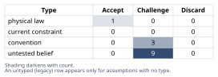
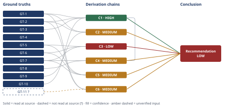

# Northbrook Churn Spike: Root Cause and Diagnostic Plan

*First-principles analysis · 10 October 2026*

*Read with: [How to read this analysis](HOW-TO-READ.md) · [Working file](analysis-20261010T022833Z.md) · [All files](INDEX.md)*

## Executive Summary

**Recommendation:** Run the four-pronged internal diagnostic wave (renewal-cohort reconstruction, ticket-category/TTR breakdown, adoption-score audit, onboarding/TTV-by-cohort) in parallel now; gate the pricing/competitive investigation on what it shows; and do not launch a blanket intervention before wave-1 findings are in (chain C4).

**Band (from §6):** LOW

**Would change it:** Pulling renewal-cohort composition data would resolve whether the 4.1%→9.2% rise is a cohort artifact (chain C1); a ticket-category and adoption-methodology audit would test the common-upstream-cause hypothesis against the live independent-causes rival (chain C3); and confirming the five named preconditions would move the "service-decline" narrative from leading hypothesis to finding (chain C5).

## 1. Problem Essence

**Core problem:** What upstream cause or combination of causes is driving Northbrook's renewal-cohort non-renewal ratio to rise from 4.1% (Q1) to 9.2% (Q3), and — because annual contracts make any single quarter's ratio a discrete, cohort-dependent statistic rather than a continuous rate — what data must be pulled to determine whether this reported rise is a real behavioral shift, a measurement/cohort artifact, or some mix of both, before any intervention is chosen?

**Success criteria:**
1. The analysis names, for each candidate hypothesis (offer/product gaps, pricing pressure, onboarding failure, service-quality decline, competitive displacement, and composites of these), the specific data pull that would confirm or rule it out — checkable by inspecting whether section 4 names a concrete data source and discriminating observation for each.
2. The analysis determines, with explicit reasoning (not assertion), whether the two CS-flagged symptoms (ticket volume up, adoption score down) are independent causes or shared effects of one upstream event — checkable by inspecting whether section 4 contains a chain that tests this structure rather than assuming it.
3. The analysis explicitly tests whether the 4.1%→9.2% comparison is confounded by which renewal cohort fell in each quarter, rather than treating the two percentages as directly comparable — checkable by inspecting whether section 4 names the comparison's basis (same cohort size/composition or not) before drawing a conclusion from it.
4. The analysis states a most-probable root cause (or composite) with explicit inference-vs-unconfirmed labeling, and does not present any hypothesis as confirmed without data this analysis does not have — checkable by inspecting whether every causal claim in section 6 carries a confidence band and a named verification gap.
5. The analysis produces a diagnostic plan that is prioritized (not just listed) by a stated method, and intervention options sequenced by confidence and cost-of-being-wrong — checkable by inspecting whether section 4/6 shows a ranking method (not just a bullet list) and a stated sequencing rationale.

No success criterion requires selecting exactly one of leadership's five named hypotheses; a composite root cause, or a "not yet determinable without data X" verdict, satisfies these criteria as well as a single clean cause would.

---

## 2. Assumptions Table

**Fishbone brainstorm (default six-category set — People, Process, Technology and Tools, Environment, Information, Resources) feeding the rows below.** The assumption space here is explicitly multi-causal (leadership's own five named hypotheses, stated non-exhaustive), so breadth-first brainstorming was used before challenge:

- **People:** support headcount/caseload-per-agent change; CSM turnover; account-management handoffs.
- **Process:** onboarding-process change (e.g., removed live onboarding calls); renewal-process change; escalation-path change.
- **Technology and Tools:** a product release introducing defects or removing/relocating a relied-on feature; a third-party integration breaking.
- **Environment:** a named competitor's feature or pricing move; a macro/budget-cut pressure on customers' own ops teams.
- **Information:** a change to the adoption-score formula or the feature catalog it scores, which could produce a score drop with zero behavioral change underneath; ticket-taxonomy re-categorization.
- **Resources:** a discounting or list-price change at renewal.

Each branch's discriminating observation (what would separate it from its siblings) is folded into the Verification column below rather than repeated here.

**Inversion applied to the "clean narrative."** The CS-flagged symptoms make "service-quality decline is the primary driver" feel obvious. Inverted and tested: five necessary, load-bearing preconditions for that claim are named in the Verification column of A-4 and A-12 below, and a sixth (reverse-causality — engagement decline following, not preceding, an already-made non-renewal decision) is named in A-3. All are currently unverified; this tempers the "obvious" narrative into a leading-but-unconfirmed hypothesis (carried forward as chain C5).

| Assumption | Type | Treatment | Verdict | Verification |
|------------|------|-----------|---------|--------------|
| A-1: "Quarterly churn rate" is computed as (logos lost among contracts whose renewal fell due that quarter) ÷ (logos whose renewal fell due that quarter) — not a rate applied against the whole active book | untested belief | Verify the exact formula with Finance/RevOps before using the 4.1%/9.2% figures in any further math | Challenge — plausible given annual terms, but Northbrook's literal metric definition is not in evidence | unverified — flagged (feeds chain C1) |
| A-2: Annual-contract renewal dates are evenly distributed across calendar quarters (no anniversary clustering from a historical sales surge) | convention | Explicitly challenge — pull renewal-due counts by quarter, trailing 2 years | Challenge — B2B SaaS renewal books are commonly clustered around specific sales-cycle quarters; evenness should not be assumed | unverified — flagged (feeds chain C1) |
| A-3: The ticket-volume rise, the adoption-score drop, and the churn rise are timed coincidentally (not leading/lagging each other by multiple quarters, and not following an already-made non-renewal decision) | untested belief | Verify via a monthly time-series overlay of all three series, plus a reverse-causality check against lost-deal timing | Challenge — plausible but unconfirmed; the "common upstream cause" reasoning in chain C3 depends on it | unverified — flagged (feeds chain C3) |
| A-4: CS's two flagged metrics are meaningful leading indicators of churn specifically at Northbrook (not merely generically plausible signals) | untested belief | Verify via historical correlation: regress past adoption-score and ticket data against actual past churn outcomes | Challenge — no historical correlation is in evidence yet | unverified — flagged (feeds chains C3, C5) |
| A-5: No pricing, product, staffing, or process change has occurred in the window that leadership/CS simply hasn't yet connected to churn | untested belief | Audit product release notes, support-org headcount history, and pricing-policy change logs over the trailing 3-4 quarters — absence of a flagged cause is not evidence no cause exists | Challenge — GT-7 records only that no cause is *confirmed*, not that none occurred | unverified — flagged (feeds chains C3, C4) |
| A-6: The reported churn figures (4.1%, 9.2%) are logo (customer-count) churn, not revenue/dollar churn | convention | Explicitly challenge; pull the dollar-churn (GRR) equivalent for the same periods — a few large-ACV logos could move revenue-churn very differently from logo-churn | Challenge — the prompt does not disambiguate this, and GT-4's wide ACV band ($18k-$40k) means logo and dollar churn could diverge sharply | unverified — flagged (feeds chain C2) |
| A-7: The Q1-vs-Q3 comparison is not dominated by small-sample volatility (the actual count of contracts up for renewal each quarter is unknown) | untested belief | Pull raw counts (logos lost / logos due), not just the percentages, for both quarters | Challenge — a 2-of-25 vs 5-of-54 pattern reads identically as "4%→9%" but means something very different statistically | unverified — flagged (feeds chain C1) |
| A-8: Annual contracts create a structural measurement lag — an upstream cause cannot appear in the churn number until the affected cohort's own renewal date, which can trail the cause by up to ~12 months | physical law (structural/contractual mechanism, non-negotiable given GT-3) | Accept as a ground-truth candidate | Accept — follows directly and non-negotiably from GT-3 (annual, yearly-renewing contracts) | read-at-source: GT-3 (promoted to GT-3's own reasoning; used directly in chains C1, C3, C4) |
| A-9: Published mid-market B2B SaaS churn benchmarks (GT-9) are a fair comparison basis for Northbrook's specific product category (data-integration/reporting) and customer base | convention | Challenge explicitly — a benchmark is a directional prior across a broad "mid-market" label, not a Northbrook- or category-specific figure | Challenge — used only as directional context in chain C2, not as a precise target | unverified — flagged (feeds chain C2) |
| A-10: Teams asked to supply diagnostic data about their own function (e.g., Support reporting on its own staffing/ticket data) will report completely and without self-protective bias | untested belief | Mitigate structurally: have an independent/cross-functional reviewer (RevOps or an outside analyst) pull and spot-check the raw data rather than relying solely on the implicated team's self-summary | Challenge — this is a process-design risk surfaced by the second-order pass, not yet a measured fact | unverified — flagged; no single verification closes this, mitigation is structural (feeds chain C4) |
| A-11: A single quarter's renewal-cohort churn ratio, if held constant, approximates the true trailing-twelve-month annualized churn | untested belief (modeling assumption) | Flag explicitly as a scenario-bracketing device, not a forecast; supersede with actual trailing-12-month cohort-weighted churn once A-1/A-2 data exists | Challenge — explicitly a bracketing assumption, not a verified fact | unverified — flagged (feeds chain C2) |
| A-12: The feature-adoption score's calculation formula and the feature catalog it scores have not changed during the Q1-Q3 window | untested belief | Pull the adoption-score calculation changelog and the feature-catalog changelog directly | Challenge — a silent methodology or catalog change would produce a mechanical score drop with zero behavioral change underneath; high-priority to rule out | unverified — flagged (feeds chains C3, C5) |
| A-13: The diagnostic-prioritization trade-off's locked criteria weights and option scores reflect reasonable prioritization judgment, not a ground-truth-derived measurement | untested belief / explicitly flagged preference | Flag as analyst judgment; the flip test (chain C4) prices this assumption's failure directly | Challenge — flagged as preference per the trade-off procedure's own rule; robustness checked via flip test, not assumed away | unverified — flagged; flip-test-priced (feeds chain C4) |

---

## 3. Ground Truths

**Five-whys (reduce-to-primitives mode) applied to the headline metric before listing it as a ground truth.** Claim: "Q3 quarterly churn rate is 9.2%." Immediate constituents: (numerator) count of logos lost among contracts whose renewal fell due in Q3; (denominator) count of logos whose renewal fell due in Q3. The ratio itself (the reported 9.2%) is a verbatim-reported fact (GT-2) — it passes the irreducibility test as a *reported* figure. Its two constituents, however, are each in principle a direct measurement but are **not supplied to this analysis** and their quarter-to-quarter stability is untested (A-1, A-2, A-7) — so the parent claim is verified only as "Northbrook reported this ratio," not as "this ratio describes a stable, comparable population quarter over quarter." This decomposition is what GT-10 and chain C1 formalize.

- **GT-1** Q1 quarterly churn rate = 4.1% — source: business-context message, "Observed facts" bullet list (this conversation turn); read-at-source: "Q1 quarterly churn rate: 4.1%"
- **GT-2** Q3 quarterly churn rate = 9.2% — source: business-context message, "Observed facts" bullet list (this conversation turn); read-at-source: "Q3 quarterly churn rate: 9.2% (more than doubled over two quarters)"
- **GT-3** Northbrook's contracts are annual (12-month term), renewing yearly, not monthly — source: business-context message, opening Context paragraph; read-at-source: "renewing yearly (not monthly — so churn signal is lagging/discrete, not continuous)"
- **GT-4** ACV range is $18,000-$40,000 — source: business-context message, opening Context paragraph; read-at-source: "Annual contracts range $18,000-$40,000"
- **GT-5** Customer Success has flagged rising support-ticket volume across the window in question, with no magnitude, category breakdown, or timestamp supplied — source: business-context message, "Observed facts" bullet list; read-at-source: "Customer Success has flagged: rising support-ticket volume"
- **GT-6** Customer Success has flagged a drop in feature-adoption scores across the window, with no magnitude, score-definition, or timestamp supplied — source: business-context message, "Observed facts" bullet list; read-at-source: "and a drop in feature-adoption scores"
- **GT-7** No root cause has yet been identified or confirmed by Northbrook — source: business-context message, "Observed facts" bullet list; read-at-source: "No root cause has yet been identified or confirmed"
- **GT-8** Leadership's candidate-hypothesis list (offer/product gaps, pricing pressure, onboarding failure, service-quality decline, competitive displacement, or combinations) is explicitly stated as non-exhaustive and unvalidated — source: business-context message, "Candidate hypotheses" bullet; read-at-source: "Candidate hypotheses on the table (not yet validated, not exhaustive)"
- **GT-9** For mid-market B2B SaaS, published benchmark bands for annual logo churn are: above 12% = Weak, 7-12% = Healthy, under 7% = Best-in-class — source: meltingspot.io, "Churn rate benchmark for B2B SaaS: what good looks like by segment"; read-at-source: raw page HTML fetched directly by this analysis (curl) and parsed independently of any summarizing tool — table row: "Annual logo churn, mid-market | above 12% | 7 to 12% | under 7%" under columns "Weak | Healthy | Best-in-class"
- **GT-10** This analysis was not supplied, and does not have access to: renewal-cohort size/composition by quarter or signup date; ticket volume by category or time-to-resolution trend; the adoption-score's definition/methodology history; pricing/discount trend at renewal; win/loss or competitor-mention data from lost deals; onboarding completion/time-to-value metrics by cohort; or the actual customer count (N) up for renewal in Q1 or Q3 — source: the full business-context message supplied for this analysis; read-at-source: entire message reviewed in full — none of these data categories appear anywhere in "Context," "Observed facts," or "Candidate hypotheses"
- **GT-11?** Secondary SaaS-metrics commentary (aggregated search summary, not independently opened by this analysis) states that some churn is "unavoidable" for reasons unrelated to vendor performance (customer-side business closure, payment/economic factors), citing a range of roughly 5-10% per year as typical of this "unavoidable" component, with other informal commentary this analysis has seen citing figures as low as 1-3% — cited to: aggregated web-search summary (query: "irreducible SaaS churn customer company bankruptcy M&A percent benchmark"); reported-by-delegate: search-result synthesis — cited sources not individually opened by this analysis, and the wide spread across informal sources (1-3% vs 5-10%) is itself evidence this figure is soft

**Provenance summary.** `?`-marked: GT-11 (1 of 11). Read-at-source locations for every unsuffixed ground truth feeding a load-bearing chain: GT-1, GT-2, GT-3, GT-4, GT-5, GT-6, GT-7, GT-8, GT-10 — each quoted above directly from the business-context message (this analysis read the full message directly, so every quoted bullet is a location within a source this analysis itself read, not a delegate summary of it). GT-9 — read directly by this analysis from the cited page's raw HTML via an independent fetch (not the earlier WebFetch-tool summary, which was discarded in favor of a direct read once the discrepancy between "read" and "delegate-summarized" was flagged); the table row is quoted above verbatim. No ground truth carrying a Discard verdict from Phase 2 appears in this list.

---

## 4. Derivation Chains

### Conclusion C1: The reported doubling of quarterly churn is not yet a validated behavioral signal — it may be partly or wholly an artifact of which renewal cohort fell in each quarter, and resolving this must precede trusting the headline number

GT-1 (Q1 ratio 4.1%) + GT-2 (Q3 ratio 9.2%) + GT-3 (annual, yearly-renewing contracts) + GT-10 (no cohort data supplied)
→ because churn is only realized at each contract's renewal date, a quarterly churn percentage on an annually-renewing book is the loss ratio among the specific cohort whose renewal fell due that quarter, not a rate applied continuously across the whole book
→ that renewal-due cohort's size and composition can differ from quarter to quarter, so a rise in the ratio is consistent with either a real rise in per-customer churn propensity or a shift in which cohort happened to renew that quarter
→ no cohort-size or cohort-composition data has been pulled (confirmed directly by GT-10), so the 4.1%→9.2% comparison cannot yet be read as a confirmed behavioral rate change — it is equally consistent with a renewal-cohort artifact until that data is pulled

**Confidence:** HIGH — every hop follows by deduction from GT-3's contract mechanics (A-8) and GT-10's confirmed data absence; the rival reading ("the doubling is already a confirmed real change") is ruled out by the endpoint itself, which establishes that no data yet exists to confirm it either way — the endpoint is itself the rival-ruling move, so the Rivals axis is satisfied rather than left open.

### Conclusion C2: On a naive persistence-based annualization, both the pre-spike and spike quarters imply an annual-equivalent churn rate above the published "weak" threshold for mid-market B2B SaaS — the Q3 spike is likely an acceleration of an existing problem, not a new one — but this bracket rests on an unverified persistence/uniformity assumption

GT-1 (Q1 ratio 4.1%) + GT-2 (Q3 ratio 9.2%) + GT-9 (mid-market benchmark bands: >12% Weak, 7-12% Healthy, <7% Best-in-class)
→ compounding each quarterly ratio across four quarters as if it persisted unchanged brackets the implied annual-equivalent churn between about 15.4 percent (from Q1's 4.1%, since 1 − 0.959⁴ ≈ 0.154) and about 32.0 percent (from Q3's 9.2%, since 1 − 0.908⁴ ≈ 0.320) *[Assumes: A-11 — a single quarter's ratio approximates steady-state annual behavior]*
→ even the lower, pre-spike end of that bracket (about 15.4 percent) already sits above GT-9's Weak threshold (above 12 percent) for mid-market annual logo churn
→ this suggests Northbrook's book was already running in weak-performance territory before Q3's acceleration, not that Q3 marks the onset of a previously healthy book

**Confidence:** MEDIUM — the Inference axis is short: the first hop rests on [Assumes: A-11], and if cohort composition is not stable or representative across quarters (exactly what chain C1 flags as unconfirmed), the true annualized figure could differ substantially from this bracket in either direction — A-11's failure has not been shown to leave the endpoint unaffected. Verification: pull actual trailing-12-month cohort-weighted churn once A-1/A-2 renewal-cohort data exists; that measurement supersedes this proxy bracket entirely.

### Conclusion C3: The two CS-flagged symptoms are more likely common effects of a single upstream change than two independent problems, but this rests on an unverified timing assumption and a live, unruled-out independent-causes rival

GT-5 (ticket volume up) + GT-6 (adoption score down) + GT-7 (no cause confirmed yet)
→ absent ticket-category, time-to-resolution, and adoption-methodology data, the two symptoms' co-occurrence in the same roughly two-quarter window is more parsimoniously explained by one dated upstream event than by two unrelated processes independently drifting in the same direction at the same time *[Assumes: A-3 — the symptoms and the churn rise are not independently timed]*
→ of the plausible common-upstream events, an onboarding or time-to-value degradation dated roughly two to three quarters before Q3 best fits the lag structure, since the annual-renewal mechanic (GT-3, A-8) means a cohort onboarded poorly in late Q4 or Q1 would generate how-to tickets and depressed adoption immediately but would not surface as churn until that cohort's own renewal lands in Q2 or Q3
→ this is the leading inference, not a demonstrated fact — a fully independent-causes account, such as ticket growth from organic usage scale combined with an adoption-score methodology artifact (A-12), remains equally consistent with GT-5 and GT-6 alone and is not yet ruled out

**Confidence:** LOW — two axes are short at once. Inference: the second hop rests on [Assumes: A-3], and its failure (the symptoms are not timing-coincidental with the churn rise) would materially weaken the common-cause reading, which has not been priced as leaving the endpoint unaffected. Rivals: the independent-causes rival named in the third hop is live and nothing in this analysis settles it yet (the organic-growth-only sub-case is addressed in Abandoned Reasoning AR-1, but the full rival, including the adoption-score-artifact sub-case, remains open). Verification: a monthly time-series overlay closes A-3; a ticket-category and adoption-methodology audit closes A-12 and bears directly on the rival.

### Conclusion C4: Run the four internal, fast, cheap diagnostics in parallel first, gate the costlier pricing and competitive investigation on what that wave shows, assign an independent reviewer to spot-check implicated teams' own data, and set explicit leadership expectation of a multi-quarter lag before a correct fix shows up in the churn number

C1 (HIGH, framing confound named) + GT-7 (hypothesis list, non-exhaustive) + GT-8 (same)
→ weighing six investigation options (renewal-cohort reconstruction; ticket-category and time-to-resolution breakdown; adoption-score audit; onboarding and time-to-value by cohort; pricing, discount and win-loss or competitor data; doing nothing) against six locked, weighted criteria (framing-confound power ×5, common-cause power ×5, speed ×4, cost and effort ×3, risk-of-being-wrong-if-skipped ×5, hypothesis coverage ×4) scores the four-pull parallel composite highest at 120, ahead of cohort reconstruction alone at 107 and pricing or win-loss data at 55
→ the flip test shows no single-criterion reweighting within the 1-5 anchor range changes this ranking, which prices A-13's failure mode directly and leaves the ranking's winner unaffected
→ pricing and win-loss or competitor data score lowest on speed and cost because they require cross-functional coordination and qualitative coding, so they are better run as a second, gated wave once the first wave either confirms or rules out the onboarding and service-quality narrative
→[2nd] running the first wave asks Support and Product to help characterize data that may implicate their own function, which creates an incentive to under-report, and asks leadership to wait through a diagnostic window during which at-risk accounts already mid-renewal receive no visible fix *[Assumes: A-10 — teams will report completely and without self-protective bias]*
→[3rd] because the annual-renewal mechanic (GT-3, A-8) is the same lag that hid the original problem, a correctly identified and fixed root cause will not visibly lower the quarterly churn number for roughly two to three more quarters, so judging the fix by the very next quarter's churn figure risks a premature "it didn't work" verdict and a reversal of a correct intervention

No extension step contradicts a Ground Truth (checked against GT-1 through GT-11).

**Confidence:** MEDIUM — the Inference axis is short: the fourth hop rests on [Assumes: A-10], and its failure (teams under-report on their own function) is not shown to leave the endpoint unaffected — it would weaken wave-1's reliability, which is exactly why the endpoint already names the independent-reviewer mitigation as a plan change rather than assuming the risk away. Verification: no single observation closes A-10; it is mitigated structurally (independent data pull by a non-implicated reviewer), not resolved by evidence.

### Conclusion C5: The "rising tickets plus falling adoption equals service-quality decline caused the churn" narrative is not yet earned and should be carried as the leading hypothesis to test first, not presented as the confirmed root cause

GT-5 (ticket volume up) + GT-6 (adoption score down) + GT-7 (no cause confirmed)
→ "service-quality decline is the primary driver of the churn spike" would follow only if five load-bearing preconditions all held at once: ticket-rate-per-active-customer, not raw count, has risen; the adoption-score methodology and feature catalog were stable across the window; the churned-logo population overlaps the population whose tickets and adoption were flagged; win/loss reason-coding does not show price or a named competitor as the dominant stated reason; and engagement decline precedes, rather than follows, the renewal decision
→ none of these five preconditions is currently verified — A-4 and A-12 leave two of them explicitly open, and GT-10's confirmed data absence leaves the remaining three unverifiable with data this analysis has
→ the strong conclusion therefore does not yet follow from the available evidence; it remains the single leading hypothesis among several live ones, not a demonstrated finding

**Confidence:** MEDIUM — EXCEPT claimed: this is an absent-fails derivation. If the five named preconditions held, "service-quality decline is the confirmed primary driver" would follow; GT-10 and assumptions A-4/A-12 together establish that those preconditions are unconfirmed, so the strong conclusion does not yet follow. The unconfirmed-precondition set named above is the satisfying evidence for this EXCEPT clause, and the chain remains MEDIUM because it establishes what does not yet follow rather than what does. Verification paths for the individual preconditions are the ones already named under A-4 and A-12.

### Conclusion C6: Even under a generous reading of a published "unavoidable churn" heuristic, Northbrook's churn is overwhelmingly not explained by irreducible attrition, but a realistic floor above zero should still be set when judging any intervention's success

GT-11? (unavoidable-churn heuristic, roughly 5-10 percent, reported-by-delegate) + GT-1 (Q1 ratio 4.1%) + GT-2 (Q3 ratio 9.2%)
→ the governing constraint is that some customer-side business discontinuity — closure, acquisition by a company that consolidates onto its own stack, or budget elimination of the function — occurs across any population of mid-market companies each year, independent of Northbrook's product or service quality
→ the cited range in GT-11? is wide and unverified, with other informal sources this analysis has seen suggesting figures as low as 1-3 percent, but even its upper end of 10 percent sits below both of chain C2's annualized brackets of roughly 15.4 percent and 32.0 percent
→ this implies the bulk of Northbrook's churn, even at the pre-spike Q1 level, is very unlikely to be fully explained by irreducible, non-addressable attrition — most of it is plausibly addressable, which bounds leadership's expectations without implying churn can be driven to zero

**Confidence:** MEDIUM — GT-11? is unverified and reported-by-delegate, carrying a wide and internally inconsistent cited range (5-10 percent vs. an informally-seen 1-3 percent). Verification: pull Northbrook's own CRM "reason for non-renewal" codes for the Q1-Q3 lost logos and tag which are company-dissolution, M&A, or budget-elimination versus a chosen non-renewal — this directly measures Northbrook's own floor rather than relying on an external heuristic.

---

## 5. Abandoned Reasoning

### Dead End: Treating "ticket volume up" as fully explained by organic customer-base growth

**What was tried:** Reading the rising ticket count as simply a function of a larger or more active customer base (more seats, more integrations), with no implication of declining service quality.

**Why abandoned:** This account cannot stand alone — it does not explain the simultaneous drop in adoption scores (GT-6), and organic growth by itself does not explain a rise in the churn ratio, since growth adds new logos rather than causing existing ones to leave. Chain C3 treats "organic growth" as a possible partial contributing condition, not a complete account, because it fails the counterfactual test for the churn rise specifically.

**What it ruled out:** "Pure organic growth, no real problem" as a *complete* explanation for the combined picture (ticket volume up, adoption down, churn up). A partial contributing role for organic growth in the ticket-volume figure specifically is not ruled out and remains a candidate to quantify once ticket-rate-per-active-customer data (A-4's verification) is pulled.

### Dead End: Presenting a naive "37% annualized" figure as a confirmed crisis-level finding

**What was tried:** Directly multiplying Q3's 9.2% quarterly figure by 4 (9.2 × 4 = 36.8%) and reporting this as Northbrook's confirmed annual churn rate.

**Why abandoned:** This is not the correct compounding arithmetic (the estimate procedure in chain C2 recomputes it as 1 − 0.908⁴ ≈ 32.0%, not 36.8%), and more importantly it assumes both persistence and cohort-uniformity across all four quarters — assumptions chain C1 explicitly flags as unverified (A-2, A-11). Presenting either figure as a confirmed finding would overstate certainty this analysis does not have.

**What it ruled out:** Nothing about the real world — it ruled out *presenting a single point estimate as fact*. The corrected, explicitly bracketed, explicitly assumption-flagged figure is retained as the upper bound of chain C2's scenario bracket, not as a stand-alone finding.

### Dead End: Concluding directly that "service-quality decline" is the confirmed root cause

**What was tried:** Taking the intuitively obvious reading of CS's two flagged metrics — rising tickets, falling adoption — as sufficient on its own to confirm that service-quality decline is the primary driver of the churn spike, and moving straight to interventions (more support staff, a win-back campaign) on that basis.

**Why abandoned:** The inversion pass (feeding chain C5) found five load-bearing preconditions for this claim, all currently unverified, and chain C3 identified a fully live, unruled-out rival (independent causes, including an adoption-score methodology artifact per A-12). Moving directly to an intervention here risks the premature-intervention failure mode identified in the Phase 5 pre-mortem (Cluster A below).

**What it ruled out:** Nothing is yet ruled out by evidence — this entry records that the "clean narrative" was tried and explicitly demoted, by chain C5, from a candidate conclusion to a leading-but-unconfirmed hypothesis pending the five preconditions named there.

---

## 6. Conclusion

**Recommended approach:** Run the four-pronged internal diagnostic wave — renewal-cohort reconstruction, ticket-category and time-to-resolution breakdown, adoption-score audit, and onboarding/time-to-value by cohort — in parallel immediately; gate the pricing and competitive-displacement investigation on what that wave shows; and do not launch a blanket retention or discount intervention until wave-1 findings are in (chain C4).

**Key insight:** The 4.1%→9.2% figure cannot yet be read as a clean behavioral signal — annual-contract renewal mechanics mean it may be partly a renewal-cohort artifact (chain C1) — and even on a bracketed, explicitly assumption-flagged annualization, Northbrook's book looks like it was already running in weak-performance territory before Q3's acceleration, not that Q3 marks the onset of a previously healthy book (chain C2); the two CS-flagged symptoms are more likely common effects of one upstream cause, most plausibly an onboarding or time-to-value failure, than two independent problems (chain C3), but the intuitively obvious "service decline caused the churn" story is not yet earned by the evidence available (chain C5).

**Trade-offs acknowledged:** Gating the pricing and competitive-displacement investigation behind wave 1 risks losing time if competitive displacement turns out to be the dominant driver (chain C4); the diagnostic plan's criteria weighting reflects analyst judgment rather than a ground-truth-derived measurement, though the flip test shows this specific sequencing choice is robust to reasonable reweighting (chain C4); and leadership should expect any correctly identified fix to lag the churn number by roughly two to three quarters, because of the same annual-contract mechanic that hid the original problem, while accepting that churn cannot be driven to zero — some floor above zero is structurally unavoidable (chain C6).

**Confidence:** LOW — the Conclusion's band is capped by chain C3 (LOW), cited for the common-upstream-cause claim in the Key Insight; chains C2, C4, C5, and C6 are each MEDIUM (see each chain's own confidence line for its verification path); chain C1 is HIGH. The Conclusion adds no downgrade cause of its own beyond what its cited chains already carry. This LOW band is the honest state of a diagnosis built entirely from the supplied business-context message and one external benchmark source, with none of Northbrook's own cohort, ticket, adoption, pricing, or win-loss records yet pulled — closing that gap is exactly what the recommended diagnostic wave (chain C4) exists to do, and the band should rise once wave-1 data replaces GT-10's confirmed absence.
