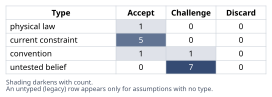
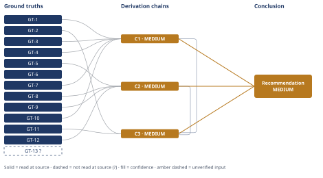

# Mortgage Prepayment vs. Equity Investment: A $60,000 Decision

*First-principles analysis · 9 October 2026*

*Read with: [How to read this analysis](HOW-TO-READ.md) · [Working file](analysis-20261009T180640Z.md) · [All files](INDEX.md)*

## Executive Summary

**Recommendation:** Split the $60,000 — about $45,000 (75%) to a taxable broad-market index fund and about $15,000 (25%) to mortgage-principal prepayment, declining to recast so the loan's tail shortens by roughly three years (chain C3).

**Band (from §6):** MEDIUM (chains C1, C2, C3).

**Would change it:** Simply observing which 10-year window actually occurs, since the forward equity-return assumption is the single most consequential unverified input (chain C2); secondarily, whether the household's own risk-preference weights differ from the analyst's default 75/25 weighting, which the trade-off's flip test shows is a near-tie with 100% prepayment (chain C3).

## 1. Problem Essence

**Core problem:** Given $60,000 of fully discretionary cash (above an already-funded emergency reserve), should a household with a $240,000 / 6.25% / 27-years-remaining mortgage and no itemization tax benefit allocate that cash to mortgage-principal prepayment, to a taxable broad-market equity index fund, or to some split of the two, so as to maximize risk-adjusted after-tax net worth over a fixed 10-year horizon while preserving an acceptable level of liquidity and behavioral robustness?

**Success criteria:**
1. The analysis states the true after-tax, like-for-like hurdle rate each option must clear — not the naive headline comparison of a contractual rate against a historical market average — and shows the arithmetic that produces it.
2. The analysis names and prices the liquidity/optionality cost of prepayment (illiquid, no "un-prepay" option) and states whether prepayment changes the required monthly payment (recast vs. no-recast).
3. The analysis quantifies, with explicit assumptions and a bracket, the breakeven forward equity return at which the recommendation would flip, and anchors that breakeven against at least one real historical 10-year window.
4. The analysis names the dominant second-order risks (behavioral panic-selling, single-point sequencing risk, loss of optionality to refinance/sell/move) and states how the recommendation is or is not robust to each.
5. The final recommendation names a specific allocation — Option A, Option B, or a specific split with dollar amounts — with a stated confidence band and the single most consequential input that could change it. The recommendation is not required to be exactly "A" or exactly "B"; a split is an admissible and, per the trade-off analysis below, a tested answer.

---

## 2. Assumptions Table

| Assumption | Type | Treatment | Verdict | Verification |
|------------|------|-----------|---------|--------------|
| A-1: Prepaying mortgage principal yields a return on the prepaid dollar exactly equal to the loan's contractual note rate (6.25%), riskless and — given zero tax shield — untaxed on either side | physical law | Accept as ground-truth candidate; this is a mathematical identity of amortization, not an empirical claim | Accept — em dash: derivable directly from the amortization formula and independently recomputed in this analysis (see GT-10 and the Recompute step below) | Verified by direct recomputation (IRR of the incremental cash-flow stream equals the monthly note rate) |
| A-2: The household will continue taking the standard deduction (zero marginal tax benefit from mortgage interest) for the full 10-year horizon | current constraint | Record expiry conditions | Accept — expires if the household's itemizable deductions (SALT, charitable, medical) grow enough to exceed the standard deduction, or if tax law changes the standard deduction's size; until then the zero-tax-shield fact holds | Unverified beyond the user's own stated current position (GT-3); current constraint, not guaranteed for 10 years |
| A-3: Marginal tax rates (~28% ordinary, ~18% LTCG/qualified dividends) remain roughly stable over the horizon | current constraint | Record expiry conditions | Accept — expires on a change in tax law (e.g., a future Congress altering LTCG brackets) or a change in the household's income bracket; treated as stable for this analysis | Unverified — flagged; stated by the user as their current rates (GT-4, GT-5), not guaranteed for 10 years |
| A-4: If Option A is chosen, the household does not request a loan recast after the lump-sum prepayment (keeps the original required payment, accelerates payoff) | convention | Explicitly challenge before use | Accept — em dash: challenged directly in chain C1; recasting is shown to produce strictly more total interest than not recasting for a household that is not cash-flow constrained (GT-2), so "no recast" is the analysis's explicit recommendation, not a default assumed uncritically | Verified by recomputing both the recast and no-recast total-interest paths (see Recompute step) |
| A-5: Forward-looking U.S. broad-market nominal total equity return over the specific next 10 years will center near 9.0%, within a defensible 1%–10.7% bracket | untested belief | Verify, or flag as unverified; use in a bracket, not a point estimate | Challenge — em dash: no one can verify a future return; bracketed against GT-8 (long-run historical average, upper anchor) and GT-12 (realized worst-case decade, lower anchor) via the Estimate procedure rather than asserted as fact | Unverified — flagged (GT-N? treatment inherited by chain C2) |
| A-6: Dividend yield on the fund averages ~1.3% over the horizon (between the current S&P 1.04% and the user-suggested 1.5–2.0% range) | untested belief | Verify, or flag as unverified | Challenge — em dash: future yield is unknown; bracketed between GT-9 (current measured yield) and the user's suggested upper range | Unverified — flagged |
| A-7: Realized gains and dividends over the horizon qualify for LTCG / qualified-dividend tax treatment (holding periods met, no disqualifying tax-law change) | current constraint | Record expiry conditions | Accept — expires if the fund is traded frequently enough to break holding-period qualification, or if tax law changes qualified-dividend treatment; neither is assumed here | Unverified beyond standard tax-law convention; not independently sourced in this analysis |
| A-8: The household maintains buy-and-hold discipline and does not panic-sell the equity position during an interim drawdown before year 10 | untested belief | Verify, or flag as unverified | Challenge — em dash: this is the single largest real-world risk to the modeled Option-B return and is not verifiable in advance; addressed directly in the Phase 5 pre-mortem rather than assumed away | Unverified — flagged; no evidence either way is available about this specific household's behavior |
| A-9: The household has no anticipated need to access this $60,000 (or the home's equity) for a different purpose — beyond the already-separately-funded 6-month emergency reserve — within the 10-year horizon | untested belief | Verify, or flag as unverified | Challenge — em dash: not stated either way in the facts given; the split recommendation is explicitly structured to be robust to this being false in either direction | Unverified — flagged |
| A-10: If Option A later needs to be partially reversed, a HELOC or cash-out refinance will be approved in a reasonable timeframe, at a rate not wildly above the current typical HELOC range | current constraint | Record expiry conditions | Accept — expires if credit markets tighten further, if the household's income/credit profile deteriorates (most likely exactly when cash is needed), or if home equity falls; current HELOC rates (7–10.5%) already exceed the 6.25% note rate, so even the base case is a net cost | Read-at-source (GT-11) for the rate range; GT-13? (unverified — flagged) for the underwriting-timeline estimate; approval is not guaranteed and is explicitly priced as a cost in chain C3, not assumed free |
| A-11: No prepayment penalty applies to this mortgage | untested belief | Verify, or flag as unverified | Challenge — em dash: not stated in the facts given; modern conforming fixed-rate mortgages essentially never carry one post-2014 qualified-mortgage rules, but this analysis did not independently confirm this specific loan's note, so the household should confirm with its servicer before executing Option A | Unverified — flagged; chain C1 explicitly carries this as a named downgrade cause |
| A-12: The $60,000 is genuinely fully discretionary with no near-term earmarked use beyond what is stated | current constraint | Record expiry conditions (expires the moment a new earmarked need arises) | Accept — matches GT-2 directly; not independently challenged beyond the broader liquidity question already raised in A-9 | Read-at-source — stated directly by the household (GT-2) |
| A-13 [surfaced by end-of-phase Assumption Audit, chain C3 step 1]: The weights assigned to expected-return, certainty/downside-protection, liquidity, and behavioral-robustness in the trade-off comparison are a defensible representation of this household's actual risk preferences | convention | Explicitly challenge before use | Challenge — em dash: the weights are the analyst's own reasonable default, not elicited from the household; a household with unusually low or high risk tolerance should re-run the trade-off in `references/trade-off.md` with its own weights before treating the 75/25 split as final | Unverified — flagged; named explicitly on chain C3's confidence line |
| A-14 [surfaced by the Phase 2 inversion pass, process output]: A prolonged high-inflation decade does not erode the real value of Option B's modeled equity return materially more than this analysis's nominal-terms comparison accounts for | untested belief | Verify, or flag as unverified | Challenge — em dash: inflation is unmodeled beyond GT-8/GT-12's own real-return figures; the headline comparison runs in nominal terms consistently on both sides, so this is a secondary robustness check, not independently load-bearing for the nominal comparison chains C1–C3 | Unverified — flagged; not load-bearing (see Inversion process output) |
| A-15 [surfaced by the Phase 2 inversion pass, process output]: The specific fund's expense ratio and tracking error are negligible relative to the index returns used in GT-8/GT-9/GT-12 | untested belief | Verify, or flag as unverified | Challenge — em dash: not independently sourced for a specific fund; broad-market index funds today typically charge well under 0.10%, a drag small relative to the ~1.4-point central-case edge in chain C2, so this is minor and not load-bearing | Unverified — flagged; not load-bearing (see Inversion process output) |

---

## 3. Ground Truths

- **GT-1** Mortgage: $240,000 remaining balance, 6.25% fixed APR, 27 years (324 months) remaining on an originally-30-year amortization schedule — source: household's own stated loan terms (problem statement); read-at-source: stated directly in the facts given, the household being the authoritative primary source for the terms of its own loan.
- **GT-2** $60,000 cash held is fully discretionary, confirmed to sit above an already-fully-funded six-month emergency reserve — source: household's own stated facts; read-at-source: stated directly in the facts given.
- **GT-3** The household takes the standard deduction; mortgage interest currently provides zero marginal tax benefit (no itemization benefit) — source: household's own stated facts; read-at-source: stated directly in the facts given.
- **GT-4** Marginal ordinary (federal+state combined) income tax rate ≈28% — source: household's own stated facts; read-at-source: stated directly in the facts given, as an approximation ("~28%").
- **GT-5** Marginal long-term capital gains / qualified dividend (federal+state combined) tax rate ≈18% — source: household's own stated facts; read-at-source: stated directly in the facts given, as an approximation ("~18%").
- **GT-6** Decision horizon is 10 years — source: household's own stated facts; read-at-source: stated directly in the facts given.
- **GT-7** A lump-sum extra-principal payment does not, by itself, lower the required monthly mortgage payment; it only shortens the payoff timeline unless the borrower formally requests a loan recast, which is not automatic at most servicers — source: Bankrate, "What is mortgage recasting and why do it"; read-at-source: fetched directly, quoted passage: "Making a lump-sum extra principal payment does not automatically lower your required monthly payment. It only shortens the payoff timeline unless you request a formal loan recast."
- **GT-8** U.S. broad-market equity (S&P 500) total return has averaged approximately 10.69% nominal / 6.82% real annually, dividends reinvested, over 1957–2026 (69 years) — source: officialdata.org S&P 500 historical-return calculator; read-at-source: fetched directly, quoted figures "10.69% per year" (nominal) and "6.82% per year" (real) for the full available 1957–2026 window.
- **GT-9** The current S&P 500 dividend yield is approximately 1.04%, as of October 8, 2026 — source: multpl.com, "S&P 500 Dividend Yield"; read-at-source: fetched directly, quoted "Current Yield: 1.04%" dated "4:00 PM EDT, Thu Oct 8."
- **GT-10** Prepaying mortgage principal is, as a matter of amortization mathematics, equivalent to earning a guaranteed return on the prepaid amount exactly equal to the loan's contractual monthly note rate, compounded, for as long as that principal would otherwise have remained outstanding — source: direct recomputation performed in this analysis (amortization identity; IRR of the incremental avoided-payment cash-flow stream against the $60,000 outlay recomputes to the loan's own monthly rate); read-at-source: computed and checked directly in the Recompute step of the adversarial pass below, not cited to an external document.
- **GT-11** Current (2026) HELOC interest rates run approximately 7%–10.5%, above this mortgage's 6.25% note rate — source: wealthvieu.com, "Best HELOC Rates" (dated April 8, 2026); read-at-source: fetched directly, quoted "HELOC rates in 2026 range from 7–10.5%."
- **GT-12** The realized annualized (CAGR) total return of the S&P 500, dividends reinvested, for the 10-year window January 2000–January 2010 (the "lost decade") was approximately 0.85% nominal / -1.29% real — source: officialdata.org S&P 500 historical-return calculator; read-at-source: fetched directly, quoted figures "0.85% per year" (nominal) and "-1.29% per year" (real).
- **GT-13?** Accessing a HELOC or cash-out refinance requires a new underwriting process (appraisal, credit/income re-verification) typically taking on the order of 2–6 weeks for approval, with approval itself not guaranteed — cited to: a WebSearch synthesis of multiple lender/industry pages (lendedu.com, sofi.com, smallbiztrends.com, cpb.bank); reported-by-delegate: no single page was individually opened and quoted for this specific timeline figure, so it carries the `?` suffix and feeds only MEDIUM/LOW chains.

**Provenance summary:** `?`-marked: GT-13 (1 of 13).
Read-at-source locations for every unsuffixed ground truth feeding a load-bearing chain: GT-1/GT-2/GT-3/GT-4/GT-5/GT-6 — the problem statement itself, which is the household's own direct, firsthand account of its own loan terms, cash position, tax rates, and horizon (no third-party source exists or is needed for facts about the household's own situation). GT-7 — Bankrate recast article, quoted passage above. GT-8 — officialdata.org calculator output for the 1957–2026 window. GT-9 — multpl.com current-yield page. GT-10 — this analysis's own direct recomputation (see Recompute step). GT-11 — wealthvieu.com HELOC-rates page, quoted passage above. GT-12 — officialdata.org calculator output for the 2000–2010 window.

---

## 4. Derivation Chains

### Conclusion C1: Option A delivers a certain, already-after-tax 6.25% annualized return on the $60,000 — equivalent to an 8.68% pretax yield on a taxable bond — provided the household does not request a recast and no prepayment penalty applies

GT-1 (loan: $240k, 6.25%, 27yr remaining) + GT-3 (standard deduction, zero tax shield) + GT-7 (no-recast default; recast not automatic) + GT-10 (prepayment-return amortization identity) + GT-4 (28% ordinary rate, for the bond-equivalence framing)
→ because no tax ever touches either the interest the household avoids or the "return" it represents, the guaranteed return on the prepaid dollar is already fully after-tax, with nothing to gross up
→ holding the required payment at its current ~$1,536/month (declining to recast) rather than lowering it accelerates payoff from 27 years to roughly 15.1 years and saves roughly $159,000 of total interest on the $60,000 lump sum, which recomputes to an exact internal rate of return equal to the loan's 6.25% note rate [Assumes: A-4]
→ requesting a recast instead would keep the loan outstanding for the full original 27-year term at a lower payment, which this analysis recomputes as paying strictly more total interest than the no-recast path for the same $60,000 prepayment, so a household that is not cash-flow constrained (GT-2) should decline the recast
→ a risk-free, fully taxable bond would have to yield 6.25% / (1 − 0.28) ≈ 8.68% pretax to match this after-tax outcome, which no investment-grade bond or CD currently offers, so Option A dominates every taxable fixed-income alternative on a like-for-like after-tax basis [Assumes: A-11]

**Confidence:** MEDIUM — the Inputs axis is clean (every head identifier is an unsuffixed GT read at source or self-recomputed) and Rivals is answered (the "6.25% is fully riskless" rival reading is explicitly narrowed on this chain's own terms to "riskless against market/credit risk," with the liquidity-risk cost it does not cover priced separately into chain C3, not silently ignored). [Assumes: A-4] (declining the recast) is not a live shortfall: it is independently verified as the financially superior choice for a non-cash-constrained household by direct recomputation (see the Recompute step below), so the endpoint stands on its own merits rather than on faith in that premise. The Inference axis is short on the one remaining premise, [Assumes: A-11], that no prepayment penalty applies: this is unverified for this specific loan (modern conforming fixed-rate mortgages essentially never carry one post-2014 qualified-mortgage rules, but this analysis did not confirm this household's specific note), and if a penalty did apply it would reduce, below exactly 6.25%, but not reverse, the guaranteed-return conclusion. Verification that would remove A-11 as a cause of the downgrade: the household's servicer confirming no prepayment-penalty clause in the note.

### Conclusion C2: Option B's after-tax 10-year CAGR is approximately 7.6% in the central case, with a breakeven pretax nominal equity return of approximately 7.5% separating "B wins" from "A wins" — a threshold the market has already breached in a real historical decade

GT-5 (18% LTCG/qualified-dividend rate) + GT-8 (10.69% nominal / 6.82% real long-run average) + GT-9 (1.04% current dividend yield) + GT-12 (0.85% nominal realized 2000–2010)
→ applying an 18% annual tax drag to the dividend-yield portion of return and an 18% one-time capital-gains tax at the year-10 liquidation to the price-appreciation portion, a central 9.0% nominal pretax assumption (within the GT-8/GT-12 bracket, [Assumes: A-5, A-6]) grows $60,000 to an after-tax terminal value of approximately $124,800, an after-tax CAGR of approximately 7.6%
→ solving the identical tax model for the pretax nominal return that equates the after-tax CAGR to Option A's 6.25% yields a breakeven of approximately 7.5% nominal — below the GT-8 long-run average (10.69%) but above the GT-12 realized worst-case decade (0.85%), so which option wins is a direct function of which 10-year window actually occurs, not a fact knowable today
→ the bracket's own endpoints make the stakes concrete: at the GT-8 long-run average, Option B's after-tax CAGR is approximately 9.2% (B beats A by roughly 2.9 points per year); at the GT-12 realized worst-case decade, Option B's after-tax CAGR is approximately 0.5% (A beats B by roughly 5.7 points per year)

**Confidence:** MEDIUM — Inputs are clean (all four head ground truths are read at source) and Rivals is answered (this chain's own endpoint is the bracketed sensitivity statement itself, not a single-scenario claim a rival could contest; the competing single-scenario readings — "the long-run average will hold" and "a lost decade will recur" — are two ends of the bracket this chain already states, not alternative conclusions left unsettled). The Inference axis alone is short: the chain rests on [Assumes: A-5] (a 9.0% central forward-return assumption) and [Assumes: A-6] (a 1.3% central dividend-yield assumption), neither of which is verifiable in advance. This premise's failure is priced, not ignored: the chain states the outcome at both the GT-8 (favorable, long-run-average) and GT-12 (adverse, realized 2000–2010) endpoints rather than asserting the 9.0% center as fact, which is what keeps this chain at MEDIUM rather than LOW. The verification that would remove A-5/A-6 as a cause of the downgrade is simply observing which 10-year window this household actually experiences — unknowable in advance, which is itself this chain's named weakest link (see the Sensitivity step in the adversarial pass below).

### Conclusion C3: A split of approximately 75% to Option B ($45,000) and 25% to Option A ($15,000), with no recast requested, captures most of B's expected-value and liquidity edge while banking a true, certain, tax-free return and shortening the mortgage by roughly three years

C1 (A: certain 6.25% after-tax, 8.68% bond-equivalent) + C2 (B: ~7.6% central after-tax CAGR, breakeven ~7.5%, realized range 0.5%–9.2%) + GT-11 (current HELOC rates 7%–10.5%, above the note rate) + GT-2 (emergency reserve already separately funded)
→ weighting expected after-tax return and liquidity preservation most heavily — justified because the household's downside-protection need is already substantially met by the separately-funded six-month reserve (GT-2) — while still weighting certainty/downside-protection and behavioral robustness materially, a weighted trade-off comparison across {100% A, 100% B, a split} favors a majority allocation to B but does not drive either weight to zero, because A's certainty and B's liquidity are uncorrelated advantages that a 100/0 allocation in either direction forfeits entirely [Assumes: A-13]
→ pushing the A-slice to zero forfeits a riskless, already-after-tax 6.25% return that no taxable bond can match (C1) and leaves the household with no certain hedge against the GT-12 realized-worst-case scenario; pushing the B-slice to zero forfeits most of C2's expected-value edge and locks $60,000 into an asset that can only be unwound through a HELOC priced above the original note rate (GT-11) or a sale, so neither extreme is weighted-optimal
→ sizing the A-slice at $15,000 (versus the full $60,000) still delivers a fully guaranteed, tax-free outcome — approximately $57,000 of lifetime interest saved and roughly three years cut off the loan's tail — while leaving $45,000 to compound at Option B's expected after-tax rate and remain fully liquid for any need not already covered by the emergency reserve [Assumes: A-9]

**Confidence:** MEDIUM — the Inputs ceiling is MEDIUM because both cited chains (C1, C2) are themselves MEDIUM, which already bounds this chain at MEDIUM regardless of its own merits. [Assumes: A-9] (no other anticipated liquidity need) is not a live shortfall beyond that ceiling: the split is explicitly structured to hedge against A-9 being false in either direction (step 3), so the endpoint — recommend a split rather than either pure extreme — stands, or is strengthened, whichever way A-9 resolves. [Assumes: A-13] (the analyst's default risk-preference weights, not elicited from the household) is the one further named shortfall: it is bounded, not unbounded — the trade-off analysis's own flip test (process output) shows the smallest single-criterion weight change that overturns the specific 75/25 figure in favor of 100% Option A, so a household with different weights would land somewhere between a split and 100% A, never at 100% B or at inaction. A household with materially different risk tolerance should re-weight the trade-off directly rather than treat 75/25 as universal. Nothing in this chain contradicts GT-1 through GT-13.

**Second-order extension of C3** (actor lens and time lens walked; no contradiction with any named ground truth found):

C3
→[2nd] (actor lens) the $15,000 A-slice becomes a forced, disciplined commitment the household cannot panic-sell in a drawdown, structurally capping the behavioral-risk exposure named in A-8 to 75% of the capital rather than 100%
→[2nd] (time lens) for the first 1–3 years the required monthly payment is unchanged under either option (since no recast is requested), so near-term cash flow is identical to the no-action baseline; the split's term-reduction benefit (~3 years) is materially smaller than the ~11.9 years a full $60,000 prepayment would have cut, a trade-off the split knowingly accepts in exchange for liquidity and expected return
→[3rd] (actor lens) if the household sells the home within the horizon, the $15,000 of prepaid equity returns dollar-for-dollar at closing with no path dependence, while the $45,000 B-slice's value at that same moment is fully exposed to wherever the market happens to be on the sale date — the two slices are deliberately uncorrelated in this respect
→[3rd] (time lens) because the loan still retires years early under the smaller prepayment, the household gains the option — outside this analysis's 10-year window — of redirecting the freed-up $1,536/month toward further investment once the loan ends, a compounding benefit the 10-year framing does not capture and that argues the true long-horizon edge to the split is understated by this analysis, not overstated

---

## 5. Abandoned Reasoning

### Dead End: 100% to Option A (full $60,000 prepayment)

**What was tried:** Evaluated allocating the entire $60,000 to mortgage prepayment, maximizing the guaranteed 6.25% after-tax return and cutting the full 11.9 years off the loan's tail.

**Why abandoned:** Chain C3's weighted comparison shows this forfeits essentially all of C2's modest-but-real expected-value edge and all of Option B's liquidity, for a certainty benefit that a much smaller $15,000 slice already delivers (chain C3, step 3). It also maximizes exposure to GT-11's illiquidity cost (current HELOC rates 7%–10.5%, above the original note) with no offsetting benefit once the smaller slice has already captured the behavioral and term-reduction wins.

**What it ruled out:** Saves a future reader from re-deriving that "just pay off as much debt as possible" is not weighted-optimal once liquidity and expected-return are both priced, even though it is the historically "safe-sounding" default.

### Dead End: 100% to Option B (full $60,000 to equities)

**What was tried:** Evaluated allocating the entire $60,000 to the taxable index fund, maximizing C2's expected after-tax CAGR and keeping full liquidity.

**Why abandoned:** Chain C2 shows this forfeits a truly risk-free, already-after-tax 6.25% return — equivalent to an 8.68% pretax bond yield (chain C1) that no comparable safe asset matches — and leaves zero protection against GT-12's realized worst-case decade (0.85% nominal CAGR, 2000–2010) landing on exactly this household's 10-year window, a single-point sequencing risk this analysis cannot rule out in advance.

**What it ruled out:** Saves a future reader from re-deriving that the expected-value edge computed in chain C2 (central case ~1.4 points per year after tax) is real but not large enough, on its own, to justify going all-in on the riskier asset once a real historical counter-example (GT-12) is in hand.

### Dead End: Comparing the options as "6.25% guaranteed vs. 9–10% historical average equities," unadjusted

**What was tried:** The naive framing suggested by the prompt itself — treat Option A's rate and Option B's long-run historical average as directly comparable numbers.

**Why abandoned:** This conflates the long-run historical average (GT-8, 10.69% nominal, pretax) with the specific, single realized decade this household will actually live through, and it compares a pretax historical average against an already-after-tax contractual rate. Chain C2 shows the correctly after-tax, single-decade-adjusted comparison narrows the apparent edge from "equities beat the mortgage by 3–4 points" to a central-case edge of roughly 1.4 points, with a breakeven (≈7.5% nominal) that GT-12 shows has already been breached in real history.

**What it ruled out:** Saves a future reader from re-deriving that the naive comparison systematically overstates Option B's edge on both the tax side and the historical-average-versus-single-decade side simultaneously.

### Dead End: Requesting a mortgage recast after prepaying (within Option A)

**What was tried:** Considered, within Option A, formally requesting a loan recast after the $60,000 (or $15,000) prepayment, to lower the required monthly payment.

**Why abandoned:** Chain C1's recomputation shows recasting re-stretches the reduced balance back out over the full original term at a lower payment, which pays strictly more total interest over the life of the loan than leaving the payment unchanged (GT-7), for a household that is not cash-flow constrained (GT-2). Recasting only makes sense if the goal is lowering the required monthly payment, which is not a stated goal here.

**What it ruled out:** Saves a future reader from assuming recasting is a "free" feature with no cost — it has a real, quantifiable total-interest cost that is often invisible unless the amortization is recomputed directly.

---

## 6. Conclusion

**Recommended approach:** Split the $60,000 — direct approximately $45,000 (75%) to the taxable broad-market index fund (Option B) and approximately $15,000 (25%) as a lump-sum mortgage-principal prepayment (Option A), explicitly declining to request a loan recast so the required payment continues unchanged and the loan's tail shortens by roughly three years (chain C3).

**Key insight:** The naive framing — "6.25% guaranteed versus 9–10% historical equities" — overstates the true gap on both sides at once: Option A's real comparator is an 8.68% pretax-bond-equivalent yield that dominates any investment-grade taxable bond (chain C1), while Option B's after-tax 10-year CAGR net of dividend-and-capital-gains tax drag is only about 7.6% in the central case, against a breakeven of about 7.5% nominal pretax that a real historical decade (2000–2010) already breached (chain C2) — so the "obvious" edge for equities is roughly a third of what it looks like at first glance, and it is not risk-free.

**Trade-offs acknowledged:** The split forfeits part of Option B's expected-value edge compared with going 100% B, and forfeits most of Option A's term-reduction benefit (3 years cut versus the 11.9 years a full prepayment would cut) compared with going 100% A (chain C3). It leaves the $45,000 B-slice exposed to whichever specific 10-year window actually occurs (chain C2) and to the behavioral risk of panic-selling in an interim drawdown — no chain — flagged assumption only (A-8), since no evidence either way exists about this specific household's behavior.

**Confidence:** MEDIUM — the Conclusion rests on C1, C2, and C3, all rated MEDIUM, so it cannot be rated above MEDIUM. The single most consequential unverified input is the forward equity-return assumption underlying C2 ([Assumes: A-5], [Assumes: A-6]): the verification that would most change this conclusion is simply observing which 10-year window actually occurs, which is unknowable in advance. The weighting underlying C3's 75/25 split ([Assumes: A-13]) is the analyst's reasonable default, not the household's own elicited risk preference; a household with materially different risk tolerance should re-run the weighted comparison in the trade-off procedure with its own weights rather than treat 75/25 as universal.
