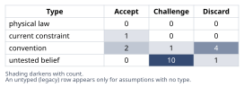
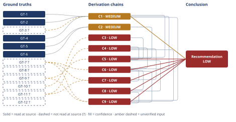

# Should You Take the SF Tech Job Over Portland

*First-principles analysis · 9 October 2026*

*Read with: [How to read this analysis](HOW-TO-READ.md) · [Working file](analysis-20261009T184345Z.md) · [All files](INDEX.md)*

## Executive Summary

**Recommendation:** Don't treat this as an accept/decline binary. First run two reversible moves in parallel: use the external offer as leverage with your current manager, and ask the SF company about remote or delayed-relocation terms (chain C9). Only accept exactly as offered if both fail and a real partner feasibility check comes back favorable (chain C5).

**Band (from §6):** LOW on the specific dollar figures, MEDIUM on the structural findings (chain C1).

**Would change it:** The partner's real Bay Area job-search feasibility (chain C4) and real, non-illustrative comp/vesting numbers (chain C1) — both are currently placeholders, not facts.

## 1. Problem Essence

**Essence Statement.** Should the user accept the SF company's offer under the terms as presented (relocate to the Bay Area, work hybrid 3 days/week in-office, +$70K nominal total comp), decline it and remain in the current fully-remote Portland role, or pursue a negotiated or composite third option — and which specific facts, not yet known, would most change that answer?

**Success criteria (checkable):**
1. States an expected-value comparison of *real* (not nominal) household economic gain across the viable options, net of Bay Area cost-of-living and state/local tax differences — not the headline $70K alone.
2. Explicitly prices the partner's career/income disruption as a cost term, not a footnote, even though it is currently unquantified.
3. Treats "accept exactly as offered" as one option among several, including negotiating remote/delayed-relocation terms, using the offer as leverage with the current employer, and a dual-household composite — not a forced binary.
4. States the reversibility/optionality of each path (what it costs to undo, and how fast).
5. Produces a recommendation and a decision rule — not "it depends" — plus the 2–4 highest-leverage clarifying questions that would most change that recommendation.

No success criterion requires the final answer to be literally "yes, take it" or "no, decline it" — a recommended *process* (e.g., negotiate first, then decide) satisfies these criteria if it is concrete and checkable.

## 2. Assumptions Table



| # | Assumption | Type | Treatment | Verdict | Verification |
|---|---|---|---|---|---|
| A-1 | The $70K comp delta equals real economic gain | convention (nominal-headline habit) | Challenge via Estimate (chain C5) | Discard — contradicted by chain C5; real gain is near zero to negative in the central case | See chain C5 |
| A-2 | Relocation + in-office-3-days is required exactly as offered, non-negotiable | untested belief | Ask the SF company directly whether remote, hybrid-light, or delayed-relocation terms exist | Challenge — negotiability unverified; ask the SF company directly (clarifying Q1) | Ask the recruiter/hiring manager before deciding (clarifying Q1) |
| A-3 | Partner's career is fixed/immovable in Portland | untested belief | Verify whether partner's field exists in the Bay Area, whether partner's employer has an unused remote option, whether skills/licensure transfer | Challenge — immovability unverified; joint Bay-Area feasibility check needed (clarifying Q3) | Joint Bay-Area feasibility check with partner (clarifying Q3) |
| A-4 | This is a one-time, irreversible choice | convention (framing habit) | Challenge: both paths are reversible at a cost, not at zero cost and not at infinite cost | Discard — both paths are reversible at a (differing) cost, per chain C6's reversibility axis | See chain C6 (reversibility axis) |
| A-5 | "Take the job" is a binary accept/decline choice | convention (offer-letter framing) | Challenge: enumerate the real option set, including composites | Discard — at least five distinct options exist, per chain C9 | See chain C9 (trade-off) |
| A-6 | Current employer has no counter-offer leverage available | untested belief | Verify by actually raising the external offer with the current manager | Challenge — untested; raise the external offer with the current manager (clarifying Q4) | Ask current manager/HR before deciding (clarifying Q4) |
| A-7 | The $70K is realized evenly starting in year 1 | untested belief | Verify the actual equity-vesting schedule/cliff structure of the written offer | Challenge — vesting schedule unverified; request the offer letter (clarifying Q2) | Request the offer letter's vesting schedule (clarifying Q2) |
| A-8 | Oregon/Portland is unambiguously the low-tax option, California the high-tax one | convention (popular reputation) | Challenge directly with GT-1, GT-2, GT-3?, GT-4 | Discard — contradicted by chain C1's direct computation at this income band | See chain C1 |
| A-9 | Remote work at the current employer is a stable, indefinite status quo | current constraint | Record expiry conditions: industry-wide RTO mandates are tightening; no entitlement to the status quo continuing | Accept — expires if/when the employer follows the 2025 industry RTO trend (GT-7?); contractual at-will, not physical | Ask current employer about remote-policy durability/precedent |
| A-10 | Bay Area commute is a minor quality-of-life detail | untested belief | Challenge: 3 days/week in-office in the Bay Area typically implies a material commute given regional housing/office geography | Discard — material enough to carry as an explicit cost line, per chain C3 | See chain C3 |
| A-11 | The relationship will survive the strain of this decision either way | untested belief | Cannot be verified from external data; this is the most values-dependent, person-specific variable in the analysis | Challenge — unverifiable from external data; a question for the couple, not this analysis | Direct joint conversation (not a research task) |
| A-12 | Equity value at the new employer is as "real" as cash at grant | untested belief | Equity carries market risk; grant value ≠ guaranteed vest-date value | Challenge — equity carries market risk; apply a haircut once real vesting data is known | Apply a discount scenario when real numbers are known |
| A-13 | "San Francisco" cost-of-living figures represent the whole Bay Area a hybrid employee could actually live in | convention / untested belief | GT-5/GT-6 are for San Francisco proper; a hybrid employee could live in a cheaper Bay Area suburb within commute range, trading cost for commute time | Challenge — GT-5/GT-6 are San Francisco-proper; a cheaper Bay Area suburb trades cost for commute time, reflected in chain C2's bracket low end | Reflected in chain C2's bracket low end |
| A-14 | The tax comparison can be run on single-filer brackets | convention (simplifying assumption, surfaced during Phase 4) | State explicitly; recompute with joint thresholds if the household files jointly | Accept — reasonable simplification; expires once filing status is known, recompute chain C1 then | Recompute chain C1 once filing status and real income are known |
| A-15 | A few years at a large, recognized tech company measurably increases future career/remote-negotiating optionality | untested belief (surfaced during Phase 4, chain C8) | This is a plausible but unproven career-capital claim, not a verified fact | Challenge — plausible but unproven career-capital claim; used only as a tie-breaker in chain C8, never as standalone justification | None available; a judgment call for the user, named as such |
| A-16 | Household "essential" monthly budget used in the COL estimate (illustrative $40K–$80K/yr) approximates this household's real spend | untested belief (surfaced during Phase 4, chain C2) | Explicit placeholder for an unknown real budget | Challenge — explicit placeholder; replace with the household's actual budget before acting on chain C2 | Replace with the household's actual budget |
| A-17 | The assumed ~1-hour-each-way Bay Area commute approximates the user's actual commute | untested belief (surfaced during Phase 4, chain C3) | Explicit placeholder pending a specific home/office pair | Challenge — placeholder pending a specific home/office pair | Confirm once a specific home/office location is known |
| A-18 | The tax, cost-of-living, commute, and partner-cost terms in chain C5 combine additively/independently, without material correlation between them | convention (simplifying assumption, surfaced during Phase 4, chain C5) | State explicitly; a correlated-shock scenario (e.g., a recession hitting both the partner's job search and equity value at once) could widen the real downside beyond C5's stated bracket | Accept — reasonable simplification; a correlated-shock scenario could widen the real downside beyond chain C5's stated bracket | None available without real data; named as a modeling simplification |
| A-19 | The trade-off criteria weights used in chain C9 (financial EV=5, reversibility=4, partner trajectory=5, user trajectory=3, relationship/process=5, quality of life=3, time=2) reflect this household's actual priorities | untested belief (surfaced during Phase 4, chain C9) | These weights are a reasonable illustrative default, not elicited from the user | Challenge — illustrative default, not elicited from the user; re-run chain C9 with the user's own weights before acting on it | Ask the user to confirm or re-weight the seven criteria |

## 3. Ground Truths

`?`-marked: GT-3, GT-7, GT-8, GT-9, GT-10, GT-11, GT-12 (7 of 12).

- **GT-1** — Oregon's top marginal individual income tax rate is 9.9%, applying to taxable income above $125,000 (single) / $250,000 (joint filers), within a four-bracket structure (4.75% / 6.75% / 8.75% / 9.9%). **Published design value** (statutory rate). Source: Tax Foundation, "Oregon," taxfoundation.org/statetaxindex/states/Oregon. Provenance: **read-at-source** — fetched directly; the statement "a top marginal rate of 9.9 percent" was located verbatim on the page.
- **GT-2** — California's top marginal individual income tax rate is 13.3% on income over $1,000,000, compounded by an uncapped 1.1% CA SDI payroll tax, for an all-in top marginal rate of 14.4%. **Published design value**. Source: Tax Foundation, "California," taxfoundation.org/statetaxindex/states/California. Provenance: **read-at-source** — fetched directly; the figure and the "14.4 percent" all-in combination were located verbatim on the page.
- **GT-3?** — California's commonly-cited mid-range bracket is 9.3%, applying to single-filer taxable income from roughly $72,725–$371,479 (2025). **Published design value** (if accurate). Provenance: **unverified**. Phase 3 failure record: the official source (ftb.ca.gov/forms/2024/2024-california-tax-rates-and-exemptions.html) returned HTTP 403 Forbidden; a secondary source (nerdwallet.com/taxes/learn/california-state-tax) was fetched but its bracket table did not appear in the retrieved content. The figure is widely reported by secondary tax sites but was not confirmed against an official table in this session.
- **GT-4** — Portland/Multnomah-area residents pay two additional local personal income taxes stacked on top of Oregon state tax: the Metro Supportive Housing Services (SHS) tax, 1% on income above $125,000 (single)/$200,000 (joint); and the Multnomah County Preschool for All (PFA) tax, 1.5% on income above the same thresholds, plus an additional 1.5% on income above $250,000 (single)/$400,000 (joint). **Published design value** (statutory local tax structure). Source: City of Portland Revenue Division, portland.gov/revenue/personal-tax. Provenance: **read-at-source** — fetched directly; both rate structures and thresholds were located verbatim on the page.
- **GT-5** — The San Francisco Bay Area's overall cost-of-living index is approximately 152 against Portland, OR's baseline of 100 — i.e., San Francisco is roughly 51.5% more expensive overall across a standard household basket. **Published estimate** (cost-of-living index methodology, not a direct measurement of any one household). Source: movenumbers.com/compare/portland-or-vs-san-francisco-ca. Provenance: **read-at-source** — fetched directly; "San Francisco, CA is 51.5% more expensive" and the 152-vs-100 index were located verbatim on the page.
- **GT-6** — Typical unfurnished 1-bedroom apartment rent: Portland median ≈ $1,655/month (range $1,580–$2,030); San Francisco median ≈ $2,950/month (range $2,510–$3,910) — a delta of roughly $1,295/month (~$15,540/year) for comparable 1BR housing. **Published estimate** (modeled rent index, not a specific unit's measured rent). Source: movenumbers.com/compare/portland-or-vs-san-francisco-ca. Provenance: **read-at-source** — fetched directly; both median figures and ranges were located verbatim on the page.
- **GT-7?** — Major employers tightened return-to-office mandates through 2025 (e.g., Amazon moved to 5-days-in-office in January 2025; Google pressured some remote staff toward office-or-buyout; AT&T and Dell issued 5-day mandates), even as roughly 67% of companies still offer some hybrid flexibility and roughly 22% of workers remain fully remote. **Estimate/survey figures**, not a direct measurement. Provenance: **unverified**. Phase 3 failure record: both candidate primary sources (axios.com/2025/01/01/back-to-work-office-companies and costar.com/article/102840689/…) returned HTTP 403 Forbidden when fetched directly; the figures above come only from a WebSearch synthesis that cited those pages, which this analysis did not open.
- **GT-8?** — (Context only, not used in any derivation chain) Median home value is reported as roughly $1.25M in San Francisco vs. $535K in Portland. Provenance: **unverified** — this figure appeared only in an earlier, broader WebSearch synthesis and was not confirmed in the direct fetch of the cost-of-living page used for GT-5/GT-6; it is not cited in any chain below and does not bear on this analysis's confidence ratings.
- **GT-9?** — User-stated: the new offer represents +$70,000/year in total compensation (base + equity) versus the current role. Provenance: **unverified** — no source beyond the user's own statement; no offer letter or vesting schedule has been reviewed in this session.
- **GT-10?** — User-stated: the new role requires relocation to the SF Bay Area and in-office work 3 days/week (hybrid). Provenance: **unverified** — stated as given; A-2 above challenges whether this term is actually fixed.
- **GT-11?** — User-stated: the partner has an established, Portland-based career with no remote option, such that relocation would force the partner to leave their job/career path. Provenance: **unverified** — stated as given; A-3 above challenges whether this has been fully tested rather than assumed.
- **GT-12?** — User-stated: the user has worked 5 years at the current, fully-remote Portland employer. Provenance: **unverified** (no independent source — a low-stakes self-reported biographical fact) — not used in any tax/COL-sensitive chain, so it does not affect any chain's confidence band.

All dollar figures used in the Derivation Chains below that are *not* one of GT-1 through GT-12 (e.g., the $190K/$260K illustrative household comp levels, the $40K–$80K illustrative essential-budget range, the commute-time and time-valuation figures) are **explicitly labeled estimates/illustrative placeholders**, not measured facts and not the user's actual numbers — see chains C1–C5 and the Abandoned Reasoning note on a discarded, inconsistent cost-of-living figure.

## 4. Derivation Chains



**C1 — Real tax-system effect of relocating (challenges A-8)**

```text
GT-1 (OR top rate 9.9% above $125K/$250K) + GT-4 (Metro SHS 1% and Multnomah PFA 1.5-3% above thresholds) + GT-3? (CA mid-bracket 9.3% from ~$72,725-$371,479) + GT-2 (CA top rate 13.3%/14.4% all-in)
→ stacking GT-1 and GT-4 on an illustrative $190,000 Portland income yields OR state tax of about $17,072 plus local taxes of about $1,625, a combined $18,696 (9.84% effective) [Assumes: A-14]
→ stacking GT-2/GT-3? on an illustrative $260,000 San Francisco income (the same household after the +$70K raise) yields CA state tax of about $20,619 plus CA SDI of about $2,860, a combined $23,479 (9.03% effective)
→ the after-state/local-tax delta between the two scenarios is $236,521 minus $171,304, which equals $65,217, against a nominal pre-tax delta of $70,000 - only about $4,783 (roughly 7%) of the raise is lost to the combined effect of switching tax jurisdictions
→ the popular framing that Oregon is unambiguously low-tax and California unambiguously high-tax does not hold at this income band once Multnomah County's stacked local surtaxes are counted - the two systems land close to a wash on the margin
```

**Confidence:** MEDIUM — Inputs axis short (GT-3? unverified: the FTB rate table returned 403 Forbidden and a secondary source did not display the bracket table); Inference axis also carries [Assumes: A-14] (single-filer brackets used; joint thresholds roughly double but the qualitative result likely still holds); Rivals axis clean (no competing reading of the same statutes is live). Verification: open an authoritative CA bracket table to confirm the 9.3% figure, and rerun with the household's actual filing status.

**C2 — Cost-of-living premium estimate (Estimate technique)**

```text
GT-5 (SF Bay Area COL index approx 152 vs Portland 100, i.e. 51.5% higher) + GT-6 (1BR rent delta approx $1,295/mo, approx $15,540/yr)
→ applying the 51.5% COL multiplier to an illustrative household essential-spend range of $40,000-$80,000/year covering housing, food, utilities, transport and routine health [Assumes: A-16]
→ yields a Bay Area cost-of-equivalent-living-standard premium of $20,600-$41,200/year, central approximately $30,900/year
→ this premium is the single largest cost line in the decision and is driven mostly by housing, consistent with GT-6's $15,540/year 1BR rent delta sitting near the bracket's low end
```

**Confidence:** MEDIUM — Inputs axis clean (both GTs read-at-source); Inference axis short because the $40K-$80K household budget is an illustrative placeholder [Assumes: A-16], not the user's real spend; Rivals axis clean. Verification: substitute the household's actual essential-spend budget.

**C3 — Commute time-cost estimate**

```text
GT-10? (new role requires in-office 3 days/week in the Bay Area)
→ assuming an illustrative 1-hour each-way commute, 3 days/week, 50 weeks/year yields about 300 commute hours/year not required under the current fully-remote arrangement [Assumes: A-17]
→ valuing that time at an illustrative post-tax rate of $35-$85/hour yields a commute time-cost bracket of $10,500-$25,500/year, central approximately $15,000/year
→ this figure is a soft, debatable cost rather than a market fact, carried as a wide bracket for that reason
```

**Confidence:** LOW — Inputs axis short (GT-10? unverified, and the commute-duration figure itself is not sourced this session) and Inference axis short (hourly valuation of commute time is a contested judgment call); Rivals axis live and unresolved (a reading in which commute time carries no dollar cost at all is equally defensible). Verification: get the actual anticipated commute for a specific home/office pairing, and have the user state a personal time-valuation.

**C4 — Partner career-disruption estimate (the dominant uncertainty)**

```text
GT-11? (partner's career stated as immovable, no remote option)
→ low case: the partner's skills transfer well and a comparable or better Bay Area role is found within roughly 3-6 months, illustrative transition cost $0-$15,000
→ central case: the partner needs roughly 6-12 months and/or accepts a lower-level or lower-paid role, illustrative sustained cost $20,000-$30,000/year
→ high case: the partner's career is genuinely non-transferable (licensure, employer-specific tenure, a Portland-concentrated industry) and comparable work is not found, illustrative sustained cost $50,000/year or more, indefinitely
→ this bracket is built on zero direct information about the partner's actual field, income, or job-search prospects, and is named here as the single largest open unknown in the whole analysis
```

**Confidence:** LOW — Inputs axis short (GT-11? unverified) and Inference axis short (the entire bracket is illustrative, with no data on the partner's field or income); Rivals axis live and unresolved (a reading in which the partner's field is in high Bay Area demand, net cost near zero, is equally defensible on current information). Verification: the joint Bay-Area feasibility check named in clarifying question 3 - the single highest-leverage fact gatherable here.

**C5 — Composite real net economic delta**

```text
C1 (MEDIUM) + C2 (MEDIUM) + C3 (LOW) + C4 (LOW) + GT-9? (nominal $70,000/year higher)
→ central-case real net economic delta equals $70,000 minus $4,782 (tax friction, C1) minus $30,900 (COL premium, C2) minus $15,000 (commute cost, C3) minus $25,000 (partner cost, central, C4), approximately -$5,682/year [Assumes: A-18]
→ low-case (favorable) bracket end equals $70,000 minus $4,782 minus $20,600 minus $10,500 minus $5,000, approximately +$29,100/year
→ high-case (unfavorable) bracket end equals $70,000 minus $4,782 minus $41,200 minus $25,500 minus $50,000, approximately -$51,500/year
→ the bracket runs from roughly -$51,500 to +$29,100/year and straddles zero, so per the Estimate procedure's own decision-resolution stop criterion this estimate alone does not resolve the decision - that straddle is the headline finding, not a defect to paper over with false precision
```

**Confidence:** LOW — capped by C3 and C4 on the Inputs axis; Inference axis also short because the composite sums four independently-uncertain terms with no correlation adjustment; Rivals axis resolved only to the extent C1-C4 already resolved it. Verification: the clarifying questions in order of leverage - partner's real situation (C4), real comp/vesting numbers (replacing illustrative GT-9?/C1 inputs), real household budget (C2), actual commute (C3).

**C6 — Inversion: obvious-bad-idea / obvious-good-idea conditions**

```text
C4 (LOW) + C1 (MEDIUM) + GT-7? (2025 industry-wide RTO tightening)
→ obvious-bad-idea conditions, inverted from the headline question: the partner cannot find comparable Bay Area work, and the current remote arrangement is actually durable, and relocation requires large upfront sunk costs, and the new role's hybrid terms are non-negotiable
→ obvious-good-idea conditions, inverted the other way: the partner's career transfers well or the partner independently wants the move, and the current employer's remote stability is fragile per GT-7?, and the new role carries real career-capital value beyond cash, and the relocation/hybrid terms are negotiable
→ the actual decision levers are therefore negotiability (A-2) and partner transferability (A-3/GT-11?) rather than the $70,000 headline figure, which C5 already shows is close to a wash
```

**Confidence:** LOW — capped by C4; the inversion structure itself is sound (Inference axis clean) but every Ground Truth/chain it cites is uncertain. Verification: same as C4, plus the A-2 negotiability check.

**C7 — Pre-mortem: how this fails in two years**

```text
C4 (LOW) + C6 (LOW) + GT-11? + GT-7?
→ premise: it is two years later and this decision has already failed
→ causes from the user's own viewpoint: the equity was worth less at vest than at grant, promotion/leveling did not materialize, the hybrid policy crept toward full RTO per GT-7?, and the pace of the new role caused burnout relative to the prior remote flexibility
→ causes from the partner's viewpoint: no comparable Bay Area role was ever found, a lower-level or lower-paid job was accepted, and the Portland professional network and seniority were lost with nothing equivalent rebuilt
→ causes from the relationship's viewpoint: the decision was made under the offer's deadline pressure without a full joint feasibility check, and the partner's sacrifice was treated as a foregone conclusion rather than a negotiated, informed choice
→ these cluster into four structural weaknesses, triaged and given a disposition in the adversarial pass record (process output)
```

**Confidence:** LOW — this chain is a structural risk map rather than a point estimate; its value is in the clusters and dispositions in the adversarial pass record, all of which trace back to the same unresolved C4/GT-7? uncertainty.

**C8 — Second-order effects (actor lens + time lens)**

```text
C6 (LOW) + C5 (LOW)
→ actor lens: the user's future self gains a "big tech" credential; the current employer loses a 5-year senior engineer and may not re-offer the same remote terms later; the new employer evaluates this hire against big-tech leveling norms, often harsher than a stable remote role's; the partner's job-search behavior and network determine whether their career resets or merely pauses; a future employer evaluating the user's resume may weight Bay Area big-tech experience favorably when negotiating remote arrangements elsewhere
→ time lens: immediately, relocation logistics and the partner's job search begin and C5's COL/commute costs start accruing; after a few cycles (one to two years), the promotion/vesting cycle resolves and the partner's career either stabilizes or does not; over the long horizon (five-plus years), the brand credential may expand future remote-negotiating leverage, or the household may instead be left holding sunk relocation costs if the arrangement does not work out
→ the main long-run upside not captured in the $70K/COL framing is this brand/network career capital, which could be worth more than the immediate cash delta if the user's long-term goal includes maximizing future remote optionality [Assumes: A-15]
→ no step here contradicts a Ground Truth; this extends C5/C6 rather than overturning them, and is used only as a tie-breaker, never as a standalone justification, given C5's near-zero central case
```

**Confidence:** LOW — Inference axis short via [Assumes: A-15], a plausible but unverified career-capital claim; Rivals axis live and unresolved (a reading in which brand capital from one employer rarely transfers cleanly is equally defensible). Verification: not independently verifiable in general - named honestly as a value judgment, not a pending fact.

**C9 — Trade-off analysis across the real option set**

```text
GT-9? + GT-7? + C1 (MEDIUM) + C4 (LOW) + C6 (LOW) + C8 (LOW)
→ five options (A: decline/status quo, B: accept as offered, C: negotiate delayed relocation/remote trial, D: use the offer as leverage and stay, E: accept with a dual-household/long-distance arrangement) are scored against seven weighted, anchored criteria locked before scoring: household financial EV (weight 5), reversibility (weight 4), partner's trajectory (weight 5), user's trajectory (weight 3), relationship/decision-process quality (weight 5), quality of life (weight 3), time-to-resolution (weight 2) [Assumes: A-19]
→ weighted totals: D = 121, A = 110, C = 104, B = 64, E = 61
→ the flip test shows D Pareto-dominates or near-dominates A and C on every single criterion except one (user career trajectory, where C and B score one point higher), so no realistic single-criterion reweighting changes the ranking at the top - D's robustness does not depend on resolving any of C4/C5's open uncertainty, which is precisely why it ranks first
→ B and E are clearly dominated under this weighting, independent of the exact dollar figures in C5, because they are the only two options that commit to the relocation's costs before the open questions (C4, A-2) are answered
```

**Confidence:** LOW on the absolute scores, which rest on the same unverified inputs as C1-C8; but the qualitative ranking - D and C ahead of B, with A close behind D - is robust to the flip test performed and does not require resolving C4/C5's open uncertainty, since D's and C's appeal is precisely that they avoid committing to it. Rivals: a reweighting that prioritizes user career trajectory above all else could favor B/C over D, but that reweighting was checked explicitly in the flip test and found to require an unrealistic weight (roughly 7x the locked weight) to flip the ranking.

## 5. Abandoned Reasoning

- **Rival ruled out: "Oregon/Multnomah County is unambiguously lower-tax than California at this income."** Tested directly against GT-1, GT-2, GT-3? and GT-4 in chain C1; the stacked Metro SHS and Multnomah PFA local taxes push the Portland-area combined burden to roughly parity with, or above, California's burden at the same income level. Ruled out by chain C1.
- **Rival ruled out: "Decline outright — the case is net negative independent of the open unknowns."** This overclaims certainty the Ground Truths do not support: chain C5's low-case bracket end is positive (+$29,100/year), and the inputs that would need to resolve negative to justify a flat "decline" (partner transferability, relocation negotiability) are genuinely unverified rather than resolved unfavorably. Ruled out by chain C5's bracket and chain C9's trade-off scoring (A scores second, not first).
- **Rival ruled out: "Accept unconditionally — the big-tech brand value alone justifies it regardless of near-term financials."** This rests on an unverified career-capital claim (A-15) and ignores the pre-mortem's Clusters B and D (partner sacrifice unpriced; decision made without joint buy-in), which can produce relationship harm independent of the financial outcome. Ruled out by chain C8's explicit flag and chain C7's clusters B/D.
- **Dead end: monetizing commute time at the user's full hourly wage rate.** Initially used full post-tax wage rate as the commute time-value; reconsidered because valuing commute time at full wage rate is methodologically contested (commute time is not foregone billable work, it is foregone leisure/rest), and reverted to a wide $35-$85/hour bracket (chain C3) rather than defending one rate.
- **Dead end: an earlier WebSearch-reported figure claiming "$150K in the current city equals $119.4K in Portland."** This number was discarded because it implied a cost-of-living ratio (roughly 1.26x) inconsistent with the directly-fetched, same-source-page figure used for GT-5 (1.515x, "San Francisco, CA is 51.5% more expensive"); the discarded figure most likely originated from a different city-pair comparison returned in the same batch of search results (the search tool also surfaced Sacramento-vs-Portland and other pairs). Per Phase 3, a figure from an unopened source that conflicts with a figure this analysis did open at source is not used.
- **Dead end: treating California's 9.3% mid-bracket figure and the 2025 RTO-tightening figures as confirmed.** Attempts to open the authoritative sources (ftb.ca.gov, axios.com, costar.com) all returned HTTP 403 Forbidden; rather than silently accepting the secondary-source figures as verified, they are carried as GT-3? and GT-7? with Phase 3 failure records in Section 3.

## 6. Conclusion

**Recommended approach:** Do not treat this as an accept/decline binary yet. Run two low-cost, reversible moves in parallel, before the offer's deadline: (1) take the external offer to the current manager as negotiating leverage (Option D) — this plausibly captures a meaningful share of the comp gap with none of the relocation or partner cost; and (2) ask the SF company whether a remote, hybrid-light, or delayed-relocation arrangement (Option C) is available, at least as a trial period. In parallel, get the actual equity-vesting schedule and real comp figures (replacing the illustrative $190K/$260K used here), and run a joint, explicit Bay-Area feasibility check with the partner rather than treating "the partner's career is fixed" as settled. Only accept the offer exactly as written (Option B) if both D and C fail to materialize and the partner's feasibility check comes back genuinely favorable, or the couple jointly decides the near-breakeven financial case (chain C5) is worth it for other reasons (chain C8) (chain C9).

**Key insight:** The headline $70K is financially close to a wash once real Bay Area cost-of-living and (if it materializes) partner career disruption are netted out — central case roughly -$5,700/year, bracket -$51,500 to +$29,100/year (chain C5) — and, contrary to the popular "Oregon low-tax, California high-tax" framing, the state/local tax system barely moves the needle this time (chain C1). The two things that actually decide this are whether the relocation terms are negotiable at all, and what really happens to the partner's income and career — presently the largest unpriced unknown in the whole decision (chain C4, chain C6).

**Trade-offs acknowledged:** Taking the job as offered, even though roughly financially neutral, could still be right for non-financial career-capital reasons (brand, scope, future remote-negotiating leverage) if the user's long-term goals favor that (chain C8) — but that reasoning is a judgment call [Assumes: A-15], not a fact, and should never be used to override the partner's stake in the decision (chain C7, clusters B and D). Conversely, staying is itself not risk-free: the current remote arrangement is not guaranteed to be stable given the 2025 industry-wide RTO-tightening trend (chain C6).

**Confidence:** LOW on the specific dollar figures — they rest on illustrative, not actual, comp/budget numbers, and on unverified inputs (GT-9?, GT-11?, GT-7?) — but MEDIUM on the structural findings: (a) the popular tax framing is wrong at this income level (chain C1, built on read-at-source GT-1/GT-4, capped only by the unread CA mid-bracket figure GT-3?), and (b) the decision should not be made as a binary "take it or don't" without first testing the negotiability and partner-feasibility assumptions (chains C6, C9). Rivals: the three rivals considered (flat decline, unconditional accept, "Oregon is just cheaper") are all ruled out in Section 5; no live rival to the recommended approach itself remains unresolved.

**Highest-leverage clarifying questions (answering any one of these would most change the recommendation):**
1. Is the relocation / in-office-3-days term actually fixed, or will the SF company negotiate remote, hybrid-light, or a delayed-relocation trial period? (drives chain C6, and whether this is even a real binary — Option C's viability)
2. What is the real total comp at both employers today, and what is the exact equity-vesting schedule behind the $70K? (replaces the illustrative $190K/$260K figures throughout chains C1 and C5 with real numbers)
3. What is the partner's actual field, current income, and a real (not assumed) Bay-Area job-search feasibility assessment — has this even been investigated yet? (drives chain C4, the single largest swing factor in chain C5 and the whole decision)
4. Has the user raised this external offer with their current manager, and is a counter-offer realistic? (tests Option D, which chain C9's trade-off analysis ranks first and which captures much of the financial upside with none of the relocation or partner cost)
