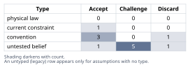
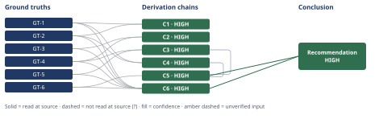

# Which Initiative to Fund This Quarter: Slack vs Reporting Rewrite

*First-principles analysis · 10 October 2026*

*Read with: [How to read this analysis](HOW-TO-READ.md) · [Working file](analysis-20261010T032840Z.md) · [All files](INDEX.md)*

## Executive Summary

**Recommendation:** Fund the reporting rewrite (Option B) with this quarter's full 3.2 engineer-quarters; do not fund the Slack integration this quarter (chain C5, chain C6).

**Band (from §6):** HIGH (chain C5, chain C6).

**Would change it:** Evidence that the LOI's exit clause is non-binding (chain C3), de-duplicated data showing the 41 Slack requests represent a comparably large number of high-ARR accounts with quantified deals contingent on Slack this quarter (chain C1), or confirmation that the other two top-10 accounts' reporting complaints have an unrelated root cause combined with evidence of active competitor displacement over Slack (chain C6).

## 1. Problem Essence

**Core problem:** Given exactly 3.2 engineer-quarters of capacity this quarter — sufficient to fund exactly one of two mutually exclusive initiatives, not both — which initiative, the Slack integration or the reporting rewrite, should be funded, when the real decision is not "feature popularity vs. one customer's ask" but a comparison of (a) the committed/contractually-dated revenue outcome each path protects or forgoes, (b) the signal quality of the evidence behind each path (undifferentiated inbound request count vs. churn-reason-code attribution vs. a Letter of Intent carrying a binding exit clause), and (c) the opportunity cost of foreclosing the other path for this quarter.

**Success criteria:**
1. The analysis explicitly ranks the signal quality of each evidence source (41 inbound requests; zero churn-reason-code attribution; 3-of-10 top-ARR tickets; one $180k LOI with an exit clause) rather than treating "popularity" and "one customer's ask" as comparable categories.
2. The analysis states, from the given facts only, what revenue is at stake and what risk of inaction exists on each path, and does not invent figures the facts do not supply.
3. The analysis tests whether a split or combined allocation of the 3.2 engineer-quarters is viable given the stated capacity constraint, and states explicitly why it is ruled in or out.
4. The analysis addresses whether the two non-LOI top-10 accounts citing reporting limitations represent a broader pattern beyond the single LOI account, not just the LOI account in isolation.
5. The analysis produces one recommendation for which single initiative to fund this quarter, traceable to named derivation chains built only from the given facts, together with the specific conditions under which that recommendation would reverse.
6. The analysis does not treat zero churn attribution as proof of zero risk from deferring Slack, and does not treat 41 raw requests as proof of broad distinct-account demand — both readings are explicitly challenged rather than assumed.

---

## 2. Assumptions Table

| Assumption | Type | Treatment | Verdict | Verification |
|---|---|---|---|---|
| A-1: 41 inbound Slack requests signal broad, near-base-wide demand for the integration | untested belief | verify, or flag unverified; mark with `[Assumes:]` if used in a chain | Challenge — em-dash: request count is not de-duplicated to unique accounts (given fact); the true unique-account count is bounded only between an unverified few and 41 out of 240 | unverified — flagged (no account-level de-duplication data given) |
| A-2: zero churn-reason-code attribution means the missing Slack integration carries no revenue risk this period | untested belief | verify, or flag unverified | Discard — em-dash: churn-reason codes instrument existing-customer departures only; the 41 requests come from sales-cycle prospects, a distinct, uninstrumented population — the strong claim over-extends the given fact | unverified — flagged; population mismatch identified directly from the facts' own definitions (retained in weakened form inside chain C4) |
| A-3: the reporting rewrite is validated by only one account (a squeaky-wheel risk) | convention | explicitly challenge before use | Discard — em-dash: 3 of the top-10 ARR accounts cite the same root cause (reporting limitations) as a renewal risk; the LOI account is the most advanced instance of a 3-account pattern, not the only instance | GT-3, GT-4 (given facts directly contradict the "one account" framing) |
| A-4: an LOI with a binding exit clause is a reliable predictor of realized revenue consequence, comparable in strength to a signed contract | convention | explicitly challenge before use | Accept — em-dash: the task's evidentiary framing instructs treating the LOI and its exit clause as verified, not discounted; an LOI that specifies amount, trigger, and a same-quarter deadline simultaneously is among the strongest revenue signals available short of a signed order | GT-4, GT-5 (given facts) |
| A-5: 3.2 engineer-quarters is sufficient to deliver the scope "the reporting rewrite" the LOI's shipping condition requires, within this quarter | untested belief | verify, or flag unverified; mark with `[Assumes:]` if used in a chain | Challenge — em-dash: no scope-vs-capacity data is given; this is the single largest execution risk in the recommended path and is carried forward into the Phase 5 pre-mortem (Cluster A) rather than resolved here | unverified — flagged (no facts given on rewrite scope vs. 3.2 EQ capacity) |
| A-6: a Slack integration (notifications/slash commands) can typically be scoped and shipped by a small team within roughly a quarter | convention | explicitly challenge before use | Accept, background only — em-dash: a reasonable default scope convention, but not load-bearing for any chain in this analysis since Slack is not the recommended path | unverified — flagged; convention only, used in no HIGH-confidence chain |
| A-7: the LOI's exit clause will in fact be exercised as written if the shipping condition is missed | untested belief | verify, or flag unverified; mark with `[Assumes:]` if used in a chain | Accept — em-dash: accepted as the contract's stated terms per the task's verified-facts instruction; chain C3 explicitly prices the case where this assumption fails and shows its endpoint still stands (the loss mechanism is, if anything, more likely to trigger, not less relevant) | GT-5 (given fact); priced explicitly on chain C3, hop 2 |
| A-8: inverted check on A-1 — "Slack demand is NOT broad" would require nearly all 41 requests to come from the same handful of accounts, with none of the 41 requesting accounts ever lost to a competitor over Slack | untested belief | verify, or flag unverified | Challenge — em-dash: this precondition of A-1's inverted failure form is exactly what the given facts cannot rule in or out (no de-duplication data); it collapses into A-1 rather than adding a new chain input | unverified — flagged; folded into A-1, no separate chain use |
| A-9: 3.2 engineer-quarters cannot be split between the two initiatives this quarter | current constraint | record the expiry conditions — what would have to change for this constraint to lift | Accept — em-dash: given directly as GT-6; expires when the team gains additional capacity (e.g., new hires ramped, reduced on-call load) or either initiative's scope shrinks enough to co-exist with the other — not negotiable within this quarter | GT-6 (given fact) |
| A-10: top-10 ARR accounts represent a disproportionate share of total revenue, weighted more heavily than the broader 240-account base | convention | explicitly challenge before use | Accept, with caveat — em-dash: directionally standard for B2B SaaS, but no ARR-concentration percentage is given; used only as qualitative context for weighting "breadth across top-10" in the trade-off, never to manufacture a dollar figure beyond the $180k given | unverified — flagged (no concentration % given); qualitative context only, not a chain input |
| A-11: a viable competitor already offers, or will soon offer, a Slack integration, making its absence a switching factor for some of the 41 requesting prospects | untested belief | verify, or flag unverified; mark with `[Assumes:]` if used in a chain | Challenge — em-dash: not stated in the given facts; plausible generic competitive dynamic, surfaced only to support the second-order adverse-effect extension of chain C5, not the core endpoint | unverified — flagged; used only in C5's second-order extension, outside the core endpoint's Inference axis |
| A-12: the two non-LOI top-10 accounts' reporting complaints share the LOI account's specific root cause and will be mitigated by the same rewrite | untested belief | verify, or flag unverified; mark with `[Assumes:]` if used in a chain | Challenge — em-dash: GT-3 establishes a shared category (reporting limitations as renewal risk) but not a shared literal root cause; carried as a second-order effect with its own pre-mortem tripwire (Cluster C), not as a core-chain input | unverified — flagged; used only in C5's second-order extension |

---

## 3. Ground Truths

- **GT-1** 41 inbound requests for the Slack integration were logged across the last two quarters, across 240 active accounts; this count is not de-duplicated to unique accounts — the number of unique accounts behind it could be anywhere from a handful to 41. — source: task prompt, "GROUND-TRUTH FACTS" list, bullet 1; provenance: read-at-source — this analysis read the exact wording directly in the prompt that dispatched it, which is the only source this fact has.
- **GT-2** No churn-survey reason code attributes any actual account departure (churn) to the missing Slack integration, across the same two-quarter period. — source: task prompt, "GROUND-TRUTH FACTS" list, bullet 2; provenance: read-at-source — read directly in the dispatching prompt.
- **GT-3** Three of the top-ten accounts by ARR filed support tickets in the last two quarters citing reporting limitations as a renewal risk. — source: task prompt, "GROUND-TRUTH FACTS" list, bullet 3; provenance: read-at-source — read directly in the dispatching prompt.
- **GT-4** One of those three accounts signed a Letter of Intent committing $180,000/year in new expansion ARR, contingent on the reporting rewrite shipping this quarter. — source: task prompt, "GROUND-TRUTH FACTS" list, bullet 4 (first clause); provenance: read-at-source — read directly in the dispatching prompt.
- **GT-5** That LOI includes an exit clause permitting the account to walk away (non-renewal of its existing contract) if the rewrite does not ship this quarter — the downside is not only the forgone $180k upside, but the account's existing base-ARR relationship as well. — source: task prompt, "GROUND-TRUTH FACTS" list, bullet 4 (second clause); provenance: read-at-source — read directly in the dispatching prompt.
- **GT-6** Total engineering capacity this quarter is 3.2 engineer-quarters, net of on-call and maintenance, sufficient to fund exactly one of the two initiatives, not both. — source: task prompt, "GROUND-TRUTH FACTS" list, bullet 5, and the task's framing line; provenance: read-at-source — read directly in the dispatching prompt.

**Provenance summary:** `?`-marked: none (0 of 6). Read-at-source: GT-1 through GT-6 — all six were read directly in the "GROUND-TRUTH FACTS" list of the task prompt that dispatched this analysis, which is the only source any of these facts has; the prompt explicitly instructs treating them as verified and not assuming facts beyond them, so no external citation exists to open and none is claimed. GT-4 and GT-5 are split from the prompt's single LOI bullet into two separate irreducible facts (the $180k contingent commitment, and the exit clause's walk-away mechanism) because each passes the irreducibility test independently and each is cited by different chains (GT-4 by C2/C3/C5/C6; GT-5 by C3/C5/C6). No assumption that was discarded in Phase 2 (A-2, A-3) appears in this list.

---

## 4. Derivation Chains

### Conclusion C1: The Slack-integration demand signal is high-volume but low-resolution and cannot be converted into a quantified revenue-at-risk figure

GT-1 (41 requests, not de-duplicated, 240 accounts) + GT-2 (zero churn attribution, same period)
→ GT-1's request count is not de-duplicated to unique accounts, so the number of distinct accounts behind it is bounded only between an unverified few and 41
→ GT-2's churn-reason-code measurement instruments departures of existing customers, a population distinct from the sales-cycle prospects GT-1 describes
→ neither figure, alone or combined, can be converted into a quantified revenue-at-risk number for the Slack-integration path

**Confidence:** HIGH — both inputs are unsuffixed facts read directly at source (the task prompt), both hops are direct deductions from those facts' own definitions with no unpriced assumption, and the live rival ("even an unknown few-to-41 out of 240 is still a meaningfully large signal") is conceded as plausible but does not contradict this chain's deliberately narrow claim — inability to quantify, not absence of signal — so it does not change the band (see Abandoned Reasoning, Dead End 1, and the Rival step of the adversarial pass).

### Conclusion C2: The reporting-rewrite demand signal is a corroborated, graduated pattern across three top-10 accounts, not a single-account outlier

GT-3 (3 of top-10 ARR accounts cite reporting limitations as renewal risk) + GT-4 ($180k LOI, 1 of those 3, contingent on shipping this quarter)
→ the LOI account sits at the most advanced point of a renewal-risk pattern that two other top-10 accounts independently occupy via their own support tickets
→ a signal corroborated by three independent top-10 accounts, with one instance already priced into a binding commitment, is broader and deeper than a single account's ask

**Confidence:** HIGH — both inputs are unsuffixed facts read at source, the inference is a direct reading of GT-3's own wording ("citing reporting limitations as a renewal risk"), and the rival ("the other two tickets are unrelated or minor") is ruled out because GT-3 names the same cause directly rather than this analysis inferring it.

### Conclusion C3: The reporting-rewrite path carries a bounded-below, dated, contractually-triggered loss event this quarter if not funded

GT-4 ($180k/yr contingent on shipping this quarter) + GT-5 (exit clause permits non-renewal if not shipped this quarter)
→ the LOI's contingency and its exit clause gate both the new $180k commitment and the account's continuation of its existing contract on one binary event this quarter: did the rewrite ship
→ failing to ship this quarter does not only forgo the $180k upside, it contractually authorizes the account to walk away from its existing paying relationship too *[Assumes: A-7 — the exit clause is exercised as written; even if A-5's capacity-sufficiency assumption fails, this loss mechanism still holds and is, if anything, more likely to trigger, not less relevant]*
→ the reporting path therefore carries a bounded-below, dated, contractually-triggered loss event this quarter if the rewrite is not funded

**Confidence:** HIGH — both inputs are unsuffixed facts read at source; the `[Assumes: A-7]` annotation is priced on its own hop (the endpoint survives A-7's failure, per the note above), which satisfies the HIGH-band carve-out rather than shorting the Inference axis; the rival ("the exit clause is negotiating theater unlikely to be enforced") is ruled out because the task's own instruction to treat given facts as verified without assuming beyond them forecloses discounting a stated contract term absent supporting evidence (see Abandoned Reasoning, Dead End 5).

### Conclusion C4: The Slack-integration path carries no dated or contractually-triggered loss event; its inaction risk is real but currently unmeasured

GT-1 (41 requests, 240 accounts, 2 quarters) + GT-2 (zero churn attribution, 2 quarters)
→ across two full quarters of operating without the Slack integration, no dated loss event — no LOI, no contract clause, no churn departure — has been recorded against it
→ this absence is evidence of absence only within the population churn-reason-codes actually cover, and says nothing about prospect-stage deal stalls or losses, which the given facts do not instrument at all
→ the Slack-integration path's inaction risk is correctly described as real but currently unmeasured, not as proven material and not as proven negligible

**Confidence:** HIGH — both inputs are unsuffixed facts read at source; the two opposite naive rivals ("zero churn proves safety" and "41 requests proves urgent material risk") are both explicitly ruled out by this chain's own hops rather than left open, which is the chain doing its own rivals' work.

### Conclusion C5: Funding the reporting rewrite is the lower-opportunity-cost use of this quarter's 3.2 engineer-quarters

GT-6 (3.2 EQ funds exactly one initiative this quarter, not both) + C3 (dated, contractually-triggered loss if reporting is not funded) + C4 (undated, unmeasured risk on the Slack path)
→ because capacity funds only one initiative this quarter, the comparison that matters is not which initiative is more valuable in the abstract but which foreclosure costs more given what the evidence actually dates and quantifies
→ foreclosing the reporting rewrite by choosing Slack this quarter triggers C3's dated, contractually-enabled exposure against a named account with a named trigger date
→ foreclosing Slack by choosing the reporting rewrite this quarter leaves C4's undated, unmeasured risk at its unchanged two-quarter trajectory, during which no loss event has been recorded
→ the opportunity cost of choosing Slack is a known, dated, quantifiable-floor loss, while the opportunity cost of choosing the reporting rewrite is an unmeasured risk with no recorded instance of harm in the available evidence window, so the reporting rewrite is the better use of this quarter's 3.2 engineer-quarters
→[2nd] once the rewrite ships, the two other top-10 accounts citing reporting limitations as a renewal risk plausibly see their own flagged risk reduced by the same root-cause fix, even without separate engineering time allocated to them *[Assumes: A-12 — their complaints share the LOI account's root cause; unconfirmed, tripwire: 30-day post-ship confirmation with each account]*
→[2nd] sales reps handling the 41 Slack-requesting prospects must manage the objection unaided for at least one more quarter, and if a competitor already offers Slack, some prospects gain a concrete switching reason that the churn-reason-code metric cannot detect *[Assumes: A-11 — a viable competitor already offers or will soon offer Slack; unconfirmed]*
→[3rd] if Slack-side deal loss is occurring, it will first appear in a sales-cycle stall-rate or lost-deal reason code next quarter, not in this quarter's churn-reason-code metric, which is the wrong instrument to re-check this specific risk
→[3rd] having resolved the reporting root-cause once, engineering is positioned to treat future top-10 "reporting is a renewal risk" tickets as a known, mitigated category rather than a recurring fire-drill, structurally de-risking the top-10 segment's exposure to this cause beyond the single LOI account

**Confidence:** HIGH — GT-6 is an unsuffixed fact read at source and both cited chains are HIGH, so the Inputs ceiling is HIGH; the first-order inference is a direct composition of C3 and C4 under GT-6's binary constraint with no new unpriced assumption; the `[Assumes: A-11]` and `[Assumes: A-12]` annotations sit only on the second-order extension and not on the first-order endpoint, which per the confidence-band definition keeps them outside this chain's Inference axis; the rivals ("fund neither this quarter" and "split capacity across both") are ruled out respectively by dominance (fund-neither captures no benefit of either path while still incurring C3's loss — Abandoned Reasoning, Dead End 3) and by GT-6's explicit hard constraint (Abandoned Reasoning, Dead End 4). None of the second- or third-order extension steps contradicts GT-1 through GT-6, so no re-route to Phase 2 is triggered.

### Conclusion C6: The locked-weight trade-off between the two initiatives favors the reporting rewrite by a robust margin

GT-1 (41 requests, not de-duplicated) + GT-2 (zero churn attribution) + GT-3 (3-of-10 pattern) + GT-4 ($180k LOI) + GT-5 (exit clause) + GT-6 (3.2 EQ funds exactly one)
→ weighted totals: Reporting rewrite (B) = 80, Slack integration (A) = 38, a 42-point gap driven by the Revenue and Downside-risk criteria (weight 5 each), both resting on GT-4 and GT-5's contractual facts rather than on GT-1 and GT-2's undifferentiated signal
→ the flip test shows no single-criterion weight change within the procedure's 1-to-5 scale reverses this result, so the recommendation is robust to reasonable disagreement about how the criteria are weighted
→ fund the reporting rewrite (Option B) with this quarter's 3.2 engineer-quarters

**Confidence:** HIGH — all six inputs are unsuffixed facts read at source; the weighted arithmetic recomputes independently of the chain text (see the adversarial pass, Recompute step); the Rivals axis is answered by the flip test itself, which is the structured check for whether a different, defensible weighting would produce a different winner, and it does not.

**Trade-off detail backing C6** (per the trade-off-matrix-to-chain conversion rule):

*Options named, status quo and composite included:* (A) fund the Slack integration; (B) fund the reporting rewrite; (C) fund neither this quarter (status quo / redirect capacity) — knocked out by dominance, see Abandoned Reasoning, Dead End 3; (D) split the 3.2 EQ across both — ruled out, not scored, because GT-6 states capacity funds exactly one initiative, not both, and no reduced-scope version of either initiative is given in the facts that would fit a split (see Abandoned Reasoning, Dead End 4).

*Must-haves:* no must-have knocks out A or B directly; capacity itself (GT-6) is the must-have that knocks out D.

*Criteria, weights (locked before scoring), and anchors:*

| Criterion | Weight | 1 means | 5 means |
|---|---|---|---|
| Revenue committed/at stake this quarter | 5 | $0 identified or committed | ≥$150k/yr contractually committed, contingent on this quarter |
| Downside risk with a dated, contractual trigger | 5 | no dated contractual trigger identified | an explicit exit clause triggered this quarter if not delivered |
| Signal quality / evidentiary confidence | 4 | anecdotal, undifferentiated count with no outcome linkage | contractually documented, multi-account corroborated pattern |
| Strategic breadth across accounts | 2 | benefit tied to a single account | benefit plausibly spans dozens of accounts |
| Execution feasibility within 3.2 EQ | 3 | scope clearly exceeds or is unconfirmed against capacity | scope well-matched to capacity with low ambiguity |

*Scores, with the ground truth each rests on:*

| Option | Revenue (×5) | Downside risk (×5) | Signal quality (×4) | Breadth (×2) | Feasibility (×3) | Total |
|---|---|---|---|---|---|---|
| A — Slack | 1 (GT-1, GT-2) → 5 | 1 (GT-2) → 5 | 2 (GT-1, GT-2) → 8 | 4 (GT-1) → 8 | 4 (A-6) → 12 | **38** |
| B — Reporting | 5 (GT-4) → 25 | 5 (GT-5) → 25 | 5 (GT-3, GT-4) → 20 | 2 (GT-3, GT-4) → 4 | 2 (A-5) → 6 | **80** |

*Flip test:* for each criterion i, let d_i = score(B) − score(A): Revenue d=4, Downside risk d=4, Signal quality d=3, Breadth d=−2, Feasibility d=−2. The current gap is 42. Solving for the weight change on each criterion alone that would zero the gap requires moving that criterion's weight outside the procedure's valid 1–5 range in every case (e.g., Revenue would need to fall to a weight of roughly −5.5; Breadth would need to rise to roughly 23). Within the valid range, the closest approach is setting Breadth or Feasibility to the maximum weight of 5, which only closes the gap to 36 or 38 respectively — B still wins. **No single-criterion weight change within the 1–5 scale flips this result.**

---

## 5. Abandoned Reasoning

### Dead End: Treat zero churn attribution as proof the Slack gap carries negligible risk

**What was tried:** Reading GT-2 (zero churn-reason-code attribution to the missing Slack integration, across two quarters) as proof that deferring Slack carries no material revenue risk.

**Why abandoned:** Churn-reason codes instrument departures of existing customers. GT-1 describes requests from sales-cycle prospects — a population churn-reason codes do not cover at all. The claim over-extends GT-2 to a population it was never measuring (contradicted by the facts' own definitions, assumption A-2, Discard verdict).

**What it ruled out:** Saves the reader from treating "no churn evidence" as "no risk" — the correct, narrower reading (chain C4) is that this specific risk channel is currently unmeasured, not proven safe.

### Dead End: Treat the reporting-rewrite ask as validated by a single squeaky-wheel account

**What was tried:** Framing the LOI account as the sole basis for the reporting-rewrite case, implying the demand is concentrated and potentially unrepresentative.

**Why abandoned:** Directly contradicted by GT-3: three of the top-10 ARR accounts, not one, cite reporting limitations as a renewal risk (assumption A-3, Discard verdict).

**What it ruled out:** Saves the reader from under-weighting the reporting-rewrite signal's breadth; chain C2 establishes the correct reading — a three-account pattern with one instance already priced into a contract.

### Dead End: Fund neither initiative this quarter and redirect capacity elsewhere pending more data

**What was tried:** Considering the status-quo option of deferring both initiatives this quarter to wait for better data (e.g., de-duplicated Slack request counts).

**Why abandoned:** Strictly dominated — this option captures none of either initiative's benefit while still incurring chain C3's dated, contractually-triggered loss event, since the LOI's shipping deadline is this quarter regardless of what the company chooses to build instead.

**What it ruled out:** Saves the reader from treating "wait for more data" as costless; under GT-4/GT-5, waiting is itself a choice with the same downside as choosing Slack.

### Dead End: Split the 3.2 engineer-quarters across both initiatives

**What was tried:** Considering a composite allocation — partial Slack integration plus partial reporting rewrite — within the same quarter.

**Why abandoned:** GT-6 states directly that capacity is sufficient to fund exactly one of the two initiatives, not both, this quarter. No reduced-scope version of either initiative is described anywhere in the given facts that would plausibly fit inside a split allocation.

**What it ruled out:** Saves the reader from re-litigating a composite option the capacity constraint already forecloses as a stated fact, not a convention open to challenge.

### Dead End: Discount the LOI's exit clause as typical negotiating theater unlikely to be enforced

**What was tried:** Treating GT-5's exit clause as a soft, largely symbolic contract term that the account would be unlikely to actually exercise.

**Why abandoned:** The task's own evidentiary framing instructs treating the given facts as verified and not assuming facts beyond them. Discounting a stated contract term without any supporting evidence in the facts would itself be assuming beyond them, which the task explicitly disallows.

**What it ruled out:** Saves the reader from quietly softening chain C3's downside exposure on no evidentiary basis; the chain treats the exit clause at face value, as given.

---

## 6. Conclusion

**Recommended approach:** Fund the reporting rewrite (Option B) with the full 3.2 engineer-quarters this quarter; do not fund the Slack integration this quarter (chain C5, chain C6). This recommendation flips if, before capacity is committed, any of the following becomes true: (1) the LOI's exit clause is shown to be non-binding or waivable without consequence, which would undercut chain C3's dated exposure; (2) de-duplicated data shows the 41 Slack requests represent a comparably large number of named, high-ARR accounts with quantified deals contingent on Slack shipping this quarter, which would elevate chain C1 into a dated, quantified claim comparable to C3; or (3) the other two top-10 accounts' reporting complaints are confirmed to have a root cause unrelated to the LOI account's, together with confirmed evidence that a competitor is actively displacing deals via Slack's absence this quarter — both pre-mortem risks (Clusters C and D) materializing at once would meaningfully close the 42-point gap found in chain C6. None of these three conditions is established by the given facts.

**Key insight:** The decisive factor is not "feature popularity vs. one customer's ask" but signal quality: the Slack-side evidence (41 undifferentiated requests, zero churn attribution) cannot be converted into any quantified, dated revenue figure (chain C1), while the reporting-side evidence is a corroborated three-account pattern with one instance already priced into a $180k/yr contractual commitment carrying a same-quarter exit trigger (chain C2). Critically, the zero-churn figure is not evidence of safety at all — churn-reason codes instrument a different population (existing-customer departures) than the one Slack-demand actually threatens (prospect-stage conversion), so it settles nothing about the Slack path's real risk (chain C4).

**Trade-offs acknowledged:** Choosing the reporting rewrite accepts continued, currently-unmeasured risk that some of the 41 Slack-requesting prospects stall or are lost to a competitor this quarter — a channel the company's current instrumentation (churn-reason codes) cannot detect (chain C4; second-order extension on chain C5). It also accepts real execution risk that 3.2 engineer-quarters may not fully cover the scope the LOI's shipping condition requires, and that the reporting fix may not transfer to the other two top-10 accounts' renewal risk — no chain — flagged assumption only (assumptions A-5 and A-12, carried as named pre-mortem clusters with tripwires rather than resolved by the given facts).

**Confidence:** HIGH — both chains the recommendation rests on are HIGH, resting entirely on unsuffixed facts read at source, with no `GT-N?` input anywhere in the analysis. The open risks named in "Trade-offs acknowledged" (A-5, A-11, A-12) qualify only the second-order extension and the execution path, not the first-order comparative claim itself (which chain is the lower-opportunity-cost choice this quarter) — per the confidence-band definition, an assumption qualifying only a second-order extension sits outside the core chain's Inference axis, so it does not lower this band; it is instead carried forward explicitly as monitoring tripwires (see the adversarial pass record, Disposition).
