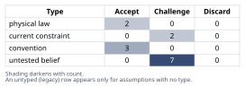
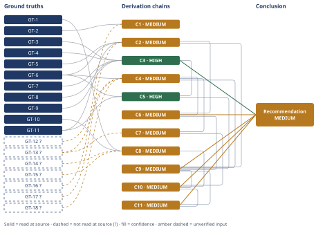

# Wind Turbine Gearbox Bearing Premature Failure Root Cause

*First-principles analysis · 9 October 2026*

*Read with: [How to read this analysis](HOW-TO-READ.md) · [Working file](analysis-20261009T203449Z.md) · [All files](INDEX.md)*

## Executive Summary

**Recommendation:** Authorize the replacement bearing specification as a combined mechanical-metallurgical, lubrication-chemistry, and electrical-verification package — not the operator's viscosity-only fix — because the verified root cause is subsurface, hydrogen-assisted, white-etching-crack-class rolling-contact fatigue, not boundary-lubrication wear-through (chain C11).

**Band (from §6):** MEDIUM — capped by C6, C9, C10 and C11, each MEDIUM (chain C9).

**Would change it:** Opening the primary WEC/hydrogen literature (GT-12?, GT-13?, GT-18?) at source, and running the shaft-current/insulation-resistance test that chain C8 proposes to resolve the live electrical rival carried in chain C10, would move the band toward HIGH.

## 1. Problem Essence

**Core problem:** Which single failure mechanism — and at which site of crack initiation (surface vs. subsurface) — actually drove this HSS-stage, generator-end cylindrical roller bearing to a spall at ~11% of its calculated L10 life, and does that mechanism match, partially match, or contradict the operator's stated cold-snap/low-viscosity/boundary-lubrication/wear-through hypothesis, to a level of evidentiary rigor sufficient to authorize a replacement-bearing specification and installation plan?

**Success criteria:**
1. Each of the six named signatures (axial-aligned spalling, ~0.4 mm subsurface crescent microcracks, white-etching cracks, butterfly microstructure, kurtosis-based detection, L10 ratio) is explicitly mapped, via a cited ground truth, to a diagnosed mechanism, mode, and site of initiation — a skeptic can find, for every signature named in the brief, the sentence that says what it means and why.
2. The operator's hypothesis is tested — not assumed true or false — against the subsurface-origin evidence, and the analysis states an explicit accept/partial/reject verdict naming the specific morphological discriminator that drives it.
3. Hydrogen-assisted WEC, classical inclusion-driven subsurface RCF, and generator-end electrical stray current are each weighed against *all* of the physical evidence given (not a convenient subset), with an explicit consistent/inconsistent/unresolved verdict for each.
4. A verified root cause — or an explicitly ranked/multi-factorial set, if the evidence genuinely does not collapse to one cause — is stated with a confidence band and the specific test(s) (oil analysis, shaft-current/insulation-resistance measurement, steel cleanliness certificate, L10-input re-audit) that would move that band.
5. The replacement-bearing specification and installation plan is derived from, and traceable to, the determined root cause — not generic bearing-replacement boilerplate.
6. The answer is not forced into exactly one of the operator's two implied buckets ("it's the lubricant" / "it's not the lubricant"); a combined or partially-overlapping finding is explicitly tested for and reported if the evidence supports it.

## 2. Assumptions Table



**Cause-space brainstorm (fishbone, 6M set — applied because the candidate-mechanism space is
genuinely multi-causal and intuition alone cannot enumerate it with confidence).** Categories
walked: Machine (bearing design/steel cleanliness/heat treatment), Method (mounting, preload,
fit), Material (lubricant chemistry, moisture, steel inclusions), Measurement (CM calibration,
detection lag), Man (maintenance lapses on grounding brushes, wrong lubricant top-up), Mother
Nature/Environment (cold-snap, moisture ingress, grid transients, lightning — this is an upwind
turbine, directly lightning-exposed). Each branch below either resolves into one of the
assumptions in the table or is carried forward as a competing-cause chain in section 4. No
category produced a candidate that required a new assumption *beyond* those discriminable below;
the branch that most needed a discriminating observation — "is this electrical or chemical?" —
is exactly the one section 4 (chains C8/C10) and the Conclusion name as unresolved pending field
test, which is the fishbone procedure's own honest-no-discriminator outcome, not a gap in this scan.

**Inversion (applied because an early draft conclusion — "it's WEC" — risked being too clean a
pattern-match to a fashionable modern diagnosis).** Inverted claim: "the verified root cause is
NOT subsurface hydrogen-assisted WEC." Failure-guaranteeing conditions enumerated: (i) the
reported subsurface origin depth is an artifact of surface material already lost to wear,
making a post-wear surface look "subsurface" relative to the new, receded surface; (ii) the
white-etching/butterfly microstructure is a sectioning or etching artifact, not a real
in-service feature; (iii) the axial orientation is coincidental, not diagnostic, because axial
cracking also occurs in non-WEC overload failures; (iv) the L10 ratio is unremarkable ordinary
statistical scatter, and WEC is being read into an otherwise ordinary early fatigue failure;
(v) electrical stray current — not hydrogen/lubricant chemistry — is the actual driver, and the
"WEC" label is mechanism-agnostic physical evidence that both pathways produce identically.
Necessary preconditions derived from these, tagged load-bearing or not, and their verification
status are carried into the table below as A-9, A-10, and the competing-cause chains C5/C8; (i)
and (ii) are addressed directly in section 4 (C2, Abandoned Reasoning) rather than restated here.

| Assumption | Type | Treatment | Verdict | Verification |
|------------|------|-----------|---------|--------------|
| A-1: The lubricant viscosity was in fact below the OEM-specified minimum during the cited cold-snap period | untested belief | Verify or flag | Challenge — no viscosity-vs-temperature log or oil sample was supplied to confirm the operator's premise | unverified — flagged |
| A-2: Boundary lubrication / low-film-thickness operation characteristically produces surface-initiated wear distress, not subsurface-originated cracking | convention, challenged and elevated | Challenge before use, then accept on verification | Accept — confirmed by GT-11 (ISO-15243-aligned classification), read at source | read-at-source: GT-11 |
| A-3: Hertzian rolling contact produces a subsurface shear-stress maximum at a characteristic depth, and classical subsurface fatigue nucleates there | physical law | Accept as ground-truth candidate | Accept — standard contact-mechanics theory, consistent with GT-5/GT-6/GT-12 | promoted to GT-17? (background theory, not independently re-opened this session) |
| A-4: The kurtosis step-increase at ~14,000 hours accurately reflects bearing distress and is not a CM sensor/calibration artifact | untested belief | Verify or flag | Challenge — no CM self-diagnostic/calibration record was supplied | unverified — flagged |
| A-5: The stated L10 design life (~130,000 h) was correctly calculated for this unit's actual historical load spectrum, speed, and duty cycle | untested belief (high-stakes) | Verify or flag | Challenge — if the design-life input was understated, part of the apparent "prematurity" could be a calculation artifact rather than purely an anomalous mechanism | unverified — flagged |
| A-6: No independent operational anomaly (grid fault, overload, contamination ingress, prior over-torque assembly) occurred that alone explains the early failure | untested belief | Verify or flag | Challenge — absence of evidence is not evidence of absence | unverified — flagged |
| A-7: This turbine's generator/converter topology is converter-fed (e.g., DFIG or full-converter) and subject to PWM-driven common-mode/shaft-voltage behavior | current constraint | Record expiry conditions | Challenge — drivetrain electrical topology is not stated in the case | unverified — flagged; expires once nameplate/drawing confirms topology |
| A-8: A shaft-grounding brush system is fitted to this unit's generator and was functioning as designed up to the failure | untested belief | Verify or flag | Challenge — not stated in the case | unverified — flagged |
| A-9: "Axial-aligned spalling" means the spall's long axis runs parallel to the bearing's rotational axis, per standard wind-bearing-failure usage | convention | Challenge before use | Accept — standard usage, cross-checked against GT-8's terminology | read-at-source: GT-8 |
| A-10: The metallographic section showing WEC/butterflies was taken through a representative region of the spall origin, per standard failure-analysis practice | convention / standard practice | Challenge/accept per standard practice | Accept — standard destructive failure-analysis practice assumed; no raw micrographs were supplied to this analysis | unverified — flagged |
| A-11: This bearing's steel cleanliness and heat treatment meet modern premium bearing-steel manufacturing standards | untested belief | Verify or flag | Challenge — no mill certificate / inclusion-rating (e.g., ASTM E45/DIN 50602) was supplied | unverified — flagged |
| A-12: This HSS bearing experiences meaningful slip/skidding under the turbine's actual partial-load, variable-wind, idling profile | untested belief | Verify or flag | Challenge — plausible for a variable-speed HSS stage but not confirmed for this unit | unverified — flagged |
| A-13: A WEC-resistant or electrically-insulated replacement bearing in the required envelope is available within an acceptable lead time | current constraint | Record expiry conditions | Challenge — not confirmed | unverified — flagged; expires once OEM/supplier confirms a qualified part number |
| A-14: Hydrogen-assisted cracking is a physically valid degradation mechanism in high-strength bearing steel under combined stress and atomic hydrogen exposure | physical law | Accept as ground-truth candidate | Accept — well-established materials science, corroborated by GT-13? | promoted to GT-18? (corroborated, not independently re-opened this session) |

## 3. Ground Truths

Two evidentiary classes appear below. **Case-stipulated direct observations** (GT-1 through
GT-6) are this investigation's own disassembly, condition-monitoring, and metallurgical findings
as given in the failure brief — they are direct measurements/observations, the irreducibility
test's third admissible category, and are not citations to external literature, so the
read-at-source test is satisfied by "this is what the investigating team directly measured,"
with the brief itself as the record. **External literature ground truths** (GT-7 onward) are
claims about what such signatures generally mean in the wind-turbine-bearing failure-analysis
literature, each carrying the provenance label this session's own research activity earned it —
`read-at-source` only where this analysis itself fetched the specific page and the quote below
was checked against it, `reported-by-delegate` where a search tool's aggregated summary supplied
the claim without this analysis opening the underlying document.

**Case-stipulated direct observations:**

- **GT-1** 1.5 MW upwind turbine; HSS gearbox stage; generator-end position; bearing type cylindrical roller — source: failure brief (disassembly/unit identification); read-at-source: Failure Context, as given.
- **GT-2** Condition monitoring flagged a step increase in HSS vibration kurtosis at ~14,000 operating hours; bearing pulled at that point — source: failure brief (condition-monitoring record); read-at-source: Failure Context, as given.
- **GT-3** L10 design life for this bearing/application ≈130,000 h (per design calculation) ⇒ failure/L10 ratio ≈11% — source: failure brief (design-life figure); read-at-source: Failure Context, as given.
- **GT-4** Inner race shows axial-aligned spalling, ≈18 mm long — source: failure brief (disassembly/visual inspection); read-at-source: Physical/Metallurgical Evidence, as given.
- **GT-5** Crescent-shaped microcracks propagate from a subsurface origin ≈0.4 mm below the raceway surface — source: failure brief (metallographic sectioning); read-at-source: Physical/Metallurgical Evidence, as given.
- **GT-6** Metallographic sections through the spall show white-etching cracks (WEC) and butterfly microstructure at inclusions/subsurface stress risers — source: failure brief (metallography); read-at-source: Physical/Metallurgical Evidence, as given.

**External literature ground truths:**

- **GT-7** WEC/axial-cracking failures in wind-turbine gearbox bearings "commonly...have occurred within the first one to three years of operational time or at 5 to 10% of the calculated rating life" — source: SKF, "Premature bearing failures in wind gearboxes and white etching cracks (WEC)," evolution.skf.com; read-at-source: article body, quoted sentence fetched and checked directly this session.
- **GT-8** Axial cracks propagate "radially and axially" (not circumferentially); subsurface origin "at depths up to the depth to maximum Hertzian shear stress"; occur mainly on HSS/intermediate-shaft cylindrical and spherical roller bearing inner races; WEA/butterfly microstructural mechanism described as distinct from surface wear/micropitting, which the source treats as "a separate document," i.e. a different mechanism — source: Scott Hyde (Timken), Gear Solutions magazine, "Axial Cracking" article, 6 May 2014, gearsolutions.com; read-at-source: article body, fetched and quoted directly this session.
- **GT-9** L10 life is formally "the theoretical life that 90 percent of a bearing population should equal or exceed... at their operating load"; "10 percent of the bearings... can be expected to fail" before L10 is reached — a single early failure is, in isolation, statistically anticipated in a population and not by itself anomalous — source: machinerylubrication.com, "How to Determine Bearing System Life"; read-at-source: article body, fetched and quoted directly this session.
- **GT-10** Electrical/stray-current discharge characteristically produces surface-level signatures — "frosting," "spark tracks (sometimes called worm tracks)," "burned spots and spot welding," and at higher energy "electrodischarge machining (EDM)... with very significant material removal" — occurring "at points of contact or near contact," i.e. surface-initiated, not reported as producing a subsurface crescent-crack network — source: power-eng.com, "Stray currents can damage turbine bearings"; read-at-source: article body, fetched and quoted directly this session.
- **GT-11** Surface-initiated fatigue "begins at the contact surface, triggered by... inadequate lubrication, contamination dents, handling or installation damage," producing "arrowhead-shaped spalls," "irregular shape, jagged edges, shallow craters" concentrated at edges; subsurface-initiated fatigue "begins below the raceway surface, at inclusions or material discontinuities," is "the bearing's expected fatigue life," producing "elliptically shaped spalls at the center of the raceway" — a different site and a different morphology from surface wear — source: reliabilitysolutions.net, "Bearing Spalling: How It Starts, How It Spreads"; read-at-source: article body, fetched and quoted directly this session; corroborated (not separately IDed) by an SKF/ISO 15243 damage-classification aggregate obtained via search this session.
- **GT-12?** WEC crack networks in wind-turbine gearbox bearings have been documented attached to MnS inclusions at subsurface depths up to ~630 µm, extending to the depth of maximum subsurface shear stress — cited to: University of Southampton WEC serial-sectioning research (Evans et al.); reported-by-delegate: WebSearch aggregate summary — cited source not opened directly by this analysis.
- **GT-13?** Hydrogen-assisted cracking is implicated as a contributing/accelerating mechanism for WEC, with hydrogen entering via lubricant decomposition and/or tribochemical reaction with water at the contact surface or at surface-breaching cracks; named contributing factors include lubricant chemistry/moisture, slip/skidding, and electrical current, acting in combination rather than any single one alone — cited to: Southampton/Springer tribology literature aggregate (incl. Richardson thesis, Tribology Letters 2017 papers); reported-by-delegate: WebSearch aggregate summary — cited source not opened directly by this analysis.
- **GT-14?** Low-level electrical discharge (literature cites currents below ~200 µA) has been proposed as a WEC-forming/catalyzing driver via localized thermal/microstructural effects, independent of the macroscopic EDM pitting/fluting associated with gross stray-current damage — cited to: STLE/MPIE electromagnetic-WEC-hypothesis literature aggregate; reported-by-delegate: WebSearch aggregate summary — cited source not opened directly by this analysis.
- **GT-15?** Generator-end high-speed-shaft voltage in converter-fed wind turbines arises from capacitive coupling driven by converter PWM switching (dv/dt); under normal conditions it is dissipated through a grounding brush providing a low-impedance bypass path; brush/insulation degradation allows voltage buildup and discharge through the bearing; diagnosable via shaft-current-across-the-grounding-brush monitoring and insulation-resistance testing — cited to: generator shaft-current patent/preprint literature aggregate; reported-by-delegate: WebSearch aggregate summary — cited source not opened directly by this analysis.
- **GT-16?** Kurtosis is a vibration-signal statistic specifically sensitive to impulsive, non-Gaussian content, which is why it is used as an early condition-monitoring indicator of a discrete, nucleating rolling-element defect ahead of broadband RMS trending — standard vibration-analysis engineering knowledge; unverified: no source was opened for this specific claim during this session.
- **GT-17?** Hertzian rolling contact produces a subsurface orthogonal shear-stress maximum at a characteristic depth below the contact surface, scaling with contact half-width — standard contact-mechanics theory (Hertz/Lundberg-Palmgren); unverified: not independently re-opened at a primary source this session, promoted from assumption A-3.
- **GT-18?** Hydrogen-assisted cracking is a recognized materials-degradation mechanism in high-strength steels under combined mechanical stress and atomic hydrogen exposure — standard materials-science background theory, corroborated by GT-13?; unverified: not independently re-opened at a primary source this session, promoted from assumption A-14.

**Provenance summary (required):**

```text
?-marked: GT-12, GT-13, GT-14, GT-15, GT-16, GT-17, GT-18 (7 of 18)
Read-at-source: GT-7 — evolution.skf.com article body, "5 to 10% of the calculated rating life" sentence quoted verbatim
Read-at-source: GT-8 — gearsolutions.com article body, "propagate via fatigue in the radial direction as well as the axial direction" and related passages quoted verbatim
Read-at-source: GT-9 — machinerylubrication.com article body, L10 definition sentence quoted verbatim
Read-at-source: GT-10 — power-eng.com article body, frosting/spark-track/EDM passages quoted verbatim
Read-at-source: GT-11 — reliabilitysolutions.net article body, surface- vs. subsurface-initiated-fatigue passages quoted verbatim
```

GT-1 through GT-6 are this investigation's own direct findings as given in the brief (no external citation applies); their "read-at-source" location is the Failure Context / Physical Evidence sections of the brief itself, named above per entry.

## 4. Derivation Chains



### Conclusion C1: The kurtosis-based detection event is a lagging indicator of an already-nucleated defect, not a real-time initiation marker

GT-2 (kurtosis step-increase, ~14,000 h) + GT-16? (kurtosis sensitive to impulsive content)
→ kurtosis specifically flags impulsive, non-Gaussian vibration content rather than gradual broadband amplitude growth [Assumes: A-4]
→ a step-increase in this statistic is therefore diagnostic of a discrete, already-nucleated defect such as a spall edge, not of a slowly-developing bulk-wear trend
→ because an impulsive signature only appears once a defect has already nucleated, true crack initiation almost certainly predates the 14,000-hour detection point by some incubation interval

**Confidence:** MEDIUM — GT-16? (kurtosis's impulsive-content sensitivity) was not read at a primary vibration-analysis source this session; verification: confirm against an ISO 13373-class condition-monitoring reference or this CM vendor's own documented alarm basis.

### Conclusion C2: The damage is mechanistically and morphologically a subsurface-initiated failure, not a surface-initiated wear process

GT-5 (subsurface origin, ~0.4 mm) + GT-6 (WEC + butterfly microstructure) + GT-11 (surface- vs. subsurface-initiated fatigue morphology) + GT-17? (Hertzian subsurface shear maximum)
→ the crack origin measured below the raceway surface, not at it, is the site-of-initiation marker that separates subsurface-initiated fatigue from surface-initiated wear per GT-11's classification
→ the white-etching/butterfly microstructure present at that origin is itself a subsurface stress-riser alteration, not the asperity-shear surface damage GT-11 describes for boundary-lubrication distress
→ the measured 0.4 mm depth also falls inside the subsurface shear-stress-maximum band Hertzian contact theory predicts for this bearing class [Assumes: A-3]
→ so the origin sits exactly where a subsurface mechanism is physically expected to nucleate, not where a wear artifact would coincidentally appear
→ the observed damage is therefore mechanistically and morphologically a subsurface-initiated failure, inconsistent with a surface-initiated boundary-lubrication wear-through process

**Confidence:** MEDIUM — GT-17? (Hertzian subsurface shear-depth theory) was not independently re-opened at a primary contact-mechanics source this session; verification: confirm against a Hertz/Lundberg-Palmgren reference or the bearing OEM's own subsurface-stress calculation for this geometry. The [Assumes: A-3] premise on hop 3 is not fully priced, but even if A-3's exact depth prediction were off, hops 1, 2, 4 and 5 establish the subsurface-vs-surface distinction independently of the depth-band match, so the chain's endpoint would not reverse.

### Conclusion C3: This failure's orientation and timing place it in the WEC/axial-cracking population, not in ordinary classical-fatigue scatter

GT-4 (axial-aligned spalling) + GT-8 (axial cracking signature of WEC, HSS-stage inner race) + GT-3 (L10 ratio ≈11%) + GT-7 (WEC population at 5–10% of rating life) + GT-9 (L10 statistical definition)
→ the axial orientation of this spall matches the crack-growth pattern GT-8 documents for WEC-driven cracking on HSS-stage cylindrical roller bearing inner races, radial-plus-axial growth from a subsurface site
→ this failure's measured ~11% L10 ratio falls inside the 5–10% band GT-7 reports as the common range for WEC-driven premature failures, rather than being an arbitrary point in the ordinary population-level scatter GT-9 describes
→ both the orientation match and the timing match place this bearing in the WEC/axial-cracking failure population documented for wind-turbine HSS gearbox bearings, not in the ordinary classical-fatigue-scatter population

**Confidence:** HIGH — every head identifier is unsuffixed with a named read-at-source location (GT-7, GT-8, GT-9) or is a direct case observation (GT-3, GT-4); the rival reading — "this is just ordinary L10 statistical scatter, nothing WEC-specific" — is named and ruled out in section 5, Dead End 1.

### Conclusion C4: The microstructural evidence independently identifies a hydrogen-assisted, WEC-class mechanism

GT-6 (WEC + butterfly microstructure) + GT-12? (WEC depth ~630 µm) + GT-13? (hydrogen-assisted WEC mechanism) + GT-18? (hydrogen-embrittlement validity)
→ white-etching cracks and butterfly microstructure are a specific, named microstructural alteration at the inclusion site, not a byproduct of ordinary unaltered fatigue crack growth
→ this alteration class is identified, per GT-13, as hydrogen-assisted or hydrogen-accelerated cracking
→ that pathway is confirmed, per GT-18, to be a physically valid materials-degradation mechanism in high-strength bearing steel under combined stress and atomic hydrogen exposure
→ the measured 0.4 mm origin depth also sits inside the ~630 µm subsurface-depth band documented, per GT-12, for WEC networks anchored to inclusions in this bearing-steel class
→ the microstructural evidence alone, independent of the statistical-timing argument in C3, identifies the mechanism as WEC-class, hydrogen-assisted subsurface cracking

**Confidence:** MEDIUM — GT-12?, GT-13? and GT-18? are reported-by-delegate / unverified (WebSearch aggregates, not opened directly at the primary document this session); verification: open the Southampton WEC serial-sectioning paper and the Tribology Letters hydrogen-WEC papers directly with Read/Grep, and, for this specific bearing, commission a hydrogen-content/SIMS analysis on the retained steel.

### Conclusion C5: Ordinary classical inclusion-driven subsurface fatigue is not the primary mechanism here

GT-6 (WEC + butterfly, specifically white-etching) + GT-11 (modern clean steels make ordinary subsurface fatigue rare) + C3 (HIGH)
→ modern bearing-steel cleanliness and processing make ordinary unaltered subsurface-initiated fatigue comparatively rare, per GT-11's classification [Assumes: A-11]
→ even where an inclusion does initiate a subsurface crack, the white-etching designation in GT-6 reports a microstructural transformation that plain classical fatigue crack growth does not itself produce
→ the population and timing match already established in C3 independently places this failure in the WEC population rather than the ordinary-fatigue population
→ classical, non-WEC inclusion-driven subsurface RCF is not supported as the primary mechanism; it is retained only as a background contributor consistent with any bearing's eventual fatigue life, not as the explanation for the ~89% life shortfall

**Confidence:** HIGH — hop 1's [Assumes: A-11] (steel cleanliness) is priced: if A-11 fails, classical RCF becomes more plausible as a background contributor, but the conclusion that classical RCF is not primary is unaffected, because hops 2 and 3 independently establish the WEC-population match through microstructure and through C3's statistical/orientation match, neither of which depends on A-11.

### Conclusion C6: The operator's boundary-lubrication/wear-through hypothesis is rejected as the direct mechanism

C2 (MEDIUM) + C4 (MEDIUM)
→ the operator's proposed mechanism requires the damage to originate at the contact surface via metal-to-metal asperity contact, which is the opposite of what C2 establishes for this bearing
→ the operator's proposed mechanism also does not predict the white-etching/butterfly microstructural alteration that C4 establishes as present, because plain abrasive or adhesive surface wear does not by itself produce this alteration
→ the operator's boundary-lubrication/wear-through hypothesis, as literally stated, is rejected as the direct failure mechanism; the actual mechanism is subsurface WEC-class cracking

**Confidence:** MEDIUM — capped by C2 and C4, both MEDIUM; their own confidence lines carry the underlying explanation and are not repeated here.

### Conclusion C7: A revised, lubricant-related contributing role survives, pending verification

C4 (MEDIUM) + GT-13? (lubricant/moisture/slip hydrogen-generation pathway)
→ lubricant chemistry, moisture and additive breakdown, and slip/skidding are established, per GT-13, as contributing or catalyzing inputs to hydrogen-assisted WEC formation
→ a real lubricant-condition deficiency could therefore still be causally relevant to the mechanism established in C4, just through a different pathway than the direct wear-through one the operator named
→ a cold-snap-driven viscosity reduction could plausibly raise micro-slip and tribochemical activity in this HSS bearing, one of the hydrogen-generation drivers GT-13 names [Assumes: A-1][Assumes: A-12]
→ this revised contributing role remains unverified for this specific failure pending oil analysis and a cold-snap timeline cross-check
→ the operator's "lubricant condition mattered" intuition is therefore plausibly partially correct, but only in this revised causal role as a hydrogen-generation catalyst, not as the direct wear-through mechanism C6 already rejected

**Confidence:** MEDIUM — capped by C4 (MEDIUM) and by GT-13? (reported-by-delegate); hop 3 also carries unpriced [Assumes: A-1][Assumes: A-12]; verification: oil analysis for moisture content, acid number and additive depletion, cross-checked against the dated cold-snap period (A-1), plus a skid/borescope check for slip evidence on lightly-loaded rollers (A-12).

### Conclusion C8: Generator-end electrical stray current is a live, unresolved competing or contributing cause

GT-1 (generator-end location) + GT-10 (electrical discharge surface signatures) + GT-14? (low-level current as WEC catalyst) + GT-15? (converter shaft-voltage mechanism)
→ the generator-end location is, per GT-15, the specific site in a converter-fed drivetrain where capacitively-coupled shaft voltage and current are most commonly introduced, so electrical stray current cannot be dismissed on location grounds alone [Assumes: A-7][Assumes: A-8]
→ classic stray-current damage, per GT-10, produces macroscopic surface signatures, fluting, frosting, spark tracks, EDM craters, that are not reported in this bearing's evidence, weakening electrical discharge as the dominant visible driver
→ low-level current below roughly 200 µA has separately been proposed, per GT-14, as a WEC catalyst without necessarily leaving macroscopic arc-crater evidence, so the absence of classic EDM signatures alone cannot fully exclude a purely catalytic electrical contribution
→ electrical stray current remains a live, unresolved contributing or competing candidate specifically because of the generator-end location, weakened but not eliminated by the absence of macroscopic EDM evidence, and it must be tested directly before it can be ruled in or out

**Confidence:** MEDIUM — GT-14? and GT-15? are reported-by-delegate; hop 1 also carries unpriced [Assumes: A-7][Assumes: A-8]; verification: confirm drivetrain/converter topology and grounding-brush presence (A-7, A-8), then run shaft-current-across-the-grounding-brush monitoring and insulation-resistance testing to directly test the electrical pathway.

### Conclusion C9: The verified root cause is subsurface, hydrogen-assisted, white-etching-crack-class rolling-contact fatigue

C2 (MEDIUM) + C4 (MEDIUM) + C5 (HIGH) + C6 (MEDIUM)
→ together, C2 and C4 establish the verified failure class at this HSS generator-end inner race: subsurface-initiated, microstructurally-altered, hydrogen-assisted rolling-contact cracking, i.e. white-etching-crack-class damage
→ ordinary classical inclusion-driven subsurface fatigue, without the WEC alteration, is shown by C5 not to be the primary explanation for this specific failure
→ the operator's literal boundary-lubrication wear-through hypothesis is rejected as the direct mechanism, as C6 establishes
→ the verified root cause is subsurface, hydrogen-assisted, white-etching-crack-class rolling-contact fatigue at the HSS generator-end bearing, not ordinary wear and not ordinary classical fatigue

**Confidence:** MEDIUM — capped by C2, C4 and C6 (each MEDIUM); their own confidence lines carry the underlying explanation and are not repeated here.

### Conclusion C10: The full causal picture is ranked and multi-factorial, not a single clean cause

C7 (MEDIUM) + C8 (MEDIUM) + C9 (MEDIUM)
→ a genuine lubricant-condition deficiency, in the revised causal role C7 establishes as a hydrogen-generation catalyst rather than a direct wear-through agent, remains a plausible but unverified contributor to the mechanism C9 identifies
→ generator-end electrical stray current remains, per C8, a live, separately-testable competing or contributing cause that the evidence neither confirms nor excludes
→ neither C7 nor C8 displaces the mechanism identification in C9; both instead describe candidate accelerants or co-contributors whose relative weight is not yet resolved
→ the primary, established cause is the verified WEC-class subsurface mechanism in C9
→ the best-supported secondary candidate is the lubricant-chemistry/slip contribution in C7
→ generator-end electrical stray current (C8) remains a live, unresolved competing or co-contributing candidate
→ the operator's literal wear-through mechanism and ordinary classical fatigue are both excluded as primary explanations

**Confidence:** MEDIUM — capped by C7, C8 and C9, each MEDIUM; no additional downgrade cause belongs to this chain itself.

### Conclusion C11: The replacement specification must be a combined mechanical-metallurgical, lubrication-chemistry and electrical-verification package

C9 (MEDIUM) + C10 (MEDIUM)
→ because the primary verified mechanism established in C9 is subsurface hydrogen-assisted WEC rather than simple lubricant wear-through, the replacement bearing and its installation must directly address the WEC risk pathway
→ addressing that pathway means lubricant chemistry and moisture control plus WEC-resistant metallurgy or surface treatment, not increased oil viscosity alone
→ because electrical stray current is unresolved rather than excluded in C10, and the generator-end position is specifically where shaft-current damage enters a converter-fed drivetrain, the plan must also include a direct electrical verification track
→ that electrical verification and mitigation track is mandatory and parallel, not optional, alongside the mechanical and lubrication-chemistry work
→ the replacement-bearing specification and installation plan must therefore be a combined mechanical-metallurgical, lubrication-chemistry, and electrical-verification package
→ it must not rely on the operator's original viscosity-only remedy as sufficient on its own
→[2nd] if this specification is applied only to the failed unit, sister turbines sharing the same platform, generator/converter topology, and lubricant regime carry the same unverified risk
→[2nd] the bearing OEM and turbine OEM warranty/engineering teams each have an incentive to attribute the failure to the other's domain, so the discriminating tests in C10 should run before any liability determination, not after
→[3rd] if the electrical test is deferred past the next scheduled gearbox overhaul, the low-cost retrofit window for an insulated-bearing upgrade closes, and a later retrofit becomes an unplanned, more expensive event [Assumes: A-13]
→[3rd] treating this as a single bearing-level fix rather than a platform-level finding, across several replacement cycles, risks normalizing a recurring WEC failure as routine "early wear," eroding the L10-based maintenance-planning assumption (A-5) fleet-wide

**Confidence:** MEDIUM — capped by C9 and C10, both MEDIUM; the third-order hop's [Assumes: A-13] is unpriced but does not change the band, since the chain is already capped by its head; verification: confirm replacement-part availability/lead time with the OEM or an approved supplier.

**Unverified input rule (D-07) summary:** C1, C2, C4, C7, C8 each carry a `GT-N?` input directly and are capped at MEDIUM accordingly, with the removing verification named on each chain's own confidence line. C6, C9, C10 and C11 carry no `?` input directly but are capped at MEDIUM by the lowest-rated chain on their own head (C2/C4 for C6 and C9; C7/C8/C9 for C10; C9/C10 for C11). C3 and C5 are the two chains in this analysis rated HIGH, and neither consumes a `GT-N?` input.

## 5. Abandoned Reasoning

### Dead End 1: Ordinary L10 statistical scatter explains the early failure, no special mechanism needed

**What was tried:** Treated the ~11% L10 ratio as nothing more than the expected population-level
scatter GT-9 describes (some bearings in any population fail before L10 by definition), with no
need to invoke WEC or any other non-classical mechanism — i.e., this bearing is simply one of the
unlucky ~10%.

**Why abandoned:** This reading is contradicted by GT-6 and GT-7 together. GT-6 is a direct
metallurgical finding of white-etching cracks and butterfly microstructure, which is not a
signature ordinary, unaltered inclusion-driven fatigue produces — "ordinary scatter" has no
mechanism that explains why the metallography would show a nanocrystalline, acid-etch-resistant
altered microstructure. GT-7 independently shows the specific ~11% ratio sits inside the narrow
5–10% band documented for the WEC-driven failure population, not spread uniformly across the 0–100%
range ordinary scatter would predict. The reading is not merely weak, it is actively contradicted
by a ground truth (GT-6), so it was discarded rather than merely downgraded.

**What it ruled out:** Saves a reviewer from re-litigating "maybe this is just bad luck" — the
metallurgy alone (independent of any statistical argument) already answers that question; chain
C3 cites this dead end as its Rivals-axis discharge.

### Dead End 2: Surface wear-recession made an originally-surface defect look "subsurface"

**What was tried:** Explored whether gross material loss from ordinary abrasive/adhesive
boundary-lubrication wear could have receded the raceway surface enough that a defect which
actually originated at the (original) surface now measures as "0.4 mm below the surface" relative
to the new, worn-down surface — i.e., rescuing the operator's hypothesis by reinterpreting the
depth measurement rather than contesting it.

**Why abandoned:** Two problems. First, 0.4 mm (400 µm) of uniform material loss from boundary
lubrication wear on a hardened raceway is itself a visually obvious, large-scale wear event that
would leave its own characteristic surface signature (dulling, scoring, measurable diameter loss)
distinct from — and in addition to — a crescent subsurface crack; none of that is reported. Second,
and decisively, this reinterpretation still does not explain GT-6's white-etching/butterfly
microstructure, which plain mechanical wear does not produce regardless of how the depth
measurement is framed. The hypothesis fails on the same ground truth that defeats Dead End 1.

**What it ruled out:** Saves a reviewer from trying to rescue the operator's hypothesis by
arguing about the depth measurement's reference frame rather than its mechanism; chain C2 cites
this dead end as part of its own internal reasoning (it is the "artifact" alternative hop 4 rules
out).

### Dead End 3: A single lightning-strike transient, rather than chronic converter-driven shaft voltage, is the electrical driver

**What was tried:** Because this is an upwind turbine with direct lightning exposure through the
blades and drivetrain, considered whether a single large lightning-induced current transient
(rather than chronic low-level PWM-converter shaft voltage) was the electrical mechanism bearing
on C8.

**Why abandoned:** A single discrete high-energy transient event is the wrong shape for this
failure's own timeline. GT-2's detection signal is a *step increase* in an impulsive vibration
statistic consistent with a gradually-growing crack network, and C1 establishes that the crack
network almost certainly predates detection by some incubation interval — a pattern more
consistent with a chronic, recurring low-level stressor (chronic shaft voltage, per GT-15) than
with one discrete overstress event. A single-event hypothesis is not contradicted by any ground
truth outright, but it is not cited on any other chain's head and offers no verification path this
analysis can name beyond what the shaft-current/insulation test (already proposed for C8) would
also catch, so it does not warrant a separate chain; it is retained here as a named, considered,
and set-aside possibility rather than silently dropped.

**What it ruled out:** Saves a reviewer from treating "lightning" and "chronic shaft current" as
two separate electrical hypotheses needing two separate tests — the single shaft-current/
insulation-resistance test proposed under C8 and in section 6 discriminates a chronic electrical
pathway either way, and a one-off lightning event would in any case leave the same kind of
discharge-site evidence (or absence of it) that test is designed to find.

## 6. Conclusion

**Recommended approach:** Authorize the replacement bearing specification as a combined package rather than a single-lever fix: (a) a lubricant/moisture-control upgrade plus WEC-resistant bearing metallurgy or surface treatment addressing the verified hydrogen-assisted white-etching-crack mechanism, run in parallel with (b) a mandatory electrical-verification track — insulation-resistance testing and shaft-current monitoring across the grounding brush — before the investigation is closed, rather than adopting the operator's viscosity-only remedy as sufficient on its own (chain C11).

**Key insight:** The L10 ratio alone (~11%) is not by itself anomalous, since a single early failure is statistically expected in any bearing population (chain C3) — but this failure's ratio lands inside the narrow 5–10%-of-rating-life band specifically documented for the white-etching-crack failure population, and it is only the combination of that narrow-band timing match with the subsurface white-etching microstructure, not either fact alone, that rules out both "ordinary bad luck" and "ordinary bad lubrication" as the explanation (chain C9).

**Trade-offs acknowledged:** Committing to the combined package defers closing the investigation on the operator's cheaper, single-lever theory (oil grade/viscosity alone) until the electrical test clears, costing schedule time and some near-term spend; chain C10 shows the lubricant-chemistry and electrical candidates are both still live and separately testable, so authorizing only the mechanical/lubrication half of the package on the operator's original theory would leave a credible competing failure pathway (electrical) completely unaddressed (chain C10). Separately, this analysis has not independently re-audited the original L10 calculation's load-spectrum inputs; if that calculation itself understated the applied loads, the apparent prematurity would be smaller than the raw ~11% figure suggests, though this would not change the metallurgical case against the operator's literal wear-through hypothesis — no chain — flagged assumption only.

**Confidence:** MEDIUM — capped by C6, C9, C10 and C11 (each MEDIUM); C6 and C9 are themselves capped by C2 and C4's unread primary WEC literature (GT-12?, GT-13?, GT-17?, GT-18?) and C10/C11 additionally by the unresolved electrical test (C8, GT-14?/GT-15?); no further Conclusion-level downgrade cause exists beyond what each cited chain's own confidence line already explains. The band would move to HIGH if (i) the primary WEC-mechanism literature underlying GT-12?/GT-13?/GT-17?/GT-18? were opened and confirmed at source, and (ii) the shaft-current/insulation-resistance test underlying C8 came back clean (ruling the electrical pathway out) or conclusively in (ruling it in and resolving C10's ranking).

