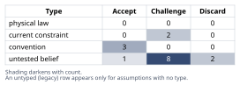
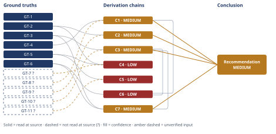

# Wind Turbine HSS Bearing Failure Root Cause

*First-principles analysis · 10 October 2026*

*Read with: [How to read this analysis](HOW-TO-READ.md) · [Working file](analysis-20261010T065706Z.md) · [All files](INDEX.md)*

## Executive Summary

**Recommendation:** Treat the operator's lubricant-viscosity/boundary-lubrication hypothesis as falsified and diagnose the failure as White-Etching-Crack-driven rolling contact fatigue (chains C1, C2, C3); do not finalize the replacement bearing on a same-spec-plus-lubricant-change basis — authorize the composite mitigation/confirmatory-testing program instead (chain C7).

**Band (from §6):** MEDIUM.

**Would change it:** The specific root-cause sub-mechanism (electrical, additive-chemistry, or transient-load) remains formally undetermined, so the confirmatory tests narrowing it, and independent re-confirmation of the metallurgy, are what would move this band (chain C5).

## 1. Problem Essence

**Core problem:** Given the physical and metallurgical evidence recovered from a wind-turbine HSS generator-end bearing that failed at roughly 1/9 of its L10 design life, determine — from tribology and contact-fatigue first principles, not from the operator's framing — which failure mechanism the evidence actually supports, whether the operator's lubricant-viscosity/boundary-lubrication hypothesis survives or is falsified, and what that implies for the replacement bearing specification and any accompanying systemic fix.

**Success criteria:**
- Every cited physical signature (subsurface origin depth, crescent microcracks, White Etching Cracks, butterflies, axial spall orientation, kurtosis step-change, time-to-failure ratio) is mapped to a specific failure mechanism using stated tribology/contact-mechanics reasoning, not analogy.
- The operator's hypothesis is tested item-by-item against the evidence and receives an explicit survive/falsify verdict with reasoning, not an assumed answer.
- A specific root cause (or narrowed set of candidate root causes) is named using the specific clues given — not a generic list of "possible WEC causes."
- Inversion reasoning is applied to both the operator's hypothesis and the headline alternative conclusion.
- Second-order consequences of mis-diagnosing this as a pure lubricant-viscosity problem are stated, including an explicit expectation for the replacement bearing's survival time.
- A conclusion is produced with an explicit, calibrated confidence band, named confirmatory/falsifying follow-up tests, and a replacement-bearing-and-systemic-fix recommendation defensible to an engineering review board.
- The answer is not constrained to be either "the operator is right" or "the operator is wrong" in some other single named way — a composite verdict (hypothesis falsified as literally stated, while a mechanistically related but distinct candidate from the same broad causal family remains live) is fully admissible if that is what the evidence supports.

---

## 2. Assumptions Table



Assumption space built with an inlined fishbone brainstorm across six categories (Lubrication, Electrical, Mechanical/Load, Material/Metallurgy, Monitoring/Detection, Environment), then stress-tested with an inlined inversion pass on the operator's hypothesis (see box below the table). `A-N` identifiers are embedded in the Assumption text and are the labels the Derivation Chains' `[Assumes: A-N]` marks and the Assumption Audit scan refer back to.

| Assumption | Type | Treatment | Verdict | Verification |
|---|---|---|---|---|
| A-1 (Lubrication): Cold-snap-driven viscosity drop forced the HSS generator-end contact into boundary lubrication and the race wore through — the operator's standing hypothesis. | untested belief | Explicitly tested against the physical evidence (origin depth, metallurgy, geometry), not assumed. | Discard — falsified by subsurface origin depth and the surface-vs-subsurface mechanism distinction (chains C1, C2) and by the axial/geometric spall pattern (chain C4). | unverified — flagged; the falsification is documented in chains C1/C2/C4 below. |
| A-2 (Lubrication): Lubricant additive-package decomposition releasing hydrogen into the steel drives WEC formation. | untested belief | Verify via used-oil additive-chemistry audit and hydrogen-content analysis of the retrieved spall material. | Challenge — live candidate, not excluded; GT-3 names this as one of several non-consensus candidate WEC drivers. | unverified — flagged, recommended confirmatory test. |
| A-3 (Lubrication): Lubricant contamination (moisture/particulate) accelerated fatigue. | untested belief | Verify via used-oil analysis (particle count, moisture, ferrography). | Challenge — deprioritized; the specific WEC+butterfly signature set (GT-2, GT-3) points toward a more specific mechanism than generic contamination-accelerated fatigue. | unverified — flagged, low priority. |
| A-4 (Electrical): Stray/parasitic bearing currents from a converter-fed generator discharge through the generator-end bearing. | current constraint (depends on the present grounding/bonding state and converter topology — not a permanent physical fact) | Verify via common-mode/shaft-voltage measurement, grounding-brush inspection, and an SEM crater/fluting search on the raceway. | Challenge — leading candidate given the generator-end location (chain C5), but no EDM crater/fluting evidence is reported in the given evidence; resolves once grounding and SEM data are in hand. | unverified — flagged, recommended confirmatory test; expiry condition: resolved by direct electrical/SEM measurement. |
| A-5 (Electrical): Inadequate grounding-brush maintenance / brush-to-slip-ring contact loss. | current constraint | Inspect brush wear state and continuity log. | Challenge — open, feeds A-4; expires once the grounding system is inspected. | unverified — flagged. |
| A-6 (Electrical): Triboelectric charging / electrostatic-discharge-machining-type damage, distinct from converter-induced current. | untested belief | Would be captured by the same SEM crater search as A-4; no independent distinguishing test is identified in the literature consulted. | Discard — as a separately-testable track, per GT-3 (reported "under scrutiny" with no settled distinguishing method); folded into A-4's SEM search. | unverified — flagged, not separately pursued. |
| A-7 (Mechanical/Load): Transient slip/skidding under light or mixed HSS loading (sliding dynamics / adiabatic shear banding). | untested belief | Verify via SCADA torque/load history correlated to the failure timing, and a slip/traction analysis for the generator-end bearing under partial load. | Challenge — live candidate; supported by GT-3 ("sliding dynamics may have some effect") and GT-6 (third-factor stress-history theory). | unverified — flagged, recommended confirmatory test. |
| A-8 (Mechanical/Load): Misalignment or housing-bore distortion concentrating load at a fixed axial location — a purely mechanical explanation for the axial spall needing no electrical or chemical cause. | untested belief | Verify via bearing-seat run-out and housing-bore inspection, shaft alignment records. | Challenge — open; a parsimonious rival explanation for the axial geometry specifically, named as a live rival in chains C4 and C5. | unverified — flagged. |
| A-9 (Material/Metallurgy): A subsurface non-metallic inclusion or carbide cluster is the local nucleation site — an ordinary manufacturing-variability feature present in nearly all subsurface RCF, including WEC. | untested belief | SEM/EDS of the inclusion at the crack origin; compare against mill-certificate/batch quality records. | Accept — almost certainly present as a necessary local feature, consistent with GT-1/GT-2, but not sufficient by itself to explain a life shortened to ~1/9 of L10; an additional driver (A-2, A-4, or A-7) is still required. | unverified — flagged. |
| A-10 (Monitoring/Detection): A vibration-kurtosis step-change reliably indicates discrete bearing-defect (spall) onset rather than some other impulsive source (e.g., a gear-mesh fault or a sensor fault). | convention (standard condition-monitoring practice) | Challenge before accepting it as the whole evidentiary basis for "a spall nucleated here"; confirm via spectral analysis for bearing-defect frequencies and against the teardown finding. | Accept — corroborated here by the teardown finding of an actual spall, but the given evidence never demonstrates that the kurtosis step's *timing* coincided with the operator's cited cold-snap period, which A-1 implicitly requires. | unverified — flagged; teardown corroboration partial, timing-correlation absent from the evidence given. |
| A-11 (surfaced in audit, Electrical/Evidence): Absence of any mention of EDM-type pitting/fluting craters in the given evidence means such damage is actually absent, not merely unreported or not yet inspected for. `[Assumes: used in chain C4]` | untested belief | Explicit SEM crater/fluting search across the full raceway circumference. | Challenge — currently an evidentiary gap, not a negative finding; silence is not treated as exclusion. | unverified — flagged. |
| A-12 (surfaced in audit, Electrical): This turbine's generator is converter-fed (e.g., DFIG or full power-converter) with an electrical topology that creates a generator-end-preferential current path. `[Assumes: used in chain C5]` | untested belief | Confirm generator/converter type and topology from the nameplate/SCADA configuration; measure common-mode/shaft voltage. | Challenge — plausible for a 1.5 MW-class turbine (converter-fed architectures dominate this class) but not confirmed by the data given. | unverified — flagged. |
| A-13 (surfaced in audit, Procedural): No incidental change to the electrical or mechanical environment occurs between the failure event and reinstallation of a replacement bearing. `[Assumes: used in chain C6]` | convention | Confirm via the O&M change log at the time of reinstallation. | Accept — reasonable default, low risk, worth a one-line check before finalizing the second-order forecast. | unverified — flagged. |
| A-14 (surfaced in audit, Procedural): The trade-off criteria weights used to select a mitigation package (Phase 4) reflect the asset owner's actual priorities among cost, risk, and schedule. `[Assumes: used in chain C7]` | convention | Confirm the weights with the asset owner / engineering review board before finalizing the mitigation package. | Accept — provisional business judgment, not a physical fact, stated explicitly so the real decision-maker can re-weight it. | unverified — flagged, procedural. |
| A-15 (surfaced in audit, Procedural/Behavioral): A mis-attributed "resolved" root-cause write-up reduces post-fix condition-monitoring vigilance and spares provisioning until the next excursion. `[Assumes: used in chain C6]` | untested belief | Verify via the O&M team's actual monitoring/escalation procedure and spares policy. | Challenge — a standard human-factors pattern in maintenance organizations, not confirmed for this specific site. | unverified — flagged. |
| A-16 (surfaced in audit, Fleet/Systemic): Sister turbines in the same fleet share this turbine's converter and grounding architecture. `[Assumes: used in chain C6]` | untested belief | Confirm fleet composition and converter/grounding design commonality from the asset register. | Challenge — plausible for a single-model fleet but not confirmed by the data given. | unverified — flagged. |

**Inlined inversion pass on A-1 (operator's hypothesis), run in Phase 2:** inverted claim — "the race did NOT wear through from boundary-lubrication contact." Necessary preconditions for A-1 (as literally stated) to be true, each written as a falsifiable assertion:

1. **P1 — film thickness actually dropped below the boundary-lubrication threshold (λ<1) during the cited cold snap.** Status: unverified (no viscosity/film-thickness calculation is in the evidence given).
2. **P2 — the resulting material loss must be surface-initiated.** Status: **contradicted** — the crescent microcracks originate ~0.4 mm below the raceway surface (evidence item), and GT-4 ties surface origin specifically to boundary/mixed-lubrication wear. This precondition's failure alone is sufficient to falsify A-1.
3. **P3 — damage should track exposure duration/severity of the cold-snap event (a progressive, duration-dependent wear pattern) rather than being fixed to one fixed axial line on the roller track.** Status: inconsistent with the evidence (a single 18 mm axial crescent, not a worn band).
4. **P4 — no metallurgical phase-transformation signature (WEC, nanocrystalline white-etching areas, butterflies) should be present, since plain adhesive/abrasive wear does not nanocrystallize the matrix.** Status: **contradicted** — WEC and butterflies are explicitly reported. This precondition's failure is independently sufficient to falsify A-1.
5. **P5 — the vibration signature should rise gradually with wear accumulation, not step-change.** Status: inconsistent — a step-change, not a gradual trend, was reported.

P2 and P4 are each independently necessary for A-1 and each is independently observed to be false. A-1 is therefore **doubly falsified**, not merely weakly supported — this result is carried forward into chains C1 and C2 in Section 4.

---

## 3. Ground Truths

**Literature-anchored ground truths (read-at-source this run, via WebFetch on 2026-10-10):**

- **GT-1** Classical Hertzian line-contact theory (Lundberg–Palmgren rolling-contact-fatigue theory): under a rolling line contact, the maximum orthogonal subsurface shear stress occurs beneath the surface, not at it, and classical subsurface-initiated fatigue origin sites are located at that subsurface depth. — provenance: physical law (foundational contact mechanics; accepted as a ground-truth candidate per its type, not sourced to an external document in this run).
- **GT-2** White Etching Cracks (WEC) are a recognized, metallurgically distinct wind-turbine-gearbox-bearing failure mode, separate from tribological micropitting/scuffing; WEC subsurface cracks occur "at depths up to the depth to maximum Hertzian shear stress"; "axial cracking" (a documented macroscopic WEC manifestation) is associated with significant tensile stresses in the circumferential direction; butterfly microstructures (white-etching phase nucleating at inclusions) are documented as co-occurring subsurface initiation features with WEC/WEA. — source: gearsolutions.com, "Wind Turbine Gearbox Bearing Material Analysis to Study Crack Nucleation" (https://gearsolutions.com/?p=26728); read-at-source: the subsurface-depth, axial-cracking/tensile-stress, and butterfly-association passages quoted above, located via WebFetch.
- **GT-3** WEC / white-structure-flaking (WSF) failures in wind-turbine gearbox bearings characteristically occur at roughly 5–10% of calculated L10 life (documented cases: 20-year design life reached in as little as six months); the root-cause mechanism for WEC remains an actively debated, non-consensus question — candidate drivers named in the literature include subsurface contact fatigue from inclusions ("one leading contender"), hydrogen effects ("notoriously difficult" to investigate), sliding/slip dynamics ("may have some effect"), WEC-sensitive lubricant additive chemistry (promotes failure "regardless of base oil type"), and stray electrical currents ("under scrutiny"). — source: lubesngreases.com, "WEC: Killer at Large" (https://lubesngreases.com/?p=8065); read-at-source: the L10-fraction figures and the candidate-cause survey quoted above, located via WebFetch.
- **GT-4** Subsurface-initiated rolling-contact fatigue develops under a full, intact oil film with no metal-to-metal contact required, and its cracks originate within the material and propagate outward toward the surface. Surface-initiated fatigue, by contrast, requires a degraded (boundary or mixed) lubrication regime with actual metal-to-metal contact/sliding, and its cracks start at the surface and migrate downward. The two mechanisms are distinguished primarily by the physical location and direction of crack origin, not by their eventual visual outcome (both can culminate in spalling). — source: machinerylubrication.com, "Basic Wear Modes in Lubricated Systems" (http://www.machinerylubrication.com/Articles/Print/1375?id=1375); read-at-source: the subsurface-vs-surface mechanism description quoted above, located via WebFetch.
- **GT-5** In converter-fed wind-turbine generators (e.g., doubly-fed induction generators), high-frequency switching on the rotor-side converter induces shaft voltages through parasitic capacitive coupling, reaching magnitudes as high as ~60 A / ~1,200 V; absent an adequate low-impedance grounding path (e.g., a functioning grounding brush), these currents discharge through the generator's bearings, producing pitting and fluting — a material-removal mechanism analogous to electrical-discharge machining. — source: windpowerengineering.com, "A Better Way to Protect Generator Bearings," and gearsolutions.com, "Electric erosion can lead to failure in wind-turbine generators" (https://gearsolutions.com/?p=25173); read-at-source: the shaft-voltage-magnitude and pitting/fluting-mechanism passages quoted above, located via WebFetch.
- **GT-6** An alternative causal model in the bearing-failure literature holds that WEC and the associated premature failure are not in a simple cause→effect relationship; both may instead be produced by a common third factor — a specific time history of short-duration, high-contact-stress (transient-loading) events early in component life — with the white-etching area forming afterward around the resulting pre-existing microcracks through subsequent crack-face rubbing, rather than WEC itself being the initiating cause. — source: spiral.imperial.ac.uk, "The origins and significance of white etching cracks in rolling bearings" (entity 04d828bc-6ef7-429a-9001-c1684d05806c); read-at-source: the four-stage mechanism and "third factor" framing quoted above, located via WebFetch.

**Case-evidence ground truths (as given in the problem statement; `?`-marked — reported-by-delegate, not independently re-inspected by this analysis):**

- **GT-7?** The failed inner race shows spalling ~18 mm long, axially aligned (along the roller-contact line rather than circumferentially distributed). — cited to: the operator's disassembly report; reported-by-delegate: supplied directly in the task description; the cited source (the actual teardown photographs/report) was not opened by this analysis.
- **GT-8?** Crescent-shaped microcracks propagate from a subsurface origin located ~0.4 mm below the raceway surface. — cited to: the operator's disassembly findings; reported-by-delegate; not independently re-measured by this analysis.
- **GT-9?** Metallographic sections through the spall show White Etching Cracks (WEC) and butterfly microstructure, nucleating around subsurface inclusions/features under the Hertzian contact zone. — cited to: the operator's metallography; reported-by-delegate; not independently re-examined (no SEM/EDS performed by this analysis).
- **GT-10?** Condition monitoring flagged a step increase in HSS vibration kurtosis; time to failure ≈14,000 operating hours against an L10 design life of ≈130,000 hours (≈10.8% of L10). — cited to: the operator's condition-monitoring record; reported-by-delegate.
- **GT-11?** The failed component is the generator-end cylindrical roller bearing on the HSS of a 1.5 MW upwind wind turbine. — cited to: the operator's asset description; reported-by-delegate.

**Provenance summary (required):**

```text
?-marked: GT-7, GT-8, GT-9, GT-10, GT-11 (5 of 11)
Read-at-source: GT-2 — gearsolutions.com/?p=26728, depth/axial-cracking/butterfly passages
Read-at-source: GT-3 — lubesngreases.com/?p=8065, L10-fraction and candidate-cause-survey passages
Read-at-source: GT-4 — machinerylubrication.com "Basic Wear Modes in Lubricated Systems", surface-vs-subsurface mechanism passage
Read-at-source: GT-5 — windpowerengineering.com "A Better Way to Protect Generator Bearings" + gearsolutions.com/?p=25173, shaft-voltage/pitting-fluting passages
Read-at-source: GT-6 — spiral.imperial.ac.uk entity 04d828bc-6ef7-429a-9001-c1684d05806c, third-factor mechanism abstract
GT-1 is a physical-law ground truth (foundational contact mechanics) and carries no external citation in this run.
```

**Inlined 5-Whys reduce-to-primitives irreducibility check** (Phase 3), applied to the compound claim "the ~0.4 mm subsurface origin depth is diagnostic of a non-boundary-lubrication mechanism":
1. Claim reduces to → "crack origin location (surface vs. subsurface) is mechanistically determined by lubrication regime" — reducible further.
2. Reduces to → "surface-initiated fatigue requires metal-to-metal asperity contact (boundary/mixed lubrication); subsurface-initiated fatigue occurs under a full oil film with no such contact" — this bottoms out at **GT-4, a direct, read-at-source empirical/mechanistic statement** — verified, not further reducible without losing the claim.
3. Parallel branch → "~0.4 mm is of the right order of magnitude for a subsurface-fatigue-initiation depth in a cylindrical roller bearing contact" — reduces to Hertzian contact mechanics (GT-1, physical law) — verified in principle, but the *specific* numeric check (computing this bearing's actual Hertzian contact semi-width `b` from its real geometry and load, to confirm 0.4 mm ≈ 0.4–0.5×`b`) was **not performed in this analysis** — no roller diameter, contact length, or load figures were supplied. This sub-branch is `Assumed — unverified`, flagged below as a named confirmatory test, and does not by itself undermine the claim (GT-4's regime-based criterion is independent of the numeric depth-matching check), but it is a gap a review board will ask about.

**Verdict:** the parent claim is verified via GT-4 (branch 2); the Hertzian-depth cross-check (branch 3) remains an open, explicitly flagged confirmatory calculation rather than a second independent verification — this distinction is carried into the Sensitivity analysis in Section 4/5 below.

---

## 4. Derivation Chains



### Conclusion C1: The operator's boundary-lubrication wear-through hypothesis is falsified by the crack-origin depth alone

GT-4 (surface-vs-subsurface mechanism criterion) + GT-8? (crescent crack, subsurface origin ~0.4 mm)
→ boundary-lubrication wear-through is by definition a surface-asperity-contact mechanism, so it requires the distress to originate at the raceway surface
→ the observed crack origin sits ~0.4 mm beneath the surface, which GT-4 ties to a full-oil-film regime rather than a boundary-lubrication regime
→ the origin-depth evidence directly contradicts the precondition the operator's hypothesis requires
→ the viscosity-driven boundary-lubrication wear-through hypothesis, as stated, is falsified by this evidence alone

**Confidence:** MEDIUM — GT-8? (the 0.4 mm origin-depth measurement) is reported-by-delegate and not independently re-measured by this analysis; verification: an independent second-opinion metallurgical/SEM measurement of the actual origin depth would remove this as a cause of the downgrade. The Inference step follows directly from GT-4's regime criterion, and no rival explanation for a subsurface crescent origin other than "not boundary lubrication" is live at this specific sub-claim, so no other axis is short.

### Conclusion C2: WEC and butterfly microstructure independently falsify the wear hypothesis and positively identify WEC-driven RCF

GT-9? (WEC + butterfly metallography) + GT-2 (WEC as a distinct, recognized failure mode)
→ plain adhesive or abrasive wear from a thinned lubricant film does not nanocrystallize the matrix or produce butterfly wings; these are documented metallurgical signatures of a different, higher-energy or chemically-assisted subsurface process
→ this exact signature set — WEC plus co-occurring butterflies — is the marker that GT-2 identifies as recognized for White-Etching-Crack-driven rolling contact fatigue, not for boundary-lubrication wear
→ the presence of WEC and butterfly microstructure independently contradicts the operator's proposed wear mechanism and positively identifies the failure as WEC-driven rolling contact fatigue

**Confidence:** MEDIUM — GT-9? (the WEC/butterfly identification) is reported-by-delegate; verification: independent SEM/EDS re-examination of the metallographic sections by a second laboratory would remove this as a cause of the downgrade. Inference and Rivals are otherwise clean for this specific claim: the literature (GT-2, GT-3) treats WEC+butterfly co-occurrence as reasonably diagnostic, and no credible rival mechanism produces this exact signature set without a subsurface, non-wear process.

### Conclusion C3: The observed time-to-failure fraction statistically corroborates WEC-population membership

GT-3 (documented WEC L10 fraction, ~5–10%) + GT-10? (observed ≈14,000/130,000 ≈ 10.8% of L10)
→ the documented WEC failure population characteristically fails at roughly 5–10% of calculated L10 life
→ this case's observed time-to-failure fraction (~10.8%) falls at the edge of, and functionally within, that documented range
→ this is an independent, population-level corroboration — distinct from the metallurgical evidence in C1/C2 — that the case belongs to the WEC failure population rather than to the ordinary Lundberg-Palmgren fatigue-scatter population a lubrication-wear-through mechanism would be expected to follow

**Confidence:** MEDIUM — GT-10? (the stated L10 design value and observed operating hours) is reported-by-delegate; verification: confirming the L10 figure against the bearing OEM's actual calculation sheet would remove this as a cause of the downgrade. This chain is corroborative rather than independently diagnostic: a statistical match to a failure-fraction range does not by itself prove mechanism — it strengthens C1/C2 but does not substitute for them.

### Conclusion C4: The axial spall geometry is a second, independent falsification of distributed wear, and tempers (without excluding) classic electrical fluting

GT-2 (axial cracking tied to circumferential tensile stress) + GT-5 (classic current-damage fluting is a periodic, circumferential signature) + GT-7? (18 mm axially-aligned spall)
→ uniform boundary-lubrication wear across a continuously rotating contact would be expected to produce a wide, circumferentially distributed wear band, not a single localized axial line
→ the observed single axially-aligned 18 mm crescent instead matches the documented "axial crack" WEC macro-morphology named in GT-2, a second, independent geometric falsification of the operator's distributed-wear hypothesis
→ that same localized, single-line morphology does not match the periodic circumferential pitting/fluting pattern GT-5 associates with classic electrical-discharge-type bearing-current damage, so the given evidence neither confirms nor strongly implicates that specific damage mode on geometry alone *[Assumes: A-11]*

**Confidence:** LOW — two axes are short. Inputs: GT-7? is reported-by-delegate and unverified by this analysis; verification: independent re-measurement/photographic confirmation of the spall's exact geometry. Inference: the "no fluting reported" step rests on the unpriced A-11 premise that absence-of-mention equals confirmed absence — not established, since no SEM crater search is reported as having been performed; verification: an explicit SEM crater/fluting search across the full raceway circumference. Rivals: A-8 (misalignment/housing-bore distortion) remains a live, purely mechanical rival explanation for the axial geometry and is not ruled out by anything in this chain.

### Conclusion C5: The generator-end location narrows toward electrical bearing current as the leading, but unconfirmed, candidate sub-cause

GT-5 (converter-induced shaft voltage / preferential discharge path) + GT-11? (component is specifically the generator-end bearing)
→ stray/parasitic bearing currents in converter-fed turbines take the lowest-impedance path to ground, and the bearing electrically closest to the generator is the structurally preferred discharge point when grounding/bonding is inadequate
→ the failed component's specific identity — the generator-end HSS bearing, not another HSS-stage bearing — is the one location this pathway specifically predicts, in a way that a generically-distributed cause such as shared lubricant chemistry or shared gearbox-wide mechanical load would not *[Assumes: A-12]*

**Confidence:** LOW — two axes are short. Inputs: GT-11? is reported-by-delegate. Inference: this chain rests on the unpriced A-12 premise that this specific turbine is in fact converter-fed with a generator-end-preferential electrical topology, which is not confirmed by the asset data given; verification: confirm generator/converter type from the nameplate/SCADA configuration and measure common-mode/shaft voltage. Rivals: A-8 (misalignment) and A-7 (slip/skidding, which can also vary by bearing position within a gear stage) are both live, unexcluded rivals for why specifically the generator-end bearing failed; nothing in this analysis settles between them.

### Trade-off: selecting the replacement/mitigation package under genuine root-cause uncertainty

Because C1–C5 establish "not lubricant viscosity, is WEC-driven RCF" at MEDIUM confidence while leaving the *specific* sub-cause (electrical, additive chemistry, transient slip/load, or some combination) undetermined at only LOW confidence (C4, C5), selecting a replacement/mitigation package is a decision under uncertainty, not a pure derivation — the inlined trade-off procedure is applied.

**Options (status quo and a composite included, per the procedure):**
1. **Status quo** — identical replacement bearing, identical lubricant, no other change.
2. **Lubricant-only fix** — the operator's originally proposed fix: change to a wider-temperature-range viscosity grade (or additive package) for cold-weather operation, same bearing spec otherwise.
3. **Electrical mitigation package** — same bearing spec, add shaft grounding brush/conductive ring, insulated or electrically-shunted generator-end bearing, and a common-mode choke/filter on the converter output.
4. **Composite program** — electrical mitigation package (Option 3) + lubricant additive-chemistry review (exclude documented "WEC-sensitive" additive packages) + upgraded condition monitoring (bearing-defect-frequency envelope analysis plus shaft-voltage/current monitoring) + the confirmatory root-cause tests named in Section 6, run before the mitigation package is finalized.

**Must-have knockouts:** any option must not re-install a bearing into a causal environment already shown by this analysis to have a plausible, specifically-testable causal link to the failure. Option 1 fails this (identical environment, no change) — **knocked out**. Option 2 fails this specifically for the *viscosity* mechanism (falsified by C1/C2/C4) — **knocked out as a standalone fix**, though an additive-*chemistry* review (a different, not-yet-excluded candidate, A-2) survives as a component of Options 3/4, not as Option 2 itself.

**Criteria, weights locked before scoring (anchors stated before scoring):**

| Criterion (higher = better) | Weight | 1 anchor | 5 anchor |
|---|---|---|---|
| Addresses evidence-supported causal pathways | 5 | addresses none of the live candidates | addresses electrical + chemistry + sets up mechanical/transient-load investigation |
| Diagnostic value (generates confirmatory data) | 4 | no new diagnostic data | confirmatory/falsifying data across all major candidates |
| Implementation economy (cost/complexity) | 2 | very costly/complex | low incremental cost over a routine bearing swap |
| Fleet-wide risk reduction | 4 | no transferability to sister turbines | directly informs a fleet-wide O&M bulletin |
| Speed to deploy | 2 | extended outage / special lead time | deployable within the same outage as the bearing swap |
| Robustness to misdiagnosis | 3 | works only if the assumed single cause is correct | useful across a wide range of plausible root causes |

**Scores and ground-truth basis** (each score cites the GT it rests on; a score with no GT behind it is a preference, marked as such):

| Option | Causal pathways | Diagnostic value | Economy | Fleet risk | Speed | Robustness | Weighted total |
|---|---|---|---|---|---|---|---|
| 3 — Electrical package only | 3 (GT-5) | 2 (preference) | 3 (preference) | 3 (preference) | 4 (preference) | 2 (GT-3's non-consensus finding) | **55** |
| 4 — Composite program | 5 (GT-3, GT-5, GT-6) | 5 (preference, by design) | 2 (preference) | 5 (preference) | 2 (preference) | 5 (GT-3's non-consensus finding) | **88** |

Arithmetic: Option 3 = 5·3 + 4·2 + 2·3 + 4·3 + 2·4 + 3·2 = 15+8+6+12+8+6 = **55**. Option 4 = 5·5 + 4·5 + 2·2 + 4·5 + 2·2 + 3·5 = 25+20+4+20+4+15 = **88**.

**Flip test:** Option 4 leads by 33 points. Even zeroing the weight on "diagnostic value" entirely (dropping 20 points from Option 4 and 8 from Option 3) leaves Option 4 at 68 vs. Option 3 at 47 — still a clear win. No single-criterion reweighting plausibly flips this result; **no single weight change flips this.**

**Recommendation from the trade-off:** adopt Option 4, the composite program, over a narrower single-cause fix.

### Conclusion C6: Misdiagnosing this as a pure lubricant-viscosity problem predicts a similarly premature repeat failure

C1 (MEDIUM) + C3 (MEDIUM) + GT-6 (third-factor/transient-stress rival mechanism, included so the forecast holds regardless of which specific WEC sub-cause is eventually confirmed)
→ if the true driver is WEC-driven rolling-contact fatigue — whichever of the electrical, chemical, or transient-load candidates is eventually confirmed — a fix limited to changing lubricant viscosity grade for cold-weather operation addresses none of them
→[2nd] a like-for-like replacement bearing, installed into the same electrical environment (unchanged grounding/bonding, unchanged converter switching behaviour) and the same mechanical/load history (unchanged control software, unchanged grid-fault and light-load-skid exposure), has no physical reason to behave differently from the failed unit *[Assumes: A-13]*
→[2nd] the expected outcome of a lubricant-only fix is a recurrence of WEC-driven premature failure on a similarly truncated timescale — plausibly again on the order of 5–20% of L10, i.e., roughly another 13,000–26,000 operating hours — not a return to the full ~130,000-hour design life
→[3rd, actor lens] maintenance and operations staff, told the issue is "resolved" by a lubricant change, will calibrate condition-monitoring vigilance and spares provisioning to a non-recurrence expectation, so the next kurtosis excursion is likely to be investigated less urgently and for longer before being correctly re-attributed *[Assumes: A-15]*
→[3rd, time lens] if this turbine shares its converter/grounding architecture with sister units in the same fleet, a root-cause write-up of "cold-snap lubricant issue, resolved" propagating through the fleet's O&M knowledge base converts a single-unit condition-monitoring event into correlated, fleet-wide re-failure risk at correlated operating-hour milestones — a materially larger warranty and O&M exposure than the original single-bearing failure *[Assumes: A-16]*

**Confidence:** LOW — the Inputs ceiling is only MEDIUM (no cited chain is itself LOW), but Inference and Rivals are both independently short, and two short axes license LOW regardless of the ceiling. Inference: the forward projection that the replacement "has no physical reason to behave differently" rests on the unpriced A-13 premise that nothing incidental changes before reinstallation. Rivals: a live, unsettled rival exists — the specific transient-stress events behind GT-6's "third factor" (or the cold-snap conditions themselves) might simply not recur, in which case the replacement could survive longer than this forecast even absent a deliberate systemic fix. Verification that would raise this: an explicit confirmation from the asset owner that no interim electrical/mechanical change has occurred (closes A-13), together with the confirmatory tests named in Section 6, which would pin down the operative sub-cause and narrow the rival.

### Conclusion C7: Authorize the composite mitigation/confirmatory-testing program, not a single-cause fix, as the replacement-authorization package

GT-3 (non-consensus WEC root cause — genuine, documented uncertainty) + GT-6 (a live rival mechanism exists) + C3 (MEDIUM — WEC population membership)
→ the root-cause attribution for this specific failure is genuinely underdetermined among at least three live, mechanistically distinct candidates (A-2 additive chemistry, A-4 electrical current, A-7 transient slip/load), none of which the evidence in hand either confirms or excludes
→ under that genuine uncertainty, the trade-off analysis above selects the composite program (electrical mitigation + lubricant additive-chemistry review + upgraded condition monitoring + confirmatory testing) over any single-cause fix specifically because it is the only option whose value does not depend on correctly guessing which candidate is operative, and that preference is insensitive to any single plausible reweighting of the trade-off's own criteria *[Assumes: A-14]*
→ the replacement-bearing authorization package should therefore include the composite program as a precondition, not merely a same-spec bearing swap with a lubricant change

**Confidence:** MEDIUM — the Inputs ceiling sits at MEDIUM because C3 (MEDIUM) is cited on the head; C3's own confidence line (above) carries its verification path and is not re-explained here. The trade-off's own criteria weights are a business judgment rather than a physical fact (A-14); the flip-test result (no single weight change flips the winner) is the stated reason this is not treated as a further, unpriced source of downgrade — the recommendation is robust to reasonable disagreement about the weights, which is why this chain is not rated LOW despite resting in part on a convention-type input.

**Unverified input rule (D-07) summary across this section:** chains C1, C2, C3 each carry exactly one `GT-N?` input and are rated MEDIUM with the verification path named on each chain's own confidence line. Chains C4 and C5 each carry a `GT-N?` input *and* an unpriced `[Assumes: A-N]` inference step, so each is rated LOW per the two-short-axes rule. Chain C6 cites two MEDIUM chains and carries no `GT-N?` directly, but two independent axes (Inference, Rivals) are short, so it is also rated LOW. Chain C7 cites one MEDIUM chain (C3) and is rated MEDIUM, with the reweighting risk explicitly priced via the flip test rather than left unpriced.

---

## 5. Abandoned Reasoning

### Dead End: Boundary-lubrication wear-through (the operator's standing hypothesis, A-1)

**What was tried:** A-1 was carried forward as the primary candidate mechanism and explicitly stress-tested, per the task's instruction, rather than assumed or dismissed out of hand.

**Why abandoned:** Contradicted independently by three separate evidentiary lines — crack-origin depth (chain C1), metallurgical transformation signature (chain C2), and spall geometry (chain C4) — each individually sufficient per the Section 2 inversion analysis (failure-guaranteeing preconditions P2 and P4 are both directly contradicted by the evidence).

**What it ruled out:** Saves a future reviewer from re-deriving the "cold snap thinned the oil, the race wore through" narrative from scratch, and rules out any fix built solely around viscosity-grade selection as addressing this specific failure's root cause.

### Dead End: Triboelectric charging / ESD-type damage treated as distinct from converter-induced bearing current (A-6)

**What was tried:** Considered whether triboelectric charging, as a mechanism separate from converter-induced parasitic current, could be pursued as its own testable root-cause track.

**Why abandoned:** GT-3 reports this mechanism is "under scrutiny" in the literature with no settled method to distinguish it from ordinary converter-induced current damage.

**What it ruled out:** Saves a future reviewer from commissioning a separate triboelectric-specific study; the SEM crater/fluting search already recommended for A-4 covers the observable consequence of either mechanism, so no separate test track is needed.

### Dead End: Generic lubricant contamination (moisture/particulate) as the primary lubrication-side candidate (A-3)

**What was tried:** Considered generic contamination-accelerated fatigue (rather than additive-chemistry breakdown specifically) as the lubrication-side candidate.

**Why abandoned:** GT-2 and GT-3 jointly associate the observed signature set (WEC + butterflies + axial cracking) with a more specific class of driver than generic contamination; GT-3 names inclusion-triggered subsurface fatigue as the "leading contender" among several specific candidates, not contamination.

**What it ruled out:** Saves a future reviewer from prioritizing a used-oil particle-count/moisture investigation ahead of the additive-chemistry and electrical investigations named in Section 6; contamination testing remains worth doing but at low priority, not as a primary track.

### Dead End: A specific thermal-stress sub-theory within the electrical-bearing-current literature

**What was tried:** Considered whether a specific thermal-stress mechanism, distinct from direct current-passage material removal, could independently explain WEC formation.

**Why abandoned:** GT-3 reports this specific sub-theory was directly reported as "debunked as unfounded" by a researcher in the cited literature.

**What it ruled out:** Saves a future reviewer from re-investigating this particular narrow sub-theory; it does not rule out electrical current damage generally (A-4), only this one narrower causal story nested inside it.

---

## 6. Conclusion

**Recommended approach:** Treat the operator's lubricant-viscosity/boundary-lubrication hypothesis as falsified for root-cause purposes (chains C1, C2); diagnose the failure as White-Etching-Crack-driven rolling contact fatigue, corroborated by the observed time-to-failure fraction (chain C3); do not finalize the replacement bearing on a same-bearing-same-lubricant or lubricant-viscosity-only basis; authorize the composite mitigation/confirmatory-testing program as the replacement-authorization package (chain C7).

**Key insight:** The single most diagnostic fact in this case is the crack-origin location together with its metallurgical transformation signature (chains C1, C2) — not the time-to-failure ratio or the kurtosis trend, which corroborate but do not individually discriminate between rolling-contact-fatigue mechanisms (chain C3). Reasoning by analogy to a generic "cold weather hurts lubrication" narrative would have missed this, because that narrative never asks where the crack actually started.

**Trade-offs acknowledged:** The composite program costs more and deploys more slowly than a narrower single-cause fix, and the specific root-cause sub-mechanism — electrical, additive-chemistry, or transient-load — remains formally undetermined at this stage (chain C5, rated LOW, with a live unsettled rival). This is reflected in the MEDIUM band below rather than a higher one, and in the explicit recommendation not to skip the confirmatory tests even though the headline diagnosis (not lubricant viscosity, is WEC-driven RCF) is already reasonably well supported on its own.

**Confidence:** MEDIUM — C1, C2, C3 and C7 are each rated MEDIUM (not HIGH) because each carries a `GT-N?` input, with the verification path stated on that chain's own confidence line in Section 4 (not repeated here). This Conclusion does not rest directly on any `GT-N?` input of its own — every unverified input is routed through the four named chains. The lower-rated chains (C4, C5, C6 — each LOW) address the specific electrical-vs-chemical-vs-mechanical sub-attribution and the second-order recurrence forecast; they are not required for the headline recommendation above (the composite program is deliberately chosen to be robust to exactly that sub-attribution uncertainty, per chain C7), and their caveats are carried instead on the Trade-offs-acknowledged line.
