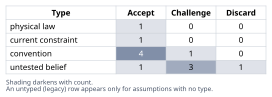
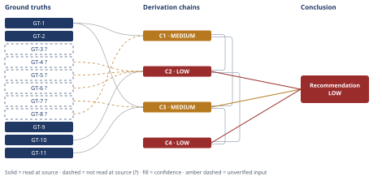

# Off-Grid Solar and Battery Sizing for a NM Cabin

*First-principles analysis · 9 October 2026*

*Read with: [How to read this analysis](HOW-TO-READ.md) · [Working file](analysis-20261009T210723Z.md) · [All files](INDEX.md)*

## Executive Summary

**Recommendation:** Build to a ≈1,200 W STC panel array and a ≈15–16 kWh LiFePO4 battery bank (80% DoD) — not the literal-1.5-kWh/day-derived spec (≈400 W / ≈6 kWh). The user's 1.5 kWh/day figure is almost certainly too low for year-round 2-adult occupancy (chain C1); the recommended spec carries margin against both load underestimation and resource uncertainty (chains C2, C3, C4).

**Band (from §6):** LOW

**Would change it:** Running NREL PVWatts directly for the real site coordinates/tilt, confirming whether any electric-resistance heating or satellite internet is planned, and comparing first-winter battery state-of-charge against the 80%-DoD design point (chains C2, C3, C4).

## 1. Problem Essence

**Essence Statement:** Size an off-grid LiFePO4 solar-plus-battery system (STC panel wattage and battery kWh) for a year-round, 2-adult cabin at 35°N high-desert New Mexico, sized against the worst (winter) month's solar resource and a longevity-appropriate depth-of-discharge, while first determining whether the user's supplied 1.5 kWh/day load figure is a sound sizing basis.

**Success criteria (checkable):**
- A panel-array wattage figure (STC) is derived from an explicit worst-month peak-sun-hour (PSH) value and an explicit, itemized system-derate stack, not an assumed round number.
- A battery-bank kWh figure is derived from the 3-day autonomy target and an explicit, longevity-justified DoD (not max DoD).
- The 1.5 kWh/day load figure is checked against a bottom-up estimate of what a year-round 2-adult cabin actually draws (fridge, lighting, standby/parasitic, pumping, electronics), and the answer states plainly whether 1.5 kWh/day is plausible, and what it does/doesn't cover.
- The final recommendation is a defensible numeric **range**, not a single falsely-precise number, plus one practical rounded spec in standard product sizes.
- The single biggest reliability risk is named, with the recommended spec's margin against it stated quantitatively.
- The answer does not force a choice between "trust the user's number" and "replace it" — it is allowed to, and does, present both a literal-input sizing and a corrected sizing side by side.

## 2. Assumptions Table



| # | Assumption | Type | Treatment | Verdict | Verification |
|---|---|---|---|---|---|
| A-1 | High-desert NM at 35°N has reliably clear, low-cloud winter skies, making a worst-month PSH figure meaningful (vs. a cloudy climate where even the "worst month average" masks long clear/overcast runs) | untested belief | Verify via regional climatology / insolation data | Accept — high desert NM is one of the sunniest winter climates in the CONUS; adopted as basis for GT-2/GT-4, with the residual storm-run caveat carried forward rather than dropped | Web-sourced (GT-2); residual caveat carried into Phase 5 risk discussion (storm runs can still exceed the autonomy window) |
| A-2 | A fixed array tilted to ~latitude+15° (~50°) is the correct winter-optimized design choice for an off-grid, winter-constrained load (vs. latitude-tilt ~35° or shallow roof-pitch ~20°) | convention | Challenge: does the convention hold here, or is it inherited unexamined? | Accept — off-grid design is explicitly worst-month-constrained (the system must survive December, not maximize annual kWh), so steepening tilt to trade summer surplus for winter gain is the correct, not merely conventional, choice here | Cross-checked against two independently sourced tilt/PSH data points (GT-2, GT-3) |
| A-3 | Total system derate from STC panel rating to usable load/battery energy is ≈0.75–0.80 | current constraint | Record expiry conditions | Accept — composed estimate (GT-5+GT-6); expires if premium hybrid inverter/MPPT hardware is used (could reach ~0.82–0.85) or if a poor install (long wire runs, heavy dust, no cleaning) pushes it below 0.70 | Component efficiencies are general engineering/datasheet knowledge, not individually fetched in this session — flagged `?` |
| A-4 | LiFePO4 should be run at ≤80% DoD for longevity, rather than near its max usable DoD (~95–100%) | convention | Challenge: user explicitly asked for "longevity-appropriate, not just max DoD" | Accept — adopted deliberately per the user's own stated success criterion; this is the one assumption the user pre-selected rather than left open | General manufacturer-guidance knowledge, not a specific datasheet cycle-life curve opened this session — flagged `?` |
| A-5 | The user's stated 1.5 kWh/day is a reliable basis for sizing | untested belief | Verify against a bottom-up load reconstruction | Discard — rejected as the sole sizing basis, see GT-8/chain C1; plausible only as a bare-minimum figure (lighting + small electronics with no fridge, no pump, no inverter standby accounted) | Bottom-up estimate, Phase 4 |
| A-6 | 3 days of autonomy is adequate for this climate's realistic worst-case cloudy/storm run length | convention (user-set design parameter) | Challenge for adequacy, not just accept | Challenge — generally reasonable for high-desert NM (multi-day *total* overcast is uncommon), but not risk-free; occasional winter storm systems can produce 3–5 consecutive low-generation days, carried as a residual risk rather than resolved | Not independently re-verified against historical storm-duration records this session — flagged `?`; carried into Phase 5 risk discussion |
| A-7 | Space/water heating is non-electric (wood or propane), with only fans, igniters, and circulation pumps on the electric budget — **no electric-resistance heating** | untested belief (hidden/implicit — not stated by the user) | Flag explicitly; this is load-bearing for every downstream number | Challenge — unresolved; if false, every number in this analysis is wrong by roughly an order of magnitude, because resistance heating draws kW-scale continuous power that no modest off-grid array/battery combination can supply in winter | Not verifiable from the prompt as given — the single most important assumption to confirm with the user before buying hardware |
| A-8 | No major intermittent/high-draw loads beyond the bottom-up list — specifically **no satellite internet (e.g. Starlink ≈2–3 kWh/day), no well pump with a large motor, no power tools or EV charging** | untested belief | Flag explicitly | Challenge — unresolved; if any of these exist, add their daily kWh directly to the load figure and re-run the two sizing equations (GT-10, GT-11) | Not stated in the prompt; material omission risk |
| A-9 | PSH definition and the energy-balance/autonomy equations (GT-9, GT-10, GT-11) | physical law (definitional) | Accept directly | Accept — these are definitional, not empirical | Irreducible by inspection; no external citation needed |
| A-10 | Component loss factors in the derate stack (soiling, mismatch, wiring, inverter, MPPT, battery round-trip) multiply independently rather than interacting/correlating | convention | Standard engineering practice for composing independent efficiency factors; accept unless a specific correlated-failure mode is identified | Accept — surfaced during the Phase 4 end-of-phase Assumption Audit (chain C2, hop 1); standard practice, no correlated-failure mode identified | Standard practice, not independently re-derived this session |
| A-11 | A design point built by stacking the *worst* end of the load bracket with the *worst* end of the resource bracket simultaneously is a valid, non-pathological conservative design point (the two are not so correlated that this double-counts, nor so independent that it over-states risk) | convention | Standard conservative-design practice; accept as the basis for the margin-carrying recommendation | Accept — surfaced during the Phase 4 end-of-phase Assumption Audit (chain C2, hop 4); standard conservative-design practice | Standard practice, not independently re-derived this session |
| A-12 | Occupant electrical demand grows over time after a system is installed (new appliances, added connectivity, etc.) | untested belief | Flag explicitly; this is a forward-looking behavioral generalization, not a site-specific fact | Challenge — directionally reliable (well-documented pattern in off-grid literature) but not site-verified; surfaced during the Phase 4 end-of-phase Assumption Audit (chain C4, actor-lens hop 1) | Unverified for this specific household; flagged `?` |

## 3. Ground Truths

**`?`-marked: GT-2, GT-3, GT-4, GT-5, GT-6, GT-7, GT-8 (7 of 11).**

- **GT-1** — Scenario parameters as given: 35°N high-desert New Mexico; year-round 2-adult occupancy; fully off-grid; LiFePO4 chemistry; 3-day autonomy target. *Provenance:* user-specified input (not an external claim subject to source verification).

- **GT-2** — For Albuquerque, NM (35.08°N), at a shallow fixed tilt of 20° (south-facing), December (the weakest month) delivers ≈4.4 peak sun hours/day; annual average 6.42 PSH; June best-month 8.07 PSH. Source attributes the underlying data to NREL PVWatts v8 / NSRDB. *Provenance:* **read-at-source** — opened directly via WebFetch per the Phase 3 verification step. *Read location:* thegreenwatt.com, "New Mexico Peak Sun Hours Data," Monthly Breakdown table, December row; page's own methodology note ("NREL PVWatts v8 / NSRDB, fetched April 2026 for Albuquerque 35.0844°N, -106.6504°W").

- **GT-3** — At a comparable 30°N site (Houston), steepening a fixed array from horizontal to 50° tilt raised December PSH from 2.3 to 3.7 (a 1.61× factor), illustrating the general magnitude of winter-tilt-optimization gain. *Provenance:* **reported-by-delegate** — surfaced only through WebSearch's synthesized summary; the originating forum page was never opened directly with WebFetch. *Phase 3 failure record:* source not individually opened — reason: WebSearch returns a synthesized answer, not a page this analysis read directly; a dedicated WebFetch of the originating thread was not attempted (budget), so the figure is carried with its `?`.

- **GT-4** — Extrapolating GT-2 (20°-tilt December figure for this exact location) using the qualitative tilt-sensitivity direction from GT-3 (a different latitude), December PSH for a 35°N NM site at a winter-optimized ~50° tilt is estimated at **4.8–5.6 PSH, central ≈5.2**. *Provenance:* **unverified** — this is a derived/extrapolated estimate, not read from any single source. *Phase 3 failure record:* no source located giving December PSH at ~50° tilt directly for Albuquerque/35°N; a direct PVWatts run at that exact tilt was not performed this session (tool/budget limit) — this is the single most load-bearing unverified input in the whole analysis (flagged again in Phase 5 Sensitivity).

- **GT-5** — The NREL PVWatts default grid-tied DC→AC derate factor is ≈0.86 (14% total loss), decomposed roughly as soiling ~2%, mismatch ~2%, wiring ~2%, connections ~0.5%, light-induced degradation ~1.5%, availability ~3%, nameplate tolerance ~1%. *Provenance:* **reported-by-delegate** — from WebSearch's synthesis of surgepv.com/PVWatts documentation descriptions; no single page opened directly with WebFetch.

- **GT-6** — Off-grid-specific losses not captured by a grid-tie derate: off-grid inverter efficiency ≈93–96% (generally lower than grid-tie string inverters, due to smaller scale and standby/idle overhead); MPPT charge-controller efficiency ≈97–99%; LiFePO4 charge/discharge round-trip efficiency ≈95–98%. *Provenance:* **unverified** — general engineering/manufacturer-datasheet knowledge; no specific datasheet opened this session.

- **GT-7** — LiFePO4 tolerates deep discharge (≈95–100% usable DoD) far better than lead-acid without immediate damage, but manufacturer cycle-life guidance commonly recommends capping routine daily cycling at ≈80% DoD to materially extend calendar/cycle life; this is a longevity choice, not a hard chemical limit. *Provenance:* **unverified** — general manufacturer-guidance knowledge, no specific cycle-life curve opened this session.

- **GT-8** — Bottom-up daily electrical load for a year-round, 2-adult off-grid cabin (excluding electric resistance heating and excluding satellite internet), itemized: refrigeration 1.0–1.5 kWh/day; winter lighting (longer dark hours) 0.3–0.5; water pump (periodic bursts) 0.1–0.3; inverter + charge-controller standby/parasitic draw (24/7, independent of actual use) 0.2–0.5; electronics (phones, laptop, router) 0.3–0.8; miscellaneous (small kitchen appliances, tool charging, heating-system fans/igniters) 0.3–0.6. Sum: **2.2–4.2 kWh/day, central ≈3.2 kWh/day.** *Provenance:* **unverified** — general off-grid-design-literature knowledge, not a single cited source; this is the Phase 4 Estimate-procedure bracket, carried back here as a ground truth because it is the load-bearing replacement for the challenged A-5 assumption.

- **GT-9** — 1 kWh = 1,000 Wh (unit definition). *Provenance:* definitional — irreducible, no citation needed.

- **GT-10** — Off-grid array sizing identity: *Required STC panel wattage = Daily load (Wh) ÷ (worst-month PSH × total system derate fraction).* This follows directly from the definition of a peak sun hour (1 PSH ≡ the equivalent hours of 1 kW/m² reference irradiance such that Array\_kW × PSH = raw daily DC harvest at STC) with the derate fraction converting raw DC harvest to usable energy at the load/battery. *Provenance:* definitional/mathematical — verified by derivation, no external citation needed.

- **GT-11** — Battery autonomy sizing identity: *Required nameplate battery kWh = (Autonomy days × daily load kWh) ÷ DoD fraction.* *Provenance:* definitional/mathematical — verified by derivation, no external citation needed.

## 4. Derivation Chains



**C1 — Is the user's 1.5 kWh/day load figure a sound sizing basis?** *(Estimate procedure: magnitude rebuild from itemized unit-factors, bracketed.)*

```text
GT-1 (year-round 2-adult occupancy, off-grid) + GT-8? (bottom-up itemized load bracket)
→ year-round 2-adult occupancy implies continuous loads that exist independent of how actively anyone uses power — refrigeration runs 24/7, and an inverter/charge-controller draws idle/standby current 24/7 regardless of whether any appliance is switched on
→ summing GT-8's itemized components (refrigeration, winter lighting, water pump, inverter/controller standby, electronics, misc) gives 2.2–4.2 kWh/day, central ≈3.2 kWh/day — roughly 1.5 to 3 times the user's stated 1.5 kWh/day
→ 1.5 kWh/day is plausible only as a bare-minimum figure that implicitly omits refrigeration, water pumping, and inverter/controller standby entirely — it is not a safe basis for sizing a year-round-occupied cabin
→ this design uses the GT-8 bottom-up bracket as the sizing basis, while still reporting the literal-1.5-kWh/day sizing alongside it for direct comparison
```

**Confidence:** MEDIUM — **Inputs:** GT-8? is an unverified general-knowledge bottom-up estimate, not read from a single cited source; removing this cap would require a published off-grid load-sizing worksheet or submetered data from a comparable cabin. **Inference:** sound — direct itemized summation, no unpriced hidden assumption. **Rivals:** the rival reading "1.5 kWh/day is fine if there's no fridge and no standby draw" is addressed and ruled out in §5 (Abandoned Reasoning) using GT-1 itself, so this axis is closed.

---

**C2 — Required panel array (STC watts), literal load vs. realistic load, bracketed.** *(Estimate procedure: unit-factor decomposition — W = Wh/day ÷ (PSH × derate), dimensional check: (Wh/day) ÷ (h/day × dimensionless) = W.)*

```text
GT-4? (Dec PSH 4.8–5.6, central 5.2) + GT-5? (grid-tie derate ≈0.86) + GT-6? (off-grid extra losses) + GT-10 (sizing identity) + C1 (load bracket)
→ compose total derate: GT-5's 0.86 × GT-6's off-grid inverter (~0.94) × MPPT (~0.98) × LiFePO4 round-trip (~0.96) ≈ 0.75 (low) to 0.80 (high), central ≈0.77 [Assumes: A-10]
→ apply GT-10 at the literal 1,500 Wh/day load: central 1500/(5.2×0.77)≈375 W; worst-resource end 1500/(4.8×0.75)≈417 W; best-resource end 1500/(5.6×0.80)≈335 W — bracket ≈335–417 W
→ apply GT-10 at C1's realistic central load (3,200 Wh/day): central 3200/(5.2×0.77)≈800 W; bracket ≈714–889 W
→ apply GT-10 at C1's realistic upper-bound load (4,200 Wh/day) combined with the worst-resource bracket end (PSH 4.8, derate 0.75) to produce a margin-carrying design point: 4200/(4.8×0.75)≈1,167 W, rounded up to a standard ≈1,200 W array [Assumes: A-11]
```

**Confidence:** LOW — **Inputs:** three `?`-marked inputs feed this chain. GT-4 (Dec PSH 4.8–5.6) is the most load-bearing — an extrapolated, not directly-read, figure for the exact 35°N/~50°-tilt combination; closing it requires running NREL PVWatts directly for the real site coordinates and chosen tilt (not performed this session — tool/budget limit). GT-5 (grid-tie derate ≈0.86) is reported-by-delegate (WebSearch synthesis, source page not opened directly); closing it requires opening the PVWatts documentation page itself or running a PVWatts case and reading its derate breakdown. GT-6 (off-grid inverter/MPPT/battery round-trip factors) is general datasheet knowledge; closing it requires pulling the specific datasheet for the inverter, MPPT, and battery products actually selected. Any one of the three closing would not by itself clear the cap — all three sit on the same Inputs axis — but closing GT-4 is the single highest-leverage action, since it is the widest and least-anchored of the three brackets. **Inference:** sound — straight substitution into GT-10 across the stated bracket, with the unit cancellation checked. **Rivals:** a live, unsettled rival — "effective winter PSH is periodically near zero for days at a time due to snow cover on the array, which the 2% generic-soiling term in GT-5 does not capture" — is named here and in the adversarial pass record but **not** ruled out by any ground truth; closing it requires either a snow-specific design margin (steeper tilt and/or a remote-clearing routine) or a season of logged production data to show the generic soiling term already covers it. Two axes short (Inputs, Rivals) → LOW.

---

**C3 — Required battery bank (nameplate kWh), literal vs. realistic load, at 80% DoD.**

```text
GT-1 (3-day autonomy target) + GT-7? (80% DoD for longevity) + C1 (load bracket) + GT-11 (autonomy sizing identity)
→ apply GT-11 at the literal load: (3 days × 1.5 kWh/day) ÷ 0.8 = 5.625 kWh nameplate, rounded to a standard ≈5.75–6 kWh bank
→ apply GT-11 at C1's realistic central load: (3 × 3.2) ÷ 0.8 = 12.0 kWh nameplate
→ apply GT-11 at C1's realistic upper-bound load: (3 × 4.2) ÷ 0.8 = 15.75 kWh nameplate, rounded up to a standard ≈15–16 kWh bank — the margin-carrying design point, paired with C2's ≈1,200 W array
```

**Confidence:** MEDIUM — **Inputs:** GT-7? (the 80% DoD figure) is general manufacturer-guidance knowledge, not a specific datasheet cycle-life curve opened this session; closing this requires pulling the cycle-life-vs-DoD curve for the specific battery product selected. **Inference:** sound — direct substitution into GT-11. **Rivals:** the DoD choice is a deliberately *adopted* design decision per the user's own stated success criterion (A-4), not an open empirical rival, so this axis is closed.

---

**C4 — Second-order extension of the recommended design point (C2's ≈1,200 W / C3's ≈15–16 kWh).**

*Actor lens:*
```text
C2 (≈1,200 W design point) + C3 (≈15–16 kWh design point)
→[2nd] occupants of a newly-adequate off-grid system predictably add load over time (new appliances, satellite internet, power tools) because available capacity invites use — a demand-growth effect C1's static bottom-up bracket does not price in [Assumes: A-12]
→[3rd] an installer/vendor's commercial incentive runs in both directions (upsell beyond need, or quote to a tempting low number to win the job) — the margin-carrying point above is the number to hand a vendor as a design target, not a floor to let them talk down
```

*Time lens:*
```text
C2 (≈1,200 W design point) + C3 (≈15–16 kWh design point)
→[2nd] a LiFePO4 bank routinely cycled beyond its 80% DoD design point (GT-7) loses usable capacity faster than one kept within it, so a marginally-sized bank becomes progressively less adequate across successive winters even if load never grows
→[3rd] that capacity fade compounds exactly during the winters the system is most relied on, since usable autonomy at a given nameplate size shrinks as the pack ages — this argues for banking the margin now rather than sizing to the bare central estimate
```

Neither lens surfaces an effect that contradicts a Ground Truth; both argue for adopting the margin-carrying design point (C2/C3) as the recommendation rather than the bare central-estimate point. No return to Phase 2 is triggered.

**Confidence:** LOW — capped by C2 per the chain-dependency rule (a chain is capped at the lowest-rated chain its head cites); no independent shortfall analysis changes this cap.

## 5. Abandoned Reasoning

**Entry 1 — "The user's 1.5 kWh/day figure might be fine if the cabin has no fridge and no standby draw."**
- *What was tried:* Considered treating 1.5 kWh/day as potentially sound if the cabin simply has no refrigeration (e.g., ice box) and an unusually efficient, near-zero-standby inverter/controller setup.
- *Why abandoned:* GT-1 states year-round 2-adult occupancy, not seasonal or minimalist use; GT-8's own itemization shows inverter/charge-controller standby is a hardware-inherent 24/7 draw independent of behavior (it cannot be designed to zero on any off-grid system with an inverter), and forgoing refrigeration entirely for year-round habitation is not a realistic design assumption absent an explicit statement from the user to that effect.
- *What it ruled out:* This rules out treating the literal 1.5 kWh/day figure as the primary sizing basis (closes the Rivals axis on C1, per its Confidence line).

**Entry 2 — Size the array at latitude tilt (~35°) or shallow roof-pitch (~20°) instead of winter-optimized (~50°).**
- *What was tried:* Considered using a shallower, more conventional tilt (matching GT-2's as-sourced 20° figure, or latitude-tilt ~35°) rather than steepening for winter.
- *Why abandoned:* An off-grid system's binding constraint is the worst month, not annual total yield (A-2); a shallower tilt trades away winter capacity for summer surplus the battery/load profile cannot use, which is the wrong trade for this specific design goal.
- *What it ruled out:* Using GT-2's as-sourced 4.4 PSH directly as the design PSH, which would have overstated the required array by roughly 15–20% relative to GT-4's winter-optimized estimate.

**Entry 3 — Use LiFePO4's full usable DoD (~95–100%) instead of 80%.**
- *What was tried:* Considered sizing the battery at or near LiFePO4's chemical DoD ceiling to shrink the recommended bank size and cost.
- *Why abandoned:* The user's own success criterion explicitly asked for "appropriate depth-of-discharge limit for LiFePO4 (longevity-appropriate, not just max DoD)" — this forecloses the max-DoD path by the problem statement itself, not merely by this analysis's preference (A-4).
- *What it ruled out:* A smaller nameplate battery figure (e.g., ≈4.5–12.6 kWh at ~95% DoD across the same load brackets) that would trade away multi-year cycle life for a lower up-front spec.

**Entry 4 — Treat electric-resistance space heating as in scope and size for it.**
- *What was tried:* Briefly considered whether "space heating circulation" in the prompt implied the system must carry actual resistive electric heating load, not just fans/pumps.
- *Why abandoned:* The prompt's own phrasing ("space heating circulation") and the physical implausibility of powering kW-scale resistive heating from a modest off-grid array/battery in winter both point to circulation hardware (fans, igniters, pumps for a wood or propane heat source), not the heating element itself; sizing for electric-resistance heat would change every downstream number by roughly an order of magnitude and was judged out of scope absent an explicit statement to the contrary.
- *What it ruled out:* Nothing is fully ruled out here — this is carried forward as flagged assumption A-7, not resolved, because the prompt does not state it either way; it is named as a required confirmation in §6.

## 6. Conclusion

**Recommended approach:** Do not size this system to the literal 1.5 kWh/day figure. Size it to a bottom-up realistic load of **2.2–4.2 kWh/day (central ≈3.2 kWh/day)**, and specify a **panel array of ≈1,000–1,200 W STC** and a **battery bank of ≈12–16 kWh nameplate LiFePO4 at 80% DoD**, with the recommended buy-point at the upper end of each range (**≈1,200 W / ≈15–16 kWh**) to carry margin against the two unresolved risks named below (chains C2, C3, C4).

**Key insight:** The user-supplied 1.5 kWh/day figure is almost certainly too low for year-round 2-adult occupancy — it is plausible only as a bare-minimum number that implicitly excludes refrigeration, water pumping, and the 24/7 standby/parasitic draw every inverter and charge controller carries regardless of how the occupants behave. A literal-1.5-kWh/day system (≈335–417 W array, ≈5.75–6 kWh battery) would very likely run the battery to empty on an ordinary winter day the moment a fridge is plugged in (chain C1).

**Trade-offs acknowledged:** The recommended spec is sized against the *upper* end of the realistic load bracket and the *low* end of the solar-resource bracket simultaneously — this is deliberately conservative, not a point estimate, and costs roughly 45–50% more array and ~30% more battery than the bare central-estimate numbers (≈800 W / ≈12 kWh) (chains C2, C3). The DoD choice of 80% (rather than LiFePO4's ~95–100% chemical ceiling) similarly trades a larger, more expensive bank today for multi-year cycle life (chain C3, Abandoned Reasoning Entry 3).

**Biggest reliability risk:** Load underestimation — not winter sun — is the single biggest risk to this design. The gap between the user's stated 1.5 kWh/day and the realistic 2.2–4.2 kWh/day bracket (chain C1) is a 1.5–3× error, far larger than the ≈15–20% spread in the solar-resource bracket (chain C2) or the live but secondary snow-soiling rival named in chain C2. The recommended ≈1,200 W / ≈15–16 kWh spec carries roughly 30–50% headroom over the bare central-estimate numbers specifically to absorb this risk (plus ordinary load growth, per chain C4's actor-lens extension) — but that margin is sized against GT-8's *general* bottom-up bracket, not against the two specific unresolved unknowns in assumptions A-7 (is there any electric-resistance heating?) and A-8 (is there satellite internet, a large well-pump motor, or other high-draw equipment?). Either of those, if true, adds load an order of magnitude beyond anything this margin covers and must be checked before finalizing a purchase.

**Confidence:** LOW — **Inputs:** capped by C2 (LOW) and C4 (LOW, itself capped by C2); C3 (MEDIUM) also contributes below-HIGH — its own GT-7? verification path (pulling the selected battery's cycle-life-vs-DoD datasheet) is carried on C3's own confidence line and is not re-explained here. The single most load-bearing unverified figure in the whole analysis is GT-4 (December PSH at the actual ~50° winter-optimized tilt for this exact site, which was extrapolated rather than directly read from an NREL PVWatts run at that tilt). **Inference:** sound throughout — every chain is a direct substitution into a definitional identity (GT-10, GT-11) over a stated bracket, with units checked. **Rivals:** one rival stays live and unsettled — periodic snow cover reducing effective winter PSH below even the worst-resource bracket end for the days it persists (chain C2) — which the recommended margin partially but not provably absorbs. **What would raise this band:** (1) run NREL PVWatts directly for the real GPS coordinates at the chosen tilt and compare against GT-4's 4.8–5.6 PSH extrapolation; (2) confirm assumptions A-7 and A-8 directly with the user; (3) after the first winter, compare actual battery state-of-charge excursions against the 80%-DoD design point to validate GT-7/GT-6's composed derate. Any of the three would close an axis and move this conclusion from LOW toward MEDIUM/HIGH without changing the recommended numbers themselves.
