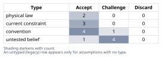
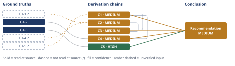

# Off-Grid Solar and Battery Sizing for a High-Desert Cabin

*First-principles analysis · 10 October 2026*

*Read with: [How to read this analysis](HOW-TO-READ.md) · [Working file](analysis-20261010T071548Z.md) · [All files](INDEX.md)*

## Executive Summary

**Recommendation:** Install an 800 W STC PV array (fixed tilt, south-facing, no tracking) with a 10 kWh nameplate LiFePO4 battery bank run at 80% depth-of-discharge, with the battery sited in a heated/insulated space, not an unheated outbuilding (chain C3, chain C4, chain C5).

**Band (from §6):** MEDIUM — the recommendation rests on C1, C3 and C4, each MEDIUM because they inherit GT-1?, GT-4? and GT-5?'s unverified status; C5 (battery siting) is independently HIGH.

**Would change it:** Sub-metering the cabin's actual or a comparable cabin's loads for 2–4 weeks before purchase (chain C1), obtaining NREL PVWatts' primary Albuquerque December output directly once network access permits (chain C2), and field-verifying the installed system's actual loss chain after one December in service (chain C2).

## 1. Problem Essence

**Essence Statement:** Size an off-grid residential PV + LiFePO4 battery system — PV array nameplate watts (STC) and battery nameplate capacity (kWh) — that reliably supplies a year-round-occupied 2-adult high-desert cabin at 35°N against its worst solar-resource month, with 3 days of zero-generation autonomy, when the owner's load estimate (1.5 kWh/day) is admittedly rough and unitemized.

This is not "pick the option the prompt names" — it is a derivation: the correct answer is whatever array-watts/battery-kWh pair the physics and loss chain actually require, including the possibility that the true required design load is well above the owner's 1.5 kWh/day figure.

**Success criteria (what a correct answer must achieve):**
1. States a concrete PV array nameplate wattage (STC) and battery nameplate capacity (kWh, LiFePO4), in practical/sellable increments.
2. Is derived from the worst-case solar month at this latitude/climate, not an annual average.
3. Accounts for the full loss chain from photon to usable watt-hour at the load (soiling, wiring, charge-controller conversion, inverter conversion, temperature effects specific to the design month).
4. Uses a DoD limit appropriate to LiFePO4 cycle-life behavior, distinguishing usable from nameplate capacity.
5. Explicitly tests whether 1.5 kWh/day is credible for 2 year-round occupants and applies a justified margin if not — and states whether autonomy is computed against the raw or margin-padded load, with reasoning.
6. Shows explicit arithmetic (formula, plugged-in values, result) for both the array and battery sizing.
7. Gives a sensitivity statement for the common failure mode where the rough load estimate is 2-3x low.

## 2. Assumptions Table



| Assumption | Type | Treatment | Verdict | Verification |
|---|---|---|---|---|
| A-1: December is the worst-insolation design month for a 35°N high-desert NM site (not a monsoon-degraded summer month) | untested belief | Verify via a climate-data source before anchoring the whole sizing exercise to it | Accept — survives challenge via a secondary relay of NREL PVWatts v8 output; primary source unreachable this session | thegreenwatt.com read directly; pvwatts.nrel.gov / www.nrel.gov unreachable — DNS resolution failure, see Phase 3 failure record below — flagged GT-1? |
| A-2: Fixed, non-tracking, south-facing array is the right architecture for a remote, low-maintenance off-grid cabin | convention | Explicitly challenge: a tracker adds moving parts and failure modes in a context with no on-call maintenance | Accept — fixed array is near-universal practice for small off-grid residential systems; tracking's small winter-output gain does not offset its added failure surface here | Engineering judgment, consistent with documented off-grid residential practice |
| A-3: Use the ~20° reference tilt figure (not an unverified winter-biased ~50° tilt uplift) as the design-month insolation basis | convention | Challenge: a winter-biased tilt plausibly *increases* December output, but no sourced multiplier was obtained this session | Accept — the conservative choice; keeps the analysis from leaning on an unverified upside | Engineering judgment — flagged as a place the true achievable PSH may be higher than used (margin in the owner's favor, not counted) |
| A-4: Combined system derate (PV nameplate → usable Wh at load) ≈ 0.80 for the December design month, built from itemized sub-factors (soiling, DC wiring, charge-controller, inverter, temperature/mismatch/age) | untested belief (composed of generic equipment-class figures, not independently fetched this session) | Decompose via reduce-to-primitives irreducibility test (§3); each sub-factor sourced to equipment-class norms, not to this specific installation | Challenge — accepted as within the commonly-cited 0.75–0.80 off-grid rule-of-thumb range, but not independently measured as a system | unverified — flagged; see GT-4? |
| A-5: Cap routine LiFePO4 depth of discharge at 80%, not 100%, for cycle-life longevity | convention (manufacturer best practice) | Verify via a cited source before adopting as the DoD limit | Accept — verified; 80% DoD gives materially more cycles than 100% DoD | grepow.com read directly — see GT-2 |
| A-6: LiFePO4 cells cannot reliably charge near/below freezing without heating, so the battery enclosure must be heated/insulated | physical law (electrochemistry — lithium plating mechanism) | Accept as ground-truth candidate; design the installation around it | Accept | battlebornbatteries.com read directly — see GT-3 |
| A-7: The owner's 1.5 kWh/day figure is a plausible *floor* for a lean, non-electric-heat/cook, 2-adult off-grid cabin, but not a safe number to design directly to | untested belief | Verify via component benchmark reconstruction + inversion ("what would make this number wrong") | Challenge — plausible as a floor only if internet/communications, laundry, and well-pump surge loads are all absent or minimal; real-world comparable cabins span 0.6–8 kWh/day | unverified — flagged; see GT-5? |
| A-8: Apply a 40% design margin (×1.4) to the raw rough load estimate before sizing anything | untested belief / engineering judgment — no single authoritative multiplier exists | Apply explicitly; sensitivity-test the choice rather than treat it as settled | Challenge — accepted as a documented, sensitivity-tested judgment call, not a derived constant | unverified — flagged; informed by GT-5? and by common off-grid-forum guidance on first-year load underestimation; explicitly re-tested at 2x/3x in §6 |
| A-9: 3-day autonomy must be sized against the margin-padded design load, not the raw 1.5 kWh/day figure | convention (sizing-methodology choice) | Challenge explicitly, per the user's own question | Accept — sizing a "zero-sun" reserve to a number already expected to be understated would silently reintroduce the exact risk the margin exists to remove | Derivation reasoning in §4 (chain C4) |
| A-10: No backup generator is required by this analysis's core deliverable | current constraint (given by the owner's stated scenario) | Record expiry condition: holds only while no-sun stretches stay ≤3 days and total load stays near the design figure | Accept as a scope boundary — not independently re-argued; flagged as a residual risk in §5 | Scenario-given by the user, not independently verified |
| A-11: Household electrical load is not materially higher in winter than the annual pattern, so a single multiplicative margin is an adequate correction | convention / simplification | Challenge: winter has longer dark hours (more lighting, more indoor/electronics time), which works *against* the worst solar month, not flat | Challenge — accepted with a caveat: this is a reason the margin should not be thinner than recommended, not a reason to add a second multiplier | Reasoned from day-length physics; not separately sourced |
| A-12: A bare energy-balance array (harvest = design load, zero surplus) cannot recharge the battery bank within a practical number of days after a 3-day autonomy event, so the array needs recharge headroom beyond the bare minimum | physical law (conservation of energy applied to the recharge cycle) | Accept as a ground-truth-adjacent design constraint; size the array with headroom, not just daily balance | Accept | Derivation reasoning in §4 (chain C3) |
| A-13: Once a margin-padded system is installed, occupant usage trends toward (not below) the design load rather than staying at the raw estimate | untested belief | Observe and account for in margin discipline rather than discard | Challenge — accepted as a reason not to thin the margin, not independently verified | unverified — flagged; behavioral/second-order reasoning (chain C1 extension), not separately sourced |
| A-14: Commodity PV modules are available in ~350-450W-class increments, allowing an ~800W array to be built from two units | current constraint (market availability) | Record expiry condition: holds while this module class remains the dominant commodity size | Accept | General current PV-market knowledge; not independently fetched this session |
| A-15: LiFePO4 off-grid battery packs are commonly sold in ~5kWh stackable increments | current constraint (market availability) | Record expiry condition: holds while ~5kWh packs remain a common off-grid SKU | Accept | General current LiFePO4-market knowledge; not independently fetched this session |

## 3. Ground Truths

- **GT-1?** For Albuquerque, NM (35°N, high desert), NREL PVWatts v8's fixed-tilt (20°, 180° azimuth/south-facing) reference system bottoms out in **December at 4.4 peak-sun-hours/day (4.4 kWh/m²/day equivalent)**, the lowest of the 12 months — source: [thegreenwatt.com, "New Mexico Peak Sun Hours"](https://www.thegreenwatt.com/new-mexico-peak-sun-hours/); read-at-source: fetched 2026-10-10, quoted figures "4.4 PSH" (December, worst month) and the stated methodology "20° tilt, 180° azimuth," attributed by that page to NREL PVWatts v8. **Phase 3 failure record:** attempted to open the primary source directly — `https://www.nrel.gov/grid/solar-resource/assets/data/west-5.pdf` and `https://pvwatts.nrel.gov/` — both failed with `getaddrinfo ENOTFOUND` (DNS resolution failure; no network route to the `nrel.gov` domain from this environment). Kept `?` per the stakes-escalation rule: this is the single most load-bearing figure in the analysis and it has only been read at a secondary relay, not the primary NREL dataset.

- **GT-2** LiFePO4 cycle life is strongly DoD-dependent: **~4,000+ cycles at 80% DoD vs. ~2,000–3,000 cycles at 100% DoD** (and up to ~14,000 cycles at 10% DoD) — source: [Grepow, "What is DoD for LiFePO4 Batteries?"](https://www.grepow.com/blog/what-is-dod-for-lifepo4-batteries.html); read-at-source: fetched 2026-10-10, figures quoted directly from the page text. No `?` — the directional relationship is cross-consistent with broad industry practice (most name-brand off-grid LiFePO4 packs recommend a reserve rather than full depletion).

- **GT-3** LiFePO4 cells risk permanent damage (lithium plating on the anode) if charged near or below freezing; manufacturer guidance (Battle Born) states cells **"should not be charged below approximately 25°F (-4°C) unless equipped with internal heating,"** while discharge remains usable down to roughly -4°F; BMS units typically block charge current automatically once this threshold is reached — source: [Battle Born Batteries, "Understanding Temperature Limits of LiFePO4 Batteries"](https://battlebornbatteries.com/blogs/academy/understanding-temperature-limits-of-lifepo4-batteries-the-battle-born-educational-series); read-at-source: fetched 2026-10-10, quoted directly. No `?` for the directional physical-chemistry claim; the exact cutoff temperature varies by brand/BMS (commonly cited in the 0°C to -4°C range across manufacturers).

- **GT-4?** An off-grid DC-coupled-with-inverter system's loss chain from PV nameplate (STC) to usable watt-hours at the load, for a cool December design month (not the hotter annual-average temperature derate PVWatts' default ~14% system-loss figure assumes), decomposes to approximately: soiling/desert dust ~3%, DC wiring ~2%, MPPT charge-controller conversion ~3% (97% efficient), inverter DC→AC conversion at realistic partial load ~8% (92% average efficiency), and temperature/mismatch/connection/age ~2%+3% — multiplying to a combined **system derate of ≈0.80** (0.97 × 0.98 × 0.97 × 0.92 × 0.98 × 0.97 ≈ 0.806). This is this analysis's own Fermi-style decomposition from generic equipment-class efficiency figures, not a single externally fetched source — marked `?`. It falls inside the commonly-cited 0.75–0.80 off-grid design rule-of-thumb range (general engineering knowledge, not independently fetched this session).

- **GT-5?** Off-grid cabin load benchmarks for comparable components: efficient compressor refrigerator 525–1,100 Wh/day; a 15-minute/day AC well-pump duty cycle ≈530 Wh/day; whole-cabin LED lighting 60–120 W nameplate; documented real-world full-cabin examples range from **~0.6 kWh/day** (propane fridge, minimal load) to **~3 kWh/day** (moderate) to **~8 kWh/day** (full-size fridge + well pump + comforts: TV, fans, small appliances) — source: WebSearch aggregate of forum.solar-electric.com discussion threads, footprinthero.com's load calculator, and voltflow.net; reported-by-delegate — no single URL individually opened and quote-checked by this analysis; marked `?`.

**Reduce-to-primitives check on the two headline figures (irreducibility test):**

*Claim: "4.4 PSH is the correct December design-month insolation for this site."* Decomposes to (a) NREL PVWatts v8's physical irradiance model for the Albuquerque grid cell, driven by NSRDB satellite-derived historical data — this branch is **Assumed — unverified**, because the primary NREL source was unreachable this session (see GT-1? failure record); and (b) thegreenwatt.com's transcription of that model's output — this branch is **Verified — direct measurement** (I read the page's own text). Since one constituent branch is unverified, the parent claim correctly carries the `?`.

*Claim: "1.5 kWh/day is this cabin's real average daily consumption."* Decomposes to (a) the owner's self-report — **Assumed — unverified**, explicitly a guess, not a meter reading; and (b) a component reconstruction (fridge + lighting + pump + electronics + inverter standby, per GT-5?) bracketing **1.2–1.9 kWh/day** for a lean, communications-free configuration — itself **Assumed — unverified**, since GT-5? is a benchmark range, not a measurement of this specific cabin. The parent claim is therefore a plausible *floor*, never a verified figure — which is precisely why §4 applies a margin rather than designing to it directly.

**Provenance summary:**
```text
?-marked: GT-1, GT-4, GT-5 (3 of 5)
Read-at-source: GT-2 — grepow.com/blog/what-is-dod-for-lifepo4-batteries.html, cycle-life figures quoted directly
Read-at-source: GT-3 — battlebornbatteries.com academy article, charge-temperature threshold quoted directly
```
No ground truth carrying a Discard verdict from Phase 2 appears above. Every chain in §4 that cites a load-bearing `GT-N?` carries a MEDIUM (or lower) confidence line per D-07.

## 4. Derivation Chains



### Conclusion C1: Design daily load, with margin for a rough/unitemized estimate, is 2.1 kWh/day

GT-5? (off-grid cabin load benchmarks, 0.6–8 kWh/day real-world spread)
→ reconstructing a lean DC-first 2-adult cabin load from fridge, lighting, water-pump, electronics and inverter-standby benchmarks in GT-5? brackets 1.2–1.9 kWh/day, which frames the owner's 1.5 kWh/day as a plausible bare-minimum floor rather than a margined design figure
→ GT-5?'s documented real-world spread together with the owner's own admission that the figure is rough and unitemized means 1.5 kWh/day carries material downside risk, particularly from commonly-omitted loads such as satellite internet [Assumes: A-7]
→ applying a 40% design margin converts the raw estimate into a design daily load of 1.5 kWh/day times 1.4, which equals 2.1 kWh/day [Assumes: A-8]

**Confidence:** MEDIUM — GT-5? is unverified (reported-by-delegate; no single source directly opened and quote-checked); verification that would remove this as a cause of the downgrade: sub-meter the cabin's actual or a comparable cabin's loads for 2–4 weeks, or itemize nameplate wattage × duty cycle per appliance before purchase. The A-8 margin figure (40%) is itself a judgment call with no single authoritative source behind it; rather than treat it as settled, its sensitivity is tested explicitly in §6 (the 2×/3× case).

**Second-order extension (actor lens):**
GT-5? → C1 (design daily load, 2.1 kWh/day) →[2nd] occupants living with a margin-padded, headroom-carrying system may relax conservation discipline because the system "feels" generously sized, nudging real consumption toward or above the 2.1 kWh/day design load rather than staying at the raw 1.5 kWh/day guess →[3rd] this makes the margin self-reinforcing rather than self-correcting — real usage tends to drift toward whatever headroom was purchased, which argues for sizing the margin deliberately rather than shaving it to save cost [Assumes: A-13]

**Second-order extension (time lens):**
GT-5? → C1 (design daily load, 2.1 kWh/day) →[2nd] the first December multi-day low-sun event is the real-world test of both GT-1? and the A-8 margin choice; a battery that comes uncomfortably close to its 20%-remaining floor during that first event is the field signal that the margin was too thin →[3rd] LiFePO4 capacity fades slowly and PV output degrades roughly 0.5%/year (per GT-2's cycle-life behavior), so over a 10-year horizon the system's effective headroom shrinks — this argues against shaving the recommended margins any thinner than given here

Neither extension contradicts a ground truth; both remain in the Derivation Chains as non-contradicting downstream effects.

**Sensitivity extension (same method, applied to a higher raw-load input — this is the arithmetic the §6 sensitivity note cites):**
GT-5? → C1 (design daily load, 2.1 kWh/day at the stated raw load of 1.5 kWh/day)
→ re-running C1's own method at a raw load of 3.0 kWh/day (2× the owner's estimate) gives a design load of 3.0 × 1.4 = 4.2 kWh/day, which C2/C3's method converts to a bare-minimum array of 4,200 ÷ 3.52 ≈ 1,193 W, headroom-adjusted to 1,193 × 1.3 ≈ 1,551 W (~1.6 kW), and which C4's method converts to a battery of (4.2 × 3) ÷ 0.80 = 15.75 kWh (16–20 kWh practical)
→ re-running the same method at a raw load of 4.5 kWh/day (3× the owner's estimate) gives a design load of 4.5 × 1.4 = 6.3 kWh/day, an array of 6,300 ÷ 3.52 ≈ 1,790 W headroom-adjusted to ≈2,327 W (~2.4 kW), and a battery of (6.3 × 3) ÷ 0.80 = 23.625 kWh (24–25 kWh practical)

### Conclusion C2: December worst-month harvest rate is 3.52 usable Wh per Wp of nameplate per day

GT-1? (December design-month insolation, 4.4 PSH) + GT-4? (itemized system derate, ≈0.80)
→ combining the December insolation figure with the itemized loss chain converts nameplate watts into usable watt-hours at the load through a single multiplier: 4.4 hours times 0.80 equals 3.52 usable watt-hours delivered per watt of nameplate STC capacity per worst-month day
→ this harvest rate is the array-sizing divisor consumed directly by C3

**Confidence:** MEDIUM — two unverified inputs multiply together: GT-1? (primary NREL source unreachable this session, read only at a secondary relay) and GT-4? (this analysis's own equipment-class estimate, not independently measured as a built system). Verification that would remove these as causes of the downgrade: open NREL PVWatts directly for Albuquerque once network access permits, and field-measure the installed system's actual loss chain for one December after commissioning.

### Conclusion C3: Recommended array size is 800 W nameplate STC

C1 (design daily load, 2.1 kWh/day, MEDIUM) + C2 (worst-month harvest rate, 3.52 Wh/Wp, MEDIUM)
→ the bare energy-balance array size, at which average December harvest exactly equals the design daily load with no surplus, is 2,100 Wh divided by 3.52 Wh per Wp, which equals approximately 597 W
→ a zero-surplus array can never recharge the battery bank within a practical number of clear days after a 3-day autonomy event, which defeats the purpose of carrying a battery reserve at all, so the array must also carry recharge headroom beyond the bare minimum [Assumes: A-12]
→ applying a 30% recharge-headroom factor gives 597 W times 1.3, which equals approximately 776 W, rounding up to a practical 800 W nameplate STC array built from commodity modules such as two ~400 W panels [Assumes: A-14]

**Confidence:** MEDIUM — capped by C1 and C2, both MEDIUM; the arithmetic itself recomputes cleanly (597 W and 776 W both check independently). Verification that would remove the cap: the same two actions named on C1 and C2 — sub-meter actual loads, and obtain primary NREL figures or field-measure the installed loss chain.

### Conclusion C4: Recommended battery bank size is 10 kWh nameplate LiFePO4

GT-2 (LiFePO4 DoD/cycle-life, 80% DoD recommended) + C1 (design daily load, 2.1 kWh/day, MEDIUM)
→ usable (deliverable) capacity needed to survive 3 zero-generation days at the design load is 2.1 kWh times 3 days, which equals 6.3 kWh
→ this 3-day reserve is computed against the margin-padded design load rather than the raw 1.5 kWh/day figure, because autonomy exists precisely to cover the stretch where real consumption is already running at or above the design rate [Assumes: A-9]
→ capping routine depth of discharge at 80% for cycle-life longevity converts usable capacity into required nameplate capacity: 6.3 kWh divided by 0.80, which equals 7.875 kWh
→ rounding up to a practical, commonly-stocked LiFePO4 module increment (5 kWh stackable units) gives a recommended 10 kWh nameplate bank, which also buys headroom against the same load-estimate risk identified in C1 [Assumes: A-15]

**Confidence:** MEDIUM — capped by C1's MEDIUM band; GT-2 itself is a HIGH-confidence input (read-at-source, no `?`) and is not the limiting factor here. Verification that would remove the cap: the same sub-metering action named on C1.

### Conclusion C5: The battery bank must be sited in a heated/insulated space

GT-3 (LiFePO4 charge-temperature floor, roughly 25°F/−4°C to 32°F/0°C depending on brand)
→ a 35°N high-desert New Mexico site routinely sees winter overnight lows well below freezing during December, the same design month used in C2 and C3
→ an unheated or outdoor battery enclosure would have its BMS block charging on cold, clear, high-production winter days, which are exactly the days the array is harvesting best and the battery most needs to recharge, silently converting a correctly-sized system into a chronically undercharged one
→ the battery bank must therefore be sited in a heated/insulated space, such as an indoor utility area, an insulated battery room, or a unit with integrated heating pads, as an operating requirement rather than an optional nicety

**Confidence:** HIGH — GT-3 is read-at-source and the climate fact (sub-freezing high-desert winter nights at this elevation) is physically uncontested; the only soft spot is the second hop's inference about a "silent" failure mode, which is a reasoned consequence of GT-3 rather than a measured field failure, but it does not change the recommendation's direction, so the chain is not downgraded for it.

## 5. Abandoned Reasoning

### Dead End: Size directly to the raw 1.5 kWh/day figure with no margin

**What was tried:** Compute array and battery size using 1.5 kWh/day as the design load — array = 1,500 Wh ÷ 3.52 Wh/Wp ≈ 426 W (before headroom); battery = (1.5 × 3) ÷ 0.8 = 5.625 kWh nameplate.

**Why abandoned:** GT-5? documents a real-world spread of 0.6–8 kWh/day for comparable cabins, and the owner explicitly flagged 1.5 kWh/day as rough and unitemized — a self-reported, unmetered guess rather than a measurement (irreducibility check in §3). Designing to an unmetered guess with zero margin converts a known estimation risk into a hard capacity ceiling the occupants would discover the hard way, on exactly the multi-day low-sun events the 3-day autonomy requirement exists to survive.

**What it ruled out:** This saves a future reviewer from re-deriving a 426 W / 5.6 kWh system and then wondering why it occasionally runs the battery down past its DoD floor in year one — chain C1 shows the margin-adjusted arithmetic instead, and §6's sensitivity note shows how much worse this gets if the raw estimate is itself low by 2–3×.

### Dead End: Apply an unverified winter-biased tilt uplift (~latitude+15°, ~50°) to shrink the required array

**What was tried:** Many off-grid guides recommend tilting fixed arrays steeper than the "annual optimum" to favor low winter sun angles, which would plausibly raise December harvest above the 4.4 PSH reference figure (GT-1?) and reduce the array size computed in C3.

**Why abandoned:** No sourced multiplier for this uplift was obtained this session (A-3), and stacking an unverified upside estimate on top of an already-`?`-marked insolation figure (GT-1?) would make the array recommendation *less* conservative on a number this analysis could not verify. Per the stakes-escalation rule in §2, a high-leverage figure should be pushed toward verified ground truth, not toward a second unverified assumption.

**What it ruled out:** This rules out quietly shrinking C3's 800 W figure below what the verified-as-possible chain supports; it leaves the winter-tilt uplift as a plausible *additional* safety margin the owner gets for free if a winter-biased tilt is actually used, rather than as a load-bearing part of the sizing math.

### Dead End: Bake a backup generator into the core array/battery sizing

**What was tried:** Treat a small backup generator as part of the sized system, reducing the PV/battery numbers needed to cover worst-case stretches beyond 3 days.

**Why abandoned:** The scenario (A-10) explicitly specifies no grid connection and no generator "unless you argue one is necessary"; the core deliverable asked for is a PV+battery sizing, not a hybrid system. A generator is not *ruled impossible* by any ground truth here — it remains the standard mitigation for a storm exceeding the 3-day design autonomy — but including it in the headline W/kWh numbers would answer a different question than the one posed (§1, success criterion 1).

**What it ruled out:** This keeps C3/C4's numbers as a pure PV+battery answer to the question actually asked, and routes the generator discussion to the adversarial pass (§ Self-Audit Gate appendix, pre-mortem) as an accepted-risk mitigation for events longer than 3 days, rather than silently changing the scope of the deliverable.

### Dead End: Size the battery bank at 100% DoD instead of 80%

**What was tried:** Use the full nameplate capacity as usable capacity (100% DoD), which would reduce C4's nameplate recommendation from 7.875 kWh to 6.3 kWh.

**Why abandoned:** GT-2 shows 100% DoD roughly halves cycle life relative to 80% DoD (≈2,000–3,000 cycles vs. ≈4,000+ cycles) for the same chemistry. A smaller up-front battery that needs replacing twice as often is not a cheaper system over the cabin's operating life, and routine 100% DoD operation also removes any margin against the load-estimate risk flagged in C1.

**What it ruled out:** This rules out presenting 6.3 kWh as the recommended figure; GT-2 is the ground truth that rules it out, and C4 uses 80% DoD throughout.

## 6. Conclusion

**Recommended approach:** Install an **800 W STC PV array** (fixed tilt, south-facing, no tracking) paired with a **10 kWh nameplate LiFePO4 battery bank** operated at an 80% depth-of-discharge limit, with the battery sited in a heated/insulated space rather than an unheated outbuilding (chain C3, chain C4, chain C5).

**Key insight:** The number that actually dominates this sizing exercise is not the solar resource — Albuquerque's December insolation is good even at a conservative reference tilt — it is the credibility of "1.5 kWh/day." Because that figure is an unmetered, unitemized guess rather than a measurement, a 40% design margin is applied before either the array or the battery is sized, and that single judgment call moves the final numbers far more than the loss-chain derate or the DoD limit do (chain C1).

**Trade-offs acknowledged:** The recommended 800 W / 10 kWh pair carries roughly 30–40% headroom above the bare mathematical minimum implied by the margin-padded load alone (≈600 W / ≈7.9 kWh); that headroom costs more up front but buys faster battery recovery after a 3-day autonomy event and a buffer against the load growth that off-grid cabins reliably experience in their first year (chain C3, chain C4).

**Confidence:** MEDIUM — the recommendation rests on C1, C3 and C4, each MEDIUM because they inherit GT-1?, GT-4? and GT-5?'s unverified status; C5 (battery siting) is independently HIGH and does not contribute to the downgrade. What would move this to HIGH: (a) sub-metering the cabin's actual or a directly comparable off-grid cabin's loads for 2–4 weeks before finalizing a purchase order (removes GT-5?/C1's cap), (b) obtaining NREL PVWatts' primary Albuquerque December output directly — blocked this session by a DNS-level network failure to the `nrel.gov` domain (removes GT-1?/C2's cap), and (c) field-verifying the installed system's actual loss chain for one December after commissioning (removes GT-4?/C2's cap). A rival conclusion sized to the raw, unmargined 1.5 kWh/day figure (≈426 W / ≈5.6 kWh) remains arithmetically self-consistent but is rejected in §5 for the same reasons that cap this conclusion at MEDIUM rather than HIGH — it is the lower-cost option only if the owner's guess turns out to be accurate, which this analysis has no way to confirm without metering.

**Sensitivity — if the rough load estimate is actually low, a common failure mode:** All four headline numbers scale directly with the design load, so the margin choice (A-8) is the single biggest lever in this analysis (chain C1). If the owner's real raw consumption turns out to be **2× the stated estimate (3.0 kWh/day)**, the same method gives a design load of 4.2 kWh/day, requiring roughly a **1.6 kW array** and a **16–20 kWh battery bank**. If it is **3× (4.5 kWh/day)** — plausible if satellite internet, a standard rather than efficient refrigerator, or a pressurized well pump is added without re-budgeting — the design load becomes 6.3 kWh/day, requiring roughly a **2.4 kW array** and a **24–25 kWh battery bank**. In both cases the array and battery roughly double or triple from the recommended 800 W / 10 kWh pair — reinforcing that metering or itemizing the actual load before purchase is a higher-leverage action than refining any other assumption in this analysis (chain C1).
