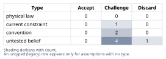
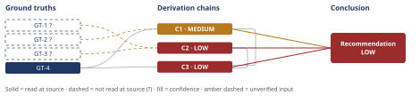

# The 878-Line Agent File vs. the 500-Line Budget

*First-principles analysis · 9 October 2026*

*Read with: [How to read this analysis](HOW-TO-READ.md) · [Working file](analysis-20261009T212852Z.md) · [All files](INDEX.md)*

## Executive Summary

**Recommendation:** Measure the real file's per-segment line counts before extracting
anything — the output-template-and-validation-rubric content, not the methodology or
companion-tool procedures, is the more probable dominant contributor to the overage (chains C2,
C3) — then extract only the segment that measurement confirms, while separately locating or
authoring the budget's missing rationale (chain C1) and commissioning a before/after rigor check
(chains C1, C3).

**Band (from §6):** LOW (chains C1, C2, C3).

**Would change it:** A direct line-count measurement of the real file's four named segments
(chain C2), locating or authoring the artifact that records the budget's protected property
(chain C1), and a before/after rigor comparison of the pre- and post-change agent body (chains
C1, C3).

# First-Principles Analysis: The 878-Line Agent File vs. the ~500-Line Budget

## 1. Problem Essence

**Core problem:** What property of the shipped Claude Code plugin agent file does its recorded
~500-line / ~5,000-token regression-gate budget actually protect, is that property — if any —
degraded by the file's current 878-line state in a way that is measurable rather than assumed,
and what is the minimum-cost intervention that restores whatever is actually load-bearing, given
that the segment driving the overage has not yet been measured and may not be the segment (the
inlined methodology body or companion-tool procedures) the reflexive "split it" response targets
first?

The triggering framing — "878 lines vs. a ~500-line budget, so split the file" — is a proposed
solution sitting on top of two unverified premises: that the budget is load-bearing for some
real consequence, and that the content most worth extracting is whichever content looks most
"procedural." Both are interrogated before any extraction is recommended.

**Success criteria** (each checkable against section 6 without further clarification):

1. Section 6's recommendation names the property the budget is meant to protect, or states
   explicitly that no such property is recorded in any artifact available to this analysis —
   it does not silently assume best-practice intuition stands in for a stated rationale.
2. Section 6's recommendation does not commit to extracting a specific content segment without
   first naming a measurement step that confirms that segment is the actual dominant contributor
   to the 878-line total — i.e., the recommended approach sequences verification before
   commitment, or it does not.
3. Section 6 treats "revise or retire the budget" and "do nothing" as options scored on the same
   footing as extraction in section 4's reasoning, rather than presupposing extraction is the
   answer before the options are compared.
4. Section 6 states explicitly which of the four named inlined categories (methodology body, the
   six companion-tool procedures, the output template, the validation rubric) stay inline and
   which are candidates for externalization, and ties that split to a stated reason — not to
   which category merely "looks most proceduralized."

---

## 2. Assumptions Table



| Assumption | Type | Treatment | Verdict | Verification |
|---|---|---|---|---|
| The ~500-line / ~5,000-token budget is load-bearing for some real, observable consequence (cost per invocation, context crowding, reasoning-quality degradation) | untested belief | Verify before use — locate the artifact that records the budget and the property it protects; if no property is named, the budget is a convention, not a demonstrated constraint | Challenge — no artifact stating the protected property was supplied to this analysis, and none is independently accessible to it | Unverified — flagged; the user's prompt states only that the budget is "recorded" and "enforced as a regression gate," with no stated rationale or named consequence; GT-2? below |
| The 878-line overage is best explained by the inlined methodology body and/or the six companion-tool procedures specifically (the content the "split it" framing names first) | untested belief — diagnostic | Verify by ruling out the alternative segments (the output template and validation rubric content) via measurement before naming a dominant contributor; confirming evidence for one hypothesis is not the same as ruling out its rivals | Challenge — unverified; no line-range measurement of the real file is available to this analysis, and a structural Fermi bracket (chain C2) makes this hypothesis the less likely of the two, not the more likely | Unverified — flagged; requires a heading-scan + line-count measurement of the actual file by someone with repository access |
| "Splitting the file" means extracting the methodology body or the companion-tool procedures into reference files, and the only other alternative is leaving the file as-is | untested belief — false-dichotomy | Challenge the binary framing — enumerate intermediate options (extract only the output-template/rubric content, revise the budget, do nothing, or a staged composite) and check whether any dominates the named poles | Discard — a composite option (measure first, then extract the confirmed segment, in parallel with clarifying the budget) survives a weighted trade-off at least as well as any single-action option (chain C3) | At least one intermediate option is constructed and scored in chain C3; the binary "split it or don't" framing is not exhaustive |
| The ~500-line figure reflects a constraint specifically validated for this agent's behavior, rather than a generic authoring convention carried over from general skill-authoring guidance | convention | Challenge explicitly — ask whether this specific number has ever been tied to a measured consequence for this specific agent, or whether it is inherited from general practice | Challenge — no evidence either way is available to this analysis; plausible under either reading | Unverified — flagged; requires locating whichever document records the budget's origin and rationale |
| Extracting inlined content into reference files never degrades the agent's reasoning quality, regardless of which content is moved | convention — context-dependent | Challenge by naming the contextual variable: whether the agent consults that content on every single invocation (unconditionally) or only sometimes (conditionally) — the convention is far more defensible for the latter than the former | Challenge — the convention plausibly holds for conditionally-consulted reference-grade content (e.g., a lookup table opened only when needed) but is considerably riskier for content executed on every run (the core methodology steps) | Unverified — flagged; requires confirming, for whichever content is actually extracted, whether the agent needs it on every invocation or only on demand |
| "878 lines" and "~5,000 tokens" scale together linearly, so a ~75% line overage implies a comparable token overage | untested belief | Verify by actually tokenizing the file rather than assuming a fixed lines-to-tokens ratio; markdown tables, code fences, and dense prescriptive prose tokenize at different densities than narrative prose | Challenge — unverified; the two halves of the stated budget (~500 lines, ~5,000 tokens ⇒ roughly 10 tokens/line) are an implied ratio, not a demonstrated one, and the actual content mix determines whether the two figures move together | Unverified — flagged; requires an actual token count of the file, not an assumption that line count and token count are interchangeable |
| The agent file will continue to receive new content additions over time, so headroom freed by an extraction has future value | current constraint | Record the expiry condition — this holds as long as the project keeps adding features to the agent surface; it would not hold for a frozen or sunset file | Challenge — plausible for an actively maintained plugin but not confirmed for this specific repository | Unverified — flagged; surfaced by the Phase 4 Assumption Audit on chain C3's second-order extension (`[Assumes: A-7]`) |
| A hand-maintained reference-file link and its inline cross-reference can drift out of sync without an automated content-generation/sync pipeline keeping them lockstep | untested belief | Verify by checking whether this repository has a sync/generation pipeline comparable to the one the precedent case (GT-4) relied on; if none exists, the mitigation is a smaller, single-sourced edit rather than pipeline-backed lockstep | Challenge — unconfirmed either way for this repository | Unverified — flagged; surfaced by the Phase 4 Assumption Audit on chain C3's second-order extension (`[Assumes: A-8]`) |

---

## 3. Ground Truths

**Irreducibility drill (five-whys, reduce-to-primitives mode), applied to the compound claim
"the 878 lines are fully accounted for by four named categories":** The claim decomposes into
(a) the methodology body, (b) the six companion-tool procedures, (c) the output template, and
(d) the validation rubric. Each of (a)-(d) is itself a heading-bounded block, and "a markdown
document's headings partition it into contiguous, non-overlapping line ranges" is a definitional,
verified primitive — true of any heading-structured document, not an empirical claim requiring a
citation specific to this file. The drill also surfaces what the four-category claim leaves
unstated: a real markdown file also carries front matter, a title, scenario or input-contract
prose, and cross-reference text that sits outside all four named blocks. The claim "these four
categories are jointly exhaustive of all 878 lines" therefore fails the irreducibility test as
stated — it is reducible further, into "the four named blocks" plus "an unquantified residual."
This residual is carried forward into the estimate in chain C2: if it is non-trivial, the true
per-category line counts are somewhat *below* the brackets built from category-only reasoning,
which — as shown in C2 — does not change the bracket's qualitative conclusion.

- **GT-1?** The agent file is stated to measure 878 lines — unverified: this analysis has no
  filesystem or repository access to the user's actual file (confirmed explicitly by the user),
  so the figure is accepted as a stated premise, not independently confirmed by this analysis via
  `wc -l` or an equivalent direct read. Phase 3 failure record: source unreachable — no file path
  or repository access was supplied, and the user explicitly states none is available.

- **GT-2?** The recorded budget is "~500 lines / ~5,000 tokens," enforced as a regression gate —
  unverified: this analysis has not seen the artifact (a requirements document, CI script, or
  equivalent) that records this budget or states what consequence it is sized to prevent. Phase 3
  failure record: source unreachable — no artifact path was supplied.

- **GT-3?** The agent file is stated to inline four content categories: the methodology body, six
  companion-tool procedures, the output template, and the validation rubric — unverified: this
  analysis cannot confirm the categories' boundaries, or that they are jointly exhaustive of the
  878 lines (see the irreducibility drill above), without reading the actual file. Phase 3 failure
  record: source unreachable — no file access.

- **GT-4** A structurally identical problem — an agent body inlining a methodology, multiple
  companion-tool procedures, an output template, and a validation rubric, measured at 878 lines
  against a recorded "~500 lines / ~5,000 tokens" budget enforced as a regression gate — is
  documented as a previously-run worked example in this skill's own installed reference material,
  at `references/examples/self-application.md`. In that documented instance, direct line-range
  measurement of the real file found the inlined output-template-and-validation-rubric appendix
  content (~464 of 878 lines, ~53%) to be the dominant contributor, while the methodology body
  (~96 lines) and the six companion-tool procedures (~175 lines) combined accounted for
  substantially less, and a later-dated check confirmed the file was reduced after the appendix
  content — not the methodology or companion-tool content — was de-inlined — source: direct read
  of `references/examples/self-application.md`, read-at-source at lines 7-8 (the 878-line and
  budget framing), lines 90-116 (GT-2/GT-3/GT-5 measuring the methodology, companion-tool, and
  appendix line ranges in that instance), and lines 444-467 (the dated outcome confirming the
  de-inlining shipped and the line count dropped). **Scope limit, stated explicitly so this
  ground truth is not mistaken for evidence about the user's own file:** this establishes only
  that the "the procedural-looking content is the bloat" instinct has already been tested against
  real measurement once, in one documented instance of this exact problem shape, and found wrong
  there. It does not establish that the user's own file has the same segment distribution — that
  requires the user's own file to be measured, which this analysis cannot do. It is used below
  only as a precedent motivating *where to look first*, never as direct evidence substituting for
  that measurement, per the no-analogy-as-direct-evidence rule.

```text
?-marked: GT-1, GT-2, GT-3 (3 of 4)
Read-at-source: GT-4 — references/examples/self-application.md, lines 7-8, 90-116, 444-467
```

---

## 4. Derivation Chains



### Conclusion C1: The budget is best classified as a convention without a confirmed protected property

GT-2? (budget recorded as "~500 lines / ~5,000 tokens," no stated protected property) + GT-4 (precedent case: the equivalent budget there was also recorded only as a bare number, and the gates that actually governed shipped behavior there measured properties other than line count)
→ in both this case and the precedent, the only property stated for the budget is the number itself, with no independently named consequence — cost per invocation, context crowding, reasoning-quality degradation — that crossing it is shown to cause
→ absent such a stated or measured consequence, exceeding the number is evidence of non-compliance with an unverified heuristic, not automatically evidence of harm to the agent's actual function
→ the budget should be classified, pending verification, as a convention under the assumption taxonomy rather than as a demonstrated constraint

**Confidence:** MEDIUM — GT-2? is the unverified input: no artifact stating the budget's
rationale was available to this analysis. GT-4 is read at source but is an analogy-scoped
precedent, not evidence about this specific budget, so it supports only the methodological point
(verify before assuming), not this conclusion's certainty. A live rival — the budget's rationale
may exist but simply was not supplied to this analysis, rather than not existing at all — is not
ruled out here and is carried into section 5's Validate pass. Verification that would raise this
chain to HIGH: locating the actual artifact that records the budget and reading whether it names
a measured consequence.

---

### Conclusion C2: The output-template-and-validation-rubric content is the more probable dominant contributor to the overage, not the methodology or companion-tool content

GT-1? (878 lines total) + GT-3? (four categories named: methodology body, six companion-tool procedures, output template, validation rubric)
→ applying defensible per-category authoring-density ranges (six companion-tool procedures at ~25-45 lines each = 150-270 lines; five methodology phases plus a connecting preamble at ~15-30 lines per phase plus ~10-20 for the preamble = 85-170 lines; a fully-specified output template enumerating conforming and non-conforming grammar examples at ~120-400 lines; a multi-criterion validation rubric with four band descriptors per criterion at ~150-450 lines) brackets the methodology-plus-procedures pair at 235-440 lines and the template-plus-rubric pair at 270-850 lines
→ both ends of that bracket place the template-plus-rubric pair above the methodology-plus-procedures pair, so the qualitative targeting question is decision-resolved even though the numeric overlap with the real file is not
→ the residual-content finding from the irreducibility drill in section 3 means the true per-category totals are likely somewhat below these brackets, which narrows the gap but does not reverse the ordering at either bracket end
→ in the absence of an actual measurement of the real file, the output-template-and-validation-rubric content is the more probable dominant contributor to the 878-line total, not the methodology or companion-tool content the "split it" framing names first

**Confidence:** LOW — two axes are short at once. Inputs: both head identifiers are `?`-marked
(GT-1?, GT-3?) because this analysis cannot read the real file. Rivals: the rival "the
methodology or companion-tool content is actually the larger contributor" is live and unsettled —
the bracket only makes it the less probable reading, not a ruled-out one. Verification that would
raise this chain to at least MEDIUM: a direct heading-scan and line-count measurement of the real
file's four named segments, which this analysis cannot perform without repository access. A LOW
band here is appropriate, not a defect: the conclusion this chain supports is explicitly
probabilistic, and the recommendation it feeds (chain C3) treats it as a reason to measure first,
not as a settled targeting decision.

---

### Conclusion C3: Measure first, then extract only the confirmed segment, while separately clarifying the budget's rationale — not a one-shot extraction of the companion-tool procedures

GT-4 (precedent: de-inlining the reference-grade appendix content worked and was later confirmed by a dated re-check) + C1 (MEDIUM: the budget's protected property is unconfirmed) + C2 (LOW: the output-template/validation-rubric pair is the more probable dominant contributor, unconfirmed)
→ weighting likelihood of resolving the literal gate overage, reasoning-quality preservation, reversibility, whether the intervention also resolves the open question of what the budget protects, and implementation cost at locked weights of 5, 5, 4, 3, and 2 respectively, the five scored options total: do-nothing = 66, revise-the-budget-alone = 86, extract-the-companion-tool-procedures = 53, extract-the-template-and-rubric-content = 73, and a staged composite (measure first, then extract whichever segment is confirmed reference-grade, in parallel with clarifying or revising the budget's rationale) = 86 — with a full rewrite knocked out on the reversibility must-have given C2's unresolved rival
→ the composite and revise-the-budget-alone are tied at the top, and the flip test shows this tie is fragile: dropping the weight on "likelihood of resolving the literal gate overage" from 5 to 4 flips the ranking to the composite outright — a one-point move on a five-point scale, named rather than silently resolved
→ revise-the-budget-alone resolves the literal gate check by redefinition but produces no evidence about whether the 878-line file, or the number it is measured against, ever affected anything the agent actually does; the composite captures that same budget-clarification action as one of its own parallel tracks while also producing the measurement that would settle C2's live rival
→ the staged composite — measure the real file's per-category line ranges first, externalize only whichever segment that measurement confirms is reference-grade and conditionally consulted, and in parallel locate or explicitly author the budget's missing rationale — is the recommended intervention, not a one-shot extraction of the companion-tool procedures or the methodology body
→[2nd] the engineer who executes the plan gains a checkable gate (the measurement) before committing to any specific extraction, but also takes on a manual-sync risk if the externalized content and its inline reference drift apart without a content-generation pipeline keeping them in lockstep [Assumes: A-8 — no automated sync pipeline is confirmed to exist for this repository]
→[2nd] a future contributor who later adds unconditionally-needed content to the file inherits more usable headroom under the composite or the template-and-rubric extraction than under revise-the-budget-alone, which frees no headroom at all and only moves the number that will eventually be hit again [Assumes: A-7 — the agent file will continue to receive new content additions over time]
→[3rd] if the measurement step the composite calls for is never actually commissioned — a realistic risk, since "measure first" follow-ups are exactly the kind that quietly stall — the composite degrades over several content-addition cycles into "we extracted something and got lucky," leaving C1's and C2's open questions unresolved indefinitely rather than settled

**Confidence:** LOW — this chain's own trade-off and second-order reasoning is not itself weak;
the LOW band is the ceiling imposed by citing C2 (LOW), per the rule that a chain is rated no
higher than the lowest-rated chain its head cites. C1 contributes its MEDIUM (the budget's
protected property is unconfirmed, GT-2?) and C2 contributes its LOW (the dominant segment is
unconfirmed, live rival). A LOW band here is not "not actionable" in the sense of having no
next step — it is exactly the band that makes the recommended action diagnostic (measure first)
rather than a final structural commitment: the composite's first step is itself the action a LOW
conclusion licenses. Verification that would raise this chain: the same real-file measurement
named in C2, plus locating or authoring the budget's rationale named in C1.

---

## 5. Abandoned Reasoning

### Dead End: Extract the six companion-tool procedures first because they look the most "proceduralized" and syntactically easy to externalize

**What was tried:** Accept the triggering framing at face value — the file is 878 lines, the
companion-tool procedures read like a step-by-step recipe, and recipe-shaped content is
conventionally the kind that benefits most from being pulled into a reference file. The proposed
move was to lift the six companion-tool procedures into separate reference files, shrinking the
`## Procedure` blocks in the agent body to one-line pointers.

**Why abandoned:** Chain C2's own bracket, at its most favorable reading for this path (the
procedures' upper estimate of 270 lines), still leaves the file at roughly 878 − 270 = 608 lines —
still over the ~500-line budget. The path fails on its own arithmetic before any reasoning-quality
argument is needed. It is also the less probable dominant segment per chain C2's bracket, and GT-4
documents a previously-measured instance of this exact problem shape in which the analogous path
(extracting the methodology procedure first) was tried, found arithmetically insufficient on its
own terms, and abandoned for the same reason. The chain "the procedures look bloated → extract
them → under budget" was never tested against the content's actual measured size; it extracted
from the segment that was easiest to characterize as procedural, not the segment shown to be
largest.

**What it ruled out:** Using "looks most procedural" as the selection criterion for what to
extract. Establishes that the selection criterion must be "confirmed largest contributor,
pending measurement" — which is what chain C3's composite commits to doing before any extraction.

---

### Dead End: Commit to a full rewrite or broad restructure of the agent file before measuring which segment drives the overage

**What was tried:** Treat the uncertainty in chain C2 (LOW confidence, unresolved rival about
which segment dominates) as a reason to restructure the file broadly rather than target a single
segment — the reasoning being that if we don't know which part is the problem, touching
everything at once is the "safe" response.

**Why abandoned:** This fails the reversibility must-have applied in chain C3's trade-off: a
full rewrite is the least reversible of the scored options, and committing to one before knowing
which segment actually drives the overage risks collateral damage to the unconditionally-executed
methodology core for an uncertain payoff. Section 4's trade-off accordingly knocked this option
out rather than merely scoring it low. Uncertainty about segment attribution is a reason to
measure first and act narrowly once confirmed — not a reason to over-correct broadly; the measure-
first composite (chain C3) is the response that uncertainty actually calls for.

**What it ruled out:** Using "broad action" as a hedge against measurement uncertainty. A full
rewrite remains available later if the eventual measurement specifically supports it; it is not
foreclosed, only deferred behind the measurement step.

---

### Dead End: Treat clearing the regression gate — in either direction — as itself the terminal success condition

**What was tried:** Argue that once the file is back under ~500 lines (by extraction) or the
budget is raised to accommodate 878 lines (by revision), the problem is solved and no further
verification is needed, because the gate — whichever way it is satisfied — is the thing that was
actually failing.

**Why abandoned:** This treats "the gate passes" as evidence that "the underlying property, if
any, is fine," which is exactly the confusion chain C1 identifies: the gate's protected property
is unrecorded in any artifact available to this analysis, so satisfying the gate's literal
check — by cutting lines or by raising the number — does not by itself tell us whether agent
reasoning quality was ever at risk, or was preserved or harmed by whatever change follows.
Stopping at "the number is satisfied" is symmetric in error whether satisfied by extraction or by
revision: both treat an unmeasured property as though compliance with the proxy were the same as
confirming the thing the proxy was meant to stand in for.

**What it ruled out:** Using gate-compliance alone, in either direction, as a terminal signal
that the question this analysis opened with — what does the budget actually protect — has been
answered. Chain C3's recommended composite keeps that question open and assigns it an explicit
verification track rather than letting either "extract enough to pass" or "raise the number
enough to pass" stand in for an answer.

---

## 6. Conclusion

**Recommended approach:** (chains C1, C2 and C3) Execute a staged, measurement-gated composite
rather than a one-shot extraction of the companion-tool procedures or methodology body:

1. **Measure before touching anything** (chain C2). Someone with access to the real agent file
   performs a heading-scan and line-count of its four named segments — the methodology body, the
   six companion-tool procedures, the output template, and the validation rubric — plus whatever
   residual front-matter and connective content remains once those four are subtracted. This
   analysis could not perform this step and flags every quantity it used in place of it (chain
   C2's Fermi bracket) as an estimate, not a measurement.
2. **Externalize only the segment the measurement confirms is both the dominant contributor and
   conditionally consulted — not unconditionally executed on every run** (chains C2 and C3). Per
   the bracket and the precedent in GT-4, the output-template-and-validation-rubric content is
   the more probable candidate, but the actual extraction target is whichever segment the
   measurement in step 1 actually names, not whichever this analysis estimated.
3. **In parallel, locate the artifact that is supposed to record the budget's rationale** (chain
   C1); if one exists, state the measurable property it protects; if none can be located, author
   one explicitly as part of this work rather than leaving the budget as an unexamined number.
4. **Commission a minimal before/after rigor check** (chains C1 and C3) — the same kind of
   analysis task run against the pre-extraction and post-extraction agent body, holding model and
   prompt fixed — before treating the extraction as validated rather than merely compliant with
   the gate.

**Key insight:** (chains C2 and C3) The reflexive "split it" response targets content by how
procedural it looks, not by how large it measures — and the Fermi bracket built here, together
with a previously-documented instance of this exact problem shape (GT-4), both point the other
way: reference-grade specification content that must enumerate every conforming and
non-conforming edge case to be checkable (an output template, a validation rubric) plausibly
outweighs comparatively compact, step-based procedural content in raw line count, even though the
procedural content is what intuition reaches for first. This analysis cannot confirm that
ordering for the user's actual file — it can only show that the intuitive target is arithmetically
insufficient on its own (Abandoned Reasoning, dead end 1) and that a cheap measurement, not a
larger guess, is what would settle it.

**Trade-offs acknowledged:**

- (chain C3) The measurement-first approach delays action by one step rather than shipping an
  extraction immediately. Given the disclosed fragility of the near-tie between "revise the
  budget alone" and the composite (a one-point weight change flips it), acting immediately on
  either pole — extract whatever looks procedural, or just raise the number — is explicitly not
  what this analysis recommends.
- (chains C2 and C3) Every quantitative bracket in this analysis (chain C2) is built from general
  authoring-density reasoning and a structurally similar but distinct precedent (GT-4), not from a
  reading of the user's own file — this analysis has no filesystem access to that file by the
  user's own statement. The recommendation's force depends on the measurement in step 1 of the
  recommended approach actually being carried out; absent that, this is a prioritized hypothesis,
  not a finding about the user's repository.
- (chain C3) If the measurement step is skipped — a disclosed risk in the adversarial pass below —
  the recommended composite degrades toward whichever extraction "feels right," reproducing
  exactly the mis-targeting failure mode this analysis set out to avoid (Abandoned Reasoning,
  dead end 1).

**Confidence:** LOW — the Conclusion's rating equals its weakest contributing chain (C2 and C3,
both LOW). C1 contributes MEDIUM (the budget's protected property is unconfirmed, GT-2?); C2 is
LOW (the dominant segment is unconfirmed and a rival is live, GT-1?/GT-3?); C3 inherits C2's LOW
as a ceiling. This LOW band is not a reason to withhold the recommendation — it is the reason the
recommendation's first act is diagnostic (measure the real file) rather than a final structural
commitment, which is exactly what a LOW-confidence conclusion should produce: a next step that,
once taken, is positioned to raise every chain above it to at least MEDIUM.

