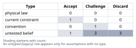
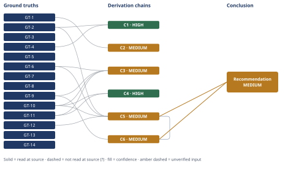

# META-Q4 Body-Size Budget: What It Protects and What to Do

*First-principles analysis · 10 October 2026*

*Read with: [How to read this analysis](HOW-TO-READ.md) · [Working file](analysis-20261010T072240Z.md) · [All files](INDEX.md)*

## Executive Summary

**Recommendation:** Do not reflexively split the file. The verified defect is a ~520-line, byte-identical duplication of all eight companion-technique procedures (the "## Companion Techniques" trailer) that the body's own instructions then redundantly re-`Read` for three of those eight techniques — fix that specifically, re-record META-Q4 honestly as a non-gating visibility item, and commission a real quality measurement on the resulting body, as one composite action (chain C5).

**Band (from §6):** MEDIUM

**Would change it:** Running the already-registered QUAL-01 measurement (chain C5) at the current scale — a confirmed quality-neutral or quality-improving result would close the chain's open Rivals-axis gap and move this to HIGH; a measured quality regression would instead shift the recommendation to a quality-grounded justification for de-duplication rather than overturning it (chain C5's own falsification condition).

## 1. Problem Essence

**Core problem:** What property (if any) does META-Q4's recorded "~500 lines / ~5,000 tokens" agent-body budget actually protect; is anything in this repository currently measuring or enforcing it; does the agent body's *current* size demonstrably harm that property; and, from those answers, which specific intervention — doing nothing, splitting, deduplicating, retiring the requirement, measuring first, or a combination — is warranted for `first-principles/agents/first-principles.md`?

**Success criteria:**
1. The Conclusion states, with cited evidence, whether any script, pre-commit hook, or CI job currently measures or gates the agent body's line/token count.
2. The Conclusion states the agent body's actual current line count, verified directly against the repository rather than assumed from the prompt's figure.
3. The Conclusion identifies at least one independently verifiable structural defect in the current body — if one exists — that is distinct from "the line count exceeds a number," with direct evidence, and states whether correcting it is recommended.
4. The Conclusion's recommendation is not simply "split the file" unless splitting is shown, from evidence gathered in this analysis, to address a verified defect; if no such defect is found, the Conclusion says so explicitly rather than defaulting to a split.

---

## 2. Assumptions Table

| Assumption | Type | Treatment | Verdict | Verification |
|---|---|---|---|---|
| META-Q4 is currently a binding, enforced regression gate (the prompt's framing) | untested belief | Verify before use | Discard — contradicted by GT-2 and GT-3: the requirement is tiered `audit-only`, `rerun_by: "none"`, and no script in the current tree checks the body's line count | `docs/data/matrix.json` v3.2/META-Q4 record; repo-wide search for `check-body-budget.py` (no match outside historical docs/tests) |
| The agent body currently measures 878 lines (the prompt's framing) | untested belief | Verify before use | Discard — contradicted by GT-1: direct `wc -l` on the current file returns 1378 lines, not 878 | `wc -l first-principles/agents/first-principles.md`, executed directly |
| Splitting the file into separate reference files is the correct intervention because it is "over budget" | convention | Challenge before use | Challenge — a structurally identical intervention was already executed once (GT-10) citing META-Q4 by name, and the budget was exceeded again anyway from unrelated growth (GT-11); "over budget" alone does not identify what, if anything, should move | Chain C4 |
| A larger agent-body line count degrades the agent's own reasoning/analysis quality | untested belief | Verify or flag unverified | Challenge — the one controlled test available (GT-5) found no detectable effect, but only across a 22-line / 3.6% contrast on a ~600-line body; no measurement exists at the ~2–2.7× scale now in question (GT-14) | `docs/v8.6-quality-ab-experiment.md`, read at source; absence confirmed by repo-wide search |
| Content already fully present, verbatim, in the agent's own loaded context still needs a fresh `Read` tool call before it can be used reliably | untested belief | Verify before use | Discard, as an information-availability claim — GT-6 shows the content three "open ... with Read" instructions would fetch is byte-identical to text already inlined in the same document; GT-8's stated rationale (procedural fidelity against recall-drift) is a usage-discipline argument, not an information-availability one, and is not itself discarded | Direct `diff` of agent-body lines against `first-principles/references/{inversion,pre-mortem,trade-off}.md` (GT-6) |
| The agent's `maxTurns: 60` ceiling makes turn-budget a genuinely scarce, prioritized resource for this agent | current constraint | Record expiry conditions | Accept — expires if `maxTurns` is raised in the agent frontmatter, or if the methodology's own Turn-discipline prioritization rules change | Agent frontmatter, read at source (GT-9) |
| Retiring META-Q4's numeric requirement with nothing recorded in its place is an acceptable outcome | untested belief | Verify before use | Challenge — GT-2 shows the requirement's own original statement is already "unrecoverable"; replacing it with nothing forfeits even the manual-`wc -l` visibility `docs/TESTING.md` currently documents | `docs/data/matrix.json`, `docs/TESTING.md:75-83`, read at source |
| The weights assigned across the six trade-off criteria in chain C5 reflect this project's actual priorities | untested belief | Verify or flag unverified | Accept — unverified directly, but the flip test (chain C5) shows the recommended option's win margin survives any single-criterion weight change within the procedure's 1–5 scale, bounding the risk this assumption is wrong | Chain C5's flip-test, computed directly |
| `chars ÷ 4` and `words × 1.3` approximate this file's true token count (as counted by the actual model tokenizer) within a reasonable margin | untested belief | Verify or flag unverified | Challenge — unverified against a real tokenizer; used only to bracket a range (chain C2), not as a point estimate, and the bracket's conclusion (≈5–6× the historical token figure) is used advisedly, not treated as exact | `wc -lwc` output on the agent body, read at source; no tokenizer run against the file in this analysis |

---

## 3. Ground Truths

- **GT-1** The current `first-principles/agents/first-principles.md` is 1,378 lines, 20,107 words, 128,131 characters — source: `wc -lwc first-principles/agents/first-principles.md`; read-at-source: direct command output in this analysis.
- **GT-2** The current requirements-matrix record for META-Q4 is: `deliverable_path: "first-principles/agents/first-principles.md"`, `coverage_tier: "audit-only"`, `rerun_by: "none"`, `statement: "statement unrecoverable"` — source: `docs/data/matrix.json`; read-at-source: the `v3.2/META-Q4` object, cross-confirmed verbatim in `docs/requirements-matrix.md` lines 82, 794, 1068.
- **GT-3** No script, pre-commit hook, or CI job in the current repository measures or gates the agent body's line count. `scripts/check-body-budget.py` does not exist in the current working tree; its retirement (as a report-only, always-exit-0 script, later removed entirely) is recorded in `docs/v9.4-gate-retirement.md` §2.5, building on TEARDOWN-01 (`docs/v8.7-constraint-teardown.md` item 1, Phase 163, 2026-07-22). `docs/TESTING.md:75-83` currently documents "Agent body size (not a gate)" and directs readers to run `wc -l` manually — source: direct repository search (`find`, `grep`) plus both docs, read at source.
- **GT-4** The historical line-count ceiling was raised reactively (500 → 580 → 644) rather than derived from a measured quality floor; the retired script's own provenance comment read "limit raised to 622 + 22 buffer" — source: `docs/v8.7-constraint-teardown.md`, read-at-source lines 48-53.
- **GT-5** A controlled blind A/B experiment (run date 2026-07-22) compared a 590-line agent body against a 612-line agent body — a 22-line / 3.6% contrast explicitly described as "the true maximum available" at the time, since "there is no 650-line body in history" — across 6 blind-judged runs (3 problems × 2 arms, 1 run each) and found identical aggregate scores: both arms 2/3 PASS, band total 35, mean 11.67. The source document's own standing note warns this is frozen, pre-rubric-rename evidence with an explicit n=1-per-cell caveat, and says not to read its band totals as a current quality figure — source: `docs/v8.6-quality-ab-experiment.md`, read-at-source lines 1-46.
- **GT-6** The agent body fully, verbatim inlines the `## Procedure` section of all eight companion-technique reference files (five-whys, fishbone, inversion, pre-mortem, trade-off, second-order, estimate, theoretical-limit) under one `## Companion Techniques` heading spanning body lines 859-1378 (520 lines, ≈37.7% of the current body). Confirmed by direct `diff`: the inlined blocks for inversion (body lines 999-1044 vs. `references/inversion.md` lines 45-90), pre-mortem (body lines 1045-1112 vs. `references/pre-mortem.md` lines 44-111), and trade-off (body lines 1113-1183 vs. `references/trade-off.md` lines 22-92) are byte-identical (`diff` exit 0 in all three cases) — source: `scripts/sync-content.py`'s `generate_agent()` docstring, which documents this as step 3 of agent-body assembly; read-at-source: direct diff executed in this analysis.
- **GT-7** The same document's own Phase 4 and Phase 5 operating instructions direct the agent to re-open three of these eight techniques — trade-off, pre-mortem, inversion — via the `Read` tool at their point of use ("open the [Trade-off procedure](.../trade-off.md) with Read", similarly for Pre-Mortem and Inversion), while elsewhere in the identical document (Phase 2's fishbone/inversion sentence, and the "### Companion tools" summary) all eight — including these same three — are called "the inlined [X] procedure." Source: direct `grep` of `first-principles/agents/first-principles.md`, cross-confirmed against `shared/spine/SKILL-body.md`, where the "open ... with Read" phrasing is literal hardcoded prose and the "inlined" phrasing elsewhere is produced by `{{TOOL:slug}}` substitution for the agent surface; read-at-source.
- **GT-8** The body's own stated rationale for forcing a `Read` rather than relying on recollection, for pre-mortem specifically, is procedural fidelity, not information-availability: "The procedure is opened, not recalled: a pre-mortem run from recollection reliably drops the past-tense framing that is the technique's whole mechanism." — source: `first-principles/agents/first-principles.md`, Phase 5 "Adversarial technique" step; read-at-source.
- **GT-9** The agent's frontmatter sets `disallowedTools: [Write, Edit, Agent, SendMessage, ListAgents, Skill]` and `maxTurns: 60`; `Read` is not in the disallowed list — source: `first-principles/agents/first-principles.md` frontmatter lines 1-13; read-at-source.
- **GT-10** A prior "de-inline" intervention was already executed once, explicitly citing META-Q4: `generate_agent()`'s code comment states "The output-template.md and validation-rubric.md spine appendices are NO LONGER inlined into the agent body (Phase 34-02, Path B) ... This restores META-Q4's <500-line agent body budget without losing the content — the agent loads the references on demand." — source: `scripts/sync-content.py` lines 1219-1224; read-at-source.
- **GT-11** The body grew from 807 lines at the v9.4.0 release commit (`172db6ee`, dated 2026-09-20, confirmed by `git show 172db6ee:... | wc -l`) to 1,378 lines now — +571 lines across roughly 15 point releases (9.4.0 through 9.19.3) whose titles name substantial new output-contract features (Answer-first delivery, Self-Audit Gate pass-tracking, structured summary, report figures, PDF rendering). Over the same window the `## Companion Techniques` trailer itself grew from 291 lines (starting at line 517 of the 807-line body) to 520 lines (starting at line 859 of the 1,378-line body), +229 lines, while the body before that trailer grew from 516 to 858 lines, +342 lines (229 + 342 = 571, reconciling exactly with the total growth) — source: `git log`/`git show` executed directly against the repository, plus direct line counts in this analysis.
- **GT-12** `scripts/check-quality-harness.py` (gate id `QUAL-01`) is a live, registered, self-testing instrument — registered in `scripts/_gate_registry.py` and `scripts/check-firewall-battery.sh` — that is the promoted, permanent successor of the exact rig used to produce GT-5. Its CI/battery registration covers only the offline self-test of the extraction pipeline; the live generate→judge arm (which would re-run a GT-5-style A/B at the current scale) requires a separate, manual invocation with live model calls — source: `scripts/check-quality-harness.py` header docstring, `scripts/_gate_registry.py`, `scripts/check-firewall-battery.sh`; read-at-source.
- **GT-13** A 2026-08-16 internal project audit (`docs/audit-2026-08-16-duplication-staleness.md`, finding S-8) asserted that "The procedures are never inlined: searching the generated agent body for any technique's actual procedure steps returns nothing." This claim is false of the current repository (directly contradicted by GT-6's byte-identical diff) and was already false when written: the inlining mechanism (`generate_agent()` step 3) was committed 2026-05-22 (`6af7cd19`/`d3dd705e`), three months before the 2026-08-16 audit — source: `docs/audit-2026-08-16-duplication-staleness.md` lines 330-341, read at source; `git log -S` confirming the dated contradiction, executed directly.
- **GT-14** No document anywhere in this repository's tracked history reports a quality measurement comparing agent-body sizes at the scale now in question (644→1,378 or 807→1,378 lines, a ≈2.1–2.3× change). `docs/v8.6-quality-ab-experiment.md` (GT-5) is the only body-size-vs-quality comparison found in the repository, and it tested a 22-line / 3.6% contrast only — source: repository-wide search (`grep`/directory listing of `docs/`) executed in this analysis, cross-checked against `docs/README.md`'s own milestone narrative, which names the same experiment as the project's sole quality A/B to date.

**Provenance summary:** `?`-marked: none (0 of 14) — every ground truth above was located and read directly in its cited source by this analysis (file contents, `git log`/`git show` output, or direct shell measurement), so none carries the `reported-by-delegate` or `unverified` suffix. Read-at-source locations: GT-1 — direct `wc` output; GT-2 — `docs/data/matrix.json` lines ~467-479 (`v3.2/META-Q4` object); GT-3 — `docs/v9.4-gate-retirement.md` §2.5 and `docs/TESTING.md:75-83`; GT-4 — `docs/v8.7-constraint-teardown.md` lines 48-53; GT-5 — `docs/v8.6-quality-ab-experiment.md` lines 1-46; GT-6 — direct `diff` output (three comparisons, all exit 0) plus `scripts/sync-content.py` lines 1210-1225; GT-7 — direct `grep` of the agent body and of `shared/spine/SKILL-body.md`; GT-8 — the agent body's Phase 5 text itself; GT-9 — the agent body's own frontmatter; GT-10 — `scripts/sync-content.py` lines 1219-1224; GT-11 — `git show 172db6ee:first-principles/agents/first-principles.md` plus current-file line counts; GT-12 — `scripts/check-quality-harness.py` header and the two registry files; GT-13 — `docs/audit-2026-08-16-duplication-staleness.md` lines 330-341 plus `git log -S` output; GT-14 — repository-wide search output.

---

## 4. Derivation Chains

### Conclusion C1: No governing property for META-Q4's budget can be reconstructed from this repository's own records — the number is an unaudited convention, not a derived constraint

GT-2 (META-Q4's own requirement statement is "unrecoverable") + GT-4 (the ceiling was raised reactively 500 → 580 → 644, fitted whenever it bound rather than derived)
→ a budget whose own text is lost, and whose only recorded history is being recalibrated every time it failed, cannot be reduced any further than "a number that was adjusted to stop failing" — a principled original constraint would not need lifting every time a commit hit it
→ no fact in this repository ties the line count to any measured consequence; the figure is, irreducibly, a convention whose origin cannot now be audited

**Confidence:** HIGH — both inputs are read at source and unsuffixed; the inference is a direct deduction from documented facts; the one live rival reading ("the original intent was probably just generic context-cost avoidance, even though the text is lost") is addressed by this chain's own second hop — a principled, derived limit does not need repeated ad hoc raising, so the raise-history in GT-4 is itself evidence against that rival, not merely silence on it.

### Conclusion C2: The current body's real per-invocation token cost brackets to roughly 5–6× the historical "~5,000 token" figure

GT-1 (1,378 lines / 20,107 words / 128,131 characters, measured directly)
→ using two independent back-of-envelope token-estimation heuristics — characters ÷ 4 ≈ 32,033 tokens, and words × 1.3 ≈ 26,139 tokens [Assumes: A-9 — these heuristics approximate this file's true tokenizer count within a reasonable margin] — the body's per-invocation token cost brackets to roughly 26,000-32,000 tokens
→ dividing both bracket ends by the historical ~5,000-token figure gives 5.2× to 6.4×, so the token side of the old budget is exceeded by a multiple comparable to the line-count side (1,378 ÷ ~500 ≈ 2.8×, 1,378 ÷ 644 ≈ 2.1×), and this cost is paid unconditionally on every invocation regardless of which phases or techniques actually fire in a given run

**Confidence:** MEDIUM — the sole input (GT-1) is read at source and unsuffixed, but the hop converting characters/words into a token count rests on an unverified approximation (`[Assumes: A-9]`) rather than this project's actual tokenizer; what would remove this as a cause of the downgrade: running a real token count (e.g., the model's own tokenizer) against the file. The conclusion's qualitative claim ("roughly 5-6× the historical figure") is robust to the bracket's own width — both ends of the bracket independently exceed the old figure by more than 5× — but the chain is rated on what it shows, not on how robust its headline phrase would survive a wider error bar.

### Conclusion C3: At least ≈520 lines (≈38%) of the current body are headroom the agent's actual tool-availability constraint does not require

GT-6 (520-line verbatim-duplicate Companion Techniques trailer) + GT-9 (`Read` is allowed; only `Skill`/`Agent`/delegation tools are blocked) + GT-10 (the identical de-inline-to-Read-on-demand pattern already shipped once, for two other appendices, explicitly to satisfy META-Q4) + GT-11 (production already ran as low as 807 lines at v9.4.0)
→ the real governing constraint on this agent's self-containment is not "every technique's full text must be inlined" — that would only be forced if `Read` itself were blocked — it is narrower: whatever text the agent needs *unconditionally at turn 0* to structure its first actions must be present without a tool call, and the eight companion-technique procedures are invoked contingently, phase-by-phase, exactly like the two appendices GT-10 already moved off this list
→ the line-count floor the actual constraint permits, computed by removing the trailer from the current body, is 1,378 − 520 = 858 lines, and production has already run leaner than even that: 807 lines at the v9.4.0 commit (GT-11) — so the "inline everything" treatment of the remaining five techniques is a convention carried over from the body's own history, not a requirement the tool restrictions impose

**Confidence:** MEDIUM — all four inputs are read at source; the arithmetic recomputes exactly (1,378 − 520 = 858; 807 line figure independently confirmed by `git show`). The Rivals axis is short and named here rather than closed: a narrower floor may exist below 858 if the "### Companion tools" summary block (≈76 lines) is also tightened once the trailer is gone — this analysis did not compute that narrower figure, so 858 is reported as a conservative, not a minimal, floor.

### Conclusion C4: An undirected split, justified only by "the number is over budget," is not durably corrective

GT-10 (an identical split-style intervention — de-inlining two appendices — was already executed once, explicitly citing META-Q4) + GT-11 (the budget was exceeded again afterward, from entirely unrelated feature growth)
→ moving content out of the body once does not prevent new content from accreting back past any chosen threshold, because nothing in the current repository measures or gates that growth as it happens (GT-3)
→ a split justified only by the raw number recreates the same failure GT-10/GT-11 already demonstrate; a split is durably justified only when it removes content that is independently a defect — duplicate or dead content (GT-6, GT-7) — or is paired with a mechanism that keeps the file from drifting back up unmeasured

**Confidence:** HIGH — both inputs are read at source and unsuffixed; the inference is a direct deduction from the project's own observed history (an intervention was tried, and the condition it was meant to prevent recurred); no live rival survives — this chain does not claim splitting never helps, only that "over budget" alone does not justify it, which the Companion Techniques trailer (GT-6) satisfies on independent grounds in chain C3.

**Trade-off must-haves (knock-outs, applied before scoring):** no option may silently delete methodology content the agent needs to run — this knocks out an undirected/arbitrary split option with no Read-fallback plan, which is why it does not appear as a scored option below; every surviving option (do nothing / de-duplicate / retire the requirement / measure / the composite) preserves full content access, so no further knock-out applies.

### Conclusion C5: Execute a composite action — targeted de-duplication, a formal META-Q4 re-record, and a commissioned QUAL-01 measurement — rather than any one of the three alone

GT-6 (verbatim duplication) + GT-10 (proven precedent for the de-inline pattern) + GT-12 (a live measurement instrument already exists) + GT-2 (the requirement's own statement is unrecoverable)
→ six weighted, anchored criteria — defect removal (w5), per-invocation cost reduction (w3), content preservation (w5), resolution of the quality-impact uncertainty (w4), implementation cost/reversibility (w2), restored governance visibility (w3) — score the composite option (de-duplicate + re-record + measure) at 103, ahead of de-duplication alone at 83, measurement alone at 70, re-recording alone at 59, and doing nothing at 50 [Assumes: A-8 — these criterion weights reflect this project's actual priorities]
→ a flip test shows no single criterion's weight, moved anywhere within the procedure's 1-5 scale, closes the 20-point gap between the composite and its nearest rival (de-duplication alone) — the composite's one weaker criterion (implementation cost, where de-duplication-alone scores higher) would need that criterion's weight raised past 20, ten times its current value and far outside the 1-5 scale, to flip the ranking
→ recommend the composite: delete the 520-line Companion Techniques trailer and route all eight techniques through the Read-on-demand pattern already proven for two appendices and three techniques; formally re-record META-Q4 as a non-gating, visibility-only item with an honest current statement; and commission a live QUAL-01 run comparing the current and de-duplicated bodies before pursuing any further compression

**Confidence:** MEDIUM — all four head inputs are read at source and unsuffixed, and the `[Assumes: A-8]` premise on the first hop is priced by the flip test rather than left unexamined. The Rivals axis is the named shortfall: a minimalist rival — "fix nothing beyond what's proven broken; GT-6/GT-7 is a correctness nit with no demonstrated quality cost, so leave the trailer and skip the measurement" — is not fully closed by this chain; it is addressed only by treating the GT-6/GT-7 fix as warranted on correctness grounds independent of any quality effect (chains C1, C3, C4), which this analysis judges sufficient but a more conservative reader need not.

### Conclusion C6: The composite action's per-invocation cost saving is unconditional; its turn-budget cost is conditional and bounded by the project's own stated priorities

C5 (composite: de-duplicate, re-record, measure) + GT-9 (`Read` allowed; `maxTurns: 60`; Turn-discipline rules already prioritize the Self-Audit Gate's first pass over optional re-entry work)
→[2nd] maintainers gain a single-source-of-truth for every companion technique's procedure text, removing the dual-edit obligation between the reference files and the inlined trailer that this project's own audit record already mishandled once (GT-13); the agent itself trades 520 unconditionally-loaded lines for up to five additional conditional `Read` calls in a run that exercises every technique, versus the up-to-three it already issues today; whoever pays the API/context bill pays strictly less per invocation regardless of which techniques fire in a given run
→[3rd] once this has been in place long enough to be assumed, the per-invocation token saving (chain C2's ≈26,000-32,000-token load drops by roughly the trailer's 37.7% share) compounds across every future invocation, while the added turn cost is paid only by runs that actually use the newly-externalized techniques — a cost this analysis judges acceptable given the project's own Turn-discipline rules already treat optional re-entry passes, not core phase-technique use, as the first thing sacrificed under a tight budget

**Confidence:** MEDIUM — capped by C5's own MEDIUM rating (lowest-rated chain its head cites); GT-9 is read at source and unsuffixed. No extension step here contradicts a ground truth, so the chain stands as an addition to C5 rather than a return to Phase 2.

---

## 5. Abandoned Reasoning

### Dead End: Trusting the prompt's 878-line figure and ~500-line/~5,000-token budget as still current, and proceeding straight to "restore compliance"

**What was tried:** Taking the prompt's stated numbers at face value and framing the task as "get the file back under its stated budget."

**Why abandoned:** GT-1 shows the current line count is 1,378, not 878 — the prompt depicts a superseded repository state. GT-2/GT-3 show the budget is not enforced by anything and its own requirement text is unrecoverable, so "restore compliance with the stated number" has no verifiable target to restore compliance *with*.

**What it ruled out:** Any recommendation structured as "cut until the number is back under 500 (or 644)," since no ground truth in this repository attaches a measured consequence to that specific figure (chain C1).

### Dead End: Generalizing GT-5's null result ("22-line delta made no measured difference") to "body size categorically does not matter"

**What was tried:** Using the one existing size-vs-quality experiment to conclude the current, much larger size is also quality-neutral, and that no further measurement is needed.

**Why abandoned:** GT-5's own source document explicitly scopes itself to a 22-line / 3.6% contrast and an n=1-per-cell design, and warns against reading its band totals as a current figure. Extrapolating "no effect at 3.6%" to "no effect at the ≈2.1-2.8× scale this analysis examines" (GT-14) is an unsupported extrapolation — the rival reading ("size matters, just not at a contrast this small") is not ruled out by the available evidence.

**What it ruled out:** Treating the empirical question as already closed; this is what motivates chain C5's inclusion of a commissioned QUAL-01 measurement at the current scale rather than resting on the old result alone.

### Dead End: Accepting the 2026-08-16 audit's claim that "the procedures are never inlined" as authoritative

**What was tried:** Relying on the project's own prior internal audit (`docs/audit-2026-08-16-duplication-staleness.md`, finding S-8) to conclude the Companion Techniques trailer either does not exist or is not a real duplication concern.

**Why abandoned:** Directly contradicted by a byte-identical `diff` (GT-6) and by dated commit history showing the inlining mechanism predates the audit by three months (GT-13). The audit's narrower claim — that the `{{TOOL:slug}}` *token* itself is only a naming substitution — is correct in isolation, but its broader conclusion, drawn from that narrower fact, does not hold against the current tree.

**What it ruled out:** Treating project self-documentation as a substitute for direct measurement in this analysis — consistent with this very methodology's own Phase 3 provenance discipline (read-at-source over cited-but-unopened).

---

## 6. Conclusion

**Recommended approach:** Execute the composite action, not any single piece of it alone (chain C5): (1) delete the ≈520-line, verbatim-duplicate `## Companion Techniques` trailer from the agent body and route all eight companion techniques through the Read-on-demand pattern already proven in this codebase for two spine appendices and three of the eight techniques (chain C3); (2) re-record META-Q4 in the requirements matrix with an honest current statement — "audit-only, visibility-only, no enforced target" — rather than leaving it at "statement unrecoverable," paired with a reinstated non-gating report line so growth stays visible (chains C1, C5); (3) commission a live QUAL-01 run (chain C5) comparing the current 1,378-line body against the de-duplicated ≈858-line body on real problems before pursuing any further compression.

**Key insight:** The prompt's own framing — "split or not" — is a false binary. The load-bearing defect this analysis found is not the body's raw size but a verified, internal inconsistency: the file instructs itself to spend a `Read` tool call re-fetching content that is already byte-identical to text sitting in its own context from turn 0 (chains C3, C4; GT-6, GT-7), and no measurement anywhere in this project's history tests whether size at the current scale harms output quality (chain C2; GT-5, GT-14). The correct first move is to fix the defect that is proven, not the number that is merely asserted and whose own governing property this repository can no longer even state (chain C1; GT-2).

**Trade-offs acknowledged:** The composite costs a modest one-time authoring effort — updating `sync-content.py`'s tool/reference mapping for five more slugs, regenerating, and re-running the existing conformance battery — and trades a certain, unconditional per-invocation token saving for a conditional, per-use turn-budget cost of up to five additional `Read` calls in a run that exercises every technique (chain C6). This analysis judges that trade acceptable under the project's own stated Turn-discipline priorities, but a future maintainer should watch it if full-composer runs start approaching the 60-turn ceiling (chain C6).

**Confidence:** MEDIUM — both contributing chains (C5, C6) are rated MEDIUM, each for a named, bounded reason: C5's Rivals axis is short against a minimalist "fix nothing beyond what's proven broken" reading (chain C5), and C6 is capped by citing C5. What would move this to HIGH: closing C5's Rivals axis — most directly, running the chain-C5 QUAL-01 measurement itself and finding either a confirmed quality-neutral result (which removes the minimalist rival's main objection) or a measurable harm from the current size (which would instead strengthen the de-duplication recommendation on quality grounds, not just correctness grounds).
