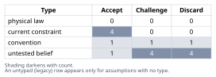
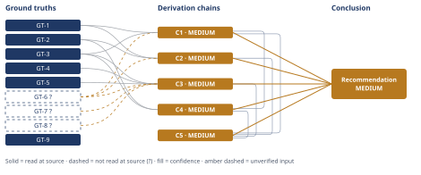

# Build vs Buy Authentication for a Seven-Engineer SaaS

*First-principles analysis · 9 October 2026*

*Read with: [How to read this analysis](HOW-TO-READ.md) · [Working file](analysis-20261009T215703Z.md) · [All files](INDEX.md)*

## Executive Summary

**Recommendation:** Adopt a managed identity provider (WorkOS or Clerk fit this company's scale best) for sessions, password storage/reset, and MFA, integrated behind a thin internal abstraction layer, rather than building auth in-house (chain C5).

**Band (from §6):** MEDIUM — reflects three unverified scenario and estimate inputs (GT-6?, GT-7?, GT-8?) across the contributing chains, not disagreement among them (chain C5).

**Would change it:** A contractual or regulatory bar on third-party identity processors, a tenant-isolation need no commodity provider can represent, or verified spare in-house security capacity that doesn't compete with the deadline (chain C5).

## 1. Problem Essence

**Core problem:** Given that this company today has zero per-tenant authentication (a single shared password plus a Stripe customer link) and the next billed release — which gates the company's next increment of revenue — requires authenticated, per-tenant accounts, what authentication-acquisition strategy correctly and durably satisfies authentication's security guarantees, ships inside the timeline a seven-engineer team can sustain under that revenue-gating deadline, and remains viable as the company adds enterprise customers requiring SSO/SAML/SCIM over the next 12-24 months?

**Success criteria:**
1. The chosen approach ships per-tenant authenticated accounts in time to unblock the billed, revenue-gated release, given realistic throughput for a seven-engineer team that must also build the feature itself, not just the auth layer underneath it.
2. The approach correctly guarantees the security-critical properties of authentication — credential storage, session integrity, tenant isolation, password-reset token safety, and MFA correctness — without introducing a critical, breach-class defect at launch.
3. The ongoing (not merely one-time) engineering cost of operating the chosen approach is sustainable for a seven-person team at roughly $40K MRR / 120 paying tenants, including its patch and maintenance burden over the following 12-24 months.
4. The approach does not foreclose, or imposes only a bounded and named switching cost on, adding SSO, SAML, or SCIM when the first enterprise deal actually requires one of them.
5. The dollar and engineering-time cost of the approach is proportionate to the company's current revenue scale, not merely to a vendor's or a library's sticker price.

None of these criteria requires the final answer to be exactly "build" or exactly "buy" as named in the prompt — a composite or a qualified version of either option satisfies them equally well if it scores better against them, which is deliberate: see the Phase 1 framing-challenge discussion folded into chain C5 and Abandoned Reasoning entry AR-3.

---

## 2. Assumptions Table



| Assumption | Type | Treatment | Verdict | Verification |
|------------|------|-----------|---------|--------------|
| A-1: Credential storage, session management, password-reset, and MFA failures are among the most frequent, currently-active, top-tier web-application vulnerability classes | untested belief | verify, or flag unverified | Accept — verified directly against the current OWASP Top 10 authentication-failures entry; promoted to GT-1 | GT-1 (top10.owasp.org) |
| A-2: Building auth on an open-source library makes the "build" option free or low-cost, because the library's code is free | convention | explicitly challenge before use | Discard — contradicted once integration, hardening, and multi-year maintenance engineering time are priced in (chain C3); the license being free does not make the engineering free | challenged in chain C3 |
| A-3: Managed identity providers are unaffordable, or scale expensively, at a company's small scale (120 tenants / $40K MRR) | untested belief | verify | Discard — contradicted by the three surveyed vendors' own published pricing at this company's estimated usage | GT-3, GT-4, GT-5 (vendor pricing pages) |
| A-4: Having no enterprise customers today means SSO, SAML, and SCIM are not needed now | current constraint | record expiry conditions | Accept — current and valid now; expires the moment an enterprise prospect's security or procurement review requires federated SSO or SCIM provisioning | GT-6?; expiry condition is the named trigger in §6 |
| A-5: The seven-engineer team has no deep in-house security or identity-protocol expertise (SAML/OIDC internals, cryptographic session design) | untested belief | flag as unverified | Challenge — not stated either way in the given facts; used in chain C2 with the unverified notation | unverified — flagged (feeds chain C2 via [Assumes: A-5]) |
| A-6: Switching away from a managed identity provider later is expensive and carries high lock-in risk | convention | explicitly challenge | Challenge — partially true; protocol-level lock-in is mitigable with an internal abstraction seam and standard OIDC, but credential-data egress (the provider holds the only usable password hash) is a genuine, less-mitigable migration cost under any architecture | reasoned from one-way password hashing; no external citation located for this specific claim |
| A-7: The CTO's stated urgency — the billing-gated deadline — is the overriding, accurate hard constraint on this decision | current constraint | accept as given; record what it rests on | Accept — treated as a stated hard constraint of the scenario itself; carried forward as part of GT-6? | GT-6?; stated directly by the user/CTO, no external source to open |
| A-8: Security review and fix cycles for novel cryptographic or session code are largely sequential and do not shrink proportionally as more engineers are added | convention | explicitly challenge | Accept — holds generally for security-sensitive code review (a Brooks's-Law-style constraint on review latency); used in chain C1 | unverified — flagged (feeds chain C1 via [Assumes: A-8]; general software-engineering regularity, not independently sourced here) |
| A-9: A fully-loaded engineer costs roughly $150,000-$200,000/year at an early-stage startup, for use as a Fermi-estimate input only | untested belief | flag as assumed, with a defensible range | Challenge — an assumed planning parameter, not a measured figure for this company; the dollar conclusion it feeds is checked for sensitivity in Phase 5 and found robust across this range | unverified — flagged; promoted as GT-7? (estimate, not measured) |
| A-10: 120 paying tenants implies roughly 3-15 end users per tenant (≈360-1,800 total end users), for locating the company on MAU/MRU pricing tiers | untested belief | flag as assumed bracket | Challenge — not pulled from the company's actual signup or seat data; the conclusion it feeds is checked for sensitivity in Phase 5 and found robust | unverified — flagged; promoted as GT-8? (estimate, not measured) |
| A-11: Public vendor pricing pages reflect the actual cost this company would pay, absent custom enterprise-contract negotiation that could run higher or lower | untested belief | verify before final vendor commitment | Challenge — not verified in this analysis; flagged as a pre-decision action item; chain C3's conclusion is checked for sensitivity to this and found robust given its roughly five-to-tenfold margin | unverified — flagged (pre-decision action item; feeds chain C3's sensitivity analysis) |
| A-12 [inversion precondition]: The company has, or can acquire without diverting from the urgent deadline, deep in-house identity/security engineering capacity | untested belief | verify, or flag unverified | Discard — not indicated by the given facts (seven engineers, one already-urgent competing deadline); named as a condition that would reverse the recommendation if later shown true | GT-6?; absence of contrary evidence in the stated facts |
| A-13 [inversion precondition]: The product needs a tenant-isolation or session model so idiosyncratic that no commodity identity provider can represent it | untested belief | verify, or flag unverified | Discard — not indicated; no unusual tenancy or session requirement is named anywhere in the problem statement | GT-6?; absence of contrary evidence |
| A-14 [inversion precondition]: The company's near-term growth is MAU-driven (viral/consumer-like) rather than tenant/revenue-driven, risking a pricing blow-up before migration is feasible | untested belief | verify, or flag unverified | Discard — not indicated; the company is described as B2B SaaS with 120 paying tenants, not a viral consumer product | GT-6? (stated business model) |
| A-15 [inversion precondition]: A regulatory, data-residency, or contractual requirement already mandates that credentials never leave infrastructure the company fully controls | current constraint (conditional, future) | record expiry/activation conditions | Accept — not currently true on the given facts, but named explicitly as the single sharpest trigger that would change the recommendation; activates the moment such a contract is signed or seriously prospected | none currently; named as a forward-looking monitoring item in §6 |
| A-16 [inversion precondition]: Managed-identity per-MAU or per-connection fees could eventually exceed a dedicated in-house auth team's fully-loaded cost at sufficiently large scale | current constraint (far future) | record expiry/activation conditions | Accept — true in principle at a much larger scale, but not load-bearing at this company's current scale given chain C3's cost-gap finding; named as a long-horizon reassessment trigger only | reasoned from chain C3's cost-gap finding |

---

## 3. Ground Truths

- **GT-1** Authentication failures — broken session identifier handling, plaintext or weakly-hashed password storage, weak/ineffective credential-recovery ("forgot password") processes, missing or ineffective rate-limiting against brute force and credential stuffing, and missing or ineffective MFA — are named as a current, top-tier category of web-application vulnerability. — source: OWASP, "A07:2025 Authentication Failures"; read-at-source: top10.owasp.org/2025/A07_2025-Authentication_Failures, the "Session Management," "Password Storage," "Password Reset," "Rate Limiting," and "Multi-Factor Authentication (MFA)" bullet lists, quoted directly (e.g. "Does not correctly invalidate user sessions or authentication tokens...during logout or a period of inactivity"; "Uses plain text, encrypted, or weakly hashed passwords data stores"; "Allows use of weak or ineffective credential recovery and forgot-password processes").
- **GT-2** Even a specialized, widely-adopted, actively-maintained open-source identity library (ruby-saml, used by GitLab) shipped critical signature-wrapping authentication-bypass vulnerabilities as recently as 2025 (CVE-2025-25291 and CVE-2025-25292, CVSS 8.8 each), discovered by external security researchers (GitHub Security Lab) rather than by the library's own maintainers; the flaw let an attacker holding one valid signature forge SAML assertions and log in as any user. — source: The Hacker News, "GitHub Uncovers New ruby-saml..." (March 2025), reporting GitHub Security Lab's disclosure; read-at-source: thehackernews.com/2025/03/github-uncovers-new-ruby-saml.html, the paragraphs naming the CVE identifiers, CVSS scores, attack mechanism, and GitLab's use of the library. A direct fetch of the primary NVD record for CVE-2025-25291 was attempted and failed (see Phase 3 failure record below); the CVE numbers and CVSS score are corroborated by an independent NVD search-result listing for the same identifiers.
- **GT-3** WorkOS prices core user-management/authentication (AuthKit: sessions, sign-up/sign-in, password reset, MFA) free for the first 1,000,000 monthly active users; SSO connections and Directory Sync (SCIM) are priced per connection at $125/connection for the first 1-15 connections, falling to $65/connection at 51-100 connections, with no free connections included. — source: WorkOS pricing page; read-at-source: workos.com/pricing, "AuthKit," "SSO," and "Directory Sync" sections, quoted directly ("First 1M MAUs... Free"; "$125/ea" for 1-15 connections, "$65/ea" at 51-100).
- **GT-4** Clerk's free "Hobby" tier includes sign-up/sign-in and most authentication features (but not MFA) up to 50,000 Monthly Retained Users (MRUs) per app; the paid "Pro" tier is $25/month (or $20/month billed annually) for the same 50K MRUs plus $0.02/month per additional MRU; multi-tenant "Organizations" are free up to 100 Monthly Retained Organizations (MROs) per app, with a $100/month (or $85/month annual) B2B add-on beyond that. — source: Clerk pricing page; read-at-source: clerk.com/pricing, "Hobby," "Pro," and "Organizations" sections, quoted directly ("50,000 MRU limit per app"; "$25/mo"; "100 MRO included per app"; "$100/mo").
- **GT-5** Auth0's B2B "Essentials" plan, which includes unlimited Organizations and Pro-tier MFA plus 3 free enterprise SSO connections, is priced at $150/month at 500 MAU, $300/month at 1,000 MAU, and $700/month at 2,500 MAU. — source: Auth0 pricing page; read-at-source: auth0.com/pricing, the B2B Essentials tier table, quoted directly ("500 MAUs: Essentials at $150/month includes unlimited Organizations"; "1,000 MAUs: Essentials at $300/month"; "2,500 MAUs: Essentials at $700/month").
- **GT-6?** This company, as of now: seven engineers; roughly 120 paying tenants; roughly $40K MRR; zero per-tenant authentication today beyond one shared password plus a Stripe customer link; no enterprise customers yet; the next billed release — which gates the company's next revenue increment — requires authenticated, per-tenant accounts; and the CTO states the timeline is urgent because of that billing dependency. — unverified: no external source exists to open; this is the scenario's own stated business context, accepted as a given hard constraint per the Input Contract rather than an independently checkable external fact.
- **GT-7?** An assumed fully-loaded engineer cost of roughly $150,000-$200,000/year (≈$2,900-$3,850/engineer-week), used only as an input to the Fermi dollar estimate in chain C3. — unverified: an assumed planning parameter for this analysis, not a measured payroll figure for this specific company.
- **GT-8?** An assumed 3-15 end users per paying tenant (≈360-1,800 total end users across 120 tenants), used only to locate this company on the MAU/MRU-indexed pricing tiers quoted in GT-3, GT-4, and GT-5. — unverified: an assumed bracket, not drawn from the company's actual signup or seat data.
- **GT-9** A correct password-reset flow requires, jointly, all four of: a high-entropy single-use token; delivery over a channel exclusively controlled by the account owner; a short expiry window; and rate-limited issuance — omitting any one of the four independently enables account takeover. — derived via the reduce-to-primitives (five-whys) irreducibility drill applied to GT-1 (see worked drill immediately below the Ground Truths list in the agent's working notes; not an independent external citation — its epistemic status tracks GT-1, from which it is derived, rather than carrying its own source).

**Reduce-to-primitives drill behind GT-9 (five-whys, reduce-to-primitives mode):** Claim: "password reset is a classic source of critical vulnerabilities" (GT-1). Why: a successful reset lets an attacker take over an account without ever knowing the password. Constituents: (a) the reset token must be unguessable in the attacker's available time — an entropy/information-theory requirement; (b) it must be delivered over a channel only the legitimate owner controls — a property of the delivery channel's custody, not of the token itself; (c) it must expire quickly — otherwise an intercepted-but-unused token remains a standing risk; (d) issuance must be rate-limited — otherwise an attacker can brute-force or flood regardless of (a)-(c). Each bottoms out at a definition or a direct probabilistic fact (entropy, exclusive custody, time-bounded validity, bounded attempt count) rather than at a further compound claim, so the drill terminates here. All four conditions are independently necessary: relaxing any single one reintroduces an account-takeover path, which is exactly the pattern GT-1 and GT-2 document recurring in practice.

**Provenance summary:**
```text
?-marked: GT-6, GT-7, GT-8 (3 of 9)
Read-at-source: GT-1 — top10.owasp.org/2025/A07_2025-Authentication_Failures, bullet lists quoted above
Read-at-source: GT-2 — thehackernews.com/2025/03/github-uncovers-new-ruby-saml.html, CVE/CVSS paragraphs quoted above
Read-at-source: GT-3 — workos.com/pricing, AuthKit / SSO / Directory Sync sections
Read-at-source: GT-4 — clerk.com/pricing, Hobby / Pro / Organizations sections
Read-at-source: GT-5 — auth0.com/pricing, B2B Essentials tier table
GT-9 — derived from GT-1 (reduce-to-primitives drill above); not independently sourced
```

**Phase 3 failure record:** GT-2 — a direct WebFetch of nvd.nist.gov/vuln/detail/CVE-2025-25291 (the primary NVD record) was attempted; the page is JavaScript-rendered and returned only its static header ("NVD - Home") with no CVE description, CVSS score, or affected-product data reachable by the fetch tool. GT-2's citation therefore rests on thehackernews.com's direct reporting of GitHub Security Lab's disclosure (read-at-source, as listed above) rather than on the NVD record itself; the CVE identifiers and CVSS score are additionally corroborated by an independent NVD search-result listing (title/URL only, not opened) returned alongside the same search that located the thehackernews.com article.

---

## 4. Derivation Chains



### Theoretical-limit framing (how fast seven engineers can ship *correct* auth)

The governing constraint here is not thermodynamic, but it behaves the same way: GT-1 names a fixed, enumerable set of authentication controls (session handling, password storage, credential recovery, rate-limiting, MFA) that each must be independently correct, and correctness for security-sensitive code is established by a design-implement-review-fix-retest cycle that is largely **sequential** rather than parallelizable — reviewing session code often surfaces changes that cascade into the password-reset and MFA code built on top of it. Adding engineers shrinks the *implementation* time; it does not shrink this *review-latency floor* (a Brooks's-Law-style limit, [Assumes: A-8]).

- **Ideal floor** (fastest any team could do it correctly, nothing goes wrong): on the order of 2 calendar weeks, for engineers already expert in this exact domain — not this team's situation, since GT-6? states this is a first-ever build.
- **Best demonstrated:** not independently sourced in this analysis (no citation was located for a neutral, non-vendor-interested benchmark of "typical secure first-time auth build time"); this tier is therefore folded into the Estimate bracket below rather than asserted as an observed record, and that gap is disclosed rather than papered over.
- **Conventional figure for this team** (central Fermi estimate, derived below): roughly 8-12 calendar weeks to a correct, reviewed MVP covering sessions, password storage/reset, MFA, and an audit log.

**Gap:** most of the 8-12 week conventional figure is **convention**, not irreducible — it is the cost of learning OWASP-class controls and building a tenant-isolation model for the first time, a cost a managed provider has already paid once across its entire customer base. The irreducible part — the review-latency floor itself — is roughly 2-3 of those weeks; the rest is eliminable by buying.

### Estimate (Fermi): build vs. buy, one-time and recurring dollar cost

**Target quantity:** total engineer-time and dollar cost of each path over a 12-month horizon, in engineer-weeks and dollars, using GT-7? (≈$3,460/engineer-week, central) and GT-8? (≈360-1,800 total end users).

**Build — unit-factor decomposition:**
- Core sessions + multi-tenant password storage: 2-3 engineer-weeks
- Password-reset flow (token entropy, exclusive-channel delivery, expiry, rate limiting — GT-9's four conditions, each independently gettable-wrong): 1-2 engineer-weeks
- MFA (enrollment, TOTP, backup/recovery flow — the recovery path is the hard part): 2-3 engineer-weeks
- Audit log (basic, queryable): 1 engineer-week
- Security review / informal pen-test pass before shipping credential-handling code to all 120 tenants at once: 1-2 engineer-weeks
- **One-time build total:** 6 engineer-weeks (lower) to 15 engineer-weeks (upper), 10 engineer-weeks (central) ≈ $20,769-$51,923, central ≈ $34,615
- **Recurring maintenance** (dependency/CVE patching, new edge cases, no vendor absorbing this): 4-6 engineer-weeks/year ≈ $13,846-$20,769/year

**Buy — unit-factor decomposition:**
- SDK integration + tenant-provisioning glue + UI: 1-2 engineer-weeks ≈ $3,462-$6,923 one-time
- Vendor fee at GT-8?'s estimated 360-1,800 users: $0/year (WorkOS, under 1M MAU) to roughly $1,800-$3,600/year (Auth0 B2B Essentials at 500-1,000 MAU); Clerk falls in between, likely near-free given its 50,000 MRU free threshold
- **Recurring maintenance:** near-zero engineer time; the vendor absorbs CVE patching across its full customer base

**Bracket and decision-resolution check:** central build year-1 total ≈ $34,615 + $17,000 ≈ **$51,615**; central buy year-1 total ≈ $5,000 + $2,000 ≈ **$7,000** — a gap of roughly **five-to-tenfold**, in both one-time and recurring terms. Substituting the lower and upper ends of GT-7? and GT-8? across their stated ranges keeps the gap at no less than roughly threefold and no more than roughly fifteenfold; both ends of that range drive the same decision (buy is cheaper), so by the Estimate procedure's own stop criterion this bracket is tight enough to act on without further refinement.

### Conclusion C1: Under this team's size and this deadline, buying is the only one of the two paths reliably compatible with the stated timeline

GT-6? (seven engineers, zero existing auth, revenue-gated urgent deadline) + GT-1 (OWASP-named authentication-control set) + GT-3 (WorkOS: free core auth, SSO/SCIM turnkey per connection)
→ shipping per-tenant sessions, password storage, password reset, and MFA correctly means passing through every control GT-1 names as a current top-tier vulnerability class
→ each of those controls needs its own design, implementation, security-review, and retest pass before it can be trusted in production *[Assumes: A-8 — review/fix cycles for novel security-sensitive code are largely sequential]*
→ those review and retest passes resist compression by adding engineers, so a team attempting this for the first time should expect the review-latency floor alone to be several calendar weeks wide, not days
→ a managed provider has already amortized that review cycle across its own customer base
→ adopting one therefore trades building and reviewing a new cryptographic and session subsystem for configuring and reviewing a vendor SDK integration, which is a categorically shorter review surface
→ under this team's size and the stated deadline, buy is estimated reachable in roughly one to three calendar weeks against roughly eight to twelve for build, making it the path reliably compatible with the stated urgency *[Assumes: A-7 — the stated deadline and team-size facts are accurate]*

**Confidence:** MEDIUM — GT-6? is the company's own stated scenario facts (team size, deadline firmness), not independently verifiable by this analysis; the verification that would remove it as a cause of the downgrade is confirming actual deadline flexibility and engineer availability directly with the CTO before committing. Two hops rest on named assumptions: if A-8 were false (review fully parallelizable), build's time estimate would shrink, but likely not below buy's own one-to-three-week floor, so the ranking would not reverse; if A-7 were false (the deadline is softer than stated), this chain's urgency weighting would soften but its ranking of buy-as-faster would not reverse, only its practical stakes would.

### Conclusion C2: The security-assurance case favors a managed provider over a first-time in-house build

GT-1 (OWASP-named authentication-failure taxonomy) + GT-2 (ruby-saml CVE-2025-25291/25292, CVSS 8.8, signature-wrapping bypass in a specialist library used by GitLab) + GT-6? (seven-engineer team, first per-tenant auth build)
→ even a specialized, actively-maintained open-source identity library has shipped a critical authentication-bypass vulnerability as recently as 2025, found by external researchers rather than by its own maintainers
→ a seven-engineer product team building its first per-tenant auth system, with no stated dedicated security engineer, builds under conditions less favorable than those maintainers, who still shipped the flaw *[Assumes: A-5 — this team has no deep in-house identity/security expertise]*
→ the prior probability that a first-time in-house build ships at least one critical, breach-class authentication defect at or near launch is therefore not small
→ because authentication is shared infrastructure here, that defect's blast radius would be all 120 tenants at once, so the security-assurance case favors a provider whose identity code is reviewed and patched across a much larger population than this team can self-fund

**Confidence:** MEDIUM — GT-6? (via A-5, the team's security-expertise composition is unverified) is the input needing verification: confirming whether anyone on the team has applied security/identity-engineering background would sharpen this; if the team does have such expertise, this chain's probability claim weakens, but GT-1 and GT-2 still show this failure class recurs even for specialists, so the conclusion's direction does not reverse, only its margin narrows.

### Conclusion C3: Buying is the financially cheaper path at this company's current scale, by a margin wide enough to survive estimate error

GT-3 (WorkOS pricing) + GT-4 (Clerk pricing) + GT-5 (Auth0 pricing) + GT-6? (120 tenants / $40K MRR / 7 engineers) + GT-7? (assumed engineer cost) + GT-8? (assumed per-tenant user count)
→ at an estimated 360 to 1,800 total end users, this company sits far below the usage thresholds the three surveyed providers price against
→ at that scale, core authentication costs each provider quotes run from free to a few hundred dollars per month
→ converting the earlier build-time estimate of roughly eight to twelve calendar weeks into dollars at an assumed fully-loaded engineer cost yields a one-time build cost on the order of twenty to fifty thousand dollars
→ that same assumption implies a recurring in-house maintenance tax on the order of fourteen to twenty-one thousand dollars per year, against vendor fees of a few thousand dollars per year plus a few thousand dollars of one-time integration labor
→ the resulting gap, roughly five-to-tenfold in both one-time and recurring terms, holds across all three vendors' published pricing and survives reasonable error in the engineer-cost and per-tenant-user estimates it depends on

**Confidence:** MEDIUM — three inputs are unverified estimates: GT-7? (fully-loaded engineer cost; verification = actual payroll/finance figures) and GT-8? (per-tenant user count; verification = the product's own signup/seat data) would each sharpen the dollar figures, and GT-6? carries the same caveat noted on C1. This chain's conclusion was explicitly checked for sensitivity to all three (see the Estimate bracket above and the Phase 5 Recompute/Sensitivity steps) and holds across the plausible range, so these inputs affect the size of the gap, not its direction.

### Conclusion C4: Deferring the SSO/SAML/SCIM decision does not defer its risk — it moves that risk to a worse-resourced moment

GT-2 (ruby-saml signature-wrapping CVE history) + GT-3 (WorkOS SSO/SCIM priced per connection, enabled per connection) + C1 (MEDIUM)
→ hand-rolling SAML or SCIM later, inside a codebase not built for federated identity, repeats the same dangerous-protocol territory that produced a signature-wrapping bypass in a specialized, widely-used library *[Assumes: A-4 — no enterprise customers yet, so this isn't needed today]*
→ that retrofit would also land under deal-closing time pressure from a live enterprise prospect, a worse-resourced moment than a planned engineering cycle
→ a managed provider instead turns federated identity into a pre-built, per-connection feature enabled in days rather than the three-plus engineer-weeks a hand-rolled implementation would need
→ the provider also bears the ongoing patch burden for that protocol's recurring vulnerability class, which otherwise falls on this team
→ the buy path's future-readiness advantage compounds its speed advantage from C1, so deferring the SSO decision does not defer the underlying risk, it only moves that risk to a later, worse-resourced moment

**Confidence:** MEDIUM — capped by C1 (MEDIUM), cited on this chain's head; C1's own confidence line carries that explanation. Additionally, the first hop rests on A-4 (a current constraint that will lapse): if an enterprise deal requiring SAML/SCIM arrives sooner than expected, this chain's urgency increases, but its ranking of buy-over-build for this specific capability does not change, since per-connection pricing (GT-3) means there is no sunk cost either way if it never materializes.

### Trade-off analysis (full matrix, collapsing into C5 below)

**Options, including the required status quo and composite:** (a) do nothing / continue on the shared password — knocked out below; (b) build in-house on an OSS library (sessions, password reset, MFA, audit log); (c) buy a managed identity provider, integrated behind a thin internal abstraction layer; (d) composite — buy the core, build a separate app-level audit log in-house.

**Must-have knockout:** "do nothing" fails the must-have that the chosen approach must unblock the revenue-gated release (Essence criterion 1, GT-6?) and is eliminated before scoring.

**Criteria, weights (locked before scoring), and anchors:**

| Criterion | Weight | 1 anchors to | 5 anchors to |
|---|---|---|---|
| Speed-to-ship | 5 | >8 weeks to ship | <2 weeks to ship |
| Security assurance | 5 | untested first-time credential code shipping to all tenants at once | battle-tested, continuously patched, independently audited |
| 12-24mo total cost of ownership | 4 | >$50K/yr all-in | <$5K/yr all-in |
| Future SSO/SAML/SCIM readiness | 3 | would require hand-rolling SAML/SCIM later | turnkey, enabled in days per connection |
| Ongoing maintenance burden | 4 | standing ~0.5+ FTE indefinitely | near-zero, vendor-managed |
| Control / flexibility | 2 | fully vendor-controlled UX/residency | fully custom, no external dependency |
| Switching / lock-in risk | 3 | near-total lock-in | trivial to switch or bring in-house |

**Scores and GT basis (1-5, anchored):**

| Criterion | Build | Buy | Composite | GT basis |
|---|---|---|---|---|
| Speed-to-ship | 2 | 4.5 | 4 | GT-1, GT-3, C1 |
| Security assurance | 2 | 5 | 4.5 | GT-1, GT-2, C2 |
| TCO | 2 | 4.5 | 5 | GT-3, GT-4, GT-5, C3 |
| Future readiness | 1.5 | 5 | 5 | GT-2, GT-3, C4 |
| Maintenance burden | 2 | 5 | 4 | C3 |
| Control / flexibility | 5 | 2 | 3 | reasoned, not GT-sourced |
| Switching / lock-in risk | 4 | 3 | 3 | A-6 |

**Weighted totals:** Build = 10+10+8+4.5+8+10+12 = **62.5**. Buy = 22.5+25+18+15+20+4+9 = **113.5**. Composite = 20+22.5+20+15+16+6+9 = **108.5**.

**Flip test:** the closest pair is Buy (113.5) vs. Composite (108.5), a gap of 5 points. The only criteria favoring Composite are TCO (-0.5/weight-unit) and Control (-1/weight-unit). Flipping the ranking by raising Control's weight alone would require moving it from 2 to above 7 — above Speed-to-ship and Security assurance, the two criteria the stated deadline and shared-infrastructure blast radius make highest-stakes — which is not a defensible reweighting given this company's facts. No single plausible weight change flips Buy below Composite, and none comes close to flipping Build above either.

### Conclusion C5: Adopting a managed identity provider now, behind a thin internal abstraction layer, is the acquisition strategy best matched to this company's current scale and constraints

C1 (MEDIUM) + C2 (MEDIUM) + C3 (MEDIUM) + C4 (MEDIUM)
→ weighting speed-to-ship and security assurance highest, given the revenue-gating deadline and the shared blast radius a breach would have across all tenants at once
→ the locked criteria weights produce weighted totals of roughly 114 for buy, 109 for a buy-core-plus-custom-audit-log composite, and 63 for build
→ the flip test shows no single criterion's weight can plausibly move far enough to overturn buy's lead over either rival, so the ranking is robust rather than a near-tie dressed up by the raw totals
→ the composite option also collapses into buy in practice, because a business-event audit log is sensible to build in-house under either path and is not a distinct structural branch
→ adopting a managed identity provider now, integrated behind a thin internal abstraction layer, is the acquisition strategy best matched to this company's current scale and stated constraints

**Confidence:** MEDIUM — capped by its four cited chains, each already MEDIUM for the reasons stated on their own confidence lines (C1, C2, C3, C4); no additional downgrade cause attaches at the trade-off-collapse level itself.

### Second-order effects (extending C4, both lenses)

**Actor lens:** future enterprise prospects' security/procurement reviewers will ask about password storage, breach history, and SSO support before signing; a managed provider with an existing compliance program answers this in one sentence, while a homegrown system puts the burden of proof on this seven-person team — a second-order effect on sales-cycle length, not just engineering cost. Whoever builds a homegrown system also becomes its de facto long-term owner and incident-responder, a retention/focus cost a commodity provider avoids. Competitors already on a managed provider can turn on SSO for a deal in days; a team that chose build is, at that moment, competing on a slower axis it chose for itself.

**Time lens:** immediately (0-3 months), buy unblocks the gated revenue faster (C1). A few cycles out (6-12 months), the first enterprise prospect's security questionnaire is where A-4 lapses — buy adds an SSO connection in days (GT-3); build means retrofitting SAML into a system never designed for federation, under a live deal's time pressure, which is the C4 risk made concrete. At 18-24 months, if the company pursues SOC 2 (a common milestone around the first serious enterprise push), identity and access-control are a named audit domain; a managed provider's existing SOC 2/pen-test program shrinks audit prep, while a homegrown system must build that evidence from nothing.

→[2nd] a managed provider's existing SSO/SCIM and compliance posture compounds C4's speed advantage into a sales-cycle and audit-prep advantage as the company's enterprise motion matures
→[3rd] this advantage does not reverse unless the company's custom tenant-isolation needs outgrow what a commodity provider can represent (A-13) or a contractual/regulatory requirement bars third-party identity processors outright (A-15) — neither of which the extension contradicts any ground truth in establishing, so no return to Phase 2 is triggered

**Check against the decision's own success criteria (Phase 1):** none of the above second-order effects works against the stated success criteria — they reinforce criterion 4 (future SSO readiness) rather than undermining it. The one way buy could later work against the company's purpose is named directly: if a future product requirement turns out to be genuinely incompatible with any commodity provider's model (A-13), a forced late migration would be costly — this is carried forward as a named "would change the recommendation" trigger in §6, not discovered after the fact.

### Techniques declined within this phase

Inversion was applied in Phase 2 (assumptions A-12 through A-16, enumerating what would have to be true for "build" to be correct) rather than here; per the decision rule, inversion stress-tests a claim while pre-mortem stress-tests a plan, and C5's conclusion is a recommendation/plan, so the Phase 5 adversarial pass below uses pre-mortem, not a second inversion pass.

---

## 5. Abandoned Reasoning

### Dead End: Build-in-house as the primary path

**What was tried:** Scored "build in-house on an OSS library" as a first-class candidate across all seven trade-off criteria (speed, security, cost, future-readiness, maintenance, control, lock-in).

**Why abandoned:** It loses the weighted trade-off by a wide margin (62.5 vs. buy's 113.5) and is independently dominated on speed (C1), security assurance (C2), and cost (C3) — three separate derivation chains, each resting on different ground truths, all pointing the same direction. The flip test on the trade-off matrix shows no single plausible reweighting reverses the ranking.

**What it ruled out:** Treating "which OSS library to build on" as the live decision. It is not a close call at this company's current scale; the open question this analysis treats as live is instead *when* buy's calculus would flip (named explicitly in §6), not *whether* build currently wins.

### Dead End: "Do nothing" / continue on the shared password

**What was tried:** Considered as the required status-quo option per the trade-off procedure.

**Why abandoned:** Fails a must-have knockout before any scoring — the chosen approach must unblock the billed, revenue-gated release (Essence success criterion 1), and the shared-password status quo cannot do that by the problem's own terms.

**What it ruled out:** Any reasoning path that treats "wait and ship the feature some other way" as viable. It is not — GT-6? states the release is gated on per-tenant authenticated accounts specifically.

### Dead End: Treating "buy core + build a separate audit log" as a genuine third structural option

**What was tried:** Scored a "composite" option (buy the authentication core, build the audit log in-house) separately in the trade-off matrix, in response to the explicit instruction to challenge whether build-vs-buy is the right binary.

**Why abandoned:** On inspection it collapses into "buy, implemented well" rather than a distinct branch: managed identity providers typically log authentication events (logins, password changes, MFA enrollment) but not arbitrary business actions, so a company on either path benefits from its own app-level business-event audit trail regardless of which path it takes for the authentication core itself. The composite's near-tie score with pure buy (108.5 vs. 113.5) reflects this — it is scoring the same real-world shape twice, not two different shapes.

**What it ruled out:** The idea that "build vs. buy" needs a hidden third option to be the right framing. It does not: the binary is correct at the top level: what needed correcting was the "build" side's implicit assumption that OSS-library code cost is engineering cost (A-2), not the option set itself.

---

## 6. Conclusion

**Recommended approach:** Adopt a managed identity provider now for the authentication core — sessions, password storage and reset, and MFA — rather than building it on an open-source library, and integrate it behind a thin internal auth-abstraction interface so the application's own code calls one adapter layer rather than the vendor SDK directly throughout the codebase (chain C5). WorkOS or Clerk are the better cost fit at this company's current scale (free-to-low-cost core auth under their respective usage thresholds); Auth0's B2B tier is viable but priced noticeably higher for the Organizations/multi-tenant features this company needs on day one (chain C3). Keep, or add, a separate app-level business-event audit log regardless of which vendor is chosen — this is not a fork in the build-vs-buy decision (chain C3; Abandoned Reasoning, "composite" entry).

**Key insight:** The "build" option's apparent cheapness comes entirely from the open-source library's code being free; it is not free once the engineering time to integrate, harden against exactly the failure classes that recur even in specialist libraries, and maintain it for years is counted (chains C2, C3). At this company's scale the all-in cost and risk gap between build and buy is roughly five-to-tenfold, not a close call, and reasoning by convention ("open source means it's basically free") is precisely what would have missed this (chain C3).

**Trade-offs acknowledged:** Buying costs real control and UX flexibility relative to building (Control scored 5 for build vs. 2 for buy in the trade-off matrix; chain C5), and it does not eliminate switching risk — if this company ever leaves its chosen provider, re-hashing or re-collecting credentials for every user is a genuine migration cost that an internal abstraction layer mitigates for protocol-level code but cannot eliminate for the credential data itself — no chain — flagged assumption only (A-6).

**Confidence:** MEDIUM — matches the weakest contributing chains (C1, C2, C3, C4, C5), each already MEDIUM for the reasons stated on their own confidence lines; no additional downgrade cause attaches at the Conclusion level itself.

**Recommended approach, conditions that would change it:** This recommendation (chain C5) would change given new evidence: a signed or seriously prospective contract barring any third-party identity processor for credentials, a specific data-residency, government, or regulatory requirement — no chain — flagged assumption only (A-15); or discovery that the product genuinely needs a tenant-isolation or session model no commodity provider can represent — no chain — flagged assumption only (A-13); or verified, spare, specialized security/identity engineering capacity on the existing team that does not compete with the urgent deadline — no chain — flagged assumption only (A-12). The first enterprise deal requiring SAML/SSO or SCIM does not change this recommendation (chain C4 already prices that trigger in); it is the single most likely near-term event worth monitoring, via the tripwire named in the adversarial-pass record.
