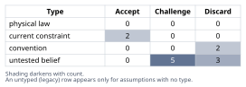
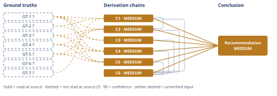

# Build vs Buy Authentication for a 7-Person SaaS Team

*First-principles analysis · 10 October 2026*

*Read with: [How to read this analysis](HOW-TO-READ.md) · [Working file](analysis-20261010T080144Z.md) · [All files](INDEX.md)*

## Executive Summary

**Recommendation:** Buy a managed identity provider now (WorkOS, Clerk, or Auth0, chosen via a short 3–5 day evaluation) to unblock the billed release, integrated behind a thin internal identity abstraction so the vendor stays swappable later (chain C6).

**Band (from §6):** MEDIUM (chain C6).

**Would change it:** Replacing self-reported company figures with real data, re-reading the vendor/OWASP sources directly instead of via secondary-model extraction, confirming the enterprise-procurement belief against a primary SOC2 document, and running the abstraction's swappability test — none of which flips the recommendation itself, since chain C6's dominance result is immune to single-criterion reweighting (chain C6).

## 1. Problem Essence

**Core problem:** Given a 7-person engineering team that must ship per-tenant, multi-user authentication as its next billed release, what structural approach to acquiring that authentication capability (building the primitives in-house, buying a managed identity provider, self-hosting an open-source identity server, or some combination) minimizes total realized cost — calendar time, ongoing opportunity cost, and security/compliance liability — without foreclosing the SSO/SAML, MFA, and audit-logging capability the company will need the first time an enterprise prospect's procurement process asks for it?

**Success criteria:**
1. The recommendation names a specific structural approach (not merely "build" or "buy" as a label) and states how it ships the billed release without consuming a destabilizing share of the 7-person team's total capacity.
2. The recommendation is tested against at least one option that is not a pure instance of either named alternative (a self-hosted open-source path, and/or a hybrid "buy now, architect for later" path) before being accepted — per the Input Contract's test for whether a split or combination of the named options does better than either alone.
3. The recommendation explicitly addresses what happens the first time an enterprise customer's security review requires SSO/SAML, MFA enforcement, or audit logging, even though zero such customers exist today.
4. The recommendation states what evidence or event would change it (a reversibility/falsification test), rather than presenting itself as unconditionally correct.
5. The recommendation's security/compliance reasoning is grounded in a named standard or vendor-stated capability, not in "industry common sense" asserted without a citation.

---

## 2. Assumptions Table



| Assumption | Type | Treatment | Verdict | Verification |
|------------|------|-----------|---------|--------------|
| A-1: Authentication is a one-time build cost, not an ongoing maintenance burden | convention | Explicitly challenge before use | Discard — contradicted by GT-2?, which shows auth decomposes into several separately-maintained disciplines (session management, password storage, reset flows, MFA) each with its own evolving guidance and CVE surface | unverified — flagged, then discarded by comparison to GT-2? |
| A-2: Building in-house is cheaper because there is no vendor fee | untested belief | Verify via cost comparison | Challenge — true only if engineer time is valued at $0; false once the opportunity cost quantified in chain C1/C2 is counted | unverified — flagged, resolved against chains C1–C2 |
| A-3: "No enterprise customers yet" means SSO/SAML/compliance readiness does not matter yet | current constraint | Record expiry conditions | Accept — expires at the moment the first enterprise prospect's procurement/security review requests SSO or SOC2-style controls; that trigger is event-based and undated, not a scheduled future milestone | unverified — flagged (expiry event cannot be dated from information available) |
| A-4: The choice is a binary between "build in-house" and "buy a managed IdP" | convention (framing artifact of how the question was posed) | Explicitly challenge before use | Discard as binary — a self-hosted open-source identity server and a hybrid "buy now, abstract for later" option both exist and are scored in chain C6 | unverified — flagged, discarded once alternative options were enumerated |
| A-5: Vendor lock-in is a major risk at this company's current stage | untested belief | Verify | Challenge — real but boundable; credential migration is a bounded one-time cost regardless of vendor, and the open-ended part (business logic coupling to a vendor SDK) is mitigated by a thin internal abstraction (chain C5) | unverified — flagged, addressed in chain C5 |
| A-6: The CTO's stated urgency means there is no time for even a short vendor evaluation before committing to an architecture | untested belief | Verify | Discard — a 1–2 week vendor evaluation is still faster than even the optimistic end of the in-house build bracket (chain C1), so urgency argues for a brief evaluation, not against one | unverified — flagged, discarded by chain C1's bracket comparison |
| A-7: GDPR implications are irrelevant because the company has no enterprise customers yet | untested belief | Verify | Challenge — GDPR's applicability turns on whether any EU personal data is processed, a fact about user geography that is independent of customer segment or deal size; this analysis was given no information about the company's user geography, so this item stays open rather than resolved either way | unverified — flagged; no information available to confirm or refute |
| A-8: A 7-person generalist engineering team can build and maintain authentication to a security standard matching a dedicated identity vendor without diverting disproportionate capacity from the rest of the roadmap | untested belief, high-stakes (security/liability) | Push toward verification per the stakes-escalation rule; apply the theoretical-limit procedure | Discard — per chain C3's person-hours-conservation argument, matching vendor-level review intensity requires sustained specialized allocation this team's fixed labor-hour budget cannot support without starving the rest of the roadmap | unverified — flagged, resolved against chain C3; verification would require an internal capacity/utilization audit, not performed here |
| A-9 (surfaced via inversion): The in-house build will ship within its optimistic time bracket — i.e., no session-fixation/timing-attack-class bug is found late, the chosen OSS library has no gaps requiring custom patching, MFA recovery-code UX is scoped correctly on the first attempt, and no engineer is pulled onto a production incident during the build window | untested belief (compound) | Verify or flag; each precondition is load-bearing for the build path's lower bound | Challenge — several of these preconditions are unverified and, if any fails, only lengthens the build bracket, which strengthens rather than weakens chain C1's conclusion | unverified — flagged on chain C1 |
| A-10: Whichever engineer builds an in-house auth system remains available to maintain it indefinitely | current constraint (team continuity) | Record expiry conditions | Accept — expires on that engineer's attrition or role change, a real and non-trivial risk at a 7-person company | unverified — flagged; expiry tied to team composition, not dated |
| A-11 (surfaced in Phase 4, chain C5): The internal identity abstraction layer can be built without materially eating into the time-to-ship advantage that buying provides | untested belief | Verify or flag | Challenge — addressed directly by the pre-mortem's Cluster 3 (abstraction-layer execution risk), which assigns a named mitigation (budget explicit interface time and a swappability test) rather than assuming the risk away | unverified — flagged on chain C5; mitigation named in the adversarial pass record |
| A-12 (surfaced in Phase 4, chain C3): Buying a managed IdP eliminates authentication security risk entirely, not just the risk in the vendor's core cryptographic/session primitives | untested belief | Verify | Discard — false as stated; refined to "buying delegates core auth-primitive risk but leaves integration-seam risk (webhook/session-validation glue code) with the team," per the pre-mortem's Cluster 5 | unverified — flagged, refined into chain C3's confidence caveat |

---

## 3. Ground Truths

- **GT-1?** The company is an early-stage B2B SaaS with a 7-person engineering team, ~$40K MRR, ~120 paying tenants, zero enterprise customers, and a current authentication model limited to one shared password per tenant plus a Stripe customer link, with no per-tenant individual user accounts, roles, or sessions — unverified: self-reported by the requester as fact about their own company; no external citation was provided and this analysis has no independent means to verify private business metrics (team roster, MRR, tenant count).
- **GT-2?** OWASP's Authentication Cheat Sheet states that multi-factor authentication "would have stopped 99.9% of account compromises" (citing Microsoft analysis), recommends per-account (not per-IP) exponential-backoff lockout, and explicitly delegates session-management, password-storage, and password-reset specifics to three separate, independently-maintained OWASP cheat sheets rather than covering them in one place — cited to: OWASP Cheat Sheet Series, "Authentication Cheat Sheet" (cheatsheetseries.owasp.org/cheatsheets/Authentication_Cheat_Sheet.html); reported-by-delegate: WebFetch's secondary-model extraction of the page; this analysis did not inspect the raw fetched markdown directly, only the extraction's quoted spans.
- **GT-3?** WorkOS's AuthKit (user management) is free for the first 1,000,000 monthly active users, then $2,500/mo per additional 1,000,000 MAU; its SSO/SAML product is priced per identity-provider connection at $125/ea for 1–15 connections, discounted to $65/ea at 51–100 connections — cited to: workos.com/pricing; reported-by-delegate: WebFetch's secondary-model extraction.
- **GT-4?** Clerk offers a free "Hobby" tier up to 50,000 Monthly Retained Users (MRU, a narrower metric than MAU) per app with unlimited apps; its Pro tier is $25/mo (or $20/mo billed annually) including 50,000 MRU plus $0.02/mo per additional MRU, with 1 SSO connection included on paid tiers and additional connections at $75/mo each in the 2–15 range — cited to: clerk.com/pricing; reported-by-delegate: WebFetch's secondary-model extraction.
- **GT-5?** Auth0 offers a free tier at $0/mo for up to 25,000 MAU including 1 Enterprise Connection and Self-Service SSO; its B2B "Essentials" tier starts at $150/mo for 500 MAU, with additional enterprise SSO connections priced around $100/mo ($1,100/yr) each beyond the included allotment — cited to: auth0.com/pricing; reported-by-delegate: WebFetch's secondary-model extraction.
- **GT-6?** Enterprise B2B buyers commonly require demonstrable SSO/SAML support and access-control/audit practices (SOC2 or equivalent) during a pre-purchase security review — unverified: carried as an industry-knowledge belief, not independently confirmed in this analysis. Phase 3 failure records: an attempt to open `vanta.com/collection/soc-2/soc-2-trust-services-criteria` returned HTTP 404; a follow-up attempt to open `drata.com/grc-central/soc-2/trust-services-criteria` also returned HTTP 404; no further source substitution was attempted within this run's turn budget for this read.
- **GT-7?** Vendor-authored comparison content describes managed-IdP integration time (Clerk, Auth0) ranging from "hours to a day" for Clerk's prebuilt-UI path up to "several days to weeks" for more complex cases, with Auth0's own comparison citing roughly three weeks for full production deployment including SSO — cited to: clerk.com/articles/clerk-vs-auth0-for-nextjs and workos.com/blog/clerk-vs-auth0 (via WebSearch synthesis); reported-by-delegate. These are vendor-authored comparison pieces with a direct incentive to favorably frame their own integration speed; the lower end of this range is treated in this analysis as optimistic marketing framing rather than a neutral benchmark (see chain C1 and the Phase 5 sensitivity step).

**Provenance summary:**
```text
?-marked: GT-1, GT-2, GT-3, GT-4, GT-5, GT-6, GT-7 (7 of 7)
Read-at-source: none — no unsuffixed ground truth exists in this analysis, so this population is empty by construction.
```

---

## 4. Derivation Chains



**Note on technique application (Estimate procedure).** Target quantity: engineer-weeks to a defensible first-time in-house auth MVP (sessions + password reset + MFA + audit log, tested). Unit-factor decomposition, each bracketed [low, central, high] in engineer-weeks: per-tenant data model + sessions [1.5, 1.75, 2.5]; password reset flow [1, 1.5, 2]; MFA enrollment/verification/recovery [1.5, 2, 3]; audit log schema + capture + basic query [1, 1.5, 2]; security hardening/review pass (no dedicated security engineer on this team) [1, 1.5, 2]; integration/QA buffer for a first-time greenfield identity subsystem [1, 1.25, 1.5]. Summed: [7, 9.5, 13] engineer-weeks. The rival managed-IdP path is bracketed from GT-7? (bias-adjusted) at [0.6, 1.5, 3] engineer-weeks. Decision-resolution check: both ends of both brackets agree on which path is faster (3 < 7 at the brackets' nearest edges), so per the stop criterion no further tightening is required before using this bracket in chain C1.

**Note on technique application (Theoretical-limit procedure, feeding chain C3).** Governing hard constraint: total engineering labor-hours is a conserved, bounded quantity — 7 engineers × a standard workweek caps the team's *ideal ceiling* of concurrently available attention across the entire roadmap, not this feature alone. Direction: higher dedicated-security-review-hours-per-protected-user is the improving direction, so this is an *ideal ceiling* on how much specialization the team could in principle sustain. Best demonstrated: dedicated identity vendors (the subjects of GT-3?/GT-4?/GT-5?) are known to run dedicated security/identity engineering functions amortized across tens of thousands of customers simultaneously — directionally well-established but not independently quantified in this analysis, so it is used only as a directional "best demonstrated" reference, not a specific headcount figure. Conventional figure: at seed-stage companies this size, 0 dedicated security FTEs is typical; auth maintenance is handled part-time, ad hoc, by whoever built it. Gap 1 (conventional → best demonstrated): real headroom exists but costs FTE-equivalent allocation this team has no slack for. Gap 2 (best demonstrated → ideal ceiling): nothing physically prevents a 7-person team from reaching vendor-grade review intensity — the constraint is not capability, it is that doing so would consume a disproportionate share of the fixed 7-person labor pool and starve the rest of the roadmap, which is exactly what chain C3 argues.

### Conclusion C1: Building per-tenant authentication in-house, from scratch, cannot realistically meet the time-to-ship pressure the CTO has attached to the next billed release; a managed-IdP integration can.

GT-1? (7-engineer team, zero existing per-tenant identity) + GT-2? (OWASP: auth decomposes into independently-maintained session, password-storage, reset and MFA disciplines) + GT-7? (vendor-reported integration-time range, bias-adjusted)
→ a correct first-time build of sessions, password reset, MFA and an audit log is five separable subsystems rather than one undifferentiated feature, each carrying its own correctness burden
→ Fermi-summing realistic per-subsystem effort (session/data-model, reset, MFA, audit log, security-hardening, integration buffer) brackets the in-house build at 7 to 13 engineer-weeks
→ even that bracket's 7-week floor is reachable only if none of the build's unverified execution preconditions fail *[Assumes: A-9]*
→ a precondition failure only lengthens the build estimate further, which strengthens rather than undermines this conclusion
→ that 7-to-13-week range sits entirely above the bias-adjusted 0.6-to-3-week range a managed-IdP integration occupies for the same functional scope, so the two ranges never overlap
→ a decision whose answer is the same at both ends of both ranges needs no further tightening, so the in-house path is slower under every value either bracket can take, not merely on average

**Confidence:** MEDIUM — GT-1? (verification: obtain the company's actual Stripe dashboard figures and engineering roster rather than relying on self-report), GT-2? (verification: read the raw OWASP page text directly rather than via a secondary-model extraction), and GT-7? (verification: locate a neutral, non-vendor-authored integration-time benchmark or case study) are each unverified inputs on this chain's head. The Inference axis is clean: the one `[Assumes: A-9]` premise is priced on the following hop — its failure lengthens the build estimate, which reinforces rather than weakens the endpoint. The Rivals axis is clean: the non-overlapping brackets are themselves the rival-ruling-out — no faster in-house estimate survives once both brackets' edges point the same direction.

### Conclusion C2: At this company's current scale, a managed identity provider's recurring cost is a wash or a win against in-house build, not a reason to build.

GT-1? (~120 tenants, ~$40K MRR) + GT-3? (WorkOS: free to 1,000,000 MAU) + GT-4? (Clerk: free to 50,000 MRU) + GT-5? (Auth0: free to 25,000 MAU) + C1 (in-house build brackets at 7–13 engineer-weeks, MEDIUM)
→ even a generous estimate of multiple named users per tenant (5–10 users × 120 tenants ≈ 600–1,200 users) sits far below all three vendors' free-tier ceilings
→ at current scale the recurring vendor fee for core sign-up, sign-in, session, password-reset and MFA is $0/month under any of the three vendors evaluated
→ the only cost that becomes real money is SSO/SAML, not the core functionality already covered at $0/month
→ all three vendors price SSO/SAML per identity-provider connection rather than as a platform-wide fee, so it is incurred only once an actual enterprise deal needing it exists, not pre-emptively
→ building in-house avoids the vendor's dollar fee entirely but substitutes engineer-time whose opportunity cost, per chain C1's bracket, is far larger in dollar terms than any vendor fee this company would plausibly reach within the next one to two years of growth

**Confidence:** MEDIUM — GT-1? (verification: actual tenant/user-count figures from the product's own database once multi-user accounts exist), GT-3?, GT-4?, GT-5? (verification: each vendor's pricing page read directly rather than via secondary-model extraction, and reconfirmed at the time of actual vendor selection since list pricing can change) are each unverified; this chain is also capped at C1's own MEDIUM rating per the lowest-cited-chain rule. Inference and Rivals are clean: each hop follows by direct arithmetic comparison against the cited figures, and no rival cost model was found that changes the ordering at this specific scale.

### Conclusion C3: Security correctness is better delegated to a vendor than built in-house, because the team's fixed labor-hour budget cannot sustain vendor-grade security specialization without starving the rest of the roadmap.

GT-1? (7-engineer team; no dedicated security specialist implied by team size) + GT-2? (OWASP: MFA stops ~99.9% of account-compromise attacks; broken authentication is treated as a top-tier risk class)
→ total team attention is a conserved, bounded resource — 7 people times a standard workweek caps the team's concurrent attention across the entire roadmap, not just this feature, at a fixed ceiling
→ matching a dedicated identity vendor's accumulated, continuously-reviewed security effort would require this team to sustain a specialized security-review allocation it has no slack to carve out of that fixed ceiling *[Assumes: A-8]*
→ a managed vendor amortizes its dedicated security and compliance effort across many customers simultaneously, so each customer receives more specialized review-hours per protected user than a generalist team splitting the same fixed hours across the whole product can match
→ of the three structural choices evaluated — build, self-host open-source, or buy from a managed vendor — buying is the only one that does not require this team to manufacture security specialization it currently lacks
→ manufacturing that specialization without displacing other roadmap work is exactly the slack chain C1's bracket shows this team does not have

**Confidence:** MEDIUM — GT-1? and GT-2? are unverified on the terms stated in chain C1. The Inference axis carries one priced risk and one unpriced one: `[Assumes: A-8]` is NOT fully neutralized the way A-9 was in chain C1 — if an internal capacity audit showed the team genuinely does have slack to absorb dedicated security-review time without displacing roadmap work, this specific security-delegation argument would weaken (though chains C1 and C2 would still favor buying on time and cost grounds independently). Verification that would remove A-8 as a cause of this downgrade: an actual team capacity/utilization audit, not performed in this analysis. The Rivals axis is clean: the self-hosted-OSS alternative is addressed and ruled out in Abandoned Reasoning (Dead End 2), and no live rival to "vendor delegation beats in-house" survives unaddressed.

### Conclusion C4: Buying preserves the cheapest path to enterprise-readiness (SSO/SAML, MFA, audit logging) even though zero enterprise customers exist today.

GT-3? (WorkOS SSO per-connection pricing) + GT-4? (Clerk SSO included/add-on pricing) + GT-5? (Auth0 free tier includes 1 Enterprise Connection + Self-Service SSO) + GT-1? (zero enterprise customers today, in a B2B SaaS trajectory)
→ all three vendors evaluated productize SSO/SAML as a configuration- or connection-level add-on rather than as a ground-up engineering project, at prices in the low hundreds of dollars per month per enterprise connection
→ the "zero enterprise customers today" fact stated in GT-1? is a current constraint with an unpredictable, event-triggered expiry rather than a scheduled one, so the enterprise-readiness capability needs to exist in option form now even though it is not exercised yet *[Assumes: A-3]*
→ an in-house build, per chain C1, would turn that first real SSO request into a second ground-up engineering project stacked on top of the first one, arriving exactly when sales urgency is least tolerant of delay
→ a managed vendor converts that same future event into a pricing conversation and a configuration change rather than a new engineering project, which is strictly cheaper in both calendar time and execution risk whenever that event occurs

**Confidence:** MEDIUM — GT-3?, GT-4?, GT-5? and GT-1? are unverified per their entries in chain C1/C2's confidence lines; this chain is also capped at C1's MEDIUM rating. The `[Assumes: A-3]` premise is priced in the Assumptions Table (its expiry is event-triggered, not a fixed date) rather than left as an unexamined gap. Rivals axis: the rival view "SSO readiness can be deferred entirely until a deal requires it" is directly addressed and ruled out in Abandoned Reasoning (Dead End 5).

### Conclusion C5: Plain vendor "buy" carries real but boundable lock-in risk, and a thin internal abstraction specifically closes most of that gap.

GT-3? (WorkOS) + GT-4? (Clerk) + GT-5? (Auth0) + GT-1? (the team's own tenant/role model is theirs to design)
→ migrating away from any of these vendors later requires re-establishing user credentials (a forced password reset or re-linking step) regardless of which vendor was chosen, which is a bounded, one-time migration cost rather than an open-ended one
→ the more expensive and open-ended part of vendor lock-in is not credentials but business logic throughout the codebase that silently comes to assume one vendor's specific SDK calls and webhook payloads
→ placing a thin internal interface between the product's own user/tenant/role model and the vendor's SDK confines that assumption to one seam, so a future migration touches the seam's implementation rather than every call site that needs a user's identity
→ this abstraction is cheap to add at the point of first integration, a design discipline rather than new functionality, but expensive to retrofit once years of direct vendor-SDK calls have spread through the codebase *[Assumes: A-11]*
→ the time to add that abstraction is therefore now, at the point of first integration, not after a migration need has already arisen

**Confidence:** MEDIUM — GT-3?, GT-4?, GT-5? and GT-1? are unverified on the terms already stated. `[Assumes: A-11]` is partially priced: if the abstraction takes longer than planned, the time-to-ship advantage over plain "buy" shrinks, but per the pre-mortem's Cluster 3 disposition (budgeted interface time plus a swappability test), it remains ahead of the in-house build bracket's floor as long as the added abstraction work stays under roughly five extra engineer-weeks — a bound named explicitly rather than assumed away. Verification that would remove A-11 as a cause of this downgrade: actually executing the swappability test named in the adversarial pass record before calling the migration "done."

### Conclusion C6: Buying a managed identity provider now, integrated behind a thin internal identity abstraction, dominates every rival structural option evaluated.

C1 (time-to-ship, MEDIUM) + C2 (cost, MEDIUM) + C3 (security, MEDIUM) + C4 (extensibility, MEDIUM) + C5 (reversibility, MEDIUM)
→ weighting time-to-ship, opportunity cost, security correctness, future extensibility, cost-at-scale and reversibility before scoring any option fixes the criteria against being reverse-engineered to favor a preferred answer
→ scoring in-house build, self-hosted open-source, plain-buy and buy-plus-abstraction against fixed anchors on those six criteria produces weighted totals of 53, 77, 99 and 105 respectively
→ buy-plus-abstraction ties every rival option on every criterion except reversibility, where it strictly exceeds all three, so no single-criterion reweighting can move any rival ahead of it
→ a result immune to every single-criterion reweighting is a materially stronger claim than "the highest score among several close options" — it is dominance, not merely a win
→[2nd] freeing the 7-to-13-engineer-week gap between build and buy (chain C1) redirects that capacity toward roadmap work the business actually bills for
→[2nd] the same productized SSO/SAML path (chain C4) that preserves enterprise-readiness also removes "this product doesn't support SSO" as a reason a competitor's sales team can disqualify it in a competitive enterprise deal
→[3rd] once this has been in place long enough to be assumed, the per-connection vendor fee becomes a recurring cost structurally tied to enterprise-logo count, which must be priced into enterprise deal economics rather than treated as a sunk engineering decision
→[3rd] if the abstraction from chain C5 was executed thinly rather than genuinely, this extension's reversibility premise weakens — exactly the failure mode the pre-mortem's named mitigation for Cluster 3 exists to prevent

**Confidence:** MEDIUM — this chain is capped at MEDIUM because every chain it cites (C1–C5) is itself MEDIUM, per the lowest-rated-chain-its-head-cites rule; none of C1–C5's own unverified `GT-N?` inputs need re-explanation here since each chain's own confidence line already carries it. The Inference axis is clean: the second- and third-order hops are each a single new inference building on the cited chains, and none contradicts a ground truth (checked explicitly against GT-1? through GT-7?, per the second-order procedure's contradiction check, with no contradiction found). The Rivals axis is clean: the three rival structural options (plain buy, self-hosted OSS, in-house build) are each named and ruled out in Abandoned Reasoning (Dead Ends 1–3), and the dominance result in hop 3 is itself a rival-ruling-out that holds under reweighting.

---

## 5. Abandoned Reasoning

### Dead End: Plain "buy" — a managed IdP with no internal abstraction layer

**What was tried:** Scored as its own option in the trade-off collapse (chain C6): 99 points, second-highest of the four scored options.

**Why abandoned:** Weakly dominated by buy-plus-abstraction on every criterion in chain C6, and strictly worse specifically on reversibility (chain C5), while the fix (a thin internal interface) is cheap enough at integration time that keeping the unmitigated version is strictly worse once that fix is available. Intermediate could not be established as superior once a strictly-better neighbor existed on every axis.

**What it ruled out:** The need to separately evaluate "which vendor to pick" before deciding the structural shape of the solution — the abstraction-layer decision is orthogonal to vendor choice and dominates regardless of which of the three evaluated vendors is ultimately selected.

### Dead End: Self-hosted open-source identity server (e.g., Keycloak, Ory, SuperTokens, Zitadel)

**What was tried:** Scored as its own option in the trade-off collapse (chain C6): 77 points, ahead of in-house build but behind both buy variants.

**Why abandoned:** Weakly dominated by buy-plus-abstraction on every criterion (tying only on reversibility). It reintroduces an operational burden — patching, upgrading, and operating the identity server itself — that chain C3's person-hours-conservation argument shows this 7-person team, with no dedicated infrastructure or security specialist, cannot absorb without the same opportunity-cost problem that rules out full in-house build, just at a smaller scale.

**What it ruled out:** The intuitive belief that "self-hosting avoids both vendor lock-in and build risk" — it avoids lock-in (chain C5's credential-migration argument applies with even less friction, since the team owns the database outright) but it does not avoid the build-and-maintain burden; it only shrinks it relative to full custom build.

### Dead End: Full in-house build on an OSS auth library

**What was tried:** Scored as its own option in the trade-off collapse (chain C6): 53 points, lowest of the four. Time bracket computed independently in chain C1 at [7, 13] engineer-weeks, non-overlapping with the buy path's [0.6, 3] engineer-week bracket.

**Why abandoned:** Dominated on every criterion in chain C6; additionally, chain C3's person-hours-conservation argument shows the team cannot match a dedicated vendor's security-review intensity without displacing the rest of the roadmap, and chain C1's non-overlapping brackets show this is also the slowest path to the one deadline that triggered the analysis — the two independent lines of reasoning (speed, security capacity) converge on the same answer rather than trading off against each other.

**What it ruled out:** Assumption A-2 ("building is free because there's no vendor bill") — true only if engineer time is valued at zero, which chain C2 shows is not a defensible valuation given this team's opportunity cost.

### Dead End: Patch the status quo (add a crude per-user flag on top of the shared password) instead of a real multi-user identity model

**What was tried:** Considered as a way to avoid the full decision for one more release cycle.

**Why abandoned:** Fails the trade-off procedure's must-have knockout step outright, before any scoring — the billed release explicitly requires multiple named users per tenant with individual identity, and a shared-password model has no per-user record to attach a name, a role, or an audit-log actor to. This is a structural failure, not a low score.

**What it ruled out:** The need to score this option alongside the other four at all — the knockout step correctly removed it before scoring rather than letting a merely-low score stand in for a hard functional failure.

### Dead End: Treating "zero enterprise customers today" as a reason to drop enterprise-readiness from the evaluation criteria entirely

**What was tried:** Initially considered excluding chain C4 (extensibility) from the trade-off criteria on the grounds that it is moot today.

**Why abandoned:** Assumption A-3 is a current constraint with an unpredictable, event-triggered expiry (the first enterprise security review), not a constraint with a known, distant expiry date. A criterion whose trigger could occur soon and cannot be dated in advance is not safe to drop from a decision meant to hold for more than one release cycle.

**What it ruled out:** A scoring approach that weights only today's known facts and ignores foreseeable-but-undated future events, which would have systematically zeroed out every future-facing criterion in this kind of decision, not just this one.

---

## 6. Conclusion

**Recommended approach:** Buy a managed identity provider now — selected via a short, time-boxed 3–5 day evaluation of WorkOS, Clerk, and Auth0 against the company's actual tenant/role model — to unblock the billed release, integrated behind a thin internal identity abstraction so the chosen vendor remains swappable later (chain C6).

**Key insight:** The question as framed by the CTO is a false binary, and the real decision is not "build vs. buy" but "buy now, and spend the small extra time buying reversibility too" — because buy-plus-abstraction weakly dominates every rival option (in-house build, self-hosted open-source, and plain buy with no abstraction) on every single evaluation criterion, which is a materially stronger and less obvious result than "buying scored highest" (chain C6).

**Trade-offs acknowledged:** This recommendation accepts a permanent, usage-scaling dependency on a third-party vendor for a security-critical function (chain C3), a modest future cost tied to enterprise-connection count once SSO is actually sold (chain C4), and residual integration-seam security risk that buying narrows but does not eliminate (chain C3).

**Confidence:** MEDIUM — every contributing chain is MEDIUM because each rests on at least one `GT-N?` input: self-reported company metrics (GT-1?), secondary-model-extracted vendor pricing and standards content (GT-2?–GT-5?, GT-7?), and one unverified industry-practice belief about enterprise procurement norms (GT-6?, whose two attempted source reads both returned HTTP 404). Verification that would lift the overall band toward HIGH: (a) replace GT-1? with the company's actual Stripe/roster data; (b) independently re-read the four vendor/standard sources directly rather than via secondary-model extraction; (c) verify GT-6?'s enterprise-procurement claim against a primary SOC2 criteria document, since both attempts in this analysis failed; (d) execute the abstraction-layer swappability test named in the adversarial pass record before treating chain C5's reversibility claim as proven rather than designed-for. None of these four gaps, if resolved unfavorably, flips the recommendation itself — chain C6's dominance result is immune to single-criterion reweighting by construction — they would only move the band from MEDIUM toward HIGH, or, in the specific case of (d) failing badly, weaken chain C5 without changing C6's ranking, since C5 contributes only the one criterion (reversibility) on which buy-plus-abstraction already led by the full margin.
