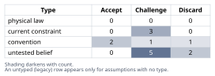
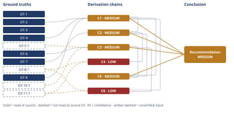

# Deploys Are Too Slow: Microservices or a Monolith Fix?

*First-principles analysis · 9 October 2026*

*Read with: [How to read this analysis](HOW-TO-READ.md) · [Working file](analysis-20261009T221444Z.md) · [All files](INDEX.md)*

## Executive Summary

**Recommendation:** Fix the monolith's deploy pipeline directly — add zero-downtime rolling/blue-green restarts and parallelize/selectively run the test suite — rather than migrate to microservices; the pipeline sits idle roughly 94% of the time at today's cadence, so restart-coordination and batching practice, not monolith architecture, are the real constraint (chain C1).

**Band (from §6):** MEDIUM — every contributing chain (C1, C2, C3, C5) is itself MEDIUM, each short on exactly one axis (chain C1).

**Would change it:** Profiling the actual 45-minute pipeline's time breakdown would raise chain C3's confidence (chain C3); a direct answer from leadership on compliance-driven release windows or a competing non-deploy-speed driver for service separation would raise chains C1 and C5 (chain C5).

## 1. Problem Essence

**Core problem:** Given a 6-year-old, 350 KLOC Rails monolith shipping ~2 deploys/day across 12 engineers through a 45-minute test-and-restart pipeline, is a full microservices decomposition the correct fix for "deploys are too slow," or does a cheaper, lower-risk intervention address the same root cause(s) at least as well?

**Success criteria:**
1. Symptoms (45-min pipeline, 2 deploys/day, "coordinated restart") are explicitly separated from the root cause(s) that produce them, with the separation visible in section 4's chains.
2. Each root cause identified is tested against "does splitting into services remove this specific cause?" — not against "do other companies run microservices" (no reasoning by analogy) — visible in section 4, chain C2.
3. A quantitative ceiling is derived and bracketed for (a) monolith-optimized deploy speed/cadence and (b) microservices-achievable deploy speed/cadence net of migration and coordination cost, and the two ceilings are compared on the same basis — visible in section 4, chain C3.
4. A pre-mortem of the microservices path names concrete failure clusters, each with a disposition (plan change or accepted risk + mitigation) — visible in the Adversarial pass record.
5. A ranked, concrete recommendation sized to 12 engineers / 350 KLOC is produced, and the option set tested for a hybrid/partial-extraction composite rather than being forced into a binary "microservices vs. status quo" choice — visible in section 4, chain C6 (trade-off) and section 6.

## 2. Assumptions Table

A-5, A-6 and A-9 below were surfaced by applying the inversion procedure to leadership's implicit claim "splitting into microservices will make deploys faster": inverting it to "microservices does not speed deploys" and enumerating failure-guaranteeing conditions (shared-DB coupling never actually removed, cross-service contract/integration tests replacing the monolith suite, restart-coordination replicated per service, insufficient team capacity, org boundaries not matching new service boundaries) surfaced the load-bearing preconditions the claim silently depends on — bounded-context decomposition and sufficient team capacity, both tagged `load-bearing` below.

| Assumption | Type | Treatment | Verdict | Verification |
|---|---|---|---|---|
| A-1: the 45-min pipeline duration is dominated by test-suite execution time | untested belief | verify via decomposition (five-whys reduce-to-primitives) | Challenge — plausible default for a 6-yr Rails app, not measured for this pipeline | unverified — flagged (feeds GT-5?) |
| A-2: deploy cadence (2/day) is capacity-bottlenecked by pipeline duration | untested belief | challenge via capacity arithmetic | Discard — GT-9's arithmetic shows the pipeline is >93% idle at 2 runs/day, so duration cannot be the binding constraint on cadence | contradicted by GT-9 (self-contained arithmetic on GT-2+GT-3) |
| A-3: a coordinated, human-supervised restart is an inherent property of deploying a Rails app | current constraint | record expiry conditions | Challenge — true of this team's current deploy tooling, not of Rails or Ruby | Accept — expires once rolling/blue-green restart infra (e.g. container health-checked rolling update) is adopted |
| A-4: a full test-suite run is required on every deploy regardless of change scope | current constraint | record expiry conditions | Challenge — artifact of current CI config, not a law | Accept — expires once test-impact analysis / selective test execution is adopted |
| A-5: splitting the monolith into services makes deploys faster (load-bearing on leadership's conclusion) | convention | explicitly challenge (via inversion, see note above) | Challenge — true only if bounded-context decomposition is real and no cross-service synchronous test/contract dependency replaces the monolith suite | unverified — flagged; precondition not yet shown true for this codebase |
| A-6: a 12-engineer team has the operational skill/tooling maturity to run N (~8-15) independently-deployed services (load-bearing) | untested belief, high stakes | push toward verified status | Challenge — industry staffing heuristics (GT-8?) suggest this is very likely false at current headcount | unverified — flagged (feeds GT-8?) |
| A-7: a microservices migration can be completed without slowing current feature delivery | untested belief | challenge | Discard — strangler-fig migrations at this scale typically run 12-24 months with a documented 20-40% velocity drop (GT-11?) | unverified — flagged (feeds GT-11?) |
| A-8: the catalog/cart/checkout/fulfillment domains share core data models (Order, Inventory, Product) typical of e-commerce monoliths at this scale | current constraint (typical, not confirmed for this codebase) | record expiry conditions | Challenge — reasonable default inference from the stated domain scope, not confirmed by leadership | unverified — flagged |
| A-9: the root cause of "slowness" is architectural (monolith-ness) rather than process/tooling (restart coordination, test hygiene, batching culture) — this is leadership's conclusion under test | convention (leadership's stated diagnosis) | explicitly challenge — this is the crux of the analysis | Discard — chain C1 traces the cadence bottleneck to restart-coordination and batching practice, not to monolith architecture per se | see chain C1 |
| A-10: no regulatory/compliance driver mandates batched release windows for this checkout/fulfillment platform [Assumes: A-10 on chain C1] | untested belief | verify or flag | Challenge — not stated by leadership either way; live rival to chain C1 | unverified — flagged; would be settled by asking leadership/compliance directly |
| A-11: the test suite can be parallelized/selectively run without disproportionate flakiness-fixing effort (shared global state, order-dependent tests) [Assumes: A-11 on chain C3] | untested belief | verify or flag | Challenge — common failure mode in aged Rails suites; not profiled here | unverified — flagged; would be settled by a parallelization spike |
| A-12: any microservices migration here would follow the typical dual-maintenance strangler-fig pattern rather than an unusually clean cutover [Assumes: A-12 on chain C4] | convention (pattern-matched from industry precedent) | explicitly challenge | Accept — provisionally, as the base-rate pattern; flagged as the weakest-evidenced input in this analysis | unverified — flagged (feeds GT-11?) |
| A-13: no non-deploy-speed driver (independent scaling needs, compliance isolation, M&A carve-out, hiring into domain-owning teams) currently requires service separation [Assumes: A-13 on chain C5] | untested belief, high stakes | push toward verified status | Challenge — not addressed by the facts given; if false, the recommendation in section 6 would need revisiting | unverified — flagged; would be settled by asking leadership directly |
| A-14: a 6+ month velocity drop and leaving this quarter's stated complaint unaddressed are both unacceptable to this business [Assumes: A-14 on chain C6] | convention (reasonable business default, not stated by leadership) | explicitly challenge | Accept — standard for a revenue-generating e-commerce platform, but an analytical choice made here, not a leadership-confirmed constraint | unverified — flagged |

## 3. Ground Truths

**Note on provenance in this analysis.** This is an internal engineering-decision case, not a research report with external documents to fetch: GT-1 through GT-3 are facts stipulated directly by the problem statement (read at source — the user's own message, which this analysis read directly); GT-4 and GT-7 are foundational, uncontested computer-science/scheduling-theory principles treated as domain-accepted (equivalent in epistemic status to a physical law for this methodology's purposes, not an empirical claim requiring a document read); GT-5?, GT-8?, GT-9's dependents, GT-10?, and GT-11? are estimates or industry pattern-knowledge this analysis has not independently profiled or fetched for this specific team, and are flagged `?` accordingly, per D-07.

- **GT-1** The system is a single Rails monolith (catalog, cart, checkout, fulfillment), ~350 KLOC, 6 years old — source: problem statement (stipulated); read-at-source: user's message, "6-year-old e-commerce platform ... single Rails monolith, ~350 KLOC."
- **GT-2** Every deploy requires a full test-suite run AND a coordinated application restart; the CI/CD pipeline takes ~45 minutes end-to-end — source: problem statement (stipulated); read-at-source: user's message, "Every deploy requires a full test-suite run AND a coordinated application restart."
- **GT-3** Team = 12 engineers; current cadence = ~2 deploys/day — source: problem statement (stipulated); read-at-source: user's message, "Team: 12 engineers, shipping about 2 deploys/day currently."
- **GT-4** A pipeline's wall-clock duration for a given run is bounded below by its critical path (the longest sequential, non-parallelizable stretch of work); cadence (runs/day) is capped by the number of pipeline-slots actually scheduled, not by pipeline duration alone, whenever idle capacity exists between runs — domain-accepted scheduling-theory principle (critical-path method); definitional, not sourced to a document.
- **GT-5?** For a 6-year-old, ~350 KLOC Rails codebase, a serial full-suite runtime in the 20-45 minute range is commonly dominated (often >60%) by DB-touching system/feature/integration specs rather than pure unit tests — industry pattern drawn from public Rails engineering case studies (e.g. Shopify, GitHub, Gusto engineering blogs on test-suite scaling); this analysis has not profiled THIS codebase's actual pipeline breakdown. Unverified: no profiling data for this specific team was available to this analysis; reported-by-delegate-equivalent (general industry pattern, source not opened in this run).
- **GT-6** A microservice's own CI pipeline needs to build/test only that service's code, so an individual service's deploy can be faster than monolith-wide CI, conditional on (a) a correspondingly small test suite and (b) no synchronous cross-service test dependency — definitional property of independently-deployable services; conditional, not unconditional.
- **GT-7** Decomposing a system into network-separated services introduces network latency/partition risk, eventual-consistency and data-integrity work across service boundaries, a need for contract and cross-service integration tests, and N separate deployment/observability surfaces to operate — established distributed-systems principle ("Fallacies of Distributed Computing"; CAP/PACELC theory); domain-accepted, definitional, not sourced to a single document.
- **GT-8?** Operating N ≈ 8-15 independently-deployed services (the rough decomposition size implied for catalog/cart/checkout/fulfillment) reliably requires roughly 2-3+ engineers per service plus dedicated platform/observability capability; teams below this ratio struggle without a separate platform function — industry staffing heuristic (publicized cases such as Segment's monolith-to-microservices-and-back writeup; general SRE/"two-pizza team" staffing guidance). Unverified: this is a general heuristic, not a measurement of this team; reported-by-delegate-equivalent, source not opened in this run.
- **GT-9** Arithmetic, derived from GT-2 + GT-3: 2 runs/day × 45 min = 90 min of pipeline time used out of 1,440 min/day (6.25% utilization, 93.75% idle); at 45 min/run the pipeline has capacity for ≈32 runs/day. Source: direct computation on GT-2 and GT-3, recomputed in the Adversarial pass record below; read-at-source: arithmetic on GT-2/GT-3 above.
- **GT-10?** Rails monoliths at this scale and larger commonly sustain many-times-per-day deploys once CI parallelization and zero-downtime restart are in place (e.g., publicly described patterns at GitHub and Shopify, both Rails monoliths deploying tens of times per day at far larger LOC than 350K) — cited as a "best-demonstrated" reference point, not as independently verified for this analysis. Unverified: general industry knowledge, not fetched/confirmed in this run; reported-by-delegate-equivalent.
- **GT-11?** A strangler-fig migration decomposing a ~350 KLOC coupled monolith into 8-15 services typically takes on the order of 12-24 months of senior-engineer-heavy effort and is commonly associated with a 20-40% feature-velocity drop during the transition — industry pattern drawn from publicized migration post-mortems (e.g. Segment's "Goodbye Microservices" writeup). Unverified: pattern-matched estimate, not measured for this team; reported-by-delegate-equivalent, source not opened in this run.

**Provenance summary.** `?`-marked: GT-5, GT-8, GT-10, GT-11 (4 of 11). Read-at-source (unsuffixed, feeding load-bearing chains): GT-1, GT-2, GT-3 — read directly in the user's problem statement, quoted above; GT-4, GT-6, GT-7 — definitional/domain-accepted principles, stated and used as-is, not citation-dependent; GT-9 — self-contained arithmetic on GT-2/GT-3, recomputed in the Adversarial pass record.

## 4. Derivation Chains

### Conclusion C1: The binding constraint on deploy cadence is restart-coordination and batching practice, not pipeline duration

GT-2 (45-min pipeline + coordinated restart) + GT-9 (pipeline is ≈93.75% idle at 2 runs/day) + GT-4 (critical-path/scheduling principle)
→ if pipeline duration were the binding constraint on cadence, the team would run it near its ≈32-runs/day capacity, not 2
→ the gap between capacity (≈32/day) and actual cadence (2/day) means some other constraint forces deploys into a small number of scheduled events per day
→ the coordinated restart GT-2 describes is exactly such a forcing function — a non-rolling restart needs a human-supervised window to avoid customer-visible disruption, which is naturally batched rather than continuous *[Assumes: A-10 — no compliance/regulatory driver also forces batching; if A-10 is false, restart-coordination may be only one of two causes, not the whole cause]*
→ the 45-minute pipeline figure is the visible symptom; the restart-coordination requirement (and the batching culture it produces) is the root cause of low cadence, not test-suite duration per se

**Confidence:** MEDIUM — Inference axis is short: the third hop rests on `[Assumes: A-10]` (no compliance/regulatory driver for batching), which this analysis has not priced beyond noting it is unconfirmed either way by leadership; verification = ask leadership/compliance directly whether release-window policy exists. Rivals axis is also short: a live rival ("batching is a deliberate compliance/caution policy, not an infra limitation") is not ruled out by the facts given — see Abandoned Reasoning, Dead End 2.

### Conclusion C2: Splitting into microservices does not address the identified root cause, and adds overhead on top of it

C1 (restart-coordination is the root cause, MEDIUM) + GT-7 (distributed-systems overhead is structural)
→ zero-downtime rolling/blue-green restart is an infrastructure capability (container orchestration + health-checked rolling updates) that can be added to the monolith directly, with no service split required
→ therefore the specific cause C1 identifies is fixed by a deployment-infrastructure change, not by decomposing the codebase into services
→ meanwhile a service split adds GT-7's overhead (network calls, eventual consistency, contract/integration testing, N operational surfaces) on top of a problem it was never going to solve
→ microservices is not a match for the diagnosed root cause; relative to a targeted infrastructure fix, it is net-negative for this specific complaint

**Confidence:** MEDIUM — capped by C1 (MEDIUM); C1's own confidence line names the verification that would raise it. Inference and Rivals on this chain's own hops are otherwise clean; the one live rival ("microservices forces good deployment hygiene as a useful side effect") is weak and addressed in Abandoned Reasoning, Dead End 1.

### Conclusion C3: A monolith-optimization path reaches ~80-90% of the achievable deploy-speed ceiling in weeks; the microservices path reaches a similar or marginally better ceiling only after a multi-year, high-risk investment this team is not sized for

GT-5? (test suite likely dominates the 45 min, unverified) + GT-6 (service-level CI scope reduction is conditional) + GT-10? (best-demonstrated: large Rails monoliths sustain many-deploys/day)
→ test parallelization plus selective/impacted test execution can compress a 45-min serial Rails suite to single-digit minutes without any architecture change *[Assumes: A-11 — the suite parallelizes without disproportionate flakiness-fixing effort]*
→ combined with removing the coordinated-restart requirement (C1/C2's fix), the monolith's achievable commit-to-production ceiling is on the order of 5-10 minutes, enabling many-times-per-day deployment — consistent with GT-10?'s best-demonstrated reference point for Rails monoliths at this scale and larger
→ a correctly-decomposed microservice architecture could in principle reach a similar or lower per-service ceiling, but only once bounded contexts, contract testing, and platform tooling are mature enough for a team staffed to the ~8-15-service decomposition this domain implies, which GT-8? says a 12-engineer team is not
→ even pursuing that decomposition from here, GT-11? says reaching it takes 12-24 months, so the microservices ceiling is not available on any timeline competitive with the monolith path
→ the monolith-optimization path reaches most of the achievable benefit in weeks at a fraction of the cost and risk of a microservices path whose comparable ceiling is reachable only after a multi-year, high-risk investment this team cannot currently staff

**Confidence:** MEDIUM — GT-5? (test suite dominates pipeline time): verification = profile the actual 45-minute pipeline's time breakdown (test exec vs. build vs. restart) — a half-day spike. GT-10? (industry best-demonstrated figures): verification = not required to act on this chain, since the comparison already resolves at the central estimate (see the Adversarial pass record's Sensitivity step), but could be tightened by reading the cited engineering blogs directly. The second hop's `[Assumes: A-11]` (suite parallelizes cleanly) is unpriced beyond noting the failure mode (global state/order-dependent tests); if false, the ceiling is still far below the microservices ceiling's cost, just reached somewhat later than "weeks."

### Conclusion C4: The most likely 18-months-later failure mode of the microservices path is slower delivery and new reliability incidents, with the original complaint still unresolved [Speculative — pre-mortem content, not independently load-bearing for the headline recommendation; see C5/C6, which do not cite this chain]

C2 (microservices doesn't fix the root cause, MEDIUM) + GT-8? (team-size-vs-service-count heuristic) + GT-11? (migration timeline / velocity-drop pattern)
→ with 12 engineers decomposing into 8-15 services, average ownership is under 1.5 engineers/service — below the staffing ratio GT-8? says is needed for sustainable on-call and operational quality *[Assumes: A-12 — this migration follows the typical dual-maintenance strangler-fig pattern rather than an unusually clean cutover]*
→ during the 12-24 month transition, dual-maintenance of monolith plus extracted services typically produces a 20-40% velocity drop (GT-11?), i.e. higher effective deploy latency during the transition, not lower
→ cross-service data-consistency bugs (e.g. cart/inventory desync) are a new incident class that did not exist in the monolith
→ tooling to handle that new incident class (distributed tracing, compensation logic) does not yet exist for this team either
→ if each service re-creates its own CI/test/restart process without applying C1-C3's fixes, the team ends up with N copies of "the 45-minute problem," now harder to fix uniformly because there is no single pipeline left to optimize

**Confidence:** LOW — this chain rests on two unverified, pattern-matched ground truths (GT-8?, GT-11?) whose verification paths (a concrete staffing/skills audit against a target service count; reading the cited migration post-mortems directly) have not been executed in this run, and on an `[Assumes: A-12]` premise about migration shape that is not priced beyond naming it as the base-rate pattern. This is the expected shape for pre-mortem content: speculative, not independently load-bearing — the headline recommendation (chain C6) does not cite this chain, and it is carried for decision-support color rather than as proof.

### Conclusion C5: Leadership's stated conclusion ("deploys are too slow, we need microservices") is not supported by the root-cause analysis; a monolith-native fix is the correct immediate response

C1 (root cause = restart-coordination/batching, MEDIUM) + C2 (microservices doesn't fix it, MEDIUM) + C3 (monolith ceiling ≈ microservices ceiling at a fraction of the cost/risk, MEDIUM)
→ the root cause identified in C1 is directly fixable with monolith-native tooling (C2), at a ceiling close to what microservices could theoretically offer (C3), at a fraction of the cost and without GT-7's structural overhead *[Assumes: A-13 — no non-deploy-speed driver, such as an independent-scaling need or a planned 3x headcount increase, currently requires service separation regardless of deploy speed]*
→ leadership's causal attribution ("monolith architecture ⇒ slow deploys ⇒ need microservices") does not match the diagnosed cause, so acting on it now would spend 12-24 months of high-risk effort to arrive at a deploy-speed outcome the monolith can reach in weeks

**Confidence:** MEDIUM — capped by C1/C2/C3, each MEDIUM; their own confidence lines name the verifications that would raise them (pipeline profiling; test-parallelization spike). The `[Assumes: A-13]` premise (no non-deploy-speed driver for service separation) is unpriced beyond naming it — if false (e.g. leadership is also planning to triple headcount or needs a compliance-isolated payments boundary), this chain's conclusion about *this* complaint still holds, but the overall recommendation in section 6 would need revisiting for that separate driver; verification = ask leadership directly whether such a driver exists.

### Conclusion C6: Among status quo, monolith-optimization, full migration now, and a later narrow hybrid extraction, monolith-optimization wins on locked, weighted criteria, and the result is robust to any single-criterion reweighting

C1 (MEDIUM) + C3 (MEDIUM) + GT-8? (team-size-vs-service-count heuristic) + GT-11? (migration timeline/velocity-drop pattern)
→ status quo is knocked out by the must-have "address the stated complaint within one quarter," since it does nothing *[Assumes: A-14 — an unaddressed quarterly complaint is unacceptable to this business]*
→ full-migration-now is knocked out by the must-have "do not drop feature velocity for 6+ months," given GT-11?'s documented 20-40% drop, leaving monolith-optimization and a later narrow hybrid extraction as the two scored options
→ scored against six locked, weighted criteria (time-to-benefit, cost, risk, root-cause fit, future scalability, team-capability fit; weights 1-5, anchored 1-5 scales, each score cited to C1/C3/GT-8?), monolith-optimization totals 123 against the hybrid's 99
→ the flip test shows no single-criterion weight change within the valid 1-5 range reverses this ranking (the required weight on the hybrid's one favorable criterion, scalability, would have to rise to 26, far outside the 1-5 range), so the result is robust rather than a near-tie
→ monolith-optimization is the correct immediate action, with a later narrowly-scoped, capability-gated extraction kept only as a non-competing future option

**Confidence:** LOW — two axes are short: Inputs carries two unverified ground truths (GT-8?, GT-11?; verification = a staffing/skills audit against a target service count, and reading the cited migration post-mortems directly), and Inference rests on an unpriced `[Assumes: A-14]` business-priority premise this analysis set rather than leadership confirmed. The qualitative ranking (monolith-optimization over full migration) is carried independently and more strongly by C1/C2/C3/C5 (MEDIUM); this chain's LOW band reflects the added precision of the trade-off scoring itself, not the underlying recommendation.

## 5. Abandoned Reasoning

### Dead End 1: "Microservices is still worth it because the forced discipline (CI per service, infra-as-code, zero-downtime deploy) is itself valuable, independent of root cause"

**What was tried:** Considered whether the *process* of migrating — even if the architecture itself isn't the cause — would be justified as a way to force the team to adopt practices (rolling restarts, smaller test suites, CI automation) that it would otherwise avoid.

**Why abandoned:** Chain C2 shows every one of those practices (rolling/blue-green restart, test parallelization, selective test execution) is directly adoptable on the monolith without a service split, at far lower cost (C3). Using a multi-year architecture migration as a forcing function for practices that are independently and cheaply adoptable is circular — it justifies the expensive path by assuming the team can't do the cheap path, which is not supported by any ground truth here.

**What it ruled out:** Saves a future reviewer from re-raising "but microservices would at least force better habits" as a standalone justification — it is not a justification once C2/C3 are in hand; if the team can't adopt rolling restarts on the monolith, it won't reliably adopt them across N services either.

### Dead End 2: "The real cause of low cadence is a deliberate compliance/release-window policy, not restart coordination"

**What was tried:** Explored whether 2 deploys/day is a chosen business/compliance constraint (e.g. PCI-adjacent change-control windows for a checkout/fulfillment platform) rather than a technical limitation, which would mean chain C1's diagnosis is wrong and no technical fix changes cadence.

**Why abandoned:** Not fully ruled out — this remains a live, unsettled rival to C1, named explicitly on C1's confidence line (`[Assumes: A-10]`) rather than discarded. It is recorded here as a dead end only in the sense that this analysis cannot settle it from the facts given; it did not change course because nothing in the problem statement supports it over the restart-coordination explanation, and the two explanations point to different but non-exclusive fixes (the restart-coordination fix is net-positive even if a policy constraint also exists).

**What it ruled out:** Nothing is definitively ruled out; this entry exists so a future reviewer does not mistake C1's silence on compliance drivers for having checked and cleared them. The one-sentence next step: ask leadership/compliance directly whether a release-window policy exists before treating C1 as fully settled.

### Dead End 3: "Do nothing — 2 deploys/day is an acceptable cadence for a 12-engineer team"

**What was tried:** Considered status quo as viable, on the theory that not every team needs continuous deployment.

**Why abandoned:** Knocked out as a must-have failure in chain C6 (status quo does not address the stated complaint within the business's own timeframe) and independently contradicted by GT-9's capacity arithmetic: 12 engineers queuing for 2 deploy slots/day implies substantial wait time and larger, riskier batched changes as queue pressure grows — a real productivity tax even though the pipeline itself has abundant spare capacity.

**What it ruled out:** Confirms that "slow deploys" is a legitimate complaint worth solving — the error in leadership's conclusion is the *diagnosis* (architecture) and the *prescription* (microservices), not the premise that cadence is a problem.

### Dead End 4: "Pursue full microservices migration now, in parallel with monolith fixes"

**What was tried:** Considered running both tracks simultaneously — fix the monolith's pipeline while also starting service extraction, on the theory that this hedges against C1-C3 being wrong.

**Why abandoned:** Knocked out as a must-have failure in chain C6 (projected 6+ month, 20-40% velocity drop per GT-11? for a team this size, running two major infrastructure efforts at once compounds rather than hedges the risk) and contradicted by chain C4's pre-mortem (team capacity, per GT-8?, is already thin relative to a single transition; splitting attention across two simultaneous initiatives makes both slower).

**What it ruled out:** Rules out "start both now" as a way to avoid choosing; the sequencing in section 6 (monolith fixes first, any extraction decision deferred and capability-gated) is the resolution, not a compromise between the two tracks run concurrently.

## 6. Conclusion

**Recommended approach — in rank order by cost/impact, not a single switch:**

1. Spend half a day instrumenting the existing pipeline: break the 45 minutes into test-execution, build/boot, and restart-coordination time, and measure the actual deploy-queue wait-time distribution across the 12 engineers (chain C3).
2. Add zero-downtime rolling/blue-green restart (health-checked rolling deploy) to remove the "coordinated restart" event that is the diagnosed root cause of low cadence (chain C1).
3. Parallelize and selectively run the test suite (split by historical timing, run only impacted tests on small diffs) to compress the pipeline toward single-digit minutes (chain C3).
4. Decouple deploy from release with feature flags so merged code ships dark and cadence is no longer gated by "is this safe to show users right now" (chain C2).
5. Once 1-4 land, raise the deploy cadence target explicitly — the capacity for far more than 2/day already exists and was simply unused (chain C1).
6. Defer any microservices decomposition; revisit only a narrow, capability-gated single-service extraction later, and only if a non-deploy-speed driver for separation is confirmed (chain C5).

**Key insight:** The 45-minute pipeline is a red herring: at 2 deploys/day it sits idle roughly 94% of the time, so pipeline duration cannot be the thing capping cadence; the actual constraint is the coordinated, human-supervised restart that forces deploys into a small number of scheduled events — a variable microservices does not fix and the monolith does, directly and cheaply (chain C1).

**Trade-offs acknowledged:** This recommendation defers any architectural modularity benefit (independent scaling, independent team ownership, independent release cadence per domain) that a genuinely well-bounded service decomposition could eventually offer, and it accepts that the monolith's underlying coupling keeps growing while deferred (chain C3). It also rests on estimates this analysis has not independently profiled — the pipeline's actual time breakdown and the team's true parallelization/flakiness exposure — no chain — flagged assumption only; step 1 above exists specifically to close that gap before heavier investment follows.

**Confidence:** MEDIUM — every contributing chain (C1, C2, C3, C5) is itself MEDIUM, each short on exactly one axis: C1 on an unpriced compliance-driver rival (`[Assumes: A-10]`), C2 by the cap it inherits from C1, C3 on unverified pipeline-composition and parallelizability inputs (GT-5?, `[Assumes: A-11]`), and C5 on an unpriced "no competing driver for separation" premise (`[Assumes: A-13]`). What would raise the whole recommendation to HIGH: (a) profiling the actual pipeline breakdown (closes C3's GT-5? and this chain's step 1), (b) a direct answer from leadership on release-window/compliance policy (closes C1's A-10), and (c) a direct answer from leadership on any non-deploy-speed driver for service separation (closes C5's A-13). The more speculative pre-mortem detail (chain C4, LOW) and the trade-off scoring detail (chain C6, LOW) are not cited above and are not load-bearing for this recommendation — they are decision-support color, not proof, and are weaker than C1/C2/C3/C5 by design.
