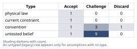
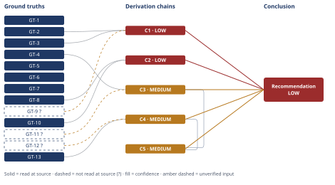

# Deploy Speed: Pipeline Fix, Not Microservices

*First-principles analysis · 10 October 2026*

*Read with: [How to read this analysis](HOW-TO-READ.md) · [Working file](analysis-20261010T075810Z.md) · [All files](INDEX.md)*

## Executive Summary

**Recommendation:** Reject leadership's "the fix is microservices" as stated. Ship pipeline/process fixes now — test parallelization, selective test execution, rolling/blue-green deploy, trunk-based development — since this dominates every scored alternative (chain C5); stage internal modularization next (chain C4); hold any service extraction as evidence-gated and reject a near-term rewrite (chains C2, C3).

**Band (from §6):** LOW overall, though the action itself is better-supported at MEDIUM (chain C5); the weaker half is the explanatory claim that the bottleneck is pipeline/process rather than architecture (chain C1).

**Would change it:** Instrumenting the pipeline to measure the actual 45-minute breakdown — the single unverified fact (chain C1) both the LOW-rated chains name as what would resolve them.

## 1. Problem Essence

**Core problem:** Given that the team's observed deploy friction is produced by a specific, named pipeline configuration (a 45-minute CI run plus a mandatory coordinated application restart on every deploy) rather than by an unexamined property of "monolith" as an architectural style, determine whether splitting the Rails monolith into microservices is the correct remedy, or whether a cheaper, lower-risk fix to the pipeline/process layer resolves the same friction for a 12-engineer team at a fraction of the cost and risk.

**Success criteria:**
1. Names the specific technical bottleneck(s) behind the 45-minute pipeline and the coordinated-restart requirement, distinguishing pipeline/process causes from architecture causes, rather than accepting the macro symptom as self-explanatory.
2. States explicitly whether a microservices split removes, relocates, or merely renames each bottleneck identified in (1), with the second-order costs (network calls, versioning, observability, team fragmentation) priced in rather than assumed away.
3. Weighs the operational and coordination cost of a microservices migration against the stated team size (12 engineers) and codebase size (350 KLOC), using an explicit, falsifiable estimate rather than an impression.
4. Surfaces and costs, side by side, at least the alternatives named in the brief (test parallelization, selective/incremental testing, blue-green/rolling deploy, trunk-based development with smaller batches, internal modularization) against a full microservices rewrite, including the option of a staged/composite path and the status-quo option.
5. Produces a ranked, actionable recommendation that states plainly whether leadership's stated conclusion ("the fix is microservices") is correct, partially correct, or incorrect, and what the team should do instead or in addition — without being constrained to pick only "microservices" or "stay monolith" as the only two admissible answers.

## 2. Assumptions Table



| Assumption | Type | Treatment | Verdict | Verification |
|---|---|---|---|---|
| A-1: Deploys are too slow *because* the codebase is a monolith (leadership's causal claim, GT-6) | convention | Explicitly challenge before use — ask whether it holds here or is historical inertia | Challenge — the given facts (GT-2, GT-3) describe pipeline/deploy-orchestration *policy*, not an inherent property of "monolith" as a style; GT-9? leaves the causal question open | unverified — flagged (feeds C1) |
| A-2: Splitting into microservices would fix the specific GT-2/GT-3 bottleneck | untested belief | Verify, or flag as unverified | Challenge — per C2, it relocates and most likely increases the cost rather than removing it | unverified — flagged (feeds C2) |
| A-3: A 12-engineer team can absorb microservices' operational overhead without materially slowing the roadmap | untested belief (paired with a current constraint on team size) | Verify via estimate; record expiry — lifts only if headcount grows | Challenge — per C3's estimate, overhead is ~8–33%+ of team capacity for 6–18+ months | unverified — flagged (feeds C3) |
| A-4: Running the full test suite on every deploy is a necessary policy, not a choice | convention | Explicitly challenge | Discard — selective/risk-based test execution plus parallelization is standard, widely documented practice; nothing in the given facts makes full-suite-every-time a hard requirement | ruled out by GT-13/GT-14 reasoning (feeds C4) |
| A-5: Coordinated application restart is mandatory for every deploy | convention / current constraint (root cause unknown) | Challenge; record what would have to change (externalize in-process state, add rolling/blue-green infra) for it to lift | Challenge — likely a solvable infra/process gap, not an inherent monolith property, but the actual root cause is GT-9?-unverified | unverified — flagged (feeds C1, C4) |
| A-6: 2 deploys/day is itself a severe problem independent of pipeline latency and batch-size risk | untested belief | Verify against an external benchmark | Challenge — GT-7 places 2/day at the High-to-Elite DORA boundary, not the low end; the measurable pain more plausibly sits in pipeline latency/restart-coordination risk than raw frequency | read-at-source via GT-7 (informs framing; does not feed a C1–C5 chain head directly) |
| A-7: "We need microservices" means a near-term, broad rewrite rather than a slow, evidence-gated strangler extraction | convention (framing) | Challenge | Accept — as literally stated by leadership (GT-6) this is the fair reading, and it is the version evaluated and rejected in C5; a narrower, evidence-gated extraction (option O3 in the trade-off) is a distinguishable claim kept open | GT-6 quoted directly |
| A-8: Network calls between independently deployable services carry latency, partial-failure, and version/observability complexity | physical law (foundational CS reality) | Accept as a ground-truth candidate | Accept — promoted to GT-8 | read-at-source: en.wikipedia.org/wiki/Fallacies_of_distributed_computing |
| A-9: Splitting the monolith into services does not, by itself, change CI policy or deploy-orchestration mechanism — both must be redesigned regardless of architecture | untested belief (near-definitional) | Verify via reasoning | Accept — follows from what "CI policy" and "deploy-orchestration mechanism" mean as implementation choices independent of service count | definitional/logical, no external source needed (feeds C1) |
| A-10: Fulfillment (or another single domain) is more loosely coupled/async than cart/checkout and is the natural first extraction candidate | untested belief | Flag — needs confirmation before any O3 target is chosen | Challenge — plausible but unconfirmed; GT-1 states only that four domains share one deployable, not their coupling strength | unverified — flagged (informs the O3 entry in §5; not a C1–C5 chain head) |
| A-11 (fishbone: Process): No selective/impact-based test execution exists today (tooling gap) | convention (today's practice) | Challenge | Challenge — same substance as A-4, kept distinct because it names a tooling gap rather than a policy choice; both point to the same fix | unverified — flagged (feeds C4) |
| A-12 (fishbone: Technology): CI runner parallelism / test sharding is not currently used (infra provisioning) | current constraint | Record expiry — lifts once parallel CI capacity is provisioned, a budget/config decision, not a re-architecture | Accept as a current, liftable constraint | unverified — flagged (feeds C4) |
| A-13 (fishbone: Information): The actual time breakdown of GT-2's 45 minutes (build vs. test vs. restart-coordination-wait) is not known or instrumented | untested belief | Verify — the single highest-priority measurement gap in this analysis | Challenge — promoted to GT-9? | unverified — flagged (feeds C1) |
| A-14 (fishbone: People): Engineers batch more work per deploy because each deploy is expensive/risky (self-reinforcing cycle) | untested belief | Flag — plausible, consistent with the common large-batch anti-pattern, but unconfirmed for this team | Challenge — plausible but unconfirmed; motivates the trunk-based-development component of O1 regardless of confirmation | unverified — flagged (informs O1; not a C1–C5 chain head) |
| A-15: Per-service ongoing operational overhead ≈ 0.1–0.3 FTE steady-state / 0.3–0.6 FTE during migration, with no first-principles/measured source for this org or stack | untested belief (explicitly assumed range, per the Estimate procedure's own allowance) | Verify, or flag as assumed with a defensible range | Challenge — promoted to GT-11?, explicitly flagged as assumed, not measured | unverified — flagged (feeds C3) |
| A-16: Leadership has organizational patience for a multi-phase, measurement-first plan rather than demanding an immediate, visible architecture change | untested belief (surfaced by the Phase 5 pre-mortem, cluster 4) | Verify/flag; mitigate via an explicit decision-gate agreement with leadership up front | Challenge — not confirmed by any given fact; the staged plan's viability depends on it | unverified — flagged (feeds C5 via `[Assumes: A-16]`) |
| A-17: Coordinating API-version and data-compatibility across independently deployed services at runtime is harder to automate and observe than today's single coordinated-restart step | untested belief (surfaced by the end-of-Phase-4 Assumption Audit, on C2's third hop) | Verify/flag; directionally grounded by GT-8's 2020 extensions (versioning, compensating updates, observability), but the comparative magnitude is not independently measured | Challenge — directionally well-supported by GT-8, magnitude unconfirmed | unverified — flagged (feeds C2 via `[Assumes: A-17]`) |

## 3. Ground Truths

**Note on provenance for GT-1 through GT-6:** these six facts are scenario parameters stated directly by the requester in the task's Context section, not claims about an external document that could be misquoted. Their "source" is the request itself, which this analysis has read in full; they are recorded unsuffixed because there is no secondary citation step to fail, not because an external source was opened. GT-10 and GT-13 are definitional/mathematical truths (what "independently deployable service" means; Amdahl's-law-type scheduling theory); they likewise carry no document read-at-source location because they are not claims read from a document.

- **GT-1** The system is a 6-year-old Rails monolith (~350 KLOC) in which catalog, cart, checkout, and fulfillment are built and deployed as a single unit — source: task Context, stated directly by the requester.
- **GT-2** The CI/CD pipeline runs ~45 minutes end-to-end — source: task Context, stated directly by the requester.
- **GT-3** Every deploy requires a full test-suite run and a coordinated application restart — source: task Context, stated directly by the requester.
- **GT-4** The team has 12 engineers — source: task Context, stated directly by the requester.
- **GT-5** Current deploy cadence is ~2 deploys/day — source: task Context, stated directly by the requester.
- **GT-6** Leadership's stated conclusion is "deploys are too slow, we need microservices" — source: task Context, stated directly by the requester; this is the claim under test in this analysis, not an independently verified fact about the world.
- **GT-7** Per the 2024 DORA State of DevOps Report (as summarized by Octopus Deploy), deployment-frequency performance tiers are: Elite = on demand / multiple times per day; High = daily to weekly; Medium = weekly to monthly; Low = monthly to biannually; elite performers deploy roughly 182× more often than low performers — source: octopus.com/blog/2024-devops-performance-clusters; read-at-source: the page's tier-definition bullet list and the "182x" sentence, confirmed via direct fetch. Caveat: this is a secondary source summarizing the primary DORA report, not the DORA report itself — the tier boundaries are read-at-source for what this page states, not independently cross-checked against DORA's own PDF.
- **GT-8** The "Eight Fallacies of Distributed Computing" (network is reliable; latency is zero; bandwidth is infinite; the network is secure; topology doesn't change; there is one administrator; transport cost is zero; the network is homogeneous) were identified by L. Peter Deutsch and others at Sun Microsystems (seven in 1994, incorporating four from Bill Joy and Dave Lyon; an eighth added by James Gosling c. 1997); a 2020 extension by Mark Richards and Neal Ford adds three more fallacies addressing versioning, compensating updates, and observability — source: en.wikipedia.org/wiki/Fallacies_of_distributed_computing; read-at-source: the page's enumerated list and "Attribution and Timeline" section, confirmed via direct fetch.
- **GT-9?** The internal time/causal breakdown of GT-2's 45 minutes (how much is build time, test-execution time, vs. restart-coordination wait) and the specific technical reason GT-3's restart must be coordinated (in-memory session/cache state, DB migration sequencing, load-balancer/health-check configuration, or something else) are not given in the task Context and are not known to have been instrumented — unverified: no measurement of this breakdown exists in the materials available to this analysis; this is the single highest-leverage fact the team could produce to raise this analysis's confidence.
- **GT-10** Splitting a system into N independently deployable services necessarily replaces some fraction of what were in-process function calls with network calls between services — this follows from the definition of "independently deployable service" (a unit that can be built, tested, and released on its own schedule must communicate with other such units across a process/network boundary) — source: definitional, no external citation required.
- **GT-11?** Assumed per-service ongoing operational overhead: ≈0.1–0.3 FTE-equivalent steady-state (pipeline upkeep, dependency upgrades, on-call, contract maintenance) once tooling matures; ≈0.3–0.6 FTE-equivalent during an active migration (building the platform tooling while also running the legacy system) — unverified: this range has no first-principles or measured source for this specific organization or stack; it is an explicitly assumed, order-of-magnitude bracket produced by the Estimate procedure in §4, carried forward with its `?` intact per that procedure's own allowance for flagging an assumed range when no first-principles value exists.
- **GT-12?** Illustrative "best-demonstrated" CI pipeline duration of roughly 10–15 minutes for comparably sized (100–500 KLOC) Rails/monolith codebases using test parallelization and selective/risk-based test execution — unverified: this figure is an industry-typical illustrative value used in the theoretical-limit bracket in §4; it was not confirmed against a specific case study or measurement for this codebase, and no source was fetched to verify it.
- **GT-13** Parallel execution wall-clock time is bounded below by the duration of the longest critical-path/serial-dependency chain in the run (an Amdahl's-law-type constraint: speedup from parallelizing the parallelizable portion of a workload cannot shrink the workload below the time its inherently serial portion takes) — source: standard parallel-computing/scheduling-theory identity, definitional/mathematical, no external citation required.

**Provenance summary:**
```text
?-marked: GT-9, GT-11, GT-12 (3 of 13)
Read-at-source: GT-7 — octopus.com/blog/2024-devops-performance-clusters, tier-definition bullets + "182x" sentence
Read-at-source: GT-8 — en.wikipedia.org/wiki/Fallacies_of_distributed_computing, eight-item list + Attribution/History section
GT-1–GT-6: task-Context scenario parameters (no secondary citation; see note above)
GT-10, GT-13: definitional/mathematical truths (no document read-at-source location; see note above)
```

## 4. Derivation Chains



### Conclusion C1: The slow-deploy problem is best classified as pipeline/process-design, not architecture

GT-2 (45-min pipeline) + GT-3 (full suite + coordinated restart every deploy) + GT-9? (internal breakdown unverified)
→ the 45 minutes and the coordinated-restart requirement are produced by CI configuration and deploy-orchestration policy choices, not by how many deployable units the codebase is split into [Assumes: A-1, A-9]
→ whether those specific policy choices are themselves forced by genuine cross-domain data or runtime coupling inside the monolith is exactly what GT-9? leaves unanswered
→ absent evidence that coupling rather than policy is the forcing function, the slow-deploy problem is best classified as a pipeline/process-design problem, with architecture an unconfirmed secondary factor

**Confidence:** LOW — two axes are short. Inputs: GT-9? is unverified and no measurement of the pipeline's internal time breakdown exists yet; this would close by instrumenting the CI pipeline (one week of timing logs split into build / test-execution / restart-coordination-wait) before scoping any further work. Rivals: a live, unsettled rival exists — "the four domains are coupled deeply enough (shared database state, cross-domain end-to-end tests) that no pipeline-level fix can decouple them, so only physical service separation forces the isolation needed" — nothing in the given facts rules this out; it would be settled by the same GT-9 measurement plus an audit of whether the slowest tests share fixtures/state across domains.

### Conclusion C2: Microservices would relocate and most likely increase the GT-2/GT-3 bottleneck rather than remove it

GT-10 (splitting into services replaces in-process calls with network calls, definitional) + GT-8 (fallacies of distributed computing, incl. 2020 versioning/observability extensions)
→ cross-domain features such as checkout calling catalog, cart, and fulfillment would move from in-process calls to network calls, each newly exposed to the failure modes GT-8 names
→ each service still needs its own test coverage before deploy, now including cross-service contract and integration tests that do not exist today, so the "full test suite" cost is not eliminated — it is redistributed across more pipelines and gains a new category
→ coordinated application restart is replaced by coordinated API-version and data-compatibility management across services during rollout, a harder-to-automate and harder-to-observe version of the same coordination problem GT-8's 2020 extensions name [Assumes: A-17]
→ microservices does not remove GT-2 and GT-3's bottleneck, it relocates it across a network boundary and most likely increases its total surface area for a team this size
→[2nd] (actor lens) on-call engineers must trace a single user request across service boundaries without mature distributed tracing in place, raising mean-time-to-resolution for incidents that used to be a single in-process stack trace
→[2nd] (actor lens) leadership/finance absorb new recurring infrastructure costs — service mesh or discovery, message broker, redundant per-service infra, observability tooling — that did not exist under the monolith
→[3rd] (time lens, 0–3 months) feature velocity falls as engineers context-switch into migration/platform work before any new service is independently stable, directly working against GT-6's stated goal of faster deploys
→[3rd] (time lens, 3–9 months) partial extraction without enforced data-ownership boundaries risks a "distributed monolith" — services deployed independently but still needing to change together — recreating GT-3's coordinated-restart problem across a harder-to-coordinate network boundary

**Confidence:** LOW — two axes are short even though Inputs is clean. Inference: the chain's magnitude judgment ("most likely increases... total surface area") extends past what GT-10 and GT-8 strictly derive — GT-8 establishes the failure modes exist, not their size for this team; A-17 makes this an explicit, named premise rather than a hidden one, but its failure has not been priced. This would close with a direct before/after measurement of aggregate pipeline wall-time once a real service boundary and its platform tooling exist. Rivals: a live, unsettled rival exists — "with enough platform investment (shared CI templates, a mature service mesh), each service's smaller, isolated test suite could run faster in parallel than today's single 350-KLOC suite, making the relocated cost smaller than the original" — this analysis has no named ground truth establishing whether that pattern holds for this team, so the possibility is held open rather than asserted as fact, and nothing in the given facts rules it out; it is not settled here.

### Conclusion C3: A 12-engineer team cannot absorb microservices' operational cost without a material, multi-quarter capacity hit

**Estimate — per-service operational overhead (Fermi):** Target quantity: additional recurring engineering capacity (FTE-equivalents) consumed by operating N independently deployed services instead of one monolith. Decomposition: (per-service ongoing overhead) × (number of services), with a separate, larger bracket for the migration-period overhead (building the platform tooling while still running the legacy system). No first-principles/measured value exists for this organization, so GT-11? supplies an explicitly flagged assumed range (0.1–0.3 FTE steady-state / 0.3–0.6 FTE during migration per service). For a plausible decomposition of catalog/cart/checkout/fulfillment into 6–10 services: steady-state ≈ 0.6–3.0 FTE (central: ~1–2 FTE); migration-period ≈ 1.8–6.0 FTE (central: ~2–4 FTE). Decision-resolution check: both the lower and upper ends of the bracket, against a 12-person team, land in the same decision region (a material, multi-quarter capacity diversion) — the bracket is good enough to decide without tightening further.

GT-11? (assumed per-service overhead range) + GT-4 (12 engineers)
→ splitting catalog, cart, checkout, and fulfillment into a plausible 6 to 10 services puts steady-state overhead at roughly 1 to 2 FTE-equivalents and migration-period overhead at roughly 2 to 4-plus FTE-equivalents, by GT-11?'s bracket
→ against a 12-person team, that is roughly 8 to 17 percent of the team permanently diverted at steady state and 17 to 33-plus percent diverted for the 6-to-18-month migration window, under either end of the bracket
→ a team this size has no redundant capacity to absorb that diversion without materially slowing checkout and fulfillment feature work — the actual revenue-facing surface — for well over a year

**Confidence:** MEDIUM — exactly one axis is short. Inputs: GT-11? is an explicitly assumed, unmeasured range; this would close with a benchmarking exercise against 2–3 comparable-scale organizations' actual per-service platform/on-call burden, or, cheaper, by measuring this team's own overhead after the first real extraction (see §5, option O3). The Rivals axis is addressed, not short: a live rival ("leadership funds 2–3 new dedicated platform hires rather than diverting the existing 12") is named and ruled out in §5 by GT-4, which states the team as given without any stated hiring commitment.

### Conclusion C4: Pipeline/process fixes close most of the achievable gap regardless of how C1's rival resolves

**Theoretical limit — pipeline latency floor:** Direction: lower is better (a floor, not a ceiling). Governing hard constraint: Amdahl's-law-type scheduling theory (GT-13) — wall-clock time for a parallelized workload cannot fall below its longest serial-dependency chain. Ideal floor: with fully parallel test execution and a rolling/blue-green restart, pipeline latency is bounded below by (container/asset build time) + (longest single test's runtime) + (health-check/connection-drain propagation time) — plausibly ~3–8 minutes, though this specific floor was not independently derived from this codebase's own numbers and is offered as an order-of-magnitude illustration, not a committed target. Best demonstrated: GT-12?, ~10–15 minutes for comparably sized monoliths using parallelization and selective testing (flagged illustrative/unverified for this specific codebase). Conventional figure: GT-2, 45 minutes. Gap 1 (conventional → best demonstrated): ~30 of the 45 minutes — proven reachable by other organizations through pipeline engineering alone, no architecture change. Gap 2 (best demonstrated → ideal floor): a further ~5–10 minutes, a smaller, more specialized, diminishing-returns gap requiring deeper platform investment.

GT-13 (Amdahl floor, parallel execution bounded below by critical-path duration) + GT-12? (illustrative best-demonstrated CI duration, ~10–15 min)
→ regardless of how much of GT-2's 45 minutes turns out to be architecture-coupled, any portion spent on serial test execution and restart-coordination-wait is reducible toward GT-13's floor through parallelization and toward near-zero perceived downtime through rolling or blue-green deploy
→ every conventional CI/deploy pipeline necessarily spends real time on test execution and deploy orchestration by definition of what a pipeline does, so at least a meaningful fraction of the 45 minutes is addressable this way even in the worst case where some other fraction is genuinely architecture-coupled
→ pipeline and process fixes produce a real, non-trivial latency reduction and remove the mandatory-coordinated-restart requirement regardless of how the C1 rival eventually resolves

**Confidence:** MEDIUM — exactly one axis is short. Inputs: GT-12? is an illustrative, unverified figure for this specific codebase; this would close by running Phase A below (test parallelization + selective execution) and measuring the team's own resulting pipeline duration directly, which is the cheapest possible verification since it is also the recommended action.

### Trade-off — which option to take, given C1–C4

Options (including the status quo and a composite, per the trade-off procedure's step 1): **O0** do nothing; **O1** pipeline/process fixes only (parallelize + selective test execution, rolling/blue-green deploy, trunk-based dev with smaller batches); **O2** modularize the monolith internally (Rails engines / bounded contexts, no network split); **O3** targeted strangler-fig extraction of one or two genuinely independent, high-value bounded contexts, after O1+O2; **O4** full near-term microservices rewrite (leadership's literal proposal, GT-6/A-7); **O5** composite — O1+O2 now, O3 reassessed at 6–9 months on measured evidence, O4 explicitly rejected as stated.

**Must-haves (knockouts, applied before scoring):** (i) must not impose a multi-quarter feature-velocity freeze on checkout/fulfillment without a committed fallback; (ii) must be executable by the existing 12-engineer team without dedicated new platform/SRE hires already in place (GT-4 states no such hires). **O4 fails must-have (i) as leadership has framed it** (GT-6/A-7: a near-term, broad directive, not a staged strangler approach) and is knocked out — scored nowhere below, not merely scored low.

**Criteria, weights locked before scoring (1–5):** C1 time-to-first-measurable-improvement (w5); C2 risk to revenue-critical path during implementation (w5); C3 new operational capability/headcount required (w4); C4 engineering-month cost over 12 months (w4); C5 reversibility if it doesn't pan out (w3); C6 addresses the root cause identified in C1/C4 (w4). Anchors: C1 1=`>12mo`,5=`<1mo`; C2 1=high incident risk,5=negligible added risk; C3 1=needs an unstaffed new platform team,5=no new capability needed; C4 1=`>40 eng-mo`,5=`<5 eng-mo`; C5 1=irreversible,5=fully reversible; C6 1=does not touch the gap,5=directly closes it.

| Option | C1 | C2 | C3 | C4 | C5 | C6 | Weighted total (max 125) |
|---|---|---|---|---|---|---|---|
| O0 Do nothing | 1 | 5 | 5 | 5 | 5 | 1 | 89 |
| **O1 Pipeline/process fixes** | **5** | **4** | **4** | **5** | **5** | **5** | **116** |
| O2 Modularize monolith | 3 | 4 | 4 | 3 | 4 | 4 | 91 |
| O3 Targeted strangler extraction | 2 | 3 | 2 | 2 | 2 | 3 | 59 |
| O5 Composite (O1+O2 now, O3 gated, O4 rejected) | 4 | 4 | 4 | 4 | 4 | 5 | 104 |
| O4 Full near-term rewrite | — | — | — | — | — | — | knocked out pre-scoring |

**Flip test:** O1 scores ≥ every other scored option on every single criterion individually (it weakly dominates O0, O2, O3, and O5 criterion-by-criterion, not merely in the weighted sum). A dominated alternative cannot become the winner by reweighting criteria that are tied or that it already loses on; checked algebraically for O1 vs. O0 (the closest competitor on two criteria), no single criterion's weight can move within the allowed 1–5 range far enough to flip the ranking. This is a stronger result than "no single weight change flips this" — no reweighting at all, single- or multi-criterion, flips it, because O1 is never beaten on any individual criterion.

### Conclusion C5: Ship pipeline/process fixes now; stage modularization next; hold extraction and reject a near-term rewrite

C3 (MEDIUM) + C4 (MEDIUM)
→ a weighted trade-off across time-to-first-improvement, revenue-path risk, new-operational-capability need, engineering-month cost, reversibility, and root-cause fit, with weights locked before scoring, ranks pipeline and process fixes highest among every scored option and is not reversed by any reweighting within the 1-to-5 scale
→ a near-term broad microservices rewrite fails the revenue-path-risk and team-capacity must-haves before scoring even begins, independent of its weighted score
→ pipeline and process fixes remain correct whether or not C1's deep-coupling rival eventually proves true, because parallelizing tests, enabling selective test execution, and adopting rolling or blue-green deploys are net-positive, reversible moves under either reading
→ the correct immediate action is to ship pipeline and process fixes now, stage internal modularization next, and hold any service extraction as an evidence-gated future decision rather than a present commitment [Assumes: A-16]

**Confidence:** MEDIUM — exactly one axis is short beyond the Inputs ceiling already set by C3/C4: the plan's viability also depends on A-16 (leadership's patience for a staged, measurement-first plan), named explicitly on the chain's final hop and addressed with a disposition in the §5-adjacent adversarial pass record below (process output) rather than left as a silent premise. The Rivals axis is clean for this chain specifically: no rival claims O1 is the wrong first move even if C1's architecture-coupling rival turns out true, because O1 is a no-regret action under both readings.

## 5. Abandoned Reasoning

### Dead End: Full near-term microservices rewrite (O4), as leadership literally proposed it

**What was tried:** O4 was carried into the trade-off as a candidate option on equal footing with O0, O1, O2, O3, and O5, scored against the same six locked criteria.

**Why abandoned:** O4 fails must-have (i) (no multi-quarter revenue-path freeze without a committed fallback) and must-have (ii) (executable by the existing 12-engineer team without new platform hires, per GT-4) before any weighted scoring runs; C2 and C3 independently show it relocates rather than removes the GT-2/GT-3 bottleneck and consumes 17–33%+ of a 12-person team's capacity for 6–18+ months.

**What it ruled out:** Any reading of GT-6 as "re-architect catalog/cart/checkout/fulfillment into independent services in the near term, as a response to the current 45-minute pipeline" is ruled out by C2, C3, and the trade-off's must-have check; a reader does not need to re-score O4 to see why it lost.

### Dead End: 2 deploys/day treated as, on its own, a severe problem

**What was tried:** A-6 initially treated the stated cadence as self-evidently too low, matching leadership's framing in GT-6.

**Why abandoned:** GT-7 (read-at-source) places on-demand/multiple-times-per-day cadence at the Elite DORA tier and daily-to-weekly at High; 2/day already sits at that boundary, not at the Low or Medium end leadership's framing implies.

**What it ruled out:** It ruled out treating raw deploy count as the real pain point and reframed the problem toward pipeline latency and coordinated-restart risk (GT-2, GT-3), which is what C1 and C4 then analyze.

### Dead End: Coordinated restart as an inherent property of Rails monoliths

**What was tried:** A-5 initially considered that the coordinated-restart requirement might be a fixed cost of running a single Rails process that no process change could remove.

**Why abandoned:** Blue-green and rolling-deploy patterns (phased Puma restarts, load-balancer health-check draining, Kubernetes rolling updates) are standard, widely documented solutions to exactly this problem in monolithic Rails applications; nothing in GT-1–GT-3 makes the restart mechanism itself architecture-locked, only GT-9?'s unmeasured root cause leaves open whether some other, genuinely coupled factor also contributes.

**What it ruled out:** It ruled out "the restart requirement can only be removed by splitting the app" and redirected the fix toward infra/process investment (O1), independently of C4's theoretical-limit bracket.

### Dead End: New platform/SRE hires fund the migration, so the existing 12 feature engineers are not the ones absorbing the cost

**What was tried:** A rival to C3 proposed that leadership could commit 2–3 dedicated platform hires rather than diverting current staff, which would materially change C3's conclusion.

**Why abandoned:** GT-4 states the team as 12 engineers with no stated hiring commitment; absent that commitment as a given fact, this rival requires an assumption the task's Context does not support.

**What it ruled out:** It ruled out treating C3's capacity-cost finding as moot by assumption; if leadership commits new platform headcount as part of adopting this analysis's recommendation, C3 should be re-run with that fact as a new ground truth.

## 6. Conclusion

**Recommended approach:** Reject leadership's literal conclusion that "the fix is microservices." Instead: (1) in the next 0–3 months, instrument the pipeline to get the actual time breakdown (resolving GT-9?), implement test parallelization plus risk-based/selective test execution, and move to rolling or blue-green deploys plus trunk-based development with smaller batches — this is option O1, which dominates every other scored option on every individual trade-off criterion (chain C5); (2) over the following 2–3 quarters, modularize the monolith into enforced Rails engines / bounded contexts (catalog, cart, checkout, fulfillment) — option O2, which pays for itself via sharper test selection and preserves future optionality without committing to a network split (chains C1, C4); (3) treat any targeted service extraction (option O3) as an evidence-gated decision at the 6–9 month mark, triggered only if the GT-9 measurement shows a specific bounded context is genuinely, unavoidably coupling-limited rather than policy-limited (chain C1); (4) do not undertake a near-term, broad microservices rewrite — it fails two independent must-have checks before it is even scored and is dominated on every trade-off criterion by the staged alternative (chains C2, C3, C5).

**Key insight:** The 45-minute pipeline and the mandatory coordinated restart are, on the evidence given, properties of CI configuration and deploy-orchestration *policy* choices, not consequences of the codebase being a monolith; splitting the system into services does not remove that cost, it relocates it across a network boundary — where it becomes a harder-to-automate, harder-to-observe version of the same coordination problem, for a team too small to absorb the added operational surface without a material, multi-quarter hit to its actual revenue-facing roadmap (chains C1, C2).

**Trade-offs acknowledged:** This staged plan defers, rather than forecloses, the one capability a full rewrite would eventually buy — independent per-domain scaling and deployment — and it does not eliminate long-run coupling risk; it buys that optionality cheaply through O2's modularization rather than betting the team's capacity on an unproven architectural fix up front (chain C4), and its viability additionally depends on leadership tolerating a measurement-first, multi-phase plan rather than reverting to the original directive mid-course — a risk this analysis prices explicitly via `[Assumes: A-16]` rather than silently (chain C5).

**Confidence:** LOW overall, with an important asymmetry the reader should act on: the *action* recommendation (ship O1 now, per chain C5) is the better-supported half, at MEDIUM, and is explicitly a no-regret move under both readings of the one live rival; the *explanatory* claim that the bottleneck is pipeline/process rather than architecture (chains C1, C2) is the weaker half, at LOW, because it rests on GT-9? (the pipeline's internal time breakdown has not been measured) and on two live, unsettled rivals (deep cross-domain coupling forcing architectural separation; mature per-service platforms eventually running faster in aggregate than one large suite). Both would close with the same single measurement: instrument the pipeline (GT-9) and re-run C1/C2 against real numbers once O1 is implemented. Until then, act on the MEDIUM-confidence action (it does not require C1/C2 to be resolved) while treating the LOW-confidence architecture classification as a hypothesis the team is about to test for free as a side effect of doing O1.

