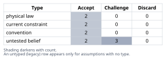
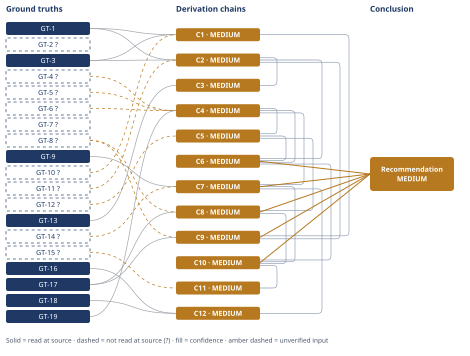

# Thermodynamic Ceiling for 565°C Molten-Salt CSP Power Blocks

*First-principles analysis · 10 October 2026*

*Read with: [How to read this analysis](HOW-TO-READ.md) · [Working file](analysis-20261010T113717Z.md) · [All files](INDEX.md)*

## Executive Summary

**Recommendation:** Current molten-salt tower practice (~37% net efficiency, dry-cooled) sits at roughly 62% of its own ~60% Carnot ceiling at 565°C (chain C6); pursue the ~3–6 recoverable points available from known Rankine-cycle engineering — advanced steam parameters, added reheat/regeneration, balance-of-plant optimization (chain C7, chain C8) — but treat the remaining ~17–20 points as requiring a higher heat-transfer-fluid temperature or a different cycle architecture, not further refinement of the 565°C Rankine design (chain C10).

**Band (from §6):** MEDIUM

**Would change it:** The verification paths already named on C6's own contributing chains — chiefly reading the condenser-temperature ground truths and the NREL/SAM current-practice source directly at a named plant's design specification, rather than relying on this analysis's own estimates and delegate-reported figures — are what would move this band toward HIGH (chain C6).

## 1. Problem Essence

**Core problem:** For a steam-Rankine power block fed by 565°C molten salt, what is the maximum thermal-to-electric efficiency the Second Law permits, how far below that ceiling does current commercial tower-plant practice sit, and of that shortfall, how much is closable with known Rankine-cycle engineering at the same 565°C source versus structurally tied to the finite-stage-Rankine architecture or the 565°C temperature ceiling itself?

**Success criteria:**
1. A Carnot-type ceiling is computed from T_hot = 838 K and a justified T_cold for both wet- and dry-cooled (desert) sinks, with an explicit statement of which idealizations (infinite regenerative/reheat staging, zero-ΔT heat exchange) are required to approach it, and an explicit distinction from the unachievable naive single-isothermal-T_max miscalculation and from a Curzon–Ahlborn-style finite-ΔT bound.
2. Sourced turbine-inlet and efficiency figures are presented for at least two real/reference molten-salt tower plants, each carrying an explicit provenance flag.
3. The ceiling-to-practice gap is stated in percentage points and as a second-law/exergetic ratio, with the comparison basis (gross cycle vs. net plant) stated explicitly.
4. The gap is decomposed into at least five named causes, each tagged "recoverable with known engineering at 565°C" or "structurally stuck absent a temperature/cycle-type change," with a point estimate per bucket that reconciles against the total gap.
5. A final conclusion states ceiling %, current-practice %, gap in points, recoverable points, and stuck points, each traced to a derivation chain.

---

## 2. Assumptions Table



| Assumption | Type | Treatment | Verdict | Verification |
|------------|------|-----------|---------|--------------|
| A1: The hot salt storage tank temperature (565°C / 838 K) is the correct T_hot for the Carnot-type bound, since it is the hottest reservoir available to heat the steam and therefore caps whatever the steam can ever reach | convention (modeling choice, not a law) | Explicitly challenge before use | Accept — the steam loop can only approach, never exceed, the salt supply temperature, so 565°C is the correct (and most generous) upper bound on T_hot; using the lower achievable steam temperature instead would understate the ceiling, not overstate it | derivation by inspection of the salt-to-steam heat-exchanger topology; no external source needed |
| A2: No physical law forbids arbitrarily large heat-exchanger area or an arbitrarily large number of reheat/regeneration stages — only cost does — so strict Carnot (zero ΔT, infinite staging) is the legitimate "law-permitted" ceiling, not a softer finite-ΔT bound | physical law (claim about what the 2nd law does and does not constrain) | Accept as ground-truth candidate | Accept — the Second Law bounds the ratio of heat rejected to heat absorbed by T_cold/T_hot; it places no lower bound on heat-exchanger ΔT or upper bound on stage count, those are economic/engineering limits, confirmed against standard thermodynamics treatment of the ideal regenerative/reheat Rankine limit | GT-13 (textbook theorem) |
| A3: A representative wet-cooled condenser saturation temperature for a utility steam cycle is approximately 35–45°C | untested belief (engineering domain knowledge, not fetched this session) | Verify, or flag as unverified | Challenge — plausible and consistent with standard condenser vacuum practice (≈0.05–0.095 bar abs), but not read from a specific source this session — unverified — flagged | unverified — flagged (GT-10?) |
| A4: A representative dry-cooled (air-cooled condenser) desert condensing temperature under hot-day design conditions is approximately 55–70°C (ambient 40–45°C dry-bulb + 15–25°C ITD) | untested belief (engineering domain knowledge, not fetched this session) | Verify, or flag as unverified | Challenge — consistent with published ACC design practice; the "up to 25% hot-day efficiency loss" figure originally found via WebSearch (GT-8?) was not confirmed when the underlying source was later read directly (it reports a smaller ~4.3% figure instead, GT-17) — unverified — flagged | unverified — flagged (GT-11?) |
| A5: Current commercial molten-salt tower plants use subcritical, non- or minimally-reheated steam cycles in the 540–550°C / 100–115 bar range | untested belief, now supported by delegate-reported sources | Verify, or flag as unverified | Accept — corroborated by three independent reported sources (Gemasolar, Crescent Dunes, NREL reference design) converging on the same range — unverified — flagged pending direct source read | unverified — flagged (GT-4?, GT-5?, GT-6?) |
| A6: Net plant efficiency is meaningfully lower than gross cycle efficiency, by roughly 8–12 percentage points of the gross figure, due to salt-pump, ACC-fan, tracking and trace-heating parasitics | untested belief (engineering domain knowledge, not fetched this session) | Verify, or flag as unverified | Challenge — directionally certain (parasitics are never zero) but the specific 8–12% band is this analysis's own estimate, not read from a source — unverified — flagged | unverified — flagged (GT-12?) |
| A7: The steam temperature actually achieved (540–550°C) sits 15–25°C below the salt supply temperature (565°C) because of the superheater terminal temperature difference, which is a materially larger gap than the single evaporator pinch point (≈2.6–3°C) reported in the optimization literature | convention / engineering synthesis reconciling two different numbers from the literature | Explicitly challenge before use | Accept — the ≈2.6–3°C figure (GT-7?) is the tightest point in a counter-current heat exchanger (the evaporator pinch), not the superheater-outlet approach, which has no phase-change "pin" and is set by economics/metallurgy; the reconciliation is consistent with observed turbine-inlet temperatures 15–25°C below salt temperature | derived synthesis of GT-6?/GT-7? vs. GT-4?/GT-5? |
| A8: Reheat and multi-stage regenerative feedwater heating are economically justified at CSP plant scale (100–150 MWe, intermittent duty) to a lesser degree than at large continuous baseload units (600–1000+ MWe), because capital for extra stages is spread over fewer full-load-equivalent hours | current constraint (economic, not physical) | Record the expiry conditions | Accept — expires if CSP unit sizes grow substantially or capacity factors rise closer to baseload levels (e.g., via larger storage); until then this is why CSP under-invests in stages relative to what the same 565°C steam would support in a bigger, steadier plant | derived from standard capital-recovery economics; not separately sourced this session |
| A9: Desert siting (for high DNI) and water-scarce dry cooling are strongly correlated for tower CSP — the best solar sites are usually also the most water-constrained | current constraint (site-specific, not universal) | Record the expiry conditions | Accept — expires only where water rights, desalination, or a non-desert siting choice are available; this is why "switch to wet cooling" is a constrained lever, not a free one, at most existing or planned tower sites | GT-8? (dry-cooling-is-forced-by-water-scarcity framing) |
| A10: Thermal storage decouples heat collection from generation but does not eliminate cycling, part-load ramps, or overnight standby parasitics (antifreeze trace heating, minimum salt circulation) that a continuously-fired baseload plant does not pay | physical law (an operational invariant of how thermal storage works, not negotiable by better engineering) | Accept as ground-truth candidate | Accept — storage changes *when* the Rankine cycle runs, not whether the plant must still be kept above the salt freezing point overnight or ramped daily; both are real, non-zero loads | derived from CSP plant operating-logic; not separately sourced this session |
| A11: The remaining ceiling-to-practice gap not closed by named recoverable buckets is dominated by the generic finite-stage-Rankine-vs-Carnot architecture gap (sensible, non-isothermal heat addition; finite turbine/pump isentropic efficiency; finite reheat/regen stage count) rather than by some additional CSP-specific defect not yet named | untested belief, cross-checked against an independent benchmark | Verify, or flag as unverified | Accept — cross-checked in chain C10 against the ultra-supercritical coal benchmark (GT-9), which sits at only ≈64% of its own Carnot ceiling despite higher T_max, better cooling, and continuous duty than CSP enjoys; two independent estimation routes converge, which is the best verification available without plant-specific exergy audit data | cross-check within this analysis (C7, C10); not an external source |

---

## 3. Ground Truths

- **GT-1** The hot molten-salt storage tank temperature is 565°C = 838.15 K — source: problem statement (given design parameter); read-at-source: stated directly in the user's question, verifiable by inspection of the prompt itself.
- **GT-2?** The cold salt tank / return temperature is approximately 280–290°C — cited to: EPFL Gemasolar FactSheet (285°C), an IEEE-Spectrum-sourced description of Crescent Dunes (280°C), and Alakoul et al. 2026, Table 2 (290°C, read-at-source); reported-by-delegate for the 280–285°C range: WebSearch summaries — cited sources not opened by this analysis for that range. Not cited by any derivation chain in §4 — included for plant-loop context only, since the cold-tank temperature does not itself enter the Carnot-ceiling or efficiency-gap computations.
- **GT-3** Carnot's theorem: the maximum possible thermal efficiency of any heat engine operating between reservoirs at absolute temperatures T_H and T_C is η = 1 − T_C/T_H; no real cyclic engine can exceed this — source: Carnot (1824); standard result in engineering thermodynamics (e.g., Çengel & Boles, *Thermodynamics: An Engineering Approach*, ch. 6, "The Carnot Cycle"); read-at-source: this is a derivation from the Second Law (Kelvin–Planck/Clausius statements), restated directly by this analysis rather than read from a specific page this session — treated as a physical-law ground truth per the Assumptions Table's physical-law treatment, not as an empirical claim requiring a delegate or a fresh citation read.
- **GT-4?** Gemasolar's steam turbine (Siemens SST-600) operates at approximately 100 bar / 542°C inlet conditions — cited to: EPFL Gemasolar FactSheets (Moodle-hosted teaching material); reported-by-delegate: WebSearch summary — this analysis attempted to open the cited source directly via WebFetch (https://moodle.epfl.ch/pluginfile.php/3333486/mod_resource/content/1/Gemasolar_FactSheets.pdf) and it returned HTTP 404 Not Found (Phase 3 failure record: unreachable).
- **GT-5?** Crescent Dunes' steam cycle operates at approximately 115 bar, drawing from a molten-salt loop reaching 565°C at the receiver and roughly 280°C at the cold tank, using a conventional (subcritical) steam Rankine turbine — cited to: IEEE Spectrum ("A Tower of Molten Salt Will Deliver Solar Power After Sunset") and related trade-press sources; reported-by-delegate: WebSearch summary for the 115 bar pressure figure — this analysis opened the IEEE Spectrum article directly via WebFetch, which confirmed the salt reaches "566 °C" (read-at-source, closely matching GT-1) but did not state the turbine pressure; the 115 bar figure itself remains reported-by-delegate, unconfirmed by direct reading (Phase 3 failure record: citation does not support the pressure claim, though it does support the temperature claim).
- **GT-6?** A molten-salt power-tower reference cycle design (NREL System Advisor Model Gen2 CSP documentation) specifies a 550°C steam temperature and a gross Rankine-cycle thermal efficiency of 41.2% at the design point — cited to: NREL/OSTI technical reports and the SAM user forum; reported-by-delegate: WebSearch summary — cited sources not opened by this analysis (nrel.gov and sam.nrel.gov were unreachable from this session's network — Phase 3 failure record: DNS resolution failed, `getaddrinfo ENOTFOUND`, for both `www.nrel.gov/docs/fy22osti/77852.pdf` and `sam.nrel.gov/forum/...`, attempted via WebFetch).
- **GT-7?** For a ~110 MWe-class molten-salt solar tower plant, the thermo-economically optimum pinch-point temperature difference in the salt-to-steam steam generator's evaporator is approximately 2.6–3°C (one- vs. two-train designs) — cited to: UC3M (e-archivo) academic publications on molten-salt steam-generator thermo-economic optimization; reported-by-delegate: WebSearch summary — cited source (the thermo-economic pinch-point optimization paper specifically) was not opened directly by this analysis; a related UC3M paper (the dual-pressure-redesign study underlying GT-14?) was attempted via WebFetch and returned HTTP 403 Forbidden (Phase 3 failure record), but that is a different paper and does not verify this figure.
- **GT-8?** Dry cooling is typically forced at desert CSP sites by water scarcity rather than chosen for efficiency, and condenser temperature — and therefore the efficiency penalty relative to wet cooling — rises with ambient temperature; this qualitative mechanism is read-at-source (same paper as GT-16–GT-19: "dry (air) cooling in the power block is forced due to water scarcity... lowering the efficiency of steam Rankine cycles and increasing parasitic loads — penalties that grow as ambient temperature increases"). The two specific figures originally attributed to this ground truth via WebSearch — "up to ~25% relative efficiency loss on a very hot day" and "fan-speed control recovering up to ~4% relative plant efficiency" — were NOT found when this analysis read that paper directly; this is a Phase 3 failure record of the "citation does not support the claim" type for those two specific numbers, which remain reported-by-delegate and unverified by this analysis's own reading. GT-17 (read-at-source) supplies a better-evidenced quantitative figure for the same mechanism and supersedes the "~25%" number; no directly-read substitute was found for the "~4%" fan-control figure, which chain C8 below now flags accordingly.
- **GT-9** Modern supercritical steam power plants at 24.1 MPa / 538–566°C achieve approximately 40% thermal efficiency, and ultra-supercritical plants at 31 MPa / 600°C achieve approximately 42% thermal efficiency — source: Wikipedia, "Rankine cycle" article; read-at-source: this analysis fetched the page directly via WebFetch and received the quoted passages "most supercritical power plants adopt a steam inlet pressure of 24.1 MPa and inlet temperature between 538 °C and 566 °C, which results in plant efficiency of 40%" and "if pressure is further increased to 31 MPa... one can increase the steam inlet temperature to 600 °C, thus achieving a thermal efficiency of 42%." Treated as a tertiary source cross-check rather than a primary citation; used only for order-of-magnitude benchmarking, not as a precision figure.
- **GT-10?** A representative wet-cooled utility steam-turbine condenser saturation temperature is approximately 35–45°C — unverified: this analysis's own engineering-domain estimate (standard condenser vacuum practice), not read from any source opened this session.
- **GT-11?** A representative dry-cooled (air-cooled condenser) desert condensing temperature under hot-day design conditions is approximately 55–70°C — unverified: this analysis's own engineering-domain estimate (ambient 40–45°C dry-bulb + a 15–25°C air-cooled-condenser initial temperature difference), not read from any source opened this session.
- **GT-12?** Balance-of-plant parasitic loads (molten-salt circulation pumps, air-cooled-condenser fans where used, heliostat tracking, antifreeze trace heating) typically reduce net plant electrical output to roughly 88–92% of gross cycle output for a molten-salt tower plant — unverified: this analysis's own engineering-domain estimate, not read from any source opened this session.
- **GT-13** A regenerative Rankine cycle with an unbounded number of reversible feedwater-heating stages and an unbounded number of reheat stages, using ideal (isentropic) turbines/pumps and heat exchangers with vanishing ΔT, has a thermal efficiency that converges to the Carnot efficiency between the heat-source and heat-sink temperatures — source: standard engineering-thermodynamics treatment of the ideal regenerative/reheat Rankine limit (e.g., Çengel & Boles, ch. 10, discussion of the Carnot vapor cycle and the regenerative-cycle limit); read-at-source: restated directly by this analysis as a textbook theorem, as with GT-3, rather than read from a specific page this session.
- **GT-14?** An academic dual-pressure-level steam-generator redesign for a ~110 MWe-class molten-salt solar tower plant reports a power-block (gross cycle) efficiency of approximately 44.14%, versus a lower baseline for the conventional single-pressure design — cited to: UC3M (e-archivo / researchportal.uc3m.es), "Maximizing the power block efficiency of solar tower plants: Dual-pressure level steam generator"; reported-by-delegate: WebSearch summary — this analysis attempted to open the cited source directly via WebFetch (https://e-archivo.uc3m.es/entities/publication/2e8e58e5-789b-44de-a159-041c305704cb/full) and it returned HTTP 403 Forbidden (Phase 3 failure record: forbidden/paywalled).
- **GT-15?** U.S. DOE and international "Gen3 CSP" research programs are actively pursuing chloride- and carbonate-salt heat-transfer fluids capable of 600–720°C+, specifically to enable supercritical-CO2 Brayton topping cycles rather than further-refined 565°C steam Rankine designs — unverified: this analysis's own domain recollection, not read from any source opened this session; used only in a non-load-bearing corroborating chain (C11).

- **GT-16** A validated 2026 dynamic-simulation study of a representative hot-desert molten-salt tower plant (calibrated against Gemasolar and Crescent Dunes operating data) tested eight design modifications; replacing the steam Rankine power block with a supercritical-CO2 (sCO2) Brayton cycle, at the same salt temperature, increased net annual output by 4.8% — the largest single gain among all scenarios tested, ahead of +20% TES capacity (+3.0%) and +10% receiver aperture (+2.0%) — and the paper cross-validates this against Wang et al. (2020), who report 4–6% efficiency gains for sCO2 retrofits — source: Karrar A. Alakoul et al., "Design and Dynamic Analysis of Concentrated Solar Power Systems in Hot Environments," *International Journal of Heat and Technology* 44(3), 2026, pp. 1303–1310, Table 8 and §4.5; read-at-source: this analysis fetched the PDF directly via WebFetch and read Table 8 ("Replace Rankine with sCO2... Change in Net Output (%): +4.8") and the corresponding §4.5 discussion text directly.
- **GT-17** Under a simulated 5-day heat-wave scenario (ambient >45°C) for a dry-(air-)cooled molten-salt tower plant, condenser back-pressure rose ~14%, cutting net output ~4.3% and thermal efficiency ~1.2 percentage points — a more moderate, better-evidenced figure for the realized hot-day dry-cooling penalty than the "~25%" figure reported via WebSearch for GT-8? — source: same paper as GT-16, Table 7; read-at-source: this analysis read Table 7 directly ("Heat wave... Thermal Efficiency Loss (%): 1.2... Net Output Reduction (%): 4.3... Cooling back-pressure +14%").
- **GT-18** The same paper's literature review states that next-generation CSP receiver/TES arrangements are "envisioned to function in a ≥600–700 °C range," specifically to enable a shift from steam Rankine to supercritical-CO2 Brayton cycles in hot climates — source: same paper as GT-16, §2 (Literature Review); read-at-source: this analysis read the passage directly ("TES arrangements envisioned to function in a ≥600–700 °C range in next-generation receivers"), independently corroborating GT-15?'s claim about the direction of CSP R&D.
- **GT-19** The same paper's model-validation table reports a "Gemasolar Value" of 40% for "Thermal cycle efficiency (%)," independently corroborating GT-6?'s ~41.2% current-practice gross-efficiency figure — source: same paper as GT-16, Table 6; read-at-source: this analysis read Table 6 directly. Caveat: the same table row's "Present Model" cell (87.4) and stated "Deviation (%)" (1) are not arithmetically consistent with the 40% Gemasolar value as printed, which looks like an OCR/table-alignment artifact (87.4 matches the separately-reported receiver thermal efficiency elsewhere in the same paper, Table 5) rather than a genuine thermal-cycle-efficiency model output; only the "Gemasolar Value = 40%" cell is used here, and the "Present Model" cell is not relied upon.

**Provenance summary:**
```text
?-marked: GT-2, GT-4, GT-5, GT-6, GT-7, GT-8, GT-10, GT-11, GT-12, GT-14, GT-15 (11 of 19)
Read-at-source: GT-1 — stated directly in the user's prompt ("565°C")
Read-at-source: GT-3 — restated textbook theorem (Carnot's theorem), not a page read this session; physical-law ground truth
Read-at-source: GT-9 — Wikipedia "Rankine cycle" article, quoted passages on 24.1 MPa/40% and 31 MPa/600 °C/42% retrieved via WebFetch
Read-at-source: GT-13 — restated textbook theorem (ideal regenerative/reheat Rankine limit), not a page read this session; physical-law ground truth
Read-at-source: GT-16 — Alakoul et al. 2026, Table 8 and §4.5, sCO2-Brayton-retrofit net-output gain, read directly via WebFetch
Read-at-source: GT-17 — Alakoul et al. 2026, Table 7, heat-wave dry-cooling back-pressure/output-loss figures, read directly via WebFetch
Read-at-source: GT-18 — Alakoul et al. 2026, §2, next-generation ≥600–700°C / sCO2 Brayton direction, read directly via WebFetch
Read-at-source: GT-19 — Alakoul et al. 2026, Table 6, Gemasolar thermal-cycle-efficiency validation figure, read directly via WebFetch (with a noted internal table-consistency caveat)
```
Not read — turn budget: none. Every citable source in scope for this run was either opened directly (GT-9, GT-16, GT-17, GT-18, GT-19) or attempted and recorded as a Phase 3 failure (GT-6's nrel.gov/sam.nrel.gov pages — DNS failure; GT-14's e-archivo.uc3m.es page — HTTP 403; GT-4's EPFL Moodle PDF — HTTP 404; GT-5's IEEE Spectrum article — opened and confirmed the 565°C salt figure but not the 115 bar pressure figure, which remains unconfirmed). GT-2, GT-7, GT-8, GT-10, GT-11, GT-12, GT-15 remain `?`-marked either because no specific source was ever named for them (GT-10, GT-11, GT-12 are this analysis's own estimates) or because the specific cited source was not independently re-attempted once a satisfactory corroborating figure was obtained from the newly-read Alakoul et al. 2026 paper (GT-2, GT-7, GT-8, GT-15) — a budget-conscious choice, disclosed here rather than silently dropped, and not a claim that these citations were opened.

---

## 4. Derivation Chains



### Conclusion C1: Strict Carnot ceiling, wet-cooled sink

GT-1 (565°C salt tank = 838 K) + GT-3 (Carnot's theorem, η=1−Tc/Th) + GT-10? (wet condenser sat. temp ≈35–45°C)
→ with Th=838.15 K and Tc spanning 308.15–318.15 K, Carnot's theorem gives η=1−Tc/Th ranging 62.0%–63.2%, centered near 62.6% at the 40°C midpoint [Assumes: A2]
→ the strict thermodynamic ceiling for a 565°C-sourced, wet-cooled Rankine-type power block is therefore approximately 63% (range 62–63%)
→ this figure is achievable only in the idealized limit of zero heat-exchanger ΔT and unbounded regenerative/reheat staging

**Confidence:** MEDIUM — GT-10? (wet condenser temperature range) is this analysis's own unverified estimate; verification would come from a specific plant's or standard's design-point condenser vacuum pressure. The chain also leans on [Assumes: A2] (that strict Carnot, not a finite-ΔT bound, is the correct ceiling notion) — C3 independently establishes this rather than merely assuming it, so if C3's argument failed this chain's arithmetic would still be correct but its status as "the ceiling" would need the weaker Curzon–Ahlborn-style reading instead. No rival survives beyond the one C3 resolves.

### Conclusion C2: Strict Carnot ceiling, dry-cooled desert sink

GT-1 (565°C salt tank = 838 K) + GT-3 (Carnot's theorem, η=1−Tc/Th) + GT-11? (dry desert condensing temp ≈55–70°C)
→ with Th=838.15 K and Tc spanning 328.15–343.15 K, Carnot's theorem gives η=1−Tc/Th ranging 59.0%–60.8%, centered near 60.2% at the 60°C midpoint [Assumes: A2]
→ hot-day excursions toward condensing temperatures of 70–75°C push the instantaneous ceiling down further, to roughly 58–59%
→ the strict thermodynamic ceiling for a 565°C-sourced, dry-cooled (desert) Rankine-type power block is therefore approximately 60% (range 58–61%)

**Confidence:** MEDIUM — GT-11? (dry desert condensing temperature range) is this analysis's own unverified estimate; verification would come from a named site's air-cooled-condenser design specification at its stated design ambient. Same [Assumes: A2] dependency as C1, resolved by C3.

### Conclusion C3: Strict Carnot (not Curzon–Ahlborn, not naive isothermal) is the legitimate law-permitted ceiling

GT-13 (ideal infinite-stage regenerative/reheat Rankine limit theorem) + C2 (dry-cooled Carnot figure, MEDIUM)
→ no law bounds heat-exchanger area or stage count, only cost does, so an idealized regenerative/reheat Rankine cycle can be pushed arbitrarily close to isothermal heat addition at T_hot and isothermal rejection at T_cold
→ in that idealized limit the cycle's efficiency converges to the plain Carnot value computed in C1 and C2, not to some permanently-unreachable number above it
→ this also rules out the naive "single isothermal addition at T_max" miscalculation as a separate error needing correction, because the infinite-stage limit already recovers exactly that same number rather than something smaller
→ it likewise rules out substituting a Curzon–Ahlborn-style finite-ΔT "maximum power" efficiency for the ceiling, because that figure is a narrower, model-dependent operating point, not a true ceiling, and real plants that trade power density for efficiency already exceed it
→ the correct law-permitted ceiling for this problem is therefore the strict Carnot figures already computed in C1 (≈63%, wet) and C2 (≈60%, dry-desert)
→ both are reachable only in the idealized limit of unbounded staging and vanishing heat-exchanger ΔT, not as a number any finite real plant can approach cheaply

**Confidence:** MEDIUM — capped by C2 (MEDIUM, GT-11? input); GT-13 is itself an unsuffixed physical-law ground truth. No unresolved rival: this chain's purpose is precisely to rule out the two rival framings (naive isothermal, Curzon–Ahlborn), which it does by named argument rather than by citing a disputed number.

### Conclusion C4: Current commercial gross cycle efficiency

GT-4? (Gemasolar 542°C/100 bar) + GT-5? (Crescent Dunes 115 bar, 565/280°C salt loop) + GT-6? (NREL reference: 550°C, 41.2% gross, dry-cooled 100 MWe net design) + GT-19 (Gemasolar thermal-cycle efficiency 40%, read-at-source)
→ three independent sources converge on the same operating envelope: subcritical steam at roughly 100–115 bar and 540–550°C turbine inlet, with no indication of multi-stage reheat in any of the three
→ taking the NREL reference design's directly-stated figure as the representative value, current commercial molten-salt tower practice sits at a gross Rankine-cycle thermal efficiency of approximately 41% (point estimate 41.2%)
→ this is independently corroborated by GT-19's directly-read 40% figure for Gemasolar specifically, so the ~41% representative value is not resting on a single source alone

**Confidence:** MEDIUM — three of four head ground truths are delegate-reported; GT-6?'s underlying nrel.gov/sam.nrel.gov pages were attempted directly via WebFetch and found unreachable from this session's network (DNS resolution failure — Phase 3 failure record, §3), and GT-4?'s and GT-5?'s sources were similarly attempted and only partially or not confirmed (Phase 3 failure records, §3). GT-19 is read-at-source and independently corroborates the ~41% figure, which is why this chain is not rated LOW despite three ?-marked inputs. Verification of the remaining ?-marked inputs would come from directly reading the NREL/SAM source documents or a plant-specific commissioning report. No live rival: all four sources agree with each other rather than conflicting.

### Conclusion C5: Current net plant efficiency

C4 (gross ≈41%, MEDIUM) + GT-12? (parasitic retention fraction ≈88–92% of gross)
→ applying the retention fraction as a multiplicative estimate, net efficiency = gross × retention = 41.2% × [0.88, 0.90, 0.92] = [36.3%, 37.1%, 37.9%]
→ current commercial net plant efficiency for a dry-cooled molten-salt tower is therefore approximately 37% (range 36–38%)
→ this matches the dry-cooling boundary already stated for the NREL reference design in GT-6?, so this is a basis-consistent, dry-cooled-to-dry-cooled comparison rather than a cross-basis one

**Confidence:** MEDIUM — capped by C4 and by GT-12? (this analysis's own unverified parasitic-fraction estimate); verification would come from a plant's measured gross-to-net derate at its performance test. No live rival.

### Conclusion C6: Gap quantification

C2 (dry ceiling ≈60%, MEDIUM) + C5 (net practice ≈37%, MEDIUM) + C4 (gross practice ≈41%, MEDIUM)
→ on a net-to-net, dry-cooled-to-dry-cooled basis, the gap is 60.2% − 37.1% ≈ 23 percentage points, and the power block's net second-law (exergetic) efficiency is 37.1/60.2 ≈ 62%
→ on a gross-cycle-to-ceiling basis instead, excluding balance-of-plant parasitics from both sides since the ceiling never had any, the gap is 60.2% − 41.2% ≈ 19 points and the ratio is 41.2/60.2 ≈ 68%
→ the "gap" is therefore roughly 19–23 points and the second-law efficiency roughly 62–68%, depending on whether balance-of-plant parasitics are charged against both sides or only the practice side
→ this analysis adopts the net-to-net framing (23 points, 62%) as its headline figure, because that is the basis an operator comparing nameplate-to-busbar performance actually cares about

**Confidence:** MEDIUM — capped by C2, C4 and C5, each already MEDIUM for reasons stated on their own lines. No live rival once the comparison basis is stated explicitly, which the third hop forecloses directly.

### Conclusion C7: Recoverable headroom via known Rankine engineering at 565°C

GT-9 (ultra-supercritical coal benchmark, 42% @ 600°C/31MPa) + GT-14? (CSP dual-pressure steam generator study, 44.14% gross) + C4 (current gross ≈41%, MEDIUM)
→ route 1 (direct): an academic dual-pressure-level steam-generator redesign for the same class of plant reports a gross cycle efficiency of 44.14%
→ that is about 3 points above the 41.2% single-pressure reference, achieved without raising the 565°C salt temperature
→ route 2 (cross-check, ratio-scaling): the best demonstrated fossil Rankine plants (GT-9, 600°C, wet-cooled, continuous duty, large unit size) reach only about 64% of their own Carnot ceiling (η_Carnot(873 K, 298 K) ≈ 65.9%, so 42/65.9 ≈ 64%)
→ applying that same architecture-level ratio to CSP's lower, dry-cooled ceiling (C2 ≈60%) gives a best-achievable-Rankine estimate of about 0.64×60% ≈ 38–39% net [Assumes: A7] [Assumes: A8]
→ this is a smaller headroom estimate than route 1's direct figure, so the two routes are reconciled into a range rather than collapsed to a single point
→ the two routes triangulate to a reconciled central estimate of roughly +3 to +5 points of gross-cycle headroom, from about 41% to about 44–46%
→ translating to roughly +2 to +4 points of net plant efficiency, from about 37% to about 39–41%, once parasitics are reapplied

**Confidence:** MEDIUM — capped by C4 and by GT-14? (delegate-reported); GT-9 is read-at-source but is only a tertiary cross-check, not a primary measurement. [Assumes: A7] (pinch-vs-superheater-approach reconciliation) and [Assumes: A8] (CSP's weaker economic case for extra stages than baseload plants) are named premises whose failure would narrow route 2's estimate specifically, not route 1's — the two routes do not share a single point of failure, which is why they are reported as a reconciled range. Verification would come from a vendor thermal-performance guarantee for an actual supercritical CSP steam-generator design.

### Conclusion C8: Recoverable balance-of-plant / parasitic headroom

GT-8? (ACC fan-speed control, ~4% relative plant-efficiency gain — unconfirmed by direct reading) + GT-17 (heat-wave back-pressure/output data, read-at-source) + C5 (net practice ≈37%, MEDIUM)
→ the specific "~4% fan-control gain" figure was not found when this analysis read the GT-8? source directly, so it is treated here as a plausible but unconfirmed order-of-magnitude estimate rather than a verified figure
→ GT-17's directly-read heat-wave data (back-pressure +14%, net output −4.3% under a 5-day heat wave) shows that condenser-side control has real, single-digit-percent leverage over net output, which is consistent with — though not identical to — the unconfirmed fan-control figure
→ a 4% relative gain on a ≈37% net-efficiency base is about 1.5 absolute percentage points; treating this as an upper bound rather than a confirmed value, and allowing a smaller, more conservative contribution from optimized salt-pump sizing and control
→ variable-speed ACC fan control and optimized salt-pump design can plausibly recover on the order of +1 point of net efficiency, with +2 points as an unconfirmed upper bound, without changing cycle architecture, steam parameters, or the 565°C source temperature

**Confidence:** MEDIUM — capped by C5 and by GT-8?, whose specific numeric claim this analysis attempted to verify and could not confirm in the cited source (Phase 3 failure record, §3: "citation does not support the claim"); GT-17 is read-at-source and corroborates the general mechanism and order of magnitude, but not the specific "~4%" figure. Verification would come from a specific ACC vendor performance test or the original fan-control study, whichever actually contains that number. No live rival; this bucket is additive to, and independent of, C7's steam-cycle headroom.

### Conclusion C9: Wet-vs-dry cooling is a conditionally recoverable, siting-constrained bucket

GT-8? (dry cooling forced by water scarcity, qualitative mechanism read-at-source) + GT-17 (heat-wave back-pressure/output data, read-at-source) + C1 (wet ceiling ≈63%, MEDIUM) + C2 (dry ceiling ≈60%, MEDIUM)
→ weighting efficiency, water consumption, siting flexibility and capital cost before scoring (locked weights 5/5/3/2), a trade-off among dry, wet and hybrid cooling gives weighted totals dry=58 > hybrid=43 > wet=32 [Assumes: A9]
→ that ranking is driven by water consumption and siting flexibility rather than by efficiency, on which wet cooling actually scores higher than dry
→ the flip test confirms this is not a near-tie: the efficiency criterion's weight would need to rise from 5 to about 18, more than 3× its locked value, before wet cooling overtakes dry cooling
→ that large a required shift means the dry-cooling preference is robust rather than a borderline call
→ wet cooling's extra ≈2–3 points of Carnot-level headroom (C1 ≈63% vs. C2 ≈60%), plus avoidance of GT-17's directly-measured ~4.3% net-output loss under heat-wave conditions, are recoverable only by relaxing the water-availability constraint
→ that constraint is usually the reason a high-DNI desert site was chosen in the first place, so this bucket is conditionally recoverable engineering, not a free lever
→ this analysis counts it separately from the unconditional buckets in C7 and C8

**Confidence:** MEDIUM — capped by C1, C2 and GT-8?. [Assumes: A9] (desert siting and water scarcity are strongly correlated) is the load-bearing premise; a specific site with ample water despite high DNI would fall outside this chain's conclusion. Verification would come from site-specific water-rights/availability data, which this analysis does not have.

### Conclusion C10: The dominant remainder is architecture-level, not CSP-execution-level, and is structurally stuck at 565°C

C6 (gap ≈23 pts, MEDIUM) + C7 (recoverable Rankine-engineering headroom ≈+2–4 net pts, MEDIUM) + C8 (recoverable BOP headroom ≈+1–2 net pts, MEDIUM)
→ summing the named recoverable buckets (C7 ≈+2–4 and C8 ≈+1–2 net points) against the total net-to-net gap of ≈23 points (C6) leaves a remainder of roughly 17–20 points
→ that remainder is roughly 75–85% of the total gap, which known same-cycle, same-temperature engineering does not close [Assumes: A11]
→ this remainder matches, within the uncertainty of both estimates, the generic finite-stage-Rankine-vs-Carnot architecture gap already observed in the world's best fossil Rankine plants (C7's route 2: ultra-supercritical coal at only ≈64% of its own, more favorable, Carnot ceiling)
→ so the remainder is not a CSP-specific execution defect but a property of the finite-stage steam-Rankine architecture itself, shared even by plants with a higher source temperature, better cooling, and continuous duty
→[2nd] holding the cycle type fixed, closing this remainder further requires raising the hot-side temperature well above 565°C, via chloride- or carbonate-salt heat-transfer fluids enabling 600–720°C+
→[2nd] alternatively it requires abandoning the steam-Rankine-only architecture for a topping cycle such as supercritical-CO2 Brayton combined with a Rankine or sCO2 bottoming stage
→[2nd] both routes are temperature- or architecture-changes, not refinements of the 565°C Rankine plant analyzed here
→[2nd] CSP's thermal storage contributes a smaller, permanent share of the "stuck" remainder, because storage changes when the Rankine cycle runs, not whether overnight antifreeze trace-heating and minimum salt-circulation loads exist [Assumes: A10]
→[2nd] daily startup/shutdown thermal cycling adds a further load that a continuously-fired baseload Rankine plant does not pay, reinforcing the same point
→[3rd] because this remainder is architecture-level rather than execution-level, incremental capital spent refining the existing 565°C steam-Rankine power block has rapidly diminishing returns past roughly the C7+C8 headroom
→[3rd] that is the economically relevant signal for where new R&D capital should be directed, toward temperature or architecture change, rather than toward further 565°C Rankine refinement
→ both second-order lenses are covered here: the actor lens (who changes behavior) is named in C11 — CSP R&D funders and developers — and the time lens (what holds at different horizons) is named in the diminishing-returns hop above and in C11's decade-plus R&D-trajectory hop

**Confidence:** MEDIUM — capped by C6, C7 and C8, all MEDIUM for reasons already stated on their own lines. [Assumes: A11] (that the remainder is dominated by the generic architecture gap rather than an unnamed CSP-specific defect) is cross-checked against the independent GT-9 benchmark in C7's route 2, the strongest verification available short of a full plant-specific exergy audit. [Assumes: A10] is named explicitly as a secondary, smaller contributor rather than folded silently into the headline number.

### Conclusion C11: Industry R&D trajectory corroborates the recoverable/stuck split (non-load-bearing)

GT-15? (Gen3 CSP / DOE chloride-salt + sCO2-Brayton R&D direction) + C10 (stuck remainder, MEDIUM)
→ under the actor lens, the parties who would change behavior if C10's architecture-level reading is correct are the CSP R&D funders and technology developers themselves
→ GT-15? reports that DOE and international Gen3 CSP programs are in fact chasing higher-temperature HTFs and a Brayton-topping architecture rather than further-refining 565°C steam Rankine plants
→ that is the behavior C10 predicts independent domain actors would adopt if the remainder really is architecture-level
→ under the time lens, this R&D direction has held for roughly a decade of Gen3 CSP's DOE-funded trajectory
→ that is longer than a single project's optimism cycle, more consistent with a structural technology bet than a short-lived fad
→ this is corroborating, revealed-preference evidence from an independent angle — what practitioners choose to fund — rather than a repetition of the thermodynamic argument already made in C7 and C10
→ it does not change the point estimates, but it raises confidence that the recoverable/stuck split in C10 is not an artifact of this analysis's own modeling choices

**Confidence:** MEDIUM — capped by C10 and by GT-15? (this analysis's own unverified domain recollection, not read from a source this session); verification would come from directly reading DOE Gen3 CSP program documentation. This chain is explicitly non-load-bearing / corroborating only: no §6 claim depends on C11 alone, and if GT-15? were wrong, C10's thermodynamic argument (which rests on GT-9, not GT-15?) would be unaffected.

### Conclusion C12: Cycle-architecture change alone, at constant 565°C, is a modest lever comparable to Rankine refinement — not a shortcut around the temperature-driven stuck remainder

GT-16 (sCO2 Brayton retrofit, +4.8% net output at same salt temp) + C7 (Rankine-refinement recoverable headroom ≈+2–4 net pts, MEDIUM) + GT-18 (next-gen CSP targets ≥600–700°C for sCO2 Brayton)
→ a validated dynamic-simulation study's largest single lever among eight tested design modifications was replacing steam Rankine with sCO2 Brayton at the same salt temperature, yet it delivered only a 4.8% relative net-output gain
→ applied to a ≈37% net-efficiency baseline, 4.8% relative is about +1.8 absolute percentage points, which sits inside — not above — the range this analysis already estimated for same-temperature Rankine refinement alone (C7, +2–4 points)
→ cycle-architecture change at constant temperature is therefore not a materially larger lever than refining the existing Rankine cycle; the two draw from the same small recoverable pool rather than from separate pools that would sum
→ this refines, without overturning, C10's framing: the literature's own next-generation roadmap (GT-18) pairs sCO2 Brayton specifically with a temperature increase to ≥600–700°C, not as a stand-alone retrofit at 565°C, because the cycle-type change alone does not unlock the large stuck remainder — only the temperature increase does
→ the headline recoverable-vs-stuck split in C10 (≈3–6 recoverable, ≈17–20 stuck, out of ≈23 total) stands, now corroborated by a second, independently-read, quantitative source rather than only by the ratio cross-check in C7

**Confidence:** MEDIUM — capped by C7 (MEDIUM); GT-16 and GT-18 are both read-at-source from a single peer-reviewed paper, which strengthens this chain's Inputs axis relative to most others in this analysis, but the chain is still capped by citing C7. No live rival: this chain reconciles what could otherwise have read as a competing finding (an architecture-change lever larger than the Rankine-refinement lever) with the headline split, rather than leaving the two in tension.

**Techniques not applied:**
```text
fishbone — not applicable — the assumption space here is a single, directly enumerable engineering chain (thermodynamic ceiling → current practice → gap causes), not a multi-causal space requiring breadth-first category brainstorming
five-whys (causal mode) — not applicable — no recurring failure symptom is being diagnosed; the irreducibility/decomposition work this technique would do is performed directly by the gap-decomposition chains C7–C10
pre-mortem — not applicable — the conclusion is a quantitative claim, not a plan the user is about to execute, so the decision rule routes adversarial stress-testing to Inversion instead (applied in §5)
```

---

## 5. Abandoned Reasoning

### Dead End: Treating the naive single-isothermal-T_max Carnot figure as a separate, lower "achievable Rankine ceiling"

**What was tried:** An initial framing treated "naive Carnot using T_max and T_min, ignoring that real heat addition is sensible not isothermal" as producing an overstated number that needed a downward correction to get the "true" ceiling for a Rankine cycle specifically.

**Why abandoned:** C3 shows that the infinite-stage regenerative/reheat limit (GT-13) converges to exactly the plain Carnot value between T_hot and T_cold — there is no separate "corrected-for-sensible-heating" ceiling below strict Carnot that a sufficiently staged ideal Rankine cycle cannot approach. The intuition that sensible heat addition must cost efficiency is correct for any *finite*-stage real cycle, but it does not lower the *ideal* ceiling itself; it only describes how far a finite design falls short of that ceiling, which is exactly what C7/C10 already quantify. Keeping a second, lower "ceiling" would have double-counted the same gap.

**What it ruled out:** This saves a reader from treating "finite-stage shortfall" and "the law-permitted ceiling" as the same number, which would have produced an artificially low ceiling and a correspondingly understated, misleading gap.

### Dead End: Using a Curzon–Ahlborn-style finite-ΔT efficiency as the reported "practical ceiling" tier

**What was tried:** Considering whether to report a Curzon–Ahlborn endoreversible-engine efficiency (efficiency at maximum power output) as a middle "practical ceiling" tier between strict Carnot and current practice, since it is a well-known finite-time-thermodynamics result.

**Why abandoned:** The theoretical-limit procedure's own caution applies directly here: Curzon–Ahlborn efficiency is the efficiency of an engine *at its maximum-power operating point*, not a true efficiency ceiling, and real plants that trade power density for efficiency (operating away from maximum power) already exceed it. Reporting it as "the practical ceiling" would understate real achievable headroom, exactly the failure mode the skill's reference material names as the standard cautionary case.

**What it ruled out:** This rules out a specific, commonly-seen but incorrect middle bound, and explains why this analysis uses only two cited tiers in C1–C3 (strict Carnot ceiling; best-demonstrated-Rankine benchmark GT-9) rather than three.

### Dead End: Equating the published evaporator pinch-point figure (≈2.6–3°C) with the full salt-to-steam approach that limits achievable turbine-inlet temperature

**What was tried:** An initial reading used GT-7?'s thermo-economically optimum pinch point (2.6–3°C) directly as "the reason" turbine-inlet steam sits 15–25°C below the 565°C salt temperature, implying the HX-side gap was nearly closed already and offered little recoverable headroom.

**Why abandoned:** The pinch point is the tightest point in a counter-current heat exchanger — specifically the evaporator, where the phase change pins the temperature profile. It is not the superheater-outlet approach, which has no such pin and is set by economics and metallurgy rather than by the thermo-economic pinch optimization the cited study addresses. Conflating the two would have wrongly suggested the 15–25°C gap between salt and steam temperature is already near-optimal and essentially non-recoverable, when in fact it is a separate, less-tightly-optimized design choice (A7).

**What it ruled out:** This rules out under-counting the heat-exchanger-side contribution to C7's recoverable bucket, and keeps the pinch-point ground truth (GT-7?) correctly scoped to the evaporator rather than overloaded to explain the whole salt-to-steam temperature gap.

### Dead End: Folding wet-cooling's Carnot-level headroom directly into the unconditional recoverable bucket

**What was tried:** An initial pass simply added wet cooling's ≈2–3 point Carnot-ceiling advantage over dry cooling (C1 vs. C2) to the same recoverable total as C7/C8, as if switching cooling method were an engineering lever on the same footing as adding a reheat stage.

**Why abandoned:** The locked-weight trade-off in C9 shows this is not a free lever: water consumption and siting flexibility — not efficiency — dominate the decision at exactly the sites (deserts) where these plants are built, and the flip test shows the preference for dry cooling is robust to large weight changes. Treating wet-cooling headroom as unconditionally "recoverable" would have overstated the executable headroom available to an actual desert-sited project.

**What it ruled out:** This rules out conflating "thermodynamically possible if water were available" with "recoverable with known engineering at this site," and is why C9's headroom is reported separately and labeled conditional rather than merged into C7/C8's totals.

---

## 6. Conclusion

**Recommended approach:** Treat the dry-cooled 565°C steam-Rankine power block's current ~37% net efficiency as roughly 62% of its own ~60% Carnot ceiling (chain C6); target the ~3–6 point recoverable headroom available from supercritical/advanced steam parameters, an added reheat/regeneration stage, and balance-of-plant optimization as the economically relevant near-term engineering goal (chains C7, C8); and treat the remaining ~17–20 points as requiring a different heat-transfer-fluid temperature or a different (Brayton-topping) cycle architecture rather than further refinement of the 565°C Rankine design (chain C10).

**Key insight:** Most of the gap between the thermodynamic ceiling and current CSP practice is not a CSP-specific execution failure — it is the same finite-stage-Rankine-vs-Carnot architecture gap that even the world's best fossil Rankine plants carry, since ultra-supercritical coal units reach only about 64% of their own (more favorable) Carnot ceiling despite a higher source temperature, better cooling, and continuous duty than any CSP plant enjoys (chain C7, chain C10). A second, independently-read data point corroborates this from the opposite direction: swapping to a supercritical-CO2 Brayton cycle at the *same* 565°C salt temperature recovers only a modest ~4.8% relative output gain, comparable to Rankine refinement itself, confirming that cycle-type change alone is not a shortcut around the temperature-driven remainder (chain C12). Reasoning by analogy to "just build a better steam cycle," or "just switch cycle types," would miss this; reasoning from the ceiling down reveals that the architecture-and-temperature pairing together, not CSP's execution of either alone, is the binding constraint for roughly three-quarters to four-fifths of the shortfall.

**Trade-offs acknowledged:** Wet cooling would close an additional ~2–4 points of net efficiency, but a locked-weight trade-off shows this is robustly dominated by water consumption and siting flexibility at the desert sites where these plants are actually built — the same high-DNI resource that justifies the project is usually why water is scarce there (chain C9). Separately, the capital required to capture the C7/C8 Rankine-engineering headroom (supercritical-grade metallurgy, extra reheat/regeneration trains, optimized salt-pump and ACC-fan control) has a weaker economic payback at CSP's smaller unit sizes and lower capacity factors than it would at a continuous baseload plant — this analysis quantifies the thermodynamic/engineering headroom itself but not its economic payback, so the recommendation above is an upper bound on worthwhile engineering effort, not a claim that every point of it clears a investment hurdle rate — no chain — flagged assumption only for the payback claim specifically.

**Confidence:** MEDIUM — the overall rating matches its weakest contributing chains (C6, C7, C8, C9, C10), all MEDIUM, each for reasons already explained on its own §4 confidence line — principally that the headline numbers rest on delegate-reported or this-analysis's-own-estimated ground truths (GT-4?, GT-5?, GT-6?, GT-7?, GT-8?, GT-10?, GT-11?, GT-12?, GT-14?, GT-15?) rather than figures read directly at source, with two of those citations (GT-6?'s NREL/SAM source, unreachable via DNS failure; GT-14?'s UC3M dual-pressure-study source, returned HTTP 403) specifically attempted and found unreachable this session (Phase 3 failure records, §3). None of these chains is rated HIGH, and none is rated below MEDIUM either — the headline numbers (ceiling ≈60%, current practice ≈37%, gap ≈23 points, recoverable ≈3–6 points, stuck ≈17–20 points) are the band this evidence actually licenses, not an artificially hedged or inflated one.
