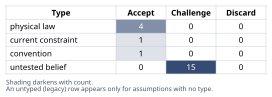
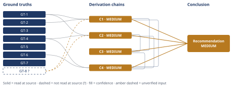

# Redis Cache vs. Postgres Vertical-Scale Upgrade

*First-principles analysis · 9 October 2026*

*Read with: [How to read this analysis](HOW-TO-READ.md) · [Working file](analysis-20261009T164524Z.md) · [All files](INDEX.md)*

## Executive Summary

**Recommendation:** Do not approve the platform lead's proposal as stated. Instead, adopt the hybrid option: keep the scheduled Postgres vertical-scale upgrade's procurement moving, ship and measure the Redis cache in parallel this quarter, and decide the upgrade's fate at an explicit checkpoint — before the procurement lead-time deadline — gated on measured hit rate, measured read/write mix, and confirmed overlap with the upgrade's own trigger resource dimension (chain C4).

**Band (from §6):** MEDIUM — every chain the recommendation rests on (C1, C2, C3, C4) is capped at MEDIUM by one unresolved input, GT-8?: no cache hit-rate, read/write-mix, upgrade-trigger-dimension, or growth-rate figures exist anywhere in the materials available to this analysis (chain C4).

**Would change it:** Measuring the actual cache hit rate, the actual read/write query mix, and the scheduled upgrade's own stated trigger resource dimension would resolve GT-8? and could lift the recommendation to HIGH confidence — or flip it toward approving the cache-and-defer plan outright, since much of the hybrid's advantage comes from preserving that exact measurement (chain C4).

## 1. Problem Essence

**Core problem:** Given that the architecture-review document's cited evidence (peak read-QPS, next-tier instance cost) does not speak to cache hit rate, read/write mix, or what is actually driving p95 tail latency and DB load, which capacity-planning action for this quarter — approve the cache and cancel/defer the upgrade, execute the upgrade now and treat caching as independent later work, or some third option — correctly respects the fact that the cache decision is cheaply reversible up to rollout while the Postgres upgrade decision becomes expensive/slow to reverse once its procurement lead time is allowed to lapse?

**Success criteria:**
1. The recommended action names what this quarter's capacity-planning meeting should decide today, and that decision does not foreclose the slow-to-reverse option (the scheduled upgrade) before the fast-to-verify option (the cache's actual hit rate and load impact) has been confirmed — unless the recommendation explicitly accepts that risk and says why.
2. The recommendation names the specific, concrete evidence (and its source) that would need to exist before fully canceling the scheduled upgrade would be justified, not just "more data."
3. The recommendation addresses whether a reduction in DB *read* load, if it materializes, actually relieves the resource dimension (CPU, memory, IOPS, connections, or write-throughput) that the scheduled vertical-scale upgrade exists to address — as opposed to assuming any load reduction automatically substitutes for any capacity increase.

A skeptic can check all three against the Conclusion section without asking this analysis anything further: criterion 1 by checking whether the recommended approach preserves or spends the procurement option and whether that choice is justified; criterion 2 by checking whether a named, checkable measurement appears; criterion 3 by checking whether the recommendation ties DB-load reduction to the upgrade's own resource dimension rather than treating "load down" and "upgrade unnecessary" as synonyms.

---

## 2. Assumptions Table

Labels `A1`-`A21` below are informal cross-reference labels (used by the `[Assumes: A-N]` chain marks and the Assumption Audit scan later in this document); per the output template, the table itself carries no ID column.

Rows A1-A12 and A17 surfaced from direct inspection of the claim and its cited evidence. Rows A19-A21 surfaced from a fishbone brainstorm (default six-category set: People, Process, Technology & Tools, Environment, Information, Resources) run against "what could actually be driving p95 tail latency and DB load on the listings endpoint," because that causal space is multi-causal and not safely enumerable by intuition alone. Rows A13-A16 and A18 surfaced from inverting the platform lead's claim (see chain C3) and from the structural logic of the two architectures being compared.

| Assumption | Type | Treatment | Verdict | Verification |
|---|---|---|---|---|
| A1. The peak read-QPS and next-tier Postgres instance cost figures cited in the architecture-review document are accurate. | untested belief | Verify, or flag unverified; any chain depending on it inherits a confidence caveat | Challenge — this analysis has no access to the document's source dashboard or billing calculator and cannot independently confirm either figure | unverified — flagged (folded into GT-5's "evidence is limited to these two figures" framing; neither figure's accuracy is load-bearing for this analysis's conclusions, since the conclusions turn on what the figures *don't* cover, not on their precision) |
| A2. Cache hit rate for the listings endpoint will be high enough (illustratively, in the 70-95% range) to matter. | untested belief | Verify, or flag unverified | Challenge — no hit-rate figure, prior measurement, or simulation is cited anywhere; this is the single most load-bearing unverified input in the entire claim | unverified — flagged (GT-8?; would require a hit-rate simulation against sampled/replayed production access logs, or a staged canary) |
| A3. The read/write mix on the tables backing the listings endpoint is read-dominated, so a read-only cache addresses most of the DB's relevant load. | untested belief | Verify, or flag unverified | Challenge — the only cited figure (peak read-QPS) says nothing about write volume or about what share of total DB load reads represent | unverified — flagged (GT-8?; would require a read/write query-mix breakdown, e.g. from `pg_stat_statements` or query logs) |
| A4. The p95 tail latency on the listings endpoint is driven by cacheable read-query cost, not by lock contention, slow writes, connection-pool exhaustion, N+1 query patterns, GC pauses, or network. | untested belief | Verify, or flag unverified | Challenge — the cited evidence set contains no query-level latency breakdown at all; this is the second most load-bearing unverified input | unverified — flagged (GT-8?; would require distributed tracing or a query-level p95 attribution) |
| A5. Listing queries are a small number of homogeneous, cacheable shapes rather than a long tail of distinct filter/sort/search permutations. | untested belief | Verify, or flag unverified | Challenge — faceted/sorted/filtered listing endpoints are a classic case of poor cache-key cardinality; nothing cited rules this out | unverified — flagged (would require a key-cardinality / cache-key distribution analysis against real traffic) |
| A6. Product-listing data (price, stock/availability, promotions) tolerates the cache's staleness window without producing business-incorrect responses (overselling, stale pricing). | untested belief | Verify, or flag unverified | Challenge — this is a product/business tolerance question, not an engineering one, and nothing in the cited evidence shows product stakeholders were consulted | unverified — flagged (requires explicit product sign-off on a stated TTL/staleness bound) |
| A7. On a cache miss, cold start, or Redis outage, the system fails open to Postgres gracefully rather than failing closed or amplifying load via a stampede. | untested belief | Verify, or flag unverified | Challenge — this is a design choice, not a property that follows automatically from "add a read-through cache"; GT-3 establishes stampede as a known risk-*class*, not that this design has mitigated it | unverified — flagged (requires naming the specific mitigation — request coalescing, jittered TTLs, circuit-breaking — in the implementation design) |
| A8. Reducing DB read load actually relieves the specific resource dimension (CPU, memory, IOPS, connections, or write-throughput) that the scheduled vertical-scale upgrade exists to address. | untested belief | Verify, or flag unverified | Challenge — the upgrade's own trigger metric is never named in the evidence cited; GT-4 establishes that a vertical-scale upgrade is generic resource headroom, which may or may not overlap with what a read cache touches | unverified — flagged (requires reading the upgrade's own capacity-planning justification for its binding resource dimension) |
| A9. The two-engineer-week estimate for shipping the cache is complete scope — including invalidation logic, monitoring/alerting, staged rollout and load testing, and operational runbooks — not just "write the caching code." | untested belief | Verify, or flag unverified | Challenge — two-week estimates for a new caching tier routinely omit operational hardening; no scope breakdown is cited | unverified — flagged (GT-7; requires a scope breakdown from whoever produced the estimate) |
| A10. Read-QPS (and underlying DB load) will not grow faster than the headroom the cache buys, over the two-quarter deferral window. | untested belief | Verify, or flag unverified | Challenge — no growth-rate figure is cited anywhere | unverified — flagged (GT-8?; requires a QPS trend line or growth forecast) |
| A11. The current Postgres instance is not already within one bad day's margin of a hard ceiling (OOM, `max_connections`, disk) such that delay carries acute risk independent of whether the cache succeeds. | untested belief | Verify, or flag unverified | Challenge — not addressed by either cited figure | unverified — flagged (requires current headroom/utilization figures for the dimension the upgrade targets) |
| A12. The procurement process for the next-tier instance genuinely has a meaningful lead time, and a late reversal of a decision to defer the upgrade is "expensive/slow." | current constraint | Record the expiry conditions; do not treat as permanent | Accept — stipulated directly by this decision's own framing; expires if procurement moves to an on-demand / no-commitment purchasing path, or if a standing capacity buffer is pre-approved so no future "upgrade decision" needs procurement lead time at all | unverified — flagged on magnitude only (GT-6 establishes the qualitative fact; no specific lead-time duration, carrying cost, or cancellation-penalty figure was supplied) |
| A13. A read-through cache can only reduce DB load generated by reads; it cannot reduce load generated by writes, regardless of hit rate. | physical law | Accept as a ground-truth candidate | Accept — true by construction of the read-through/cache-aside pattern | GT-1 (definitional) |
| A14. p95 (tail) latency is set by whichever ~5% of requests are slowest, not by the typical/fast-path request. | physical law | Accept as a ground-truth candidate | Accept — true by the definition of a percentile statistic | GT-2 (definitional) |
| A15. Vertical-scale (instance-tier) upgrades add generic resource headroom (CPU/memory/IOPS) without changing query patterns, write volume, lock-contention behavior, or connection architecture. | physical law | Accept as a ground-truth candidate | Accept — true by the definition of vertical scaling | GT-4 (definitional) |
| A16. A shared read-through cache has a well-documented stampede/thundering-herd failure-mode class on cold-start or synchronized key expiry. | physical law | Accept as a ground-truth candidate | Accept — follows structurally from any architecture where many concurrent readers share one cached value: if that value disappears, by construction all concurrent requests needing it in that instant see a miss unless specifically mitigated | GT-3 (structural/definitional) |
| A17. Doing nothing this quarter (no cache, no upgrade) is not a viable path for more than the very short term. | untested belief | Verify, or flag unverified | Challenge — the existence of an already-scheduled upgrade is evidence some real pressure exists, but this analysis has no data on how acute that pressure is | unverified — flagged (used only to justify excluding a pure "do nothing" option from serious consideration in the trade-off, per chain C4) |
| A18. Keeping the upgrade's procurement moving while building the cache in parallel costs the same two engineer-weeks as building the cache alone — i.e., engineering cost is not mechanically coupled to whether procurement also proceeds. | convention | Explicitly challenge before accepting | Accept — plausible operational independence (different teams/budgets typically own engineering effort and infrastructure procurement), but flagged because if procurement itself carries a non-trivial holding/cancellation cost, that cost is a real trade-off input this analysis has not been given a figure for | unverified — flagged (see Pre-Mortem Cluster 2 in the adversarial pass) |
| A19. A missing index or a query-plan regression after a data-volume increase, rather than cacheable read volume, is driving the tail latency. | untested belief (fishbone: Technology & Tools) | Verify, or flag unverified | Challenge — plausible and entirely untested by the cited evidence | unverified — flagged |
| A20. Application-side connection-pool sizing/configuration, independent of per-query cost, is contributing to queueing and tail latency. | untested belief (fishbone: Technology & Tools / Resources) | Verify, or flag unverified | Challenge — plausible and entirely untested by the cited evidence | unverified — flagged |
| A21. Nobody has instrumented query-level p95 attribution or DB load by resource dimension prior to this proposal, so the "will cut p95 / will reduce load" promise was not derived from a diagnosis in the first place. | untested belief (fishbone: Information) | Verify, or flag unverified | Challenge — the cited evidence set (peak QPS, instance cost) is consistent with no such diagnosis having been done; this is itself a meta-finding about the proposal's evidentiary basis | unverified — flagged (this is the root condition that makes A4, A8, A19, A20 all simultaneously open) |

---

## 3. Ground Truths

**Irreducibility check (5-Whys, reduce-to-primitives mode).** The claim is compound: "Adding Redis will (i) cut p95 latency AND (ii) reduce DB load enough to defer a *vertical-scale* upgrade for ≥2 quarters." Decomposing:

- (i) "cut p95 latency" reduces to: *the p95-defining tail is populated by requests whose critical path is a cacheable read* → reduces to the definition of a percentile statistic (bottoms out at **GT-2**, a definition) combined with the definition of what a read-through cache touches (bottoms out at **GT-1**, a definition) → the remaining component, *which requests actually populate the tail today*, is an empirical fact nobody has measured (bottoms out at **GT-8?**, unverified — it cannot be reduced further by reasoning alone; it requires an observation).
- (ii) "reduce DB load enough to defer a vertical-scale upgrade" reduces to: *the load removed overlaps the resource dimension the upgrade exists to relieve* → reduces to the definition of vertical scaling (bottoms out at **GT-4**, a definition) combined with the definition of what a read-through cache touches (**GT-1** again) → the remaining component, *how much load is removed and whether it overlaps the upgrade's trigger dimension*, is again an empirical fact nobody has measured (bottoms out at **GT-8?**).
- "for at least two quarters" reduces to a rate comparison (headroom bought vs. organic growth over the window) → the growth-rate term is unmeasured (also folds into **GT-8?**).
- The claim's practical stakes reduce to the decision's reversibility structure, which is stipulated directly by the decision framing rather than derived (**GT-6**, **GT-7**).

Every branch bottoms out at a physical-law-equivalent definition, a directly-quotable fact about the materials supplied, or an acknowledged unmeasured empirical quantity. No branch is circular, and no branch rests on an analogy to another system.

**Ground truths:**

- **GT-1** A read-through cache intercepts and can only reduce load generated by read queries; load generated by write queries (inserts/updates/deletes) still reaches the primary database regardless of cache hit rate. — source: definition of the read-through / cache-aside caching pattern; read-at-source: the pattern's own definition (by construction, a read-through cache sits in the read path only).
- **GT-2** p95 latency is set by whichever ~5% of requests are slowest; a change that only speeds up requests that were already fast does not move the p95 figure unless those requests were themselves among the slow 5%. — source: definition of a percentile statistic applied to a request-latency distribution; read-at-source: standard definition of the p95 statistic.
- **GT-3** A shared read-through cache has a well-documented stampede / thundering-herd failure-mode class: when a popular key expires or the cache is cold or flushed, concurrent requests needing that key can simultaneously fall through to the backing store, producing a load spike at the backing store at the moment the cache is least effective. — source: structural property of any architecture where N concurrent readers share one cached value; read-at-source: the architecture pattern's own structure (if the shared value disappears, every concurrent requester needing it in that instant sees a miss unless specifically mitigated).
- **GT-4** A vertical-scale (instance-tier) upgrade adds more of the same generic resource dimensions (CPU, memory, and/or IOPS/network throughput) to the existing instance; it does not, by itself, change the application's query patterns, write volume, lock-contention behavior, schema, or connection-handling architecture. — source: definition of vertical scaling; read-at-source: standard definition of vertical vs. horizontal scaling.
- **GT-5** The evidence cited in the architecture-review document, as described for this decision, consists of exactly two figures — peak read-QPS on the listings endpoint, and the next-tier Postgres instance's cost — and explicitly excludes a cache hit-rate figure, a read/write ratio, a query-pattern/cacheability breakdown, a staleness-tolerance determination, cache failure-mode behavior, and a breakdown of which resource dimension is actually driving the scheduled upgrade. — source: this task's CONTEXT section ("Evidence cited in the document: peak read-QPS... and the next-tier Postgres instance cost"); read-at-source: quoted CONTEXT bullet, read in full by this analysis.
- **GT-6** The decision is stipulated to be reversible at the cache-rollout boundary (up until the cache is rolled out and relied upon), while the scheduled Postgres vertical-scale upgrade has a procurement lead time such that reversing a decision to defer it late would be expensive/slow. — source: this task's "Reversibility" bullet; read-at-source: quoted CONTEXT bullet, read in full by this analysis.
- **GT-7** The cache-build effort is stipulated, in the decision framing, at two engineer-weeks, with no stated breakdown of what is included in that estimate. — source: this task's decision-framing bullet ("a two-engineer-week effort to ship the Redis cache"); read-at-source: quoted CONTEXT bullet, read in full by this analysis.
- **GT-8?** No figure or estimate for cache hit rate, read/write query mix, the upgrade's own binding resource dimension, or read-QPS growth rate over the next two quarters was supplied anywhere in the materials available to this analysis, and none could be independently sourced in this session. — unverified: these are exactly the empirical unknowns the claim's central promise depends on, and no telemetry dashboard, query-log access, or delegate report was available in this session to resolve them.

**Provenance summary:** `?`-marked: GT-8 (1 of 8). Read-at-source locations: GT-1 — read-through cache pattern definition; GT-2 — p95 statistic definition; GT-3 — shared-cache architecture structure; GT-4 — vertical-scaling definition; GT-5 — this task's CONTEXT "Evidence cited in the document" bullet; GT-6 — this task's "Reversibility" bullet; GT-7 — this task's decision-framing bullet citing "a two-engineer-week effort." No assumption that received a Discard verdict in Phase 2 appears above (none did — every Phase 2 row above is Accept or Challenge; see §5 for paths that were abandoned on other grounds).

---

## 4. Derivation Chains

### Conclusion C1: The "cut p95 latency" sub-claim is conditional on an unmeasured premise, not established

GT-1 (cache only intercepts reads) + GT-2 (p95 set by slowest contributing path) + GT-8? (tail composition unmeasured)
→ the ceiling on any p95 improvement a read cache can deliver equals the share of the slowest 5% of requests whose critical path is itself a cacheable read served at a hit
→ that share has not been measured anywhere in the materials available to this analysis
→ the "cut p95 latency" sub-claim is therefore conditional on an unmeasured premise rather than established *[Assumes: A4 — if the p95 tail is not read-cache-bound, the premise fails and the sub-claim is false regardless of hit rate]*

**Confidence:** MEDIUM — GT-8? is unverified (no measured breakdown of what populates the p95 tail exists anywhere in the materials supplied). The verification that would remove this as a cause of the downgrade is a query-level distributed-tracing breakdown (or slow-query-log analysis) of the p95-contributing request population, showing what fraction of the tail is itself composed of cacheable reads.

### Conclusion C2: The "reduce DB load enough to defer the upgrade" sub-claim is also conditional, and shipping the cache introduces a timing risk that works against the deferral it is meant to justify

GT-1 (cache only intercepts reads) + GT-4 (vertical-scale adds generic resource headroom) + GT-8? (hit-rate / mix / trigger-dimension unmeasured)
→ the fraction of DB resource consumption a read cache can remove is bounded above by hit rate times the read-attributable share of that consumption
→ that removable fraction is zero on whatever share of consumption is generated by writes, lock contention, or connection-pool queueing, since a read-through cache cannot touch those paths
→ bracketing hit rate across an illustrative 0 to 0.95 range and the read-attributable share across an illustrative 0.2 to 0.9 range yields a removable-load bracket of roughly 0% to 86%, with a midpoint-illustrative value near 26%
→ because the bracket's low and high ends recommend opposite capacity decisions, the "reduce DB load enough to defer" sub-claim cannot be assessed on the evidence supplied *[Assumes: A2, A3, A8 — each bound is illustrative, not measured; if the true hit rate and read-attributable share sit near the bracket's low end, the sub-claim is false regardless of what the upgrade's trigger dimension turns out to be]*
→[2nd] even where measured average load reduction is real, GT-3's stampede failure-mode class means a cold start, mass key expiry, or Redis outage can synchronize many concurrent requests back onto Postgres at once, transiently pushing load above the pre-cache baseline at the moment the cache is least effective
→[3rd] that transient spike lands hardest during the same high-traffic windows the scheduled vertical-scale upgrade exists to absorb, so deferring the upgrade removes the one piece of headroom that would have cushioned the cache's own worst-case failure mode

**Recompute (shown inline, independent of the chain text):** low = 0 × 0.2 = 0.0; high = 0.95 × 0.9 = 0.855 ≈ 86%; midpoint = avg(0, 0.95) × avg(0.2, 0.9) = 0.475 × 0.55 ≈ 0.261 ≈ 26%. All three reproduce the figures stated in the third hop.

**Confidence:** MEDIUM — GT-8? is unverified (no hit-rate, read/write-mix, or upgrade-trigger-dimension figures exist in the materials supplied). The verification that would remove this as a cause of the downgrade is measuring the actual cache hit rate (simulated against sampled production access logs, or a staged canary), the actual read/write query mix (e.g. via `pg_stat_statements`), and the scheduled upgrade's own stated trigger resource dimension, before relying on this chain's bracket to size a deferral.

### Conclusion C3: Inverting the claim shows the opposite decision (upgrade now) is correct exactly when any of several currently-unverified preconditions fails

C1 (p95 sub-claim conditional on tail composition) + C2 (DB-load sub-claim conditional on hit rate/mix/trigger-dimension overlap, plus stampede-timing risk)
→ inverting the platform lead's claim: it is false if the p95 tail is not read-cache-bound, or if the upgrade's binding resource dimension is not one a read cache relieves
→ it is also false if deferral consumes more headroom than organic growth leaves available, or if a cache-layer failure mode consumes the engineering capacity meant to monitor the deferral window
→ each of those four failure-guaranteeing conditions names a necessary precondition the claim silently depends on: tail read-cache-boundedness, trigger-dimension overlap, bounded deferral-window growth, and clean two-quarter cache operation
→ three of those four preconditions are unverified rather than false, and the fourth (bounded deferral-window growth) has no supporting growth-rate figure at all
→ the opposite decision — executing the upgrade now — would be correct specifically if any precondition resolves unfavorably, which this analysis cannot rule out on the evidence supplied *[Assumes: A10 — no read-QPS growth-rate figure was supplied for the deferral window]*

**Confidence:** MEDIUM — this chain cites C1 and C2, both rated MEDIUM because each rests on GT-8?; their own confidence lines carry the verification path and are not re-explained here. This chain's own downgrade cause is that the fourth precondition (bounded deferral-window growth) has no verification currently in motion at all under any option considered so far — no owner is collecting a growth-rate figure — which is an open gap rather than a resolved one until the capacity-planning meeting assigns it.

### Trade-off analysis (feeds Conclusion C4)

**Options (status quo and composite included):**
- **A** — Ship the cache (2 engineer-weeks) and cancel/defer the vertical-scale upgrade for Q1+Q2 (the platform lead's proposal as stated in the claim).
- **B** — Execute the scheduled vertical-scale upgrade now; treat caching as independent, later optimization (the originally scheduled plan).
- **C** — Hybrid: keep the upgrade's procurement moving (do not cancel it) while building and measuring the cache in parallel this quarter, with an explicit decision checkpoint, set before the procurement lead-time deadline, at which the upgrade is cancelled only if measured hit rate, measured load reduction, and confirmed overlap with the upgrade's own trigger resource-dimension clear a pre-agreed bar — otherwise the upgrade proceeds as scheduled.
- **D** — Do nothing this quarter (no cache, no upgrade). Included per the trade-off procedure's requirement to always list the status quo.

**Must-haves (knockouts, applied before scoring):**
- M1 — must address the capacity pressure that caused an upgrade to be scheduled in the first place, on at least one resource dimension, this quarter.
- **D fails M1** (A17: a scheduled upgrade already existing is evidence of some real pressure; D addresses none of it) — **D is knocked out, not scored.** A, B, and C are each executable and are scored below; none is knocked out, because none is categorically infeasible — see Abandoned-Reasoning Dead End 2 for why A is scored low rather than eliminated outright.

**Criteria & weights (locked before scoring, each tied to a ground truth or the decision framing):**

| Criterion | Weight | 1 means... | 5 means... | Basis |
|---|---|---|---|---|
| Capacity-risk coverage this quarter | 5 | addressed on no resource dimension | addressed regardless of which dimension (CPU/mem/IOPS/connections/writes) actually binds | GT-4, A8 |
| Preserves reversibility given lead time | 5 | forecloses the slow-to-reverse option before the fast one is confirmed | keeps the slow-to-reverse option open until the fast one is confirmed | GT-6 |
| Engineering cost this quarter | 2 | large, open-scope effort | minimal/no new effort | GT-7, A9 |
| Procurement/infra cost this quarter | 2 | pays for both upgrade and cache with no offset | avoids paying for capacity not needed | GT-6 |
| Latency/UX improvement delivered | 3 | no latency improvement | latency demonstrably improved | A2, A4 |
| Operational risk introduced (higher = lower risk) | 4 | new, unmitigated failure mode | no new surface, or fully hardened/monitored | GT-3, A7 |
| Time-to-decision-quality | 3 | commits irreversibly with no new information | informed by real measurement before the irreversible step | GT-8?, A2, A3, A8 |

**Scoring (weight × score; ground truth behind each score noted):**

| Option | Capacity-risk (×5) | Reversibility (×5) | Eng cost (×2) | Procurement cost (×2) | Latency/UX (×3) | Op risk (×4) | Time-to-decision (×3) | **Total** |
|---|---|---|---|---|---|---|---|---|
| A — cache + cancel upgrade | 2×5=10 (GT-1,GT-4: covers only the cacheable-read dimension) | 1×5=5 (GT-6: cancels the slow-to-reverse option before the fast one is verified) | 4×2=8 (GT-7) | 5×2=10 | 3×3=9 (A2,A4: plausible, unverified magnitude) | 2×4=8 (GT-3,A7: new unhardened failure surface) | 1×3=3 (GT-8?: commits before measuring anything) | **53** |
| B — upgrade now, cache later | 5×5=25 (GT-4: generic headroom covers whichever dimension binds) | 3×5=15 (spends the option rather than foreclosing it on a bet) | 5×2=10 | 2×2=4 | 2×3=6 (headroom only, not targeted at hot-path latency) | 5×4=20 (no new failure surface) | 1×3=3 (also commits immediately, just on the conservative side) | **83** |
| C — hybrid / checkpoint | 4×5=20 (GT-4: headroom persists until the checkpoint actually cancels it) | 5×5=25 (GT-6: directly satisfies the asymmetric-reversibility logic) | 4×2=8 (GT-7) | 3×2=6 (some carrying cost likely exists; see Abandoned Reasoning / Pre-Mortem Cluster 2) | 3×3=9 (same unverified-but-plausible benefit as A) | 3×4=12 (same new surface as A, but measured before the irreversible step) | 5×3=15 (GT-8?: explicitly designed to gather the missing measurement first) | **95** |

**Flip test:** C leads B by 12 points (95 vs. 83). Recomputing each criterion's per-weight differential (C score − B score): Capacity −1, Reversibility +2, Eng cost −1, Procurement +1, Latency +1, Op risk −2, Time-to-decision +4; weighted sum = 5(−1)+5(2)+2(−1)+2(1)+3(1)+4(−2)+3(4) = −5+10−2+2+3−8+12 = **+12**, confirming the table. The two largest possible single-criterion swings within the 1-5 scale are: Time-to-decision-quality 3→1 (Δw=−2 × diff 4 = −8) and Reversibility 5→1 (Δw=−4 × diff 2 = −8); every other single-criterion move within range is smaller. Neither reaches the −12 needed to flip the winner, and no weight can move further than the 1-5 scale allows. **No single weight change flips this result** — C's lead over B is robust; the closest approach (either swing above) only closes the gap from 12 to 4.

This collapses into one chain (per the trade-off-to-chain conversion rule):

### Conclusion C4: The hybrid, procurement-preserving option is the correct capacity-planning decision for this quarter

GT-6 (asymmetric reversibility) + GT-4 (vertical-scale = generic headroom) + C1 (p95 sub-claim conditional) + C2 (DB-load sub-claim conditional, plus stampede-timing risk) + C3 (inversion: unverified preconditions could flip the decision)
→ a weighted trade-off scores three options against seven locked criteria — capacity-risk coverage, reversibility, engineering cost, procurement cost, latency benefit, operational risk, and time-to-decision-quality
→ the hybrid option — keep procurement moving, build and measure the cache, checkpoint before the deadline — scores 95, ahead of upgrade-now at 83 and ship-cache-and-defer at 53
→ the flip test shows no single criterion's weight can move far enough within the 1-5 scale to change the winner, so the hybrid's lead over upgrade-now is robust rather than an artifact of the weights chosen
→ the recommended action for this quarter's capacity-planning decision is the hybrid option: keep the scheduled upgrade's procurement moving, ship and measure the cache in parallel, and decide the upgrade's fate at a checkpoint set before the procurement lead-time deadline

**Confidence:** MEDIUM — this chain cites C1, C2, and C3, each rated MEDIUM for the reasons stated on their own confidence lines (chiefly GT-8?). This chain's own downgrade cause is that several of the trade-off scores above (notably Capacity-risk coverage, Latency/UX, and Operational risk) are judgment calls made in the absence of GT-8?'s missing figures; the verification that would remove this as a cause of the downgrade is re-running the scoring with the measured hit-rate, mix, and trigger-dimension figures once the checkpoint produces them, and re-confirming the flip test against the re-scored totals.

### Techniques not applied

`theoretical-limit — not applicable — Phase 4: no latency or load figures were supplied from which to derive a numeric ideal bound (ceiling/demonstrated/conventional with cited values); the ceiling relationship itself is captured qualitatively within chain C1 via GT-2's percentile definition, but a full theoretical-limit bracket requires at least one measured latency or load value, which this analysis does not have.`

---

## 5. Abandoned Reasoning

### Dead End: Treating the two cited figures as sufficient evidence on their own

**What was tried:** Initially considered evaluating the claim primarily by checking whether peak read-QPS and the next-tier instance cost "add up" to a plausible deferral — i.e., treating the cited evidence as dispositive because it is concrete and it is what was given.

**Why abandoned:** GT-5 establishes that these two figures, even if perfectly accurate, say nothing about cache hit rate, read/write mix, or what is driving p95 or DB load. A conclusion of the form "the cited evidence is sufficient to approve the plan" would be circular — assuming the evidence settles the question because it is the evidence offered — and does not trace to a real inference once GT-1 through GT-4's definitional constraints are applied.

**What it ruled out:** Any conclusion that the two cited metrics alone are sufficient grounds to approve the cache-and-defer plan as stated. This saves a future reviewer from re-litigating whether the cited evidence is enough; per chains C1 and C2, it is not.

### Dead End: Treating Option A as a hard knockout rather than a scored-low option

**What was tried:** Considered applying "must not foreclose the reversible path before the irreversible one is verified" as a hard must-have that eliminates Option A (ship cache, cancel upgrade) outright, the same way Option D (do nothing) was knocked out.

**Why abandoned:** Unlike D, Option A is not infeasible — in a world where hit rate is genuinely high and DB load is genuinely read-dominated, A could be the right call. Treating a risk-weighted concern as an absolute knockout would smuggle a probability-1 judgment ("the cache will not work") into the methodology under the label of a hard constraint, which GT-8? explicitly does not support either way. The trade-off procedure's own distinction between must-haves (strict viability gates) and weighted criteria (where risk belongs) was the deciding factor.

**What it ruled out:** A hard veto of Option A in the trade-off. This is why A is scored (53, see the Trade-off analysis in §4) rather than excluded — the distinction is what keeps Conclusion C4 honest about A being dominated on current evidence rather than impossible in principle.

### Dead End: Presenting the Estimate bracket's midpoint as a measured answer

**What was tried:** Considered presenting the ~26% midpoint of the load-reduction bracket (chain C2) as "the" expected load reduction, and translating it into a specific number of quarters of deferred headroom.

**Why abandoned:** The midpoint of an illustrative, unanchored bracket (hit rate [0, 0.95], read-attributable share [0.2, 0.9]) is arithmetic performed on two guessed ranges with no ground truth behind either bound (GT-8? names exactly this absence). Presenting it as a point estimate would manufacture false precision and misrepresent a bracket whose two ends recommend opposite decisions as if it were a single confident number.

**What it ruled out:** Any specific "X.Y quarters of headroom" figure attributed to this analysis. The honest output is the bracket itself plus the recommendation to measure (chain C2, Conclusion C4) — not a number a reader might later cite as if it had been measured.

---

## 6. Conclusion

**Recommended approach:** Adopt the hybrid, procurement-preserving option for this quarter's capacity-planning decision: do not cancel or defer the scheduled Postgres vertical-scale upgrade yet; keep its procurement moving; ship and measure the Redis cache in parallel; and decide the upgrade's fate at an explicit checkpoint, set before the procurement lead-time deadline, gated on (1) measured cache hit rate, (2) measured read/write query mix, and (3) confirmed overlap between the load the cache actually removes and the resource dimension the upgrade's own trigger metric tracks (chain C4).

**Key insight:** The claim bundles two independently fragile sub-claims — "will cut p95 latency" and "will reduce DB load enough to defer a *vertical-scale* upgrade specifically" — behind two concrete-looking but non-dispositive numbers (peak QPS, instance cost). Reasoning by "we have numbers, so this is evidence-based" misses that neither cited number bears on cache hit rate, read/write mix, or whether the upgrade's own trigger dimension is even one a read-through cache can touch; by construction, a cache can only ever relieve the cacheable-read share of load, and a vertical-scale upgrade exists to relieve whatever resource dimension is actually binding, which may not be that share at all (chains C1, C2).

**Trade-offs acknowledged:** The hybrid option gives up some of Option A's immediate procurement-cost avoidance — it keeps paying some carrying/holding cost on the upgrade procurement during the checkpoint window rather than cancelling immediately — and it does not eliminate the cache's new operational-risk surface (stampede, invalidation); it only ensures that surface is measured before the slow-to-reverse option is given up (chain C4; chain C2's second- and third-order stampede-timing risk).

**Confidence:** MEDIUM — chains C1, C2, C3, and C4, which this conclusion rests on, are each capped at MEDIUM by the same unresolved input, GT-8? (no cache hit-rate, read/write-mix, upgrade-trigger-dimension, or growth-rate figures were supplied anywhere in the materials available to this analysis). The verification that would lift C1, C2, C3, and C4 to HIGH is the same across all four chains and is exactly what the recommended approach itself asks the team to go do: measure actual cache hit rate (simulated against sampled production access logs or a staged canary), measure the actual read/write query mix and the scheduled upgrade's own stated trigger resource dimension (via existing DB monitoring, e.g. `pg_stat_statements`), and measure read-QPS growth rate over the deferral window — each independent of this analysis's own reasoning, and each named as a checkpoint gate in the recommended approach above.
