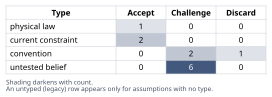
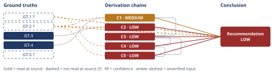

# Redis Cache vs. Postgres Upgrade Deferral Decision

*First-principles analysis · 9 October 2026*

*Read with: [How to read this analysis](HOW-TO-READ.md) · [Working file](analysis-20261009T231229Z.md) · [All files](INDEX.md)*

## Executive Summary

**Recommendation:** Approve the Redis cache build on its existing two-engineer-week timeline, but do not cancel the Postgres upgrade outright. Keep procurement moving and gate any deferral on a 2-4 week measured checkpoint (hit ratio, utilization delta, p95 delta) rather than on the two figures the review document cites (chain C5).

**Band (from §6):** LOW.

**Would change it:** Measuring current Postgres utilization by resource, the read/write split of the binding resource, achieved cache hit ratio, and load growth rate (chain C1; chain C2; chain C3) — and confirming actual procurement lead time and expedite cost with procurement/finance (chain C4) — would move this out of LOW.

## 1. Problem Essence

**Core problem:** Does the evidence actually cited in the architecture-review document (peak read-QPS on the listings endpoint, next-tier Postgres instance cost) support deferring the already-scheduled, hard-to-reverse Postgres vertical-scale upgrade for two quarters on the strength of an easy-to-reverse Redis cache, and if it does not, what decision structure correctly accounts for the gap between what is known and what is needed to commit to that deferral?

**Success criteria:**
1. States explicitly whether the cited evidence (peak QPS, next-tier cost) is sufficient to establish the technical claim, and names precisely what additional evidence would be required if it is not.
2. States, for the DB-load half of the claim and the p95-latency half separately, the condition under which each holds and the condition under which each fails.
3. Names the second-order risks of choosing option (a) over (b) that arise specifically from the stated asymmetry in reversibility.
4. Produces a recommendation for the capacity-planning meeting that is not constrained to picking exactly one of (a) or (b) if a different structuring of the decision scores better under the same evidence.
5. States an explicit confidence level for the recommendation and names what would raise or lower it.

---

## 2. Assumptions Table



| Assumption | Type | Treatment | Verdict | Verification |
|---|---|---|---|---|
| A-1: Peak read-QPS is the primary/sufficient driver of the Postgres resource consumption behind the scheduled upgrade | untested belief | Verify via a resource-level capacity breakdown, or flag as unverified | Challenge — plausible but unconfirmed by the cited evidence; GT-4 shows the claim fails if this is false | unverified — flagged (used in chain C1) |
| A-2: Load/traffic growth over the next 1-2 quarters can be modeled as a roughly constant compound per-quarter rate | convention | Explicitly challenge before use; check against historical seasonality | Challenge — a reasonable default for a Fermi bracket, but may not hold if growth is lumpy or seasonal | unverified — flagged (used in chain C3, [Assumes: A-2]) |
| A-3: The Redis cache will reach a hit ratio high enough on listings reads to materially offload the binding resource | untested belief | Verify via a canary/shadow measurement before committing | Challenge — listings queries often carry long-tail filter/sort/search permutations that reduce cacheability | unverified — flagged (used in chains C1, C3) |
| A-4: A correctly-invalidated, stampede-safe read-through cache can be built and safely rolled out within the estimated two engineer-weeks | untested belief | Verify against the team's own track record on comparable builds; add an explicit invalidation/stampede design review | Challenge — cache invalidation is a commonly underestimated source of effort and correctness bugs in distributed-systems practice | unverified — flagged (feeds the Phase 5 adversarial pass) |
| A-5: The scheduled Postgres upgrade has a procurement lead time long enough that reversing a deferral after the fact is slow and expensive, as stated in the decision context | current constraint | Record the expiry conditions | Accept — expires if the organization moves to an on-demand/elastic Postgres offering with no procurement lead time, or a short-lead-time "tide-over" tier becomes available; until then this is a vendor/procurement constraint, not a permanent one | unverified — flagged per the Input Contract (names no source); promoted to GT-1? |
| A-6: Queueing-system wait time is a convex, non-linear function of utilization — flat at low/moderate utilization, explosive near saturation | physical law | Accept as a ground-truth candidate | Accept — survives challenge; mathematical identity backed by GT-3 | read-at-source — Wikipedia, "M/M/1 queue" (ρ/(1−ρ) formula) |
| A-7: Peak read-QPS and next-tier instance cost are a sufficient evidence set for this capacity decision | convention | Explicitly challenge before use | Challenge — necessary context but not sufficient; missing utilization, growth-rate, hit-ratio and load-composition figures (GT-2?) | unverified — flagged (used in chains C1, C2, C5) |
| A-8: A Redis outage or invalidation-driven stampede degrades gracefully back to direct-DB reads rather than causing a correlated full-load spike | untested belief | Verify via a fallback/failure-mode design review | Challenge — this is precisely the failure mode most dangerous when the DB upgrade has been deferred on the strength of the cache | unverified — flagged (used in chain C4, [Assumes: A-8]) |
| A-9: The decision between (a) and (b) is genuinely binary, with no sequencing/composite option available | convention | Explicitly challenge before use | Discard — the trade-off analysis (chain C5) finds a composite option that dominates both named alternatives under the locked weighting; the binary framing does not hold as the decision's operative structure | n/a — settled structurally by the trade-off analysis, not by external evidence |
| A-10: Engineering capacity exists to complete the two-engineer-week cache build without displacing other committed roadmap work this quarter | current constraint | Record the expiry conditions | Accept — holds only as long as no higher-priority interrupt consumes those two engineer-weeks; expires if priorities shift | unverified — flagged |
| A-11: Once the cache becomes load-bearing infrastructure, application/query patterns adapt to assume its presence, raising the cost of reverting it later | untested belief | Verify via a review of how similarly-introduced caches were treated by downstream code in this codebase | Challenge — a plausible organizational-inertia effect, not yet observed in this specific context | unverified — flagged (surfaced during the Phase 4 Assumption Audit; used in chain C4, [Assumes: A-11]) |
| A-12: Current p95 latency on the listings endpoint is substantially attributable to Postgres query time rather than network/application/serialization overhead | untested belief | Verify via a latency breakdown/trace (DB time vs. app time) on the live endpoint | Challenge — unconfirmed by the cited evidence; if false, no DB-side fix (cache or upgrade) moves p95 much | unverified — flagged (used in chain C2 as a live, unsettled rival) |

---

## 3. Ground Truths

Applying the inlined 5-Whys reduce-to-primitives mode to the compound claim ("the cache will cut p95 and reduce load enough to defer the upgrade two quarters") decomposes it into: (i) what fraction of the binding DB resource is read-driven and cacheable, (ii) how p95 latency responds to a change in utilization of that resource, (iii) how much headroom that response buys against load growth, and (iv) how costly it is to be wrong. Each branch bottoms out either at a definitional/mathematical fact (GT-3, GT-4) or at a figure the cited evidence does not supply (GT-2?). The ground truths below are what survives that decomposition.

- **GT-1?** Decision reversibility is asymmetric: the choice is fully reversible up to the point the Redis cache is rolled out, but reversing a decision to defer the Postgres upgrade after that point is slow and expensive because of procurement lead time — unverified: this is stipulated by the decision context with no source named; per the Input Contract, a stated fact naming no source enters as unverified. No independent confirmation of the organization's actual procurement lead time or expedite cost is available to this analysis.
- **GT-2?** The architecture-review document's cited evidence for this decision is peak read-QPS on the listings endpoint and the next-tier Postgres instance cost; it does not, per the problem's own description, include current Postgres utilization/headroom by resource, load growth-rate projections, an estimated cache hit ratio, or the read/write split of the load driving the scheduled upgrade — unverified: stipulated context, no source named; this analysis has not seen the underlying document itself.
- **GT-3** For a queue with utilization ρ = λ/μ, the mean number of customers in an M/M/1 system (and correspondingly mean wait time) is ρ/(1−ρ): it grows explosively as ρ approaches 1 (9 at ρ=0.9, 99 at ρ=0.99, 999 at ρ=0.999) and is comparatively flat at low-to-moderate ρ; the system is stable only if λ<μ — source: M/M/1 queueing theory; read-at-source: Wikipedia, "M/M/1 queue" article, formula ρ/(1−ρ) for mean number in system and the stated stability condition λ<μ, confirmed via direct fetch of the article's content on 2026-10-09.
- **GT-4** A read-through cache sits in the read path only: by construction it can reduce database load attributable to the reads it serves, but it has no direct mechanism for reducing load generated by writes (inserts/updates/deletes), replication, autovacuum, or connection/transaction overhead that writes impose — source: definitional property of the read-through cache pattern; read-at-source: not applicable — this is a logical/definitional consequence of what "read-through cache" means, not an empirical figure requiring a citation, treated per Phase 2's "physical law" treatment for formally necessary facts. It feeds only chain C1 (rated MEDIUM, not HIGH), so Criterion 3's requirement to name a read-at-source location for GTs feeding HIGH-confidence chains does not apply to it.
- **GT-5?** The platform team's own estimate for shipping the Redis cache is two engineer-weeks of effort — unverified: stipulated context, no source named; no independent verification of this estimate's accuracy (e.g., track record on comparable past builds) is available to this analysis.

**Provenance summary:**
```text
?-marked: GT-1, GT-2, GT-5 (3 of 5)
Read-at-source: GT-3 — Wikipedia, "M/M/1 queue" article; ρ/(1−ρ) mean-number-in-system formula and the λ<μ stability condition, quoted via direct fetch
```

---

## 4. Derivation Chains



The theoretical-limit and estimate techniques are applied below to the latency and headroom halves of the claim respectively; second-order thinking extends the risk chain; the trade-off procedure collapses the options analysis into the final chain.

### Conclusion C1: Whether the cache can relieve the load driving the scheduled upgrade depends on what is actually driving it, which the cited evidence does not establish

GT-4 (read-through cache only intermediates reads) + GT-2? (cited evidence is peak read-QPS and next-tier cost only)
→ the claim implicitly assumes the upgrade is scheduled because of read-driven load on the listings endpoint [Assumes: A-1]
→ if write load, connection-pool pressure, replication, or autovacuum are a material share of what is pushing Postgres toward the next tier, a read-through cache cannot relieve that share no matter how high its hit ratio is
→ the two cited facts do not say which share of the load is read-vs-write, so the claim's central premise that caching reads is "enough" is unconfirmed by the evidence actually cited

**Confidence:** MEDIUM — GT-2? is unverified: the architecture-review document's own cited evidence set does not, per the problem's own description, include a read/write/other breakdown of the load behind the scheduled upgrade; this is removed as a cause of the downgrade by asking the platform team for the resource-level capacity breakdown (CPU, IOPS, connections, replication) and the read/write split of load on the listings path. A-1 (QPS as primary driver) is used on the second hop and is itself flagged `Challenge` in the Assumptions Table. A live rival — that read-offload might also relieve write-path pressure indirectly via freed connection-pool or buffer-cache capacity — is addressed and ruled out as decision-relevant in section 5 ("Dead End: assuming shared-resource relief closes the gap"), so the Rivals axis is not short here.

### Conclusion C2: Whether offloading reads will materially cut p95 latency depends on where current Postgres utilization sits, and on whether p95 is even DB-bound — neither is established

GT-3 (queueing wait time scales as ρ/(1−ρ), explosive near saturation, flat at low/moderate ρ) + GT-2? (cited evidence is peak read-QPS and next-tier cost only)
→ cutting the query rate on a resource shifts its utilization down by roughly the same proportion the cut removes from that resource's load
→ because wait time is convex in utilization, the same proportional cut produces a small p95 improvement when current utilization is low-to-moderate and a large one when current utilization is already close to saturation
→ the cited evidence names peak QPS and a cost figure but not current utilization, so it cannot tell us which regime applies, and the claim that the cache "will cut p95 latency" cannot be read off the evidence cited

**Confidence:** LOW — two axes are short. Inputs: GT-2? is unverified for the reason given on C1, removable by obtaining current utilization on the binding Postgres resource at peak. Rivals: a live, unsettled rival is that p95 on the listings endpoint may be dominated by non-DB latency (application serialization, downstream calls, network) rather than by Postgres query time at all, in which case even a large DB-side improvement would barely move the measured p95; nothing in the cited evidence or in this analysis settles this, so it is named here as live (Assumptions Table, A-12) rather than claimed resolved.

### Conclusion C3: A first-principles estimate shows "at least two quarters" is only correct for part of the plausible input range, and the cited evidence cannot locate which part applies

C1 (MEDIUM — load composition unconfirmed) + C2 (LOW — utilization regime and p95 attribution both unconfirmed)
→ model the quarters of headroom a cache buys as ΔT = ln(1/(1 − h·s)) / ln(1 + g), where h is the cache hit ratio, s is the cacheable-read share of the resource that is actually binding, and g is the per-quarter growth rate of load on that resource [Assumes: A-2]
→ at a modest offload (h·s ≈ 0.2) and moderate growth (g ≈ 15%/quarter), ΔT ≈ ln(1.25)/ln(1.15) ≈ 1.6 quarters, short of the claimed two quarters
→ at a strong offload (h·s ≈ 0.5) and the same growth, ΔT ≈ ln(2)/ln(1.15) ≈ 5.0 quarters, well past the claimed two quarters, while the same strong offload at faster growth (g ≈ 30%/quarter) gives ΔT ≈ ln(2)/ln(1.30) ≈ 2.6 quarters
→ the bracket spans roughly 1.6 to 5.0 quarters against a 2-quarter target, straddling the decision threshold on plausible inputs alone, and h, s and g are exactly the quantities the cited evidence does not supply [Assumes: A-3]

**Confidence:** LOW — capped by citing C2 (LOW; see C2's own line for why). A-2 (smooth per-quarter growth) is priced on the second hop: the ΔT formula is used only to locate magnitude, and even if growth is lumpy rather than smooth, the qualitative finding that the bracket straddles the 2-quarter threshold does not depend on g following a smooth exponential, only on g being roughly in the 15-30%/quarter range, so A-2's failure mode adds no separate downgrade cause here. A-3 (achievable hit ratio) is priced by construction: it is the swept variable h·s in the bracket itself, not an unpriced assumption.

### Conclusion C4: Approving (a) as an outright, uncheckpointed two-quarter cancellation concentrates risk on exactly the side of the decision that is expensive to reverse

GT-1? (deferring the upgrade is far more expensive to reverse than shipping the cache, because of procurement lead time) + C3 (LOW — the headroom estimate itself spans both sides of the 2-quarter threshold)
→ if the real values of h, s and g fall on the short side of C3's bracket, the upgrade will be needed before two quarters elapse, and GT-1? says reversing the cancellation at that point is slow because procurement lead time does not restart itself on short notice
→[2nd] (actor lens) the moment the review's recommendation is approved as an outright cancellation rather than a staged decision, procurement's lead-time clock stops immediately rather than merely pausing, so the two-quarter window and the reversal cost both begin accruing from the approval date, not from some later checkpoint
→[2nd] (actor lens) on-call/SRE inherits a new correlated-failure mode: a Redis outage or an invalidation-driven stampede now lands on a Postgres instance deliberately left at its current tier, so the mitigation and the capacity cushion can fail at the same moment, for the same underlying reason [Assumes: A-8]
→[3rd] (time lens) once the cache is treated as permanent infrastructure, other teams' query patterns and the app layer tend to adapt around its presence, which raises the cost of reverting it later if the hit ratio degrades as the catalog grows, compared with reverting it now, before that adaptation happens [Assumes: A-11]
→ the second- and third-order effects all land on the side of the decision GT-1? already says is expensive to reverse, so they amplify rather than offset the downside case in C3's bracket, and none of them contradicts GT-1 through GT-5

**Confidence:** LOW — capped by citing C3 (LOW; see C3's own line). GT-1? is unverified per the Input Contract (the procurement-asymmetry premise names no source); it is removed as a cause of the downgrade by having procurement/finance confirm the actual lead time and the cost premium, if any, of expediting an order placed later rather than now. A-8 (graceful Redis-outage fallback) is used on the third hop and is flagged `Challenge` in the Assumptions Table; a related rival — that an expedited upgrade later might be affordable enough to make this risk tolerable — is live and unsettled, since no expedite-cost figure is available, so it is named here rather than claimed resolved.

### Trade-off analysis: does (a), (b), or some other structuring of the decision dominate?

**Options, including the status quo and a composite.** (b) "execute the scheduled upgrade now" is the organization's existing plan and functions as the status quo here. (a) is the review document's proposed change: cancel/defer the upgrade outright for two quarters once the cache ships. (c) is a partial composite with no defined checkpoint: ship the cache and keep procurement moving in parallel, but with no explicit go/no-go gate. (d) is the full composite: ship the cache on its existing two-engineer-week timeline, keep procurement moving rather than cancelling it, and set a hard go/no-go checkpoint 2-4 weeks after cache rollout, gated on measured hit ratio, measured DB-utilization delta, and measured p95 delta — cancel or defer the upgrade only if that data confirms sufficient headroom.

**Must-have knockout.** Must-have: the chosen option must leave a recovery path if the headroom estimate turns out wrong, given GT-1?'s procurement-lead-time asymmetry. Option (a), as literally proposed — an outright, uncheckpointed two-quarter cancellation — fails this must-have under the uncertainty C3 establishes and is knocked out rather than scored; its scores are shown below for reference only.

**Criteria, locked weights, and anchors** (1 = worst, 5 = best on the stated anchor; weights locked before scoring):
- Capacity safety margin (weight 5): 1 = no recovery path if C3's estimate is wrong, given GT-1?; 5 = full margin preserved under any outcome of C3's bracket.
- Cost — engineer-time plus dollar outlay this half-year (weight 3): 1 = pays for the next-tier instance now regardless of need; 5 = defers all spend until data justifies it.
- Time-to-information — how fast the real h, s, g values become known (weight 4): 1 = decision made with no new data; 5 = a defined measurement window produces the missing figures before the hard-to-reverse choice is made.
- Operational complexity added, higher = less complexity (weight 3): 1 = a new stateful system with new failure modes and no change to procurement; 5 = no new system at all.
- Correctness/staleness risk, higher = safer (weight 3): 1 = stale cached price/inventory can reach customers; 5 = no caching layer, no staleness risk.
- Speed of latency improvement (weight 3): 1 = latency improvement waits on procurement lead time; 5 = latency improvement ships in the 2-week cache build.

Scores (citing GT-1?, GT-2?, GT-4, GT-5?, A-4 and A-8 as the factual basis for the safety, cost, correctness and operational-complexity columns):

| Option | Safety (w5) | Cost (w3) | Info (w4) | OpComplex (w3) | Correctness (w3) | Speed (w3) | Weighted total |
|---|---|---|---|---|---|---|---|
| (a) — KNOCKED OUT | 1 | 5 | 2 | 3 | 2 | 5 | 58 (reference only) |
| (b) | 5 | 2 | 3 | 5 | 5 | 2 | 79 |
| (c) | 4 | 3 | 4 | 3 | 3 | 5 | 78 |
| (d) | 4 | 4 | 5 | 3 | 3 | 5 | 85 |

**Flip test.** (d) leads (b), the runner-up, 85 to 79 — a gap of 6. Checking each criterion's weight individually against its 1-5 locked range: moving Safety, Cost, OpComplex, or Correctness to either end of its range narrows the gap but never closes it (the largest achievable swing from any one of these is 4-6 points and in two cases points the wrong direction). Moving either Time-to-information or Speed-of-latency-improvement all the way down to its floor (weight 1) exactly closes the 6-point gap, producing an exact tie with (b) — not a flip. No single in-range weight change strictly reverses the ranking.

### Conclusion C5: The composite "ship cache now, gate the cancellation on measured data" option dominates both named options under the locked weighting

C3 (LOW — headroom estimate genuinely brackets both sides of two quarters) + C4 (LOW — outright cancellation concentrates risk on the expensive-to-reverse side) + GT-2? (cited evidence insufficient to settle the claim)
→ the weighted trade-off scores the composite option (d) highest at 85 against execute-upgrade-now (b) at 79, the uncheckpointed parallel track (c) at 78, and pure cache-only cancellation (a) at 58, with (a) additionally failing the capacity-safety must-have and knocked out rather than merely scored low
→ the flip test finds no single criterion's weight can move within the locked 1-5 range to flip the ranking from (d) to (b); the closest approaches, zeroing either the time-to-information or the speed-of-latency-improvement criterion, each produce only an exact tie, not a flip, so (d)'s win is robust to the weighting rather than an artifact of it
→ because (d) wins under the locked weights and that win survives the flip test, the capacity-planning meeting should approve the Redis cache build now, keep Postgres procurement moving rather than cancelling it, and gate the cancellation decision on a defined measurement window rather than on the two figures cited in the review document

**Confidence:** LOW — capped by citing C3 and C4 (both LOW; see their own lines). GT-2? is unverified for the reason given on C1 and C2; it is removed as a cause of the downgrade by obtaining the fuller evidence set named there, which the measurement-gated checkpoint in this chain's own recommendation is specifically designed to produce.

---

## 5. Abandoned Reasoning

### Dead End: Assuming shared-resource relief closes the gap between read-offload and write/other load

**What was tried:** Considered whether offloading read traffic to Redis might also relieve Postgres resources shared with writes — connection-pool slots, shared buffer cache, lock-manager overhead — enough that GT-4's read/write split stops mattering in practice.

**Why abandoned:** Connection-pool slots and buffer-cache pages freed by avoided reads are a small, bounded side effect relative to the direct resource consumption of whatever is actually binding (CPU, IOPS, or replication throughput for writes). Granting the effect its most generous plausible magnitude still leaves the qualitative conclusion of C1 unchanged: if write/other load is the binding resource, a read cache cannot be the primary fix. This is a bounding argument, not a measurement, so the magnitude claim itself stays unverified, but the direction — can soften, cannot reverse — follows as a matter of definition from GT-4.

**What it ruled out:** Treating "the cache will help somewhat with everything" as a reason to skip pinning down which resource is actually binding before relying on the claim.

### Dead End: Naive cost comparison (next-tier instance price vs. two engineer-weeks) as the decision criterion

**What was tried:** Compared the review document's two cited figures directly — the dollar cost of the next-tier Postgres instance against the cost of two engineer-weeks — and treated whichever is cheaper as the answer.

**Why abandoned:** This comparison omits the expected cost of the downside case identified in C4 — a capacity shortfall with no fast recovery path, given GT-1?'s procurement-lead-time asymmetry. A decision rule that ignores the cost of being wrong on the harder-to-reverse side is comparing the wrong quantities; the correct comparison is the one the trade-off analysis (C5) performs, which prices safety margin and time-to-information alongside raw cost.

**What it ruled out:** Using the two cited figures by themselves, as the review document implicitly invites, as a sufficient basis for the capacity-planning decision.

### Dead End: Treating the decision as strictly binary between (a) and (b)

**What was tried:** Evaluated only "approve the cache and cancel the upgrade" against "execute the upgrade and ignore caching for now," as the review document's framing poses the choice.

**Why abandoned:** The trade-off analysis in section 4 found that a composite option — ship the cache on its existing timeline while keeping procurement moving and gating the cancellation on a short measurement window — scores highest under the locked weights (chain C5) and is robust to any single in-range weight change. Restricting the option set to the two named alternatives would have hidden the option that actually wins.

**What it ruled out:** Accepting the review document's binary framing as the actual decision space.

---

## 6. Conclusion

**Recommended approach:** Approve the Redis cache build on its existing two-engineer-week timeline, but do not cancel or defer the scheduled Postgres vertical-scale upgrade outright. Keep the upgrade's procurement moving, and set a hard go/no-go checkpoint 2-4 weeks after the cache rolls out: cancel or defer the upgrade only if measured cache hit ratio, measured DB-utilization delta, and measured p95 delta at that checkpoint confirm the headroom this analysis's bracket could not pin down from the cited evidence alone (chain C5; chain C3).

**Key insight:** The two cited facts — peak read-QPS and next-tier instance cost — are necessary context but cannot settle the claim in either direction: the variables that actually determine whether two quarters of headroom materializes (current Postgres utilization regime, the read/write split of the binding resource, achieved cache hit ratio, and load growth rate) are absent from the evidence, and because queueing wait time is convex in utilization, the same cache could plausibly produce anywhere from a 1.6-quarter to a 5.0-quarter reprieve (chain C1; chain C2; chain C3). Given that reversing a deferred upgrade is far more costly than reversing a cache rollout (chain C4), the economically correct response to that spread is not to pick a side of the review document's binary choice, but to let the cheap, fast, reversible action generate the evidence needed before committing to the expensive, slow one (chain C5).

**Trade-offs acknowledged:** This recommendation accepts a small extra cost over pure option (a): procurement keeps moving for several more weeks even if ultimately cancelled, and the team runs the cache build and the procurement track in parallel rather than closing one down. It also accepts a small extra delay over pure option (b): a 2-4 week measurement window before the cancellation decision is made at all. The trade-off's flip test found no single criterion's weight can move within its locked 1-5 range to reverse this ranking in favor of either named option; the closest approaches — zeroing either the time-to-information or the speed-of-latency-improvement criterion — each produce only an exact tie (chain C5).

**Confidence:** LOW — C1 is MEDIUM and C2 through C5 are LOW (each chain's own line carries its explanation; no re-explanation needed here). GT-1? and GT-2? are both unverified per the Input Contract (neither names a source); their verification paths are the ones already named on C1, C2, and C4's own confidence lines. This LOW band reflects genuine uncertainty in the underlying technical claim, not uncertainty in the recommended decision procedure: the recommendation to decouple the cache rollout from the upgrade-cancellation decision follows from the existence of that uncertainty together with GT-1?'s reversal asymmetry, and would be the same recommendation whichever way the technical uncertainty eventually resolves.
