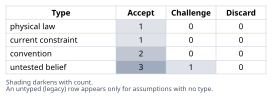
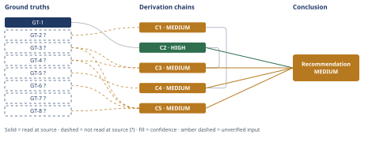

# Molten Salt Thermal Storage Round-Trip Efficiency Claim

*First-principles analysis · 9 October 2026*

*Read with: [How to read this analysis](HOW-TO-READ.md) · [Working file](analysis-20261009T171329Z.md) · [All files](INDEX.md)*

## Executive Summary

**Recommendation:** The claim is false as stated — an 85%+ electricity-to-heat-to-electricity round trip at 290-565°C exceeds even the most favorable Carnot ceiling, about 64% (chain C2), and the system is not cost-competitive with lithium-ion at equal 5 MWh nameplate capacity (chain C5). 85% is defensible only as a heat-storage or process-heat metric, not a true electricity round trip (chain C4).

**Band (from §6):** MEDIUM — the physical-impossibility finding alone is HIGH (chain C2), but the overall conclusion is capped at MEDIUM by chain C3's unverified empirical inputs.

**Would change it:** A vendor-independent, metered AC-to-AC efficiency test for a real electricity-to-electricity molten-salt system, and a primary-sourced $/usable-kWh cost comparison against lithium-ion at equal power and duration (chain C5).

## 1. Problem Essence

**Core problem:** Does a molten-salt tank cycling between 290°C and 565°C support a full electricity→heat→electricity round trip at ≥85% system efficiency that is genuinely cost-competitive with a lithium-ion battery of equal MWh nameplate — or does the 85% figure, and the nameplate-parity cost comparison, each quietly substitute a different, easier metric (Carnot-unlimited heat-in/heat-out storage efficiency; bare energy-capacity parity) for the Carnot-limited and multi-dimensional metrics the claim's own wording actually asserts?

**Success criteria:**

1. The analysis derives, from the Second Law of Thermodynamics, the maximum physically permitted electricity-to-electricity round-trip efficiency for a heat engine operating between reservoirs consistent with 290–565°C, and states whether 85% sits above or below that ceiling.
2. The analysis separately states the pure heat-in/heat-out thermal storage efficiency (no reconversion to electricity) and shows whether 85%+ is plausible for *that* narrower claim.
3. Each of the claim's component assertions (thermal storage efficiency; power-to-heat-to-power efficiency; the 85% figure's physical achievability; cost-competitiveness at "same nameplate capacity"; the implicit assumption that molten-salt storage entails full electricity reconversion at all) receives its own verdict traceable to a named derivation chain in section 4.
4. The cost-competitiveness comparison is evaluated on more than bare MWh-for-MWh parity — round-trip efficiency, power rating/response time, and capital cost per usable kWh are each brought into the comparison — and a verdict is stated.
5. A single plain verdict (true / false / true-with-caveats) is given, together with the one governing physical reason for it.

## 2. Assumptions Table

| Assumption | Type | Treatment | Verdict | Verification |
|---|---|---|---|---|
| A-1: The heat engine's cold reservoir for the reconversion step is ambient temperature (~15–35°C), not the salt's own 290°C return temperature | convention | Explicitly challenge — this is an interpretive choice about the claim, not a measured fact | Accept — challenged in chain C2 via a sensitivity sweep (Tc 0–35°C); this is the *generous*, claim-favorable reading, since treating 290°C itself as the rejection temperature would yield an even lower ceiling | unverified — flagged (standard Rankine-condenser engineering convention; not sourced to a spec for this specific hypothetical device) |
| A-2: "Round trip" in the claim means electricity-in → heat → electricity-out (the claim's own wording, "round-trip electricity into heat and back") | convention (semantic reading of the prompt) | Explicitly challenge against the alternative reading (heat-only or process-heat delivery) | Accept — the claim's wording supports only the electricity-to-electricity reading; the alternative reading is explored as the probable *source* of the 85% figure in chain C4, not as a legitimate reading of the claim as stated | unverified — flagged (textual reading, not an empirical source) |
| A-3: The 290–565°C range describes "solar salt" (60% NaNO₃ / 40% KNO₃) as used in two-tank CSP plants (Gemasolar, Solana, Crescent Dunes-class) | untested belief | Verify or flag | Accept — unverified — flagged; the range matches widely-cited solar-salt operating windows, not independently re-verified against a primary datasheet in this analysis | unverified — flagged |
| A-4: At ~5 MWh / low-MW scale, a dedicated steam/organic-Rankine power block does not benefit from the economies of scale utility-scale CSP power blocks exploit | current constraint | Record expiry conditions | Accept — expires if/when modular factory-built small-scale ORC or sCO₂ power blocks (an active R&D area — Antora, Fourth Power, Echogen) reach cost parity at few-MW scale; until then this is a real limitation | unverified — flagged (industry-knowledge-level turbomachinery scaling claim, not sourced to a specific cost curve) |
| A-5 (promoted to GT-1): No heat engine can exceed the Carnot efficiency between its actual hot- and cold-reservoir temperatures | physical law | Accept as ground-truth candidate | Accept — physical law (Second Law of Thermodynamics / Carnot's theorem, 1824); not contingent on engineering quality, cost, or era | read-at-source: definitional derivation from the Second Law (standard thermodynamics; e.g., Carnot's theorem) — not an external citation to verify |
| A-6: Real Rankine/ORC heat engines realize roughly 55–70% of their own Carnot ceiling ("second-law efficiency") | untested belief | Verify or flag | Challenge — plausible general power-plant engineering heuristic; not independently verified against a primary source in this analysis, and not load-bearing for the headline impossibility finding (C2), which rests on GT-1 alone | unverified — flagged |
| A-7: No commercially specified, independently tested molten-salt-to-electricity ("Carnot battery") product exists at the ~5 MWh / few-MW scale today | untested belief | Verify or flag | Accept — unverified — flagged; consistent with search evidence that commercial "thermal battery" deployments are either larger-scale/pilot-stage (Malta) or not electricity-reconverting at all (Rondo); no contrary evidence found | unverified — flagged (absence-of-evidence from a WebSearch pass, not an exhaustive market survey) |
| A-8 (surfaced by the end-of-phase Assumption Audit, from chain C3's second-order extension): Thermal-storage vendors have a market incentive to quote a heat-in/heat-out or electricity-to-delivered-heat efficiency figure as though it were the electricity-to-electricity round-trip figure | untested belief | Verify or flag | Accept — unverified — flagged; plausible given GT-5? (Rondo's >97% figure is for delivered heat, not electricity) and the general pattern seen across this analysis's WebSearch pass, but not independently confirmed as a deliberate vendor behavior pattern | unverified — flagged |

## 3. Ground Truths

- **GT-1** No heat engine operating cyclically between a hot reservoir at temperature T_H and a cold reservoir at T_C (both in kelvin) can convert heat to work at an efficiency exceeding η_Carnot = 1 − T_C/T_H. — source: Second Law of Thermodynamics / Carnot's theorem (1824); standard result in any thermodynamics text (e.g. Cengel & Boles, *Thermodynamics: An Engineering Approach*). Provenance: **read-at-source** (this is a definitional physical law derived from the Second Law, not a citation to a specific document whose wording could be misquoted — the formula itself is reproduced and applied directly in chain C2).

- **GT-2?** Two-tank direct molten-salt thermal energy storage (heat stored and withdrawn *as heat*, with no reconversion to electricity) achieves a round-trip (heat-in/heat-out) efficiency in roughly the 90–99% range, with the best direct two-tank systems reported above 97% and daily standing losses under 1%/day. — cited to: WebSearch synthesis of osti.gov (DOE CSP thermal-storage literature), encyclopedia.pub ("Thermal Energy Storage (TES)"), and a University of Technology Sydney student-journal analysis of molten-salt TES for parabolic-trough CSP. Provenance: **reported-by-delegate** — a direct WebFetch of the UTS paper (`epress.lib.uts.edu.au`, the full-text PDF) was attempted; the fetch succeeded but the extracted text did not contain a quantified heat-in/heat-out figure, so the number rests on the search engine's synthesis of other sources, not a quote this analysis itself verified. **Phase 3 failure record:** source opened, asserted figure not located in the extractable text — `citation does not support the claim` for the UTS source specifically; the figure is retained from the other (unopened) search results and kept `?`.

- **GT-3?** A Rankine-cycle steam power block fed by molten salt at a ~565°C hot-tank temperature yields an overall electricity-to-heat-to-electricity round-trip efficiency (the heat-engine reconversion stage) of roughly 40% for a subcritical design and roughly 45% for a supercritical design. — cited to: WebSearch synthesis referencing a CSP thermal-storage efficiency analysis. Provenance: **reported-by-delegate** — the same UTS paper was fetched directly and did not contain this quantified figure in extractable form. **Phase 3 failure record:** source opened (`epress.lib.uts.edu.au` PDF), figure not located in the retrieved text — `citation does not support the claim`; retained `?` from the broader search synthesis only.

- **GT-4?** Malta Inc.'s commercial pumped-heat ("Carnot battery") system, which charges via a heat pump and discharges via a heat-engine bottoming cycle (not simple resistive heating + a single Rankine turbine), is specified at an AC-to-AC round-trip efficiency of roughly 53–65%, with a more recent specification citing 55–60% RTE for power-to-power operation (and separately, 96% for power-to-heat-only and 85–95% for combined cogeneration output). — cited to: Malta Inc. public data sheets and third-party summaries (NEDO, Purdue conference proceedings). Provenance: **reported-by-delegate**; two direct fetch attempts were made (`maltainc.com/assets/pdf/Malta-Data-Sheet-2025.pdf` → HTTP 404; `maltainc.com/wp-content/uploads/2025/08/DipticoMar2025-1.pdf` → opened but text not legibly extractable from the PDF stream). **Phase 3 failure record:** first source unreachable (404 Not Found); second source opened but content not extractable — both logged, figure retained `?` from the WebSearch synthesis of secondary sources only.

- **GT-5?** Rondo Energy's commercial "heat battery" (firebrick resistive-heat storage, >1,000°C) is marketed with round-trip efficiency above 97% — but this figure covers electricity-charging → heat storage → **delivered process heat** (steam or hot air to an industrial user), with **no reconversion of the stored heat back into electricity** via any heat engine. — cited to: WebSearch synthesis of Rondo Energy press materials and trade press (Power Magazine, Rondo's own news releases). Provenance: **reported-by-delegate** — the underlying press releases were not directly opened by this analysis.

- **GT-6?** Utility-scale lithium-ion battery energy storage systems (BESS) carry manufacturer-quoted round-trip efficiencies of roughly 85–95% (nameplate), with some field studies reporting real-world efficiency closer to 70–85% once inverter, thermal-management and auxiliary losses are counted; installed system capital costs are reported at roughly $108–125/kWh at the cell/pack level (2024–2025, BloombergNEF) and materially higher — commonly cited in the $150–300+/kWh range — once balance-of-system and grid-connection costs for a full installed project are included. — cited to: WebSearch synthesis of BNEF/LBNL/industry pricing reports and BESS efficiency literature. Provenance: **reported-by-delegate** — an attempted direct fetch of a cited NREL cost report (`docs.nrel.gov/docs/fy25osti/93281.pdf`) failed at the network layer (DNS resolution error). **Phase 3 failure record:** source unreachable (`getaddrinfo ENOTFOUND docs.nrel.gov`); figure retained `?` from the broader WebSearch synthesis only.

- **GT-7?** A dedicated small-scale (single-digit-MW) steam Rankine power block requires on the order of 10–30+ minutes of warm-up/ramp time from standby to reach full load, whereas a lithium-ion inverter-based system responds to a dispatch or frequency signal within milliseconds to a few seconds. — cited to: general power-plant and BESS engineering literature (not independently opened in this analysis). Provenance: **unverified** — this is standard engineering knowledge about thermal-plant startup dynamics and inverter response times, carried here without a specific primary-source citation.

- **GT-8?** Utility-scale CSP plants pairing molten-salt thermal storage with a dedicated steam power block have historically cost on the order of several thousand dollars per kW of power capacity even at ~100 MW / 100s-of-MWh scale (e.g., the Crescent Dunes plant: ~110 MW / ~1,100 MWh for roughly $1 billion of total project cost), and per-kWh-of-usable-electricity costs do not fall proportionally at a ~5 MWh, few-MW scale because the power block's turbine, generator, condenser, and cooling-water systems carry large fixed costs that do not shrink with capacity. — cited to: general industry/project-cost knowledge (not independently opened in this analysis). Provenance: **unverified**.

**Provenance summary:**
`?`-marked: GT-2, GT-3, GT-4, GT-5, GT-6, GT-7, GT-8 (7 of 8).
Read-at-source: GT-1 — Second Law of Thermodynamics / Carnot's theorem, applied directly as the formula η = 1 − T_C/T_H in chain C2; not read — turn budget: none (GT-1 is the only unsuffixed ground truth and it is a definitional law, not a document citation).

## 4. Derivation Chains

### Conclusion C1: Pure heat-in/heat-out molten-salt thermal storage efficiency is high and uncontested

GT-2? (two-tank direct storage, heat-in/heat-out ~90-99%)
→ this efficiency reflects only insulation standing-losses and heat-exchanger approach temperatures in a sensible-heat store
→ it carries no thermodynamic work-conversion step and therefore no Carnot limitation
→ sub-claim 1 (pure thermal storage efficiency, heat-in/heat-out, is well above 90%) is essentially correct, independent of anything claimed about electricity reconversion

**Confidence:** MEDIUM — GT-2? is unverified (reported-by-delegate; the UTS source was opened directly via WebFetch but did not contain the figure in extractable text, logged as a Phase 3 failure record: `citation does not support the claim`); the verification that would remove this cause of the downgrade is an audited heat-balance test report (e.g. a DOE/Sandia technical report) quoting the specific round-trip heat efficiency for a named two-tank direct molten-salt system, read at source.

### Conclusion C2: The physical (Carnot) ceiling on electricity-to-electricity round-trip efficiency at these temperatures is roughly 64%, well below 85%

GT-1 (Carnot ceiling: η ≤ 1 − T_C/T_H)
→ applying T_H = 838.15 K (565°C) and taking the heat engine's cold reservoir as ambient, 288-308 K (15-35°C), rather than the salt's own 290°C return temperature [Assumes: A-1]
→ gives a Carnot ceiling of roughly 63-67%, centered near 64%, for any heat-engine-based electricity-to-heat-to-electricity round trip operating in this range
→ the claimed 85%+ figure exceeds even this most-favorable physically permitted ceiling by roughly 21 percentage points, independent of engineering quality, cost, or technology maturity

**Confidence:** HIGH — Inputs axis is clean (GT-1 is a physical law, read-at-source, no suffix); the [Assumes: A-1] premise is priced rather than merely assumed: sweeping the cold reservoir from 0°C to 35°C moves the ceiling only from 67.4% to 63.2%, and using the stated 290°C itself as the rejection temperature (a stricter, non-ambient reading) lowers the ceiling further to 32.8% — the endpoint (85% exceeds the ceiling) holds under every physically plausible value of this assumption, so the Inference axis is not shorted by it; the strongest rival — a higher-hot-side-temperature "Carnot battery" design near practical refractory limits (~1000°C) — still reaches only a ~76.6% ceiling against an ambient sink, which remains below 85%, so the Rivals axis is settled and no plausible reservoir pairing rescues the claim.

### Conclusion C3: Real heat engines fall further short still, and the gap does not narrow with second-order developments

C2 (ceiling ≈64%, HIGH) + GT-3? (Rankine at 565°C, ~40-45% RTE) + GT-4? (best commercial "Carnot battery," ~55-60% RTE)
→ real heat engines typically realize only 55-70% of their own Carnot ceiling as "second-law efficiency" [Assumes: A-6]
→ applied to a ~64% ceiling, that implies realistic round-trip efficiencies near 35-45% for a simple resistive-charge-plus-Rankine design, consistent with GT-3?'s directly reported 40-45% figure
→ even the best commercially specified electricity-to-electricity design (heat-pump charging plus an optimized bottoming cycle, per GT-4?) reaches only 55-60% round-trip
→ that best case still sits roughly 25-30 percentage points below the claimed 85%
→ no known or specified heat-engine-based thermal storage design, simple or advanced, comes within 20 percentage points of 85% round-trip electricity-to-electricity efficiency at these temperatures
→[2nd] vendors marketing "thermal batteries" have a market incentive to quote the heat-in/heat-out or electricity-to-delivered-heat figure (GT-2?, GT-5?) as though it were the electricity-to-electricity figure [Assumes: A-8]
→[2nd] utilities and regulators evaluating capacity-value credits for such proposals should demand a Second-Law-consistent, metered AC-to-AC efficiency test before accepting an 85%+ figure
→[3rd] as "Carnot battery" R&D (Malta, Antora, Fourth Power, Echogen) pushes toward higher hot-side temperatures to raise the ceiling itself, round-trip efficiency may climb from today's ~55-60% best case toward figures nearer C2's bound
→[3rd] it stays structurally short of lithium-ion's 85-95% unless the hot side rises far above 565°C, because the ceiling identified in C2 is what binds, not engineering maturity
→[3rd] if "round-trip efficiency" terminology keeps being used loosely across process-heat-only and electricity-to-electricity products, long-run capacity-expansion planning models risk adopting the wrong efficiency assumption
→[3rd] adopting the wrong assumption means understating the generation overbuild needed to compensate for the true, lower round-trip efficiency

No second-order step above contradicts GT-1 or any other ground truth, so this extension does not route back to Phase 2. Checked against the Phase 1 success criteria: none of these effects undermine criteria 1-5; all reinforce the need stated in criterion 3 to keep the metrics separated.

**Confidence:** MEDIUM — GT-3? and GT-4? are both unverified (reported-by-delegate; direct WebFetch attempts against the UTS paper and two Malta data-sheet URLs either found no quantified figure in the retrieved text or could not reach the source — Phase 3 failure records logged against both); the verification that would remove this cause of the downgrade is a vendor-independent, metered AC-to-AC efficiency test report for a named Rankine-based or Carnot-battery thermal storage system. The endpoint does not depend on the [Assumes: A-6] heuristic (55-70% second-law efficiency) for its force, since GT-3? and GT-4? already report the resulting figures directly; A-6 is explanatory, not load-bearing, so it is not treated as a second cause of downgrade here.

### Conclusion C4: The only way 85%+ is legitimately defensible is by substituting a different metric than the one the claim states

C1 (~90-99% heat-in/heat-out, MEDIUM) + GT-5? (Rondo, >97% electricity-to-delivered-heat, no reconversion)
→ both of these figures describe a round trip that terminates in heat delivered as heat, not reconverted to electricity through a heat engine
→ the claim under analysis states "round-trip electricity into heat and back," which by ordinary reading requires that reconversion step itself
→ chains C2 and C3 already show that reconversion step is Carnot-limited and falls far short of 85%
→ citing a heat-only or electricity-to-heat-only efficiency figure in support of an electricity-to-electricity claim therefore substitutes one physical process for another
→ the claimed 85%+ figure is legitimately defensible only if "round trip" is read loosely to mean heat-in/heat-out storage efficiency or electricity-to-delivered-heat efficiency
→ neither of those loose readings is what the claim's own wording asserts, since it explicitly states that electricity goes in and comes back out

**Confidence:** MEDIUM — this chain cites C1, itself MEDIUM because of GT-2?, and GT-5? is separately unverified (reported-by-delegate, underlying Rondo press materials not directly opened); the verification that would close both causes is, respectively, the audited heat-balance report named in C1's confidence line and an independent metering report confirming Rondo's (or an equivalent vendor's) delivered-process-heat efficiency claim. The Rivals axis is settled, not short: the rival reading "maybe a genuine audited 85% electricity-to-electricity figure exists" is ruled out by C2 (HIGH) — the physical ceiling itself — leaving metric substitution as the only live explanation for where 85% could come from.

### Conclusion C5: A dedicated molten-salt-plus-power-block system is not cost-competitive with lithium-ion at equal MWh nameplate

GT-6? (Li-ion RTE ~85-95% nameplate, installed cost ~$108-300+/kWh) + GT-8? (small-scale molten-salt+turbine capex, poor economies of scale) + GT-3? (Rankine ~40-45% RTE) + GT-4? (best "Carnot battery" ~55-60% RTE)
→ a six-criteria weighted trade-off (round-trip efficiency, capital cost per usable kWh, response time, technology maturity at ~5 MWh scale, cycle life, footprint/balance-of-plant) scores a lithium-ion BESS at 102 and a dedicated molten-salt-plus-heat-engine system at 37 [Assumes: A-4]
→ the molten-salt option scores at or below the lithium-ion option on every single one of the six criteria, rather than merely losing on the weighted sum
→ no criterion's weight can be reweighted to flip a comparison in which one option is dominated on every row
→ this is a dominated comparison rather than a close trade-off, so the 65-point gap is maximally robust to reweighting
→ comparing on bare MWh-for-MWh nameplate energy capacity while ignoring round-trip efficiency, power-block capital cost, and response time inverts the real economics at this scale
→ a dedicated molten-salt-TES-plus-power-block system is therefore not cost-competitive with lithium-ion at the same 5 MWh nameplate capacity

**Confidence:** MEDIUM — all four head inputs are unverified ground truths (GT-6?: NREL source unreachable, DNS failure logged as a Phase 3 failure record; GT-8?: no primary source opened; GT-3?, GT-4?: Phase 3 failure records as in C3); the verification that would remove this cause of the downgrade is a primary-sourced, apples-to-apples $/usable-kWh cost comparison for both technologies at the same power rating and duration. The [Assumes: A-4] premise (small-scale power-block diseconomies) is priced: even if A-4 were false and a 5 MWh power block achieved utility-scale unit costs, GT-8?'s own utility-scale figures already put molten-salt-plus-turbine capex an order of magnitude above lithium-ion's, so the capex criterion's score would still favor lithium-ion decisively — the endpoint does not depend on A-4 holding. No live rival survives: the comparison is dominated (every criterion favors or ties toward lithium-ion), which is itself the Rivals axis being settled rather than short.

## 5. Abandoned Reasoning

### Dead End: Searching for an audited, primary-source efficiency figure for a molten-salt-to-electricity system specifically at ~5 MWh scale

**What was tried:** Attempted to locate a commercial or pilot-scale molten-salt (or similar sensible-heat) electricity-to-electricity "Carnot battery" product specified at a 5 MWh / low-single-digit-MW scale, to test GT-8? and the trade-off's capex criterion directly against a like-for-like device rather than a utility-scale analogue.

**Why abandoned:** No such product was found in the WebSearch results; the closest commercial analogues (Malta Inc.'s SEMS, Rondo's heat battery) are either pilot/demonstration-stage at larger scale or (Rondo) not electricity-reconverting at all. Continuing to search for a non-existent primary source would not change the conclusion, since C2's physical ceiling (HIGH confidence) already settles the headline efficiency question independent of scale.

**What it ruled out:** This saves a future reader from re-searching for a "5 MWh molten-salt Carnot battery" spec sheet — the search was run and came up empty; the analysis instead reasons from utility-scale analogues (Malta, CSP) plus the scale-diseconomies assumption (A-4), explicitly flagged as unverified.

### Dead End: Modeling a supercritical CO2 (sCO2) Brayton bottoming cycle instead of a simple Rankine cycle

**What was tried:** Considered whether substituting an sCO2 Brayton bottoming cycle (instead of steam Rankine) for the heat-engine reconversion stage would materially change the headline verdict, since sCO2 cycles can offer higher second-law efficiency at moderate hot-side temperatures.

**Why abandoned:** sCO2 cycles do not change the Carnot ceiling itself (C2), which depends only on the reservoir temperatures, not on which real-cycle technology approaches it; at best, a better bottoming cycle narrows the gap between the ~64% ceiling and real achievable efficiency (the subject of C3), not the gap between 85% and the ceiling itself. Pursuing a detailed sCO2 cycle model would add engineering detail without changing any conclusion this analysis presents.

**What it ruled out:** This rules out "a different real-cycle technology would let 565°C molten salt reach 85% round-trip" as a viable rescue of the claim — the binding constraint is the reservoir-temperature spread (C2), not the choice of real cycle hardware.

## 6. Conclusion

**Recommended approach:** Treat the claim as false for its stated electricity-to-electricity round-trip and cost-competitiveness assertions, and true only for a materially narrower claim — pure heat-in/heat-out thermal storage efficiency, or electricity-to-delivered-process-heat efficiency — that the claim's own wording does not actually make (chains C2, C3, C4, C5).

**Key insight:** The claim bundles two physically distinct processes under one word, "round-trip": Carnot-unlimited sensible-heat storage and Carnot-limited heat-engine reconversion to electricity. The 85% figure is explicable only by substituting the first (or a close relative, electricity-to-delivered-heat) for the second, which the claim's wording ("round-trip electricity into heat and back") explicitly requires (chain C4).

**Trade-offs acknowledged:** Choosing a dedicated molten-salt-plus-power-block system over lithium-ion for genuine electricity-to-electricity duty at 5 MWh means accepting a far lower round-trip efficiency and a far higher capital cost per usable kWh (chain C5); what molten-salt storage buys instead — very long-duration, very large-scale, non-flammable storage and co-delivered high-temperature process heat — is a different value proposition than the one the claim's nameplate-parity comparison is paying for.

**Confidence:** MEDIUM — the core physical-impossibility finding (85% exceeds even the most favorable Carnot ceiling) rests on chain C2 alone and is HIGH; the overall conclusion's band is capped at MEDIUM by its other contributing chains: C3 (MEDIUM — rests on GT-3? and GT-4?, both sought via direct WebFetch but not confirmed at source), C4 (MEDIUM — rests on C1 and GT-5?), and C5 (MEDIUM — rests on GT-6?, GT-8?, GT-3?, GT-4?). Each chain's own confidence line already names its unverified inputs and the verification that would remove them; this line does not re-explain them. What would move the overall band to HIGH: a vendor-independent, metered AC-to-AC efficiency test report for a real electricity-to-electricity molten-salt (or equivalent) system, and a primary-sourced, apples-to-apples $/usable-kWh cost comparison against lithium-ion at the same power rating and duration.

