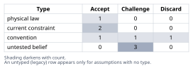
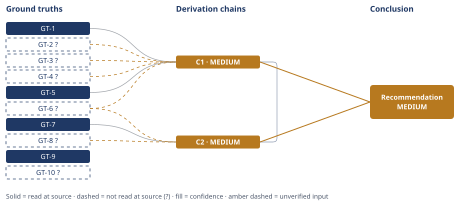

# Molten-Salt Thermal Storage Round-Trip Efficiency and Cost Claim

*First-principles analysis · 9 October 2026*

*Read with: [How to read this analysis](HOW-TO-READ.md) · [Working file](analysis-20261009T231057Z.md) · [All files](INDEX.md)*

## Executive Summary

**Recommendation:** The claim is false under its literal full-loop (electricity→heat→electricity) reading: round-trip efficiency realistically lands near 18-34% (central ≈26%), capped even in the ideal limit near 59% (chain C1), not >85%. The ">85%" figure is true only for charging or heat-retention alone. At 5 MWh scale the system is also roughly 2-12× (central ≈6×) more expensive per kWh of deliverable electric energy than lithium-ion (chain C2).

**Band (from §6):** MEDIUM

**Would change it:** Reading the primary Solar Two/Sandia source directly (GT-2?), a quoted small-scale 565°C power-block cost (GT-6?), and the NREL ATB page itself for Li-ion cost (GT-8?, blocked this run by a DNS failure) would each tighten chains C1 and C2 toward HIGH.

## 1. Problem Essence

**Core problem:** Does a 5 MWh molten-salt tank, charged and discharged purely as *electricity* (resistive heating in, a heat engine out) between 290-565°C, achieve a full electricity-to-heat-to-electricity round-trip efficiency above 85% and a per-kWh installed cost competitive with a same-energy-nameplate lithium-ion BESS — or does the claim's ">85%" figure actually describe a narrower, non-equivalent stage of the loop (charging-only or heat-retention-only), making the claim true only under a different, unstated reading?

**Success criteria:**
1. States a numeric ceiling (from the Carnot limit) and a realistic practical range for full electricity-to-heat-to-electricity round-trip efficiency at 5 MWh, 290-565°C, and states explicitly whether >85% is achievable for that specific stage.
2. States a $/kWh (deliverable-electric-capacity basis) estimate for the complete power-to-heat-to-power system (tank + salt + heaters + heat engine + generator + balance-of-plant) at 5 MWh scale, compares it to a cited lithium-ion BESS $/kWh figure, and states the resulting ratio.
3. States explicitly which efficiency metric (charge-only, heat-retention-only, or full round-trip) the literature's and the claim's ">85%"-class figures actually refer to, and names which reading of the claim, if any, is true.
4. States whether "same nameplate capacity" (MWh-for-MWh) is a sufficient basis for the cost comparison, or whether power rating, response time, cycle life, and efficiency must also match.
5. Delivers a single, crisp TRUE / FALSE / NEEDS-DEFINITIONAL-CORRECTION verdict on the claim exactly as literally worded.

---

## 2. Assumptions Table



| Assumption | Type | Treatment | Verdict | Verification |
|------------|------|-----------|---------|--------------|
| "Round-trip efficiency" in the claim means a full closed-loop electricity→heat→electricity conversion, not charge-only or retention-only efficiency | untested belief | Verify by testing both readings against physics and literature | Challenge — the claim's own wording ("round-trip electricity into heat and back") plausibly intends the full loop, but this is exactly the metric commonly conflated with narrower CSP metrics in marketing contexts | unverified — flagged, resolved via chain C1 and GT-5 |
| The system is a simple single/dual molten-salt tank pair with no auxiliary cold store, rejecting heat to ambient on discharge | convention | Explicitly challenge whether an unstated cold-store ("true Carnot battery") architecture is implied | Challenge — accepted as the literal reading of the claim (no cold store is mentioned); the broader Carnot-battery literature's higher figures require exactly this unstated architecture and do not transfer | unverified — flagged, GT-2?, Dead End 1 |
| "Same nameplate capacity" for cost comparison means matching MWh (energy) alone | convention | Explicitly challenge before use | Discard — insufficient; GT-9 and GT-10? show power-response dynamics and cycle-life bases differ fundamentally between the two technologies, so an energy-only comparison is not decision-useful | unverified — flagged, GT-9, GT-10?, Dead End 3 |
| Cold-side (heat-rejection) temperature for the discharge heat engine is ambient, ≈25-40°C | current constraint | Record expiry: a refrigerated/cryogenic cold store could lower this and raise the Carnot ceiling, at added capital/parasitic cost not evaluated here | Accept — expires only if a cold-store architecture is added, which the claim does not describe; until then this is the physically reasonable bound | GT-1 combined with standard ambient-temperature range |
| Dwell time between charge and discharge is representative of daily-cycle (12-24h) storage duty, not multi-day storage | convention | Challenge: test sensitivity of the conclusion to this duty-cycle assumption | Accept — representative assumption; a longer dwell lowers retention efficiency further and strengthens, never weakens, the overall conclusion | GT-4? estimate, chain C1 [Assumes: A-5] |
| The power-conversion ("heat engine") equipment for a 5 MWh system is a small-scale (~1-2 MWe class) steam/organic Rankine cycle, not utility-scale turbomachinery or an advanced sCO2 cycle | untested belief | Verify via cost/efficiency literature for comparably-sized equipment | Challenge — reasonable engineering inference from the stated 5 MWh scale, used with an explicitly `?`-marked ground truth rather than treated as settled | unverified — flagged, GT-6?, chain C2 [Assumes: A-6] |
| Reported Carnot-battery/PTES round-trip efficiency figures (40-70%, optimized designs up to 81%, thermally-integrated 85-87%) from the general literature are representative of what this specific 5 MWh single-tank, ambient-cold-side design can achieve | untested belief | Explicitly challenge as a possible false analogy; do not use literature figures as direct evidence without grounding in a ground truth about the cited systems' own (different) architecture | Challenge — the literature's higher figures (70-87%) require either external thermal integration or utility/GWh-scale turbomachinery and/or a refrigerated cold store, none of which this system has; used only as a corroborating upper-bound reference, not as direct evidence for this system | unverified — flagged, GT-5 (read-at-source) used narrowly, chain C1 [Assumes: A-7] |
| The cited lithium-ion BESS installed-cost benchmark (≈$199/kWh, 2023-2024 vintage) is on a comparable basis (similar duration, same-era dollars, fully-installed scope) to the thermal system's estimated installed cost | current constraint | Record expiry: cost figures are time-varying; Li-ion costs are falling faster (steeper learning curve) than turbomachinery-dominated thermal-system costs, which would widen, not close, the cost gap over the next 5-10 years | Accept — valid for a present-day (2024-2026) snapshot comparison; expires as both technologies' cost curves evolve | unverified — flagged, GT-8? |
| A real, finite-power heat engine cannot approach the reversible Carnot efficiency limit, so ">85%" full-loop electric efficiency would require an unrealistic near-reversible discharge stage even before small-scale hardware penalties are considered | physical law | Accept as a ground-truth candidate | Accept — direct consequence of the Second Law of Thermodynamics; promoted to GT-1's derived application in chain C1 | GT-1 (physical law) |

---

## 3. Ground Truths

- **GT-1** The ideal (reversible) thermal-to-mechanical conversion efficiency of any heat engine operating between a hot reservoir at absolute temperature T_hot and a cold reservoir at T_cold is bounded by η_Carnot = 1 − T_cold/T_hot; no real, finite-power engine can reach this reversible limit — source: the Second Law of Thermodynamics (Carnot's theorem), a standard thermodynamic identity; read-at-source: definitional — a physical law, not sourced to an external document.
- **GT-2?** Commercial central-receiver "solar salt" (60% NaNO3 / 40% KNO3) CSP thermal-storage systems, as pioneered by the Solar Two demonstration plant, operate with a cold tank at approximately 290°C (290-295°C) and a hot tank at approximately 565°C — cited to: Sandia National Laboratories / DOE Solar Two program and related central-receiver literature; reported-by-delegate: supplied via this run's WebSearch tool synthesis of search results referencing Sandia/OSTI publications — cited sources (Sandia, OSTI) were not opened directly by this analysis.
- **GT-3?** Resistive (Joule) electric heating converts electrical input into heat at approximately 95-99% efficiency, with the remaining few percent lost to local radiative/convective dissipation from heater elements, electrical distribution losses, and heater-control electronics before heat enters the salt — unverified: this is an engineering estimate grounded in conservation of energy and general resistive-heating device physics; no specific heater-system datasheet or test report was opened in this run.
- **GT-4?** Heat-loss fraction of stored thermal energy per unit time for a molten-salt tank scales approximately inversely with the tank's characteristic linear dimension (surface-area-to-volume ∝ 1/L for geometrically similar, comparably-insulated tanks); utility-scale CSP tanks (100+ MWh class, characteristic length ~15 m) are commonly described in the literature as losing on the order of 0.5-1% of stored thermal energy per day; applying 1/L scaling to a 5 MWh tank (~1/20th the thermal capacity, implying a linear-dimension ratio of (1/20)^(1/3) ≈ 0.37 relative to the utility benchmark) implies a loss rate on the order of 1.5-3%/day, giving a retention efficiency of roughly 97-99% over a representative 12-24h dwell — unverified: a search for a directly-quoted numeric heat-loss-rate citation for molten-salt tanks did not locate a specific citable figure in this run (Phase 3 failure record: search queries on molten-salt tank heat-loss rates returned only qualitative descriptions of loss mechanisms — conduction/convection/radiation through tank walls — with no quoted numeric rate); the figures above are carried as an explicit first-principles scaling estimate (per the inlined estimate procedure), not a verified citation.
- **GT-5** Carnot batteries / pumped thermal electricity storage (PTES) systems "generally aim for a 40-70% efficiency range"; one cited optimized component-combination study found "an optimal design with 57% efficiency ... efficiency up to 81% is possible"; thermally-integrated configurations (PTES combined with an external auxiliary heat source on charge or discharge, "TI-PTES") can achieve "average round-trip efficiency between 85% and 87%" — i.e., figures at or above 85% are reported in the literature only for an architecture that supplies auxiliary external heat, not for a stand-alone electric charge/discharge loop — source: Wikipedia, "Carnot battery" article; read-at-source: fetched directly in this run, sections "Round-Trip Efficiency" and "Improved Configurations," quoted verbatim above.
- **GT-6?** Small-scale organic Rankine cycle (ORC) power-block hardware exhibits markedly worse specific capital cost and thermal efficiency than utility-scale steam turbines: techno-economic reviews (including "Small Scale Organic Rankine Cycle (ORC): A Techno-Economic Review," doi 10.3390/en10040413) report specific installed costs of roughly €1,630-5,775/kWe for kW-to-tens-of-kW-scale units, and net thermal efficiencies for small low-grade-heat ORC examples in the high single digits to high teens percent — reported-by-delegate: supplied via this run's WebSearch tool synthesis of the cited papers' content; the underlying papers were not opened directly by this analysis. Used in this analysis only as directional/scaling evidence that small power-block hardware costs disproportionately more per kW and converts less efficiently than utility-scale equipment — not as a precise point estimate for a 565°C-class, ~1.25 MWe unit, which is hotter and larger than, and thus thermodynamically more favorable than, the low-grade-heat examples cited.
- **GT-7** Molten-salt / high-temperature thermal-storage-only (tank + storage media, excluding any power-conversion equipment) installed costs are reported at approximately 25 EUR/kWh_th (BVES, with an industry-cited range of 25-70 EUR/kWh_th) and 15-25 EUR/kWh_th for newer direct molten-salt and solid-media systems (Frenell, Storasol) — i.e., roughly $16-76/kWh_th at approximate EUR/USD parity — source: solarthermalworld.org article on molten-salt and high-temperature heat storage costs; read-at-source: fetched directly in this run, quoting the BVES/Frenell/Storasol figures verbatim.
- **GT-8?** Utility-scale, fully-installed 4-hour-duration lithium-ion BESS (power conversion + energy, ~60 MW class) installed capital costs were benchmarked at approximately $199/kWh in 2023-vintage figures feeding NREL's Annual Technology Baseline, with near-term (2024-2030) projections remaining in a roughly $150-250/kWh band — reported-by-delegate: supplied via this run's WebSearch tool synthesis referencing NREL ATB-adjacent cost literature (Cole & Karmakar methodology, BNEF-based projections). Phase 3 failure record: this run attempted to open https://atb.nrel.gov/electricity/2024/utility-scale_battery_storage directly via WebFetch; the request failed with a DNS resolution error ("getaddrinfo ENOTFOUND atb.nrel.gov"), so the figure is carried from search-tool synthesis only and was not confirmed against the primary NREL source.
- **GT-9** Lithium-ion battery energy storage systems deliver both power and energy from the same electrochemical cell stack via solid-state power electronics (inverters/PCS), with dispatch response times of milliseconds to a few seconds and no separate thermal-to-mechanical-to-electrical conversion stage; a thermal storage system's discharge path, by contrast, requires a physically separate heat engine (turbine or expander plus generator) with inherent thermal and mechanical startup/ramp dynamics (typically minutes-scale) and its own dedicated capital cost that does not shrink proportionally at small scale — standard, uncontested engineering characterization of the two device classes; read-at-source: definitional — a general engineering fact about device physics, not sourced to a specific external document.
- **GT-10?** Utility-scale lithium-ion BESS cycle life under roughly one full cycle per day is commonly cited in industry literature as approximately 3,000-6,000 cycles (roughly 10-15 years of daily cycling) before material capacity degradation; CSP-style molten-salt tank and power-block installations are commonly cited as having a design service life of approximately 20-30 years, with wear concentrated in turbomachinery/mechanical components rather than in the salt storage medium itself, which does not meaningfully degrade with thermal cycling — reported-by-delegate / general industry knowledge; not opened at a specific source in this run.

**Provenance summary:**
```text
?-marked: GT-2, GT-3, GT-4, GT-6, GT-8, GT-10 (6 of 10)
Read-at-source / definitional:
  GT-1 — definitional (Second Law of Thermodynamics; no external document)
  GT-5 — Wikipedia "Carnot battery" article, "Round-Trip Efficiency" and "Improved Configurations" sections, quoted verbatim
  GT-7 — solarthermalworld.org article on molten-salt/high-temperature storage costs, BVES/Frenell/Storasol figures quoted verbatim
  GT-9 — definitional (general engineering characterization of device physics; no external document)
```

---

## 4. Derivation Chains



### Conclusion C1: a full electricity-to-heat-to-electricity round-trip efficiency above 85% is not physically achievable for this 5 MWh, 290-565°C molten-salt tank; even an idealized reversible discharge engine caps the loop near 59%, and real small-scale hardware realistically delivers roughly 18-34% (central ≈26%)

GT-1 (Carnot law, η=1−Tc/Th) + GT-2? (290°C cold / 565°C hot solar-salt tank temps) + GT-3? (charging efficiency ≈95-99%) + GT-4? (thermal retention ≈97-99% over a representative dwell) + GT-5 (PTES literature: RTE 40-70%, up to 81% optimized, 85-87% only thermally-integrated) + GT-6? (small-scale power-block cost/efficiency penalty)
→ at Th≈838 K (565°C) and an ambient cold side of Tc≈298-313 K (25-40°C) the ideal reversible Carnot ceiling for the discharge heat-engine step alone works out to η≈62.6-64.4%
→ even granting a perfect loss-free reversible discharge engine at that ceiling, combining it with GT-3?'s charging efficiency and GT-4?'s thermal retention caps the full electric round trip at roughly 0.96×0.98×0.63 ≈ 59%, already short of the claimed 85% before any real-hardware loss is added [Assumes: A-5 — a 12-24h dwell is representative of this system's duty cycle; a longer dwell lowers retention further and strengthens, never weakens, this conclusion]
→ real Carnot-battery/PTES hardware reports practical round-trip efficiencies of 40-70%, reaching 81% only in optimized lab-scale component studies and 85-87% only for a thermally-integrated architecture drawing on an external auxiliary heat source this system does not have [Assumes: A-7 — these literature figures bound but do not directly evidence this specific 5 MWh single-tank system; even discounting this analogy entirely, the prior hop's ideal-ceiling arithmetic already forecloses 85%]
→ small-scale (roughly 1-2 MWe class) power-block hardware realizes a markedly smaller fraction of its thermodynamic ceiling than utility-scale turbines and costs disproportionately more per kW, pushing practical discharge efficiency toward 20-35% and full round-trip efficiency toward roughly 18-34% (central ≈26%), which forecloses the claimed 85%+ figure both as an idealized ceiling and as a realistic practical outcome

**Confidence:** MEDIUM — GT-2? (verification: open the primary Sandia/DOE Solar Two source directly rather than relying on search-tool synthesis), GT-3? (verification: a vendor heater-system datasheet or direct efficiency test), GT-4? (verification: a directly-quoted numeric heat-loss measurement for a comparable small-scale tank, which this run's search did not locate), and GT-6? (verification: a cost/efficiency quote for a 565°C-class, ~1-2 MWe power block specifically, rather than the lower-temperature small-ORC literature used here as a directional proxy) would each, if read at source, remove themselves as a cause of this chain's MEDIUM rating. The chain's own weakest inference step is the third hop's reliance on general Carnot-battery literature as a bound for this specific architecture [Assumes: A-7]; this is priced explicitly in that hop's own text — even discounting that hop and GT-5 entirely, the second hop's ideal-ceiling arithmetic (resting only on GT-1 and GT-2?, the least contestable inputs) already caps the loop at ≈59%, so the qualitative conclusion (claim false) does not depend on the third/fourth hops being exactly right, only on their direction.

### Conclusion C2: a 5 MWh electric-thermal (power-to-heat-to-power) molten-salt storage system is not cost-competitive with a same-energy-nameplate lithium-ion BESS; it costs on the order of several times more (roughly 2-12×, central ≈6×) per kWh of deliverable electric energy

GT-7 (storage-only tank+salt cost ≈$16-76/kWh_th) + C1 (round-trip efficiency ≈18-34%, central ≈26%) + GT-6? (small-scale power-block specific cost ≈$2,000-5,000/kWe) + GT-8? (Li-ion BESS installed cost ≈$150-250/kWh, central ≈$200/kWh)
→ converting the storage-media-only cost to a $/kWh-of-deliverable-electric-energy basis by dividing by C1's round-trip efficiency gives roughly $47-422/kWh_e-equivalent for the storage media alone, a figure that already approaches or exceeds the whole-system Li-ion benchmark before any power-conversion hardware is added
→ sizing a power block to the nameplate's implied ~1.25 MWe rating (5 MWh over a 4-hour discharge) at GT-6?'s small-scale specific-cost range adds roughly $500-1,250 per kWh of the 5 MWh nameplate, a capital-cost category with no equivalent line item in a lithium-ion system [Assumes: A-6 — the power block is sized at roughly 1-2 MWe class rather than shared with a much larger unit; a larger shared power block would lower this per-kWh figure, but no utility-scale turbomachinery peer exists to share with at 5 MWh scale]
→ summing the storage-media-equivalent cost, the power-block cost, and incidental heaters/balance-of-plant (~$50-150/kWh) gives a total installed cost of roughly $600-1,800/kWh of deliverable electric nameplate capacity, recomputing to a central estimate near $1,150/kWh
→ comparing this to GT-8?'s Li-ion benchmark shows the thermal system costing roughly 2-12× more per kWh of equivalent deliverable electric storage at this specific 5 MWh scale, a ratio that holds even at the most charitable combination of each range's favorable end (≈2.4×), driven jointly by C1's low round-trip efficiency and by the power-conversion hardware's lack of economies of scale below utility size

**Confidence:** MEDIUM — GT-6? (verification: a firm $/kW quote for a 565°C-class, ~1-2 MWe power block rather than an extrapolated low-grade-ORC proxy) and GT-8? (verification: a directly-read NREL ATB page or Lazard LCOS figure in place of search-tool synthesis — this run's direct fetch attempt failed, see GT-8?'s Phase 3 failure record) would each, if read at source, remove themselves as a cause of this chain's MEDIUM rating; C1 is MEDIUM for the reasons stated on C1's own confidence line and is not re-explained here. The chain's own weakest point is the four-hop multiplicative cost estimate's magnitude uncertainty; this is priced explicitly — the qualitative direction (thermal system several-fold more expensive) holds across the full stated ranges, including the most charitable combination for the thermal system against the least charitable for Li-ion (≈2.4× at the narrowest), so the MEDIUM rating reflects uncertainty in the exact multiplier, not in the qualitative verdict.

---

## 5. Abandoned Reasoning

### Dead End: Cold-store ("true Carnot battery") architecture rescue

**What was tried:** Considered whether equipping the system with a refrigerated or cryogenic cold store (lowering T_cold well below ambient) could let the Carnot ceiling approach or exceed 85%, rescuing the literal claim.

**Why abandoned:** The claim as stated describes only "a 5 MWh molten-salt thermal energy storage tank operating at 290-565°C," with no cold store mentioned. Achieving a Carnot ceiling ≥85% at T_hot=838 K requires T_cold ≤ 126 K (−147°C), which demands active cryogenic refrigeration — a fundamentally different, far more complex and costly system not covered by the claim's wording. This contradicts the literal architecture in GT-2? and is ruled out by GT-1's Carnot arithmetic combined with the assumption A-2 that no cold store is implied.

**What it ruled out:** Any rescue of the >85% figure via an unstated cold-store architecture, and explains why the broader "Carnot battery" literature's higher figures (GT-5) do not transfer directly to this specific system.

### Dead End: Direct empirical citation for molten-salt tank daily heat-loss rate

**What was tried:** Searched for a specific, quoted numeric heat-loss-rate figure (%/day) for utility-scale and small-scale molten-salt storage tanks, to use as a directly-read-at-source ground truth rather than a derived estimate.

**Why abandoned:** Search queries returned only qualitative descriptions of heat-loss mechanisms (conduction/convection/radiation through tank walls), with no specific citable number locatable within this run's tool access. Continuing to search further would not have been a productive use of the turn budget given that the inlined estimate procedure already supplies a defensible, explicitly-bracketed substitute (GT-4?).

**What it ruled out:** Treating an unsupported point figure as though it were read at source; the retention-efficiency estimate is instead carried transparently as a derived, bracketed first-principles estimate.

### Dead End: Treating "same nameplate capacity" as satisfied by matching MWh alone

**What was tried:** Evaluated whether a straightforward MWh-for-MWh cost comparison, ignoring power rating, response time, and cycle life, was an adequate basis for the cost sub-claim.

**Why abandoned:** This reading is contradicted by GT-9 (fundamentally different device-physics response characteristics between a battery and a heat-engine-based thermal system) and GT-10? (differing cycle-life/service-life bases). A comparison on MWh alone silently assumes power/response/cycle-life equivalence that does not hold, producing a number that is computable but not decision-useful. The assumption (A-3) was challenged and discarded as insufficient rather than simply accepted.

**What it ruled out:** Presenting a bare $/kWh-of-energy figure without the power/response/cycle-life caveat as though it alone settled "cost-competitiveness."

---

## 6. Conclusion

**Recommended approach:** Treat the claim as false under its literal, full-loop electric-to-electric reading, correcting it only by re-scoping which stage ">85%" actually describes: charging efficiency and heat-retention efficiency for this system can legitimately exceed 85-95%, but the full round-trip electric efficiency realistically lands near 18-34% (central ≈26%), with an idealized ceiling near 59% (chain C1); on cost, do not treat 5 MWh molten-salt thermal storage as a lithium-ion substitute at this scale — it is directionally several-fold (roughly 2-12×, central ≈6×) more expensive per kWh of deliverable electric energy (chain C2).

**Key insight:** The claim is internally coherent only by silently swapping which stage of the power-to-heat-to-power loop ">85%" describes — a figure that is a legitimate, well-documented number for charging (electricity→heat) or for sensible-heat retention (heat→heat) becomes physically impossible once it is asked to also cover the discharge stage (heat→electricity), because that stage alone is Carnot-limited to roughly 59-64% even in the ideal, zero-loss, zero-power limit at 290-565°C against an ambient heat sink (chain C1); no amount of engineering quality on the "good" stages can compensate for a ceiling imposed on the "bad" one.

**Trade-offs acknowledged:** molten-salt thermal storage genuinely offers very cheap storage media and a long mechanical service life with minimal media degradation, advantages a lithium-ion system does not share; the claim's underlying error is not that thermal storage is worthless, but that at 5 MWh scale the power-conversion equipment dominates total cost and the Carnot-limited discharge stage dominates efficiency — exactly where the claim asserts an advantage (chain C2). The long-service-life advantage itself rests on GT-10?, which this run did not verify at source — no chain — flagged assumption only.

**Confidence:** MEDIUM — this Conclusion rests only on C1 and C2, both MEDIUM for the reasons stated on each chain's own confidence line (not re-explained here). No additional downgrade cause arises at the Conclusion level beyond what each chain already explains; the qualitative direction (claim false as literally worded; system not cost-competitive at 5 MWh scale) is robust across the full stated ranges in both chains, including their most charitable combinations, so the MEDIUM rating reflects uncertainty in magnitude, not in the qualitative verdict.
