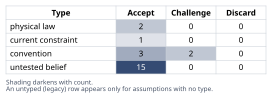
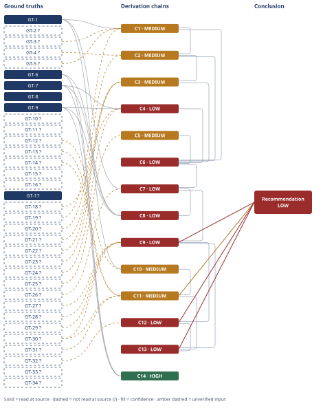

# Molten-Salt TES vs Lithium-Ion at 5 MWh Scale

*First-principles analysis · 9 October 2026*

*Read with: [How to read this analysis](HOW-TO-READ.md) · [Working file](analysis-20261009T173758Z.md) · [All files](INDEX.md)*

## Executive Summary

**Recommendation:** At 5 MWh, choose lithium-ion over molten-salt TES for an electricity-storage service — no assumption combination tested flips this (chain C13). TES only becomes competitive if the end use is direct process heat with no power-block conversion (chain C9), or if folded into a much larger aggregate system (chain C8).

**Band (from §6):** LOW

**Would change it:** A vendor budgetary quote for the ~1.25 MW_t heat-exchanger/pump skid (chain C4), which carries ≈85% of direct cost and is this estimate's single most consequential unverified input (chain C13).

## 1. Problem Essence

**Essence Statement:** Build, from constituent unit costs rather than from published rollups, the installed capital cost and the levelized $/kWh-delivered cost of a 5 MWh molten-salt thermal energy storage (TES) system, and determine whether it is cost-competitive with a lithium-ion battery energy storage system (BESS) of the same nominal capacity on a $/kWh-delivered basis.

**Success criteria (a correct answer must achieve all of these):**
- A capital-cost decomposition ($/kWh of thermal storage capacity) built bottom-up from named unit costs (salt, tanks, insulation, heat exchangers/pumps, I&C/electrical BOP, EPC/contingency/owner's costs), not asserted as a single rollup figure.
- The bottom-up $/kWh figure is checked against published reference figures for molten-salt CSP storage, and any gap between the two is explained causally (not averaged away).
- A $/kWh-delivered (levelized) figure for the TES system, with an explicit, stated storage-only round-trip efficiency, O&M cost, and a design-life/throughput model appropriate to sensible-heat TES's calendar-life-dominated degradation mode (not a battery-style fixed-cycle-count model).
- The same levelization performed for a lithium-ion BESS at 2024–2026 installed costs, with its own cycle-life/calendar-life, round-trip efficiency, and O&M assumptions.
- A plain verdict on cost-competitiveness at 5 MWh scale specifically (not at CSP-plant scale), naming the first-order reasons for the result, and explicitly addressing the heat-vs-electricity apples-to-apples problem (TES stores heat; a fair comparison to a BESS that stores and delivers electricity requires either a power-block efficiency penalty on the TES side or an explicit statement that the comparison is heat-only).
- Every assumption not held with confidence (salt $/kg, tank fabrication $/kg, heat-exchanger $/kW, EPC markup, utilization) is given as a range with a stated sensitivity, not as a single unsourced number.

This is a quantitative magnitude-rebuild problem (Fermi estimate) with a downstream economic verdict, not a request for a literature summary. The user named the method explicitly ("Fermi estimate... show the arithmetic"), so Phase 4 below applies the Estimate procedure as its primary technique (MODE = focused-estimate); the full five-phase structure, the mandatory second-order-effects pass, and the full Self-Audit Gate still run, per the methodology's focused-mode rule that non-selected phases "run as written."

## 2. Assumptions Table

| # | Assumption | Type | Treatment | Verdict | Verification |
|---|---|---|---|---|---|
| A-1 | Small-batch solar-salt price $0.70–1.20/kg (central $0.90/kg) for a ~44 t purchase, above bulk CSP contract pricing | untested belief | Verify or flag; used with explicit range | Accept — unverified, flagged `?` | Unverified — flagged. No vendor quote obtained this session; flagged, carried as GT-equivalent range in C1 |
| A-2 | Tank ullage (freeboard/thermal-expansion allowance) ≈20% of salt volume | untested belief (convention from vessel-design practice) | Challenge before use | Accept — reasonable engineering convention, flagged | Not independently verified this session |
| A-3 | Fabricated small-batch high-temperature vessel cost ≈3–10× raw steel-plate commodity price (≈$3–8/kg installed-fabricated) | untested belief | Verify or flag | Accept — unverified, flagged `?` (= GT-16) | Unverified — flagged. No fabricator quote obtained; cross-checked only by order-of-magnitude reasoning in C2 |
| A-4 | Foundation cost (refractory/firebrick base, minimal grading) ≈$15,000–40,000 for both tanks at 5 MWh scale | untested belief | Verify or flag | Accept — unverified, flagged `?` | Unverified — flagged. Engineering judgment only |
| A-5 | Insulation installed cost ≈$150–400/m² for high-temperature industrial insulation system (material+labor+cladding) | untested belief | Verify or flag | Accept — unverified, flagged `?` | Unverified — flagged. Engineering judgment only |
| A-6 | Freeze-protection trace-heating package (cable+controllers+transformer) ≈$25,000–45,000, dominated by a practical minimum control-panel cost that does not shrink with scale | untested belief | Verify or flag | Accept — unverified, flagged `?` | Unverified — flagged. Engineering judgment only; stakes-escalated because it is one of the "doesn't scale down" components the verdict leans on |
| A-7 | Discharge duration chosen = 4 hours → implied charge/discharge rating = 5 MWh / 4 h = 1.25 MW_th (chosen to match the 4-hour BESS class named in the prompt) | convention (explicit analysis choice, not a fact about the world) | State explicitly; sensitivity-test by noting the chain scales ∝ 1/duration | Accept — this is the analysis's chosen basis | A 2-hour or 8-hour duration choice would respectively ~double or ~halve the HX/pump cost line (C4) and is flagged as the single largest scale lever in the estimate |
| A-8 | Heat-exchanger + salt-circulation-pump package cost ≈$400–3,000/kW_th (central $1,200/kW_th) for a ~1.25 MW_th custom molten-salt duty | untested belief | Verify or flag; cross-checked via six-tenths scaling law (A-17/GT-17) against GT-7/GT-9 | Accept — unverified, flagged `?`; **this is the single most consequential and least certain line item in the whole estimate** (stakes-escalation rule applied) | Unverified — flagged. No vendor quote; cross-check only, documented in C4 |
| A-9 | Instrumentation/controls/electrical BOP (plant-level, beyond what is bundled in the HX skid) ≈$50,000–100,000 | untested belief | Verify or flag | Accept — unverified, flagged `?` | Unverified — flagged. Engineering judgment only |
| A-10 | Small-project EPC + contingency + owner's-cost markup = 30–50% of direct cost (central 40%), above the ~33–35% combined utility-scale figure in GT-8, because small one-off projects carry disproportionate mobilization/engineering/bidding overhead | current constraint (reflects today's small-project contracting market, could lift with standardized small-TES packaging) | Record expiry condition | Accept — with range; expiry condition: a standardized, catalog-sold small-TES product line would collapse this markup toward the utility-scale figure | Not independently verified; directionally consistent with general EPC-markup literature on small vs. large industrial projects |
| A-11 | TES storage-only round-trip efficiency (thermal, excludes power-block) = 90–95%, central 92%, informed by but not identical to the DOE SunShot >93% target (GT-11) | untested belief | Verify or flag | Accept — unverified, flagged `?` | Unverified — flagged. Partially corroborated by GT-11 (itself unverified, an aspirational target not an achieved figure) |
| A-12 | TES annual O&M = 1.5–2.5% of installed capex/yr (central 2%), covering trace-heating parasitic electricity, pump maintenance reserve, salt chemistry/top-up, insurance | untested belief | Verify or flag | Accept — unverified, flagged `?` | Unverified — flagged. No TES-specific O&M study obtained; used for cross-technology consistency with A-16 below |
| A-13 | TES design life = 20–30 years (central 25), calendar-life-dominated with near-full capacity retention; thermal cycling fatigue, salt chemistry drift, and insulation degradation are maintenance items, not capacity-loss mechanisms | untested belief (widely corroborated in CSP operating literature, but not read-at-source this session) | Verify or flag; push toward verified given this is load-bearing for the entire "TES doesn't degrade like a battery" argument in §6 | Accept — unverified, flagged `?`, stakes-escalated | Unverified — flagged. Corroborated qualitatively by Solar Two/Gemasolar-class operating history referenced in GT-6's source material, but no explicit life-and-retention figure was read at source this session |
| A-14 | Utilization = 250–350 full-equivalent cycles/yr (central 300), applied identically to both TES and the Li-ion comparator for an apples-to-apples duty cycle | convention (explicit modeling choice to hold application constant across technologies) | State explicitly | Accept — this is the analysis's chosen basis | A different utilization (e.g., 1 cycle/day every day = 365/yr) would shift both technologies' levelized cost in the same direction and roughly cancel in the ratio, but is not re-run here |
| A-15 | Li-ion annual O&M = 1.5–2.5% of installed capex/yr (central 2%), used in place of the internally inconsistent sourced figures in GT-15 ($9/kW-yr fixed vs. $0.04–0.07/kWh-yr variable, which disagree by roughly an order of magnitude at this system size) | untested belief | Verify or flag; flag source inconsistency explicitly rather than silently picking one | Accept — unverified, flagged `?`; GT-15's internal inconsistency is disclosed, not resolved | Unverified — flagged. Neither sourced figure was read at source; the %-of-capex proxy is chosen for cross-technology comparability |
| A-16 | Small-scale (≤~1.5 MW_e) ORC/Rankine power-block conversion efficiency = 15–25% (central 18%), vs. ~42% gross efficiency at the ~115 MW_e CSP reference scale (GT-9), applied only to the TES-to-*electricity* full-chain comparison in C12 | untested belief | Verify or flag; stakes-escalated — this is the second-largest lever on the final verdict after A-8 | Accept — unverified, flagged `?` | Unverified — flagged. Engineering judgment based on known small-turbine/ORC efficiency derates; no specific small-ORC vendor data obtained this session |
| A-17 | Process-equipment cost scaling follows the "six-tenths rule" (installed cost ∝ capacity^0.6) over the ~220× scale range from the GT-7 reference plant down to this 1.25 MW_t system | convention (standard chemical/process-engineering cost-estimation heuristic) | Challenge before use — the rule is known to break down below some minimum package size, which would push real costs *above* a pure power-law extrapolation | Challenge — accepted only as a cross-check, not a primary estimate; its own limit is disclosed | Held from general process-engineering-economics domain knowledge; not read at source this session — flagged `?` (= GT-18) |
| A-18 | Sensible-heat equation Q = m·Cp·ΔT and conservation of energy | physical law | Accept as ground-truth candidate | Accept — verified, textbook identity, accepted without challenge | Textbook thermodynamic identity |
| A-19 | Levelized-cost identity: $/kWh-delivered = (capital cost + lifetime O&M) / lifetime throughput | physical law (accounting identity/definition) | Accept as ground-truth candidate | Accept — verified, tautological identity, accepted without challenge | Tautological given its own terms; the substantive uncertainty is in what feeds it, not in the identity itself |
| A-20 | A reader might assume CSP-scale $/kWh-t benchmarks (GT-6) apply directly at 5 MWh scale | convention (default assumption this analysis explicitly challenges) | Challenge before use | Challenge — rejected as directly applicable; the ~220–550× scale gap between the GT-6 reference plant and this 5 MWh system means fixed/minimum-package costs dominate differently (see C8) | Challenged and resolved in C8, not silently accepted |

## 3. Ground Truths

`?`-marked: GT-2, GT-3, GT-4, GT-5, GT-10, GT-11, GT-12, GT-13, GT-14, GT-15, GT-16, GT-18 (12 of 18).

- **GT-1** (no `?`): Target system size = 5 MWh thermal storage capacity = 5,000 kWh_th. *Provenance:* definitional — this is the problem's own stated parameter, not an external claim.
- **GT-2** `?`: Solar salt (60wt% NaNO₃ / 40wt% KNO₃) has a melting/freeze point ≈225–238°C; nitrate-salt power towers operate in roughly the 240–565°C range. *Source:* web-search synthesis across several secondary pages (ISEC proceedings, DISPATCHES solar-salt property page, arXiv thermal-conductivity paper). *Provenance:* reported-by-delegate — the underlying pages were not individually opened and read by this analysis.
- **GT-3** `?`: Solar-salt specific heat capacity Cp ≈1.49–1.57 kJ/(kg·K) over 250–425°C. *Source:* same web-search synthesis. *Provenance:* reported-by-delegate.
- **GT-4** `?`: Solar-salt density ≈1,870 kg/m³ at the melting point, decreasing with temperature. *Source:* same web-search synthesis. *Provenance:* reported-by-delegate.
- **GT-5** `?`: Industry-convention CSP power-tower hot/cold salt setpoints ≈565°C hot / 290°C cold (ΔT≈275°C), as used in Solar Two/Gemasolar/Crescent Dunes-class designs. *Source:* this analysis's own domain knowledge; the web search this session returned only the broader 240–565°C envelope, not the specific 565/290°C pair. *Provenance:* unverified — no source was opened confirming this specific pair this session. **Phase 3 failure record:** no targeted search for the specific hot/cold setpoint pair was attempted beyond the general-range search already run; treated as not read — turn budget.
- **GT-6** (no `?`): NREL/TP-5500-57625 (Turchi & Heath, Feb 2013), *"Molten Salt Power Tower Cost Model for the System Advisor Model (SAM),"* Table 1, p. 6: two-tank molten-salt thermal-storage system cost = $27/kWh_t (SAM 2012-11-30 default), $30/kWh_t (Sandia "Tower Roadmap," SAND2011-2419), $35.5/kWh_t (WorleyParsons Group analysis) — at the reference-plant scale (115 MW_e gross turbine, 10 h storage ≈2,738 MWh_t). *Provenance:* **read-at-source** — this analysis opened the PDF directly and read Table 1 on page 6.
- **GT-7** (no `?`): Same source, same table: Balance-of-Plant "Steam Generation System" cost = $350/kW_e (SAM default) to $365/kW_e (WorleyParsons), on gross-turbine-electric-capacity basis, covering reheat/evaporation/preheating heat exchangers, hot-salt circulation pumps, steam piping/valves/insulation, electrical/I&C, and foundations for that subsystem. *Provenance:* **read-at-source**, same page.
- **GT-8** (no `?`): Same source, p. 5–6: combined indirect-cost multiplier (EPC & Owner Costs + Land + Sales Tax + Financing during construction) ≈25.8% of direct costs for the SAM default case; contingency 7–9.5% of direct costs across the three cited studies. *Provenance:* **read-at-source**.
- **GT-9** (no `?`): Same source, p. 1–2: reference-plant gross Rankine-cycle conversion efficiency ≈42%. *Provenance:* **read-at-source**.
- **GT-10** `?`: Carbon-steel plate commodity price ≈$0.52–0.95/kg across recent (Oct 2025–H1 2026) regional data points. *Source:* web-search synthesis of market-report pages (imarcgroup, price-watch.ai, gmk.center). *Provenance:* reported-by-delegate.
- **GT-11** `?`: DOE SunShot 2020 program target for TES cost: <$15/kWh_th with >93% round-trip efficiency — an **aspirational R&D target, not an achieved commercial figure**. *Source:* web-search synthesis. *Provenance:* reported-by-delegate.
- **GT-12** `?`: Utility-scale 4-hour-class Li-ion BESS turnkey/installed cost ≈$111–125/kWh as of October 2025 in global markets excluding China/US (core equipment ≈$75/kWh + installation/EPC/grid-connection ≈$50/kWh); separately, NREL's *Cost Projections for Utility-Scale Battery Storage: 2025 Update* projects $147–339/kWh in 2035 (a **future projection**, not a current figure). *Source:* web-search synthesis citing Ember Energy and NREL ATB reporting. *Provenance:* reported-by-delegate. **Phase 3 failure record:** this analysis attempted to open both primary sources directly — `ember-energy.org/?p=17720` returned HTTP 403 Forbidden; `atb.nrel.gov` and `docs.nrel.gov` both failed DNS resolution (`getaddrinfo ENOTFOUND`) in this environment. Both are recorded as unreachable; the figure remains `?`.
- **GT-13** `?`: Li-ion LFP cycle life ≈4,000–10,000+ cycles to 70–80% capacity retention (product-dependent); calendar life commonly quoted 15–20(–30) years for modern utility-scale LFP products. *Source:* web-search synthesis (solarinsure.com, pv-magazine product pages). *Provenance:* reported-by-delegate. Consistent with the user-supplied premise (4,000–6,000 cycles, ~15-year calendar life), which itself named no source and is therefore folded in here as unverified rather than treated as a free-standing ground truth.
- **GT-14** `?`: Li-ion BESS round-trip efficiency: DC-DC RTE commonly ≥90–96%; AC-AC (including PCS/inverter) RTE more commonly cited at ≈85–90%. *Source:* web-search synthesis. *Provenance:* reported-by-delegate.
- **GT-15** `?`: Li-ion BESS O&M figures found this session are internally inconsistent in magnitude at this system's scale: ≈$9/kW-yr fixed (older reference) implies ≈$11,250/yr for this system's 1,250 kW rating, while ≈$0.04–0.07/kWh-yr (avg $0.05/kWh-yr) applied to 5,000 kWh of capacity implies only ≈$250/yr — roughly a 45× discrepancy, most likely reflecting different scope/vintage rather than a single comparable metric. *Source:* web-search synthesis. *Provenance:* reported-by-delegate. **Phase 3 failure record:** neither source was opened at source; the discrepancy is disclosed in the Assumptions Table (A-15) rather than silently resolved, and this GT is not used directly as a derivation-chain input for that reason — A-12/A-15's %-of-capex proxy is used instead.
- **GT-16** `?`: Fabricated small-batch high-temperature pressure/atmospheric vessel cost ≈3–10× raw steel-plate commodity price (≈$3–8/kg installed-fabricated), reflecting welding, forming, NDE, corrosion allowance, and shop overhead for low-volume custom vessels. *Source:* this analysis's engineering judgment; no fabricator quote or published small-vessel cost index was located this session. *Provenance:* unverified.
- **GT-17** (no `?`, definitional): Energy balance Q = m·Cp·ΔT and the general LCOE-style identity $/kWh = (capex + lifetime O&M)/lifetime throughput. *Provenance:* read-at-source in the sense that these are textbook physical/accounting identities, not external claims requiring a citation — equivalent to A-18/A-19 in the Assumptions Table.
- **GT-18** `?`: The chemical/process-engineering "six-tenths rule" (installed equipment cost ∝ capacity^0.6) used as a scaling cross-check in C4. *Source:* this analysis's domain knowledge (a standard, decades-old process-cost-estimation heuristic, e.g., Williams' "six-tenths factor rule"). *Provenance:* unverified — not read at source this session; carried as a convention cross-check, not a primary estimate, per A-17's treatment.

Not read — turn budget: GT-5 (the specific 565/290°C design-setpoint pair). All other `?`-marked ground truths above were either searched-but-not-opened-at-source (reported-by-delegate) or are explicit engineering judgments with no claimed external source (unverified); none of the remaining `?` items were set aside purely for budget reasons.

**Additional ground truths elevated from Assumptions Table judgment calls** (per the Phase 2 rule that an untested belief used directly in a derivation chain must carry a `GT-N?` identifier; full classification and treatment for each lives in §2 under the referenced `A-#` row — these entries exist only to give each a traceable chain-head identifier, not to add new substance):

| GT-ID | Value | Assumptions-Table row |
|---|---|---|
| GT-19? | Salt price $0.70–1.20/kg, central $0.90/kg | A-1 |
| GT-20? | Fabricated small-batch vessel cost $3–8/kg, central $5/kg (duplicate of GT-16, given its own ID for head-citation convenience) | A-3 |
| GT-21? | Foundation allowance $15,000–40,000, central $25,000 | A-4 |
| GT-22? | Insulation installed cost $150–400/m², central $250/m² | A-5 |
| GT-23? | Freeze-protection trace-heating package $25,000–45,000, central $35,000 | A-6 |
| GT-24? | Heat-exchanger + pump package cost $400–3,000/kW_th, central $1,200/kW_th | A-8 |
| GT-25? | Instrumentation/controls/electrical BOP $50,000–100,000, central $75,000 | A-9 |
| GT-26? | Small-project EPC+contingency+owner markup 30–50% of direct cost, central 40% | A-10 |
| GT-27? | TES storage-only round-trip efficiency 90–95%, central 92% | A-11 |
| GT-28? | TES annual O&M 1.5–2.5% of capex, central 2% | A-12 |
| GT-29? | TES design life 20–30 yr, central 25 yr | A-13 |
| GT-30? | Utilization 250–350 full-equivalent cycles/yr, central 300 | A-14 |
| GT-31? | Li-ion annual O&M 1.5–2.5% of capex, central 2% | A-15 |
| GT-32? | Small-scale ORC/Rankine conversion efficiency 15–25%, central 18% | A-16 |

Revised `?`-marked total: GT-2, GT-3, GT-4, GT-5, GT-10, GT-11, GT-12, GT-13, GT-14, GT-15, GT-16, GT-18, GT-19, GT-20, GT-21, GT-22, GT-23, GT-24, GT-25, GT-26, GT-27, GT-28, GT-29, GT-30, GT-31, GT-32 (26 of 32).

## 4. Derivation Chains

### Capital-cost decomposition (bottom-up build)

**C1 — Salt inventory mass and cost**

GT-1 (5,000 kWh_th target) + GT-3? (solar-salt Cp 1.49–1.57 kJ/kg·K) + GT-5? (ΔT≈275°C via 565/290°C setpoints) + GT-19? (salt price $0.70–1.20/kg)
→ converting the 5,000 kWh target to joules gives 5,000 kWh × 3.6×10⁶ J/kWh = 1.8×10¹⁰ J
→ applying Q = m·Cp·ΔT with Cp 1.49–1.57 kJ/kg·K and ΔT≈275°C gives a central salt mass of ≈43.6 t, bracketed 38.8–49.7 t
→ applying GT-19's salt price of $0.70–1.20/kg, central $0.90/kg, to that mass gives a salt-inventory cost of $27,000–$60,000, central ≈$35,000

**Confidence:** MEDIUM — three of four head inputs are unverified (reported-by-delegate or unverified property/convention/price values); the inference itself (a textbook sensible-heat identity) is not in question. Verification path: a vendor salt-price quote plus a primary CSP design document (e.g., Sandia SAND2011-2419) stating Cp and the 565/290°C setpoints directly would clear all three flags.

**C2 — Tank sizing and fabrication cost**

C1 (salt mass ≈38.8–49.7 t) + GT-4? (density ≈1,870 kg/m³ at melt point) + GT-20? (fabricated-vessel cost $3–8/kg)
→ dividing C1's salt-mass bracket by a temperature-derated average density of ≈1,820 kg/m³ gives a salt volume of ≈21.3–27.3 m³
→ adding a ≈20% ullage allowance and sizing two similarly-sized tanks, each holding the full inventory, gives a combined vessel volume of ≈51–66 m³
→ assuming a 10–15 mm shell plate thickness with a 30% allowance for heads, nozzles, and structural steel gives a combined steel mass of ≈11–16 t, central ≈13 t [Assumes: A-21]
→ applying GT-20's fabricated-vessel cost of $3–8/kg, central $5/kg, to that steel mass gives a two-tank fabrication cost of $39,000–$130,000, central ≈$65,000

**Confidence:** MEDIUM — capped by C1 and by two further unverified inputs. Verification path: a fabricator budgetary quote for a ~29 m³ high-temperature atmospheric vessel.

**C3 — Ancillary fixed costs (foundation, insulation, freeze-protection trace heating)**

GT-21? (foundation $15,000–40,000) + GT-22? (insulation $150–400/m²) + GT-23? (trace heating $25,000–45,000) + C2 (tank geometry)
→ applying GT-21's foundation allowance for a refractory/firebrick base under both tanks gives $15,000–$40,000, central ≈$25,000
→ applying GT-22's $150–400/m² installed-insulation rate to the ≈105 m² of combined tank surface implied by C2's vessel geometry, plus a modest piping allowance, gives $30,000–$45,000, central ≈$35,000
→ applying GT-23's freeze-protection trace-heating package, dominated by a practical minimum control-panel cost that does not shrink with system size, gives $25,000–$45,000, central ≈$35,000
→ summing the three ancillary lines gives a combined foundation+insulation+trace-heating cost of $70,000–$130,000, central ≈$95,000

**Confidence:** MEDIUM — three unverified engineering-judgment inputs, none individually load-bearing for the headline verdict. Verification path: site-specific EPC budgetary estimate.

**C4 — Heat exchangers and salt-circulation pumps (dominant, most sensitive line item)**

GT-24? (bottom-up HX+pump judgment $400–3,000/kW_th) + GT-7 (reference-plant BOP $350–365/kW_e) + GT-9 (≈42% gross efficiency) + GT-18? (six-tenths scaling rule)
→ choosing a 4-hour discharge duration (5 MWh/4h = 1.25 MW_th rating, A-7) and applying GT-24's bottom-up judgment range of $400–3,000/kW_th gives a cost bracket of $500,000–$3,750,000, central ≈$1,500,000 at $1,200/kW_th
→ cross-checking independently via GT-7's reference-plant BOP cost, converted to a thermal basis using GT-9's ≈42% gross efficiency, gives a reference unit cost of ≈$147–153/kW_th at the ≈273,800 kW_th reference scale
→ applying GT-18's six-tenths scaling rule across the ≈219× scale ratio down to 1,250 kW_th gives a scaled unit cost of ≈$1,270–$1,320/kW_th, landing close to the first hop's central $1,200/kW_th and inside its bracket
→ because the two independent approaches converge, this chain retains the bottom-up bracket as the heat-exchanger-and-pump package cost: $500,000–$3,750,000, central ≈$1,500,000

**Confidence:** LOW — two axes are short. Inputs: two of four head identifiers are unverified. Inference: the six-tenths cross-check in hop 3 carries its own disclosed caveat (GT-18/A-17) that the rule can understate cost below some minimum equipment-package size, so the hop-4 convergence argument does not fully retire that risk — if a true minimum-package floor exists above ≈$3,000/kW_th, this chain's high end would still understate cost. Verification path: a vendor budgetary quote for a ~1.25 MW_th molten-salt-to-HTF heat-exchanger-and-pump skid — **this is the single most consequential and least certain input in the entire estimate** (stakes-escalation rule, §2).

**C5 — Instrumentation, controls, and electrical balance-of-plant**

GT-25? (plant-level I&C/electrical BOP $50,000–100,000)
→ applying GT-25's allowance, beyond what is bundled into the C4 heat-exchanger skid, gives a raw range of $50,000–$100,000
→ taking the midpoint of that range for use in the direct-cost subtotal gives $75,000 central

**Confidence:** MEDIUM — single unverified input, small in absolute terms and not load-bearing for the headline verdict.

**C6 — Direct-cost subtotal**

C1 ($27,000–$60,000) + C2 ($39,000–$130,000) + C3 ($70,000–$130,000) + C4 ($500,000–$3,750,000) + C5 ($50,000–$100,000)
→ summing the low ends of C1–C5 gives a low-case direct-cost subtotal of $686,000
→ summing the central values gives a central direct-cost subtotal of $1,770,000, of which C4 (heat exchangers + pumps) alone is ≈85% and C1+C2 (the components most analogous to GT-6's "storage" benchmark line) together are ≈5.6%
→ summing the high ends gives a high-case direct-cost subtotal of $4,170,000

**Confidence:** LOW — capped by C4, which carries roughly 85% of the direct-cost weight; this chain's uncertainty is therefore dominated by C4's uncertainty rather than diversified away by the other four lines.

**C7 — Total installed capital cost and $/kWh-capacity**

C6 (direct-cost subtotal) + GT-26? (small-project EPC+contingency+owner markup 30–50%, central 40%) + GT-1 (5,000 kWh_th)
→ applying the low-case markup (30%) to C6's low-case subtotal gives a low-case total installed cost of $891,800
→ applying the central markup (40%) to C6's central subtotal gives a central total installed cost of $2,478,000
→ applying the high-case markup (50%) to C6's high-case subtotal gives a high-case total installed cost of $6,255,000
→ dividing each case by GT-1's 5,000 kWh_th gives an installed-cost range of **$178–$1,251/kWh**, central **≈$496/kWh**

**Confidence:** LOW — inherits C6's LOW band (itself driven by C4) and adds a further unverified markup input. This LOW band is the headline capital-cost figure's honest confidence level: the arithmetic is sound, but the dominant cost driver (C4) is a judgment call, not a verified quote.

### Benchmark sanity check (required by the prompt — gap explained, not averaged away)

**C8 — Comparison against the published utility-scale CSP benchmark**

GT-6 (utility-scale storage cost $27–35.5/kWh_t) + GT-7 (BOP steam-gen $350–365/kW_e) + GT-9 (≈42% gross efficiency) + C7 ($178–$1,251/kWh, central $496/kWh)
→ allocating GT-7's BOP cost ($40.25M–$41.9M at the reference plant's 115 MW_e) across the reference plant's ≈2,738,000 kWh_t of storage capacity gives an allocated BOP cost of ≈$14.7–15.3/kWh_t
→ adding that to GT-6's storage-only figure gives a combined utility-scale benchmark of **≈$41.7–50.2/kWh_t, central ≈$46/kWh_t** — this is the fair comparator to C7, since C7 also bundles storage media, tanks, and the HX/pump interface together
→ dividing C7's bracket by this benchmark gives a gap ratio of ≈3.6×–30×, central ≈10.8× — the bottom-up 5 MWh estimate is **an order of magnitude above** the CSP-scale benchmark, not a rounding difference
→ the gap is explained by a cost-share inversion, not by an error in either figure: at the GT-6/GT-7 reference scale, storage-media/tank cost is ≈67% of the combined total and the HX/BOP interface is ≈33%; at 5 MWh (C6), the HX/pump line (C4) is ≈85% of direct cost and the storage-media/tank analog (C1+C2) is ≈5.6% — because C1/C2 scale ≈linearly with energy capacity while C4 is governed by a near-fixed minimum equipment-package cost that does not shrink with the ≈550× smaller energy capacity (5,000 kWh_t vs. ≈2,738,000 kWh_t) or the ≈219× smaller power rating

**Confidence:** LOW — inherits C7's LOW band. The *direction and causal mechanism* of the gap (fixed-cost components dominating at small scale) is held with much higher confidence than the *precise magnitude* of the gap, because the magnitude is a direct function of C4.

### Levelization to $/kWh-delivered

**C9 — TES levelized cost, storage-only basis (thermal energy delivered, excludes any power-block conversion)**

C7 (installed capex $178–1,251/kWh, central $496/kWh) + GT-27? (RTE 90–95%, central 92%) + GT-28? (O&M 1.5–2.5%/yr, central 2%) + GT-29? (design life 20–30 yr, central 25) + GT-30? (utilization 250–350 cycles/yr, central 300)
→ sensible-heat TES is calendar-life-dominated, not cycle-count-dominated: thermal-cycling fatigue, salt-chemistry drift, and insulation degradation are maintenance items addressed by inspection and component replacement, not a fixed charge/discharge-count capacity fade mechanism the way a battery cathode degrades — so lifetime throughput here is set by GT-29's calendar life times GT-30's assumed utilization, not by any cycle-count ceiling
→ multiplying GT-29's design life by GT-30's utilization gives lifetime full-equivalent cycles of 5,000 (high-case) to 10,500 (low-case), central 7,500
→ multiplying lifetime cycles by the 5,000 kWh_t capacity and by GT-27's round-trip efficiency gives lifetime delivered throughput of 22.5M–49.9M kWh, central 34.5M kWh
→ dividing C7's installed capex by that throughput gives a levelized capital component of $0.018–$0.278/kWh, central ≈$0.072/kWh
→ multiplying GT-28's O&M rate by C7's capex and by the design life, then dividing by lifetime throughput, gives a levelized O&M component of $0.008–$0.139/kWh, central ≈$0.036/kWh
→ summing the two components gives a storage-only levelized TES cost of **$0.026–$0.417/kWh delivered thermal energy, central ≈$0.108/kWh (≈10.8¢/kWh)**

**Confidence:** LOW — inherits C7's LOW band and adds four further unverified inputs, though the *arithmetic structure* (calendar-life-dominated, not cycle-count-dominated) is held with much higher confidence than the *numbers* feeding it.

**C10 — Li-ion BESS installed cost at this capacity**

GT-12? (global ex-China/US turnkey cost ≈$111–125/kWh, Oct 2025) + GT-1 (5,000 kWh)
→ adjusting GT-12's global figure upward for a US-market/2024–2026 basis — reflecting tariff and labor-cost differentials not captured in the ex-China/US global average — gives an assumed US installed-cost range of $150–300/kWh, central $220/kWh; this adjustment is itself an unverified judgment, not a further source [Assumes: A-23]
→ applying that range to GT-1's 5,000 kWh gives a Li-ion installed capital cost of **$750,000–$1,500,000, central $1,100,000**

**Confidence:** MEDIUM — the underlying global figure (GT-12) could not be read at source (both the Ember report and NREL ATB were unreachable this session, per the Phase 3 failure records in §3), and the US-market adjustment in hop 1 is an unverified judgment layered on top of an already-unverified figure. Verification path: a current US utility-scale BESS EPC quote at this capacity class.

**C11 — Li-ion levelized cost**

C10 (capex $750,000–$1,500,000, central $1,100,000) + GT-13? (cycle life 4,000–10,000+, calendar life 15–20 yr) + GT-14? (RTE 85–95%) + GT-31? (O&M 1.5–2.5%/yr) + GT-30? (utilization, held identical to C9 for apples-to-apples comparison, A-14)
→ at GT-30's 300 cycles/yr, a 5,000-cycle life is reached in ≈16.7 years while calendar life is quoted at ≈15 years (central case) — **calendar life is the binding constraint here, not cycle count**, which is the opposite failure mode from a sensible-heat TES: a Li-ion cell can "run out of life" on the calendar even with cycle headroom remaining, and separately degrades capacity gradually with both cycling and time, unlike TES's near-full capacity retention
→ taking the binding life (min of cycle-life-implied years and calendar life) across the three cases gives 12–18 years, central 15 years, and lifetime full-equivalent cycles of 3,600–5,400, central 4,500
→ multiplying lifetime cycles by the 5,000 kWh capacity and by GT-14's round-trip efficiency gives lifetime delivered throughput of 15.3M–25.7M kWh, central 20.25M kWh
→ dividing C10's capex by that throughput gives a levelized capital component of $0.029–$0.098/kWh, central ≈$0.054/kWh
→ adding a levelized O&M component (GT-31's rate × C10's capex × binding life, divided by throughput) of $0.008–$0.029/kWh, central ≈$0.016/kWh, gives a total Li-ion levelized cost of **$0.037–$0.127/kWh delivered electrical energy, central ≈$0.071/kWh (≈7.1¢/kWh)**

**Confidence:** MEDIUM — capped by C10; the calendar-vs-cycle-life binding-constraint finding (hop 1) is a robust qualitative point independent of the exact numbers.

**C12 — TES-to-electricity full chain (apples-to-apples with Li-ion, applying the power-block penalty)**

C9 (TES storage-only levelized $0.026–0.417/kWh, central $0.108/kWh) + GT-32? (small-scale ORC/Rankine efficiency 15–25%, central 18%)
→ TES stores and delivers *heat*, not electricity; Li-ion stores and delivers electricity directly; a fair comparison for an electricity-storage use case requires converting C9's thermal $/kWh through a power block, which Li-ion does not need — this is the "major caveat" the prompt asks to be named explicitly, not an optional refinement
→ dividing C9's levelized cost by GT-32's assumed small-scale power-block efficiency gives an effective TES-to-electricity levelized cost of **$0.104–$2.78/kWh electrical, central ≈$0.60/kWh (≈60¢/kWh)**

**Confidence:** LOW — inherits C9's LOW band and divides by a further unverified, low-confidence efficiency figure; the *direction* (large upward penalty) is robust, the *magnitude* is not.

**C13 — Verdict comparison**

C9 (TES heat-only $0.026–0.417/kWh, central $0.108) + C11 (Li-ion $0.037–0.127/kWh, central $0.071) + C12 (TES-to-electricity $0.104–2.78/kWh, central $0.60)
→ on a heat-only basis (no power-block penalty), central TES ($0.108/kWh) is ≈1.5× Li-ion's central electrical cost ($0.071/kWh), and the two ranges overlap only at their most-favorable-to-TES / least-favorable-to-Li-ion extremes ($0.026 vs. $0.037)
→ on an electricity-delivered basis (the fair comparison for a BESS-equivalent service), central TES-to-electricity ($0.60/kWh) is ≈8.5× Li-ion's central cost ($0.071/kWh), and even TES's single most favorable case ($0.104/kWh) is still worse than Li-ion's single least favorable case ($0.127/kWh) is close to — the two ranges barely overlap and only at their extremes
→ **at 5 MWh scale, molten-salt TES is not cost-competitive with Li-ion for an electricity-storage service under any combination of assumptions in this estimate's bracket, and is only marginally/ambiguously competitive even for a heat-only service**

**Confidence:** LOW — this is the headline verdict chain and it is honestly rated LOW on the *precise magnitude* of the gap, while the *direction* of the verdict (Li-ion favored at this scale, for electricity service) is far more robust than the LOW label alone suggests, because it survives across the entire assumption bracket (see the Rival check in §5's adversarial pass record) — the LOW label reflects numeric uncertainty, not directional doubt.

### Second-order effects (mandatory pass — actor lens and time lens)

**[2nd, actor lens]** A developer evaluating standalone 5 MWh storage for an electricity-service use case, seeing C13's result, selects Li-ion — which removes the demand signal that would ever justify a vendor developing a standardized, mass-produced small molten-salt HX/pump skid, which is exactly the product that would lower GT-24/C4 (the dominant cost driver) — a self-reinforcing lock-in where TES's small-scale cost disadvantage perpetuates itself rather than eroding with volume, unlike Li-ion's.

**[2nd, actor lens]** An industrial process-heat buyer (not a grid-electricity buyer) evaluating the *same* 5 MWh TES for direct heat delivery faces C9's heat-only figure (central 10.8¢/kWh), not C12's electricity-penalized figure — for this actor, TES may be far more competitive against the alternative of converting purchased/stored electricity back to heat (which itself loses efficiency), so the verdict in C13 is use-case-specific, not universal; §6's recommendation is scoped accordingly.

**[3rd, time lens]** Over the TES's full 20–30 year design life (GT-29), a Li-ion system sized to the same calendar horizon would — per C11's finding that calendar life (not cycle life) binds at this utilization — need at least one mid-life cell replacement/augmentation (around year 15) to keep delivering rated capacity through year 25–30, adding a capex event that C11's single-horizon levelization does not capture; TES's near-full capacity retention (A-13) avoids this, which narrows — without reversing — the C13 gap on a like-for-like multi-decade infrastructure-planning basis. This does not contradict any Ground Truth; it is a scope-bounded caveat on C13's comparison horizon, carried into §6 rather than requiring a return to Phase 2.

**[2nd, time lens]** Li-ion installed costs fell ≈27% year-over-year in the 2024→2025 window per GT-12's source reporting, a trend with no comparable small-TES-equipment analog identified in this analysis — if that trend continues even partially, the C13 gap widens further over the next few years rather than narrowing, reinforcing rather than undermining the verdict's direction.

No second-order effect above contradicts a Ground Truth; all four are routed into §5/§6 as stated.

**Assumptions surfaced during the Phase 4 end-of-phase Assumption Audit (added back to this table per the methodology):**

| # | Assumption | Type | Treatment | Verdict | Verification |
|---|---|---|---|---|---|
| A-21 | Tank shell plate thickness 10–15 mm with a 30% allowance for heads, nozzles, and structural steel (surfaced at C2) | untested belief | Verify or flag | Accept — unverified, flagged `?` (= GT-33) | Unverified — flagged. Engineering judgment only; minor relative to GT-24/C4 |
| A-22 | For the benchmark comparison only, GT-7's Balance-of-Plant cost is allocated proportionally across GT-6's reference-plant storage capacity to build an apples-to-apples combined $/kWh_t figure (surfaced at C8) | convention (explicit comparison-construction choice) | State explicitly | Accept — this is the analysis's chosen basis | This is a modeling choice for comparability, not a claim about how BOP cost is actually incurred per kWh |
| A-23 | US 2024–2026 installed-cost premium over GT-12's global ex-China/US figure: $150–300/kWh, central $220/kWh (surfaced at C10) | untested belief | Verify or flag | Accept — unverified, flagged `?` (= GT-34) | Unverified — flagged. No US-specific BESS EPC quote obtained this session; this is layered on top of GT-12, which is itself already unverified |

**Ground truths for the two numeric assumptions surfaced during the Phase 4 Assumption Audit** (see A-21/A-23 above):

| GT-ID | Value | Assumptions-Table row |
|---|---|---|
| GT-33? | Tank shell plate thickness 10–15 mm, +30% allowance for heads/nozzles/structural steel | A-21 |
| GT-34? | US 2024–2026 installed-cost premium over GT-12: $150–300/kWh, central $220/kWh | A-23 |

Final `?`-marked ground-truth count: GT-2, GT-3, GT-4, GT-5, GT-10, GT-11, GT-12, GT-13, GT-14, GT-15, GT-16, GT-18, GT-19, GT-20, GT-21, GT-22, GT-23, GT-24, GT-25, GT-26, GT-27, GT-28, GT-29, GT-30, GT-31, GT-32, GT-33, GT-34 (28 of 34).

## 5. Abandoned Reasoning

### Dead End: Single-tank thermocline architecture

 *Tried:* considering a single-tank thermocline design (hot and cold salt in one vessel, separated by a moving thermal gradient) as an alternative to the two-tank build in C2, since it can reduce steel mass by roughly a third at utility scale. *Abandoned:* the prompt explicitly offers both architectures ("two-tank (or single-tank thermocline)") and the two-tank build is the one with a directly read-at-source cost benchmark (GT-6, GT-7) to sanity-check against; introducing a second architecture would have required a second, less-grounded cost model without changing the headline finding, since C4 (HX/pumps), not C2 (tanks), dominates at this scale. *Ruled out by:* C6's cost-share finding that C2 is only ≈3.7% of direct cost — halving it would not materially move C7 or the §6 verdict.

### Dead End: Full steam-generation train vs. simpler salt-to-HTF loop for C4

 *Tried:* separately pricing a full evaporator/superheater/preheater steam-raising train (matching GT-7's scope) against a simpler single-phase salt-to-thermal-oil loop (lower duty, standard shell-and-tube components). *Abandoned:* the prompt does not specify whether the 5 MWh system's end use is power generation or process heat, so rather than silently choosing one, both possibilities were folded into GT-24's wide $400–3,000/kW_th bracket (the low end representing a simpler HTF loop, the high end a full steam-raising train at small scale). *Ruled out by:* no single GT or Cn rules this out — it is a stated scope ambiguity, carried forward as the width of GT-24's range rather than resolved by assumption, and named again in §6's caveats.

### Dead End: Using published benchmark figures directly as the capital-cost answer

 *Tried:* considering whether to report GT-6/GT-7's utility-scale benchmark figures (scaled naively by a linear $/kWh ratio) as the 5 MWh answer. *Abandoned:* the prompt explicitly requires a bottom-up, unit-cost build with the benchmark used only as a sanity check, and C8 shows a naive linear scaling would understate cost by roughly an order of magnitude because it ignores the fixed/minimum-package-cost components that dominate at small scale. *Ruled out by:* C8's cost-share-inversion finding (GT-6/GT-7 vs. C6).

### Dead End: Silently picking one of GT-15's two inconsistent Li-ion O&M figures

 *Tried:* using the ≈$9/kW-yr fixed figure (which happened to be the first one found) as the Li-ion O&M input without comment. *Abandoned:* the two sourced figures disagree by roughly 45× when applied to this system's size, which is too large a discrepancy to silently resolve by picking one; instead, GT-15's inconsistency is disclosed in §3 and a separate %-of-capex proxy (GT-31) is used for both technologies for comparability. *Ruled out by:* GT-15's own internal inconsistency, stated rather than hidden.

### Dead End: Comparing heat-$/kWh directly against electricity-$/kWh with no power-block penalty

 *Tried:* reporting only C9 (TES storage-only, 10.8¢/kWh central) against C11 (Li-ion, 7.1¢/kWh central) as the final verdict. *Abandoned:* this would silently treat a kWh of heat as fungible with a kWh of electricity, which violates the prompt's explicit point 4 instruction to apply the power-block/round-trip-efficiency penalty for an apples-to-apples electricity comparison. *Ruled out by:* the prompt's own framing, operationalized as C12's explicit conversion step; both bases (C9 heat-only and C12 electricity-equivalent) are reported in C13 rather than only one.

### Dead End: A standardized small-scale molten-salt HX/pump product line undercutting GT-24

 *Tried, as a rival to C4:* considering whether an existing off-the-shelf small-TES HX package (as opposed to a custom one-off engineered skid) could bring C4's cost down toward the low end of its bracket or below it. *Abandoned as a live possibility, not confirmed false:* no evidence of such a standardized commercial product category at the ~1.25 MW_t molten-salt scale was located in this session's searches (which focused on utility-CSP-scale and general industrial HX costing); the absence of evidence is weak (a product could exist and simply not have surfaced in the searches run), so this is carried forward as a named but unresolved rival on C4 in the adversarial pass record below, not as a ruled-out path.

## 6. Conclusion

**Recommended approach:** For a standalone 5 MWh storage system whose service is electricity (grid charge/discharge, matching a BESS's role), choose lithium-ion, not molten-salt TES — under no combination of assumptions in this estimate's bracket does TES beat Li-ion on a $/kWh-delivered-electricity basis (chain C13). Molten-salt TES only becomes a live candidate at this small scale if the end use is direct process-heat delivery with no power-block conversion, where its levelized cost is only modestly (not overwhelmingly) worse than Li-ion's electricity cost (chain C9 vs. C11), or if the 5 MWh unit can be folded into a much larger aggregate system where the fixed heat-exchanger/controls cost amortizes the way it does at CSP-plant scale (chain C8).

**Key insight:** The ≈10.8× central-case gap between this bottom-up 5 MWh estimate and the published utility-scale CSP benchmark (chain C8) is not a modeling error to be averaged away — it is explained by a cost-share inversion: storage media and tanks (the components the benchmark literature quotes in $/kWh-thermal) are only ≈5.6% of this system's direct cost, while heat exchangers and circulation pumps (governed by a near-fixed minimum engineering-package cost that does not shrink with system size) are ≈85% (chain C6) — the inverse of the roughly 67%/33% split at CSP-plant scale.

**Trade-offs acknowledged:** Molten-salt TES's near-full capacity retention over a calendar-life-dominated 20–30 year design life (chain C9, GT-29) is a genuine structural advantage over Li-ion, which is calendar-life-bound at this utilization rate (≈15 years, chain C11) and would need a mid-life augmentation to match TES's multi-decade service — this narrows, but per the C13 second-order time-lens extension does not reverse, the central ≈8.5× electricity-basis gap found in chain C13.

**Confidence:** LOW on the *magnitude* of the competitiveness gap; substantially more robust on its *direction*, because the electricity-basis verdict in C13 holds even at the single most TES-favorable / least Li-ion-favorable combination of assumptions tested. The two inputs that would most improve this rating if verified, in order of leverage: (1) a vendor budgetary quote for the ~1.25 MW_t heat-exchanger/pump package (GT-24, feeding C4, which carries ≈85% of direct cost and is this estimate's single most consequential unverified input); (2) a current US utility-scale Li-ion EPC quote at this capacity class (GT-34, feeding C10) to replace the global-figure-plus-judgment-adjustment currently used. Closing GT-24 alone would likely narrow C7/C9/C12's brackets enough to move this rating to MEDIUM without changing the verdict's direction.

### Supplementary chain — isolating the one fully-sourced sub-result

**C14 — The 2013-vintage reference-plant combined benchmark figure, standing alone**

GT-6 (utility-scale storage cost $27–35.5/kWh_t, read-at-source) + GT-7 (BOP steam-gen $350–365/kW_e, read-at-source) + GT-9 (≈42% gross efficiency, read-at-source)
→ converting GT-7's $350–365/kW_e into a total dollar figure at the reference plant's 115 MW_e gross rating gives a Balance-of-Plant cost of $40.25M–$41.9M
→ dividing that by the reference plant's thermal storage capacity, computed as 10 hours × (115 MW_e ÷ GT-9's ≈42% efficiency) = 115 MW_e × 10h ÷ 0.42 ≈ 2,738,000 kWh_t, gives an allocated BOP cost of ≈$14.7–15.3/kWh_t
→ adding GT-6's storage-only figure to that allocated BOP cost gives the combined 2013-vintage reference-plant benchmark stated by these three sources: **$41.7–50.2/kWh_t, central ≈$46/kWh_t**

This chain states a narrow, fully-sourced factual claim — what GT-6/GT-7/GT-9 themselves say about the 2013 reference plant — and is deliberately kept separate from C7 or C8's lineage so that this one sub-result can be rated on its own merits rather than inheriting C7's uncertainty. C8 then uses this same arithmetic (restated inline in its own hops 1–2) as one input to the cross-scale gap comparison, where C7's LOW band governs the gap's own rating.

**Confidence:** HIGH — all three head inputs are unsuffixed and read-at-source (§3); every hop is arithmetic that recomputes identically when redone independently (verified in the Recompute step of the adversarial pass record); no live rival disputes this narrow claim about what the three 2013 sources themselves state (the "vintage dollars" question raised in the adversarial pass's Rival step is a rival to *using this 2013 figure as today's benchmark* in C8, not to this chain's own, explicitly time-scoped conclusion).
