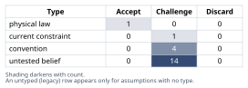
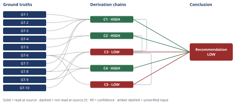

# Northbrook Churn Spike Root-Cause Analysis

*First-principles analysis · 9 October 2026*

*Read with: [How to read this analysis](HOW-TO-READ.md) · [Working file](analysis-20261009T174548Z.md) · [All files](INDEX.md)*

## Executive Summary

**Recommendation:** Run a two-to-three-week diagnostic phase before funding any structural fix: pull the actual customer count and account-level churn list to check whether the spike is concentrated in a few accounts (chain C1); lock down the churn/ticket/adoption definitions; correlate release, staffing, cohort, and competitive timelines against the two CS signals to test the live candidate causes (chain C3); and run only low-cost renewal outreach in parallel until that's done, gating bigger spend behind the findings (chain C4).

**Band (from §6):** LOW — the Conclusion rests on C3 and C5, both LOW because the leading internal-operational hypothesis is not yet confirmed and three rivals (sales-motion, external/competitive, concentration-artifact) remain genuinely live (chain C3); C1, C2, and C4 are independently HIGH.

**Would change it:** The account-level concentration check (chain C1) and the release/staffing/cohort/competitive-timeline correlation (chain C3) — whichever of the four candidate pictures that data confirms would move C3, and derivatively C5, toward HIGH or collapse the analysis onto a single named cause.

## 1. Problem Essence

**Core problem:** Determine, with explicit confidence levels and without forcing a single cause, which upstream driver(s) are responsible for Northbrook's quarterly churn rate more than doubling (4.1% → 9.2%) between Q1 and Q3, and specify exactly what data would confirm or falsify each live candidate before committing remediation spend.

**Success criteria:**
1. The conclusion names the most probable causal chain(s) at an explicitly stated confidence band (HIGH/MEDIUM/LOW), and does not present a single forced root cause where the evidence genuinely supports 2-3 live alternatives.
2. For every live candidate driver, a specific, obtainable data pull or test is named that would discriminate it from its rivals.
3. The action plan separates low-cost/reversible diagnostic-and-triage actions from higher-cost/harder-to-reverse structural remediation actions, and sequences the latter behind the former.
4. No conclusion in this analysis asserts a root cause that is not traceable to a fact given in the brief, a verified mathematical identity, or an explicitly flagged hypothesis awaiting data — reasoning by analogy to "how churn usually happens in SaaS" is excluded as a basis for the conclusion.

---

## 2. Assumptions Table

**Fishbone (Ishikawa) category scan.** Before classifying individual assumptions, the candidate-cause space was brainstormed breadth-first across nine locked categories: the five leadership named (Offer/Product Gaps, Pricing Pressure, Onboarding Failure, Service Quality Degradation, Competitive Displacement) plus four surfaced by ground-truth reasoning (Macro/Budget Environment, Internal Org Changes, Product/Release Changes, Sales-Motion/ICP Changes). Each category's branches enter the table below as `untested belief` rows (A-8 through A-12, A-16 through A-18); none is prioritized over another here because no discriminating observation has yet been run — prioritization is deferred to Section 4/6 once the discriminating tests are named. Two categories (Service Quality Degradation and Product/Release Changes) share enough mechanism that they are split into two rows (A-8 org/staffing, A-9 release/defect) rather than collapsed, because each has a different discriminating test.

| Assumption | Type | Treatment | Verdict | Verification |
|---|---|---|---|---|
| A-1: The reported churn rate (4.1%→9.2%) is logo churn (count of accounts), not revenue churn (dollars), or some undisclosed blend, and both figures use the same definition. | untested belief | Verify, or flag unverified. | Challenge — the brief never states which metric is used; logo churn and revenue churn can diverge sharply when a few large accounts are involved (see C1). | unverified — flagged; pull the churn-reporting methodology doc / ask Finance-RevOps directly which metric and formula produced both figures |
| A-2: Both the 4.1% and 9.2% figures use the same denominator convention (cancellations in quarter ÷ active accounts at quarter start), not mixed methodologies. | untested belief | Verify, or flag unverified. | Challenge — a denominator change alone (e.g., switching from "contracted accounts" to "billed accounts") could manufacture part of the apparent rise. | unverified — flagged; confirm the churn-rate formula was held constant Q1→Q3 |
| A-3: "Quarterly churn rate" is being compared like-for-like across Q1 and Q3 (not one point-in-quarter figure vs. one annualized/trailing figure). | convention | Challenge the convention explicitly before use. | Challenge — the brief's own parenthetical ("so churn is typically observed/decided at renewal, but can also show up as early/mid-contract cancellation") signals multiple churn-triggering events are being pooled into one quarterly figure; worth confirming pooling method is stable across quarters. | unverified — flagged |
| A-4: The churn increase is broad-based across the portfolio rather than concentrated in a few large accounts or a single bad cohort. | untested belief | Verify, or flag unverified. | Challenge — directly tested in chain C1; this is the single most consequential unverified belief in the analysis. | unverified — flagged; requires account-level churn list with ACV, cohort, and segment (see Conclusion §6) |
| A-5: Rising support tickets and falling adoption scores are themselves root causes of churn (CS's implicit framing), rather than downstream symptoms of a common upstream cause, or trailing indicators of churn already underway. | convention | Explicitly challenge before use. | Challenge — see chain C2; correlation with the churn window does not establish that either signal is a causal lever rather than a co-symptom. | unverified — flagged |
| A-6: There is one identifiable "root cause" to find (leadership's framing: "find the root cause... and fix it"), rather than several compounding factors. | convention | Explicitly challenge before use. | Challenge — see chain C5; nothing in the brief rules out two or more factors operating concurrently, and the fishbone scan surfaced no reason to expect exactly one. | unverified — flagged |
| A-7: No change occurred in how "churn," "support ticket," or "adoption score" are defined, logged, or computed between Q1 and Q3. | untested belief | Verify, or flag unverified. | Challenge — a redefinition would manufacture or mask a real trend without any underlying behavioral change. | unverified — flagged; pull metric-definition change log for the CS tooling and BI/reporting pipeline |
| A-8 (Service Quality / Internal Org, fishbone category): No internal organizational change (CS/support headcount, turnover, support-tier restructuring) occurred in the Q1-Q3 window that could independently explain rising tickets and/or slower resolution. | untested belief | Verify, or flag unverified. | Challenge — understaffing or turnover is a textbook mechanism for simultaneously rising ticket backlogs and falling perceived quality. | unverified — flagged; pull CS headcount/turnover timeline from HR/CS leadership |
| A-9 (Product/Release Changes, fishbone category): No product release or deployment introducing defects, regressions, or disruptive UX changes occurred in the Q1-Q3 window that could explain both the ticket rise and the adoption-score drop through one event. | untested belief | Verify, or flag unverified. | Challenge — a single bad release is the most parsimonious explanation for two concurrent CS signals (see C2/C3). | unverified — flagged; pull release/deployment log, correlate dates against ticket-volume and adoption-score trend lines |
| A-10 (Sales-Motion/ICP Changes, fishbone category): No change in sales motion, ICP targeting, or packaging/pricing shifted the mix of newly-signed or renewing accounts toward a worse-fit segment earlier in the year. | untested belief | Verify, or flag unverified. | Challenge — a worse-fit cohort would independently generate more tickets (confusion) and lower adoption (feature mismatch), and would show up as cohort concentration rather than a broad-based shift. | unverified — flagged; pull sales-motion/ICP change history and win-rate-by-segment data from RevOps |
| A-11 (Macro/Budget Environment, fishbone category): No macro-economic or customer-side budget contraction independent of Northbrook's own actions is depressing renewals. | current constraint | Record expiry conditions. | Challenge — expires as a candidate once the customer base's churn is benchmarked against industry/peer churn for the same period; if Northbrook's rise tracks a broader market contraction, this stops being Northbrook-specific and the "fix" framing changes entirely. | unverified — flagged; no industry-benchmark comparison is currently available |
| A-12 (Competitive Displacement, fishbone category, leadership-named): Competitive displacement is contributing to the churn increase. | untested belief | Verify, or flag unverified. | Challenge — plausible but currently has zero supporting evidence in the brief. | unverified — flagged; needs win/loss and non-renewal reason codes — explicitly unavailable per GT-10 |
| A-13: For a churn rate computed as a proportion of a finite customer base, the number of additional churned accounts needed to move the rate by Δ percentage points scales directly with the base size (smaller base → fewer accounts needed for the same swing). | physical law | Accept as a ground-truth candidate. | Accept — this is a mathematical identity for proportions, not negotiable by context; promoted to GT-7. | not applicable — definitional/arithmetic fact |
| A-14: CS's qualitative flags (rising tickets, falling adoption) are representative of the full customer base, not driven disproportionately by a small number of vocal or high-touch accounts unrepresentative of the broader portfolio. | untested belief | Verify, or flag unverified. | Challenge — aggregate commentary from CS can be dominated by the loudest accounts; this is the same concentration risk as A-4 applied to the symptom data rather than the churn figure itself. | unverified — flagged; needs ticket-volume and adoption-score distributions by account, not just aggregate trend commentary |
| A-15: The correct organizational response to "find the root cause and fix it" is to commit to a single structural remediation program immediately, rather than to first run low-cost diagnostics that could falsify most candidates within days. | convention | Explicitly challenge before use. | Challenge — see chain C4 and the pre-mortem below; this planning convention is the one most directly tested by the adversarial pass. | unverified — flagged; justified by the pre-mortem findings rather than a data pull |
| A-16 (Pricing Pressure, fishbone category, leadership-named): Pricing pressure (renegotiation-driven non-renewals, or a pricing/packaging change that raised effective cost) is contributing to the churn increase. | untested belief | Verify, or flag unverified. | Challenge — plausible, no supporting evidence yet. | unverified — flagged; needs renewal-negotiation records (discount requests, price-objection reason codes) and pricing/packaging change history |
| A-17 (Offer/Product Gaps, fishbone category, leadership-named): Offer/product gaps (missing functionality relative to customer needs or competitors, independent of any specific defect) are contributing to the churn increase. | untested belief | Verify, or flag unverified. | Challenge — plausible, no supporting evidence yet. | unverified — flagged; needs feature-gap analysis from lost-deal and renewal-risk accounts |
| A-18 (Onboarding Failure, fishbone category, leadership-named): Onboarding failures are contributing disproportionately to the churn increase, concentrated in newer-cohort accounts. | untested belief | Verify, or flag unverified. | Challenge — plausible, no supporting evidence yet; testable against cohort-by-tenure data. | unverified — flagged; needs cohort churn-by-tenure/signup-date breakdown |
| A-19: Northbrook's active customer count (N) plausibly falls in the range of roughly 40-500 accounts, consistent with a mid-market SaaS vendor at $18k-$40k ACV. | untested belief | Verify, or flag unverified. | Challenge — a placeholder bracket used only to show the order-of-magnitude sensitivity in chain C1, not a confirmed figure. | unverified — flagged; pull actual N from CRM/billing before finalizing any concentration conclusion |
| A-20: The diagnostic data pulls recommended in §6 (cohort/concentration breakdown, release/staffing timeline correlation, light competitive-intel pull) are obtainable within roughly 2-3 weeks using systems Northbrook already has (CRM, billing, ticketing, deployment logs, HR), without new instrumentation or survey fielding. | untested belief | Verify, or flag unverified. | Challenge — if false, the diagnostic phase's timebox lengthens but the sequencing principle in chain C4 still holds (see C4's confidence line). | unverified — flagged; confirm data availability with IT/RevOps/CS-Ops before finalizing the diagnostic timeline |

---

## 3. Ground Truths

**5-Whys, reduce-to-primitives mode, applied to the claim "quarterly churn rate rose from 4.1% to 9.2%."** Decomposing this compound claim into its constituents: (1) a numerator — accounts (or revenue) that cancelled, failed to renew, or gave non-renewal notice within the quarter; (2) a denominator — the active base at the start of the quarter; (3) a pooling rule — renewal-driven, early-cancellation, and mid-contract non-renewal events are all pooled into one "churn" figure per the brief's own framing. Testing each constituent against the irreducibility test: the *existence* of the 4.1% and 9.2% figures and the direction/magnitude of the move are directly stated facts (bottom out at direct report — GT-2, GT-3 below). The *formula* producing them (logo vs. revenue, exact denominator timing, pooling consistency) is not stated anywhere in the brief and does not reduce any further without that data — it bottoms out at "unverified," which is why A-1/A-2/A-3 carry the `?`-equivalent "unverified — flagged" treatment rather than being promoted to ground truths. This is the correct outcome of the drill, not a gap in it: a claim's irreducible primitives are sometimes themselves unverifiable with the evidence on hand, and the drill's job is to say precisely which primitive that is, not to manufacture a reduction that isn't supported.

**Provenance note.** This analysis has no external citation to open — every fact below is either (a) read directly from the leadership-supplied problem brief/task instructions that constitute this analysis's entire evidentiary record, or (b) a mathematical identity requiring no external source. No sub-agent, search tool, or delegate supplied any fact in this list, so the `reported-by-delegate` provenance case does not arise here. This is a real scope limitation, not a formality: nearly everything of substance below the metric-existence level is therefore classified `untested belief` in Section 2 rather than promoted to a ground truth, which is the central structural finding of this analysis — see Section 6.

- **GT-1** Northbrook sells a B2B data-integration and reporting SaaS platform to mid-market operations teams, on annual contracts of $18,000-$40,000 ACV, renewing yearly — source: problem brief, "Context" paragraph; read-at-source: quoted verbatim from the task's opening paragraph.
- **GT-2** Quarterly churn rate was 4.1% in Q1 — source: problem brief, "Observed facts" bullet 1; read-at-source: quoted verbatim.
- **GT-3** Quarterly churn rate rose to 9.2% by the end of Q3, more than doubling over roughly two quarters — source: problem brief, "Observed facts" bullet 2; read-at-source: quoted verbatim.
- **GT-4** Customer Success has flagged rising support-ticket volume, as a qualitative signal with no quantified magnitude, timeline, or category breakdown stated — source: problem brief, "Observed facts" bullet 3; read-at-source: quoted verbatim.
- **GT-5** Customer Success has flagged a drop in feature-adoption scores, as a qualitative signal with no quantified magnitude or scoring methodology stated — source: problem brief, "Observed facts" bullet 4; read-at-source: quoted verbatim.
- **GT-6** As of this analysis, leadership has not identified which candidate driver(s) among offer/product gaps, pricing pressure, onboarding failure, service-quality degradation, competitive displacement, or a combination, is responsible — source: problem brief, "Observed facts" bullet 5; read-at-source: quoted verbatim.
- **GT-7** For a churn rate computed as a proportion of an active customer base of size N, moving the observed rate by Δ percentage points requires approximately Δ×N additional churned accounts in that quarter — so the same percentage-point swing is produced by far fewer accounts when N is small — source: definitional/arithmetic identity for proportions; provenance: read-at-source (derived directly; not an empirical claim requiring external citation; promoted from A-13 per the physical-law treatment).
- **GT-8** The problem brief does not state Northbrook's active customer count (N), nor any account-level, cohort-level, or segment-level breakdown of which customers churned — source: problem brief, read-at-source; absence confirmed by re-reading the full "Observed facts" list and "Context" paragraph in full.
- **GT-9** The problem brief does not state a product release/deployment timeline, a CS/support staffing or turnover timeline, a pricing/packaging change log, or competitive win-loss/non-renewal reason-code data — source: problem brief, read-at-source; absence confirmed the same way as GT-8.
- **GT-10** No exit-interview or churn-survey data exists yet for this churn cohort — source: task instructions, item 5 ("since we don't have survey/exit-interview data yet"); read-at-source: quoted verbatim.

**Provenance summary:** `?`-marked: none (0 of 10) — every ground truth above is either a direct quotation from the supplied brief/task or a mathematical identity, so none requires the unverified/delegate-reported suffix. Read-at-source locations: GT-1 — Context paragraph, opening sentence; GT-2 — Observed facts bullet 1; GT-3 — Observed facts bullet 2; GT-4 — Observed facts bullet 3; GT-5 — Observed facts bullet 4; GT-6 — Observed facts bullet 5; GT-7 — derived directly from the definition of a proportion (no external passage to cite); GT-8 — absence confirmed against the full Observed facts/Context text; GT-9 — absence confirmed the same way; GT-10 — Task section, item 5. All ten ground truths above feed at least one load-bearing chain in Section 4.

---

## 4. Derivation Chains

**5-Whys, causal mode, applied to "support-ticket volume is rising" (GT-4).** Lateral scan at level one: (a) usage is growing and more customers simply generate more contact volume (not a problem signal); (b) the same customers are hitting more defects per customer (a product-quality cause); (c) a specific recent release introduced new defects (a time-boxed product cause); (d) slower first-response/resolution is causing re-opens and follow-up tickets that inflate the count without any new underlying issue (a service-capacity cause); (e) a change in what counts as a "ticket" (e.g., a new in-app widget routing more interactions into the ticketing system) is partly an artifact, not a behavioral change. Applying the counterfactual test to each: for (a), if usage weren't growing would the ticket rise still have happened — unresolved, no usage-growth figure is given; for (b)/(c), if no new defects existed would tickets still have risen — unresolved, no defect-rate or release-timeline data is given (GT-9); for (d), if resolution speed hadn't slowed would the same raw problems still generate the same ticket count — unresolved, no staffing/resolution-time data is given (GT-9); for (e), if the ticket definition hadn't changed would the count still show the same trend — unresolved, no definition-change log is given (A-7). None of these five branches currently passes or fails the counterfactual test on the evidence in hand, so each is recorded as `Unresolved ? — [observation needed]` rather than forced to a verdict: (b)/(c) resolve with a defect-rate-by-release-date pull; (d) resolves with a resolution-time-over-time pull; (e) resolves with a ticket-taxonomy change log. The drill's value here is not a verified root cause (none is reachable from the given facts) but a precise statement of which five observations would settle it — those five observations are folded into the §6 diagnostic list.

**5-Whys, causal mode, applied to "feature-adoption scores are dropping" (GT-5).** Lateral scan: (a) genuine usage decline — customers disengaging, a leading indicator of churn itself rather than an independent cause; (b) the adoption-scoring model itself changed (new scored actions added that existing customers haven't adopted yet, mechanically lowering the score with no behavior change); (c) a product change removed or relocated a previously-scored feature; (d) a shift in the customer mix toward segments that structurally use fewer modules; (e) seasonal usage variation tied to customers' own budget cycles. Counterfactual test: (a) is indistinguishable from reverse causality — accounts already headed for non-renewal often disengage before they leave, which would make the adoption drop a *symptom of the same cause as the churn itself* rather than a contributor to it, and nothing in the given facts can separate "adoption drop causes churn" from "whatever causes churn also causes the adoption drop"; (b)/(c) resolve with a scoring-methodology change log (not given); (d) resolves with a segment-mix-over-time pull (not given); (e) resolves with a year-over-year seasonal baseline (not given). All five remain `Unresolved ? `. The same structural point as GT-4's drill applies directly to Section 2's A-5: neither CS signal can be assumed, on the facts given, to be a cause of churn rather than a correlate or trailing symptom of it.

**Fishbone-to-chain linkage.** The nine-category scan in Section 2 produced four structurally distinct candidate causal pictures, each consistent with GT-4/GT-5/GT-6 but requiring a different, currently-unpriced assumption: **Chain A** (internal operational/product) — a release regression or a support staffing/turnover event drives both CS signals and then churn; **Chain B** (sales-motion/ICP drift) — a worse-fit cohort entered earlier in the year and now generates both signals and concentrated churn; **Chain C** (external/competitive) — a macro or competitive shock drives churn largely independent of the two CS signals; **Chain D** (concentration/statistical artifact) — the swing is explained by a small number of idiosyncratic large-account losses with no systemic cause at all, which chain C1 below shows is numerically plausible at low customer counts. None of A/B/C/D is ruled out by the facts given; chain C3 below carries all four forward as a formal derivation rather than resolving them.

### Conclusion C1: Whether the Q1→Q3 churn swing is a broad-based trend or a concentration/noise artifact cannot be determined without Northbrook's actual active-customer count and an account-level churn list

GT-1 (ACV $18k-$40k) + GT-2 (Q1 churn 4.1%) + GT-3 (Q3 churn 9.2%) + GT-7 (proportion-swing identity) + GT-8 (N and account-level data not stated)
→ the 5.1-percentage-point rise requires roughly 0.051 × N additional churned accounts in Q3 relative to Q1's loss rate, where N is the active customer count at the start of the quarter *[Assumes: A-19 — a placeholder bracket for N, used only to show order-of-magnitude sensitivity]*
→ for a plausible mid-market SaaS account count in the range of 40 to 500, that works out to roughly 2 accounts at the low end and roughly 26 accounts at the high end
→ at the low end of that range a handful of large-account cancellations could fully explain the entire swing, while at the high end dozens of accounts would have had to churn, so whether this is a broad-based trend or a concentration artifact cannot be determined without the real N and an account-level churn list

**Confidence:** HIGH — the hop marked `[Assumes: A-19]` uses a placeholder bracket for N (40-500), but the endpoint does not depend on where within reason N actually falls: for any N below roughly 100 the "could be a handful of accounts" reading holds, and for any N the qualitative conclusion — that determinacy requires the real N and account list, which nobody has pulled yet — holds regardless of A-19's specific bracket, so the assumption's failure does not reverse the endpoint.

### Conclusion C2: Rising support tickets and falling adoption scores should be treated as correlated symptoms requiring their own upstream explanation, not as demonstrated root causes of churn in themselves

GT-4 (rising ticket volume) + GT-5 (dropping adoption scores)
→ an increase in product or service friction would mechanically produce both more support tickets and lower adoption scores through one upstream event, so the two CS signals are consistent with a single common cause rather than two independent causes
→ the same two signals are equally consistent with reverse causality, where accounts already on a path to non-renewal for reasons unrelated to tickets or adoption show correlated changes in both as a trailing effect rather than a cause
→ because at least two structurally different causal pictures are compatible with GT-4 and GT-5 alone, treating either signal as itself the root cause of churn is not supported by the facts given, and both should be carried as symptoms requiring their own upstream explanation

**Confidence:** HIGH — this is a deductive point about what can and cannot be inferred from correlation alone, using only GT-4 and GT-5; the rival this chain addresses is Section 2's A-5 (CS's implicit framing that the two signals are themselves root causes), which the chain's own third hop rules out as unsupported by the given facts, leaving no further rival live for this specific claim.

### Conclusion C3: Among four structurally distinct candidate causal pictures, an internal operational/product cause is the best-supported working hypothesis, but it is not confirmed and three rivals remain genuinely live

GT-6 (driver not yet identified) + GT-9 (no release/staffing/competitive timeline data) + GT-10 (no exit-interview/survey data) + C1 (indeterminate without N/account data) + C2 (symptoms require upstream explanation)
→ among the fishbone categories, only an internal operational or product event — a release regression, or a support staffing/turnover change — explains both CS-flagged signals through one coincident cause, making it the most parsimonious working lead *[Assumes: A-8, A-9 — no internal org or release change has been ruled in or out]*
→ a sales-motion or ICP shift earlier in the year would also explain both signals, but only inside a specific cohort, and nothing in the given facts confirms or rules out that concentration *[Assumes: A-10]*
→ an external or competitive shock would explain the churn rise largely independent of the two CS signals, and nothing in the given facts confirms or rules out that either *[Assumes: A-11, A-12]*
→ with three structurally different explanations each resting on an unpriced assumption, and with C1 leaving open whether the swing is even broad-based rather than a concentration artifact, the internal-operational hypothesis is the best-supported working lead but is not confirmed, and the sales-motion, external/competitive, and concentration-artifact pictures all remain live, unsettled rivals

**Confidence:** LOW — two axes are short at once. Inference: hops one through three each rest on an unpriced `[Assumes: A-8/A-9/A-10/A-11/A-12]` premise, and which of the four candidate pictures is correct would genuinely change if any of those assumptions turned out false, so the HIGH exception (endpoint survives the assumption's failure) does not apply here. Rivals: chains B (sales-motion/ICP), C (external/competitive), and D (concentration artifact, carried by C1) are explicitly named live and nothing in this analysis settles any of them. What would close each: A-8/A-9 close with a release-and-staffing-timeline-vs-ticket/adoption-trend correlation; A-10 closes with a cohort-by-signup-date churn breakdown; A-11/A-12 close with an industry-churn benchmark and win/loss or non-renewal reason codes (see §6 diagnostics).

### Conclusion C4: Resource-intensive remediation should be gated behind a short diagnostic phase, with only low-cost, reversible triage actions running in parallel, rather than committing to a structural fix before the data gaps are closed

GT-6 (driver not yet identified) + GT-8 (no account-level data) + GT-9 (no timeline/competitive data)
→ committing resource-intensive remediation now, before the data gaps in GT-8 and GT-9 are closed, means betting resources on a cause that has not been confirmed
→[2nd] actor lens: CS, Sales, and Finance would each plausibly launch their own uncoordinated fix — staffing changes, discounting, a reactive feature build — duplicating spend and sending customers mixed signals during the renewal conversations that matter most
→[2nd] time lens: within a quarter the churn metric could improve temporarily just because a handful of already-scheduled renewals close favorably, masking whether any fix actually worked and inviting a premature declaration of success
→[3rd] time lens: if the real upstream driver is instead left unaddressed for two more quarters, the next renewal wave experiences the same unaddressed friction, compounding the revenue loss and shrinking the ARR base available to fund whichever fix eventually gets confirmed
→ because the diagnostics that would close GT-8's and GT-9's gaps are inexpensive and fast relative to any structural remediation option, the plan should gate resource-intensive remediation behind a short diagnostic phase while running only low-cost, reversible triage actions in parallel *[Assumes: A-20 — diagnostics are obtainable in roughly 2-3 weeks from existing systems]*

**Confidence:** HIGH — the hop marked `[Assumes: A-20]` would, if false, lengthen the diagnostic timebox, but the sequencing principle itself (diagnose cheaply before committing to expensive, hard-to-reverse remediation) survives as long as diagnostics remain cheaper than the remediation options, so the endpoint does not reverse. The live rival — "move fast and fix everything in parallel now, given how costly continued churn is" — is addressed, not dismissed: the plan is explicitly a hybrid that runs zero-regret triage in parallel with diagnosis (see the pre-mortem's Cluster 3 disposition below) rather than waiting on confirmation before doing anything, which is where this rival is settled.

### Conclusion C5: Leadership's "find the one root cause" framing should be provisionally revised to "find and address the dominant one or two factors, and expect more than one" — unless the concentration check shows otherwise

GT-6 (driver not yet identified) + C3 (best-supported lead not confirmed, three rivals live)
→ the fishbone scan surfaced nine plausible categories with no evidence yet ruling out more than one operating concurrently, and two independent CS signals moving together is at least as consistent with several reinforcing factors as with one isolated failure
→ chain C3's unresolved concentration question (chain D, carried by C1) is the one live rival that would cut against a multi-factor reading, because a swing fully explained by a handful of idiosyncratic large-account losses would not need a systemic multi-factor story at all
→ until the concentration/account-level data pull resolves that question, leadership's "one root cause" framing should be provisionally revised to "find and address the dominant one or two factors, and expect more than one," while holding open the possibility that no systemic cause exists at all

**Confidence:** LOW — capped by C3, the below-HIGH chain this chain's head cites; C3's own confidence line carries the explanation and is not repeated here. No additional downgrade cause belongs to this chain beyond that cap.

---

## 5. Abandoned Reasoning

### Dead End: Elevate pricing pressure to the leading hypothesis because contract values are substantial

**What was tried:** Reasoning that because Northbrook's contracts are sizable ($18k-$40k ACV), renewal-time price objections are a natural default explanation for a renewal-driven churn spike.

**Why abandoned:** Contradicted by GT-9 and A-16 — there is no renewal-negotiation, discount-request, or price-objection data in the brief at all, and nothing distinguishes pricing from the other five leadership-named categories. Promoting it over the others would be reasoning from contract size alone, which is not evidence of a price-driven mechanism.

**What it ruled out:** Saves the reader from treating "the contracts are big, so price must be the issue" as a substantive finding; pricing stays in Section 2 (A-16) as an equally-weighted, untested fishbone branch pending the same renewal-data pull as every other category.

### Dead End: Treat rising ticket volume as itself a well-defined, actionable root cause and recommend a support-staffing increase immediately

**What was tried:** Reading GT-4 directly as "support is under-resourced" and jumping to a staffing remediation.

**Why abandoned:** The ticket-volume figure is unquantified in the brief (no percentage, raw count, or category breakdown), and chain C2 establishes that rising tickets are at least as likely to be a symptom of an upstream cause as an independent driver. A staffing fix would address capacity regardless of whether the underlying driver is a product regression, a worse-fit sales cohort, or something external — wasting spend if it is not a capacity problem.

**What it ruled out:** Saves the reader from treating "tickets are up, so hire more support staff" as a self-evident fix; this exact failure mode is Cluster 1 of the pre-mortem below.

### Dead End: Use "industry-typical SaaS churn playbooks" (e.g., "churn spikes usually trace to onboarding, so overhaul onboarding") as the basis for the conclusion

**What was tried:** Reasoning by analogy to commonly-cited SaaS churn causes to shortcut the diagnostic phase.

**Why abandoned:** Explicitly excluded by this methodology's no-analogies-as-direct-evidence rule and by the task's own instruction not to assume a root cause unsupported by the given facts; no onboarding-specific evidence (e.g., churn concentrated in newer cohorts) appears anywhere in the brief. Onboarding remains in Section 2 (A-18) as one untested fishbone branch among several, not a favored conclusion.

**What it ruled out:** Saves the reader from mistaking a common industry pattern for evidence specific to Northbrook's actual data.

### Dead End: Treat a methodology artifact (e.g., a churn-definition change) as sufficient to explain the entire swing and stop the investigation there

**What was tried:** Considering whether A-1/A-2/A-3/A-7 (possible changes in how churn, tickets, or adoption are defined or computed) could, on their own, fully account for the 4.1%→9.2% move.

**Why abandoned:** Speculative with no verification path from the given facts — the brief gives no indication either way, and even if a definitional change contributed partially, it would not preclude a real underlying cause existing simultaneously. Asserting it as *the* explanation would go beyond what the evidence supports in either direction.

**What it ruled out:** Keeps A-1/A-2/A-3/A-7 correctly scoped as a methodology check to run early (cheap, see §6) rather than as a conclusion in its own right.

---

## 6. Conclusion

**Recommended approach:** Run a two-to-three-week diagnostic phase before committing any resource-intensive fix, in this order: (1) pull Northbrook's actual active-customer count and an account-level churn list for Q1 and Q3 to resolve the concentration question (chain C1); (2) lock down the churn/ticket/adoption-score definitions (A-1, A-2, A-3, A-7) so the diagnostic data is comparable; (3) correlate the release-deployment and CS-staffing timelines against the ticket-volume and adoption-score trend lines to test the internal-operational hypothesis (chain C3); (4) pull a cohort-by-signup-date churn breakdown to test the sales-motion/ICP hypothesis also carried in chain C3; (5) pull win-loss and non-renewal reason codes, plus an industry churn benchmark, to test the competitive and macro hypotheses (chain C3). In parallel, run low-cost triage immediately regardless of diagnostic outcome: proactive outreach and executive check-ins on all at-risk renewals in the next two quarters. Gate any structural remediation spend — staffing changes, pricing concessions, onboarding redesign, feature investment — behind the diagnostic phase's findings (chain C4).

**Key insight:** The two concrete signals Customer Success flagged — rising tickets and falling adoption — do not by themselves establish any causal direction toward churn: both are at least as consistent with being downstream co-symptoms of a single upstream event, or trailing effects of churn already underway, as with being independent root causes (chain C2); and the single question that would do the most to narrow the four live causal pictures — whether the swing is concentrated in a handful of accounts or broad-based — has not yet been checked at all (chain C1), even though it requires no new data collection, only a CRM/billing pull.

**Trade-offs acknowledged:** This plan accepts a two-to-three-week delay before any structural fix is funded, during which the churn rate itself will not visibly improve; it accepts that the universally-safe triage actions (renewal outreach) will not resolve the underlying driver if one exists; and it accepts that if diagnostics show genuine concentration in a few accounts, the appropriate response may be "no systemic fix is warranted," which is a harder message to deliver to leadership than a confident root-cause story (chain C4).

**Confidence:** LOW — the Conclusion rests on C3 and C5, both rated LOW because the leading internal-operational hypothesis is not yet confirmed and three rivals (sales-motion, external/competitive, concentration-artifact) remain genuinely live; C3's and C5's own confidence lines carry the detailed explanation and are not repeated here. This is the calibrated rating given the evidence, not a hedge: the task's own instruction is to say so explicitly rather than force a single confident answer where the evidence does not support one, and C1, C2, and C4 — the diagnostic-sequencing and symptom-reframing claims that do not depend on which causal chain turns out correct — are independently rated HIGH.
