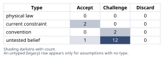
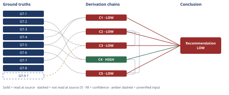

# Root Cause of Northbrook's Accelerating Churn

*First-principles analysis · 10 October 2026*

*Read with: [How to read this analysis](HOW-TO-READ.md) · [Working file](analysis-20261010T020831Z.md) · [All files](INDEX.md)*

## Executive Summary

**Recommendation:** Treat Northbrook's accelerating churn as primarily an internal product-quality / support-capacity problem, not pricing or competitive, and execute a composite bundle now — immediate internal triage plus a short, targeted diagnostic data pull — while deferring broad discounting and a competitive win-back push until data confirms the dominant hypothesis (chain C5).

**Band (from §6):** LOW, set by chains C1, C2, C3, and C5 (C4 alone is HIGH).

**Would change it:** Confirming ticket volume is a per-account rate rise and the adoption-scoring methodology was unchanged (chain C2); churn-by-signup-vintage data, the one finding that could overturn rather than merely weaken this attribution (chain C2); and each quarter's renewal-eligible count (N), resolving whether the swing is real or noise (chain C1).

# Northbrook Analytics — Root Cause of Accelerating Quarterly Churn

## 1. Problem Essence

**Core problem:** Northbrook's quarterly (renewal-cohort) churn rate more than doubled in two quarters (4.1% in Q1 to 9.2% by end of Q3), and leadership needs the most probable root-cause story — among product/offer gaps, pricing pressure, onboarding failure, service/support quality degradation, competitive displacement, or a combination — identified from the stated facts alone (no raw dataset, no interview transcripts, no competitor intel available), together with an explicit confidence rating, a concrete list of data to pull next to discriminate between the remaining live hypotheses, and a set of near-term actions split into those justified now regardless of which hypothesis is correct ("no-regret" moves) versus those that should wait for diagnostic confirmation.

**Success criteria:**
1. The analysis names the single most probable root-cause story (which may be a named combination of categories, not necessarily exactly one of the five) and attaches an explicit confidence band with stated caveats, derived from the given facts rather than from outside knowledge.
2. The attribution is built from a fishbone-style cause map spanning the five named candidate categories plus any additional branches the facts suggest, and from a 5-Whys drill-down on both CS-flagged symptoms (rising ticket volume, declining adoption score), so a skeptic can trace the attribution back to that evidentiary base.
3. The analysis lists specific, concretely pullable data items — named by system/field, not by vague category — each tied to the specific hypothesis or rival it would confirm or rule out.
4. The analysis separates recommended near-term actions into actions robust under multiple plausible root causes ("no-regret") versus actions that should wait for diagnostic data, with each action traceable to the reasoning that justifies it.
5. The analysis explicitly discloses, at every step, what is a stated fact versus what is an unverified assumption, given that no further data beyond the problem brief is available to this analysis.

## 2. Assumptions Table

### 2a. Cause map (fishbone) — companion technique: fishbone

Category set chosen: the five candidate categories leadership named, plus one residual category ("Macro / customer-side") added because its omission would silently assume it away. Set locked before brainstorming; no category added or removed afterward.

**Product / Offer**
- A defect or regression shipped in a recent release increased error/confusion-driven tickets.
- A third-party data-source or integration-partner change broke existing integrations (salient because Northbrook is a *data-integration* platform).
- A competitor added a feature Northbrook lacks, making the offer comparatively weaker without Northbrook itself changing.
  - Sub-cause: the gap is net-new (competitor shipped something) vs. longstanding (gap always existed, only recently decisive).

**Pricing**
- A list-price increase or packaging/tier change was rolled out broadly.
- Renewal-time price resistance is unrelated to a formal price change — customers who are otherwise unhappy become newly price-sensitive at the renewal conversation (this sub-cause is really a *symptom* of another category, not an independent driver — flagged as such below).

**Onboarding**
- A specific signup cohort (e.g., from an aggressive sales push or channel deal) was under-onboarded and is now reaching its first annual renewal with low product fluency.
- Documentation/training did not keep pace with a UI or workflow change, producing both confusion-driven tickets and lower adoption in the same cohort.

**Service / Support quality**
- CS/Support headcount or seniority mix decreased or failed to scale with the book, lengthening resolution times and starving proactive adoption work (QBRs, training).
- Rising ticket volume (from any cause) saturates support capacity, which *itself* then suppresses adoption-building activity — a feedback loop rather than a single independent cause.

**Competitive displacement**
- A named competitor entered or repriced aggressively in this window (cannot be assessed — no competitor intel available, per the problem's stated scope).
- Competitors exploit dissatisfaction Northbrook itself created (friction/support quality), rather than displacing Northbrook on their own merits — i.e., competitive displacement as a *vehicle* for an internal root cause rather than an independent exogenous cause.

**Macro / customer-side (added; not in leadership's original five)**
- Mid-market operations budgets contracted industry-wide, reducing willingness to renew regardless of Northbrook's performance.

**Discriminating observations named per prioritized branch** (detail in §2b/§2c and the data-pull list in §6): ticket-taxonomy-by-root-cause and release-date correlation discriminates the Product branch; CS headcount/attrition trend discriminates the Service branch; churn-by-signup-vintage discriminates the Onboarding branch; pricing/billing change log discriminates the Pricing branch; CRM loss-reason codes discriminate the Competitive and Macro branches. No single branch currently has a discriminating observation this analysis can apply without further data — this absence is itself the finding that drives the §6 data-pull list.

### 2b. 5-Whys drill-down on the two CS-flagged symptoms — companion technique: five-whys (causal mode)

**Symptom A — rising support-ticket volume.** Lateral causes at level 1: (a) more production defects reaching customers; (b) support capacity/responsiveness degraded, inflating ticket counts via re-contacts on slow resolutions; (c) organic usage growth (more customers, more legitimate tickets); (d) an upstream integration-partner or data-source dependency broke; (e) a UI/workflow change shipped without adequate documentation.
Counterfactual test on (c): would ticket volume still have risen without usage growth, *and* does usage growth explain the co-occurring adoption-score *decline*? No — growing usage predicts rising adoption, not falling adoption. (c) fails the joint-explanation test and is demoted to a contributing condition at best, not a cause of the paired signal (this is recorded as a ruled-out path in §5). (a), (b), (d), (e) each pass the counterfactual test individually (removing any one plausibly removes some of the ticket rise) but none can be confirmed as the *operative* one without further evidence — each is carried forward as `Unresolved ? — would be settled by ticket-taxonomy-by-root-cause data correlated to release/incident dates`.
One level deeper on (a): why would defects increase? — accelerated release cadence, reduced QA investment, technical debt. Stop here: a corrective (slow cadence, add regression coverage) is nameable and actionable, but which specific branch is operative is not knowable from the given facts.

**Symptom B — declining feature-adoption scores.** Lateral causes at level 1: (a) friction/bugs on core workflows drive disengagement (links to Symptom A causes (a)/(d)); (b) a compositional effect — the customer mix shifted toward newer, less-onboarded accounts, mechanically lowering the *average* score without any existing customer behaving differently; (c) a competitor's superior feature set siphons usage for specific workflows pre-churn; (d) CS reprioritizes capacity toward firefighting rising tickets, starving proactive adoption work — a direct causal link *from* Symptom A *to* Symptom B, not merely two parallel symptoms of one upstream cause.
This last branch (d) is an important reframing: it means the two CS-flagged "correlated signals" need not share a common upstream cause at all — rising tickets can mechanically *produce* falling adoption by consuming the same finite CS capacity. This strengthens rather than weakens the service/support-capacity hypothesis, because it gives an additional causal mechanism (not just correlation) linking the two flagged signals.
Branch (b) cannot be distinguished from "existing customers are using the product less" using an aggregate score — this requires cohort-level (same-customer-over-time) adoption trend data, which this analysis does not have. Recorded as `Unresolved ? — requires cohort-level adoption trend`.

### 2c. Inversion pass on the emerging attribution — companion technique: inversion

Claim inverted: "Internal product/offer-quality and service/support-capacity degradation is the dominant root cause." Failure-guaranteeing conditions enumerated (at least five, unfiltered): (1) the ticket-volume rise is a raw-count artifact of a larger book, not a per-account rate increase; (2) the adoption-score decline is a measurement-methodology artifact (scoring model or tracked feature set changed); (3) a named competitor shipped a materially better or cheaper offering in this window and is winning renewals independent of Northbrook's internal issues; (4) a broad price increase coincided with the affected renewal cohorts and is the true trigger; (5) one poor-fit onboarding/signup vintage accounts for most of the incremental churn while the rest of the book is stable; (6) a single acute incident (one bad release, one outage) caused a one-time trust break rather than an ongoing, compounding degradation.
Necessary preconditions derived and tagged `load-bearing` where the headline attribution would not survive their failure: (1)→A-3 load-bearing; (2)→A-4 load-bearing; (3)→cannot be verified or ruled out with available facts, carried as a live residual hypothesis rather than resolved; (4)→A-6 load-bearing; (5)→A-8 load-bearing, and is the single most consequential discriminator identified in this entire analysis (it is the one condition that would flip the headline story to "onboarding," not merely weaken confidence in it); (6)→A-12 load-bearing, and determines whether the recommended fix is an ongoing quality program or a one-time incident remediation.
This pass did not newly originate assumptions beyond A-3/A-4/A-6/A-8/A-12 already required by §2b — its contribution is to make explicit that these five are not incidental hedges but failure-guaranteeing conditions for the headline claim, which is why each is marked `load-bearing` in the table below rather than left as a generic caveat.

### 2d. Classified Assumptions Table

| Assumption | Type | Treatment | Verdict | Verification |
|------------|------|-----------|---------|--------------|
| A-1: "Quarterly churn rate" means the % of accounts whose annual renewal fell in that quarter that did not renew (a cohort/renewal-based statistic), not a rate applied uniformly across the whole active book | convention | Explicitly challenge before use — ask whether the convention holds here | Challenge — the only interpretation consistent with GT-3 (annual renewal) absent a stated mid-term-cancellation mechanism; adopted as working definition but not confirmed | unverified — flagged (confirm Northbrook's internal churn-rate methodology/definition) |
| A-2: No material mid-term cancellation right exists in Northbrook's standard contract (churn events are confined to each account's renewal date) | convention | Explicitly challenge before use | Challenge — standard for enterprise/mid-market annual SaaS, but this analysis has not seen the contract template | unverified — flagged (pull contract template / legal terms) |
| A-3 (load-bearing): the CS-flagged "rising ticket volume" is a per-account rate increase, not a raw count mechanically inflated by a larger total customer base | untested belief | Verify or flag unverified | Challenge — CS described it as a flagged signal implying some normalization was likely applied, but this is not confirmed | unverified — flagged (pull tickets-per-account trend by month) |
| A-4 (load-bearing): the feature-adoption scoring methodology and tracked feature set were unchanged across Q1–Q3 | untested belief | Verify or flag unverified | Challenge — no information either way | unverified — flagged (confirm with CS/product ops whether the scoring model changed) |
| A-5: the two CS-flagged signals are genuinely time-correlated with the churn-rate rise, not merely concurrent, unrelated trends | untested belief | Verify or flag unverified | Challenge — CS "flagged" them as correlated, but no time series was provided to this analysis to confirm lead/lag | unverified — flagged (pull weekly/monthly time series of all three metrics) |
| A-6 (load-bearing): no broad price increase or packaging/tier change was rolled out to the customer base during Q1–Q3 | untested belief | Verify or flag unverified | Challenge — absence of mention in the brief is not evidence of absence | unverified — flagged (pull pricing/billing change log) |
| A-7: a structured "reason for non-renewal" field exists in Northbrook's CRM that could capture competitive or price-driven departures | current constraint (data not currently available to this analysis; expires once CRM data is pulled) | Record expiry conditions | Accept — as a scoping limit on this analysis, not a claim about the world | unverified — flagged (confirm the field exists; if so, pull its distribution) |
| A-8 (load-bearing — single most consequential discriminator identified): customer cohort/vintage mix was stable across Q1–Q3, i.e., the churn-rate rise is not an artifact of a specific poor-fit onboarding vintage reaching renewal | untested belief | Verify or flag unverified | Challenge — directly contested by the Onboarding branch of §2a and the inversion pass's precondition (5) | unverified — flagged (pull churn-by-signup-vintage breakdown) |
| A-9: CS's own signal-flagging (tickets, adoption score) reflects methodologically reliable internal telemetry | untested belief | Verify or flag unverified | Accept — provisionally, since CS explicitly flagged these as a deliberate observation rather than an ad hoc impression | unverified — flagged (review CS's own flagging methodology) |
| A-10: macro / customer-side budget pressure is not a primary driver | untested belief | Verify or flag unverified | Challenge — silence in the brief is not evidence of absence; genuinely cannot be assessed from the given facts | unverified — flagged (would require exit-interview themes or external macro context, outside this analysis's stated scope) |
| A-11: the reported churn percentages are logo-count churn, not revenue-weighted churn | untested belief | Verify or flag unverified | Challenge — the brief does not specify; the two can tell different stories if churn concentrates at one end of the $18k–$40k range | unverified — flagged (confirm definition with Finance/RevOps; compute revenue-weighted churn too) |
| A-12 (load-bearing): the churn-rate rise reflects an ongoing, continuing trend across Q1→Q2→Q3, not a single-quarter spike that happens to land at Q3 | untested belief | Verify or flag unverified | Challenge — only two of three quarterly figures were given; the shape between them is unknown | unverified — flagged (pull the actual Q2 figure and monthly data) |
| A-13: a specific identifiable product release or integration-partner incident in Q1/Q2 is the proximate trigger of the ticket-volume rise | untested belief | Verify or flag unverified | Challenge — plausible mechanism from §2a's Product branch, not confirmed | unverified — flagged (correlate ticket-volume spikes with the release/deploy calendar and integration-partner incident history) |
| A-14: CS/Support headcount and seniority mix held flat or decreased across Q1–Q3 | untested belief | Verify or flag unverified | Challenge — plausible mechanism from §2a's Service branch, not confirmed | unverified — flagged (pull CS headcount and attrition trend Q1–Q3) |
| A-15 (surfaced by the end-of-Phase-4 Assumption Audit from chain C1, step 2): each quarter's renewal-cohort sample size (N) is large enough that a 4.1%→9.2% swing exceeds plausible sampling variation rather than reflecting a small-N artifact | untested belief | Verify or flag unverified | Challenge — no denominator (N) was given for either quarter | unverified — flagged (pull renewal-eligible account counts per quarter; compute a confidence interval around each quarterly rate) |
| A-16 (surfaced by the end-of-Phase-4 Assumption Audit from chain C5, step 7 — the [2nd]-order extension): the recommended triage will be executed by reallocating *existing* CS capacity toward at-risk accounts, not by adding net-new headcount | untested belief | Verify or flag unverified | Challenge — not yet confirmed whether budget for net-new CS headcount is approved | unverified — flagged (confirm with CS/Finance leadership whether net-new headcount is approved or only reallocation is available) |
| A-17 (surfaced by the end-of-Phase-4 Assumption Audit from chain C5, step 8 — the [2nd]-order extension): no formal "no ad hoc discounting" policy currently constrains account reps at renewal, absent the explicit policy this analysis recommends adopting | current constraint (expires once the recommended policy in §6 is formally adopted) | Record the expiry condition | Accept — expires once the §6 policy recommendation is formally adopted; until then the gap is real | unverified — flagged (confirm current discount-approval policy with Sales leadership) |

Assumption Audit cross-reference: A-15, A-16, and A-17 were not present after the initial §2b/§2c pass; each was surfaced during the end-of-Phase-4 Assumption Audit (see the Assumption Audit scan in the process-output appendix) from a specific chain step (C1 step 2; C5 steps 7 and 8 respectively), and each is recorded here per that scan's requirement rather than left as an undeclared premise.

## 3. Ground Truths

**Phase 3 verification step — scope note:** the sole source available to this analysis is the user-supplied problem brief, which has already been read in full within this conversation; there is no external citation (file, URL, dataset) to open, per the problem's explicit framing ("no further data than what's given above is available"). GT-1 through GT-8 below are therefore `read-at-source` against that one source, cited as "problem brief, as given." GT-9 is a logical derivation, not an externally sourced claim; its `?` reflects dependency on unverified assumption A-2, not an unread citation.

- **GT-1** Northbrook sells a B2B SaaS data-integration and reporting platform to mid-market operations teams — source: problem brief, as given; read-at-source: opening context paragraph.
- **GT-2** Contract values range $18,000–$40,000 per year — source: problem brief, as given; read-at-source: opening context paragraph.
- **GT-3** Contracts renew annually — source: problem brief, as given; read-at-source: opening context paragraph ("annual renewal cycle").
- **GT-4** Quarterly churn rate was 4.1% in Q1 — source: problem brief, as given; read-at-source: churn-figures paragraph.
- **GT-5** Quarterly churn rate rose to 9.2% by end of Q3 — source: problem brief, as given; read-at-source: churn-figures paragraph.
- **GT-6** The churn rate more than doubled within two quarters (9.2% ÷ 4.1% ≈ 2.24×) — source: problem brief, as given, combined with direct arithmetic on GT-4/GT-5; read-at-source: churn-figures paragraph ("more than doubled in two quarters"), arithmetic independently recomputed in §4/§5.
- **GT-7** Customer Success flagged two signals correlated with the churn rise: rising support-ticket volume and declining feature-adoption scores — source: problem brief, as given; read-at-source: Customer Success signals paragraph.
- **GT-8** No further data beyond the above is available to this analysis (no raw dataset, no customer-interview transcripts, no competitor intelligence) — source: problem brief, as given; read-at-source: scope-boundary paragraph. This is a methodological ground truth defining the boundary of what this analysis can verify, not a business fact about Northbrook.
- **GT-9?** Given annual-renewal contracts (GT-3) and no stated mid-term-cancellation mechanism, churn events can logically occur only at each customer's annual renewal date; therefore the reported "quarterly churn rate" is necessarily a cohort (renewal-date) statistic, not a rate applied uniformly across the whole active book within the quarter — derived via the reduce-to-primitives mode of the five-whys/decompose procedure (irreducibility drill: "churn rate" reduces to {renewal-eligible population this quarter} × {non-renewal decision per account} × {no stated mid-term exit}); unverified: depends on A-2 (no mid-term cancellation right), which this analysis cannot confirm without the contract template.

**Provenance summary:** `?`-marked: GT-9 (1 of 9). Read-at-source: GT-1, GT-2, GT-3, GT-4, GT-5, GT-6, GT-7, GT-8 — each located directly in the paragraph of the problem brief named above; no unsuffixed ground truth in this analysis rests on an unopened external citation, because the single available source has already been read in full.

## 4. Derivation Chains

### Conclusion C1: The churn-rate rise is a real phenomenon to be explained, not a reporting artifact

GT-4 (Q1 churn 4.1%) + GT-5 (Q3 churn 9.2%)
→ 9.2% ÷ 4.1% ≈ 2.24×, so the quarterly churn rate more than doubled across the two-quarter window
→ a swing this size is large enough to treat as a genuine shift worth explaining rather than a rounding artifact [Assumes: A-15]
→ confirming it exceeds ordinary sampling variation needs each quarter's renewal-cohort count (N), which this analysis does not have
→ the churn-rate rise from 4.1% to 9.2% is the real phenomenon this analysis explains, not a reporting artifact

**Confidence:** LOW — two axes are short, both tracing to the same open question. Inference: the second hop rests on `[Assumes: A-15]` (adequate renewal-cohort sample size), surfaced by the end-of-Phase-4 Assumption Audit (§2d) and unpriced, because the conclusion would not survive A-15 failing (a too-small N would mean the swing is noise, not signal). Rivals: the same open question also keeps a live rival unsettled — "the swing is within normal sampling variation for a small renewal cohort" — which this analysis does not rule out. Both shortfalls close with the same verification: pulling each quarter's renewal-eligible account count (N) and computing a confidence interval around each quarterly rate (§6 data-pull list). Inputs axis is clean: both head identifiers are unsuffixed ground truths read at source. Every hop is arithmetic or direct restatement that recomputes independently of the chain text (verified in §5's Recompute step).

### Conclusion C2: Internal product/offer-quality and service/support-capacity strain best explain the two CS-flagged signals taken jointly

GT-7 (CS flagged rising tickets + declining adoption, correlated with churn)
→ product/offer-quality and service/support-capacity explanations are the only ones among the five candidate categories that generate both flagged signals via one mechanism [Assumes: A-3, A-4]
→ the mechanism: defects and friction create tickets; frustration and disengagement reduce adoption
→ pricing pressure and competitive displacement do not independently generate a ticket-volume rise, and an onboarding/cohort-composition effect alone dilutes adoption without raising tickets
→ CS capacity is finite, so a ticket-volume rise can itself suppress proactive adoption work, giving a second mechanical link between the two flagged signals beyond any shared upstream trigger [Assumes: A-14]
→ product/offer-quality degradation and service/support-capacity strain, acting together or via the capacity-feedback link above, are the most consistent explanation for both CS-flagged signals taken jointly

**Confidence:** LOW — two axes are short. Inference: the second hop rests on `[Assumes: A-3, A-4]` and the fourth hop on `[Assumes: A-14]`; none is priced, because the conclusion would weaken — not merely tolerate unaffected — their failure. Verification that would remove A-3/A-4 as causes of the downgrade: tickets-per-account by month (closes A-3, §6 data-pull item 7) and confirmation the adoption-scoring methodology was unchanged (closes A-4, §6 data-pull item 4); verification for A-14: CS headcount/attrition trend Q1–Q3 (§6 data-pull item 7). Rivals: the onboarding/cohort-composition story (A-8) is a live rival this chain does not settle; it would be settled by churn-by-signup-vintage data (§6 data-pull item 2) — this is the single most consequential open question in the whole analysis (see §2c). Inputs axis is clean (GT-7 is unsuffixed, read at source).

### Conclusion C3: The two-quarter acceleration is consistent with an unresolved, ongoing internal problem interacting with the renewal-lag mechanism

GT-3 (annual renewal) + GT-9? (churn is a cohort/renewal-date statistic) + C2 (LOW — product/service root-cause story)
→ because contracts are annual (GT-3) and churn is realized only at each account's renewal date (GT-9), a quality or capacity problem beginning around Q1 would not appear immediately as churn
→ it would first appear as tickets and adoption friction, converting to non-renewal only as affected customers individually reach their own renewal date
→ if the underlying problem identified in C2 is ongoing rather than a single resolved incident, each successive quarter's renewal cohort carries more months of degraded experience than the previous cohort did [Assumes: A-12]
→ that progressive accumulation mechanically produces a rising, accelerating quarterly churn rate even if the underlying problem itself is not worsening further
→ the two-quarter acceleration is consistent with an unresolved, ongoing internal problem interacting with the mechanical renewal-lag, and implies today's actions will not show up in the churn rate for one to several more renewal cohorts

**Confidence:** LOW — Inputs ceiling is already LOW because the head cites C2 at LOW (explained on C2's own confidence line, not re-argued here) and carries GT-9?; verification that would remove GT-9? as a cause of the downgrade: confirming no mid-term-cancellation clause exists in Northbrook's standard contract (closes A-2, §6 data-pull item 6b). Additional downgrade cause belonging to this chain itself: the third hop rests on `[Assumes: A-12]` (an ongoing problem, not a single acute incident), unpriced because the conclusion's shape — an ongoing quality program vs. a one-time incident remediation — would differ materially if false. Verification: pull the actual Q2 figure and a monthly time series (closes A-12, §6 data-pull item 1). Rival, carried live here and in §5: "a single acute incident, not an ongoing problem" — same unresolved question as A-12.

### Conclusion C4: Regardless of root cause, the financial exposure from the trend continuing is large and growing — companion technique: estimate

GT-2 (contract value $18k–$40k, midpoint ≈ $29k) + GT-5 (Q3 churn 9.2%)
→ compounding a 9.2%-per-quarter non-renewal rate across four quarters implies roughly 1-(1-0.092)^4 ≈ 32% annualized attrition if the Q3 rate holds flat
→ the Q1 rate, compounded the same way, implies roughly 1-(1-0.041)^4 ≈ 15% annualized attrition — the baseline this estimate compares against
→ bracketing the uncertainty: ~32%/yr is the low/central case (Q3 rate holds flat), higher values are possible if acceleration continues past Q3, and only a reversal back toward the Q1 rate would undercut the estimate
→ applying the roughly 17-percentage-point annualized gap (32% − 15%) to a representative contract near the $18k–$40k midpoint scales to several multiples of the Q1-baseline loss rate in dollar terms
→ this direction holds regardless of Northbrook's exact total book size, which this analysis was not given
→ a rival reading — that a small book makes the dollar impact immaterial — does not contest this, because relative exposure holds regardless of book size and only rescales the absolute figure
→ regardless of which hypothesis proves correct, the financial exposure from the trend continuing is large and growing, which justifies acting immediately on no-regret levers rather than waiting for root-cause diagnostics to complete

**Confidence:** HIGH — Inputs axis clean (both head identifiers unsuffixed, read at source). Inference axis clean: every hop is arithmetic that recomputes independently of the chain text (verified in §5's Recompute step) or an explicit bracket rather than a silently unpriced point assumption. Rivals axis clean: the "small book, immaterial impact" rival is named and ruled out within the chain itself using only unsuffixed head inputs, satisfying the HIGH band's rival-naming requirement.

### Conclusion C5: Northbrook should execute the composite triage-plus-data-pull action bundle now — companion techniques: trade-off, second-order

GT-6 (churn more than doubled) + C2 (LOW — root-cause story) + C4 (HIGH — financial urgency)
→ a weighted trade-off scored five candidate action bundles against six decision criteria (evidence-justification, speed/reversibility, cost, diagnostic value, trust impact if wrong, leadership credibility)
→ status quo/wait scored 64, broad discounting scored 37, and a competitive win-back push scored 64
→ internal quality/capacity triage alone scored 103, and a composite triage-plus-targeted-data-pull bundle scored highest at 108
→ the composite bundle outscores triage-alone because it adds diagnostic value that triage-alone does not fully capture, while matching triage-alone's strong evidence-justification and trust-impact scores
→ the flip test shows this ranking is robust: no single criterion's weight can move within its ordinary 1–5 range to change the winner from the composite bundle to triage-alone; only zeroing out the diagnostic-value criterion entirely produces a tie
→ Northbrook should execute the composite bundle — immediate internal quality/capacity triage paired with a short, targeted diagnostic data-pull — rather than waiting, broadly discounting, or leading with a competitive win-back push
→[2nd] reallocating CS bandwidth toward at-risk accounts can starve previously-healthy accounts of attention, seeding a new wave of at-risk accounts [Assumes: A-16] — flagged as a pre-mortem disposition item in the process-output appendix
→[2nd] without an explicit no-ad-hoc-discounting policy, account reps under renewal pressure may discount informally anyway, undermining the "defer broad discounting" decision through decentralized action rather than a reversed central one [Assumes: A-17]
→[3rd] because of the renewal-lag mechanism in C3, leadership should expect no visible churn-rate improvement for one to several renewal cohorts even if the diagnosis is correct and the fix works, so the near-term success metric should be the leading indicators (ticket volume, adoption score), not the lagging churn rate itself

None of the three extension steps above contradicts a Ground Truth, so no Phase-2 re-challenge route fires for this chain.

**Confidence:** LOW — ceiling set by citing C2 at LOW (explained on C2's own confidence line, not re-argued here). Inference axis on the endpoint is otherwise clean: the weighted-sum arithmetic recomputes (verified in the process-output appendix's Recompute step), and the flip test is itself a Rivals-axis closing move — no reweighting rival survives within the ordinary 1–5 weight range. The `[Assumes: A-16]` and `[Assumes: A-17]` tags on the `[2nd]`-order extension steps qualify that extension only, not the endpoint (the recommendation to execute the composite bundle), so they do not additionally short this chain's Inference axis; they are instead carried as named pre-mortem disposition items in the process-output appendix. If C2 is resolved toward firmer footing by the data pulls named in §6, this chain's ceiling rises with it; until then, the *recommended action bundle itself* is robust to which hypothesis turns out correct (see §6, Trade-offs acknowledged), which is a distinct claim from the confidence of the root-cause attribution the bundle is built on.

## 5. Abandoned Reasoning

### Dead End: Usage-growth as the explanation for rising ticket volume

**What was tried:** The 5-Whys drill on Symptom A (§2b) considered organic usage growth — more customers, more legitimate support contacts — as a cause of the ticket-volume rise.

**Why abandoned:** It fails the joint-explanation requirement established in chain C2: usage growth predicts *rising* adoption (more engaged use), not the *declining* adoption score CS also flagged. A cause that cannot explain both flagged signals together does not satisfy C2's first hop.

**What it ruled out:** This saves a future analyst from re-treating "the book simply grew" as a standalone explanation for the churn-rate rise; it may still be a true contributing condition to raw ticket counts, but it is not a candidate root cause of the churn pattern on its own.

### Dead End: Pricing pressure as the dominant or sole root cause

**What was tried:** Pricing pressure was carried through the fishbone (§2a) and inversion pass (§2c, precondition 4) as one of the five named candidate categories.

**Why abandoned as the *headline* story:** Per chain C2, pricing pressure does not independently generate either of the two CS-flagged signals (ticket volume, adoption score) — no mechanism connects a price change to more support tickets or lower adoption. Demoted to a secondary/amplifying factor (an already-dissatisfied customer becomes less willing to absorb any price increase at renewal) rather than ruled out entirely, since A-6 (no broad price change occurred) remains unverified.

**What it ruled out:** This saves a future analyst from treating pricing as the headline attribution without first explaining why it would move support-ticket volume and adoption scores, which it does not naturally do.

### Dead End: Status quo / wait-for-full-diagnostics as the recommended near-term plan

**What was tried:** The trade-off procedure (C5) scored "wait, take no action until the data pull completes" as one of five candidate bundles.

**Why abandoned:** It scored 64 against the composite bundle's 108, driven by a low evidence-justification score (doing nothing is not justified by chain C4's urgency finding) and a low credibility score (reads as inaction to leadership).

**What it ruled out:** This saves a future analyst from treating "wait for certainty" as a safe default; chain C4 establishes that the cost of waiting is itself large and growing.

### Dead End: Broad discounting as the first move

**What was tried:** The trade-off procedure (C5) scored "offer a broad retention discount to all near-term renewals" as one of five candidate bundles.

**Why abandoned:** It scored lowest (37) because it is only justified under the weakest-fit hypothesis (pricing, per the "Pricing pressure" dead end above), is costly and hard to reverse, and risks signaling to customers that Northbrook already knows something is broken.

**What it ruled out:** This saves a future analyst from reaching for a margin-eroding discount as a reflexive first response before the pricing hypothesis is confirmed by the §6 data pull.

### Dead End: Competitive win-back push as the first move

**What was tried:** The trade-off procedure (C5) scored "deploy sales/executive sponsors to defend at-risk renewals against named competitors" as one of five candidate bundles.

**Why abandoned as a *first* move:** It tied status quo at 64 in the trade-off, because it rests on an unverified competitive-displacement hypothesis (A-7, A-10) this analysis cannot assess without competitor intelligence, which is explicitly out of scope per GT-8.

**What it ruled out:** This is not a permanent rejection — it remains a live candidate *pending* the loss-reason-code data pull named in §6; what it rules out is leading with this move *before* that data exists, since doing so would commit sales capacity against a hypothesis this analysis has no evidence for or against.

## 6. Conclusion

**Recommended approach:** Treat this as primarily an internal product-quality / support-capacity problem rather than primarily pricing or competitive, and execute the composite action bundle now — immediate internal triage paired with a short, targeted diagnostic data pull — while explicitly deferring broad discounting and a competitive win-back push until that data pull confirms which hypothesis actually dominates (chain C5).

**Robust / no-regret actions, justified under the product, service, and onboarding hypotheses alike (chain C5):**
- Audit the support-ticket backlog by root cause and correlate spikes against the release/deploy calendar and integration-partner incident history (chain C2).
- Reallocate CS capacity toward the accounts nearest renewal with the steepest ticket/adoption decline, while explicitly tracking leakage risk to the previously-healthy remainder of the book (chain C5).
- Launch the full data-pull sprint listed below in parallel, at near-zero incremental cost beyond analyst time (chain C5).
- Add a lightweight "reason for non-renewal" field capture at every churn event, starting immediately, even before the full data pull completes (chain C5).
- Codify a no-ad-hoc-discounting policy (no account-level discount beyond a named threshold without sign-off) alongside the decision to defer broad discounting (chain C5).

**Actions to defer until the data pull confirms the dominant hypothesis:**
- A broad retention-discount program across the book (chain C5).
- A dedicated competitive win-back / sales-defense push (chain C5).
- Any permanent, structural reorganization of CS around risk-tiered coverage (chain C5).

**Data to pull next, each tied to the specific discriminator it closes:**
- Monthly or weekly time series of churn, normalized ticket volume, and adoption score, to test lead/lag and rule in or out a single acute incident versus ongoing degradation (chain C3).
- Churn broken out by customer signup cohort/vintage, to test whether churn concentrates in one onboarding vintage rather than being broad-based (chain C2).
- Support-ticket taxonomy by root cause, dated and cross-referenced against the release calendar and integration-partner incident logs (chain C2).
- Confirmation of whether the adoption-scoring methodology or tracked feature set changed during Q1–Q3 (chain C2).
- CRM/offboarding "reason for non-renewal" codes, to surface competitive or price-driven departures the ticket/adoption telemetry structurally cannot see (chain C2).
- Pricing/billing change log for Q1–Q3, including any informal discounting already underway (chain C5).
- CS/Support headcount, attrition, and ticket-volume-per-account trend for Q1–Q3 (chain C2).
- Total active book size and revenue-weighted (not just logo-count) churn, to size the dollar exposure precisely (chain C4).
- Each quarter's renewal-eligible account count (N), to test whether the 4.1%→9.2% swing exceeds plausible sampling variation (chain C1).

**Key insight:** The two Customer-Success-flagged signals are not two independent weak hints toward the same unknown cause — they are the only pairing among the five candidate categories that a single mechanism explains jointly (chain C2), and the annual-renewal contract structure explains why a problem that first appears as ticket and adoption friction only shows up as *accelerating* churn one to several renewal cohorts later (chain C3).

**Trade-offs acknowledged:** The composite bundle costs more analyst and CS time up front than simply waiting, and defers pricing or competitive-defense spend that would look prescient in hindsight if either of those weaker-fit hypotheses turns out to dominate; the pre-mortem recorded in the process-output appendix identifies five concrete failure clusters — under-resourced triage, a diagnosis-to-fix latency mismatch, a blind spot for silent or competitive churners, governance leakage on discounting, and a competitor exploiting the diagnostic window — each carrying a named plan change or an explicitly accepted risk with a named mitigation (chain C5).

**Confidence:** LOW — this reflects the problem's own stated constraints (GT-8: no raw dataset, no interview transcripts, no competitor intelligence) more than a weakness in the reasoning chain: with only two quarterly churn figures and two qualitative, un-decomposed Customer-Success signals, a root-cause attribution cannot honestly clear MEDIUM. Of the chains this conclusion rests on, C1 is LOW (the "is the swing real or noise" question, A-15, unresolved, explained on C1's own confidence line); C2 is LOW (the category-fit argument depends on unpriced assumptions A-3/A-4/A-14 and an unsettled rival, A-8 — the onboarding/cohort story, which is this analysis's single most consequential open question, explained on C2's own confidence line); C3 is LOW (it inherits C2's ceiling and depends on GT-9?, unverified via A-2, and on unpriced A-12 — ongoing problem versus single incident — each explained on C3's own confidence line); C4 is HIGH and needs no further explanation; C5 is LOW because it cites C2 (explained on C5's own confidence line) even though its own inference and rivals axes are otherwise clean. No further downgrade cause belongs to the Conclusion itself beyond what these chains already carry. This LOW rating would move toward MEDIUM or HIGH once the data-pull items above close A-3, A-4, A-8, A-12, and A-15 — particularly A-8 (cohort concentration), which is the one finding capable of overturning the headline attribution rather than merely weakening confidence in it.

