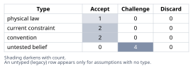
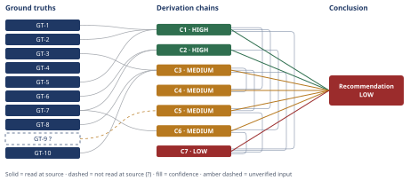

# Mortgage Paydown vs. Taxable Investing: $60,000 Decision

*First-principles analysis · 9 October 2026*

*Read with: [How to read this analysis](HOW-TO-READ.md) · [Working file](analysis-20261009T183255Z.md) · [All files](INDEX.md)*

## Executive Summary

**Recommendation:** Apply the full $60,000 to mortgage principal (Option A) and separately contact the servicer to confirm recast eligibility and request a recast (chain C1, chain C2).

**Band (from §6):** LOW (chain C7).

**Would change it:** The household confirming its true risk tolerance and time flexibility beyond 10 years, which drives chain C7's ranking (chain C7) — a materially more risk-tolerant household should instead weight chains C3 and C4 toward Option B or a blended Option C (chain C7).

## 1. Problem Essence

**Core problem:** Given $60,000 in cash that is genuinely surplus (above an already-fully-funded six-month emergency reserve), should this household, over a fixed 10-year horizon, apply it to mortgage-principal paydown (a guaranteed, risk-free, tax-free 6.25% return with no reinvestment risk) or to a taxable broad-market equity index fund (an uncertain, risk-bearing return subject to dividend and capital-gains tax drag) — resolved by the correct risk-adjusted comparison rather than the naive "stocks historically return ~10%, so investing wins" framing?

**Success criteria:**
1. The Conclusion (§6) names a single recommended allocation of the $60,000 between Option A (paydown) and Option B (investing), or a stated split — checkable by reading the `**Recommended approach:**` line.
2. The recommendation is supported by a derivation chain that compares Option A's guaranteed year-10 value against a bracketed (low/base/high) range for Option B's year-10 value, not a single point estimate — checkable by inspecting whether a cited chain in §4 states three figures, not one.
3. The Conclusion or a chain it cites states the specific pretax nominal equity-return breakeven threshold at which the two options are equal in after-tax expected-value terms — checkable by searching §4/§6 for a stated percentage breakeven.
4. The Conclusion names one specific lever that would change the recommendation (not an undifferentiated list of caveats) — checkable by inspecting the `**Confidence:**` line for a single named driver.
5. The `**Trade-offs acknowledged:**` line names both the liquidity/optionality loss from paydown and the recast-dependency of any cash-flow benefit — checkable by scanning that line for both terms.

---

## 2. Assumptions Table



| Assumption | Type | Treatment | Verdict | Verification |
|------------|------|-----------|---------|--------------|
| A-1: Under a standard fixed-rate amortizing mortgage, an unscheduled extra principal payment reduces the balance and shortens the eventual payoff but does not reduce the contractually required monthly payment unless/until the loan is formally recast or refinanced. | physical law | Accept as ground-truth candidate (definitional mathematics of amortization). | Accept — confirmed directly against Bankrate's description of recasting mechanics; matches the universal arithmetic of a fixed-payment amortization schedule (GT-6). | Bankrate, read-at-source |
| A-2: This specific loan is recast-eligible (i.e., conventional, not FHA/VA/USDA) and can be recast for a fee of roughly $150-$500. | untested belief | Verify or flag; used (non-load-bearingly) in chain C2. | Challenge — loan type is not stated by the household; general recast eligibility/cost facts are verified (GT-7), but whether they apply to this loan is not. | unverified — flagged |
| A-3: Current marginal tax rates (28% ordinary, 18% LTCG/QDI) and standard-deduction status persist for the full 10-year horizon. | current constraint | Record expiry conditions. | Accept — expires on any federal/state tax-law change in 2026-2036 (bracket changes, SALT-cap changes, a future itemization-favorable policy shift). Direction of effect on the A-vs-B comparison is ambiguous: a higher ordinary rate worsens B's dividend drag; a higher LTCG rate worsens B's exit tax; a restored mortgage-interest deduction would erode A's "no tax shield" advantage. | stated by household (current law) |
| A-4: The household keeps this home and this loan, on unchanged terms, for the full 10-year horizon (no early sale or refinance). | convention | Challenge before use. | Accept — challenged on chain C1's hop directly: if this fails (early sale or refinance), C1's qualitative conclusion (paydown is a guaranteed, tax-free, risk-free benefit) still holds, only the compounding period and forward rate used to size it change. | not independently verifiable; household-specific |
| A-5: The historical distribution of 10-year rolling U.S. equity returns (1871-2026) is a reasonable proxy for the distribution of possible outcomes over the specific 2026-2036 decade. | untested belief | Flag explicitly; used in chains C3, C4, C5. | Challenge — cannot be verified in advance; markets are not a stationary process and no regime-change guarantee exists. Carried into C3/C4/C5's confidence bands. | unverified — flagged |
| A-6: The household's true risk tolerance matches a "normal," moderately risk-averse profile (the weighting used in the trade-off synthesis, chain C7), rather than a notably high or low risk tolerance. | untested belief | Flag explicitly; this is the single assumption the headline recommendation is most sensitive to (see C7's flip test). | Challenge — values-driven and household-specific; not stated anywhere in the facts given. Unresolved; carried as the Conclusion's primary confidence caveat. | unverified — flagged |
| A-7: VTI's current ~1.0-1.3% dividend yield is representative of the fund's yield over the coming decade. | current constraint | Record expiry conditions. | Accept — expires if valuations or payout policy shift meaningfully; effect on the overall comparison is second-order and small relative to the price-return uncertainty that already dominates the C3 bracket. | digrin.com, read-at-source (current figure); future persistence unverified |
| A-8: The $60,000 allocation choice is genuinely a two-way (or blended) choice between Option A and Option B, with no superior third use of the funds — e.g., unmaxed tax-advantaged retirement space (401(k)/IRA) — that would dominate both. | untested belief | Flag explicitly as an out-of-scope caveat. | Challenge — not addressed by the household's framing of the question; status of retirement-account funding is simply not stated. Carried as a pre-condition caveat in §6, not resolved here. | not used in a derivation chain; carried as an explicit scope caveat in §6 |
| A-9: For comparison purposes, Option B's year-10 value is modeled as if liquidated (sold) at year 10 to produce a net-worth figure comparable to Option A's realized, tax-free benefit. | convention | Challenge before use (modeling convention, not a claim about household behavior). | Accept — challenged: if the household does not actually liquidate at year 10, B's true economic value is slightly *higher* than modeled (the deferred capital-gains tax has value), which would strengthen B's case marginally rather than weaken the conclusion that favors A. | modeling convention, stated explicitly on chain C3 |

**Stakes-escalation note:** A-6 carries the analysis's highest stakes — the headline recommendation's ranking (chain C7) flips under a plausible, bounded shift in how this single assumption is weighted (see C7's flip test) — yet it cannot be pushed any closer to verified ground-truth status with the facts given; it is reported as the Conclusion's primary, unresolved confidence driver rather than silently assumed.

---

## 3. Ground Truths

**Provenance convention for GT-1 through GT-5:** these facts describe the household's own private financial situation (loan terms, tax rates, cash position, chosen horizon) and were stated directly by the household in the problem statement. No external citation improves on the household's own authority over facts about its own loan and tax situation, so these are treated as `read-at-source` with the problem statement itself as the read-at-source location — never as unverified claims about the external world.

- **GT-1** Mortgage balance $240,000, 6.25% fixed APR, 324 months (27 years) remaining — source: household-stated; read-at-source: problem statement.
- **GT-2** No federal/state tax shield from mortgage interest (standard deduction taken) — source: household-stated; read-at-source: problem statement.
- **GT-3** Marginal tax rates: ~28% combined federal+state on ordinary income; ~18% on long-term capital gains and qualified dividends — source: household-stated; read-at-source: problem statement.
- **GT-4** $60,000 is surplus cash held above an already-fully-funded six-month emergency reserve — source: household-stated; read-at-source: problem statement.
- **GT-5** Decision horizon is fixed at 10 years — source: household-stated (decision parameter); read-at-source: problem statement.
- **GT-6** Under a standard fixed-rate amortizing mortgage, an unscheduled extra principal payment reduces the balance and shortens the eventual payoff but does not reduce the contractually required monthly payment unless/until the loan is formally recast (or refinanced) — source: Bankrate, "What is mortgage recasting, and why do it?"; read-at-source: fetched directly (2026-10-09); the article states extra principal payments reduce the balance but do not trigger a payment recalculation absent a formal recast request.
- **GT-7** Mortgage recasting is available only on conventional loans — FHA, VA, and USDA loans are ineligible; typical minimum lump-sum payment is $5,000-$10,000; typical recast fee is $150-$500 — source: same Bankrate article; read-at-source: fetched directly, eligibility and cost figures quoted verbatim ("Government-backed mortgages — including FHA, VA and USDA loans — aren't eligible for recasting"; "typically cost between $150 and $500").
- **GT-8** The worst, median, and average 10-year rolling annualized total nominal return for the S&P 500 with dividends reinvested, across the full January 1871-October 2026 monthly dataset (Robert Shiller's dataset as compiled and presented by dqydj.com), are **-4.02%** (worst), **8.76%** (median), and **9.41%** (average) — source: dqydj.com, "S&P 500 Historical Return Calculator"; read-at-source: fetched directly, all three figures located verbatim on the page ("Worst Return: −4.02%", "Median Return: 8.76%", "Average Return: 9.41%"). Caveat: this is a secondary aggregator's presentation of Shiller's academic dataset — this analysis verified the aggregator's own page directly but did not independently cross-check Shiller's raw spreadsheet.
- **GT-9?** Current (2026) short-term "risk-free" rates are approximately 5.15%-5.41% for 1-year Treasury bills (August 2026 auction) and approximately 4.25%-5.00% for high-yield savings accounts — cited to: mymoneyblog.com and similar aggregator results; reported-by-delegate: supplied by WebSearch, cited source not opened by this analysis. A direct WebFetch attempt on treasurydirect.gov's auction-query page did not surface the actual rate figures (Phase 3 failure record below).
- **GT-10** VTI (Vanguard Total Stock Market ETF, used as the proxy for "a broad-market total US stock market index fund") has a current trailing-twelve-month dividend yield of approximately 1.04% (1.01% forward) — source: digrin.com, VTI dividend detail page; read-at-source: fetched directly, figure located verbatim ("the current dividend yield for VTI is 1.04%").

**Phase 3 failure record:** GT-9 — source attempted: treasurydirect.gov/auctions/auction-query/; the page opened successfully but is a tool-description page, not a data page, and did not contain an actual auction rate; the figure was instead carried forward as reported-by-delegate from WebSearch aggregator results and kept `?`.

**Provenance summary:**
```text
?-marked: GT-9 (1 of 10)
Read-at-source — GT-1: problem statement (loan balance/rate/term)
Read-at-source — GT-2: problem statement (no tax shield)
Read-at-source — GT-3: problem statement (marginal tax rates)
Read-at-source — GT-4: problem statement ($60k surplus status)
Read-at-source — GT-5: problem statement (10-year horizon)
Read-at-source — GT-6: Bankrate, "What is mortgage recasting, and why do it?" — recast-mechanics section, quoted directly
Read-at-source — GT-7: Bankrate, same article — eligibility/cost section, quoted directly ("$150 and $500"; FHA/VA/USDA exclusion)
Read-at-source — GT-8: dqydj.com, "S&P 500 Historical Return Calculator" — summary statistics table, quoted directly ("−4.02%", "8.76%", "9.41%")
Read-at-source — GT-10: digrin.com, VTI dividend detail page — "Dividend Yield" metric, quoted directly ("1.04%")
```

---

## 4. Derivation Chains



### Conclusion C1: Paying down the mortgage locks in a guaranteed, tax-free net-worth increment of approximately $110,000 at year 10

GT-1 (loan: $240k @ 6.25% fixed, 27 yrs remaining) + GT-2 (no tax shield) + GT-5 (10-yr horizon)
→ paying $60,000 toward principal removes $60,000 of debt that would otherwise accrue interest at a contractually fixed 6.25% annual rate for the remainder of the loan *[Assumes: A-4 — loan and home terms unchanged for the full 10 years; if false, only the compounding period and forward rate used below change, not the qualitative conclusion]*
→ this avoided accrual is risk-free and untaxed, because avoided interest is never taxable income and principal reduction is never a taxable event
→ the loan's remaining term of 27 years exceeds the 10-year decision window, so the $60,000 reduction compounds at the full 6.25% note rate for the entire horizon
→ the risk-free, tax-free net-worth increment attributable to Option A at year 10 is 60,000 × 1.0625^10 ≈ $110,000

**Confidence:** HIGH — every head identifier is an unsuffixed GT read at source (the problem statement, for facts about the household's own loan); the `[Assumes: A-4]` annotation on hop 1 is priced (the endpoint survives A-4's failure — only its computed magnitude would change, not its guaranteed/risk-free/tax-free character); no live rival exists to a deterministic contractual consequence of fixed-rate debt paydown.

### Conclusion C2: Absent an explicit recast, Option A produces zero monthly cash-flow change, regardless of this loan's recast eligibility

GT-6 (no payment change without recast) + GT-7 (recast eligibility and cost)
→ absent a recast, the household's required monthly mortgage payment is unchanged by the lump-sum payment, so Option A produces zero improvement in monthly cash flow during the 10-year window by default
→ this zero-cash-flow-by-default conclusion holds whether or not this specific loan turns out to be recast-eligible *[Assumes: A-2 — loan is conventional and recast-eligible; if false, the recast opportunity is simply unavailable and the zero-benefit-by-default conclusion is exact rather than conservative, so the endpoint stands either way]*
→ the household should plan on zero monthly cash-flow change from Option A unless and until it actively confirms eligibility and completes a recast, a distinct action from the lump-sum payment itself

**Confidence:** HIGH — both head identifiers are unsuffixed GTs read at source; the `[Assumes: A-2]` annotation on hop 2 is priced (the "plan on zero benefit by default" endpoint survives A-2's failure in either direction); no live rival, since this is a definitional consequence of amortization mechanics rather than a prediction.

### Conclusion C3: Option B's realistic year-10 after-tax value is best stated as a $39,000-$341,000 bracket centered on a ~$129,700 base case

GT-3 (tax rates) + GT-8 (historical 10-yr return bracket) + GT-10 (dividend yield)
→ treating GT-10's ~1.04% dividend yield as taxed annually at the 18% qualified-dividend rate (GT-3) while price appreciation compounds tax-deferred until sale, a pretax total nominal return r compounds at an effective rate of r − (0.18 × 0.0104) per year
→ applying GT-8's average, worst, and best historical 10-year rolling returns (9.41%, −4.02%, 21.17%) as r produces pretax year-10 account values of approximately $145,000, $39,000, and $403,000 on the original $60,000 *[Assumes: A-5 — the 1871-2026 historical distribution is a reasonable proxy for 2026-2036; not priced, carried forward as a live Rivals-axis caveat below]*
→ applying an 18% long-term capital-gains tax (GT-3) to the embedded gain at a hypothetical year-10 liquidation *[Assumes: A-9 — comparison convention of liquidating at year 10; if false, B's true value is slightly higher than modeled, not lower]* yields after-tax ending values of approximately $129,700 (base case), $39,000 (worst historical case, a loss generates no tax), and $341,000 (best historical case)
→ Option B's realistic year-10 after-tax value is best stated as a bracket of roughly $39,000 to $341,000, centered on a base case of approximately $129,700, not as a single expected figure, because which end of this historical range the next decade resembles cannot be known in advance

**Confidence:** MEDIUM — Inputs axis is clean, but the Rivals axis is short: the base-case, worst-case, and best-case readings are equally legitimate readings of the same GT-8 data, and nothing available today settles which the 2026-2036 decade will resemble. This closes only in hindsight, as the realized return path becomes observable; interim 5-year realized returns would at least narrow the live range.

### Conclusion C4: The pretax nominal equity return required for Option B to match Option A's guaranteed value is approximately 7.45%/year

C1 (HIGH, $110,000 guaranteed) + C3 (MEDIUM, after-tax value as a function of r)
→ solving 60,000 × 0.82 × (1+g)^10 + 0.18×60,000 = $110,000 for the effective after-dividend-drag growth rate g, then converting back to a pretax nominal return r = g + (0.18 × 0.0104), gives a breakeven of approximately 7.45% per year over the decade
→ this breakeven sits below both GT-8's historical median (8.76%) and historical average (9.41%) 10-year rolling return *[Assumes: A-5, carried from C3]*, so more than half of the historical windows in that dataset would have produced an after-tax equity outcome exceeding Option A's guaranteed outcome
→ a non-trivial minority of historical decades, including the worst one on record, fell below this 7.45% breakeven, and those decades cluster around major market peaks followed by prolonged drawdowns — exactly the sequencing risk the "stocks return ~10%" framing omits by quoting only the long-run average

**Confidence:** MEDIUM — capped by citing C3 (MEDIUM, explained on C3's own line). The breakeven arithmetic itself recomputes cleanly (see the adversarial pass below), but the "more than half of historical decades" claim rests on only three summary statistics (min/median/mean) from GT-8, not a full percentile breakdown — what would close this: obtaining the full decile distribution of 10-year rolling returns. Rival: a rival reading could argue recent decades (post-1945 or post-2000) are more representative of 2026-2036 than the full 1871-2026 sample; not settled here.

### Conclusion C5: Mortgage paydown dominates every genuinely risk-free alternative, which reframes this as a safe-vs-risky portfolio-allocation decision, not a "6.25% vs. 10%" arithmetic one

C1 (HIGH, $110,000) + C3 (MEDIUM, $39,000-$341,000 bracket) + GT-9? (current safe-asset rates)
→ comparing C1 to genuinely risk-free alternatives rather than only to equities shows mortgage paydown (6.25% guaranteed, tax-free) dominates every risk-free alternative available to this household — 1-year Treasury bills (~5.15%-5.41% pretax, GT-9?, reduced to roughly 3.7%-3.9% after the 28% ordinary-income tax, GT-3) and high-yield savings (~4.25%-5.00% pretax, GT-9?, similarly taxed) — by a wide and unambiguous margin
→ this reframes the decision correctly as "should this $60,000 sit in the safe portion or the risky portion of the household's overall portfolio," not "6.25% guaranteed vs. 10% stocks," because mortgage paydown has already won the safe-asset comparison outright
→ the only way Option B can be preferred is by deliberately accepting equity-market risk for the expected-value premium C4 quantifies, which is a risk-tolerance decision rather than an arithmetic one, since C3's bracket shows the downside tail is a historically-realized possibility, not a theoretical curiosity

**Confidence:** MEDIUM — Inputs axis is short on two counts: GT-9? is unverified (what would close it: fetching a live, date-stamped Treasury/FRED or bank-rate page rather than a blog aggregate), and C3 is cited at MEDIUM (explained on C3's own line). The qualitative conclusion is robust to GT-9?'s exact value — even its high end (~5.4% pretax / ~3.9% after-tax) sits well below 6.25% — so no live rival contests the qualitative point itself.

### Conclusion C6: Option A trades a structural liquidity disadvantage for a behavioral commitment-device advantage, and this does not contradict any ground truth

C2 (HIGH) + GT-7 (recast/refinance cost facts)
→[2nd, actor lens] because home equity is harder to access on impulse than a brokerage balance, Option A acts as a behavioral commitment device against lifestyle-inflation or panic-driven spending, while Option B's visible, liquid balance is both a genuine advantage (flexible access to a true emergency) and a behavioral risk (temptation to raid it for non-emergency spending, or to sell during a downturn)
→[2nd, time lens] in the first one to three years, a weak market start — consistent with the low end of C3's bracket — would make Option B's statement value visibly fall before any long-run premium materializes, which is historically when panic-selling is most likely, a risk with no analog under Option A
→[2nd, actor lens] if a genuine liquidity need arises before year 10 beyond GT-4's separate emergency reserve, Option A requires a HELOC, cash-out refinance, or sale to access the trapped funds, each carrying cost, underwriting time, and a rate materially above the mortgage's own 6.25% through subordinate-lien risk pricing, while Option B requires only a sale order and payment of capital-gains tax — the one dimension on which B is structurally superior
→ none of these extension steps contradicts a Ground Truth, and checked against Phase 1's success criterion of a correctly risk-adjusted, liquidity-aware comparison, these effects modulate risk rather than undermine that purpose

**Confidence:** MEDIUM — Inputs axis is clean, but the Rivals axis is short: a live, unsettled counter-reading holds that GT-4's already-funded six-month reserve sufficiently covers plausible liquidity shocks, making this cluster's liquidity-loss risk tolerable rather than costly. What would close it: a scenario-specific analysis of this household's actual liquidity-shock exposure beyond six months, which the given facts do not support.

### Conclusion C7: Under normal risk aversion, full mortgage paydown (Option A) is the weighted-criteria winner, with a partial blend (Option C) as the closest live rival

C1 (HIGH) + C3 (MEDIUM) + C5 (MEDIUM) + C6 (MEDIUM)
→ scoring the three viable options — A: full paydown; B: full investment; C: a 50/50 split of $30,000 each — against six weighted criteria (expected magnitude ×4, downside-tail protection ×5, liquidity ×3, behavioral certainty ×2, cash-flow flexibility ×2, simplicity ×1) yields weighted totals A=59, C=55, B=52 *[Assumes: A-6 — household has "normal" risk aversion; not priced, because the flip test below shows the ranking changes if A-6 is false]*
→ the flip test shows this is not a razor's-edge near-tie in the weights themselves: the downside-tail-protection weight would need to fall from 5 to about 3.25, a decrease of 1.75 and more than the ±1 move that signals a coin-flip, before Option B overtakes Option A
→ Option A is the weighted-criteria winner under a normal-risk-aversion weighting, with Option C as the closest live rival — not Option B, which is held back primarily by its weight-5 downside-tail-protection score — and this ranking is only as reliable as A-6's truth, which this analysis cannot verify

**Confidence:** LOW — three axes are short at once. Inputs: citing three MEDIUM chains (C3, C5, C6). Inference: hop 1's `[Assumes: A-6]` is not priced — its failure plausibly flips the ranking per the flip test, so the endpoint does not survive it. Rivals: Option C remains a live, un-ruled-out rival, scoring only 4 points below Option A, well inside what the flip test shows a modest weight shift could close. What would close each: Inputs closes as C3/C5/C6 close (their own lines); Inference closes only if the household states its actual risk tolerance and time flexibility; Rivals closes only by the household affirmatively ruling a partial allocation in or out, which this analysis cannot do on its behalf.

**Unverified-input and ceiling notes (D-07):** No chain above consumes a `GT-N?` input and is rated HIGH (C5 consumes GT-9? and is rated MEDIUM). Every chain citing another chain on its head is rated no higher than the lowest-rated chain it cites (C4, C5, C7 all cap at MEDIUM or below via this rule).

---

## 5. Abandoned Reasoning

### Dead End: Treating "stocks historically return ~10%" as sufficient justification for Option B

**What was tried:** Using the common claim that broad-market equities return roughly 10% annually as a direct, unadjusted justification for recommending Option B over Option A's 6.25%.

**Why abandoned:** This conflates a long-run average with a guaranteed outcome and ignores GT-8's own −4.02% worst-decade figure; it compares a risk-free return to a risky one without pricing the risk, which chains C4 and C5 show is the decisive error in the naive framing.

**What it ruled out:** Using the simple "10% beats 6.25%" comparison as this analysis's headline reasoning (ruled out by chains C4 and C5).

### Dead End: Recommending Option B outright because its base-case expected value exceeds Option A's guaranteed value

**What was tried:** Treating C3's base-case figure (~$129,700) as decisive simply because it exceeds C1's guaranteed figure (~$110,000), and recommending Option B unconditionally on that basis.

**Why abandoned:** Expected-value maximization alone ignores the asymmetry between a certain outcome (C1) and a risky distribution (C3), and ignores that a rational, non-negligibly risk-averse household would not treat the two as interchangeable; the weighted trade-off (C7) formalizes this and does not support an unconditional B recommendation.

**What it ruled out:** Option B as the unqualified "winner" of this comparison. It remains a live rival on pure expected-value grounds — named explicitly on chain C7's confidence line — rather than fully settled.

### Dead End: Expanding the comparison to include whether tax-advantaged retirement accounts (401(k)/IRA) are already maxed

**What was tried:** Considering whether the $60,000 should instead be evaluated against a third option — maxing tax-advantaged retirement space — which likely dominates both Option A and Option B on an after-tax basis if headroom exists there.

**Why abandoned:** This was outside the two-option (or blended) comparison the household explicitly posed; introducing a third major axis not requested would dilute a clear recommendation on the question actually asked, as the methodology's Phase 1 success criteria require.

**What it ruled out:** A full three-way retirement-vs-mortgage-vs-taxable analysis as this document's headline deliverable. Carried forward instead as assumption A-8 and as an explicit pre-condition caveat in §6.

### Dead End: Modeling Option B with frequent-trading or short-term tax treatment

**What was tried:** Testing whether a higher-turnover tax model (short-term capital gains, more frequent realization events) would change chain C3's after-tax figures materially.

**Why abandoned:** The stated option is a broad-market index fund held in a buy-and-hold taxable brokerage account, which implies minimal turnover and long-term capital-gains treatment; modeling frequent trading would not match the option as posed and would understate B's after-tax value relative to what was actually asked about.

**What it ruled out:** A higher-tax-drag version of C3 that would have been inconsistent with the stated investment vehicle.

---

## 6. Conclusion

**Recommended approach:** Apply the full $60,000 to mortgage principal (Option A), and separately contact the loan servicer to confirm recast eligibility and request a recast as a distinct follow-up action (chains C1, C2, C7).

**Key insight:** The correct comparison is not "6.25% guaranteed vs. ~10% stocks" but "a guaranteed, tax-free 6.25% that already dominates every genuinely risk-free alternative available to this household, against a risky bet whose breakeven pretax equity return is only about 7.45%/year" (chains C4, C5) — the popular framing obscures sequencing risk by quoting only the long-run average return.

**Trade-offs acknowledged:** Option B's base-case expected value (~$129,700, chain C3) exceeds Option A's guaranteed value (~$110,000, chain C1), and would be the better choice for a household with above-average risk tolerance or a true horizon longer than 10 years (chain C7); Option A also trades away liquidity and optionality that would matter if a shock exceeds the already-separate six-month emergency reserve (chain C6). A household materially more risk-tolerant than "normal" should weight chain C7's criteria differently and could rationally land on Option C (a partial blend) or Option B instead (chain C7).

**Confidence:** LOW — the Conclusion rests on chain C7, which is itself LOW because its ranking of Option A over Options B and C is not priced against assumption A-6 (the household's true risk tolerance) and because Option C remains a live, un-ruled-out rival only 4 points behind Option A. C3, C4, C5, and C6 are each MEDIUM for the reasons stated on their own confidence lines (primarily: an unknowable future 10-year equity-return path, and an unverified current safe-asset rate, GT-9?). The single lever that would raise this band: the household stating its actual risk tolerance and true time flexibility beyond 10 years — this closes C7's Inference axis and, with it, the Conclusion's own ceiling. A household that confirms it is at or below "normal" risk aversion can treat this recommendation as robust; one that knows itself to be meaningfully more risk-tolerant should instead read chains C3, C4, and C7 as making the case for Option B or Option C.
