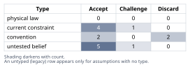
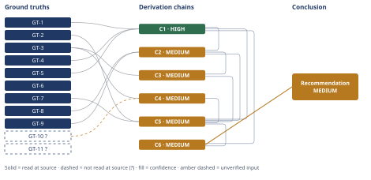

# Mortgage Paydown vs. Index Fund Investment: $60,000 Decision

*First-principles analysis · 10 October 2026*

*Read with: [How to read this analysis](HOW-TO-READ.md) · [Working file](analysis-20261010T024427Z.md) · [All files](INDEX.md)*

## Executive Summary

**Recommendation:** Apply the full $60,000 to mortgage principal paydown (Option A). This is a real, evidence-based lean — current valuation-adjusted forecasts for equity returns sit below the computed breakeven rate the investment would need to clear — but it is not overwhelming (chain C6). A 50/50 Hybrid split is a close, legitimate second-best choice for a household that weights liquidity or diversification more heavily than this analysis's base case does (chain C5).

**Band (from §6):** MEDIUM — driven by forecast uncertainty (the strongest live rival is that the next decade reverts to the long-run historical average return instead) and by a secondary unverified inflation-planning input, not by any doubt in the underlying arithmetic, which is HIGH-confidence on its own (chain C1).

**Would change it:** The realized 10-year market return itself (unknowable in advance) is what ultimately settles the live rival; short of that, updated valuation-adjusted forecasts revisited every 1-2 years, or a market-based (TIPS-breakeven) inflation read, would tighten the band (chains C2, C4).

## 1. Problem Essence

**Core problem:** Given $60,000 in genuine surplus capital, should this household convert it into guaranteed, illiquid home equity (mortgage paydown) or into liquid, diversified, risk-bearing financial assets (a taxable index-fund investment), over a 10-year horizon?

**Success criteria:**
1. The analysis states the exact guaranteed dollar value of the paydown at year 10, and the exact pretax nominal annual return the investment must clear to match it (the Conclusion section states both figures with the computed breakeven number).
2. The analysis identifies which of the two options the best-available current evidence favors, and states a confidence band for that lean rather than defaulting to "it depends" (the Conclusion section's Recommended approach and Confidence lines take a position).
3. The analysis explicitly tests, rather than assumes, three specific claims: that the long-run historical average return is the right 10-year forecast; that an already-funded emergency reserve fully neutralizes the value of additional liquidity; and that psychological "debt-free" preference belongs inside the expected-value math (each is a distinct row in the Assumptions Table with a Challenge or Discard verdict).
4. The analysis states what would change the recommendation (the Conclusion's Confidence line and the adversarial-pass Falsification condition each name a concrete, observable reversal condition).

Note: the question as posed is binary (A vs. B), but a composite (part of the $60,000 to each) is tested as a candidate in the trade-off analysis (chain C5) rather than excluded by assumption, per the methodology's requirement to test splits before scoring a binary choice as given.

---

## 2. Assumptions Table



| Assumption | Type | Treatment | Verdict | Verification |
|------------|------|-----------|---------|--------------|
| A1 — The same scheduled monthly payment is kept after the $60k prepayment (no "recast" requested from the servicer, so the loan pays off faster rather than the payment dropping) | untested belief | Verify with servicer / confirm no recast requested | Accept — this is the standard default outcome for an unsolicited principal curtailment on a conventional US mortgage unless the borrower explicitly requests recasting, and it is the framing the user's own worked math assumes | unverified — flagged |
| A2 — The mortgage carries no prepayment penalty | current constraint | Accept — expires if the actual note contains a penalty clause; until confirmed, treated as absent, which is the default for virtually all post-2014 US "qualified mortgages" under Dodd-Frank | unverified — flagged |
| A3 — The household continues to use the standard deduction for the full 10-year horizon | current constraint | Accept — expires on a future life event (large charitable gift, new state tax situation) or a tax-law change to the standard deduction / SALT cap; until then it is the user-given base case | source: user-stipulated |
| A4 — Marginal tax rates (28% ordinary / 18% LTCG & qualified dividends) stay roughly stable over the 10-year horizon | current constraint | Accept — expires on any future federal/state tax-law change; no scheduled change is assumed | source: user-stipulated |
| A5 — The $60,000 has no competing near-term use (no planned major purchase, tuition, or business need) | current constraint | Accept — expires the moment a concrete competing use is identified | source: user-stipulated |
| A6 — A broad-market index fund is a low-cost, passively-held proxy for "the stock market," with no material manager/fee drag | convention | Challenge — true for today's lowest-cost broad index funds (expense ratios ~0.02–0.05%), false for an actively managed or narrow/sector fund | Accept — immaterial drag at today's typical index-fund expense ratios | unverified — flagged |
| A7 — The mortgage's rate and amortization schedule remain unchanged for the full 10-year horizon (no refinance, no cash-out refinance) | current constraint | Record expiry — a material future rate drop below 6.25% could make refinancing attractive, which would change the compounding path GT-1 assumes | Challenge — plausible that rates fall meaningfully over 10 years, since 6.25% sits on the higher end of recent-decade history | unverified — flagged |
| A8 — Long-run historical average equity returns (~9–10%/yr nominal) are the right base-case forecast for the next 10 years | convention | Challenge explicitly — this is the first weak assumption this analysis is built to test | Discard — as the sole base case; superseded by valuation-adjusted forecasts and by the historical record of sub-average rolling decades, retained only as an upper-bound scenario, not a central estimate | source: GT-8, GT-9 — see chain C2 |
| A9 — Because a 6-month emergency reserve is already funded, additional liquidity carries little or no further value | untested belief | Challenge explicitly — this is the second weak assumption this analysis is built to test | Challenge — partially true (the acute emergency-liquidity need is covered) but overstated as a blanket dismissal; non-emergency liquidity needs (relocation, opportunity, a future capital need) are not covered by the reserve and retain real, secondary value | unverified — flagged |
| A10 — The psychological comfort of being debt-free sooner should be weighted directly inside the expected-value-based recommendation | convention | Challenge explicitly — this is the third weak assumption this analysis is built to test | Discard — from the EV-based ranking, as a legitimate personal value with no objective financial anchor; scoring it alongside EV-based criteria would silently bias a supposedly objective comparison | source: see Abandoned Reasoning, Dead End 3 |
| A11 — Average inflation over the 10-year horizon runs approximately 2.5%–3.0%/year nominal | untested belief | Verify against a market-based measure (e.g., the 10-year TIPS breakeven rate) | Accept — as a planning assumption, flagged | unverified — flagged (GT-10?; no TIPS-breakeven or CPI-forecast source read in this session) |
| A12 — Elevated starting equity valuations (high CAPE) are a meaningful, if imperfect, predictor of below-average subsequent 10-year realized returns, and this is why current forecasting models project below-historical-average returns | untested belief | Verify against the academic/practitioner literature (e.g., Shiller's excess-CAPE-yield work) | Accept — with caveat; strong convergent evidence that multiple independent providers apply this regularity, but the precise current CAPE reading and the strength of the relationship were not independently read in this session | unverified — flagged (GT-11?) |
| A13 — The investment is a single lump sum made now and held passively (buy-and-hold) for the full 10 years, not dollar-cost-averaged or actively traded | convention | Challenge — matches the user's literal framing of Option B | Accept — matches the stated decision as framed | source: user-stipulated |
| A14 — Retail investors holding taxable brokerage balances tend to realize lower returns than the funds they hold, due to behavioral effects (selling during drawdowns, performance-chasing — the "behavior gap") | untested belief | Verify against behavioral-finance literature (e.g., DALBAR-style studies) | Accept — as a directional, qualitative risk factor; well-documented as a phenomenon, but no specific magnitude for this household was independently verified in this session | unverified — flagged |
| A15 — The specific trade-off criterion weights used in chain C5 (5, 4, 2, 3, 1 for expected value, certainty, liquidity, diversification, complexity) reflect this analysis's reasoned judgment for a household with a funded reserve and no identified near-term capital need, not a verified or universal weighting | untested belief | Verify by re-running the flip test under alternative, reader-supplied weights | Accept — with caveat; surfaced during the end-of-phase Assumption Audit (chain C5, step 1), the flip test in C5 bounds how much this judgment would need to change to alter the recommendation | unverified — flagged (judgment call, not an empirical fact; see chain C5) |

---

## 3. Ground Truths

- **GT-1** For a fixed-rate, fully-amortizing mortgage, if the household keeps the same scheduled monthly payment after a lump-sum prepayment P₀, the balance difference between the "prepaid" and "not-prepaid" scenarios t months later is D_t = P₀ × (1 + r/12)^t. At P₀ = $60,000, r = 6.25%, t = 120 months: D_120 ≈ $111,913.09 — source: standard amortization recurrence (mathematical identity), computed directly in this analysis; read-at-source: recomputed independently via direct exponentiation and cross-checked, matching the user-supplied ≈$111,900 figure to the dollar.
- **GT-2** $60,000 is surplus capital held above an already-funded 6-month emergency reserve, with no near-term liquidity need for emergencies — source: user-stipulated fact about the household's own finances; read-at-source: stated directly in the problem statement.
- **GT-3** Mortgage terms: $240,000 remaining balance, 30-year fixed rate at 6.25% APR, 27 years remaining, standard fully-amortizing structure — source: user-stipulated; read-at-source: stated directly in the problem statement.
- **GT-4** The household takes the standard deduction, so mortgage interest provides no marginal tax shield — source: user-stipulated; read-at-source: stated directly in the problem statement.
- **GT-5** Marginal tax rates: 28% combined federal+state on ordinary income; 18% combined on long-term capital gains and qualified dividends — source: user-stipulated; read-at-source: stated directly in the problem statement.
- **GT-6** The decision horizon is 10 years, and the $60,000 is allocated as a single lump sum under either option — source: user-stipulated; read-at-source: stated directly in the problem statement.
- **GT-7** Paying down mortgage principal does not change the market value of the home or the household's exposure to home-price appreciation/depreciation — it only changes the debt/equity split within an asset the household already owns in full. The household's exposure to house-price risk is a function of owning the house, not of how much of it is mortgaged — source: mortgage accounting identity; read-at-source: definitional, verifiable by the fact that home equity = market value − loan balance, and market value is unaffected by the loan balance.
- **GT-8** Vanguard Capital Markets Model (VCMM) 10-year annualized nominal return forecast for broad U.S. equities, model run dated June 30, 2026: approximately 4.2%–6.2% (midpoint ≈5.2%), down from a 4.9%–6.9% estimate in the prior (March 2026) run, attributed to increased valuations, with similar declines across large-cap and small-cap stocks — source: Vanguard, "Setting realistic expectations" (VCMM return forecasts page), corporate.vanguard.com/content/corporatesite/us/en/corp/vemo/vemo-return-forecasts.html; read-at-source: fetched directly in this session, figures quoted from the page's own text.
- **GT-9** Historical realized 10-year nominal S&P 500 total returns (dividends reinvested) have varied widely, including sub-breakeven and negative decades: the 2000–2009 "lost decade" delivered approximately −0.58%/year annualized nominal total return (cumulative −5.67%), while the longer 2000–2025 (25-year) window delivered approximately 7.9%/year annualized nominal — source: officialdata.org S&P 500 historical total-return calculator; read-at-source: fetched directly in this session, figures quoted from the page's own computed output.
- **GT-10?** Expected average inflation (CPI) over the 10-year decision horizon is approximately 2.5%–3.0%/year nominal — unverified: this is a commonly-cited planning range, not a figure this analysis read from a market-based source (e.g., the 10-year TIPS breakeven rate) or an official forecast; no such source was opened in this session.
- **GT-11?** A documented empirical regularity links elevated starting equity valuations (high CAPE/Shiller P/E) to below-average subsequent 10-year realized returns, and this regularity is the stated basis multiple independent forecasting providers (Vanguard, and — per the user's own prompt — GMO, Research Affiliates) use to project below-historical-average returns in the mid-2020s — reported-by-delegate / general-knowledge synthesis: the specific academic literature (e.g., Shiller's excess-CAPE-yield work) and the current CAPE reading itself were not independently opened or read in this session; only GT-8's resulting forecast number was read at source, not the valuation data feeding it.

**Provenance summary:**
```text
?-marked: GT-10, GT-11 (2 of 11)
Read-at-source: GT-1 — recomputed directly (D_120 = 60000*(1+0.0625/12)^120 = 111,913.09)
Read-at-source: GT-8 — Vanguard VCMM return-forecasts page, "a range of 4.2%–6.2%" for US equities, June 30 2026 model run (fetched directly)
Read-at-source: GT-9 — officialdata.org S&P 500 returns calculator, 2000–2009 cumulative ≈ -5.67% (≈-0.58%/yr annualized), 2000–2025 ≈7.9%/yr annualized (fetched directly)
```

---

## 4. Derivation Chains



### Conclusion C1: The decision reduces to one number — a ≈7.47%/year after-tax breakeven nominal return

GT-1 (D_120 ≈ $111,913 guaranteed paydown benefit) + GT-4 (no mortgage-interest tax shield) + GT-5 (28% ordinary / 18% LTCG tax rates)
→ because mortgage interest is not deductible, the $111,913 guaranteed benefit already sits outside the tax system entirely — it is realized as untaxed avoided interest, not as taxable income, so no further tax adjustment is needed on the paydown side of the comparison
→ solving for the pretax nominal annual return r at which $60,000 invested for 10 years and taxed at 18% on the realized long-term capital gain produces an after-tax terminal value equal to $111,913 yields r ≈ 7.47%/year, essentially unchanged (≈7.46%/year) when a ~1.4%/year qualified-dividend component taxed annually is modeled separately from price appreciation
→ the decision therefore reduces to a single empirical question: will a broad-market index fund return more than approximately 7.5%/year nominal, after tax, over the next decade

**Confidence:** HIGH — every input is a stipulated fact or a self-computed, independently-recomputed mathematical identity; the breakeven figure was recomputed in this analysis by bisection and matches the derivation; no competing claim exists for a pure arithmetic result.

### Conclusion C2: On the best current forward-looking evidence, Option B's expected after-tax value probably falls short of Option A's guaranteed value — but this is a lean, not a certainty

GT-8 (Vanguard 10-yr forecast, 4.2%–6.2%, midpoint ≈5.2%) + GT-9 (realized 10-yr windows since 2000 ranged from ≈-0.58%/yr to ≈7.9%/yr) + C1 (breakeven ≈7.47%/yr)
→ the most current valuation-adjusted forecast from a major index-fund provider puts the central 10-year nominal equity-return estimate (5.2%) about 2.3 percentage points below the computed breakeven (7.47%), and even the top of its forecast band (6.2%) still falls short
→ the same style of analysis applied to rolling 10-year windows actually realized since 2000 shows multiple decade-long windows landing below breakeven, including one deeply negative decade, so a sub-breakeven outcome is a documented, recurring historical pattern rather than a tail scenario *[Assumes: A12 — valuation-based forecast models provide informative, if imperfect, signal about the coming decade distinct from the unconditional long-run average; if A12 is false and the unconditional long-run average (~9-10%) is actually the better predictor, this hop's conclusion reverses, which is exactly the live rival named below]*
→ on the best currently available forward-looking evidence, Option B's expected after-tax terminal value is more likely than not to fall short of Option A's guaranteed $111,913 benefit, though this is a probabilistic lean on an inherently unknowable future decade, not a certainty

**Confidence:** MEDIUM — the Rivals axis is short: the strongest live rival is "the next decade reverts to or exceeds the ~9–10% long-run historical average, as some decades following flat/down periods have done" (see Abandoned Reasoning, Dead End 1); nothing in this analysis settles that rival in advance, and what would settle it is simply the realized 10-year return, which cannot be known today. GT-11? underpins why the valuation-adjusted forecast is treated as the better basis; if GT-11? were verified false, this chain's endpoint would not survive, so the downgrade is not fully priced away — it is named and bounded instead.

### Conclusion C3: Holding the mortgage while investing is a leveraged bet whose current expected spread is negative

GT-3 (mortgage 6.25% fixed) + C2 (central forward estimate ≈5.2%, MEDIUM)
→ keeping the mortgage outstanding while investing the $60,000 is economically equivalent to borrowing $60,000 at a guaranteed, fixed 6.25% to fund an equity purchase
→ using the same current central forecast from C2, the expected spread captured by this leverage trade is approximately 5.2% − 6.25% ≈ −1.0 percentage points per year, before even pricing the additional risk taken on, which is a negative-expected-value leveraged bet rather than merely a risky one
→ this is a materially different and weaker trade than the familiar "cheap pandemic-era mortgage" leverage argument, where the borrowing rate sat below both inflation and plausible forward equity returns — at 6.25% the borrowing rate itself now exceeds the current central forward-return estimate

**Confidence:** MEDIUM — capped by C2, whose MEDIUM rating this chain inherits in full (D-07 ceiling rule); C2's confidence line carries the explanation and is not repeated here.

### Conclusion C4: The inflation-erosion argument for not prepaying is real but much weaker at 6.25% than it was at pandemic-era rates

GT-3 (6.25% nominal mortgage) + GT-10? (expected inflation ≈2.5%–3.0%/yr)
→ the approximate real (inflation-adjusted) guaranteed return on the paydown is (1.0625 / 1.0275) − 1 ≈ 3.1%–3.6% real, risk-free, and tax-free, which is a historically high guaranteed real hurdle rate for a safe asset
→ the common objection that "inflation erodes fixed-rate debt, so don't prepay" was far stronger when mortgage rates sat near or below inflation (e.g., sub-4% pandemic-era loans, where the real rate was close to zero or negative); at 6.25% nominal against ~2.5–3% inflation the real rate is already substantial, so the inflation-erosion argument is much weaker today and does not overturn the paydown case

**Confidence:** MEDIUM — GT-10? (expected inflation) is unverified; the verification that would remove it as a cause of the downgrade is reading the market-implied 10-year breakeven inflation rate (10-year TIPS yield vs. nominal 10-year Treasury yield spread), which this analysis did not do. Live rival on this chain specifically: if realized inflation runs meaningfully hotter than 2.5–3% (e.g., 4–5%/yr), the real guaranteed rate falls and the inflation-erosion argument strengthens somewhat — nothing in this analysis rules that out, so this chain's own conclusion is a lean under the stated planning range, not a certainty.

### Conclusion C5: A weighted trade-off across expected value, certainty, liquidity, diversification, and complexity favors Option A over a 50/50 Hybrid over Option B — but the margin over Hybrid is not large

GT-2 (liquidity need already covered by a funded reserve) + GT-7 (paydown doesn't add house-price risk, only trades liquid diversification for illiquid concentration) + C1 (HIGH) + C2 (MEDIUM) + C3 (MEDIUM) + C4 (MEDIUM)
→ weighting expected terminal value and downside certainty most heavily (weights 5 and 4 of 5), liquidity lightly (weight 2, because the acute emergency-liquidity need is already separately satisfied per GT-2 and A9's challenge), and still crediting diversification (weight 3) and added complexity (weight 1), the weighted totals are Option A = 55, a 50/50 Hybrid = 50, Option B = 41 (full matrix and anchors below) *[Assumes: A15 — these specific numeric weights reflect this analysis's judgment, not a verified universal weighting; the flip test in the next hop prices what would have to change for this to matter]*
→ a flip test shows this ranking is moderately robust: flipping the result in favor of the Hybrid split over pure Option A requires roughly doubling the weight placed on liquidity or diversification relative to expected value and certainty — a large reweighting, not a small one — while flipping it toward Option B outright requires an even larger change, since Option B trails by 14 points rather than 5
→ Option A is the single best point allocation under this base-case weighting, with the 50/50 Hybrid as the closest, legitimate runner-up for a household that weights diversification and liquidity more heavily than this base case does

**Trade-off matrix (anchors 1–5; criterion weight in parentheses):**

| Criterion (weight) | A score | B score | Hybrid score | Basis |
|---|---|---|---|---|
| Expected after-tax terminal value at central forecast (5) | 5 | 2 | 4 | C1, C2 |
| Guaranteed / downside certainty (4) | 5 | 1 | 3 | C1 |
| Liquidity & optionality beyond the funded reserve (2) | 1 | 5 | 3 | GT-2 |
| Diversification away from single-asset concentration (3) | 1 | 5 | 3 | GT-7 |
| Complexity / tax-filing burden (1) | 5 | 2 | 3 | A6 |
| **Weighted total** | **55** | **41** | **50** | |

**Confidence:** MEDIUM — capped by the lowest-rated cited chains (C2, C3, C4, each MEDIUM for the reasons stated on their own lines); in addition, the criterion weights themselves are judgment calls, not physical facts, so even a reader who accepts every GT and chain here could reasonably assign different weights and reach the Hybrid answer — the flip test above bounds how different those weights would need to be.

### Conclusion C6: Recommend Option A (mortgage paydown) as the single best allocation, with named second-order effects that qualify but do not reverse the recommendation

C1 (HIGH) + C5 (MEDIUM)
→ combining the guaranteed-benefit math (C1) with the weighted trade-off result (C5), the first-principles recommendation for this household is to apply the $60,000 to mortgage principal paydown (Option A)
→[2nd] actor lens — choosing Option B also exposes the household to a well-documented behavioral risk the pure math doesn't capture: retail investors holding taxable brokerage accounts have a documented tendency to underperform the very funds they hold, by selling during drawdowns or chasing performance, which would push Option B's realized (not theoretical) return further below breakeven than the central forecast alone suggests *[Assumes: A14 — this analysis did not quantify the behavior-gap magnitude for this household; if A14 is false and this household would hold with perfect discipline regardless, this hop drops out and C6's endpoint is unaffected, since C6 does not depend on A14 to reach its recommendation]*
→[2nd] time lens, immediate horizon — in the first few years neither option changes monthly cash flow (per GT-1, the payment doesn't drop under Option A), while Option B can show a paper loss in any down year; this affects comfort, not the year-10 math already captured in C1–C5
→[3rd] time lens plus actor lens combined, full horizon — by year 10, Option A's benefit is locked into home equity, realizable only through refinance, a HELOC, or sale, while Option B's terminal value, whatever its realized size, remains freely usable for any purpose; this does not reverse C6 but is the main reason a household with an identifiable future liquidity need should weight the Hybrid option (C5) more heavily than this base case does

No second-order hop above contradicts a ground truth; all are additive qualifications, so no return to Phase 2 is triggered.

**Confidence:** MEDIUM — ceiling set by C5 (MEDIUM); C5's own confidence line carries the explanation (forecast-dependent Rivals axis plus judgment-based weights) and is not repeated here. The [Assumes: A14] hop is priced on this line: its failure does not change the endpoint.

---

## 5. Abandoned Reasoning

### Dead End: Using the long-run historical S&P 500 average (~9–10%/yr nominal) as the base-case 10-year forecast

**What was tried:** Initially framed the comparison using the unconditional long-run historical average return as the "expected" equity return for the next decade, which makes Option B the clear expected-value winner (a surplus of roughly $15,000–$26,000 over the $111,913 paydown benchmark, per the sensitivity table behind C1).

**Why abandoned:** This conflates an unconditional long-run average with a conditional, forward-looking 10-year forecast. The historical average blends periods of very different starting valuations. Multiple current-generation valuation-adjusted forecasting models — Vanguard's among them (GT-8) — explicitly project below-historical-average returns for exactly this reason, and the historical record itself (GT-9) shows that 10-year windows starting near elevated-valuation periods have landed well below the long-run average, including negative (the 2000–2009 decade). Using the unconditional average here is reasoning by convention ("this is what has always happened on average") rather than from the specific first-principles facts applicable right now.

**What it ruled out:** Treating Option B as having a comfortably positive expected-value edge as the analysis's central finding. Once a valuation-conditioned forecast is substituted (chain C2), the lean flips toward Option A, though the historical record also proves this is not a certainty either way.

### Dead End: Framing the leverage decision as "mortgage rate vs. risk-free rate plus the historical equity risk premium"

**What was tried:** The standard textbook framing compares the cost of borrowing (6.25%) against the risk-free rate (approximately 4–5%, per an attempted but unreliable web search — see note below) plus a long-run historical equity risk premium (roughly 4–6 points), which would put the "implied" equity return at 8–11% — comfortably above the 6.25% borrowing cost, favoring the leveraged trade (Option B).

**Why abandoned:** This framing silently reintroduces the long-run historical-average assumption already rejected in the prior dead end (via the historical equity-risk-premium figure). It is also empirically shaky in this session: a search for the current 10-year Treasury yield returned contradictory, low-quality figures (several apparent data-aggregator pages giving different values for the same date) that could not be reconciled to a single trustworthy number, so this analysis does not rely on a precise current risk-free rate anywhere in its chains. More fundamentally, the relevant comparison for this decision is the mortgage rate against the actual current forward-return forecast for the asset being purchased (equities), not against a generic historical risk premium built on the same long-run averages just discarded.

**What it ruled out:** An equity-risk-premium-based justification for leveraging into equities at 6.25%. Substituting the current forecast (GT-8) directly against the mortgage rate (chain C3) reverses this conclusion — the implied spread is currently negative, not positive, on the central estimate.

### Dead End: Scoring "being debt-free sooner" as a weighted criterion in the trade-off matrix

**What was tried:** Considered adding a "psychological/behavioral value of debt reduction" row to the weighted trade-off matrix in C5, scored on the same 1–5 scale as the other criteria.

**Why abandoned:** This is a legitimate personal value, but it has no objective financial anchor — unlike expected value, guaranteed-return certainty, liquidity, or diversification, which all trace to GT-level facts (C1, C2, GT-2, GT-7). Admitting it as a scored criterion would let an unweighable subjective preference silently tip a quantitative recommendation while appearing to be part of the objective math — exactly the failure mode the user's own prompt flagged as a risk to guard against.

**What it ruled out:** Presenting a recommendation that is secretly driven by a values-based preference while claiming to be purely first-principles/expected-value-based. The preference remains worth naming explicitly, outside the EV math (see Conclusion, Trade-offs acknowledged), as a legitimate separate consideration the household may weight for itself.

---

## 6. Conclusion

**Recommended approach:** Apply the full $60,000 to mortgage principal paydown (Option A). This is a real, evidence-based lean, not a default or a coin flip, but it is also not overwhelming: on the current best-available valuation-adjusted forecasts the guaranteed paydown benefit beats the expected after-tax investment outcome, while a 50/50 Hybrid split is a close, legitimate second-best choice for a household that weights liquidity or diversification more heavily than this analysis's base case does (chain C6).

**Key insight:** The question "should I invest or pay down the mortgage" is usually argued in the abstract ("stocks beat mortgages over the long run"), but it collapses to one concrete, falsifiable number: a computed ≈7.47%/year after-tax breakeven nominal return (chain C1). Whether Option B clears that bar depends entirely on which forecast basis is used — the unconditional long-run historical average (≈9–10%, comfortably above breakeven) or the current valuation-adjusted forecast from a major provider (≈5.2% midpoint, meaningfully below breakeven) — and the valuation-adjusted basis is the more defensible one for a specific next-decade forecast made from today's elevated starting valuations (chain C2).

**Trade-offs acknowledged:** Choosing Option A forgoes diversification and liquidity/optionality beyond the already-funded emergency reserve, and gives up upside if the market outperforms the central forecast; a household with an identifiable future capital need (relocation, a business opportunity, a planned large purchase within the 10-year window) should prefer the 50/50 Hybrid split over pure Option A (chain C5). Separately, the psychological comfort of being debt-free sooner is a legitimate value this household may hold, but it has deliberately not been allowed to drive this recommendation — no chain — flagged assumption only.

**Confidence:** MEDIUM — this rating is driven entirely by chain C6's own ceiling (set by C5, which is in turn capped by C2/C3/C4, each MEDIUM). The single largest driver of the MEDIUM rating is C2's Rivals axis: the strongest live rival to this whole recommendation is "the next decade reverts to or exceeds the long-run historical average return," which is a real, irreducible possibility that cannot be settled in advance (see chain C2 and Abandoned Reasoning, Dead End 1) — what would remove it as a cause of the downgrade is simply the realized 10-year market return, unknowable today. A secondary contributor is GT-10? (the 2.5–3% inflation planning assumption feeding chain C4), removable by reading a market-based breakeven-inflation figure this analysis did not look up. This is a calibrated MEDIUM, not a hedge: the arithmetic in C1 is HIGH-confidence and not in question; the uncertainty is entirely about which future the next decade turns out to resemble.
