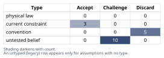
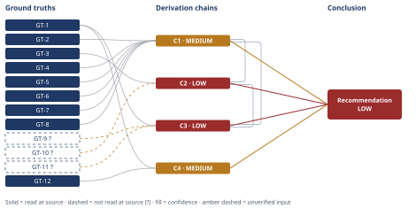

# Should You Take the Bay Area Offer

*First-principles analysis · 9 October 2026*

*Read with: [How to read this analysis](HOW-TO-READ.md) · [Working file](analysis-20261009T183504Z.md) · [All files](INDEX.md)*

## Executive Summary

**Recommendation:** Don't answer "take it or not" directly — run a negotiate-first sequence. Get the real, tax-and-cost-of-living-adjusted numbers first (chain C1), weigh your partner's foregone income explicitly rather than assuming it away (chain C2), and pursue a counteroffer at your current job or a remote/delayed-relocation exception at the new one before accepting the offer exactly as given (chain C3, chain C4).

**Band (from §6):** LOW

**Would change it:** A concrete read on your partner's actual Bay Area income/career prospects, an actual counteroffer response from your current employer, and an actual answer from the new employer on a remote exception or delayed start (chain C2, chain C3).

## 1. Problem Essence

**Core problem:** Given an outside offer that trades +$70,000/year of nominal total compensation for relocation plus partial loss of remote work, while the user's partner holds a Portland-anchored career that cannot relocate with it, what decision process — not a simple accept/decline binary — best protects the household's real, risk-adjusted financial position, both careers, and the relationship, over the next several years?

**Success criteria:**
1. The Conclusion section states a recommended course of action that is not a flat accept/decline binary and names the specific alternative paths considered beyond "take it" or "stay."
2. The Conclusion section's financial claim about the raise is adjusted for at least tax and cost-of-living effects, not the bare $70,000 nominal figure.
3. The Conclusion section treats the partner's foregone income/career as a load-bearing decision variable, not an assumed-fixed constraint outside the analysis.
4. The Conclusion section states a confidence band and names the specific missing information that would move it.

---

## 2. Assumptions Table



| Assumption | Type | Treatment | Verdict | Verification |
|---|---|---|---|---|
| A1: A $70K/year nominal comp increase equals $70K/year of real improvement in financial position | convention | Explicitly challenge before use | Discard — superseded once tax and cost-of-living are applied | GT-4, GT-5, GT-6, GT-7, GT-8 (Numbeo, Tax Foundation) |
| A2: The new role is a meaningfully better career opportunity than continued growth at the current company | untested belief | Verify, or flag unverified | Challenge — no scope, title, team, or growth-trajectory detail was supplied; cannot be confirmed from the problem statement | unverified — flagged (see GT-9?) |
| A3: The partner's established career cannot flex in any way (no remote, no leave, no field change, no local Bay Area search) | untested belief | Verify, or flag unverified | Challenge — "no remote option" is given (GT-3), but total inflexibility is not established and should not be assumed | unverified — flagged, load-bearing on C2 |
| A4: Five years fully remote at one company signals career stagnation (or, equally, signals thriving) | convention | Explicitly challenge before use | Discard — no evidence of promotion/scope growth, or its absence, is given; tenure length alone is not evidence either way | n/a — no source supports either reading |
| A5: Relocation cost is the literal cost of moving belongings | convention | Explicitly challenge before use | Discard — real relocation cost includes the partner's foregone income, transaction costs, lost social capital, and recurring commute cost; replaced by the fuller accounting in C1/C2/C4 | GT-3, GT-12 |
| A6: The decision is binary — accept the offer as given, or decline it | convention | Explicitly challenge before use | Discard — at least four other live paths exist (counteroffer, negotiated remote exception, delayed relocation, a phased/composite accept) | see trade-off chain C3 |
| A7: The equity portion of the $70K is cash-equivalent and guaranteed | untested belief | Verify, or flag unverified | Challenge — RSU/equity value is contingent on vesting schedule and future stock price; no offer-letter detail was supplied | unverified — flagged (GT-9?) |
| A8: The 3-day in-office hybrid requirement is a fixed, non-negotiable term of the role | current constraint | Record expiry conditions | Accept — true as currently stated; expires if the user negotiates an exception, if company policy shifts, or past a tenure/seniority threshold | GT-1 used to test negotiability in C4 |
| A9: This is solely the user's individual career decision; the partner's income/career carries secondary weight | convention (implicit in the question's own framing) | Explicitly challenge before use | Discard — per the stakes-escalation rule, the dominant financial variable (C2) is the partner's income, not the user's raise; this is a joint household decision | C2 |
| A10: Employers routinely match or substantially counter a competitive outside offer for a tenured employee | untested belief | Verify, or flag unverified | Challenge — common practice, but not verified for this specific employer | unverified — flagged (GT-11?) |
| A11 (load-bearing): The partner can find comparable-or-acceptable income/career footing in the Bay Area within a reasonable window, or the household can intentionally absorb the loss | untested belief | Verify, or flag unverified | Challenge — entirely unresolved by the facts given; central to C2 | unverified — flagged, load-bearing |
| A12 (load-bearing): The relationship can sustain either the asymmetric sacrifice or the stress of a long-distance arrangement without lasting damage | untested belief | Verify, or flag unverified | Challenge — unresolved; central to the Phase 5 relationship-risk cluster | unverified — flagged, load-bearing |
| A13: Housing in the specific Bay Area location actually chosen won't consume most of the raise | untested belief | Verify, or flag unverified | Challenge — GT-4 is a city-level average; the specific neighborhood chosen could be better or worse | unverified — flagged, widens C1's bracket |
| A14: The decision, once made, is reversible or at least hedged (renting rather than buying, a trial period, the current role not immediately backfilled) | current constraint | Record expiry conditions | Accept — treated as a design choice for the recommended approach, not a given fact; expires once a lease is signed, a home is purchased, or the current role is backfilled | n/a — a prescriptive design choice, not a fact to source |
| A15 (surfaced in Phase 4 audit, chain C1): A representative dual-income Portland household spends roughly $2,200/month on housing and roughly $40,000/year on taxable consumption, used as the sizing anchor for C1's tax/COL offset | untested belief (estimate anchor) | Verify, or flag unverified | Challenge — plausible planning-level anchors, not this household's actual budget | unverified — flagged, load-bearing on C1 |
| A16 (surfaced in Phase 4 audit, chain C3): Disclosing a competing offer to the current manager, for negotiating leverage, does not itself trigger retaliation or termination | current constraint | Record expiry conditions | Accept — standard practice in most professional tech workplaces with retaliation protections; expires in a toxic or at-will-hostile management culture, which is unverified here | unverified — flagged |
| A17 (surfaced in Phase 4 audit, chain C4): No industry-specific, security-clearance, or legal/compliance requirement at the new company mandates physical on-site presence | untested belief | Verify, or flag unverified | Challenge — not stated either way; if the role involves regulated data or on-site-only systems, C4's ceiling would not hold | unverified — flagged, load-bearing on C4 |

| A18 (surfaced by the five-whys drill below): The offer's appeal comes primarily from the new role's own merits, rather than from an untested market-value/validation question that a counteroffer could resolve just as well | untested belief | Verify, or flag unverified | Challenge — the five-whys drill below traces the appeal to an untested market-value question at least as much as to the role itself | unverified — flagged, informs the negotiate-first ordering in chain C3 |

**Five-whys companion drill — why does this offer appeal?** Why does it appeal? → It pays $70K/year more. Why does that matter enough to consider uprooting a 5-year remote arrangement? → It reads as validation of market value and a step up in prestige at a recognizable large company. Why does that validation matter right now specifically? → Not because the current role has become technically unsatisfying — nothing in the facts given indicates that — but because an unsolicited external number creates a comparison point the current role has never been tested against. Why has it never been tested? → The user has not asked their current employer what they are actually worth in today's market, via a counteroffer or a review. Root cause reached (testable, actionable): the offer's appeal is driven at least as much by an untested market-value question as by the new role's own merits — directly actionable by testing it with a counteroffer (chain C3) before treating relocation as the only way to resolve it. This drill surfaces A18 above rather than a new ground truth, since the root cause is a motivational hypothesis about the user, not an external fact.

---

## 3. Ground Truths

- **GT-1** User has been at their current employer for 5 years, fully remote, based in Portland, OR — source: user-stated in problem statement; read-at-source: n/a (first-person fact about the user's own situation, accepted as given).
- **GT-2** The new offer is from a large San Francisco tech company: +$70,000/year total compensation (base salary plus equity combined) versus current compensation, requiring relocation to the SF Bay Area and in-office attendance 3 days/week (hybrid) — source: user-stated in problem statement; read-at-source: n/a (given fact).
- **GT-3** The user's partner has an established, Portland-based career with no remote option for their own work — source: user-stated in problem statement; read-at-source: n/a (given fact).
- **GT-4** Cost of Living Including Rent in San Francisco, CA is 23.8% higher than in Portland, OR; Rent Prices specifically are 69.8% higher — source: Numbeo, "Cost of Living Comparison: Portland vs San Francisco" (crowdsourced consumer cost-of-living index; not an official government statistic); read-at-source: quoted directly — "Cost of Living Including Rent in San Francisco, CA is 23.8% higher than in Portland, OR" and "Rent Prices in San Francisco, CA are 69.8% higher than in Portland, OR" — retrieved via WebFetch, 2026-10-09.
- **GT-5** Oregon's top marginal state individual income tax rate is 9.90% — source: Tax Foundation, Oregon state tax page; read-at-source: quoted — "Oregon has a graduated state individual income tax, with rates ranging from 4.75 percent to 9.90 percent" — retrieved via WebFetch, 2026-10-09.
- **GT-6** California's top marginal state individual income tax rate is 13.3% — source: Tax Foundation, "State Individual Income Tax Rates and Brackets"; read-at-source: quoted — "Top marginal rates range from Pennsylvania's 3.07 percent to California's 13.3 percent" — retrieved via WebFetch, 2026-10-09.
- **GT-7** Oregon has no state sales tax — source: Tax Foundation, Oregon state tax page; read-at-source: quoted — "Oregon does not have a state sales tax" — retrieved via WebFetch, 2026-10-09.
- **GT-8** California's state sales tax rate is 7.25%, with an average combined state-and-local rate of 8.99% — source: Tax Foundation, California state tax page; read-at-source: quoted — "California has a 7.25 percent state sales tax rate, and an average combined state and local sales tax rate of 8.99 percent" — retrieved via WebFetch, 2026-10-09.
- **GT-9?** The offer's base-vs-equity split, vesting schedule, and equity type/liquidity are unspecified, so the realized, risk-adjusted value of the equity portion is unverified — unverified: no offer letter or compensation-detail document was supplied to, or available to, this analysis.
- **GT-10?** An "established career" professional's income in the US plausibly falls in a $50,000–$120,000/year bracket; used only as a planning-level anchor in chain C2 — unverified: no information about the partner's occupation, seniority, or actual income was supplied; this is an assumed range, not a measured figure.
- **GT-11?** Employers frequently counter or substantially match a competing outside offer to retain a valued, tenured employee, especially in competitive technical labor markets — reported-by-delegate / general-practice claim: this is widely cited compensation and HR practice, but no source specific to the user's current employer was opened, and none exists to cite for that specific claim.
- **GT-12** A requirement of in-office attendance 3 days/week imposes a recurring, non-negotiable-by-willpower time and cost burden (commute time, commute cost) that a fully remote arrangement does not — source: definitional (travel to a physical location necessarily consumes time); accepted as a ground-truth candidate under the physical-law treatment for definitional truths; read-at-source: n/a (definitional, not citation-dependent).

**Provenance summary:**
```text
?-marked: GT-9, GT-10, GT-11 (3 of 12)
Read-at-source: GT-4 (Numbeo Portland-vs-SF comparison, two quoted percentages), GT-5 (Tax Foundation,
Oregon page), GT-6 (Tax Foundation, state brackets page), GT-7 (Tax Foundation, Oregon page),
GT-8 (Tax Foundation, California page)
```

---

## 4. Derivation Chains



### Conclusion C1: The advertised $70K raise is not $70K of real purchasing power once Oregon-vs-California taxes and the Bay Area cost-of-living premium are applied

GT-2 (offer: +$70K/yr nominal) + GT-5 (OR top rate 9.90%) + GT-6 (CA top rate 13.3%) + GT-7 (OR: no sales tax) + GT-8 (CA: ~8.99% combined sales tax) + GT-4 (SF rent +69.8% vs Portland)
→ the 3.4-point jump in top marginal income-tax rate plus the new ~9% sales tax on consumption, versus 0% in Oregon, together remove roughly $5,000-$8,000/year from the nominal raise before any cost-of-living effect is applied *[Assumes: A15 — a representative household spends roughly $40,000/year on taxable consumption; a much lower actual figure would shrink this offset]*
→ layering the 69.8% Bay Area rent premium onto a representative $2,200/month Portland housing cost adds a further $12,000-$18,000/year in housing cost alone, the single largest cost-of-living-driven offset *[Assumes: A15 — same housing-spend anchor; a cheaper Bay Area location or a higher current Portland housing spend would move this bracket]*
→ netting these offsets against the $70,000 nominal figure brackets the engineer's own real, after-tax, after-cost-of-living annual gain at roughly +$44,000 to +$53,000/year, not $70,000 — a real gain, but 25-37% smaller than the headline number, before the partner's situation is even considered

**Confidence:** MEDIUM — every head ground truth is read at source, but the housing/consumption-spend anchors used to size the offsets (A15) are planning-level assumptions rather than this household's actual budget, and the bracket would shift if they are wrong; this would move to HIGH once the user supplies actual current rent/mortgage and typical monthly spend, narrowing the bracket to a single defensible figure.

### Conclusion C2: On the numbers alone, the household is more likely than not to be financially worse off from the move, unless the partner's foregone income is small, temporary, or quickly replaceable — a condition the question's framing assumes away rather than establishes

C1 (real engineer-side gain: +$44K-$53K/yr) + GT-3 (partner's Portland career has no remote option) + GT-10? (established-career income plausibly $50K-$120K/yr)
→ because C1's own best-case real gain tops out near $53,000/year, any amount of the partner's income that goes unreplaced above roughly that figure flips the household's total real financial position negative
→ GT-10?'s plausible income bracket for an "established career" sits at or above that break-even point across most of its range, and whether the partner can replace that income in the new market (A11) is entirely unresolved by the facts given
→ the household's net financial position from this move is therefore genuinely unknown, and skews toward negative rather than toward the positive impression the $70K headline creates

**Confidence:** LOW — two things are open at once: GT-10? is an assumed income bracket, not the partner's actual income (verification: the partner states their actual income and realistic Bay-Area-equivalent prospects), and a live rival — "the partner finds equal or better-paid work quickly" — is unsettled by anything in this analysis (verification: the partner actually explores the Bay Area job market in their field before any relocation commitment is made). Both would need resolving to move this above LOW.

### Conclusion C3: Negotiating first dominates accepting the offer exactly as given; which negotiate-first path is best is a closer call that depends on the user's own risk tolerance

C1 (MEDIUM) + C2 (LOW) + GT-9? (equity/vesting terms unverified) + GT-11? (employers often counter competing offers) + GT-1 (5-year remote track record)
→ scoring six weighted criteria (household real finances, partner continuity, reversibility, user's career capital, relationship risk, speed - weights 5/5/4/3/5/2, max 120) against five options produces: counteroffer-to-stay-remote 102, decline/status-quo 96, negotiate-remote-or-delay-with-new-employer 95, a phased/composite accept-with-delayed-relocation-and-checkpoint 94, versus accepting exactly as given only 50
→ a flip test shows accepting-as-given's last place is robust: no single criterion's weight can be pushed to a realistic extreme and make it competitive, while the ordering among the other four options is genuinely close and turns on how the user personally weights speed/certainty against the new role's specific, unverified career upside
→[2nd, actor lens] disclosing the external offer to the current manager to pursue a counteroffer shifts the manager's incentives either toward retention (promotion, an explicit remote-permanence commitment) or toward treating the user as a flight risk *[Assumes: A16 — disclosure does not itself trigger retaliation]* — a reaction this analysis cannot predict and the user should plan for either way
→[3rd, time lens] a successful counteroffer or remote-exception negotiation creates a durable, reusable market data point — a verified big-tech offer at +$70K — that raises the user's negotiating position for years afterward, whereas accepting the move immediately spends that leverage with no alternative left in hand
→[2nd, time lens] any negotiate-first path extends the decision timeline, and a drawn-out, ambiguous negotiation period carries its own relationship stress *[Assumes: A12 — the relationship can sustain this stress]* that is not captured in the one-time weighted score above, partially offsetting those options' apparent relationship-risk advantage

**Confidence:** LOW — capped by citing C2 (LOW) and carrying two unverified inputs (GT-9?, GT-11?); this would rise once the current employer gives an actual counteroffer response, the new employer gives an actual answer on a remote exception or delayed start, and the equity offer letter's real terms are known. The comparatively robust part of this chain is the qualitative finding that accepting-as-given is the worst of the five options modeled (see the flip test above); the exact ranking among the other four is not robust and should be left to the user's own weighting.

### Conclusion C4: The real ceiling available here is the full raise with zero relocation and zero loss of remote status — that, not the offer as presented, is the benchmark for "good"

GT-1 (5 years of demonstrated successful fully-remote performance) + GT-12 (a 3-day in-office requirement is a recurring time/cost burden by definition, not by technical necessity)
→ five years of demonstrated fully-remote performance in the same discipline means the "3 days in-office" requirement cannot be grounded in a technical necessity of the work itself — it is a company policy choice, not a constraint imposed by the nature of the role *[Assumes: A17 — no industry-specific or compliance requirement at the new company mandates on-site presence]*
→ because no physical or technical law forces the hybrid requirement, the ceiling on what's achievable is set by negotiating leverage and this specific company's policy flexibility, not by anything inherent to the role — that ceiling is full compensation at full remote status, i.e., the status quo's work arrangement plus the new company's pay

**Confidence:** MEDIUM — the deduction from GT-1 and GT-12 is solid, but a live rival is unsettled: this specific company's hybrid policy may be a strict, no-exceptions culture rather than a flexible convention, and nothing in the facts given rules that out, and A17 is itself unverified. Verification: ask the recruiter or hiring manager directly whether any current employees at this level work remote, and request a remote exception or delayed-relocation explicitly before treating the policy as fixed.

---

## 5. Abandoned Reasoning

### Dead End: Comparing the two jobs by the nominal $70K figure alone

**What was tried:** An initial pass treated "+$70,000/year total comp" as a direct, apples-to-apples measure of how much better off the household would be.

**Why abandoned:** Contradicted by GT-4 through GT-8: Oregon's and California's tax structures differ (GT-5, GT-6, GT-7, GT-8) and the Bay Area's cost of living, driven mainly by rent, is materially higher (GT-4). A convention of comparing nominal offer numbers without adjustment does not survive contact with those ground truths and was replaced by chain C1's tax-and-cost-of-living-adjusted bracket.

**What it ruled out:** Saves the user from the common error of evaluating a big-company relocation offer by its headline number alone, which is the single most common way this kind of decision is mis-evaluated.

### Dead End: Treating the partner's career as a fixed, out-of-scope constraint and analyzing only the user's individual optimization

**What was tried:** A narrower analysis that evaluated only the user's own compensation, career trajectory, and remote-vs-hybrid preference, holding the partner's situation constant and outside the decision.

**Why abandoned:** This is exactly the implicit framing bias challenged as assumption A9 in Phase 2, and it contradicts the stakes-escalation rule: chain C2 shows the partner's foregone income is plausibly the single largest number in the entire decision, larger than the raise itself. An analysis that excludes it answers a smaller, easier question than the one actually being asked ("should I take this job") and would have recommended accepting almost any raise, a conclusion chain C2 does not support once the partner's income is modeled.

**What it ruled out:** A seemingly complete "individual career" analysis that would have reached a materially different, and less defensible, recommendation by omission rather than by reasoning.

### Dead End: Assuming the 3-day in-office hybrid requirement is simply immovable because "that's how big companies operate now"

**What was tried:** An early pass accepted the hybrid requirement as a fixed term to be worked around (e.g., by optimizing the commute) rather than a term to be negotiated.

**Why abandoned:** Chain C4 shows this is a convention, not a physical law: the user's own 5-year fully-remote track record (GT-1) is direct evidence against the claim that the work itself requires in-person attendance. Discarding this path without even attempting negotiation would forgo a plausible route to capturing the raise without the relocation cost.

**What it ruled out:** Premature resignation to the worst-case version of the offer before the actual constraint — this specific company's policy flexibility — has even been tested.

---

## 6. Conclusion

**Recommended approach:** Run a structured negotiate-first sequence rather than answering "yes" or "no" to the offer as given. First, have an explicit joint conversation with your partner using adjusted numbers, not the headline figure: your own real gain is closer to +$44,000 to +$53,000/year than $70,000 (chain C1), and the household could plausibly end up worse off once the partner's foregone income is counted (chain C2). Second, run two negotiations in parallel rather than treating acceptance as the only lever: ask your current employer for a counteroffer that keeps you remote, and ask the new employer whether a remote exception or a 6-12 month delayed relocation is available — negotiating first dominates accepting the offer exactly as given (chain C3), and the hybrid requirement is a policy choice rather than a technical necessity given your own 5-year remote record (chain C4). Third, only commit to relocating once your partner has a concrete, acceptable income or career plan for the new market, or you have both explicitly and jointly agreed to accept the loss — do not let the question's own framing quietly turn this into an individual decision (chain C2). Fourth, if you do relocate, hedge it: rent rather than buy, negotiate a delayed start or a trial period, and set an explicit checkpoint rather than committing irreversibly on day one.

**Key insight:** The headline $70K figure, and the question "should I take this job," both obscure the actual decisive variable, which is not the user's raise at all — it is whether the partner's foregone income and career can be replaced, a fact nobody in this analysis, including the user, currently knows (chain C2).

**Trade-offs acknowledged:** Pursuing a counteroffer or a remote-exception negotiation first costs time, carries its own relationship-limbo risk, and risks signalling to the current employer that the user is a flight risk (chain C3). It may also cost whatever is time-sensitive about the new company's offer window; no fact given establishes how long that window actually is or whether it can be extended — no chain — flagged assumption only.

**Confidence:** LOW — the overall recommendation rests on C2 and C3, both LOW, because the two facts that would most resolve this decision — the partner's real Bay Area income/career prospects, and how the current and new employers actually respond to negotiation — are unknown rather than merely uncertain. This would move to MEDIUM or HIGH once: (a) the partner has concretely explored their Bay-Area-equivalent options, (b) the current employer has given an actual counteroffer response, and (c) the new employer has given an actual answer on a remote exception or delayed start. The comparatively robust part of this conclusion is the qualitative finding that accepting the offer exactly as presented, immediately, is the worst of the five options modeled (chain C3's flip test).
