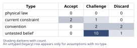
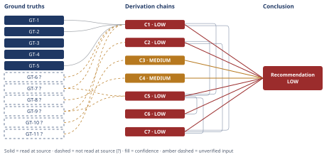

# Should You Take the SF Offer and Relocate

*First-principles analysis · 10 October 2026*

*Read with: [How to read this analysis](HOW-TO-READ.md) · [Working file](analysis-20261010T025855Z.md) · [All files](INDEX.md)*

## Executive Summary

**Recommendation:** Negotiate for time and real information — the exact comp/equity breakdown, hybrid-schedule terms, and true decision deadline — while immediately having a direct conversation with the partner about their actual appetite and timeline, before choosing among staying, relocating together, or a bounded live-apart trial (chain C7, chain C5).

**Band (from §6):** LOW

**Would change it:** Resolving the specific unknowns the Key Insight and Confidence lines already name — the partner's genuine preference and Bay Area job-market viability (chain C2), and the offer's real cash/equity split, vesting terms, and tax/COL exposure (chain C1) — is what would move this conclusion toward HIGH.

## 1. Problem Essence

**Core problem:** Given an offer whose true risk-adjusted economic value is not yet established and a relocation cost that, as framed, falls almost entirely on a partner whose actual preferences have not been established either, what should this engineer do now — accept, decline, or something else — and what specifically would have to be known to make that choice safely?

**Success criteria:**
1. The Conclusion section names the real decision variables beyond "pay vs. relocation" that actually drive the recommendation.
2. The Conclusion section states, for each major unresolved uncertainty, the specific question or data point that would resolve it.
3. The Conclusion section does not force a single accept/decline answer unless a Derivation Chain actually supports one at HIGH confidence; where none does, it states a decision framework instead.
4. The Conclusion section treats the partner's career and the engineer's career as symmetric decision inputs, not a fixed cost loaded onto one side.
5. The Conclusion section names at least one concrete action the person can take within days — not months — to narrow the largest uncertainty.

---

## 2. Assumptions Table



| Assumption | Type | Treatment | Verdict | Verification |
|------------|------|-----------|---------|--------------|
| The stated $70K/year TC delta is the real economic delta of taking the offer | convention | Challenge — gross pre-tax, pre-COL figures are routinely treated as "the number," but that treatment is a habit, not a fact about what the money is worth | Challenge — the figure mixes guaranteed cash with risk-bearing equity and ignores CA/OR tax and Bay Area COL; its real value is contested in chain C1 | unverified — flagged (GT-7?) |
| Equity should be counted at face value, same as cash | untested belief | Verify or flag; do not treat as cash-equivalent | Discard as a working assumption — vesting, forfeiture-on-exit, and valuation risk make face value an overstatement | unverified — flagged (GT-11?; see Phase 3 failure record below) |
| The partner's career "has no remote option" is a fixed, permanent fact | current constraint | Record expiry conditions — what would have to change for this to lift | Challenge — this describes the partner's current employer's policy today, not a permanent fact about the partner's field or the Bay Area job market in it; expiry conditions: partner's employer adopts hybrid/remote, partner's field has Bay Area demand, or partner chooses a pause/pivot on their own terms rather than having one forced | unverified — flagged (GT-9?) |
| Staying in Portland is the safe, zero-risk default | convention | Challenge before use | Challenge — the current role's job security and promotion trajectory are asserted favorable, not evidenced; see inversion result in chain C3 | unverified — flagged (untested belief, no independent GT; addressed in C3) |
| In-office 3 days/week means losing the remote lifestyle entirely | convention | Challenge before use | Discard as stated — overstated; 2 remote weekdays plus weekends remain under hybrid terms; real binding constraint is commuting-range geography, not loss of remote life (chain C4) | derived directly from GT-8? (stipulated hybrid terms) |
| The offer's value is driven mainly by the raw pay increase | untested belief | Verify or flag | Challenge — scope, title, and brand/network effects of a large SF tech employer may carry career-capital value independent of, and possibly exceeding, the cash number | unverified — flagged (no GT; named as an open question in §6) |
| The decision is binary: accept-and-relocate vs. decline-and-stay | convention | Challenge before use | Discard as too narrow — negotiate-first, live-apart/commute trial, and leverage-for-counteroffer are all live intermediate options (chain C5) | addressed directly in the C5 trade-off matrix |
| 5 years of remote tenure is deep, portable career capital that would simply be "lost" by leaving | untested belief | Verify or flag | Challenge — not given whether the role has been advancing (promotions, scope growth) or has plateaued; remote tenure can under-build visibility/sponsorship that a new role might restore | unverified — flagged (GT-10?) |
| A large SF tech company offer implies greater job security than the current fully-remote role | untested belief | Verify or flag | Challenge — large tech employers have had repeated, significant layoffs in 2022-2025; nothing given supports assuming either role is safer | unverified — no GT; addressed in chain C3 |
| The partner's willingness to move, pause, or job-search is incidental detail, not a core variable | untested belief (highest stakes) | Verify immediately, before any other step | Challenge — this is very likely the single highest-leverage unresolved input in the entire decision | unverified — flagged (GT-9?; named as the top next-action in §6) |
| CA and OR statutory top marginal income tax rates and thresholds (current law) | current constraint | Record expiry — figures are current-law, current-year and subject to legislative change | Accept — read at source | read-at-source (GT-1, GT-2) |
| Cost-of-living index deltas between Portland, OR and San Francisco, CA | current constraint / market measurement | Record currency — these are index snapshots, not fixed facts, and will drift | Accept, with a caveat — Numbeo is crowd-sourced, not an official statistical source, and should ideally be cross-checked against a second source (e.g., a relocation-specific COL calculator or regional CPI) before being used for a real budget | read-at-source (GT-3, GT-4, GT-5), caveat noted |
| A "large SF tech company" necessarily means publicly-traded, liquid RSUs | untested belief | Verify or flag | Challenge — "large" does not guarantee public/liquid; a large but still-private late-stage company changes the equity-risk picture materially | unverified — no GT; named as an open question in §6 |
| The relationship has already discussed, and has some resilience plan for, relocation stress independent of the financial outcome | untested belief | Verify immediately | Challenge — not given; this is a precondition (P5) surfaced by the inversion pass in Phase 2 below | unverified — named as a next-action in §6 |
| Equity constitutes 30-60% of the stated $70K delta | untested belief (illustrative modeling range) | Flag as illustrative pending real figures | Challenge — introduced in the Phase 4 Fermi estimate (chain C1); range is a placeholder, not a reported fact | unverified — flagged; `[Assumes: A-15]` on chain C1 |
| A reasonable risk/illiquidity discount on at-risk equity is 15-35% | untested belief (illustrative modeling range) | Flag as illustrative pending real vesting terms | Challenge — introduced in chain C1's Fermi estimate; standard comp-finance practice informs the range but it is not a verified figure for this specific grant | unverified — flagged; `[Assumes: A-16]` on chain C1 |
| 45-65% of gross TC is exposed to local cost-of-living for an upper-income household | untested belief (financial-planning heuristic) | Flag as illustrative pending real budget data | Challenge — introduced in chain C1's Fermi estimate; a generic heuristic, not this household's actual spending pattern | unverified — flagged; `[Assumes: A-17]` on chain C1 |
| The illustrative criterion weights and option scores in the C5 trade-off matrix reflect a generic household's priorities | untested belief | Flag as provisional, to be re-scored with the couple's own weights | Challenge — introduced in chain C5; stands in for the couple's actual priorities until they weight it themselves | unverified — flagged; `[Assumes: A-18]` on chain C5 |

**Inversion pass (Phase 2 companion technique).** Claim inverted: "this relocation, if accepted, will be good for both careers and the relationship." Inverted form: "this relocation will damage the engineer's career, the partner's career, or the relationship (or more than one)." Failure-guaranteeing conditions enumerated: (a) the partner acquiesces reluctantly rather than wanting the move, and resentment accumulates; (b) the partner cannot find comparable Bay Area work in a reasonable window; (c) the equity is worth far less at vesting than assumed (decline, no liquidity event); (d) the hybrid policy tightens toward full RTO over time; (e) the relationship doesn't survive relocation stress regardless of the financial outcome; (f) the engineer doesn't adjust well to in-office culture after 5 remote years and is let go or sidelined; (g) the couple declines and stays, and the "safe" choice turns out not to protect them either. Necessary preconditions derived and their load-bearing status: P1 "the partner is genuinely, not just nominally, willing to relocate or pause for a bounded period" (load-bearing) → feeds the assumption on partner willingness above; A-3 "the partner's field has a realistic Bay Area job market within an acceptable window" (load-bearing) → feeds the "no remote option is fixed" assumption; P3 "the equity's risk-discounted expected value still makes the offer attractive even in a below-expectation outcome" (load-bearing) → feeds the equity-face-value assumption; P4 "the hybrid policy's RTO trajectory is at least inferable" (not load-bearing — affects degree, not the core choice); P5 "the relationship has a stress-resilience plan independent of the financial outcome" (load-bearing) → new assumption row above; P6 "the engineer has assessed their own adjustment risk to in-office work" (not load-bearing — secondary); A-4 "staying is actually being evaluated for its true risk rather than defaulted to as safe" (load-bearing) → feeds the "staying is safe" assumption above.

---

## 3. Ground Truths

- **GT-1** California's highest marginal state individual income tax rate is 13.3%, applying to income exceeding $1,000,000 for single filers and $1,442,628 for married couples filing jointly; CA has ten marginal brackets from 1% to 13.3%. — source: tax-brackets.org California tax table; read-at-source: quoted passage, "California's highest marginal state individual income tax rate is 13.3%... applies to income exceeding $1,000,000 for single filers and $1,442,628 for married couples filing jointly."
- **GT-2** Oregon's highest marginal state individual income tax rate is 9.9%, applying to income over $125,000 for single filers and over $250,000 for married couples filing jointly; OR has four marginal brackets from 4.75% to 9.9%. — source: tax-brackets.org Oregon tax table; read-at-source: quoted passage, "Oregon has four marginal tax brackets, ranging from 4.75%... to 9.9%..."
- **GT-3** Rent prices in Portland, OR are 41.1% lower than in San Francisco, CA. — source: Numbeo cost-of-living city comparison (San Francisco, CA vs Portland, OR); read-at-source: quoted figure, "Rent Prices in Portland, OR are 41.1% lower than in San Francisco, CA."
- **GT-4** Cost of living (excluding rent) in Portland, OR is 3.3% lower than in San Francisco, CA. — source: Numbeo cost-of-living city comparison; read-at-source: quoted figure, "Cost of Living in Portland, OR is 3.3% lower than in San Francisco, CA (excluding rent)."
- **GT-5** Cost of living including rent in Portland, OR is 19.3% lower than in San Francisco, CA. — source: Numbeo cost-of-living city comparison; read-at-source: quoted figure, "Cost of Living Including Rent in Portland, OR is 19.3% lower than in San Francisco, CA."
- **GT-6?** A software engineer's total compensation in the roughly $200K-$350K range would fall in California's 9.3% marginal bracket (which runs from about $68,350 to $349,137 for a single filer), not the 13.3% top bracket, which only applies above $1,000,000. — cited to: general knowledge of CA's published bracket structure (brackets between GT-1's top threshold and the mid-range have not been read at source this run); unverified: the exact current-year bracket boundaries for the intermediate brackets were not opened and confirmed in this analysis.
- **GT-7?** The new offer is $70,000/year greater in total compensation (base + equity combined) than the person's current total compensation. — cited to: the user's own statement of the situation; unverified: no breakdown of the cash/equity split, no vesting schedule, and no confirmation of whether the figure is gross or net of anything.
- **GT-8?** The new role requires in-office attendance 3 days per week (hybrid). — cited to: the user's own statement; unverified: the exact enforcement strictness and future trajectory of this policy (whether it is likely to tighten toward full RTO) are not given.
- **GT-9?** The partner has an established, Portland-based career with no remote option currently available through their present employer. — cited to: the user's own statement; unverified: whether this is a structural fact of the partner's entire field (e.g., licensure-bound) or a policy specific to their current employer that could change, and whether the partner has been asked directly about appetite and timeline for a change.
- **GT-10?** The person has 5 years of tenure in a fully remote role at their current employer. — cited to: the user's own statement; unverified: trajectory (promotions, scope growth, or plateau), satisfaction, and how replaceable the role is are not given.
- **GT-11?** Equity grants at large, established technology employers are, in general, less liquid and more risk-bearing than guaranteed cash: vesting schedules create forfeiture-on-departure risk, and valuation is subject to market or liquidity-event risk; whether this specific offer's equity is in a publicly-traded (more liquid) or still-private (illiquid) company is not stated. — unverified: three source-read attempts this run failed to confirm the general RSU/vesting-mechanics claim at source (see Phase 3 failure records below); the general claim is treated as a standard, widely-known feature of equity compensation, but it has not been read at source in this analysis.

**Phase 3 failure records (GT-11?):** (1) investopedia.com/terms/r/restricted-stock-unit.asp — unreachable (tool-level fetch restriction); (2) schwab.com/learn/story/restricted-stock-units-rsus-facts — unreachable (authorization error returned by the host); (3) carta.com/learn/equity/stock-options/restricted-stock-units/ — unreachable (HTTP 403 Forbidden). All three attempts failed before any content could be read; GT-11? remains `?`-marked and no chain depending on it is rated above MEDIUM.

**Provenance summary:**
```text
?-marked: GT-6, GT-7, GT-8, GT-9, GT-10, GT-11 (6 of 11)
Read-at-source: GT-1 — tax-brackets.org California tax table, quoted marginal-rate/threshold passage
Read-at-source: GT-2 — tax-brackets.org Oregon tax table, quoted marginal-rate/threshold passage
Read-at-source: GT-3, GT-4, GT-5 — Numbeo San Francisco vs Portland cost-of-living comparison, quoted percentage figures
```

---

## 4. Derivation Chains



### Conclusion C1: The real, risk-and-COL-adjusted economic benefit of the move brackets around zero, not $70K

**Estimate (Fermi bracket).** Target quantity: the real, risk-and-COL-adjusted annual economic benefit of accepting the offer, in Portland-equivalent purchasing power (direction: higher is better).

GT-7? (headline $70K/yr delta) + GT-11? (equity is risk-bearing, not cash-equivalent) + GT-1 (CA top rate 13.3% over $1M) + GT-6? (realistic CA bracket ~9.3% for this income band) + GT-2 (OR top rate 9.9% over $125K) + GT-5 (COL including rent 19.3% higher in SF than Portland)
→ risk-adjusting the equity portion of the $70K delta — assuming it is 30%-60% of the delta and discounting that portion 15%-35% for illiquidity/forfeiture/valuation risk — lowers the cash-equivalent delta by roughly $3,150 to $14,700/year, to about $55,300-$66,850 `[Assumes: A-15, A-16]`
→ at a senior software engineer's likely income band, CA's marginal rate (~9.3%) sits close to or even below OR's top marginal rate (9.9%), so the state-tax delta from relocating is small and could run in either direction, not the large CA tax penalty commonly assumed
→ applying the 19.3% COL gap to the 45%-65% of gross income typically exposed to local costs for an upper-income household produces a COL drag whose plausible size overlaps the risk-adjusted cash delta from the first hop `[Assumes: A-17]`
→ the real, risk-and-COL-adjusted economic benefit of the move brackets from roughly -$10,000 to +$20,000 per year depending on the person's actual equity split, vesting terms, and target housing choice, straddling zero, so the headline $70K figure should not be treated as the real number

**Confidence:** LOW — Inputs axis short: GT-7? (verification: get the offer letter's exact cash/equity split and vesting schedule), GT-11? (verification: confirm whether the equity is publicly-traded/liquid or private/illiquid, and its current 409A or market valuation), GT-6? (verification: read the current-year CA bracket table directly rather than relying on general bracket-structure knowledge). Rivals axis also short: a live rival reading — "the $70K delta, even after adjustment, is still robustly positive because the new base salary is high enough on its own" — is not ruled out by anything given, since the person's actual current and new base-salary figures are unknown; nothing in this analysis settles it (see Abandoned Reasoning, Dead End 1, for why a dollar-precise rebuttal was not attempted).

### Conclusion C2: The partner's "no remote option" constraint is softer and more time-bound than the framing suggests

GT-9? (partner's career has no remote option, stipulated)
→ inverting the implicit claim "the move succeeds for both careers" surfaces that the partner's job-search outcome in the new market, not the compensation number, is the single largest unpriced variable in the whole decision `[Assumes: A-3]`
→ the stated "no remote option" describes the partner's current employer's policy today, not a permanent fact about the partner's field, skills, or the Bay Area job market in that field
→ the true cost of relocation to the partner's career cannot be assessed from the facts given, and resolving it is the single highest-leverage open input in the entire decision

**Confidence:** LOW — Inputs axis short: GT-9? (verification: a direct conversation establishing the partner's actual Bay Area job-market viability in their field, and their genuine appetite/timeline, independent of what they feel pressured to say). Rivals axis also short: a live rival reading — "the partner's career truly is immobile (e.g., state-licensure-bound, or built on years of local institutional relationships that don't transfer)" — is equally consistent with the facts given and is not ruled out here; only the partner's own input and a basic Bay Area labor-market check for their field can settle it.

### Conclusion C3: Staying in Portland is not a zero-risk default

GT-10? (5 years fully-remote tenure, trajectory not stated)
→ the framing that treats staying as the "safe" default asserts, rather than evidences, that the current role's job security and promotion trajectory are favorable `[Assumes: A-4]`
→ inverting the "staying is safe" claim surfaces at least one concrete failure path the facts given do not rule out: restructuring, a return-to-office mandate at the current employer, or a stalled promotion track for a long-tenured remote employee
→ staying is a genuinely uncertain path, not a zero-risk baseline, and should be weighted as such rather than scored implicitly as safe

**Confidence:** MEDIUM — Inputs axis short: GT-10? (verification: an honest self-assessment, or a direct conversation with a manager, about actual promotion trajectory, performance standing, and the current employer's remote-work policy stability). Inference and Rivals axes are otherwise clean: no live rival claims staying is risk-free once the asymmetry is named, and the inversion step is a direct logical substitution, not an unpriced premise.

### Conclusion C4: The 3-day hybrid requirement is a geography-and-schedule constraint, not a loss of remote life

GT-8? (3 days/week in-office, stipulated)
→ a 3-day-per-week on-site requirement leaves 2 weekdays plus both weekend days under remote-equivalent conditions, a materially different regime from full remote but also from a 5-day mandate
→ the binding new constraint this creates is residence within commuting range of the SF office, not the disappearance of remote work from the person's life
→ the household's actual constraint is a joint geography-and-schedule problem — where can both partners' logistics coexist within commuting range of the office 3x/week — not a binary loss of the remote lifestyle

**Confidence:** MEDIUM — Inputs axis short: GT-8? (verification: confirm the policy's enforcement strictness and whether the company has a recent history of tightening hybrid policies toward full RTO). Rivals and Inference are otherwise clean: a narrower rival ("even a few required office days can feel like losing remote life if the commute is long enough") is accounted for inside the conclusion's own framing (it is a geography problem, which subsumes commute burden) rather than competing with it.

### Conclusion C5: A weighted trade-off across five options shows a fragile near-tie, not a clear winner

**Trade-off analysis (companion technique).** Options named, including the status quo and a composite negotiate-first option: O1 Decline/stay; O2 Accept, relocate together (partner pauses/job-searches in the new market); O3 Accept, live-apart/commute trial for a bounded period; O4 Negotiate first (counter for modified terms, delayed start, or a relocation package, then re-decide among O1/O2/O3 with better information); O5 Decline, but use the offer as leverage for a counteroffer/raise with the current employer. Must-haves checked first: M1, any accepted option preserves a baseline of mutual relationship commitment (cannot be evaluated yet — the partner conversation has not happened); M2, the offer's equity/vesting terms must be fully disclosed before relocating (not yet confirmed). Neither must-have currently eliminates any option on the facts given, but M1 is flagged as the condition most likely to retroactively knock out O2/O3 once the partner's actual position is known. Criteria, weighted 1-5 and locked before scoring, with anchors: Household financial outcome, risk-adjusted 5yr (w5, anchor 1=falls/flat even optimistically to 5=robustly higher even pessimistically); Engineer's career capital/optionality (w4, 1=no change to 5=step-change); Partner's career capital (w5, 1=materially damaged to 5=preserved/enhanced); Relationship stability/stress load (w5, 1=high unmitigated stress to 5=low/bounded stress); Reversibility within 1-2 years (w3, 1=effectively irreversible to 5=easily reversible); Job/role security 5yr (w2, 1=more exposed to 5=more secure); Lifestyle fit (w2, 1=clear downgrade to 5=upgrade/neutral). Weighted totals (out of a possible 130): O4 Negotiate-first = 99; O3 Live-apart-trial = 97; O5 Leverage-counteroffer = 95; O1 Decline/stay = 92; O2 Relocate-together = 78.

GT-7? (headline comp delta) + GT-9? (partner's current no-remote constraint) + C1 (real comp delta uncertain, possibly near zero) + C2 (partner constraint softer/time-bound than framed)
→ weighted totals place Negotiate-first (99) and Live-apart-trial (97) ahead of Leverage-counteroffer (95), Stay (92), and Relocate-together (78), driven by the top-weighted Partner-career-capital and Relationship-stability criteria that heavily penalize immediate full relocation `[Assumes: A-18]`
→ the flip test shows the 2-of-130-point margin between the top two options collapses to an exact tie if Relationship-stability's weight is lowered from 5 to 3, and flips to favor Live-apart-trial at weight 2 — a small, plausible weight change — so neither top option is a safely dominant choice yet; Negotiate-first is recommended as the dominant immediate action because it strictly preserves the ability to choose between the top two later, while the others foreclose it

**Confidence:** LOW — capped by its cited chains C1 (LOW) and C2 (LOW); their own confidence lines carry the explanation and are not repeated here. This chain's own added downgrade cause: the flip test shows a 2-point margin on a 130-point scale, meaning the Rivals axis is short in its own right — Live-apart-trial is a live, nearly-as-strong rival to Negotiate-first, and nothing in the facts given settles between them; what would settle it is the same partner conversation and real comp data named under C1 and C2.

### Conclusion C6: Negotiating/delaying pays off across stakeholders and time horizons, but only if it happens quickly

C5 (Negotiate-first recommended as the dominant immediate action)
→ [2nd] negotiating or delaying changes how the recruiter, the current employer, and the partner each perceive and react to the process: the recruiter's incentive shifts toward closing the role quickly, the current employer's trust in the engineer may shift once aware of an external offer, and the partner moves from being told a plan to being a co-decision-maker
→ [3rd] the information this produces — the partner's real job-search outcome, the negotiated terms, and the equity's eventually-realized value — resolves over months to a few years, while the career-capital bet on brand, scope, and network resolves over the fuller 2-5 year horizon
→ pursuing Negotiate-first pays off across both the actor lens and the time lens only if the information-gathering step is completed quickly; the binding risk to manage is timeline, not information quality, which the pre-mortem below confirms directly

**Confidence:** LOW — capped by C5 (LOW); C5's own confidence line carries that explanation. No new downgrade cause belongs to this chain itself: the second-order extension introduces no new unpriced assumption and contradicts no ground truth, so nothing routes back to Phase 2 from this step.

### Conclusion C7: A single accept/decline answer is not honestly supportable; resolve the named unknowns first

C1 (real comp delta brackets around zero) + C2 (partner constraint softer/time-bound than framed) + C5 (top two options separated by a fragile 2-point margin)
→ every chain that tried to collapse this decision into one dominant number produced a bracket straddling zero (C1) or a near-tie (C5) rather than a clear winner
→ the specific inputs that would break the tie — the partner's real preference and Bay Area job-market viability, the offer's true comp/equity breakdown and vesting terms, and the household's true cost-of-living exposure — are nameable and inexpensive to obtain relative to the decision's stakes
→ a single accept/decline answer is not honestly supportable from the facts given; the correct immediate action is to resolve the named unknowns first, then re-apply this same weighted framework with real numbers substituted

**Confidence:** LOW — capped by C1, C2, and C5, each LOW; their own confidence lines carry the explanation. No additional downgrade cause belongs to this chain itself beyond what those three already state.

**Unverified input rule (D-07) note:** every chain above either carries a `?`-marked ground truth directly (C1-C4) or cites a chain that does (C5-C7), so none is rated above MEDIUM, and the three that cite LOW-rated chains are themselves capped at LOW. This is not a defect in the reasoning; it is the honest shape of a decision this dependent on information the facts given do not yet contain.

---

## 5. Abandoned Reasoning

### Dead End: Producing a precise dollar bracket for the COL/tax-adjusted real income delta using an assumed current salary

**What was tried:** An attempt to convert the relative COL and tax figures (GT-3, GT-4, GT-5, GT-1, GT-2) into a specific dollar range for the real economic delta by assuming a plausible current Portland salary (e.g., $180K-$220K) and a plausible Bay Area rent figure, then computing an exact number.

**Why abandoned:** Doing so would require inventing a specific current-salary and target-housing figure that the user did not supply. Presenting a dollar figure built on invented baseline data as a ground truth would misrepresent fabricated inputs as facts, which the Input Contract explicitly warns against ("flag where missing information materially changes the answer rather than assuming it away"). The intermediate claim could not be established from any named ground truth without that fabrication.

**What it ruled out:** This tells the reader that a precise-dollar Fermi estimate for this specific case is not responsible without the person's actual current comp and target housing numbers, and is why chain C1's estimate is expressed as a bracket built from percentages and explicit illustrative-assumption ranges (`[Assumes: A-15, A-16, A-17]`) rather than as a single invented dollar figure.

### Dead End: Modeling "living apart / long-distance commuting" (O3) with a precise annual cost figure

**What was tried:** An attempt to assign O3 a specific dollar cost (dual housing, flights, time cost) so it could be compared to O2's relocation cost on the same quantitative basis as C1's estimate.

**Why abandoned:** Doing so would require assumptions about flight frequency, dual-housing arrangements, and the couple's specific risk/distance tolerance that are not given and would be equally fabricated as the Dead End above. The intermediate claim (a specific O3 cost) could not be established from any named input.

**What it ruled out:** This is why O3 is scored qualitatively within the C5 trade-off matrix (using the same anchored 1-5 scale as every other option) rather than quantitatively, and why the matrix is explicitly flagged as provisional pending the couple's own numbers.

---

## 6. Conclusion

**Recommended approach:** Treat this as a staged decision, not a single up-or-down vote: negotiate time and information before committing to geography. Concretely, that means going to the recruiter now to ask three things — the exact cash/equity split and vesting terms, whether a reduced on-site schedule or a delayed start is possible, and the real decision deadline — while, in parallel and immediately, having a direct, non-rhetorical conversation with the partner about their actual appetite and timeline for a move (chain C7, chain C5). This is the dominant first move regardless of where the underlying trade-off ultimately lands, because the weighted comparison among the live options is a fragile near-tie that the currently-missing information would resolve (chain C5).

**Key insight:** Both headline numbers in the framing are softer than they look. The $70K figure is not the real economic delta — once equity risk, CA/OR tax differences, and Bay Area cost of living are accounted for, the real benefit brackets from roughly -$10K to +$20K per year, straddling zero (chain C1). And the "no remote option" constraint describes the partner's current employer's policy today, not a fixed fact about the partner's career (chain C2) — which means the two numbers the question is framed around are both negotiable or uncertain, while the two inputs that would actually settle the decision (the partner's real preference, and the offer's real comp breakdown) are currently unexamined.

**Trade-offs acknowledged:** Pursuing Negotiate-first accepts some real costs: it risks signaling hesitation to the new employer, it risks the offer's deadline expiring before the partner conversation and comp clarification are complete, and if the offer is used as leverage with the current employer it risks changing that relationship even if the person ultimately stays (chain C6; see also the pre-mortem below, Clusters 1, 3, and 4). These are accepted because the alternative — deciding now, blind to the partner's actual preference and the offer's real value — risks a materially worse and harder-to-reverse outcome on both the financial axis (chain C1) and the relationship axis (chain C2) — no chain — flagged assumption only.

**Confidence:** LOW — every chain this conclusion rests on is capped LOW except C3 and C4, which are MEDIUM. The overall band matches the weakest contributing chains (C1, C2, C5, C6, C7), each of whose own confidence line already names its `?`-marked inputs and the verification that would remove them (GT-7?, GT-9?, GT-10?, GT-6?, GT-11?) and, for C1, C2, and C5, a live rival that nothing in the facts given settles. This LOW rating is not a defect in the reasoning — it is the calibrated, honest result of a decision this dependent on inputs (the partner's real preference, the offer's real comp/equity breakdown, the household's real cost-of-living exposure) that the facts given do not yet contain; resolving those specific, nameable inputs (named above and under Key Insight) is what would move this conclusion toward HIGH.
