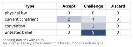
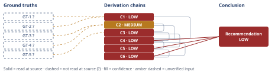

# Slack Integration vs. Reporting Rewrite: Quarterly Capacity Decision

*First-principles analysis · 10 October 2026*

*Read with: [How to read this analysis](HOW-TO-READ.md) · [Working file](analysis-20261010T032817Z.md) · [All files](INDEX.md)*

## Executive Summary

**Recommendation:** Commit the quarter's 3.2 engineer-quarters primarily to the reporting rewrite (Option B), gated on an immediate scoping spike and a Legal/Sales review of the LOI's "ship" and exit-clause language before capacity is irreversibly spent; do not build the Slack integration this quarter except as a contingent, lightweight notification-only stretch that only engages if the spike confirms spare capacity remains (chain C6).

**Band (from §6):** LOW (chains C1, C3, C4)

**Would change it:** A scoping spike showing the reporting rewrite's MVP scope exceeds the 3.2 engineer-quarter budget even after descoping (chain C3), or a pipeline audit tying specific dollar value to the missing Slack integration (chain C1) — either could move the band or the allocation.

## 1. Problem Essence

**Core problem:** Given only enough engineering capacity (3.2 engineer-quarters) to fully fund one of two candidate initiatives this quarter, which allocation of that capacity maximizes verified, quantified business value while not silently forfeiting a contractually time-boxed revenue commitment — and does any partial/composite allocation beat committing the whole 3.2 engineer-quarters to a single option?

**Success criteria:**
1. The recommendation names a specific capacity allocation (one option, or a stated composite) and that allocation's total engineer-quarters does not exceed 3.2.
2. Every dollar or demand figure used to justify the allocation is traced to a named ground truth, with its evidentiary quality (quantified vs. anecdotal; de-duplicated vs. raw count; contractual vs. informal) stated explicitly rather than assumed.
3. The analysis states what would have to be true about the unscoped items (the reporting rewrite's actual engineering effort; the Slack integration's actual engineering effort; the LOI's actual contractual scope) for the recommendation to flip, and names the specific verification action that would resolve each before capacity is irreversibly committed.
4. The analysis tests at least one non-binary allocation (a split, a scoped-down MVP, or a contingent stretch) against the two named options before concluding a single option wins outright.
5. The recommendation is traceable end-to-end to the stipulated facts via explicit derivation chains, with confidence bands that reflect the real uncertainty in those facts (none of which are independently audited by this analysis).

---

## 2. Assumptions Table



| Assumption | Type | Treatment | Verdict | Verification |
|------------|------|-----------|---------|--------------|
| The 41 logged Slack-integration requests represent meaningful, non-duplicated demand signal | untested belief | Verify, or flag as unverified (D-07) | Challenge — the prompt itself states 41 is a raw event count, not a de-duplicated account count; true distinct-account demand lies somewhere in [1, 41] of 240 accounts (0.4%–17.1%) | unverified — flagged (feeds C1 as GT-1?) |
| No churn-survey reason code attributing departure to missing Slack integration means Slack integration carries no revenue risk | untested belief (logical leap) | Verify, or flag as unverified | Challenge — churn-survey codes test *retention* of existing customers; the claimed value of Slack integration is sales-side (new-deal win rate / prospect conversion), a different mechanism that this disconfirming evidence does not test at all | unverified — flagged (feeds C1 as GT-2?); no pipeline/closed-lost data supplied |
| "Sales prospects keep asking" is a leading indicator of future pipeline value or win-rate | convention (common sales-engineering heuristic) | Explicitly challenge before use | Challenge — plausible in general, but no dollar-denominated pipeline data ties any specific deal to the Slack gap; treated as a live, unresolved rival to deprioritizing Option A, not as settled | unverified — flagged; would be resolved by a pipeline audit of deals tagged "blocked on Slack integration" |
| The reporting rewrite's engineering scope has been sized and fits within 3.2 engineer-quarters | untested belief, load-bearing / high-stakes | Verify immediately given stakes-escalation rule | Challenge — no scope or estimate is given anywhere in the facts; "rewrite" is a broad term that could range from a targeted fix to a multi-quarter platform rebuild; this is the single largest unresolved risk in the whole decision | unverified — flagged; requires an immediate (3–5 business day) scoping spike before full capacity commitment |
| The Slack integration's engineering effort is small (an implicit "quick win" framing) | untested belief | Verify, or flag as unverified | Challenge — no scope given; a notification-only integration and a full bidirectional sync differ by roughly 4x in effort (see Estimate, Phase 4); treating it as cheap by default is unverified | unverified — flagged; would require its own scoping spike if A is reconsidered |
| The Letter of Intent (LOI) is an unambiguous, binding commitment with a clearly defined trigger ("ship") and a clearly scoped exit clause (expansion ARR only, vs. also the account's base renewal) | untested belief, load-bearing / high-stakes | Verify immediately given stakes-escalation rule | Challenge — "Letter of Intent" is conventionally a *non-binding* instrument except for specific carve-out clauses; the facts do not state whether "ship" means production GA, a specific feature subset, or customer UAT sign-off, nor whether "non-renewal" touches only the $180K expansion or the account's existing base ARR too | unverified — flagged; requires Legal/Sales review of the actual signed document before capacity is locked |
| Churn-survey reason codes reliably capture the true drivers of past churn | untested belief | Verify, or flag as unverified | Challenge — self-reported churn reasons are a well-known weak proxy (customers often cite a diplomatic reason rather than the real one); this weakens, but does not eliminate, the force of "no churn code cites Slack" as disconfirming evidence for Option A | unverified — flagged; no independent churn-driver analysis supplied |
| Optimizing this quarter's build around the single largest contractual/dollar threat is the right prioritization frame for this company's current strategic stage (vs. optimizing for new-logo growth) | convention | Explicitly challenge before use | Challenge — no company OKRs/strategy document is supplied; accepted as a reasonable default given the quantified, dated stakes on the B side versus the unquantified stakes on the A side, but flagged as an assumption, not a confirmed strategic mandate | unverified — flagged; would be confirmed by the company's stated quarterly strategic priorities |
| The 3.2 engineer-quarter capacity figure can fund only one of the two initiatives, not both, this quarter | current constraint | Record expiry conditions | Accept — stated directly as the capacity constraint; expires only if additional capacity is hired/contracted, on-call load is reduced, or the quarter boundary moves; treated as binding for this quarter | unverified — flagged (feeds C3/C6 as GT-5?); in practice confirmable with Eng management's capacity plan |
| [Inversion] No late-stage sales pipeline deal is currently gated specifically on the Slack integration shipping | untested belief, load-bearing | Verify, or flag as unverified | Challenge — if false, deprioritizing Option A could cost more open pipeline ARR than the $180K at stake on the B side; this precondition is necessary for "A has low stakes" to hold and is currently untested | unverified — flagged; would be resolved by a pipeline audit (see Inversion, Phase 2) |
| [Inversion] The three top-ten accounts citing "reporting limitations" have substantially overlapping, not divergent, underlying reporting needs | untested belief | Verify, or flag as unverified | Challenge — if their needs diverge significantly, a single "reporting rewrite" may not retain all three, and the LOI account's specific ask may differ from the other two's; necessary for assuming one build serves all three | unverified — flagged; would be resolved by direct account/ticket-content interviews (see Pre-Mortem Cluster 3, Phase 5) |
| [Second-order] Repeatedly prioritizing roadmap items because a customer attached an LOI with an exit clause will not distort future engineering prioritization (moral hazard / precedent effect) | current constraint | Record expiry conditions | Challenge — flagged as a secondary, non-actionable-this-quarter risk; expires once a stated cross-quarter prioritization policy is adopted; not load-bearing for this quarter's decision, but worth tracking if the pattern recurs | unverified — flagged; not resolved this quarter, revisit if recurring |
| [Assumption Audit, surfaced at chain C3] The Estimate bracket's subtask decomposition for the reporting rewrite (data model, query engine, dashboard UI, migration, QA) actually matches what "rewrite" means for this product | untested belief | Verify, or flag as unverified | Challenge — this analysis built the [2.0, 3.0, 5.0+] engineer-quarter bracket from a generic subtask decomposition, not the team's own scope; the bracket's validity depends on this match holding | unverified — flagged (labelled A-decomp; feeds chain C3's [Assumes] tag); resolved only by the scoping spike itself |
| [Assumption Audit, surfaced at chain C5] The organization has no pre-agreed policy for how an LOI with an exit clause should affect roadmap prioritization | current constraint | Record expiry conditions | Accept — absent a stated policy, this analysis treats the LOI as one strong input among several, not an automatic override; expires once such a policy is explicitly adopted | unverified — flagged (labelled A-policy; feeds chain C5's [Assumes] tag) |

---

## 3. Ground Truths

**Irreducibility check (five-whys, reduce-to-primitives mode) on GT-1 and GT-4 before listing them:**

- GT-1 decomposes into: (a) a logging/tagging mechanism in the company's CRM or support tool exists and was used consistently — Assumed, unverified (this analysis cannot inspect the tool); (b) "41" is a count of logged request *events*, not distinct accounts — Verified by the prompt's own definition (stated directly as a caveat in the facts supplied); (c) "240 active accounts" is the current total account base — Assumed, unverified (stipulated, no independent source). Because (a) and (c) are unverified, the parent claim inherits `?`.
- GT-4 decomposes into: (a) the LOI was signed by an authorized signatory on both sides — Assumed, unverified; (b) "$180,000/year" is an annual recurring figure, not one-time — Verified by the prompt's own definition (stated directly); (c) the "ship this quarter" trigger and the exit clause's scope have a shared, unambiguous definition between the vendor and the customer — Assumed, unverified (this is Assumption row 6 in the table above). Because (a) and (c) are unverified, the parent claim inherits `?`.

**Provenance note applying to every ground truth below:** all five facts are stipulated by the decision-maker as the premises of this analysis; none names an external, independently-checkable source (no CRM export, ticket export, or signed document was attached). Per the Input Contract, supplying a fact does not discharge Phase 3 verification — each is therefore carried as `unverified` provenance with its own Phase 3 failure record, not treated as self-certifying because it was asserted confidently.

- **GT-1?** 41 inbound requests for a Slack integration were logged across 240 active accounts over the last two quarters; the count is of request events, not de-duplicated by account (true distinct-account count lies in [1, 41]). — unverified: no CRM export or ticket-tag export was supplied or accessible to this analysis session; this is internal company data. *Phase 3 failure record: source unreachable — no citation named; data lives in the company's own CRM, not accessible to this session.*
- **GT-2?** No churn-survey reason code attributes any past customer departure to the missing Slack integration. — unverified: no churn-survey dataset was supplied or accessible. *Phase 3 failure record: source unreachable — same reason as GT-1.*
- **GT-3?** Three of the company's top-ten accounts by ARR filed support tickets in the last two quarters citing reporting limitations as a renewal risk. — unverified: no ticket export was supplied or accessible. *Phase 3 failure record: source unreachable — same reason as GT-1.*
- **GT-4?** One of those three accounts signed a Letter of Intent committing $180,000/year in expansion ARR, contingent on the reporting rewrite shipping this quarter, with an exit clause permitting non-renewal if it does not ship this quarter. — unverified: the signed LOI document itself was not supplied or accessible for this analysis to read its exact operative language. *Phase 3 failure record: source unreachable — the document exists in the company's legal/deal-desk system, not accessible to this session; see Assumption row "LOI binding nature" for the specific ambiguity this leaves open.*
- **GT-5?** The team has 3.2 engineer-quarters of build capacity this quarter, net of on-call and maintenance, sufficient to fund only one of the two initiatives. — unverified: no engineering capacity plan was supplied or accessible to independently confirm the figure or the "only one" claim. *Phase 3 failure record: source unreachable — same reason as GT-1; this figure is accepted as the stipulated planning constraint for this analysis (see Techniques-not-applied note on theoretical-limit).*

**Provenance summary (required):**
```text
?-marked: GT-1, GT-2, GT-3, GT-4, GT-5 (5 of 5)
Read-at-source: none — no unsuffixed ground truth exists in this analysis; every stipulated fact carries a Phase 3 failure record (source unreachable) as recorded above.
```

No assumption carrying a Discard verdict from Phase 2 appears in this list.

---

## 4. Derivation Chains



### Estimate (Fermi) — effort brackets and a blocked revenue estimate

**Target quantity 1 — Slack integration effort, units: engineer-quarters.** Decomposed into OAuth/install flow (~0.1–0.2 eq) + event subscription/webhook handling (~0.1–0.3 eq) + minimal notification UI (~0.1–0.2 eq) + admin/account mapping (~0.1–0.2 eq) + testing/rate-limit hardening (~0.1–0.3 eq). Central estimate for a notification-only build ≈ 0.5–0.7 eq; a fuller bidirectional sync (two-way message sync, interactive components) could run 1.5–2.0 eq. Bracket: **[0.5, 1.2, 2.0] engineer-quarters**, entirely a Fermi bracket — no scoping spike performed, flagged unverified.

**Target quantity 2 — reporting rewrite effort, units: engineer-quarters.** Decomposed into data-model/schema changes (~0.5–1.5 eq) + query/aggregation engine changes (~0.5–1.5 eq) + dashboard UI rebuild (~0.5–1.0 eq) + migration of existing saved reports (~0.3–0.8 eq) + validation/QA against the three accounts' specific tickets (~0.2–0.5 eq). Central estimate ≈ 2.0–2.5 eq for a genuine rewrite; could run 3.5–5+ eq if "rewrite" means a platform-level replacement. Bracket: **[2.0, 3.0, 5.0+] engineer-quarters**.

**Decision-resolution stop test.** The Slack bracket [0.5, 2.0] fits within 3.2 eq at both ends — decision-irrelevant uncertainty, no further tightening needed to use it in the trade-off below. The reporting bracket [2.0, 5.0+] fits at its lower end and **does not fit at its upper end** — the bracket straddles the capacity ceiling, which is exactly the case the Estimate procedure says must be tightened before use, not accepted as-is. This is the formal basis for this analysis's central recommendation that capacity commitment to Option B be gated by an immediate scoping spike (see chain C3).

**Target quantity 3 — Option A's $ ARR exposure (attempted, blocked).** Decomposition: $ at stake = (distinct accounts wanting Slack) × (average ARR per account) × (probability the gap causes churn or lost expansion). Distinct accounts bounded [1, 41] from GT-1?. Average ARR per account ("ARPA"): **no first-principles value or measurement is available** — no total-ARR or average-account-value figure is supplied, and the $180K LOI figure cannot be substituted for it without committing an analogy error (that figure belongs to one specific top-ten account, not the 240-account population). Probability factor: no win/loss or pipeline data ties to this gap (GT-2? tests a different mechanism — see Assumptions table). **Verdict: this estimate cannot be completed with the facts given; Option A's revenue exposure is non-quantifiable, not merely "smaller."** This blocked attempt is itself load-bearing evidence, carried into chain C1.

### Conclusion C1: Option A's evidentiary base is weak and its revenue exposure is non-quantifiable with the facts available

GT-1? (41 raw, non-deduped requests of 240 accounts) + GT-2? (no churn code cites Slack)
→ the distinct-account demand behind GT-1? is bounded only to between 1 and 41 of 240 accounts, leaving the true prevalence unknown across a wide range
→ GT-2?'s disconfirming evidence tests retention of existing customers, not the new-deal win-rate mechanism through which Option A's value is actually claimed, so it neither confirms nor refutes that claim
→ the Estimate attempt above to convert either figure into a dollar exposure fails for lack of an average-account-ARR factor and a win/loss-linkage factor, so Option A's revenue upside remains non-quantifiable with the facts available

**Confidence:** LOW — GT-1? is unverified (verification: pull de-duplicated CRM account IDs behind each request); GT-2? is unverified (verification: cross-check churn-survey reliability against win-back interviews, and separately pull closed-lost/pipeline reason codes, which test the actually-claimed mechanism); a live rival is unsettled by §5 — "A's true pipeline/win-rate impact could exceed the $180K at stake on the B side" — which a pipeline audit for deals tagged blocked-on-Slack would settle (see Rival, Phase 5).

### Conclusion C2: Option B has stronger, convergent, and contractually quantified evidentiary support than Option A

GT-3? (3 of top-10 ARR accounts cite reporting limitations as renewal risk) + GT-4? (LOI: $180K expansion ARR contingent on shipping this quarter, exit clause on non-renewal)
→ three independent top-ten accounts converging on the same root cause is a structurally stronger pattern than Option A's single anecdotal signal type
→ one of those three has converted the risk into an explicit, dated, dollar-denominated contractual commitment with a stated trigger and consequence, which Option A has no equivalent of anywhere in the given facts
→ Option B therefore carries both a quantified upside and a quantified, time-boxed downside that Option A's evidence base does not supply

**Confidence:** MEDIUM — GT-3? is unverified (verification: pull the underlying ticket export for the three accounts); GT-4? is unverified (verification: Legal/Sales review of the signed LOI's actual operative language — see the LOI-binding-nature assumption); no live rival contests this specific claim (that B's evidentiary base is comparatively stronger), so only the Inputs axis is short.

### Conclusion C3: The reporting rewrite's capacity fit is the decision's single largest unresolved risk and must be gated by an immediate scoping spike

GT-5? (3.2 eq capacity, funds one initiative) + C2 (MEDIUM)
→ no engineering scoping estimate exists for the reporting rewrite, and the Estimate bracket built above runs [2.0, 3.0, 5.0+] engineer-quarters, whose upper end exceeds the entire budget *[Assumes: A-decomp — the generic subtask decomposition used to build this bracket matches what "rewrite" means for this product]*
→ because the bracket straddles the capacity ceiling, committing full capacity to Option B without first tightening this estimate risks missing the quarter deadline regardless of which option is chosen, which would trigger the LOI's exit clause anyway
→ the correct response to a bracket straddling the decision threshold is to tighten the dominant uncertain factor before committing, which here means an immediate 3-5 business day scoping spike with authority to descope to an LOI-satisfying MVP

**Confidence:** LOW — GT-5? is unverified (verification: confirm the capacity figure against Eng management's own capacity plan); the A-decomp assumption on the first hop is unpriced — its failure (the decomposition is wrong) is exactly the scenario the scoping spike exists to catch, so the chain cannot yet state what happens to the endpoint if it fails; two axes (Inputs, Inference) are short, which licenses no higher than LOW.

### Conclusion C4: Weighing both options, the status quo, and a composite under locked, anchored, weighted criteria favors the composite option, which weakly dominates Option B alone and strongly dominates Option A alone or doing nothing

C1 (LOW) + C2 (MEDIUM) + C3 (LOW)
→ across six anchored criteria (quantified revenue protection ×5, evidence quality ×4, capacity-fit confidence ×4, deadline urgency ×3, strategic breadth ×2, build leanness ×2) scored against GT-1?-GT-5? and the Estimate brackets above, the weighted totals are Composite 82, Option B 76, status quo 44, Option A 36 (see Trade-off matrix, below)
→ Composite scores at least as high as Option B on every criterion and strictly higher on two, so no reassignment of positive criterion weights makes Option B beat Composite, and no single-criterion weight change flips the winner toward Option A or the status quo either
→ the trade-off's own flip test therefore shows the headline choice between Composite and Option B is robust to this analysis's weighting judgments even though the inputs behind both remain uncertain

**Confidence:** LOW — capped by C1 and C3, both LOW; C1 is LOW because of GT-1?/GT-2? and a live rival (see C1's own confidence line for the verification path); C3 is LOW because of GT-5? and the unpriced A-decomp assumption (see C3's own confidence line); this chain's own contribution is sound (the dominance argument in hop two is a direct, recomputable consequence of the scored matrix, not a new source of uncertainty).

### Conclusion C5: The composite allocation is "commit primary capacity to the reporting rewrite now, with a lightweight Slack-notification stretch contingent on verified spare capacity after the scoping spike"

C3 (LOW) + C4 (LOW)
→ because C3 established that the reporting rewrite's true scope is unresolved, any capacity promised to Option A upfront is capacity that might be needed to keep Option B inside the quarter, so a lite-Slack build can only be safely scheduled after the spike confirms spare capacity, not before
→[2nd] sales will need interim messaging for prospects asking about Slack while the contingent stretch stays unscheduled, and engineering's own incentive structure shifts slightly toward rewarding whichever customer attaches a dated contractual exit clause, a precedent worth watching across future quarters *[Assumes: A-policy — the organization has no pre-agreed policy for how an LOI exit clause should affect roadmap prioritization]*
→[3rd] if this quarter's reporting fix resolves the renewal risk for all three top-ten accounts rather than only the LOI signer, NRR improves beyond the $180K figure alone, while deferring Option A for a second consecutive evaluation period raises competitive exposure if a native Slack integration becomes an established buying criterion elsewhere — a real but currently unquantified cost of this recommendation, and not a contradiction of any ground truth above

**Confidence:** LOW — capped by C3 and C4, both LOW (see their own confidence lines for verification paths); the A-policy assumption on the second-order hop qualifies only that extension step, not the chain's first-order endpoint, so it does not by itself change the band, but is named here for completeness per the Inference-axis test in output-template.md.

### Conclusion C6: Commit the quarter's 3.2 engineer-quarters primarily to the reporting rewrite (Option B), gated by an immediate scoping spike and LOI-language clarification, with a contingent lite-Slack stretch only if verified spare capacity remains, and separately institute closed-lost/pipeline reason-code tracking as a near-zero-cost process change

C4 (LOW) + C5 (LOW)
→ the trade-off's robust winner and the capacity-fit risk it inherits from Option B point to the same operational plan: fund Option B first, verify its scope within the first week, and only then decide whether any Slack work is safely affordable this quarter
→ this plan does not require resolving Option A's unquantified upside to be the right call this quarter, because Option B's downside is already contractual and dated while Option A's upside remains speculative under every brace of the Estimate bracket in C1
→ instituting reason-code tracking for closed-lost and at-risk-renewal deals this quarter is a process change, not an engineering build, so it does not compete with the 3.2-engineer-quarter budget and directly resolves the data gap that currently blocks a confident verdict on Option A

**Confidence:** LOW — capped by C4 and C5, both LOW (see their own confidence lines); this chain adds no new unpriced inference of its own — hop two is a direct restatement of C1's and C2's comparative findings, and hop three (the tracking recommendation) is a low-stakes process step whose own risk is not load-bearing for the capacity decision.

### Trade-off matrix (collapsed into chain C4 above; full matrix shown here for auditability)

Options named, including the status quo and a composite (per the trade-off procedure's step 1): **A** (Slack integration, full build), **B** (reporting rewrite, full build), **Status quo** (build neither this quarter), **Composite** (commit to B, contingent lite-A stretch only if spare capacity is confirmed).

**Must-have knockout:** fit within 3.2 engineer-quarters without exceeding available capacity (GT-5?, physical/current-constraint, non-negotiable). All four listed options pass this knockout as scoped here (A and B's point-estimates fit; Composite and Status quo trivially fit) — the capacity-fit *risk*, not a knockout failure, is instead captured as a scored criterion below, because an unscoped option is not yet known to be non-viable, only unverified.

**Criteria, weights (1-5, locked before scoring), and anchors:**

| Criterion | Weight | 1 anchor | 5 anchor |
|---|---|---|---|
| Quantified revenue protection/upside | 5 | no quantified dollar figure identified | ≥$150K ARR quantified and contractually documented |
| Evidence quality / signal strength | 4 | single anecdotal/ambiguous signal | multiple independent corroborating signals with direct causal linkage |
| Capacity-fit confidence | 4 | no scoping done, high overrun risk | fully scoped, confirmed to fit with margin |
| Deadline urgency / cost of delay | 3 | no deadline, low cost of delay | hard deadline this quarter with contractual consequence |
| Strategic breadth of impact | 2 | affects one account/edge case | affects multiple top-tier accounts' retention |
| Build leanness (smaller effort scores higher) | 2 | very large estimated effort | very small estimated effort |

**Scores (cited to GT/estimate basis) and weighted totals:**

| Option | Revenue (w5) | Evidence (w4) | Capacity (w4) | Urgency (w3) | Breadth (w2) | Leanness (w2) | Weighted total |
|---|---|---|---|---|---|---|---|
| A (Slack) | 1 (C1: non-quantifiable) | 2 (C1: single, mismatched signal) | 2 (Estimate: unscoped, 0.5-2.0 eq bracket) | 1 (GT-1?: no stated deadline) | 2 (GT-1?: 1-41 of 240, mostly net-new) | 4 (Estimate: smaller bracket) | **36** |
| B (Reporting) | 5 (GT-4?: $180K, contractual, dated) | 4 (C2: 3 converging accounts, 1 contractual) | 2 (Estimate: unscoped, 2.0-5.0+ eq bracket straddles ceiling) | 5 (GT-4?: explicit "this quarter" + exit clause) | 4 (GT-3?: 3 of top-10 accounts) | 2 (Estimate: larger bracket) | **76** |
| Status quo | 1 (forfeits the $180K) | 1 (ignores all signals) | 5 (zero capacity used) | 1 (fails the one hard deadline) | 1 | 5 (zero effort) | **44** |
| Composite | 5 (same as B, not sacrificed) | 4 (same as B, plus marginal A upside if delivered) | 3 (same risk as B; stretch is contingent, not committed upfront) | 5 (same as B) | 4 (same as B, plus marginal A upside) | 3 (minor incremental cost over B, contingent only) | **82** |

**Flip test:** Composite's per-criterion scores are ≥ Option B's on every criterion and strictly greater on two (capacity-fit framing and build leanness) — this is weak dominance, so **no reassignment of non-negative criterion weights can make Option B beat Composite.** The gap between Composite/B (76-82) and Status quo/A (36-44) is large enough that no single-criterion weight change flips the ranking either; stated explicitly, per the procedure's requirement to report this even absent a near-tie: **no single weight change flips this result.**

---

## 5. Abandoned Reasoning

### Dead End: Prioritize Option A because "sales keeps asking" is treated as a settled leading indicator

**What was tried:** Early framing treated the 41 logged requests plus the general sales-engineering heuristic ("if prospects keep asking, it will eventually cost us deals") as sufficient grounds to prioritize the Slack integration without further quantification.

**Why abandoned:** The heuristic is a convention, not a verified fact (see Assumptions table), and no pipeline, win-rate, or closed-lost data in the given facts corroborates it; the Estimate attempt in chain C1 showed the claim cannot even be converted into a dollar figure with the data available, while Option B's downside is already contractual and dated (chain C2). The rival this dead end represents is not fully closed — see chain C1's confidence line — but it is not strong enough to outweigh B's quantified, time-boxed stakes.

**What it ruled out:** This saves a future review from re-litigating "just build what sales asks for" as a standalone justification; it also pinpoints exactly what evidence (a pipeline audit tagging deals blocked on Slack) would be needed to revive Option A's case on firmer ground next quarter.

### Dead End: Treat "no churn-survey reason code cites Slack" as proof Option A has zero revenue risk

**What was tried:** Using GT-2? directly as disconfirming evidence that the Slack integration has no material business impact.

**Why abandoned:** The five-whys/irreducibility check and the Assumptions table challenge established that churn-survey codes test *retention* of existing customers, while Option A's claimed value operates through a different mechanism (new-deal win rate / prospect conversion); the evidence and the claim are about different populations and different causal pathways, so GT-2? does not settle the question either way (chain C1).

**What it ruled out:** This prevents mis-citing absence-of-churn-evidence as presence-of-no-risk evidence; it also identifies the correct disconfirming/confirming dataset (closed-lost reason codes, sales pipeline stage data) that this quarter's recommended process change (instituted in chain C6) is designed to produce.

### Dead End: Commit the full 3.2 engineer-quarters to the reporting rewrite with no scoping spike, on the strength of the LOI alone

**What was tried:** Given the LOI's dated urgency, an early framing considered simply allocating all capacity to Option B immediately, treating the business urgency as sufficient justification to skip a scoping step.

**Why abandoned:** The Estimate bracket for the reporting rewrite ([2.0, 3.0, 5.0+] engineer-quarters) straddles the 3.2 eq ceiling at its upper end, and the Pre-Mortem (Phase 5, Cluster 1) identified this as a fatal, not merely costly, risk: if the true scope exceeds capacity, the team can commit every available engineer-quarter and still miss the quarter deadline, triggering the exit clause regardless of which option was chosen. Committing blind is strictly worse than spending 3-5 days confirming scope first (chain C3).

**What it ruled out:** This rules out "urgency justifies skipping scoping" as a valid inference in this analysis, and it is the reasoning that produced this analysis's single most load-bearing recommended action (the immediate scoping spike).

### Dead End: Split the 3.2 engineer-quarters evenly between Option A and Option B

**What was tried:** Considered a straightforward 50/50 capacity split as a compromise that avoids choosing between the two options outright.

**Why abandoned:** GT-5? states the capacity can fund only one initiative, not both, and the trade-off matrix's Composite option (chain C4) — which conditionally and contingently adds a lite-Slack stretch only *after* spare capacity is confirmed — already weakly dominates a committed-upfront split on every scored criterion, because an upfront 50/50 split risks under-delivering on Option B's hard, contractual deadline (the exact fatal failure mode identified in the Pre-Mortem) while still not producing a fully-scoped Option A. An upfront split was never scored as a fifth option because it is dominated by Composite by construction: Composite achieves the same contingent Slack upside without ever risking Option B's capacity margin, which a committed-upfront split cannot claim.

**What it ruled out:** This rules out capacity-splitting as a way to avoid the prioritization decision; it also makes explicit why the Composite option is specified as *contingent and sequenced*, not as a simultaneous parallel commitment.

---

## 6. Conclusion

**Recommended approach:** Commit the quarter's 3.2 engineer-quarters primarily to the reporting rewrite (Option B), but gate that commitment on an immediate 3-5 business day scoping spike and a Legal/Sales review of the LOI's exact "ship" and exit-clause language before the capacity is irreversibly spent; do not build the Slack integration (Option A) this quarter except as a contingent, lightweight notification-only stretch that only engages if the spike confirms spare capacity remains (chain C6).

**Key insight:** The two options are not actually comparable on the evidence given — Option B's stakes are quantified, convergent across three accounts, and contractually dated, while Option A's stakes cannot currently be converted into a dollar figure at all (the Estimate procedure's attempt fails for lack of an average-account-ARR factor and a win/loss-linkage factor) — so the decision does not hinge on precisely how large Option A's hidden upside might be; it hinges on whether Option B's scope, which nobody has sized, actually fits the budget, which is a solvable unknown rather than an unresolvable one (chains C1, C3).

**Trade-offs acknowledged:** This recommendation accepts a known opportunity cost — real but currently unquantified — if any of the 41 logged Slack requests represents late-stage pipeline value, and it accepts a second-order risk that repeatedly funding the customer who attaches the most contractually dated exit clause could distort future roadmap prioritization if it becomes a pattern (chain C5); it also accepts that even Option B's $180K upside is not fully secured by this plan, because the LOI's own "ship" and exit-clause language remains unverified (no chain — flagged assumption only) pending the recommended Legal/Sales review.

**Confidence:** LOW — every chain this conclusion rests on is capped LOW by GT-1?-GT-5? (all five stipulated facts are unverified provenance; see Ground Truths) and by two unresolved, load-bearing unknowns: the reporting rewrite's true engineering scope (chain C3's A-decomp assumption, closed only by the scoping spike) and Option A's non-quantifiable revenue exposure (chain C1, closed only by instituting the pipeline/closed-lost reason-code tracking this plan already recommends). Despite the LOW confidence band on magnitude, the trade-off's flip test (chain C4) shows the directional choice — fund B first, over A — is robust to the analysis's own weighting judgments; LOW here describes genuine uncertainty about *how large* the stakes are on both sides, not uncertainty about *which option* a rational allocator should fund first under every plausible resolution of that uncertainty.
