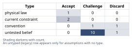
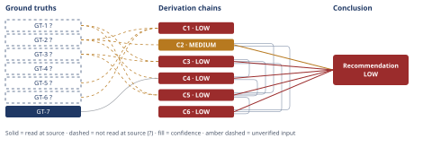

# Should This B2B SaaS Business Add a Free Tier

*First-principles analysis · 9 October 2026*

*Read with: [How to read this analysis](HOW-TO-READ.md) · [Working file](analysis-20261009T190735Z.md) · [All files](INDEX.md)*

## Executive Summary

**Recommendation:** Do not launch an open, public, self-serve free tier now. Run a capped,
gated, time-boxed pilot — hard engineering-enforced signup cap, buyer-fit gating, a
Finance-approved cost ceiling, pre-committed kill/hold/expand thresholds — together with a
separate "free expansion seats" wedge inside already-paying accounts (chain C6; chain C5).
Treat building full self-serve PLG infrastructure as a distinct, later decision (chain C2).

**Band (from §6):** LOW.

**Would change it:** Finance's actual measured per-free-user cost (the single sensitivity
ground truth, GT-3?, named in the adversarial pass); an Engineering hard-cap feasibility
assessment (A-10, chain C6); and a CRM loss-reason review showing deals are actually lost
over the absence of a free tier (A-8, chain C1) would each raise this analysis's confidence
or could shift the recommendation toward a faster, more open launch.

## 1. Problem Essence

**Core problem:** Given a $2.4M-ARR / 240-team B2B SaaS business whose entire acquisition
motion today is outbound sales plus referral — with no self-serve signup flow, no PLG
infrastructure, zero internal conversion data, and a cost model in which free-tier
infrastructure/support cost scales with active free users rather than with revenue — which
specific job (if any) does adding a free product tier need to perform, and does the
evidence available today justify building one now, versus deferring, versus running a
bounded test first?

**Success criteria:**
1. The answer names which of the distinct jobs a free tier can perform in a B2B motion
   (top-of-funnel/lead-gen substitute, PLG self-serve growth engine, competitive-eval
   checkbox, land-and-expand wedge, brand/awareness) this business's current motion
   actually lacks and would benefit from — rather than asserting "a free tier helps"
   generically.
2. The answer states, for the competitive-parity argument specifically, what observation
   would show it is actually costing deals today, and whether that observation has been
   made.
3. The answer treats the free-to-paid conversion rate as a genuine unknown — it names the
   cost-exposure structure and a decision process (pilot design, cost bounding) that does
   not require first guessing a conversion number, rather than substituting an assumed
   plausible rate.
4. The answer identifies the specific second-order risks (cannibalization of existing
   outbound/referral deals, support/infra cost growth from unqualified signups, sales
   incentive effects, brand effects) that follow from this business's specific starting
   conditions, not a generic freemium risk list.
5. The answer states the conditions under which adding a free tier would be clearly wrong,
   and checks today's evidence against those conditions.
6. The answer ends in one specific, actionable recommendation — add it, don't, run a
   bounded pilot, or a named alternative/hybrid — with the trade-off being accepted and the
   conditions that would flip the recommendation.

No success criterion requires the final answer to be exactly one of "add a free tier" or
"don't add a free tier" as a binary choice; a split or hybrid option (e.g., a bounded gated
pilot, or a free-seat expansion wedge limited to already-paying accounts rather than an open
public tier) is explicitly in scope and is tested against the others in Phase 4.

## 2. Assumptions Table



Assumption space generated by two companion techniques, consolidated into one table:

**Fishbone** (breadth-first cause-category brainstorm, categories: Market/Funnel,
Financial, Competitive, Organizational, Product/Engineering, Brand) surfaced A-6–A-11;

**Inversion** (invert "we should add a free tier" → enumerate what would guarantee it is
the wrong move) surfaced the load-bearing preconditions A-12–A-15, with three of
inversion's necessary preconditions (sales-incentive behavior, win/loss effect,
cap-feasibility) found to duplicate fishbone branches already in the table — merged rather
than duplicated, per the Phase-4 Assumption-Audit merge rule applied proactively here.

| Assumption | Type | Treatment | Verdict | Verification |
|---|---|---|---|---|
| A-1: Because named competitors have a free tier, this business needs one too | convention | Challenge — competitive-parity conventions carry historical/herd-behavior inertia and must be tested against this business's actual win/loss drivers, not assumed | Challenge — em-dash: no evidence yet that parity drives this business's outcomes; GT-6? explicitly states the effect is unmeasured | unverified — flagged |
| A-2: Freemium/PLG motions generically work well for B2B SaaS, so this business should adopt one | convention | Challenge — this is exactly the generic-pattern-matching the analysis is instructed to avoid; freemium PLG's usual preconditions (low-friction self-serve activation, usage-based virality, low-touch sales) are tested against this business's actual conditions, not assumed to transfer | Discard — em-dash: GT-2? shows none of freemium PLG's standard preconditions currently hold here (chain C2) | unverified — flagged |
| A-3: No self-serve/PLG signup infrastructure exists today | current constraint | Record expiry conditions — this constraint lifts only if the business separately decides to invest in building self-serve onboarding/activation infrastructure, a distinct, larger-scope decision from the pricing/packaging question asked here | Accept — em-dash: expires only on a future, not-yet-made infrastructure-investment decision; treated as current, not permanent | unverified — flagged (GT-2?, business-stipulated) |
| A-4: Free-tier infra/support cost scales with active free users, independent of revenue | current constraint | Record expiry conditions — this is a property of today's metering/billing architecture; it could lift if the architecture is redesigned with hard per-user resource caps, which is itself a separate engineering investment | Accept — em-dash: expires only if metering architecture is redesigned; treated as current, not physical | unverified — flagged (GT-3?, business-stipulated) |
| A-5: Net financial effect of a free tier = converted revenue − free-tier cost − cannibalized revenue − sales opportunity cost | physical law (accounting identity) | Accept as ground-truth candidate — a definitional identity, not an empirical claim, and does not expire | Accept — em-dash: true by definition/logical inspection; passes the irreducibility test (see GT-7 note) | read-at-source: verified by logical inspection, not an external citation |
| A-6 (Fishbone/Market): Latent inbound/organic demand exists today that outbound isn't capturing | untested belief | Verify | Challenge — em-dash: plausible but no data cited; discriminating observation named | unverified — flagged |
| A-7 (Fishbone/Financial): Per-free-user infra+support cost is small enough that a bounded pilot volume is affordably testable | untested belief | Verify | Challenge — em-dash: Finance confirmed cost scales with users (GT-3?) but gave no per-unit figure; chain C3 uses an illustrative, explicitly-flagged placeholder only | unverified — flagged |
| A-8 (Fishbone/Competitive + Inversion precondition): Deals are actually being lost in competitive evaluations citing the absence of a free tier | untested belief | Verify | Challenge — em-dash: GT-6? already states this effect is unmeasured; this is the same unknown, named from two angles | unverified — flagged |
| A-9 (Fishbone/Organizational + Inversion precondition): Sales comp/incentive structure will not cause reps to divert attention from outbound pipeline or self-protectively avoid routing prospects to a free tier | untested belief | Verify | Challenge — em-dash: no comp-plan review has been done; this is one of the two behavioral preconditions the cannibalization/second-order chain (C4) depends on | unverified — flagged |
| A-10 (Fishbone/Product-Eng + Inversion precondition): Current infrastructure can hard-cap/rate-limit free-tier usage without major engineering investment | untested belief, **load-bearing** | Verify before launch — this is a pre-launch go/no-go gate, not an optional nicety | Challenge — em-dash: unverified; this is the precondition that, if false, collapses a "bounded" pilot into the cost-exposure profile of the knocked-out full-open-tier option (see pre-mortem Cluster A) | unverified — flagged |
| A-11 (Fishbone/Brand): Prospects or analysts expect a free tier as category-baseline hygiene | untested belief | Verify | Challenge — em-dash: plausible but unmeasured; lowest-stakes item in this table | unverified — flagged |
| A-12 (Inversion precondition P1): Free-to-paid conversion will clear the accounting break-even rate once minimal activation mechanics exist | untested belief, **load-bearing, sharpest finding** | Verify via instrumented pilot, not via assumed figure | Challenge — em-dash: GT-4? states this is currently pure speculation; the entire economic case for Job 2 (PLG engine) rests on this being true, and it is completely untested | unverified — flagged |
| A-13 (Inversion precondition P2): Free-tier feature gating can be designed so it does not substitute for the $10K paid product | untested belief, **load-bearing** | Verify/design — a product-packaging design question, addressable before launch | Challenge — em-dash: no packaging design work has been done yet; directly determines cannibalization exposure (chain C4) | unverified — flagged |
| A-14 (Inversion precondition P5): A minimum-viable self-serve onboarding/activation flow exists, or will be built, so free signups can reach value without sales touch | untested belief, **load-bearing, currently false, sharpest finding** | This precondition is not merely unverified — GT-2? directly states no such flow exists today. Treatment: resolve by explicit decision (build a minimal version, or do not attempt the PLG-engine job at all) rather than by verification of an existing state | Discard as currently true — em-dash: affirmatively false per GT-2?; downstream Job-2 ambitions must be rescoped around this fact, not verified against it (chain C2) | unverified — flagged (resolved false directly by GT-2?, not by further verification) |
| A-15 (Inversion precondition P7): Sufficient support/design resourcing will be allocated so a free tier does not read as a neglected afterthought | untested belief | Verify via explicit resourcing commitment before launch | Challenge — em-dash: no resourcing commitment has been made; this is pre-mortem Cluster D's concern | unverified — flagged |
| A-16 (surfaced by end-of-phase Assumption Audit, from chain C4): Once a free tier has existed for multiple quarters it becomes a difficult-to-reverse baseline feature, carrying real organizational/reputational switching cost if later removed | untested belief | Verify — review how other pricing/packaging changes at this business have historically been reversed or not, as the closest available analogue to this specific claim | Challenge — em-dash: plausible organizational-behavior regularity but not verified for this business specifically; feeds chain C4's longer-horizon hop | unverified — flagged |

**Discriminating observations for the highest-priority Fishbone branches** (named per the
Fishbone procedure's exit criterion): A-6 → review organic/direct web-traffic and
branded-search trend data (not yet done); A-8 → review CRM loss-reason tags and win/loss
interview notes for "no free tier" mentions (not yet done); A-9 → review the sales comp
plan structure and whether free-tier leads would carry quota credit (not yet done); A-10 →
obtain an Engineering feasibility assessment of hard per-account usage caps (not yet done,
and promoted to a required pre-launch gate in the Phase 5 pre-mortem).

## 3. Ground Truths

All business-stated facts below (GT-1 through GT-6) were supplied directly by the business
principal in the prompt, with no external document, URL, or file cited alongside them.
Per the Input Contract, supplying a fact does not discharge Phase 3 verification — and
because no citation was ever offered for these six (not merely one that could not be
opened), each is marked `unverified` rather than carrying a Phase 3 failure record of the
"source unreachable" kind: there is no source for this analysis to have attempted opening.
This is a provenance label about what this analysis did, not a statement of distrust in the
business's own knowledge of its own numbers — the business is maximally positioned to know
its own ARR, channel mix, and finance model; the `?` marks only that this analysis did not
independently read a citable source for it.

- **GT-1?** Current ARR is $2.4M, from 240 paying teams, at an average annual contract
  value (ACV) of ~$10,000/team — unverified: stipulated directly by the business, no
  external source cited. Internally consistent: $2.4M ÷ 240 = $10,000 exactly, matching the
  stated ACV (recomputed independently in the Phase 5 adversarial pass below).
- **GT-2?** Acquisition today is 100% outbound sales plus referral; no self-serve
  product-led signup flow and no PLG motion currently exists — unverified: stipulated
  directly by the business, no external source cited.
- **GT-3?** Finance has confirmed that free-tier infrastructure and support costs scale
  with active (free) users, not with paying users — a real, non-negligible variable cost
  line that grows independently of revenue — unverified: stipulated directly by the
  business (via Finance), no external source cited.
- **GT-4?** The business has never run a freemium pilot; there is zero internal data on
  free-to-paid conversion, and any conversion-rate assumption today is pure speculation —
  unverified: stipulated directly by the business, no external source cited.
- **GT-5?** All named competitors already offer a free tier — unverified: stipulated
  directly by the business, no competitor names or external source cited.
- **GT-6?** The actual effect of competitive free-tier parity on this business's own
  win/loss rate is unmeasured — unverified: stipulated directly by the business as an
  acknowledged internal unknown, no external source cited.
- **GT-7** Definitional accounting identity: the net financial effect of operating a free
  tier = (free→paid conversions × ACV) − (free-tier infrastructure/support cost) −
  (revenue cannibalized from prospects who would have paid but took the free tier instead)
  − (sales-team opportunity cost from attention diverted to low-intent free signups) —
  read-at-source: verified by logical/definitional inspection, not an external claim about
  the world. **Irreducibility check (five-whys, reduce-to-primitives mode):** decomposing
  GT-7's four terms — converted revenue, infra/support cost, cannibalized revenue,
  opportunity cost — each bottoms out at a basic accounting definition (a count times a
  price, a measured resource cost, a substitution effect, a forgone-alternative cost) with
  no further empirical claim embedded in the identity itself; GT-7 passes the irreducibility
  test as a compound-but-definitional ground truth. It is the only ground truth in this
  analysis that does not carry a `?`, precisely because it asserts no fact about this
  business — only the logical structure used to evaluate facts about it.

**Provenance summary (required):**
```text
?-marked: GT-1, GT-2, GT-3, GT-4, GT-5, GT-6 (6 of 7)
Read-at-source: GT-7 — verified by direct logical/definitional inspection (accounting
identity decomposed via five-whys reduce-to-primitives mode; no external source applicable)
```
No unsuffixed ground truth in this analysis feeds a HIGH-confidence chain (see §4): every
chain that uses GT-1?–GT-6? is capped at MEDIUM or LOW by the unverified-input rule (D-07),
and GT-7 alone, while unsuffixed, never single-handedly carries a chain to HIGH because
every chain citing it also cites at least one `?`-marked business fact.

## 4. Derivation Chains



### Conclusion C1: Competitive parity does not currently justify a free tier on its own

GT-5? (named competitors already have a free tier) + GT-6? (effect on this business's own win/loss rate is unmeasured) + GT-2? (100% of deals originate via outbound/referral)
→ competitor parity alone is an observed industry pattern, not evidence that it causally affects this business's own deals
→ because acquisition is 100% outbound/referral (GT-2?), whatever competitive-evaluation signal a free tier could send is necessarily mediated through a sales rep rather than through a self-serve channel today, which caps how much additional signal an unmediated public free-tier checkbox could add
→ the competitive-parity job does not currently justify building a free tier on its own, and the question stays open only pending a direct review of CRM loss-reason data for explicit "no free tier" mentions (A-8)

**Confidence:** LOW — two axes are short, not one. Inputs: GT-5?, GT-6?, GT-2? are all unverified business-stipulated facts with no external citation; verification would mean obtaining a named competitor list with sourced screenshots/pricing pages (for GT-5?) and a CRM loss-reason review (for GT-6?), neither of which has been done. Rivals: a live, unsettled rival exists — "competitive parity has zero effect on this specific business's deals" — which GT-6? does not rule out (it only states the effect is unmeasured, not that it is absent); nothing in this analysis settles it, and the discriminating observation named for A-8 (CRM loss-reason review) is what would.

### Conclusion C2: "Add a free tier" cannot deliver the PLG-growth-engine job by itself

GT-2? (no self-serve/PLG infrastructure, no PLG motion exists today)
→ delivering a self-serve PLG growth engine requires self-serve onboarding, in-product activation, and an upgrade-prompt mechanism as necessary infrastructure, none of which a bare pricing-tier change supplies on its own
→ because GT-2? establishes none of that infrastructure exists today, this precondition (A-14) is currently false, not merely unverified, and building it is a separate, larger-scope investment decision with its own cost, timeline, and risk
→ "add a free tier" as literally posed cannot deliver the PLG-growth-engine job by itself; evaluating whether to build full self-serve PLG infrastructure is a distinct decision from the pricing/packaging question asked here (A-14)

**Confidence:** MEDIUM — GT-2? is unverified (business-stipulated, no external source); verification would mean an Engineering/Product confirmation of what signup and onboarding infrastructure exists today, which closes this input's gap rather than the chain's logic. Rival not applicable — GT-2? is a direct first-party stipulation about the business's own infrastructure, which is the kind of fact the stipulating party is maximally positioned to know; no competing reading is plausible absent a specific reason to doubt the stipulation.

### Conclusion C3: Volume, not the conversion rate, is the binding near-term cost risk

GT-3? (free-tier cost scales with active free users, independent of revenue) + GT-1? (ACV ≈ $10,000/team/year)
→ define the break-even per-free-user conversion rate r* as the annual cost of serving one free user (c) divided by ACV — the direct-conversion rate at which converted revenue alone offsets that user's cost
→ bracketing c at an illustrative $50 to $500 per free user per year — explicitly flagged as a placeholder pending Finance's own unit-cost figure, not a ground truth — gives r* of roughly 0.5% to 5%, a bar that is low in absolute terms only if signup quality and intent are held constant *[Assumes: A-7 — if the real per-user cost sits outside this bracket, r* moves proportionally, but the hop's downstream point (that volume, not r*, is the binding risk) is unaffected either way]*
→ GT-7's identity shows this break-even calculation omits two further terms, cannibalized revenue and sales opportunity cost, either of which can turn a tier that clears r* into a net loser, and cannibalization risk is highest exactly where free-tier functionality overlaps with what the $10,000 paid product delivers
→ because GT-2? establishes no inbound funnel exists to pre-qualify intent, free signup volume (N) is effectively unbounded by anything except a deliberately engineered gate, making total exposure (N times c) the variable this business can actually control before any conversion data exists, not the conversion rate itself
→ the direct arithmetic bar to clear is low, but it is not the binding constraint; the binding constraint is uncapped signup volume with no intent filter, which makes volume-capping, not conversion-rate optimism, the primary cost-risk control (A-7, A-10)

**Confidence:** LOW — three things are outstanding. Inputs: GT-3? and GT-1? are unverified business-stipulated facts; verification would mean Finance supplying its own measured per-free-user cost figure rather than this chain's illustrative $50–$500 placeholder. Inference: the $50–$500 cost bracket (c) is an unpriced, unsourced placeholder, not a verified figure — the chain names what would remove it as a cause of the downgrade (Finance's actual unit-cost figure, per A-7) but has not obtained it. Rivals: a live, unsettled rival exists — "free users are nearly free to serve (e.g., a static/cached read-only tier), making the entire cost-exposure concern moot" — nothing in this analysis settles it; an actual infra-cost accounting from Finance/Engineering is what would.

### Conclusion C4: The sharpest second-order risks are concentrated cannibalization and a front-loaded-cost/back-loaded-benefit timing mismatch

GT-2? (100% outbound/referral) + GT-7 (net-effect accounting identity) + C3 (volume is the binding cost risk, LOW)
→ [actor lens, prospects] because every current prospect is reached through a sales-led relationship (GT-2?), a prospect who learns a free tier exists can substitute self-serve access for the ongoing paid sales conversation, and this substitution is most available to exactly the population already engaged and closest to converting, which is the highest-value cannibalization channel, not the low-intent open internet
→ [actor lens, sales reps] sales compensation tied to closed paid deals creates an incentive for reps to avoid mentioning or to route around a free tier for opportunities they already own, which partially self-limits cannibalization for known in-flight deals but does not protect referral-sourced leads who discover the free tier before ever reaching a rep *[Assumes: A-9 — if A-9 fails and reps do not self-limit, cannibalization risk is larger than this hop suggests, which strengthens rather than undermines the conclusion below]*
→ [time lens, immediate] infra/support cost accrues from the first signup while any conversion evidence takes a full sales-cycle-plus-activation-latency to materialize, producing a structurally front-loaded cost and back-loaded benefit profile that will look unfavorable on any short-window dashboard regardless of the eventual steady-state economics
→ [time lens, longer horizon] once a free tier has existed for several quarters it becomes an assumed baseline in competitive conversations, making later removal organizationally and reputationally costly even if the pilot data turns out unfavorable, which converts what should be a reversible test into a decision carrying real option-value asymmetry *[Assumes: A-16 — if removal turns out to carry no real switching cost, this hop's point is moot but the conclusion's cost/cannibalization finding above still stands on its own]*
→ the two largest second-order risks are cannibalization concentrated in the already-engaged-lead population rather than diffuse anonymous signups, and a front-loaded-cost/back-loaded-benefit timing mismatch that argues for a short, pre-committed decision window rather than an open-ended pilot

**Confidence:** LOW — capped by the cited chain: C3 is rated LOW, and a chain is rated no higher than the lowest-rated chain its head cites, per D-07's ceiling rule; C3's own confidence line carries that rating's explanation and is not re-explained here. In addition, GT-2? is unverified (business-stipulated); verification would mean the same Engineering/Product confirmation named under C2. The one hop resting on a declared premise (A-9) has been priced inline on that hop: if A-9 fails, the conclusion's cannibalization-risk finding gets stronger, not weaker, so this hop's assumption failing does not undermine the endpoint.

### Conclusion C5: The weighted trade-off is a near-tie; an option-value argument, not the scorecard, decides it

GT-1? (ACV $10,000; 240 paying teams) + GT-3? (cost scales with active free users) + C2 (Job-2 infra precondition currently false, MEDIUM) + C3 (volume is the binding cost risk, LOW) + C4 (cannibalization and timing-mismatch risk, LOW)
→ applying the must-have knock-out — no option may require accepting uncapped, unbounded monthly cost growth per GT-3? — eliminates "launch a full open self-serve free tier now" before any scoring; its cost-exposure profile is exactly what C3 and C4 flag as unmanaged
→ weighted scoring across six criteria (learning value, cost control, cannibalization risk, org/sales disruption risk, competitive-signal value, standup cost; weights 5/5/4/3/2/3) on the three surviving options gives totals of 82 for the status quo, 81 for a bounded/gated pilot, and 71 for an expansion-seats-only wedge inside existing paying accounts — a one-point, effectively-tied gap between the first two
→ the flip test shows a single-point increase to the learning-value criterion's weight (5 to 6) is sufficient to reverse the ranking, because the status quo scores 1 on learning value against the bounded pilot's 5, and weighting the resolution of this analysis's own sharpest load-bearing unknowns (A-12, A-14) below avoiding short-term disruption is itself a substantive bet that those unknowns are safe to leave unresolved, not a neutral default
→ the weighted scorecard alone is a near-tie and does not decide the question by itself; the decision instead turns on an explicit option-value argument outside the scorecard — resolving A-12 and A-14 at a capped, Finance-approved cost beats remaining permanently ignorant of them — which favors running a bounded, gated pilot in parallel with the low-cost, low-risk expansion-seats wedge, over doing nothing

**Confidence:** LOW — capped by the cited chains: C3 and C4 are each rated LOW, and this chain is rated no higher than the lowest-rated chain its head cites; each of their own confidence lines carries its explanation and is not repeated here. GT-1? and GT-3? are additionally unverified business-stipulated facts feeding the scoring directly (ACV and cost-scaling behavior); verification would mean Finance supplying audited figures for both rather than this analysis treating the business's own stipulation as given. The trade-off's own weights are this analysis's judgment, not an independently verified statement of the business's priorities — the named flip-test distance (a one-point weight move) is what a reader should use to decide whether to trust this analysis's weighting or substitute their own.

### Conclusion C6: A fully specifiable near-term pilot design does not require first knowing the conversion rate

C2 (Job-2 infrastructure precondition currently false, MEDIUM) + C3 (volume is the binding cost risk, LOW) + C5 (bounded pilot plus expansion-seats wedge favored over the status quo, LOW)
→ because A-14 is currently false and building full PLG infrastructure is out of scope for a near-term pricing/packaging move, any pilot must substitute lightweight, minimum-viable activation mechanics — for example a manual onboarding email sequence and sales-assisted activation — rather than assuming a full self-serve PLG motion exists
→ because C3 identifies volume, not the conversion rate, as the binding cost risk, the pilot's primary design lever is a hard, engineering-enforced signup cap and a buyer-fit gate (invite codes, company-domain verification, minimum team size), sized to a pre-committed, Finance-approved cost ceiling fixed before launch *[Assumes: A-10 — if hard caps are not technically feasible without major engineering investment, this entire pilot design is blocked until that investment is made, which is exactly why A-10 is named a pre-launch go/no-go gate in Phase 5]*
→ the pilot's evaluation window and decision thresholds (kill, hold, or expand) can be fixed in advance, independent of what the unknown conversion rate turns out to be, because the question being tested is what the conversion and cannibalization rate actually is, not whether an assumed rate would justify the spend
→ a fully specifiable near-term action exists today — a capped, gated, time-boxed pilot plus a parallel expansion-seats wedge, with no open or unbounded free-tier launch — that does not require resolving A-12 (the conversion rate) in advance to be worth running

**Confidence:** LOW — capped by the cited chains: C3 and C5 are each rated LOW, and this chain is rated no higher than the lowest-rated chain its head cites; each cited chain's own confidence line carries its explanation and is not repeated here. This chain itself introduces no new `GT-N?` input and no new unpriced hop-level assumption beyond what C2, C3, and C5 already carry — its downgrade cause is entirely inherited from its head, which is the ceiling rule working as intended rather than a defect of this chain's own reasoning.

## 5. Abandoned Reasoning

### Dead End: Launch a full, open, self-serve free tier now to match named competitors

**What was tried:** Treating "all named competitors have a free tier" (GT-5?) as sufficient
justification on its own to launch an equivalent, fully open tier immediately.

**Why abandoned:** Fails the must-have knock-out applied in chain C5 — it requires
accepting uncapped, unbounded monthly cost growth under GT-3?'s cost model, which chains
C3 and C4 independently show is the primary unmanaged risk given GT-2?'s lack of any
inbound intent-filtering mechanism. The justification itself is also a convention (A-1)
explicitly discarded in Phase 2 rather than accepted: competitor parity alone was never
shown to be causally connected to this business's own win/loss outcomes (GT-6?).

**What it ruled out:** Saves a future reader from re-litigating "just match competitors
feature-for-feature" as a shortcut — it is not a live option under this business's current
cost model and funnel structure, and would only become one if GT-3? itself were shown false
(see Phase 5 Sensitivity).

### Dead End: Rely on generic B2B freemium/PLG industry benchmarks as planning inputs

**What was tried:** Substituting commonly cited industry freemium conversion-rate ranges
(e.g., "freemium SaaS typically converts at 1–5%") as a stand-in for this business's unknown
conversion rate, in place of GT-4?'s explicit statement that any such figure is pure
speculation here.

**Why abandoned:** This is reasoning by analogy, not from a verified ground truth about
this business's own prospects — explicitly excluded by the methodology's no-analogy rule
and by the prompt's own instruction. A-2 (the generic "freemium works for B2B SaaS"
convention) was discarded in Phase 2 for the same reason: this business's current
conditions (no self-serve activation infrastructure, per GT-2?/A-14; outbound-only funnel)
do not match the preconditions under which those benchmark figures were observed elsewhere.

**What it ruled out:** Saves a future reader from anchoring pilot sizing or a go/no-go
decision on an imported number; chain C3 instead derives a break-even bar from this
business's own ACV and an explicitly-flagged illustrative cost bracket, and chain C6's
pilot design is built to work without needing any conversion-rate assumption at all.

### Dead End: Decide the question purely from the weighted trade-off scorecard

**What was tried:** Treating chain C5's weighted totals (82 status quo / 81 bounded pilot /
71 expansion-seats wedge) as the decision by themselves, taking the highest score as the
answer per the trade-off procedure's ordinary read-the-result step.

**Why abandoned:** The scores are a near-tie (one point apart) that flips under a single
one-point weight change, per the flip test in C5 — treating a result that fragile as
dispositive would misrepresent how settled the comparison actually is. Refining the scores
further to break the tie was itself rejected, per the trade-off procedure's own guidance
that refining a near-tie manufactures false precision rather than resolving it.

**What it ruled out:** Saves a future reader from trusting the raw scorecard number as the
whole argument; the actual recommendation in §6 rests on the option-value argument C5's
final hop supplies (resolving A-12 and A-14 at bounded cost beats remaining ignorant of
them), not on the scorecard's arithmetic lead alone.

## 6. Conclusion

**Recommended approach:** Do not launch an open, public, self-serve free tier now. Instead,
run a capped, gated, time-boxed pilot (hard engineering-enforced signup cap, buyer-fit
gating, a Finance-approved cost ceiling, and pre-committed kill/hold/expand thresholds),
together with a separate, lower-risk "free expansion seats" wedge offered only inside
already-paying accounts — and treat the much larger question of building full self-serve
PLG infrastructure as a distinct, later decision contingent on what the pilot shows (chain
C6; chain C5).

**Key insight:** "Should we add a free tier" is not one question but a bundle of up to five
different jobs (TOFU/lead-gen substitute, PLG growth engine, competitive-eval checkbox,
land-and-expand wedge, brand/awareness signal), and this business's current all-outbound,
no-PLG-infrastructure starting point structurally forecloses the two jobs that usually
justify freemium in generic SaaS advice — a self-serve growth engine and a lead-gen
substitute — until a separate infrastructure investment is made (chain C2); once those two
jobs are set aside, the real near-term design problem is capping uncapped signup volume,
not guessing at an unknown conversion rate (chain C3).

**Trade-offs acknowledged:** This recommendation accepts a near-tie result on the weighted
scorecard itself (chain C5) rather than a decisive win, resolving the tie instead via an
explicit, named option-value argument; it accepts a real, though design-mitigated,
cannibalization and timing-mismatch risk concentrated in the business's own best,
already-engaged leads (chain C4), to be addressed by the sales-incentive and lead-routing
plan changes named in the Phase 5 adversarial pass below rather than left unaddressed; and
it defers the competitive-parity question (chain C1) and the full PLG-infrastructure
question (chain C2) rather than resolving either now.

**Confidence:** LOW — every chain this conclusion rests on below HIGH is already named above: C2 is MEDIUM, and C3, C4, C5, and C6 are each LOW; each of those chains' own confidence lines carries the explanation for its rating and is not repeated here. This conclusion rests on no `GT-N?` ground truth directly — only through the chains already named — so there is no additional direct-input downgrade cause to state. The overall LOW rating is a calibrated reflection of how much of this specific recommendation is genuinely outstanding (six of seven ground truths unverified by this analysis's own sourcing standard, a completely untested conversion rate, and an explicitly near-tied trade-off), not a defect in the reasoning connecting them — what would raise it is exactly the verification work named throughout §4: Finance's actual per-free-user cost figure, an Engineering hard-cap feasibility assessment, and the CRM loss-reason review, each of which the pilot itself is designed to force into existence.

