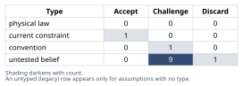
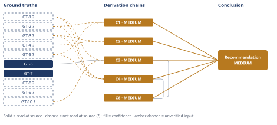

# Should This B2B SaaS Company Add a Free Tier

*First-principles analysis · 10 October 2026*

*Read with: [How to read this analysis](HOW-TO-READ.md) · [Working file](analysis-20261010T034542Z.md) · [All files](INDEX.md)*

## Executive Summary

**Recommendation:** Do not build an open-ended free tier. Adopt land-and-expand as the primary growth motion, refining the existing outbound/referral engine (chain C4), and run a small, sales-gated, time-boxed trial pilot as a bounded, reversible way to generate the free-to-paid conversion and support-cost data this company currently lacks (chain C6).

**Band (from §6):** MEDIUM

**Would change it:** An independent read of Finance's actual per-active-user cost model, underlying GT-3? (chain C2, chain C3), and real data from the recommended trial pilot closing the missing-data gap (chain C3); separately, CRM or win-loss evidence that real deals are being lost specifically to the lack of a free tier would justify reweighting competitive parity and re-running the trade-off (chain C1, chain C4).

## 1. Problem Essence

**Core problem:** Given that free-tier hosting/support cost is a real, usage-scaled cost center rather than a marketing freebie, and given that this company has no inbound/PLG motion for a free tier to plug into and no internal data on conversion economics, should it commit to a free tier at all — or does a different, lower-risk growth instrument better fit an outbound/referral-sold, high-ACV, team-based business that currently has no way to measure the thing a free-tier decision most depends on?

**Success criteria:**
1. The recommendation names a specific go-to-market instrument (free tier, trial, usage-based entry tier, land-and-expand, or a named combination) and states, for each instrument considered, whether it was adopted, rejected, or deferred — verifiable by inspecting section 6 against section 4's trade-off chain.
2. The recommendation states the economic condition (a breakeven ratio of marginal cost to captured value) under which a free or discounted tier would pay for itself, derived from the given facts rather than from competitor benchmarking — verifiable by inspecting the Fermi-estimate chain in section 4.
3. The recommendation identifies which commonly-cited justifications for a free tier (competitive parity, "infra is cheap," inbound growth) are supported by a verified ground truth versus resting on an unverified or discarded assumption — verifiable by cross-checking section 6's claims against section 2's Verdict column.
4. The recommendation names at least two second-order effects (one from the actor lens, one from the time lens) and at least one condition that would reverse it — verifiable by inspecting the second-order extension in section 4 and the "would change it" field in the Answer block.

No success criterion requires the answer to be exactly one of the four named alternatives (free tier, free trial, freemium-lite, usage-based entry tier) or land-and-expand alone — a combination, or a sequenced pairing of alternatives, is in scope and is tested explicitly in the trade-off procedure (section 4) via a composite option.

---

## 2. Assumptions Table



| Assumption | Type | Treatment | Verdict | Verification |
|------------|------|-----------|---------|--------------|
| "Competitors all have a free tier, therefore we need one too" | convention | Explicitly challenge before use — a competitor's tier structure is evidence about the competitor's unit economics and motion, not about this company's | Challenge — tested via inversion below; found to be an analogy, not evidence, absent a verified ground truth about *this* company's lost deals or funnel fit | unverified — flagged; see C1 |
| "A free tier will drive inbound/organic growth" | untested belief | Verify, or flag as unverified | Challenge — no self-serve/PLG funnel exists today (GT-2?) for a free signup to plug into; growth requires a funnel, not just a signup page | unverified — flagged; see C1, C4 |
| "A free tier is low-cost because cloud infrastructure is cheap" | untested belief | Verify, or flag as unverified | Discard — directly contradicted by GT-3? (Finance: cost scales with active users, not payers); the premise is false on the facts given, not merely unverified | discarded — contradicted by GT-3?; see C2 |
| "Free users will convert to paying customers at a rate that makes the program net positive" | untested belief | Verify, or flag as unverified | Challenge — no internal conversion data exists (GT-4?); external benchmarks are a different population (see C3) and bracket both above and below breakeven | unverified — flagged; see C3 |
| "A free tier will not cannibalize the existing $10,000-ACV outbound-sold deals" | untested belief | Verify, or flag as unverified | Challenge — surfaced via inversion as a failure-guaranteeing condition (a prospect substitutes free use for a paid contract); no evidence either way exists | unverified — flagged; see C1, C4 |
| "Free-tier signups are good top-of-funnel signal for an enterprise, team-based, outbound-sold product" | untested belief | Verify, or flag as unverified | Challenge — open self-serve signups carry no economic-buyer filter, unlike the current outbound/referral motion, which is pre-qualified by construction (the watermelon-metric risk named in the prompt) | unverified — flagged; see C4 |
| "Lack of a free tier is currently costing the company real deals" | untested belief | Verify, or flag as unverified | Challenge — no lost-deal data, win/loss notes, or CRM evidence is given; this is the specific unevidenced claim inversion targets | unverified — flagged; see C1 |
| "The 100%-outbound/referral motion and ~$10,000 average team ACV are fixed facts of this business" | current constraint | Record expiry conditions — what would have to change for this to no longer hold | Accept — expires if the company deliberately changes its ICP/segment strategy (e.g., targets smaller self-serve-native teams) or if a self-serve channel is built and proven; until then it is the operative constraint | unverified — flagged (user-asserted business fact, no external audit); see GT-1?, GT-2? |
| "Sales compensation and quota structures can be adjusted to reward land-and-expand (account-expansion) behavior without the comp plan itself blocking it" | untested belief | Verify, or flag as unverified | Challenge — surfaced during the Assumption Audit (Phase 4) from chain C4's second-order extension; not addressed by any given fact | unverified — flagged; see C4, Pre-mortem Cluster 1 |
| "A small, sales-gated trial pilot can be operated with existing sales/engineering capacity, without building full self-serve signup/billing infrastructure" | untested belief | Verify, or flag as unverified | Challenge — surfaced during the Assumption Audit from chain C6's synthesis; plausible given it needs no new billing system, but unverified against this company's actual engineering capacity | unverified — flagged; see C6, Pre-mortem Cluster 2 |
| "Marginal infra + support cost per active free user is roughly $30–$300/year" | untested belief | Verify, or flag as unverified | Challenge — this analysis's own first-principles construction (no company-specific or external source); used only as a bracket input to C3, not asserted as fact | unverified — flagged; see GT-10?, C3 |
| "The trade-off's criterion weights reflect this analysis's own reasoned risk priorities (cost-scaling risk real per Finance; competitive-parity reasoning explicitly flagged as weak), not an elicited statement of this company's actual risk tolerance" | untested belief | Verify, or flag as unverified | Challenge — surfaced during the Assumption Audit from chain C4's weighted-ranking hop; the flip test shows the ranking survives even an extreme single-weight change, bounding (but not eliminating) this assumption's impact | unverified — flagged; see C4 |

---

## 3. Ground Truths

- **GT-1?** ARR is $2.4M across 240 paying teams/customers, average ACV ~$10,000/team/year (enterprise/team-based pricing, not per-seat self-serve) — unverified: this is the requester's own stated business fact; no external, audited, or independently-opened source names it, per the Input Contract's classification of supplied "facts on the ground."
- **GT-2?** Customer acquisition today is 100% outbound sales + referral; no self-serve/PLG inbound signup flow or funnel exists for a free tier to plug into — unverified: same basis as GT-1?.
- **GT-3?** Free-tier infrastructure and support costs scale with active (logged-in, product-using) users, not with paying users — confirmed by Finance per the prompt — unverified: "Finance has confirmed" names an internal function, not a document this analysis can open; this is the single most load-bearing fact in the analysis (see Phase 5 Sensitivity) and the highest-value fact to independently verify against Finance's actual cost model before acting.
- **GT-4?** The company has never run a freemium pilot of any kind; no internal data exists on free-to-paid conversion rate, free-user activation rate, or support burden per free user — unverified: same basis as GT-1?.
- **GT-5?** All competitors in this space currently offer a free tier; this company does not — unverified: same basis as GT-1?.
- **GT-6** The average SaaS freemium-to-paid conversion rate across industries is 2–5%, with top performers reaching 8–10% — source: getmonetizely.com, "Maximizing Growth: How to Calculate and Optimize Freemium to Enterprise Conversion" (the article attributes this figure to 2023 ChartMogul data, which this analysis did not independently open); read-at-source: this analysis fetched the article directly and quotes its own sentence verbatim — "the average SaaS freemium-to-paid conversion rate across industries is 2-5%, with top performers reaching 8-10%."
- **GT-7** Enterprise-tier deals typically represent 5–15% of all paid conversions in SaaS freemium/tiered funnels (a *mix-share* metric — the share of paid conversions that are enterprise-tier, not a free-to-paid conversion *rate* for enterprise prospects) — source: getmonetizely.com, same article (attributing this figure to OpenView Partners); read-at-source: quoted verbatim — "Enterprise conversions specifically typically represent 5-15% of all paid conversions."
  - **Phase 3 failure record:** an earlier candidate ground truth, drafted from an initial WebSearch synthesis as "enterprise-grade freemium products see 5–10% free-to-paid conversion, i.e., higher than the general rate, because the free tier acts as a qualified-lead filter," was checked against this same source once it was opened directly. The source does not support that claim — it reports a different metric (enterprise share of paid conversions, not an enterprise-specific free-to-paid conversion rate). Reason: *citation does not support the claim*. That candidate is discarded and replaced by the accurately-scoped GT-7 above; it is not used as a benchmark comparator in C3.
- **GT-8?** B2B SaaS median free-trial-to-paid conversion is reported around 18.5%, with top performers at 35–45%+; opt-out trials requiring a credit card convert around 48.8%, versus ~18.2% for opt-in trials requiring no card — reported-by-delegate: WebSearch synthesis citing flint.com and shno.co; neither source was independently opened by this analysis. Not load-bearing for the headline recommendation (used only as descriptive color on the trial option in the trade-off matrix, where trial is not the top-scoring option), so no further verification read was attempted.
- **GT-9?** Sales-led enterprise deal win rates are reported around 12–18%, with sales cycles commonly running 6–12 months — reported-by-delegate: WebSearch synthesis citing prospeo.io; not independently opened. Used only as narrative context on the existing outbound motion, not cited in any chain head, so it carries no confidence-cap obligation.
- **GT-10?** First-principles-constructed bracket: marginal infrastructure + support cost per active free user is roughly $30–$300/year (central estimate ≈$100/year) — unverified: constructed by this analysis from typical B2B SaaS cost-structure reasoning (compute/storage/bandwidth per active account plus a support-ticket-rate × cost-per-ticket term), not from a company-specific or external source. This is the dominant uncertain factor in the Fermi estimate (chain C3) and the second-highest-value fact to verify (after GT-3?) before acting on any unit-economics conclusion.

**Provenance summary:**
```text
?-marked: GT-1, GT-2, GT-3, GT-4, GT-5, GT-8, GT-9, GT-10 (8 of 10)
Read-at-source: GT-6 — getmonetizely.com, quoted: "the average SaaS freemium-to-paid conversion rate across industries is 2-5%, with top performers reaching 8-10%"
Read-at-source: GT-7 — getmonetizely.com, quoted: "Enterprise conversions specifically typically represent 5-15% of all paid conversions"
```

No assumption that received a Discard verdict in section 2 (the "free tier is low-cost because infra is cheap" belief) appears in this list.

---

## 4. Derivation Chains



### Conclusion C1: Competitive parity is not evidence of need for this company

GT-5? (all competitors offer a free tier) + GT-2? (100% outbound/referral, no PLG funnel)
→ a free tier's payoff depends on a working inbound-to-revenue funnel, which this company does not currently have
→ the mere existence of competitors' free tiers is therefore evidence about their funnel fit, not about this company's, so parity alone does not establish need here

**Confidence:** MEDIUM — GT-5? and GT-2? are both unverified user-asserted facts (verification: an internal audit of competitor tier structures and of this company's actual funnel/CRM setup would remove both as causes of the downgrade). A rival reading — that parity carries brand/trust value independent of funnel mechanics — is live and not settled by any ground truth here; it is carried forward on this line rather than ruled out.

### Conclusion C2: A free tier is a real, unbounded cost commitment, not a marketing freebie

GT-3? (free-tier cost scales with active users, not payers) + GT-4? (no internal data on free-user volume, activation, or support burden)
→ the cost of a free tier grows with the number of free signups regardless of whether any of them ever pay, and today the company cannot forecast or cap that growth
→ committing to an open-ended free tier now means accepting an unbounded, unforecastable cost commitment rather than a low-cost marketing addition

**Confidence:** MEDIUM — GT-3? is Finance-asserted but not independently read by this analysis (verification: reading Finance's actual per-user cost model would remove it as a cause of the downgrade); GT-4? is a documented absence of data (verification: running any bounded pilot, per C6, would begin to close it). No live rival: the inference that scaling cost implies a real commitment is close to definitional given GT-3?, and no alternative reading was found.

### Conclusion C3: Unit economics for a free/discounted tier are genuinely undetermined, not favorable or unfavorable

GT-1? (avg ACV ~$10,000/team/year) + GT-10? (marginal cost per free user ~$30–$300/yr, central ~$100) + GT-6 (general freemium conversion 2–5%, top performers 8–10%)
→ the breakeven free-to-paid conversion rate equals marginal cost per free user divided by the ACV captured per conversion, bracketing to roughly 0.3% in the low-cost/full-ACV case and 15% in the high-cost/partial-value case, with a central case near 1.0%
→ the central case sits below the general benchmark range while the pessimistic case exceeds even top-performer benchmark conversion, so the bracket straddles the benchmark zone rather than sitting clearly inside or outside it
→ unit economics alone cannot determine whether a free tier would be cost-positive for this company, because the answer depends on which cost/value regime actually applies, and that is exactly the data GT-4? says does not exist

**Confidence:** MEDIUM — GT-1? is a user-asserted business fact (verification: an audited revenue/ACV breakdown would remove it as a cause); GT-10? is this analysis's own first-principles construction with no company-specific anchor (verification: Finance's real per-active-user infra+support cost, the single highest-value number to obtain next after GT-3? itself, would remove it). No live rival: the "undetermined" conclusion already absorbs the rival reading that the benchmark comparison is the wrong reference class entirely — both readings agree no clean answer exists without new data.

### Conclusion C4: A land-and-expand refinement of the outbound motion outranks every tier-structure change, and this ranking is robust

GT-1? (revenue base/ACV) + GT-2? (motion fit) + GT-3? (cost-scaling risk) + GT-5? (competitive context)
→ weighted scoring across six locked criteria ranks land-and-expand highest among the seven options considered (107), with the status quo (95) and a sales-gated trial-plus-entry-tier composite (92) closest behind, and open-ended freemium lowest by a wide margin (31) *[Assumes: A-weights — the locked criterion weights reflect this analysis's reasoned risk priorities, not an elicited statement of the company's actual risk tolerance; the flip test below bounds, but does not eliminate, this assumption's impact]*
→ a flip test shows no single criterion's weight, moved anywhere within the 1–5 scale used, reverses the ranking between land-and-expand and its nearest rival, the composite
→[2nd] land-and-expand only changes outcomes if sales compensation and quota credit are restructured to reward expansion revenue; otherwise reps keep chasing new-logo deals and the motion exists on paper only *[Assumes: A-comp — sales compensation can be adjusted to reward expansion behavior; if it cannot, land-and-expand's realized score falls toward the status quo's, which still outranks every tier-structure option considered, so the headline ranking is unaffected even if this premise fails]*
→[2nd] competitors' free tiers remain available to them as a talking point in competitive evaluations against this company — a real but bounded brand-positioning cost that the low locked weight on the competitive-parity criterion accepts deliberately, per C1, rather than overlooks
→[3rd] layering a small, sales-gated, time-boxed trial onto the land-and-expand motion converts C3's unresolved unit-economics question into company-specific, read-at-source data within a few sales cycles
→[3rd] that data is the one input currently missing before any future freemium decision could responsibly be revisited

**Confidence:** MEDIUM — all four head ground truths are unverified user-asserted facts (verification: an audited CRM/revenue export plus Finance's cost model would remove each as a cause of the downgrade). The A-comp assumption on the first [2nd]-order hop is priced on its own line (failure does not change the endpoint). Rival: the trial-plus-entry-tier composite is the nearest live alternative; the flip test above is what rules it out within the bounds tested — no single-criterion weight change inside the 1–5 scale reverses the ranking — though an out-of-scale or multi-criterion shift was not tested and is not claimed to be ruled out.

### Conclusion C6: Do not build an open-ended free tier; refine the outbound motion and pilot a bounded trial to close the data gap

C3 (unit economics undetermined) + C4 (land-and-expand wins the trade-off, robust to single-weight perturbation)
→ C4 establishes that no tier-structure change outscores a sales-motion refinement under the locked weights, while C3 establishes that the unit-economics case for any free or discounted tier remains genuinely unresolved without new data
→ the option that both respects the cost-scaling constraint named in GT-3? and begins closing the data gap named in GT-4? is to adopt land-and-expand as the primary motion now, and to run a small, bounded, sales-gated trial as a cheap, reversible instrument for generating that missing data — not as a tier-structure launch
→ the trial-pilot add-on is justified directly by C3's finding rather than by C4's trade-off score, where a trial-inclusive composite scores below land-and-expand alone once the operational-complexity criterion is weighted, so the recommendation's two parts carry different, and different-strength, justifications

**Confidence:** MEDIUM — this chain rests entirely on C3 and C4, both MEDIUM; their own confidence lines carry the explanation for each. No additional downgrade cause belongs to this chain itself beyond the ceiling those two chains already set.

---

## 5. Abandoned Reasoning

### Dead End: Open-ended full freemium tier

**What was tried:** Treated "add a free tier" at face value — an unlimited, indefinite, self-serve free plan, mirroring what every named competitor offers.

**Why abandoned:** Scored lowest of all seven options in the trade-off (31 of a possible high near 140), driven by unbounded cost exposure under GT-3?, the weakest anti-cannibalization properties of any option (an indefinite team-based free plan is the option best able to substitute for the $10,000 paid product), and the largest build requirement against a motion that has no existing self-serve infrastructure (GT-2?). The inversion pass in Phase 2 independently surfaced the same failure-guaranteeing conditions (no funnel to plug into, highest substitution risk) before scoring confirmed them.

**What it ruled out:** Saves a future reviewer from re-litigating "just match competitors" as a sufficient justification; it is not — chain C1 and C4 are on record for why.

### Dead End: Tightly-capped "freemium-lite" (permanent single-user, single-project free plan)

**What was tried:** A narrower permanent free tier, capped to one seat/one project, explicitly designed to be unable to substitute for the team-based paid product.

**Why abandoned:** Scored 65 in the trade-off — better anti-cannibalization than full freemium, but it still carries open-ended, uncapped-by-user-count cost exposure under GT-3? (per-user cost is capped, but the number of free users is not), and still requires building net-new self-serve signup infrastructure the company does not have. It was outscored by both the trial and the entry-tier options (81 each) and by land-and-expand (107).

**What it ruled out:** Saves a future reviewer from treating "make it small" as sufficient mitigation for the core problem (GT-3?'s cost scaling is a function of user count, not feature scope); scope-capping alone does not resolve it.

### Dead End: Reasoning from "what competitors do" as direct evidence

**What was tried:** An early framing treated competitors' free tiers as itself a reason to add one — "if it works for them, it should work for us."

**Why abandoned:** This is an analogy, not evidence. No ground truth in this analysis states competitors' conversion rates, their support cost per free user, or whether their motion was inbound-native from inception (a structurally different starting point than this company's 100%-outbound motion, GT-2?). Per the no-analogy-as-direct-evidence rule, the claim was discarded as unsupported rather than carried forward with a `?`-flag, because no ground truth about competitors' actual situation exists to flag.

**What it ruled out:** Saves a future reviewer from treating competitor imitation as a substitute for this company's own data; chain C1 formalizes why.

### Dead End: Stopping at the Fermi estimate (C3) alone

**What was tried:** Using the breakeven-conversion bracket in C3 as a sufficient basis for a go/no-go decision on its own.

**Why abandoned:** The bracket (0.3%–15%) straddles the available benchmark range (2–10%) rather than resolving clearly inside or outside it, so the estimate is a necessary check (it shows the free tier is not doomed on pure hosting-cost grounds) but not a sufficient one — it says nothing about cannibalization, signal quality, or motion fit, which the trade-off (C4) was needed to address.

**What it ruled out:** Saves a future reviewer from treating "the math could work" as equivalent to "we should do it"; C3's own conclusion is explicitly that the question is undetermined, not favorable.

---

## 6. Conclusion

**Recommended approach:** Do not build an open-ended free tier. Adopt land-and-expand as the primary growth motion, refining the existing outbound/referral engine rather than replacing it (chain C4), and run a small, sales-gated, time-boxed trial pilot as a bounded, reversible instrument to generate the free-to-paid conversion and support-cost data this company currently lacks (chain C6).

**Key insight:** The facts given already falsify the two premises most often used to justify a free tier here — "a free tier is low-cost because infra is cheap" is directly contradicted by Finance's cost-scaling fact, and "competitors have one so we need one" is an analogy about their funnel fit, not evidence about this company's (chain C1, chain C2). The real decision is therefore not "free tier: yes or no" but "which instrument generates the missing conversion-economics data at the lowest risk to the existing $2.4M outbound-sold revenue base" (chain C3, chain C4), and the trade-off answer to that reframed question is not a tier-structure change at all.

**Trade-offs acknowledged:** This recommendation accepts ceding, for now, the self-serve-native segment of the market that land-and-expand and a sales-gated trial structurally cannot reach, since both still depend on a prospect entering the outbound/referral motion first — named explicitly as an accepted risk in the pre-mortem's Cluster 3 (chain C4). It also accepts that the trial-pilot add-on is justified by a different, independently-MEDIUM-rated chain (C3) than the land-and-expand recommendation itself (C4), and that the sales-compensation change C4's second-order extension depends on is an unverified precondition whose failure, while plausible, does not change the headline ranking (chain C4).

**Conditions that would flip this recommendation:**
- If Finance's cost-scaling fact is independently checked and found to be heavily mitigated by a hard per-user usage cap, the cost case weakens and a bounded entry-tier pilot becomes attractive sooner than this recommendation assumes (chain C2, chain C3).
- If the sales-gated trial pilot empirically shows free-to-paid conversion at or above the general benchmark without diluting deal size, chain C3's "undetermined" finding resolves favorably and graduating toward a formal low-cost entry tier would be justified (chain C3).
- If CRM or win-loss data later shows real deals are being lost specifically because of the lack of a free tier, the competitive-parity criterion's weight in the trade-off should be raised and the matrix explicitly re-run, rather than silently overridden (chain C1, chain C4).
- If the company deliberately changes its target segment toward smaller, self-serve-native teams, the "100%-outbound" premise this whole trade-off rests on expires, and chain C4 should be re-scored under that new constraint (chain C4).

**Confidence:** MEDIUM — every chain this Conclusion rests on (C1, C2, C3, C4, C6) is rated MEDIUM; each chain's own confidence line carries the specific unverified inputs and verification paths that produced that rating, and no additional downgrade cause belongs to the Conclusion itself beyond the ceiling those chains already set. The single highest-value verification that would move this toward HIGH is an independent read of Finance's actual per-active-user cost model (the fact underlying GT-3?, C2, and C3) paired with real data from the recommended trial pilot (closing GT-4?).
