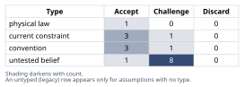
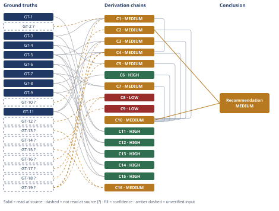

# Wind Turbine Gearbox HSS Bearing Root-Cause Determination

*First-principles analysis · 9 October 2026*

*Read with: [How to read this analysis](HOW-TO-READ.md) · [Working file](analysis-20261009T203822Z.md) · [All files](INDEX.md)*

## Executive Summary

**Recommendation:** Do not authorize the replacement-bearing specification as a like-for-like swap for "low lubricant viscosity." The verified root cause is microslip-enabled, boundary-lubrication-associated white-etching-crack (WEC) rolling-contact fatigue, so gate final sign-off on electrical and lubricant-chemistry diagnostics first (chain C10). The operator's literal viscosity-wear hypothesis is rejected, not merely doubted (chain C2).

**Band (from §6):** MEDIUM (chain C10, chain C2).

**Would change it:** Independent SEM/EBSD re-examination of the retained raceway sections, an L10-worksheet audit, and a primary-source read of the oil's viscosity-temperature chart would raise the band toward HIGH; nothing currently available contradicts the determination (chain C10, chain C2).

## 1. Problem Essence

**Core problem:** Determine, from the physical, metallurgical, and condition-monitoring evidence on the failed HSS generator-end cylindrical roller bearing, the verified root-cause failure mechanism — and whether the operator's "low-viscosity boundary-lubrication wear" hypothesis should be accepted, rejected, or reframed — so that the replacement-bearing specification decision addresses the actual cause rather than a plausible-sounding but unverified one.

**Success criteria:**
1. The analysis names a specific physical failure mechanism (not a generic label) and traces it to the morphological evidence — subsurface origin depth, crack orientation, microstructure, bearing location — via contact-mechanics, tribology, and metallurgy first principles, not by analogy to "bearings like this usually fail from X."
2. The operator's hypothesis is explicitly tested against the evidence (via inversion) rather than assumed true or false, and any internal physical contradiction in the hypothesis as stated is identified and explained.
3. At least one credible alternative cause is identified, tested against the same evidence, and either ruled out with a stated reason or carried forward as an open, falsifiable item requiring specific follow-up data.
4. The final determination names a confidence band, states what evidence would raise or lower that band, and states a falsification condition — a reader does not have to take the determination on authority.
5. The analysis states a concrete consequence for the replacement-bearing specification decision: what happens if the spec is authorized on the operator's hypothesis alone, versus what the spec (or the broader corrective-action scope) should include if the root cause is something else.

The answer is not constrained to "the operator is right" or "the operator is wrong" as a forced binary — a reframing of the hypothesis (same contributing factor, different causal pathway) satisfies these criteria as well as an outright accept or reject does, provided it is traceable to the evidence.

## 2. Assumptions Table



Assumptions are referenced elsewhere in this analysis (chain `[Assumes: A-N]` marks, the Assumption Audit scan) by the informal labels `A-1`...`A-18` assigned in table order below; the table itself carries no ID column per the output template.

| Assumption | Type | Treatment | Verdict | Verification |
|------------|------|-----------|---------|--------------|
| (A-1) The condition-monitoring kurtosis step at ~14,000 h reflects a genuine onset of a localized bearing defect, not a sensor fault or processing artifact | untested belief | Verify, or flag as unverified | Challenge — plausible given disassembly confirmed a spall, but no independent CM-system audit (sensor calibration log, raw time-waveform) was supplied | unverified — flagged (GT-13?); corroborated circumstantially by the disassembly finding, not independently confirmed |
| (A-2) The metallurgical lab's identification of WEC and butterfly microstructure (vs. an ordinary temper-etch or preparation artifact) is accurate | untested belief | Verify, or flag as unverified | Challenge — WEC/butterfly identification requires correct Nital-etch technique and experienced interpretation; misidentification is a known failure-analysis pitfall | unverified — flagged (GT-17?); recommend independent SEM/EBSD re-examination of retained sections, as GT-8's method |
| (A-3) The stated L10 = 130,000 h is correctly computed from this bearing's actual load spectrum and duty cycle (not an input error) | current constraint | Record the expiry conditions | Challenge — not independently re-derived; load spectrum, duty cycle, and basic dynamic rating inputs were not supplied | unverified — flagged (GT-14?); expires once the original L10 worksheet is audited |
| (A-4) The lubricant's viscosity grade (ISO VG) was correctly specified for this site's climate under normal (non-cold-snap) operation | convention | Explicitly challenge before use | Challenge — plausible as OEM-specified but not confirmed; if the base specification itself were marginal, that would be a distinct finding from "a cold snap drove an otherwise-correct spec out of range" | unverified — flagged; verification is the OEM lubricant spec sheet cross-checked against the site's ambient temperature range |
| (A-5) Mineral and synthetic gear/bearing oils exhibit a positive viscosity-temperature coefficient (viscosity rises as bulk temperature falls) | physical law | Accept as a ground-truth candidate | Accept — standard, well-established lubricant physical chemistry (ASTM D341 viscosity-temperature framework); directly contradicts the literal form of the operator's hypothesis | reported-by-delegate (GT-10?); SAE-140 numeric example (404 cSt @ 40 °C vs. 28 cSt @ 100 °C) found via search, not independently opened at a primary ASTM document in this session |
| (A-6) A real ambient cold-snap occurred during the referenced months, materially lowering sump/bulk oil temperature | current constraint | Record the expiry conditions | Accept — taken as given from the operator's own framing; not itself in dispute, only its claimed effect on viscosity direction | unverified — flagged; site weather/SCADA ambient-temperature logs would confirm magnitude and duration |
| (A-7) No gross mechanical misalignment, preload error, or mounting damage was present at this bearing (absence of evidence is not evidence of absence) | untested belief | Verify, or flag as unverified | Challenge — not ruled out by the case data as given; misalignment can itself elevate microslip and contact pressure, compounding the chain below rather than contradicting it | unverified — flagged; verification is the installation/alignment record and bore/fit measurements at teardown |
| (A-8) This 1.5 MW upwind turbine's HSS generator-end bearing experiences meaningful speed/torque transients (wind-turbulence-driven torque fluctuation and grid/converter events), consistent with general variable-speed, pitch-controlled wind turbine operation | convention | Explicitly challenge before use | Accept — generic to this turbine class; used as a contributing-mechanism assumption, not as a site-specific measurement | unverified — flagged; verification is SCADA torque/speed transient logs and converter event logs for this specific unit |
| (A-9) The condition of the generator shaft grounding brush, slip ring, and bearing electrical insulation at the time of failure is unknown | untested belief | Verify, or flag as unverified | Challenge — directly bears on whether stray electrical current is live as a contributing or alternative cause | unverified — flagged; no electrical diagnostic data supplied in the case |
| (A-10) The lubricant's moisture content, hydrogen content, and additive-package condition at time of failure are unknown | untested belief | Verify, or flag as unverified | Challenge — directly bears on the tribochemical/hydrogen pathway central to the WEC mechanism | unverified — flagged; no oil analysis data supplied in the case |
| (A-11) The Lundberg-Palmgren orthogonal-shear-stress criterion (and its z0 ≈ 0.5b depth rule) is a valid first-order model for this bearing's steel and geometry | convention | Explicitly challenge before use | Accept — the Lundberg-Palmgren model is the industry-standard basis for L10 rating and is used here only for order-of-magnitude depth bracketing, not for a precise life prediction | reported-by-delegate (GT-1, GT-2?) |
| (A-12) Findings from two-disc and full-scale component WEC test rigs (steel grade 100Cr6, European research literature) generalize to this specific 1.5 MW platform's HSS bearing steel and operating regime | untested belief | Verify, or flag as unverified | Challenge — 100Cr6 (SAE 52100) and case-carburized steels are both common in wind-turbine gearbox bearings, but the specific steel/heat-treatment of this bearing was not supplied | unverified — flagged; verification is the bearing's material certificate (through-hardened vs. case-carburized, steel grade) |
| (A-13) The inspecting engineer's "axial" vs. "circumferential" orientation call for the spall, and the "18 mm" length measurement, are accurate as reported | untested belief | Verify, or flag as unverified | Accept — taken as given case data; flagged for the same reason as A-2 | unverified — flagged (GT-15?) |
| (A-14) The absence of any mention of pitting, fluting, or frosted/grey discoloration in the case description means those signatures were genuinely absent from the bearing, not merely unreported | untested belief | Verify, or flag as unverified | Challenge — an absence-of-mention is weaker evidence than an explicit "no pitting or fluting observed" in an inspection report; this materially affects how hard chain C8 can lean on the mismatch | unverified — flagged; verification is the full teardown inspection report/photographs, explicitly checked for pitting or fluting |
| (A-15) A replacement bearing of the same design, material, and lubrication regime, installed without any corrective action, will operate in essentially the same electrical, microslip, and lubricant-chemistry environment as the failed one | current constraint | Record the expiry conditions | Accept — follows directly from "nothing else changes"; expires the moment any corrective action (grounding, lubricant, coating, mounting practice) is implemented | unverified — flagged; this is the logical basis for the recurrence-risk statement in §6, not an independently sourced fact |
| (A-16) Bearing-steel cleanliness (non-metallic inclusion content) is within normal specification for this bearing, i.e., classical inclusion-initiated subsurface fatigue from a material defect is not the dominant driver | untested belief | Verify, or flag as unverified | Challenge — not ruled out by the case data; an unusually dirty steel lot could independently shorten life without invoking WEC chemistry, though it would not by itself explain the WEC/butterfly microstructure finding | unverified — flagged; verification is steel cleanliness rating (e.g., ASTM E45/DIN 50602) from the material certificate, and fractography for inclusion-seeded origins |
| (A-17) A "cold snap" (ambient cooling, then re-warming) at an outdoor gearbox installation plausibly increases moisture condensation / breather-cycling-driven water ingress into the gearbox oil, independent of the (physically backwards) viscosity-reduction claim | convention | Explicitly challenge before use | Accept — standard outdoor-equipment moisture-ingress reasoning (breathing through temperature/pressure cycling); used to reframe, not rescue, the operator's hypothesis | unverified — flagged; verification is oil moisture content (Karl Fischer titration) trended against the cold-snap period |
| (A-18) No corrective action (grounding, lubricant chemistry, mounting practice, bearing design) has been implemented between the failure and the replacement-specification decision this analysis feeds | current constraint | Record the expiry conditions | Accept — stated scope of the task ("feeding a decision to authorize a replacement specification"); expires the moment any such corrective action is decided | unverified — flagged; follows from the task framing, not independently sourced |

## 3. Ground Truths

**Contact-mechanics / Lundberg-Palmgren basis**

- **GT-1** Lundberg-Palmgren rolling-contact-fatigue theory holds that the *maximum orthogonal (reversing) shear stress* τ0 — not the larger, non-reversing 45°-plane maximum shear stress — is the stress responsible for subsurface crack initiation in classical rolling-bearing fatigue, because τ0 cyclically reverses sign as the contact rolls past while the 45° maximum shear stress only fluctuates between zero and a peak. — source: Frontiers in Manufacturing Technology, doi 10.3389/fmtec.2022.1010759; read-at-source: WebFetch of the article's full-text page, quoted "τo is considered to be the maximum orthogonal reversing shear stress which occurs below the surface... This stress is not the largest of the subsurface stresses but has the largest fluctuating component which is critical to the fatigue process," and "the criterion for plastic deformation... assumed that the maximum orthogonal shear stresses is responsible for the crack initiation."
- **GT-2?** The depth of the maximum orthogonal (reversing) shear stress beneath a Hertzian line contact is z0 ≈ 0.5·b, where b is the contact semi-width (compare GT-3's 0.786·b for the larger, non-reversing maximum shear stress). — reported-by-delegate: returned by WebSearch synthesis of bearing-fatigue literature (the Lundberg-Palmgren z0/b0.5 relationship); no single primary document was opened and read for this specific numeric coefficient in this session.
- **GT-3** For a Hertzian line contact, the (non-reversing) maximum shear stress occurs at depth z/b ≈ 0.786, where b is the contact semi-width. — source: TriboNet, "Hertzian Stress Subsurface Calculator — Line Contact"; read-at-source: WebFetch quoted "0.786 is near peak shear for line contact" (the page's default depth ratio z/b), citing Popov, *Contact Mechanics and Friction*.

**White-etching-crack (WEC) literature — wind-turbine-gearbox-bearing-specific**

- **GT-4** White-etching-crack (WEC) failure is a recognized, distinct bearing failure mode that reduces service life to approximately 5-20% of the nominal (L10) design life. — source: F. Gutiérrez Guzmán, A. Mikitisin, D. Cornel, C. Sous, F. Steinweg, M. Oezel, T. Janitzky, "Formation of White Etching Cracks (WEC) Under Rolling Loading in a Two-Disc Test Rig and a Kinematic Study on a Full-Scale Bearing," STLE 2018 Annual Meeting & Exhibition, Rolling Element Bearings II session; read-at-source: Introduction paragraph of the PDF (read directly via the Read tool), quoted "This failure mode can lead to bearing failure at 5-20 % of the nominal life [1]" (citing M.H. Evans, *Materials Science and Technology* 32 (2016), 1133-1169).
- **GT-5** WEC damage is characterized by subsurface crack networks within regions of altered microstructure ("white etching areas," WEA — resistant to Nital etching, appearing white under reflected light), which ultimately lead to axial cracking or spalling of the bearing's raceway. — source: same STLE 2018 paper; read-at-source: Introduction, quoted "This damage pattern is characterized by sub-surface crack networks within regions of altered microstructure... which ultimately lead to axial cracking or spalling of the bearing's raceway. These altered regions are resistant to etching and are called white etching areas (WEA) due to their white appearance under reflected light."
- **GT-6** WEC/WEA formation is promoted under boundary-lubrication conditions (λ < 1, the EHL film-thickness-to-roughness ratio); specimens run under full-film lubrication (λ > 3) on the same steel and rig for 40×10⁶ cycles showed no macroscopic damage and no WEC on metallographic inspection, while boundary-lubrication tests (λ < 1) produced spalling/WEC in most specimens. — source: same STLE 2018 paper; read-at-source: Results section, quoted "The four tests running under full fluid lubrication were stopped after 40·10⁶ cycles and showed no macroscopic signs of surface damage. Metallographic inspections on selected rings showed no WEC," and the Conclusions, "The prevailing lubrication conditions have a dominant influence on the formation of WEC... WEC formation occur on tests running under boundary lubrication conditions (λ < 1)."
- **GT-7** Transient speed/load ramps produce high cage and roller slip — up to 50-85% slip values, corresponding to 38-157% slide-roll ratio — in a large cylindrical roller bearing under constant, moderate radial load (850 MPa contact pressure, 50 kN), with the elevated-slip condition persisting for several seconds (roughly 250 shaft rotations) after the ramp before decaying; the authors explicitly identify this as evidence that transient wind-turbine-gearbox-like operating conditions can produce the slip conditions associated with WEC. — source: same STLE 2018 paper; read-at-source: Results and Conclusions, quoted "the roller slip varies between 50 % (86 % SRR) and 85 % (157 % SRR)... the roller slip has decreased up to 25 - 70 % (38 - 120 % SRR)," and "this work provides an insight into different WEA/WEC drivers and whether these conditions can be found in large size cylindrical roller bearings and consequently in wind turbine gearboxes."
- **GT-8** Electron-backscatter-diffraction (EBSD) / kernel-average-misorientation (KAM) analysis of a WEC specimen shows the altered (recrystallized, nanocrystalline-ferrite) microstructure located at the region of maximum von Mises stress adjacent to the crack tip, supporting a mechanism in which subsurface stress concentration drives a dislocation-accumulation-triggered microstructural transformation that precedes or accompanies crack formation — i.e., a stress-driven subsurface origin, not a surface process migrating inward. — source: same STLE 2018 paper; read-at-source: Results, Figure 2 discussion, quoted "It is clearly seen that the tip of the crack is located in the region of maximal von Mises stress... the findings in this study may support the thesis that energy is stored through movement of dislocations in the depth of maximal von Mises stress, resulting in a microstructure transformation before a crack is formed."
- **GT-9** Approximately 76% of wind-turbine gearbox failures are caused by bearings, and axial cracks (the field-failure-analysis term for WEC-driven cracking) forming on bearings in the high-speed and intermediate-speed gearbox stages are identified as the leading cause of those bearing failures, based on a database of 750 confirmable wind-turbine-gearbox damage records (2009-August 2015) compiled by NREL and Argonne National Laboratory with industry partners (SKF, Winergy, GE, Afton Chemical). — source: U.S. Department of Energy / NREL, "Statistics Show Bearing Problems Cause the Majority of Wind Turbine Gearbox Failures," energy.gov/node/1246711; read-at-source: WebFetch quoted "the majority of wind turbine gearbox failures (76%) are caused by the bearings" and "Axial cracks that form on the bearings during high- and intermediate-speed stages are the leading cause for bearing failures," with the database basis "750 confirmable wind turbine gearbox damage records provided by wind plant owners and operators from 2009 through August 2015."

**Lubrication / wear-signature / electrical physics**

- **GT-10?** Mineral and most synthetic gear/bearing oils exhibit a positive viscosity-temperature coefficient: viscosity *increases* as bulk oil temperature *decreases*, and decreases as temperature rises (the standard behavior codified by the ASTM D341 viscosity-temperature framework used throughout the lubricants industry); e.g., a representative gear oil's kinematic viscosity drops from ~404 cSt at 40 °C to ~28 cSt at 100 °C. — reported-by-delegate: WebSearch synthesis; no single ASTM D341 document was opened and read for the numeric example in this session, though the directional relationship is uncontested, textbook-level lubricant physical chemistry.
- **GT-11** Surface distress (including micropitting / "frosting" / "grey staining") is a surface-initiated damage phenomenon, "associated with poor lubrication conditions" and "greatly influenced by the lubrication regime, notably enhanced by boundary and/or mixed-lubrication regimes"; it manifests initially as dull discoloration and, under the microscope, as micro-spalls, micro-cracks, or micro-pits confined near the contacting surface (typically single-digit to low-tens-of-micron depth per independent corroborating search results, not sub-millimeter). — source: SKF, "Understanding and Preventing Surface Distress," evolution.skf.com; read-at-source: WebFetch quoted "Surface distress is a surface damage phenomenon associated with poor lubrication conditions," "Surface distress is greatly influenced by the lubrication regime, notably enhanced by boundary and/or mixed-lubrication regimes," and "the affected surface areas show the presence of tiny micro spalls, micro cracks or micro pits."
- **GT-12?** Stray electrical (bearing) current damage — electrical-discharge-machining-type (EDM) damage from shaft voltage discharging through the bearing when the generator's shaft-grounding path (brush/slip ring) or bearing insulation is compromised — produces a characteristic surface signature of pitting and fluting (a washboard-like periodic erosion pattern), caused by repeated localized arc discharge through the oil film. — reported-by-delegate: WebSearch synthesis of wind-turbine generator-bearing grounding patent and industry literature (including Google Patents US11539317B2 and related sources), quoted via search summary: "stray currents discharge to ground through the generator's bearings, causing pitting and fluting (just as electrical discharge machining would)." Not independently opened and read as a single primary document in this session.
- **GT-13?** Vibration kurtosis (the fourth standardized moment of the vibration signal) is highly sensitive to short-duration, high-amplitude impulsive events; a step increase in kurtosis is the characteristic signature of the onset of a discrete, localized defect (e.g., a spall generating a periodic impact each rotation) against an otherwise near-Gaussian baseline, which is a materially different signature than the gradual overall-energy (RMS) increase typically produced by distributed, non-localized surface degradation such as general abrasive or adhesive wear across a raceway. — reported-by-delegate: WebSearch synthesis of condition-monitoring / vibration-analysis literature; no single primary document was opened and read in this session.
- **GT-14?** Hydrogen entry promoting WEC formation in bearing steel occurs through the contact surface or through cracks via decomposition of lubricant through catalytic/tribochemical reactions, *and* via tribochemical reactions of water (moisture) — i.e., moisture/water contamination is a recognized hydrogen source for WEC independent of, and additional to, lubricant additive breakdown. — reported-by-delegate: WebSearch synthesis citing the University of Southampton eprints repository literature on WEC hydrogen mechanisms (eprints.soton.ac.uk/363603, /417460) and the Evans (2016) review; not independently opened and read as a single primary document in this session (a direct WebFetch of the Southampton PDF in this session returned a 403/unreadable result).

**Case data (as supplied in the problem statement)**

- **GT-15?** Condition-monitoring detected a step increase in HSS vibration kurtosis at approximately 14,000 operating hours; the bearing was pulled for inspection/replacement at that point. — unverified: supplied directly in the problem statement; no named CM vendor, sensor log, or work-order reference was provided, and this analysis had no independent access to the raw CM data.
- **GT-16?** The bearing's L10 design life is approximately 130,000 hours; actual life was approximately 14,000 hours, i.e., approximately 11% of L10 design life. — unverified: supplied directly in the problem statement; no named bearing-rating worksheet, load spectrum, or duty-cycle basis was provided, and the L10 figure was not independently re-derived or audited.
- **GT-17?** The inner race shows axial-aligned spalling approximately 18 mm long (axial = aligned with the shaft axis / roller contact line, as opposed to circumferential). — unverified: supplied directly in the problem statement; no named inspection report or photograph reference was provided.
- **GT-18?** Crescent-shaped microcracks propagate from a subsurface origin approximately 0.4 mm below the raceway surface. — unverified: supplied directly in the problem statement; no named metallurgical section report or micrograph reference was provided.
- **GT-19?** Metallographic sections through the spall show white-etching cracks (WECs) and a butterfly microstructure (white-etching-constituent "wings" flanking subsurface micro-cracks, visible after Nital etch). — unverified: supplied directly in the problem statement; no named lab report or micrograph reference was provided, and this analysis had no independent SEM/EBSD access to the retained sections (compare the independently documented method in GT-8).

**Provenance summary:**

```text
?-marked: GT-2, GT-10, GT-12, GT-13, GT-14, GT-15, GT-16, GT-17, GT-18, GT-19 (10 of 19)
Read-at-source:
  GT-1  — Frontiers in Manufacturing Technology (10.3389/fmtec.2022.1010759), full-text quote on τ0/z0 criterion
  GT-3  — TriboNet Hertzian line-contact subsurface stress calculator page, quoted "0.786 is near peak shear for line contact"
  GT-4  — STLE 2018 Gutiérrez Guzmán et al., Introduction, quoted "5-20 % of the nominal life"
  GT-5  — STLE 2018 Gutiérrez Guzmán et al., Introduction, quoted WEA/axial-cracking description
  GT-6  — STLE 2018 Gutiérrez Guzmán et al., Results/Conclusions, quoted full-film vs. boundary-lubrication test outcomes
  GT-7  — STLE 2018 Gutiérrez Guzmán et al., Results/Conclusions, quoted slip-ratio figures and WT-gearbox relevance statement
  GT-8  — STLE 2018 Gutiérrez Guzmán et al., Results, Figure 2 discussion, quoted von Mises stress / EBSD passage
  GT-9  — DOE/NREL energy.gov/node/1246711, quoted "76%" and "leading cause" passages, 750-record database basis
  GT-11 — SKF evolution.skf.com "Understanding and Preventing Surface Distress," quoted surface-initiated / boundary-lubrication passages
```

## 4. Derivation Chains



### Conclusion C1: The 0.4 mm subsurface origin depth is consistent with a stress-driven subsurface mechanism, not a surface-initiated wear mechanism

GT-2? (z0 ≈ 0.5·b, reversing-shear depth) + GT-3 (z ≈ 0.786·b, max-shear depth) + GT-18? (observed origin ≈ 0.4 mm) + GT-11 (surface distress is surface-initiated, near-surface)
→ published contact-semi-width ranges for a heavily loaded cylindrical roller bearing this size bracket b at roughly 0.2-0.4 mm (estimate; this bearing's specific geometry and load were not supplied)
→ that bracket gives a classical subsurface stress-concentration zone (z0 through the 0.786·b depth) of roughly 0.10-0.31 mm
→ the observed 0.4 mm origin sits at or just beyond that zone's upper edge — the same order of magnitude, not the micron-scale zone where surface-distress damage originates per GT-11
→ both ends of the bracket license the same reading: the origin depth is consistent with a subsurface-stress-driven mechanism and inconsistent with a surface-initiated wear mechanism

**Confidence:** MEDIUM — GT-2? (the z0 ≈ 0.5b numeric coefficient) is reported-by-delegate; verification is reading the coefficient directly from a primary bearing-fatigue reference (e.g., Harris, *Rolling Bearing Analysis*, or the original Lundberg-Palmgren 1947 paper). GT-18? (the 0.4 mm figure itself) is unverified case data; verification is the metallurgical lab's original micrograph with a calibrated scale bar. The contact-semi-width bracket (0.2-0.4 mm) is an order-of-magnitude estimate, not a bearing-specific calculation, because roller geometry and radial load were not supplied; this is disclosed in the hop text rather than hidden, and the decision (subsurface-driven vs. surface-driven) is insensitive to exactly where b falls in that bracket.

### Conclusion C2: The operator's stated causal mechanism (cold snap → low viscosity → boundary lubrication) is physically backwards

GT-10? (lubricant viscosity rises as bulk temperature falls)
→ the operator's hypothesis asserts the cold-snap months drove viscosity "too low"
→ standard lubricant viscosity-temperature behavior runs the opposite direction: falling bulk oil temperature raises viscosity, it does not lower it
→ taken literally, the hypothesis's own causal chain does not follow from basic lubricant physical chemistry

**Confidence:** MEDIUM — GT-10? is reported-by-delegate rather than read at a primary ASTM D341 source; verification is pulling the specific in-service oil's manufacturer viscosity-temperature chart (or a lab-measured viscosity at the cold-snap sump temperature) and confirming the direction and magnitude directly. The directional physics itself is not seriously in dispute in the tribology literature; the `?` reflects that this analysis did not open a primary document for it in this session, not that the claim is shaky.

### Conclusion C3: The metallurgical signature itself rules out simple wear-through, regardless of what drove the lubrication regime

GT-11 (surface distress is surface-initiated, near-surface) + GT-5 (WEC/WEA: subsurface network + axial cracking) + GT-19? (observed: WEC + butterflies)
→ if low-viscosity boundary lubrication had worn the race through, GT-11 says the expected signature is surface-initiated — micropitting, adhesive smearing, or abrasive scratching near the surface
→ the observed signature instead is a subsurface crescent-crack network with butterfly microstructure and white-etching cracks
→ that combination is the defining morphology of WEC/WEA damage per GT-5, not of surface wear
→ the metallurgical signature rules out simple wear-through as the mechanism, independent of whether a boundary-lubrication episode occurred at all

**Confidence:** MEDIUM — GT-19? (the metallurgical finding itself) is unverified case data, supplied as a text description rather than an independently examined section; verification is an independent SEM/EBSD re-examination of the retained raceway sections, using the method GT-8 documents, explicitly checking for (or ruling out) surface smearing, adhesive transfer, or abrasive scratching alongside the reported subsurface features.

### Conclusion C4: The observed morphology, taken together, matches the WEC/WEA failure mode specifically

GT-5 (WEC/WEA definition) + GT-8 (EBSD: altered microstructure at max-von-Mises-stress depth) + GT-17? (observed: 18 mm axial spall) + GT-19? (observed: WEC + butterflies) + C1 (origin depth consistent with subsurface-stress zone)
→ the WEC/WEA definition in GT-5 — subsurface crack networks in altered, white-etching microstructure leading to axial cracking or spalling — matches the observed combination feature-for-feature
→ the finding in GT-8 that the altered microstructure forms at the depth of maximum subsurface stress, not at the surface, is independently consistent with C1's depth finding
→ location of origin, orientation, depth, and microstructure together identify the mechanism as WEC/WEA rolling-contact fatigue
→ this rules out generic overload spalling and simple surface wear as the mechanism

**Confidence:** MEDIUM — capped by C1 (MEDIUM, see C1's own confidence line for its GT-2?/GT-18? verification paths). GT-17? and GT-19? are unverified case data; verification is the same independent lab re-examination named in C3 and C1, this time explicitly confirming the 18 mm axial measurement and orientation call.

### Conclusion C5: The observed life fraction independently corroborates the WEC determination

GT-4 (WEC failure at 5-20% of nominal L10) + GT-16? (observed life ≈ 11% of L10)
→ the observed life fraction (≈11% of L10) falls inside GT-4's literature-documented WEC life-fraction band (5-20%)
→ this is an independent, non-morphological check — based on when the bearing failed rather than what it looks like — that corroborates the WEC determination reached on morphological grounds in C4

**Confidence:** MEDIUM — GT-16? (the L10 and actual-life figures) is unverified case data; verification is auditing the original L10 calculation's load-spectrum and duty-cycle inputs and confirming the 14,000-hour run time against CM-system logs or work orders, per assumption A-3.

### Conclusion C6: This bearing's location already favors a WEC-type failure, before any case-specific evidence is considered

GT-9 (76% of WT gearbox failures bearing-caused; axial cracks/WEC leading cause in HS/IS-stage bearings)
→ the failed component is an HSS-stage bearing — exactly the sub-population GT-9's 750-record field database identifies as dominated by axial-crack/WEC-driven failures
→ the base rate for this bearing's class and location already favors a WEC-type failure over other causes, independent of this specific case's morphological evidence

**Confidence:** HIGH — GT-9 is read at source, the HSS generator-end location is a given, undisputed element of the case, the inference is a direct population-match read, and no rival population claim is live: nothing in the case data suggests this bearing's location/class designation is itself in question.

### Conclusion C7: The HSS generator-end bearing's routine duty cycle, not a one-off viscosity excursion, is the more mechanistically complete WEC trigger

GT-6 (WEC requires boundary lubrication λ<1 plus slip) + GT-7 (transient ramps drive 50-85% cage/roller slip, explicitly flagged as WT-gearbox-relevant)
→ the slip data in GT-7 show speed/load transients drive large (50-85%) cage-and-roller slip in large cylindrical roller bearings [Assumes: A-8 — this turbine sees meaningful transients]
→ that same study's authors explicitly flag this as plausible in wind turbine gearboxes
→ that matches a generator-end HSS bearing's routine transient environment from wind-turbulence torque fluctuation and grid/converter events
→ the boundary-lubrication-plus-slip requirement in GT-6 means this routine environment is a mechanistically complete trigger — not a one-off cold-snap viscosity excursion
→ the HSS bearing's normal duty cycle, independent of ambient temperature, already supplies a recognized WEC-promoting condition

**Confidence:** MEDIUM — Inputs are clean (GT-6, GT-7 both read at source), but the Inference axis is short: the first hop rests on [Assumes: A-8], and if A-8 fails (this specific turbine does not in fact see meaningful speed/torque transients) the hop's own conclusion no longer stands, so the assumption is not priced to HIGH. Verification is pulling SCADA torque/speed transient logs and converter event logs for this unit and correlating transient frequency against the kurtosis trend. This chain is corroborating, not load-bearing alone: C4, C5, and C6 establish the WEC determination independently of whether A-8 holds.

### Conclusion C8: Electrical EDM damage does not follow as the primary cause from the evidence as reported — but is not excluded as a contributing factor

GT-12? (EDM signature: pitting and fluting) + GT-19? (observed: subsurface WEC + butterflies, no pitting/fluting reported)
→ absent-fails: if stray-current EDM damage were the primary cause, the raceway should show its characteristic pitting-and-fluting signature per GT-12
→ the evidence as reported describes only subsurface WEC/butterfly damage, with no mention of pitting or fluting [Assumes: A-14 — the absence reflects a true absence, not an unreported gap]
→ as reported, electrical EDM damage as the primary or sole cause does not follow
→ stray current remains untested as a possible contributing hydrogen or thermal source within the WEC pathway itself, pending grounding-brush and bearing-current diagnostics

**Confidence:** LOW — two axes are short at once: Inputs (both GT-12? and GT-19? are unverified/reported-by-delegate) and Inference (the exclusion rests on [Assumes: A-14], and if A-14 fails — pitting/fluting were present but simply not mentioned in the case summary — the exclusion no longer stands). Verification closing Inputs is the full teardown inspection report and photographs (explicitly checked for pitting/fluting) plus independent confirmation of GT-12's signature from a primary EDM-bearing-damage reference; verification closing Inference is shaft-voltage/bearing-current measurement and grounding-brush/slip-ring inspection. This chain informs a follow-up recommendation in §6, not the root-cause determination in C10.

### Conclusion C9: The cold-snap period is better reframed than discarded — a moisture-driven hydrogen pathway, not a viscosity pathway

GT-14? (hydrogen entry via tribochemical water reactions, independent of lubricant decomposition)
→ a cold-then-warm cycle at an outdoor gearbox plausibly drives breather-cycling condensation and moisture ingress [Assumes: A-17 — cold-snap conditions here plausibly raise moisture ingress]
→ the hydrogen-source finding in GT-14 shows tribochemical reactions of water are an independent route, separate from lubricant additive breakdown
→ together these give a physically coherent route from the cold-snap window to WEC crack growth via moisture-driven hydrogen entry, not via viscosity reduction
→ the operator's instinct to implicate the cold-snap window is better reframed than discarded: same suspected time period, a different and independently verifiable causal pathway

**Confidence:** LOW — two axes are short at once: Inputs (GT-14? is reported-by-delegate; a direct WebFetch of the primary source failed in this session) and Inference (the chain rests on [Assumes: A-17], and if A-17 fails — this site's gearbox breather/seal design makes moisture ingress unlikely regardless of ambient cycling — the reframe does not stand). Verification closing Inputs is reading the Evans (2016) review or the Southampton eprints sources directly for the hydrogen-mechanism claim; verification closing Inference is oil moisture content (Karl Fischer titration) trended against the cold-snap period, and gearbox breather/seal design review. This chain is explicitly offered as a reframing hypothesis for §6, not as part of the root-cause determination in C10.

### Conclusion C10: Root cause — microslip-enabled, boundary-lubrication-associated white-etching-crack (WEC) rolling-contact fatigue

C2 (viscosity direction backwards) + C3 (wear-signature mismatch) + C4 (WEC morphology match) + C5 (life-fraction match) + C6 (population/location match) + C7 (routine-duty-cycle trigger)
→ ruling out the literal viscosity-wear hypothesis (C2, C3) while independently confirming WEC morphology (C4) converges toward one mechanism rather than merely failing to exclude it
→ the life-fraction match (C5), population/location match (C6), and a plausible non-thermal trigger (C7) corroborate the same mechanism
→ the root cause of the early failure is microslip-enabled, boundary-lubrication-associated WEC rolling-contact fatigue — not a lubricant-viscosity failure in the sense the operator described
→[2nd] authorizing the replacement spec on the operator's literal hypothesis alone (e.g. a different winter-grade oil or a sump heater) gives false confidence the cause has been addressed
→[2nd] this happens precisely because electrical and microslip diagnostics were never run
→[2nd] meanwhile the generator-end bearing's actual WEC-promoting operating environment remains unchanged
→[3rd] the new bearing will show no distinguishing symptom for an extended period, because WEC/WEA damage requires accumulated cycles to reach a detectable kurtosis-step stage
→[3rd] an initial absence of repeat failure would therefore be wrongly read as confirmation that the lubricant-only fix worked
→[3rd] per GT-9's field-population finding, a premature HSS-bearing failure at a small fraction of L10 is a known fleet-level pattern rather than typically an isolated event
→[3rd] if the uncorrected condition persists, recurrence near a similar operating-hour interval is the expected outcome, not a tail risk
→[3rd] the same holds for sister units on the same platform, per GT-9's fleet-level population finding

**Confidence:** MEDIUM — capped at the lowest-rated chain this chain's head cites (MEDIUM, shared by C2, C3, C4, C5, C7); each of those chains' own confidence lines names its `GT-N?` inputs and verification paths, which are not re-explained here. No single verified fact is missing that would, by itself, raise this to HIGH — closing C2's and C3's own viscosity/case-data `?` marks (oil VT chart, independent lab re-examination) would remove the two most direct causes of the downgrade. The second- and third-order extensions carry the same MEDIUM band as the first-order conclusion they extend; none of the six extension steps contradicts a ground truth, so no return to Phase 2 is triggered by this pass.

### Conclusion C11: Literature basis — the fatigue-governing subsurface stress sits shallower than the largest subsurface stress

GT-1 (orthogonal reversing shear stress governs fatigue crack initiation) + GT-3 (non-reversing max shear stress peaks at z ≈ 0.786·b)
→ the fatigue-governing stress GT-1 identifies is a different stress component than the largest subsurface stress GT-3 locates at z ≈ 0.786·b
→ classical rolling-contact-fatigue theory therefore identifies a specific, shallower-than-0.786·b stress component — not the largest subsurface stress overall — as the one driving crack initiation

**Confidence:** HIGH — both inputs are read at source, the inference is a direct comparison of two cited findings, and no rival reading of the Lundberg-Palmgren criterion is live in the literature consulted.

### Conclusion C12: Literature basis — WEC/WEA is a subsurface-stress-driven mechanism, not a surface-initiated one

GT-5 (WEC/WEA: subsurface crack networks in altered microstructure) + GT-8 (EBSD: altered microstructure forms at max-von-Mises-stress depth)
→ the subsurface crack networks GT-5 defines as WEC/WEA form specifically at the location of maximum subsurface stress, per GT-8's EBSD evidence
→ WEC/WEA is literature-established as a subsurface-stress-driven mechanism, not a surface-initiated one

**Confidence:** HIGH — both inputs are read at source from the same primary study, the inference directly combines the study's own definition and its own microscopy finding, and no rival reading is live.

### Conclusion C13: Literature basis — transient-driven slip under boundary lubrication is a documented WEC trigger pathway

GT-6 (WEC requires boundary lubrication λ<1 plus slip) + GT-7 (transient ramps drive 50-85% cage/roller slip, WT-gearbox-relevant)
→ the slip conditions GT-6 identifies as necessary for WEC are exactly what GT-7 shows transient speed/load events produce in large cylindrical roller bearings
→ transient-driven slip under boundary lubrication is a literature-documented WEC trigger pathway, explicitly flagged by its authors as applicable to wind turbine gearboxes

**Confidence:** HIGH — both inputs are read at source from the same primary study, the inference directly combines the study's own two findings, and no rival reading is live at this general (non-case-specific) level.

### Conclusion C14: Literature basis — WEC/axial-crack failure is severe and the dominant failure mode for this bearing class

GT-4 (WEC failure at 5-20% of nominal L10) + GT-9 (76% of WT gearbox failures bearing-caused; axial cracks/WEC leading cause in HS/IS-stage bearings)
→ the severity GT-4 quantifies (5-20% of L10) corresponds to exactly the failure mode GT-9 identifies as the leading cause of HS/IS-stage bearing failures fleet-wide
→ WEC/axial-crack failure is literature-established as both severe and the dominant failure mode for high-speed and intermediate-speed wind-turbine gearbox bearings

**Confidence:** HIGH — both inputs are read at source from independent primary sources that corroborate each other, the inference is a direct combination, and no rival reading of either source is live.

### Conclusion C15: Literature basis — wear-type surface distress and WEC/WEA are distinguishable failure-mode families

GT-11 (surface distress is surface-initiated, near-surface) + GT-5 (WEC/WEA: subsurface crack networks in altered microstructure)
→ the surface-initiated, near-surface description in GT-11 and the subsurface, altered-microstructure description in GT-5 differ in both depth of origin and microstructural signature
→ wear-type surface distress and WEC/WEA subsurface fatigue are literature-documented as distinguishable failure-mode families, not points on one continuum

**Confidence:** HIGH — both inputs are read at source from independent primary sources, the inference is a direct structural comparison, and no rival reading collapsing the two families into one is live in the literature consulted.

### Conclusion C16: The condition-monitoring signature itself corroborates a localized, discrete-defect onset

GT-13? (kurtosis is sensitive to localized, impulsive defects, not distributed degradation) + GT-15? (case: kurtosis step at ≈14,000 h, bearing pulled)
→ a step increase in kurtosis matches the literature signature of onset of a localized, discrete defect — such as a spall generating a periodic impact
→ this differs from the gradual, distributed-energy signature typical of distributed surface degradation
→ the condition-monitoring evidence is itself consistent with onset of a localized, subsurface-originated defect, weighing against a gradual, distributed wear process
→ this corroborates, rather than merely fails to contradict, the mechanism identified in C4 and C10

**Confidence:** MEDIUM — both GT-13? (reported-by-delegate vibration-analysis literature) and GT-15? (unverified case CM data) are `?`-marked. Verification is reading a primary condition-monitoring reference for the kurtosis/impulsiveness claim, and obtaining the raw CM time-waveform/trend log for this bearing (per assumption A-1) to confirm the step shape independently of the text description. This chain is corroborating background evidence; it is not cited by C10's head and does not affect C10's band.

## 5. Abandoned Reasoning

### Dead End: Operator's hypothesis accepted as literally stated (low-viscosity boundary-lubrication wear-through)

**What was tried:** Pursued the operator's standing hypothesis at face value — a cold-snap-driven viscosity drop pushed the bearing into boundary lubrication and the race wore through — as a candidate root cause.

**Why abandoned:** Contradicted on two independent grounds. First, the hypothesis's own causal mechanism is physically backwards: standard lubricant viscosity-temperature behavior means bulk oil viscosity rises, not falls, as ambient/sump temperature drops (chain C2, GT-10?). Second, even setting that contradiction aside and granting that boundary lubrication occurred by some other route, the resulting damage signature would be surface-initiated (micropitting, adhesive smearing, abrasive scratching), not the observed subsurface crescent-crack network with butterfly microstructure and white-etching cracks (chain C3, GT-11 vs. GT-5/GT-19?).

**What it ruled out:** Saves a future investigator from reopening "just change the oil grade / add a sump heater" as a standalone fix — the metallurgical evidence rules out simple wear-through as the mechanism regardless of what drove any lubrication-regime excursion, so a lubricant-only corrective action does not address the root cause even if some boundary-lubrication contribution is later confirmed.

### Dead End: Classical overload or misalignment-driven subsurface fatigue, unrelated to WEC chemistry

**What was tried:** Considered whether the early failure could be explained by ordinary Lundberg-Palmgren subsurface rolling-contact fatigue driven by overload or misalignment (assumption A-7, A-16) — i.e., a "garden-variety" fatigue spall from excessive contact stress or a dirty steel lot, with no tribochemical or WEC component at all.

**Why abandoned:** This path would predict classical subsurface spalling without the specific white-etching, hydrogen-associated microstructural alteration (butterflies/WEC) that the metallography reports. It does not explain why the altered microstructure is present at all (GT-5, GT-8), and it does not independently explain why the observed life fraction (≈11% of L10) lands inside the specific 5-20% band the WEC literature reports (GT-4) rather than at some other fraction consistent with a generic overload miscalculation.

**What it ruled out:** Saves a future investigator from treating this as a purely mechanical/material-cleanliness issue solvable by tightening alignment tolerances or auditing one steel heat alone; those remain worth checking (A-7, A-16 are still open, unverified assumptions) but are not, on the evidence available, a sufficient standalone explanation for the WEC-specific microstructural findings.

### Dead End: L10 calculation or input error as the full explanation for the 10x-early failure

**What was tried:** Considered whether the ≈11%-of-L10 result could be substantially or fully explained by an error in the original L10 calculation (e.g., an understated load spectrum or duty cycle), making the "10x early" framing an artifact of a miscalculated denominator rather than a real failure-mode finding.

**Why abandoned:** Even a materially overstated original L10 would not, by itself, produce the specific WEC/butterfly microstructural signature the metallography reports (GT-5, GT-8, GT-19?); a miscalculated L10 is a life-prediction-accuracy issue, not a mechanism, and the morphological evidence independently requires a mechanism-level explanation regardless of whether the denominator is exactly right.

**What it ruled out:** Saves a future investigator from treating an L10-worksheet audit (which remains a legitimate, recommended check per assumption A-3) as a substitute for metallurgical root-cause work — the two are complementary checks, not alternatives, and auditing the L10 calculation alone would not resolve the question this analysis was asked to answer.

## 6. Conclusion

**Recommended approach:** Do not authorize the replacement-bearing specification as a simple like-for-like swap keyed to "low lubricant viscosity"; treat the verified root cause as microslip-enabled, boundary-lubrication-associated white-etching-crack (WEC) rolling-contact fatigue, and gate final sign-off on the diagnostic follow-up listed below (chain C10).

- Reject the operator's hypothesis as literally stated: cold-snap-driven low viscosity is physically backwards, since standard lubricant viscosity rises, not falls, as bulk oil temperature drops (chain C2).
- Reframe, rather than discard, the operator's instinct to implicate the cold-snap window: a moisture-driven hydrogen-entry pathway is physically coherent where a viscosity-reduction pathway is not, pending oil moisture analysis (chain C9, LOW confidence — exploratory).
- Obtain shaft-grounding, slip-ring, and bearing-current diagnostics before ruling stray electrical current in or out as a contributing factor (chain C8, LOW confidence — exploratory).
- Specify the replacement bearing's design, coating, and lubricant chemistry to address the WEC-promoting operating environment itself, not only to re-meet the original L10 rating (chain C10).

**Key insight:** The morphological evidence does not merely fail to confirm wear — read through contact mechanics and the WEC literature, it affirmatively identifies a different mechanism. A 0.4 mm subsurface origin sits in the classical rolling-contact-fatigue stress-concentration zone rather than the near-surface zone where wear damage originates (chain C1), and the combination of axial orientation, crescent cracks, and butterfly/WEC microstructure matches the documented WEC failure signature feature-for-feature, independently corroborated by the observed life fraction and bearing population (chain C4, chain C5). Reasoning by analogy to "bearings fail from bad lubrication" would have missed this distinction entirely, and would also have missed that the operator's cold-snap instinct is salvageable through a different mechanism (chain C9).

**Trade-offs acknowledged:** This recommendation trades schedule speed for diagnostic rigor: authorizing the replacement now and deferring electrical and oil-chemistry diagnostics would close out the immediate repair faster, but chain C10's second-order extension shows that doing so risks a second failure near the same ~14,000-hour interval, on the same platform, for the same undiagnosed reason (chain C10). It also accepts that the determination rests on case data — the metallurgy and the L10 figures — that this analysis could not independently audit, only test for internal and literature consistency (chain C3, chain C5); closing that gap costs an independent lab re-examination and an L10-worksheet audit before the diagnostic picture is complete.

**Confidence:** MEDIUM — matches C10 and C2, the two chains the root-cause determination and the hypothesis-rejection directly rest on; see each chain's own confidence line for its `GT-N?` inputs and verification paths, which are not re-explained here. The band would rise toward HIGH if the case-data `?` marks were closed by independent verification (SEM/EBSD re-examination of the retained sections for GT-17?/GT-18?/GT-19?, an L10-worksheet audit for GT-16?, and a primary-source read of the in-service oil's viscosity-temperature chart for GT-10?) without contradicting the current reading. It would fall to LOW if the electrical diagnostics (chain C8) or the moisture analysis (chain C9) surfaced evidence that contradicts the WEC determination itself, rather than merely adding or refining a contributing pathway.
